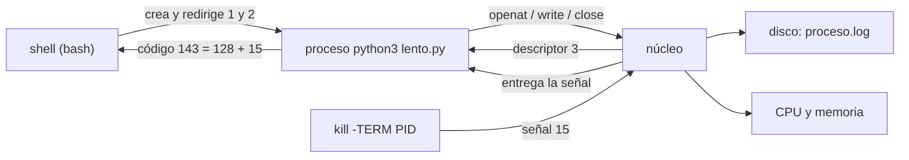
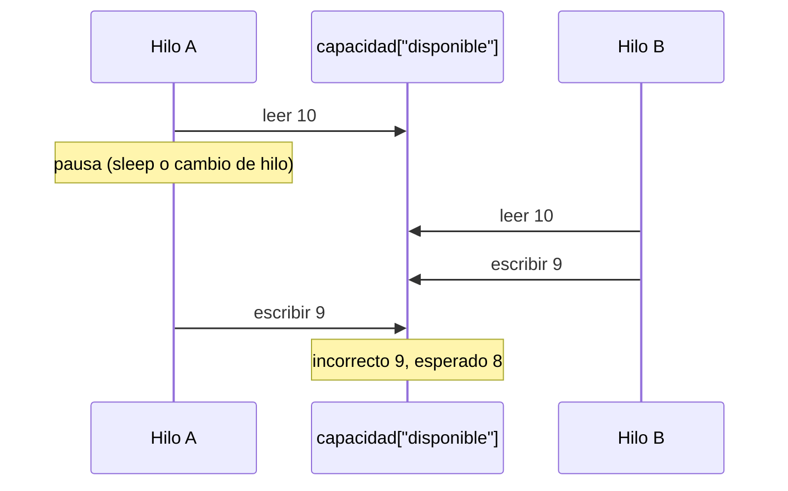
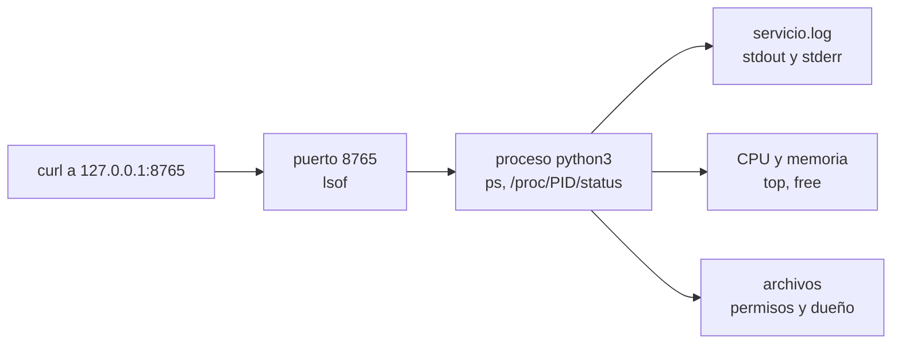
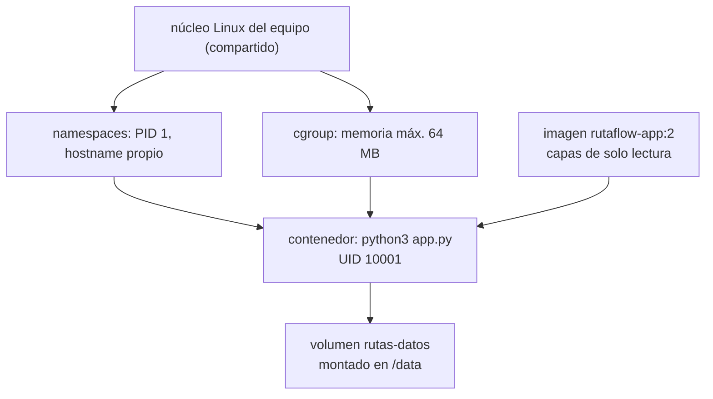
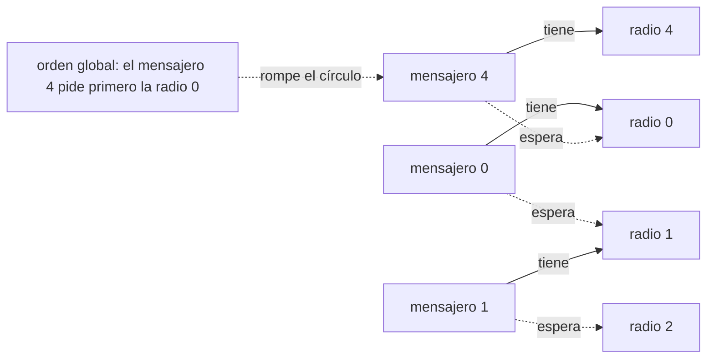

# Módulo 8: Sistemas operativos, concurrencia, Linux y contenedores

**Entorno comprobado para esta edición (2026-11-24):** Python 3.13.18 y bash 5.2.21 en Linux (Ubuntu 24.04, x86_64, 2 núcleos), procps-ng 4.0.4 (`ps`, `top`, `free`), strace 6.8, lsof 4.95.0, curl 8.5.0, Docker Engine 29.9.3 y Docker Compose v5.7.1. Todas las transcripciones son literales y se ejecutaron como el usuario sin privilegios `estudiante`, en `/home/estudiante/labs/m8` (tu `~/labs/m8`). Los PID, las fechas, los identificadores de contenedor y los tiempos medidos cambian en cada máquina. El equipo de referencia no tenía acceso a Docker Hub: por eso la imagen base de las capturas, `rutaflow/python-base:3.13`, se creó localmente con `docker import` a partir del mismo Python 3.13.18. En tu equipo usa `python:3.13-slim`; las salidas de `docker build` con esa imagen no se capturaron. El `compose.yaml` del proyecto se validó con `docker compose config`, pero no se levantó.

Hasta ahora construiste un inventario, lo protegiste con pruebas y seguridad y separaste su arquitectura. En este
módulo miras **debajo** del código: quién entrega CPU y memoria, cómo dos tareas se estorban, cómo investigar un
servicio en Linux y qué hace realmente Docker. El objetivo no es memorizar comandos, sino formar un modelo mental
para diagnosticar sistemas reales.

Al terminar este módulo podrás:
- inspeccionar un proceso, sus descriptores y sus llamadas al sistema, y detenerlo con la señal adecuada;
- reproducir una condición de carrera con hilos y corregirla con una sección crítica mínima;
- diagnosticar un servicio Linux por sus permisos, su puerto, su memoria y su log;
- construir una imagen que se ejecuta sin root, guarda datos en un volumen y respeta un límite de memoria;
- provocar un interbloqueo y eliminarlo con un orden global de recursos.

**Qué necesitas saber antes:** sistema operativo, programa, proceso, PID, terminal y comando (Módulo 0, Tema 1);
shell, argumento y código de salida (Módulo 0, Tema 4); entrada y salida estándar y tubería (Módulo 0, Tema 5);
funciones, clases y `__name__` (Módulo 1); puerto, localhost y cliente y servidor (Módulo 3, Tema 1); SQLite
desde Python (Módulo 4); registro con `logging` (Módulo 5, Tema 1).

**Esquema del módulo:**
1. El sistema operativo como administrador y frontera.
2. Memoria y concurrencia sin magia.
3. Linux como entorno observable.
4. Contenedores: aislamiento reproducible.
5. Problemas clásicos de concurrencia: filósofos y lectores-escritores.
6. Proyecto 8: inventario operable en un contenedor.


## Aprende construyendo


### Tema 1: El sistema operativo como administrador y frontera · Avanzado · 60 min

<details open>
<summary><strong>Capa 1 — Lectura</strong></summary>

#### Objetivos
Al terminar este tema podrás:
- explicar qué hace el núcleo y por qué un programa le pide todo mediante llamadas al sistema;
- lanzar un proceso en segundo plano, inspeccionarlo con `ps` y listar sus descriptores en `/proc`;
- detenerlo con una señal y deducir qué señal recibió a partir de su código de salida;
- escribir un programa que atienda `SIGTERM` y se apague sin dejar trabajo a medias.

**Conceptos clave:** núcleo, llamada al sistema, descriptor de archivo, redirección, proceso en segundo plano, señal, ps, kill

#### El problema
El cálculo de rutas de RutaFlow tarda varios minutos con miles de paradas. La coordinadora lo deja corriendo en el
servidor y sigue trabajando en la misma terminal. Luego necesita saber si sigue vivo, dónde escribe sus mensajes y
cómo detenerlo sin dañar los datos. Ver solo el archivo `.py` no responde ninguna de esas preguntas.

Este tema usa lo que ya conoces: **sistema operativo**, **proceso**, **PID** y **terminal** tienen ficha en el
Módulo 0, Tema 1; **shell** y **código de salida**, en el Módulo 0, Tema 4; **entrada estándar y salida estándar**,
en el Módulo 0, Tema 5. Aquí no se redefinen.

#### Glosario del tema

**núcleo (kernel)**
- **Definición técnica:** parte del sistema operativo que se ejecuta con privilegio máximo; controla CPU, memoria y dispositivos y atiende las peticiones de los procesos.
- **En palabras sencillas:** el único empleado con llave de todas las salas; los demás le piden lo que necesitan.
- **Dónde se rompe la comparación:** no aparece en `ps` como un proceso más; trabaja por debajo de todos ellos.
- **Ejemplo:** `uname -r` muestra su versión; en el equipo de referencia, `6.18.44-fc-v819`.
- **Error típico:** creer que Python escribe directamente en el disco; siempre se lo pide al núcleo.

**llamada al sistema**
- **Definición técnica:** petición formal que un proceso hace al núcleo para usar un recurso protegido: abrir un archivo (`openat`), escribir (`write`), cerrar (`close`) o crear procesos.
- **En palabras sencillas:** un trámite en ventanilla: el proceso no entra al archivero; pide y el núcleo responde.
- **Dónde se rompe la comparación:** un trámite tarda minutos; una llamada tarda microsegundos, aunque cuesta más que una suma.
- **Ejemplo:** `print("registro guardado")` terminó en `write(1</dev/pts/0>, "registro guardado\n", 18) = 18` (Problema resuelto 1.2).
- **Error típico:** buscar el fallo en Python cuando lo rechazó el núcleo: `Permission denied` es la respuesta del núcleo.

**descriptor de archivo**
- **Definición técnica:** número entero que el núcleo entrega a un proceso al abrir un archivo, una terminal o una conexión; el proceso lo usa en las llamadas siguientes.
- **En palabras sencillas:** la ficha del guardarropa: entregas la ficha 3 y te devuelven tu abrigo.
- **Dónde se rompe la comparación:** cada proceso tiene su propia numeración; el 3 de un proceso no es el 3 de otro.
- **Ejemplo:** todo proceso nace con 0 (entrada estándar), 1 (salida estándar) y 2 (salida de errores, *stderr*); el siguiente archivo abierto recibe el 3.
- **Error típico:** abrir archivos sin cerrarlos; al llegar al límite aparece `OSError: [Errno 24] Too many open files: 'a.txt'`.

**redirección**
- **Definición técnica:** instrucción del shell que conecta un descriptor del proceso con un archivo antes de ejecutarlo: `>` redirige el 1, `2>` el 2 y `2>&1` envía el 2 adonde ya apunta el 1.
- **En palabras sencillas:** cambiar la dirección del correo: lo que iba a la terminal llega a un archivo.
- **Dónde se rompe la comparación:** el programa no se entera del cambio; sigue escribiendo en su descriptor 1.
- **Ejemplo:** con `python3 lento.py > proceso.log 2>&1 &`, los descriptores 1 y 2 apuntan a `proceso.log`.
- **Error típico:** invertir el orden (`2>&1 > proceso.log`): los errores siguen saliendo por la terminal.

**proceso en segundo plano**
- **Definición técnica:** proceso lanzado con `&` al final del comando; el shell no espera a que termine y devuelve el control de inmediato. La variable `$!` guarda su PID.
- **En palabras sencillas:** dejar la lavadora funcionando mientras haces otra cosa en la casa.
- **Dónde se rompe la comparación:** si cierras la terminal, el shell suele terminar también sus procesos en segundo plano.
- **Ejemplo:** al lanzar `lento.py`, bash respondió `[1] 4486`: trabajo número 1, PID 4486.
- **Error típico:** escribir `print` sin `flush=True` y ver el log vacío: Python guarda el texto en memoria hasta acumular suficiente.

**señal**
- **Definición técnica:** notificación asíncrona que el núcleo entrega a un proceso. Cada una tiene nombre y número: `SIGINT` (2) es Ctrl+C, `SIGKILL` (9) obliga a terminar y `SIGTERM` (15) lo pide.
- **En palabras sencillas:** un timbre: `SIGTERM` dice «por favor, cierra»; `SIGKILL` es cortar la luz.
- **Dónde se rompe la comparación:** `SIGKILL` no se puede atender ni ignorar; el proceso no alcanza a guardar nada.
- **Ejemplo:** tras `kill -TERM`, `echo $?` mostró `143`, es decir 128 + 15.
- **Error típico:** usar `kill -9` como primera opción: el proceso muere sin cerrar archivos ni terminar el envío en curso.

**ps y kill**
- **Definición técnica:** `ps` lista procesos con las columnas que pides (`-o pid,ppid,stat,etime,command`); `kill` envía una señal a un PID, por defecto `SIGTERM`.
- **En palabras sencillas:** `ps` es la lista de asistencia; `kill` es el timbre de una puerta concreta.
- **Dónde se rompe la comparación:** pese al nombre, `kill` solo entrega la señal; el proceso decide qué hacer, salvo con `SIGKILL`.
- **Ejemplo:** `ps -o pid,ppid,stat,etime,command -p "$PID"` mostró el estado `S` (dormido) y como padre el PID de la terminal.
- **Error típico:** usar un PID viejo: `kill -TERM 999999` responde `bash: kill: (999999) - No such process`.

#### ► CÓMO FUNCIONA
El sistema operativo tiene dos zonas. En la zona de usuario viven los procesos: tu programa, la terminal, el shell.
En la zona del núcleo vive el único código que toca el hardware. La frontera entre ambas son las llamadas al sistema.

1. El shell pide al núcleo crear un proceso y, si hay redirección, conecta sus descriptores 1 y 2 a un archivo.
2. Python abre archivos con `openat`; el núcleo comprueba permisos y devuelve un descriptor, por ejemplo el 3.
3. Cada `print` o `write` se convierte en una llamada `write` sobre un descriptor.
4. Cuando llega una señal, el núcleo interrumpe al proceso: si tiene un manejador, lo ejecuta; si no, lo termina.
5. Al terminar, el núcleo informa al padre un código: si murió por la señal N, el shell muestra 128 + N.



#### Problema resuelto 1.1
Lanza un cálculo de ruta largo en segundo plano, comprueba que vive, mira adónde escribe y detenlo con `SIGTERM`.

**Razonamiento:**
1. Hace falta un programa que tarde: el cálculo `nearest_neighbor_route` con miles de paradas y una pausa inicial.
2. El `&` lo deja en segundo plano; `$!` guarda su PID para no copiarlo a mano.
3. `ps -p` informa su estado; `/proc/PID/fd` muestra a qué apunta cada descriptor.
4. `kill -TERM` lo detiene y `wait` recupera su código de salida.

```python
# domain.py — cálculo de ruta mínimo de RutaFlow
from dataclasses import dataclass
from math import hypot


@dataclass(frozen=True)
class Stop:
    shipment_id: str
    latitude: float
    longitude: float


def nearest_neighbor_route(origin: tuple[float, float], stops: list[Stop]) -> list[Stop]:
    """Heurística educativa O(n²); no afirma encontrar la ruta óptima."""
    remaining = stops.copy()
    ordered = []
    position = origin
    while remaining:
        selected = min(
            remaining,
            key=lambda stop: hypot(stop.latitude - position[0], stop.longitude - position[1]),
        )
        ordered.append(selected)
        remaining.remove(selected)
        position = (selected.latitude, selected.longitude)
    return ordered
```

```python
# lento.py — un cálculo de ruta que tarda lo suficiente para observarlo
import os
import time

from domain import Stop, nearest_neighbor_route

paradas = [Stop(f"RF-{i}", i * 0.01, i * 0.01) for i in range(3000)]
print(f"pid={os.getpid()} paradas={len(paradas)}", flush=True)
time.sleep(30)
ruta = nearest_neighbor_route((0, 0), paradas)
print("primera parada:", ruta[0].shipment_id, flush=True)
```

```text
$ echo $$
4482
$ python3 lento.py > proceso.log 2>&1 &
[1] 4486
$ PID=$!
$ sleep 1
$ ps -o pid,ppid,stat,etime,command -p "$PID"
  PID  PPID STAT     ELAPSED COMMAND
 4486  4482 S          00:01 python3 lento.py
$ cat proceso.log
pid=4486 paradas=3000
$ ls -l /proc/$PID/fd
total 0
lrwx------ 1 estudiante estudiante 64 Nov 24 07:32 0 -> /dev/pts/0
l-wx------ 1 estudiante estudiante 64 Nov 24 07:32 1 -> /home/estudiante/labs/m8/proceso.log
l-wx------ 1 estudiante estudiante 64 Nov 24 07:32 2 -> /home/estudiante/labs/m8/proceso.log
$ kill -TERM "$PID"
$ wait "$PID"
[1]+  Terminated              python3 lento.py > proceso.log 2>&1
$ echo $?
143
```

**Explicación por partes.**
- `domain.py`: es el cálculo de ruta del curso. Con 3000 paradas compara cada parada pendiente en cada paso.
- `lento.py`, línea 7: crea 3000 paradas en diagonal. Línea 8: `flush=True` obliga a escribir ya en `proceso.log`.
- `lento.py`, línea 9: la pausa de 30 segundos te da tiempo de observar el proceso antes de que calcule.
- `echo $$` muestra el PID de la terminal (`4482`); `ps` confirma que es el padre (columna `PPID`).
- `STAT` vale `S`: el proceso duerme dentro de `time.sleep`. `ELAPSED` cuenta el tiempo vivo.
- `/proc/4486/fd` muestra los descriptores: el 0 sigue en la terminal (`/dev/pts/0`) y el 1 y el 2 van al log.
- `wait` espera al hijo y deja su código en `$?`: `143` significa «terminó por la señal 15».

> **Error común.** Enviar una señal a un proceso ajeno. `kill -TERM 1` responde
> `bash: kill: (1) - Operation not permitted`. El PID existe, pero pertenece a otro usuario y el núcleo rechaza la
> petición. Si el mensaje es `No such process`, el problema es otro: ese PID ya no existe.

> **Prevenir errores.** Guarda el PID con `PID=$!` justo después del `&`. Copiar el número a mano es la forma más
> común de detener el proceso equivocado.

#### Problema resuelto 1.2
Comprueba con evidencia que Python no escribe directamente en el disco ni en la terminal: le pide al núcleo.

**Razonamiento:**
1. `strace` registra cada llamada al sistema de un proceso con sus argumentos y su resultado.
2. Un programa pequeño que abre un archivo, escribe y avisa en la terminal produce pocas llamadas interesantes.
3. Con `-o traza.txt` la traza va a un archivo; `grep` filtra las líneas del registro y las escrituras.
4. `-y` muestra a qué ruta apunta cada descriptor, así no hay que adivinarlo.

```python
# guardar.py — registra una entrega en un archivo y avisa en la terminal
with open("entregas.txt", "a", encoding="utf-8") as archivo:
    archivo.write("RF-4471 entregado\n")
print("registro guardado")
```

```text
$ strace -y -o traza.txt -e trace=openat,write,close python3 guardar.py
registro guardado
$ grep -E 'entregas|write' traza.txt
openat(AT_FDCWD</home/estudiante/labs/m8>, "entregas.txt", O_WRONLY|O_CREAT|O_APPEND|O_CLOEXEC, 0666) = 3</home/estudiante/labs/m8/entregas.txt>
write(3</home/estudiante/labs/m8/entregas.txt>, "RF-4471 entregado\n", 18) = 18
close(3</home/estudiante/labs/m8/entregas.txt>) = 0
write(1</dev/pts/0>, "registro guardado\n", 18) = 18
$ wc -l traza.txt
87 traza.txt
```

**Explicación por partes.**
- Línea 2: `open(..., "a")` se convierte en `openat` con `O_APPEND` (agregar al final) y `O_CREAT` (crear si falta).
- El núcleo responde `= 3`: el primer descriptor libre después de 0, 1 y 2.
- Línea 3: `archivo.write` termina en `write(3, ...)`; el `= 18` confirma que escribió 18 bytes.
- Al salir del bloque `with`, Python llama a `close(3)` y el núcleo libera el descriptor.
- Línea 4: `print` es un `write` sobre el descriptor 1, que apunta a la terminal.
- `wc -l` cuenta 87 líneas: casi todas son el arranque de Python abriendo sus propios módulos.

> **Buena práctica.** Cuando un programa «no encuentra» un archivo que sí existe, mira la llamada `openat` en la
> traza. Muestra la ruta exacta que pidió y la respuesta del núcleo, sin suposiciones.

#### Problema resuelto 1.3
Haz que el procesador de envíos atienda `SIGTERM`: debe terminar el envío en curso, informar y salir con código 0.

**Razonamiento:**
1. `signal.signal` registra una función que el intérprete ejecuta cuando llega la señal.
2. La función no corta el trabajo: solo marca `detener = True`.
3. El bucle revisa la marca entre envíos; así nunca se interrumpe un envío a la mitad.
4. Para comparar, se envía `SIGKILL` a `lento.py`, que no puede atenderla.

```python
# apagado.py — procesa envíos y se detiene limpio al recibir SIGTERM
import os
import signal
import time

detener = False


def pedir_detencion(numero_senal, marco):
    global detener
    print(f"señal {signal.Signals(numero_senal).name} recibida; termino el envío actual", flush=True)
    detener = True


signal.signal(signal.SIGTERM, pedir_detencion)
print(f"pid={os.getpid()} procesando envíos", flush=True)
procesados = 0
while not detener:
    time.sleep(0.5)  # simula procesar un envío
    procesados += 1
print(f"apagado limpio: {procesados} envíos procesados", flush=True)
```

```text
$ python3 apagado.py > apagado.log &
[1] 4435
$ PID=$!
$ sleep 2
$ kill -TERM "$PID"
$ wait "$PID"
[1]+  Done                    python3 apagado.py > apagado.log
$ echo $?
0
$ cat apagado.log
pid=4435 procesando envíos
señal SIGTERM recibida; termino el envío actual
apagado limpio: 4 envíos procesados
$ python3 lento.py > proceso.log 2>&1 &
[1] 4438
$ PID=$!
$ sleep 1
$ kill -KILL "$PID"
$ wait "$PID"
[1]+  Killed                  python3 lento.py > proceso.log 2>&1
$ echo $?
137
```

**Explicación por partes.**
- Línea 9: el manejador recibe el número de la señal y el marco de ejecución; aquí solo se usa el número.
- Línea 10: `global` permite cambiar la variable `detener` del módulo desde la función.
- Línea 15: registra el manejador. Sin esta línea, `SIGTERM` terminaría el proceso con código 143.
- Líneas 18–20: el bucle revisa `detener` antes de cada envío; el envío en curso siempre termina.
- `Done` y código `0`: el proceso salió por su cuenta. `Killed` y `137` (128 + 9): lo terminó el núcleo.

> **Error común.** Esperar que `SIGKILL` ejecute el manejador. Bash informa `Killed` y el código es `137`; la línea
> «apagado limpio» nunca se escribe. Ningún programa puede atender `SIGKILL`.

> **Buena práctica.** Detén servicios con `SIGTERM`, espera unos segundos y usa `SIGKILL` solo si no responde.
> Docker y los orquestadores siguen la misma secuencia al apagar un contenedor.

#### Checkpoint 1.1
Un proceso de RutaFlow termina y `echo $?` muestra `137`. ¿Qué señal recibió y quién pudo enviarla?

Respuesta: `SIGKILL` (137 − 128 = 9). La envió alguien con `kill -KILL` o el propio núcleo, por ejemplo al superar
un límite de memoria (lo verás en el Tema 4).

</details>

<details>
<summary><strong>Capa 2 — Construcción</strong></summary>

#### Paso 1 · Prepara la carpeta
Ejecuta `mkdir -p ~/labs/m8 && cd ~/labs/m8`. Crea `domain.py` y `lento.py` con el código del Problema resuelto 1.1.

#### Paso 2 · Lanza y observa
Ejecuta `echo $$`, luego `python3 lento.py > proceso.log 2>&1 &` y `PID=$!`. Ejecuta el `ps` del problema resuelto y
comprueba que el `PPID` coincide con el número de `echo $$`.

#### Paso 3 · Mira los descriptores
Ejecuta `ls -l /proc/$PID/fd` antes de que pasen 30 segundos. Comprueba que el 1 y el 2 apuntan a `proceso.log`.
En macOS no existe `/proc`; usa `lsof -p $PID`.

#### Paso 4 · Detén y lee el código
Ejecuta `kill -TERM "$PID"`, `wait "$PID"` y `echo $?`. Debes ver `143`.

#### Paso 5 · Traza las llamadas al sistema
Crea `guardar.py` y ejecuta el `strace` del Problema resuelto 1.2. Si responde `command not found`, instálalo con
`sudo apt install strace`. En macOS no hay `strace`; el equivalente aproximado es `dtruss`, que exige permisos extra.

#### Paso 6 · Apaga limpio
Crea `apagado.py`, lánzalo en segundo plano y envíale `SIGTERM` a los dos segundos. Revisa `apagado.log` y el código.

#### Resumen
- El **núcleo** es la parte privilegiada del sistema operativo; los procesos le piden todo con **llamadas al sistema**.
- Un **descriptor de archivo** es el número que identifica un archivo abierto dentro de un proceso: 0, 1 y 2 vienen de fábrica.
- La **redirección** (`>`, `2>&1`) cambia adónde apuntan los descriptores sin que el programa se entere.
- Un **proceso en segundo plano** (`&`) libera la terminal; `$!` guarda su PID.
- Una **señal** pide (`SIGTERM`) u obliga (`SIGKILL`) a terminar; el código 128 + N delata la señal N.
- **ps** muestra estado y padre de un proceso; **kill** entrega una señal, no necesariamente lo mata.

#### Ejercicio verificable 1
Básico. Ejecuta `python3 lento.py` en primer plano y pulsa Ctrl+C antes de 30 segundos. ¿Qué código de salida
muestra `echo $?` y por qué?

Respuesta esperada: `130`. Ctrl+C envía `SIGINT` (2) y 128 + 2 = 130. Antes, Python muestra un traceback que
termina en `KeyboardInterrupt`, señalando la línea 9 (`time.sleep(30)`).

#### Ejercicio verificable 2
Intermedio. Escribe `dos_archivos.py`, que abra `a.txt` y `b.txt` a la vez y muestre el descriptor de cada uno con
`archivo.fileno()`. Predice los números antes de ejecutar.

Respuesta esperada: `a.txt -> 3 | b.txt -> 4`. El núcleo entrega el menor descriptor libre, y 0, 1 y 2 ya están
ocupados por la entrada, la salida y la salida de errores.

#### Ejercicio verificable 3
Reto. Modifica `apagado.py` para que también atienda Ctrl+C con el mismo manejador. Pruébalo y explica el código de
salida.

Respuesta esperada: agrega `signal.signal(signal.SIGINT, pedir_detencion)` después de la línea 15. Al pulsar
Ctrl+C se imprime `señal SIGINT recibida; termino el envío actual`, luego «apagado limpio» y el código es `0`.

#### En el trabajo
En los servidores de RutaFlow, los servicios se detienen con `SIGTERM` durante cada despliegue. Un servicio que no lo
atiende pierde los envíos en curso o deja archivos a medias. Ante un fallo raro, el equipo de operaciones revisa
`ps`, los descriptores en `/proc` y, si hace falta, una traza con `strace`.

</details>

### Tema 2: Memoria y concurrencia sin magia · Avanzado · 70 min

<details open>
<summary><strong>Capa 1 — Lectura</strong></summary>

#### Objetivos
Al terminar este tema podrás:
- demostrar que los hilos de un proceso comparten memoria y que dos procesos no;
- distinguir concurrencia de paralelismo midiendo el mismo trabajo con hilos y con procesos;
- provocar una condición de carrera real con hilos de Python y explicar el valor incorrecto;
- corregirla con un `Lock` alrededor de la sección crítica mínima y con una actualización atómica en SQLite.

**Conceptos clave:** hilo, memoria compartida, concurrencia, paralelismo, GIL, condición de carrera, sección crítica, lock

#### El problema
Un vehículo de RutaFlow tiene 10 lugares. Diez repartidores reservan un lugar al mismo tiempo desde la aplicación.
Cada reserva lee los lugares libres, resta uno y guarda el resultado. Al final deberían quedar 0 lugares, pero el
sistema dice que quedan 9. Nadie cambió el código: solo llegaron todos a la vez.

Este tema usa **proceso** y **PID** (Módulo 0, Tema 1), **función** (Módulo 1, Tema 4), **`__name__` y el bloque
principal** (Módulo 1, Tema 4) y **perf_counter** (Módulo 2, Tema 2). Aquí no se redefinen.

#### Glosario del tema

**hilo**
- **Definición técnica:** secuencia de ejecución dentro de un proceso; todos los hilos de un proceso comparten su memoria y sus descriptores, pero cada uno tiene su propia pila de llamadas.
- **En palabras sencillas:** varios cocineros en la misma cocina, usando la misma despensa.
- **Dónde se rompe la comparación:** los cocineros se ven y se avisan; los hilos no saben nada del otro salvo que tú los coordines.
- **Ejemplo:** `Thread(target=registrar, args=("RF-1",))` crea un hilo que ejecuta `registrar("RF-1")` al llamar a `start()`.
- **Error típico:** olvidar `join()`: el programa principal imprime el resultado antes de que los hilos terminen.

**memoria compartida**
- **Definición técnica:** región de memoria que varios flujos de ejecución pueden leer y escribir; los hilos de un proceso la comparten por defecto, los procesos no.
- **En palabras sencillas:** una pizarra en la pared de la cocina: lo que uno escribe, los demás lo ven.
- **Dónde se rompe la comparación:** en una pizarra ves a alguien escribiendo; en memoria, dos escrituras pueden pisarse sin rastro.
- **Ejemplo:** en `memoria.py`, el hilo agrega `RF-1` y el principal lo ve; el proceso hijo agrega `RF-2` y el principal no.
- **Error típico:** esperar que un proceso hijo modifique una lista del padre: trabaja sobre su propia copia.

**concurrencia**
- **Definición técnica:** propiedad de un programa con varias tareas en curso cuyos pasos pueden intercalarse en cualquier orden, avancen o no al mismo instante.
- **En palabras sencillas:** un cocinero que alterna entre tres ollas: todas avanzan, pero atiende una a la vez.
- **Dónde se rompe la comparación:** el cocinero elige cuándo cambiar de olla; el planificador del sistema decide por ti.
- **Ejemplo:** los dos hilos de `paralelo.py` son concurrentes: ambos avanzan, pero tardan lo mismo que hacerlo en secuencia.
- **Error típico:** creer que más hilos siempre terminan antes.

**paralelismo**
- **Definición técnica:** ejecución simultánea de varias tareas en distintos núcleos de CPU en el mismo instante.
- **En palabras sencillas:** dos cocineros con dos estufas: cada uno cocina su olla al mismo tiempo.
- **Dónde se rompe la comparación:** repartir y juntar el trabajo cuesta tiempo; dos núcleos casi nunca dan la mitad exacta.
- **Ejemplo:** en `paralelo.py`, dos procesos hicieron en 0.81 s lo que en secuencia tardó 1.51 s.
- **Error típico:** esperar paralelismo de una tarea que espera disco o red; ahí la CPU no es el límite.

**GIL**
- **Definición técnica:** *Global Interpreter Lock*; candado del intérprete CPython que permite a un solo hilo ejecutar código Python a la vez dentro de un proceso.
- **En palabras sencillas:** una sola cuchara para todos los cocineros de la cocina: se turnan para revolver.
- **Dónde se rompe la comparación:** el GIL se suelta al esperar disco, red o `time.sleep`; ahí otros hilos sí avanzan.
- **Ejemplo:** `python3 -c "import sys; print(sys._is_gil_enabled())"` muestra `True` en el equipo de referencia.
- **Error típico:** creer que el GIL evita las condiciones de carrera; el Problema resuelto 2.3 demuestra lo contrario.

**condición de carrera**
- **Definición técnica:** defecto en el que el resultado depende del orden en que se intercalan operaciones concurrentes sobre un dato compartido.
- **En palabras sencillas:** dos personas leen «quedan 10», cada una escribe «quedan 9», y una reserva desaparece.
- **Dónde se rompe la comparación:** entre personas se nota; en un programa el error aparece a veces y casi nunca en tu equipo.
- **Ejemplo:** `carrera.py 0.001` mostró `lugares disponibles: 9 (esperado: 0)`.
- **Error típico:** dar por correcto un programa porque pasó tres ejecuciones seguidas.

**sección crítica**
- **Definición técnica:** fragmento de código que accede a un dato compartido y debe ejecutarse por un solo hilo a la vez para mantener el dato válido.
- **En palabras sencillas:** el baño con una sola llave: mientras alguien está adentro, los demás esperan.
- **Dónde se rompe la comparación:** la sección debe incluir lectura y escritura juntas; proteger solo una no sirve.
- **Ejemplo:** en `carrera_lock.py`, las líneas 13–15 (leer, pausar, escribir) forman la sección crítica.
- **Error típico:** hacerla enorme: si incluye trabajo que no toca el dato, los hilos esperan sin necesidad.

**lock (cerrojo)**
- **Definición técnica:** objeto de sincronización (`threading.Lock`) con dos operaciones: `acquire` lo toma o espera hasta que esté libre, y `release` lo libera. `with` hace ambas cosas.
- **En palabras sencillas:** la llave del baño: quien la tiene entra; los demás hacen fila.
- **Dónde se rompe la comparación:** cualquiera puede devolver la llave aunque no la tenga, y Python lo trata como error.
- **Ejemplo:** `with candado:` en `carrera_lock.py` deja `lugares disponibles: 0 (esperado: 0)`.
- **Error típico:** liberar un lock que nadie tomó: `RuntimeError: release unlocked lock`.

#### ► CÓMO FUNCIONA
Restar un lugar parece una sola operación, pero son tres: **leer** el valor, **calcular** el nuevo y **escribirlo**.
Si un hilo pierde la CPU entre leer y escribir, otro hilo lee el mismo valor viejo. Las dos escrituras guardan el
mismo resultado y una reserva se pierde.

1. El hilo A lee 10 y el planificador lo pausa.
2. El hilo B lee 10, calcula 9 y escribe 9.
3. El hilo A despierta, calcula 9 con su valor viejo y escribe 9.
4. Hubo dos reservas, pero el contador solo bajó una vez.

Un lock convierte los tres pasos en una sección crítica: B no puede leer hasta que A haya escrito.



#### Problema resuelto 2.1
Demuestra que un hilo ve los cambios del programa principal y que un proceso hijo no.

**Razonamiento:**
1. Una lista global sirve de dato compartido.
2. Un hilo y un proceso hijo ejecutan la misma función, que agrega una guía y muestra cuántas ve.
3. Al final, el principal muestra la lista: solo contendrá lo que agregaron quienes comparten su memoria.

```python
# memoria.py — los hilos comparten memoria; los procesos no
import os
from multiprocessing import Process
from threading import Thread

entregas = []


def registrar(guia):
    entregas.append(guia)
    print(f"PID {os.getpid()} agregó {guia}; ve {len(entregas)} entrega(s)")


if __name__ == "__main__":
    print(f"proceso principal PID {os.getpid()}")
    hilo = Thread(target=registrar, args=("RF-1",))
    hilo.start()
    hilo.join()
    hijo = Process(target=registrar, args=("RF-2",))
    hijo.start()
    hijo.join()
    print("el principal ve:", entregas)
```

```text
$ python3 memoria.py
proceso principal PID 4563
PID 4563 agregó RF-1; ve 1 entrega(s)
PID 4565 agregó RF-2; ve 2 entrega(s)
el principal ve: ['RF-1']
```

**Explicación por partes.**
- Líneas 16–18: el hilo corre dentro del mismo proceso; por eso informa el mismo PID 4563.
- Líneas 19–21: `Process` crea un proceso nuevo (PID 4565) con una **copia** de la memoria del padre.
- El hijo ve 2 entregas porque su copia ya traía `RF-1`; su `RF-2` queda solo en esa copia.
- Línea 22: el principal ve `['RF-1']`. Lo que hizo el hijo desapareció al terminar.
- Línea 14: `multiprocessing` necesita el bloque principal para no repetir el arranque en cada hijo.

#### Problema resuelto 2.2
Mide si dos hilos o dos procesos terminan antes que hacer dos cálculos seguidos en una CPU de 2 núcleos.

**Razonamiento:**
1. Un cálculo que solo usa CPU (sumar restos) evita esperas de disco o red.
2. Se mide primero en secuencia, luego con dos hilos y luego con dos procesos.
3. Si los hilos fueran paralelos, tardarían cerca de la mitad.

```python
# paralelo.py — mismo trabajo con hilos y con procesos en una CPU de 2 núcleos
import time
from multiprocessing import Process
from threading import Thread


def calcular(n=20_000_000):
    total = 0
    for i in range(n):
        total += i % 7
    return total


def medir(clase):
    trabajadores = [clase(target=calcular) for _ in range(2)]
    inicio = time.perf_counter()
    for t in trabajadores:
        t.start()
    for t in trabajadores:
        t.join()
    return time.perf_counter() - inicio


if __name__ == "__main__":
    inicio = time.perf_counter()
    calcular()
    calcular()
    print(f"secuencial:   {time.perf_counter() - inicio:.2f} s")
    print(f"dos hilos:    {medir(Thread):.2f} s")
    print(f"dos procesos: {medir(Process):.2f} s")
```

```text
$ nproc
2
$ python3 paralelo.py
secuencial:   1.51 s
dos hilos:    1.50 s
dos procesos: 0.81 s
$ python3 -c "import sys; print(sys._is_gil_enabled())"
True
```

**Explicación por partes.**
- Línea 14: `medir` recibe la clase (`Thread` o `Process`); ambas tienen `start` y `join`, así sirve para las dos.
- Dos hilos tardan lo mismo que la secuencia: hay concurrencia, pero el GIL deja avanzar a uno a la vez.
- Dos procesos tienen cada uno su intérprete y su GIL; usan los dos núcleos y bajan a 0.81 s.
- No llega a la mitad exacta (0.75 s): crear procesos y repartir el trabajo cuesta tiempo.

> **Rendimiento.** Para trabajo de CPU en Python con GIL, usa procesos. Para trabajo que espera red o disco, los
> hilos sí ayudan, porque el GIL se libera durante la espera.

#### Problema resuelto 2.3
Reproduce la reserva simultánea del vehículo y obtén un resultado incorrecto con hilos reales de Python.

**Razonamiento:**
1. Diez hilos ejecutan la reserva: leer, esperar un instante, escribir.
2. La pausa entre leer y escribir representa cualquier trabajo intermedio (consultar otra tabla, registrar un log).
3. Un argumento permite elegir la pausa y repetir el experimento.
4. Como control, un contador sin pausas, para ver que «funciona en mi equipo» no prueba nada.

```python
# carrera.py — diez repartidores reservan un lugar del mismo vehículo a la vez
import sys
import time
from threading import Thread

capacidad = {"disponible": 10}
pausa = float(sys.argv[1]) if len(sys.argv) > 1 else 0.0


def reservar_lugar():
    actual = capacidad["disponible"]          # 1. leer
    time.sleep(pausa)                         # 2. el hilo puede ser interrumpido aquí
    capacidad["disponible"] = actual - 1      # 3. escribir


hilos = [Thread(target=reservar_lugar) for _ in range(10)]
for h in hilos:
    h.start()
for h in hilos:
    h.join()
print("lugares disponibles:", capacidad["disponible"], "(esperado: 0)")
```

```python
# contador.py — cuatro hilos suman 1 un millón de veces cada uno, sin pausas
from threading import Thread

total = 0


def sumar():
    global total
    for _ in range(1_000_000):
        total += 1


hilos = [Thread(target=sumar) for _ in range(4)]
for h in hilos:
    h.start()
for h in hilos:
    h.join()
print(f"total = {total:,} (esperado: 4,000,000)")
```

```text
$ python3 carrera.py
lugares disponibles: 3 (esperado: 0)
$ for i in 1 2 3 4 5; do python3 carrera.py 0.001; done
lugares disponibles: 9 (esperado: 0)
lugares disponibles: 9 (esperado: 0)
lugares disponibles: 9 (esperado: 0)
lugares disponibles: 9 (esperado: 0)
lugares disponibles: 9 (esperado: 0)
$ for i in 1 2 3; do python3 contador.py; done
total = 4,000,000 (esperado: 4,000,000)
total = 4,000,000 (esperado: 4,000,000)
total = 4,000,000 (esperado: 4,000,000)
```

**Explicación por partes.**
- `carrera.py`, línea 7: `sys.argv[1]` es la pausa en segundos; sin argumento vale `0.0`.
- Líneas 11–13: los tres pasos separados. `time.sleep` suelta el GIL, así que otro hilo entra justo ahí.
- Con pausa `0.0` quedaron 3: hasta `sleep(0)` cede el turno, y el resultado cambia en cada ejecución.
- Con pausa `0.001`, los diez hilos leen 10 antes de que alguno escriba; todos escriben 9.
- `contador.py` dio el total correcto tres veces. Eso no lo hace seguro: solo muestra que aquí la ventana es pequeña.

> **Error común.** Compartir una conexión de SQLite entre hilos. El hilo termina con
> `sqlite3.ProgrammingError: SQLite objects created in a thread can only be used in that same thread. The object was created in thread id 140302570673984 and this is thread id 140302564476608.`
> Abre una conexión por hilo, como en el Problema resuelto 2.5.

> **Prevenir errores.** Para probar código concurrente, agranda la ventana a propósito con una pausa entre leer y
> escribir, y repite la prueba muchas veces. Un error que aparece «a veces» en producción aparece siempre así.

#### Problema resuelto 2.4
Corrige `carrera.py` para que cualquier pausa deje 0 lugares, y mide el costo de la corrección.

**Razonamiento:**
1. El dato compartido es `capacidad["disponible"]`; leerlo y escribirlo debe ocurrir sin interrupciones de otro hilo.
2. Un `Lock` global protege esos tres pasos: es la sección crítica mínima.
3. Con la pausa dentro de la sección, los hilos se forman en fila: el tiempo debería ser cercano a 10 × pausa.

```python
# carrera_lock.py — la misma reserva, protegida con un lock
import sys
import time
from threading import Lock, Thread

capacidad = {"disponible": 10}
pausa = float(sys.argv[1]) if len(sys.argv) > 1 else 0.0
candado = Lock()


def reservar_lugar():
    with candado:                                 # solo un hilo a la vez entra aquí
        actual = capacidad["disponible"]
        time.sleep(pausa)
        capacidad["disponible"] = actual - 1


hilos = [Thread(target=reservar_lugar) for _ in range(10)]
inicio = time.perf_counter()
for h in hilos:
    h.start()
for h in hilos:
    h.join()
print("lugares disponibles:", capacidad["disponible"], "(esperado: 0)")
print(f"tiempo: {time.perf_counter() - inicio:.3f} s")
```

```text
$ for i in 1 2 3; do python3 carrera_lock.py 0.001; done
lugares disponibles: 0 (esperado: 0)
tiempo: 0.012 s
lugares disponibles: 0 (esperado: 0)
tiempo: 0.012 s
lugares disponibles: 0 (esperado: 0)
tiempo: 0.012 s
```

**Explicación por partes.**
- Línea 8: un único `Lock` compartido por todos los hilos. Un lock por hilo no protegería nada.
- Línea 12: `with candado` llama a `acquire` al entrar y a `release` al salir, incluso si hay una excepción.
- Líneas 13–15: leer, pausar y escribir quedan juntos; ningún otro hilo lee un valor viejo.
- El tiempo, 0.012 s, es casi 10 × 0.001 s: la corrección convierte la concurrencia en una fila.

> **Buena práctica.** Usa siempre `with candado:` en lugar de `acquire()` y `release()` sueltos. Si el código de
> adentro lanza una excepción, `with` libera el lock igual; con llamadas manuales el lock queda tomado para siempre.

#### Problema resuelto 2.5
El inventario guarda el stock en SQLite. Doce pedidos retiran una unidad de un producto con 10 en stock. Garantiza
que se acepten exactamente 10 y que el stock nunca sea negativo.

**Razonamiento:**
1. Leer el stock en Python y luego escribirlo repetiría la carrera de `carrera.py`.
2. Un solo `UPDATE ... WHERE stock >= ?` lee, compara y escribe dentro de la base, en una sola sentencia atómica.
3. Si ninguna fila cumple la condición, `rowcount` vale 0: el pedido se rechaza.
4. Cada hilo abre su propia conexión; el contador de resultados también es compartido y va bajo el lock.

```python
# retiro_sql.py — doce pedidos retiran stock de la misma fila en SQLite
import sqlite3
from threading import Lock, Thread

lock = Lock()
resultados = {"ok": 0, "rechazado": 0}


def retirar(conexion, producto_id, cantidad):
    with lock, conexion:
        cursor = conexion.execute(
            "UPDATE productos SET stock = stock - ? "
            "WHERE id = ? AND stock >= ?",
            (cantidad, producto_id, cantidad),
        )
        if cursor.rowcount != 1:
            raise ValueError("stock insuficiente")


def pedido():
    conexion = sqlite3.connect("stock.db")
    try:
        retirar(conexion, 1, 1)
        estado = "ok"
    except ValueError:
        estado = "rechazado"
    finally:
        conexion.close()
    with lock:
        resultados[estado] += 1


with sqlite3.connect("stock.db") as base:
    base.execute("DROP TABLE IF EXISTS productos")
    base.execute("CREATE TABLE productos (id INTEGER PRIMARY KEY, stock INTEGER NOT NULL)")
    base.execute("INSERT INTO productos VALUES (1, 10)")

hilos = [Thread(target=pedido) for _ in range(12)]
for h in hilos:
    h.start()
for h in hilos:
    h.join()
final = sqlite3.connect("stock.db").execute("SELECT stock FROM productos WHERE id = 1").fetchone()[0]
print(resultados, "stock final:", final)
```

```text
$ python3 retiro_sql.py
{'ok': 10, 'rechazado': 2} stock final: 0
$ python3 retiro_sql.py
{'ok': 10, 'rechazado': 2} stock final: 0
```

**Explicación por partes.**
- Línea 10: `with lock, conexion` toma el lock y abre una transacción; al salir confirma los cambios y libera el lock.
- Líneas 12–13: la condición `stock >= ?` va dentro del `UPDATE`; la base nunca deja el stock en negativo.
- Línea 16: `rowcount` dice cuántas filas cambió; 0 significa que no había stock.
- Línea 21: cada hilo abre su propia conexión, como exige SQLite.
- Líneas 29–30: `resultados` también es memoria compartida; su suma va bajo el mismo lock.
- La condición en SQL protege incluso contra otros procesos; el lock solo coordina los hilos de este proceso.

#### Checkpoint 2.1
En `carrera_lock.py` mueves `time.sleep(pausa)` fuera del `with`, antes de él. ¿Sigue siendo correcto el resultado?
¿Cambia el tiempo?

Respuesta: sigue siendo correcto, porque leer y escribir quedan juntos dentro del lock. El tiempo baja, porque las
pausas ocurren a la vez fuera de la sección crítica. Con `0.01`, el equipo de referencia pasó de `0.103 s` a
`0.023 s`: por eso conviene que la sección sea mínima.

</details>

<details>
<summary><strong>Capa 2 — Construcción</strong></summary>

#### Paso 1 · Comparte y separa memoria
En `~/labs/m8`, crea `memoria.py` y ejecútalo. Comprueba que el hilo informa el mismo PID que el principal.

#### Paso 2 · Mide concurrencia y paralelismo
Ejecuta `nproc` para saber cuántos núcleos tienes y luego `python3 paralelo.py`. Con un solo núcleo, los procesos
no mejoran; con cuatro, puedes cambiar `range(2)` por `range(4)` y comparar.

#### Paso 3 · Provoca la carrera
Crea `carrera.py` y ejecuta el bucle `for` con pausa `0.001`. Anota los cinco resultados.

#### Paso 4 · Corrígela
Crea `carrera_lock.py` y repite el bucle. Todos los resultados deben ser 0.

#### Paso 5 · Deja que la base decida
Crea `retiro_sql.py` y ejecútalo dos veces. Abre `stock.db` con `sqlite3 stock.db "SELECT * FROM productos"` y
confirma que el stock es 0.

#### Resumen
- Un **hilo** ejecuta dentro de un proceso y comparte su memoria; un proceso hijo trabaja sobre una copia.
- La **memoria compartida** es lo que permite a los hilos colaborar y, a la vez, estorbarse.
- **Concurrencia** es intercalar tareas; **paralelismo** es ejecutarlas en el mismo instante en varios núcleos.
- Con el **GIL**, los hilos de CPython no aceleran trabajo de CPU; los procesos sí.
- Una **condición de carrera** aparece cuando leer y escribir un dato compartido pueden intercalarse.
- Un **lock** alrededor de la **sección crítica** mínima la elimina; en una base, una sentencia `UPDATE ... WHERE` atómica.

#### Ejercicio verificable 1
Básico. Ejecuta `python3 carrera_lock.py 0.01`. Antes, predice el tiempo.

Respuesta esperada: `lugares disponibles: 0 (esperado: 0)` y un tiempo cercano a 0.1 s (en el equipo de
referencia, `0.103 s`): diez hilos en fila con 0.01 s cada uno.

#### Ejercicio verificable 2
Intermedio. En `retiro_sql.py`, cambia `range(12)` por `range(15)`. ¿Cuántos pedidos se aceptan y cuántos se
rechazan?

Respuesta esperada: `{'ok': 10, 'rechazado': 5} stock final: 0`. El stock inicial es 10; la condición del `UPDATE`
rechaza los cinco pedidos sobrantes.

#### Ejercicio verificable 3
Reto. En `carrera.py`, alguien protege con un lock **solo la lectura** (línea 11) y deja fuera la pausa y la
escritura. Escribe esa versión, ejecútala con `0.001` y explica el resultado.

Respuesta esperada: sigue mostrando `lugares disponibles: 9 (esperado: 0)`. El lock impide leer a la vez, pero cada
hilo lee 10 y suelta el lock antes de escribir; la sección crítica debe incluir lectura y escritura.

#### En el trabajo
Las reservas de cupos, el stock y los saldos son los lugares típicos de una condición de carrera en una empresa
de envíos. Casi nunca aparecen en pruebas locales y sí en un día de alta demanda. Los equipos las previenen con
actualizaciones atómicas en la base y con pruebas concurrentes que agrandan la ventana a propósito.

</details>

### Tema 3: Linux como entorno observable · Avanzado · 60 min

<details open>
<summary><strong>Capa 1 — Lectura</strong></summary>

#### Objetivos
Al terminar este tema podrás:
- leer los permisos de un archivo en `ls -l` y cambiarlos con `chmod` para ejecutar un script o proteger un secreto;
- comprobar qué usuario ejecuta un proceso y qué puede hacer otro usuario con tus archivos;
- diagnosticar un servicio por su proceso, su puerto en escucha, su memoria y su log;
- leer el estado del equipo con `free`, `top` y el sistema de archivos `/proc`.

**Conceptos clave:** usuario, grupo, permisos, chmod, sistema de archivos, /proc, RSS, top, free, lsof

#### El problema
El servicio de seguimiento de RutaFlow dejó de responder en el servidor. Hay tres sospechas: el script de
comprobación no se ejecuta, el puerto lo ocupa otro proceso o el servicio se quedó sin memoria. Además, un archivo
con un token de mapas quedó legible para todos. Necesitas evidencia para cada sospecha, no intuiciones.

Este tema usa **proceso** y **PID** (Módulo 0, Tema 1), **ruta** (Módulo 0, Tema 3), **puerto**, **localhost** y
**curl** (Módulo 3, Tema 1), **registro** (Módulo 5, Tema 1) y las **señales** del Tema 1 de este módulo.

#### Glosario del tema

**usuario y grupo**
- **Definición técnica:** un usuario es una identidad numérica (UID) con la que el núcleo decide qué puede hacer cada proceso; un grupo (GID) reúne usuarios para darles permisos en común.
- **En palabras sencillas:** el carné de cada empleado y el área a la que pertenece.
- **Dónde se rompe la comparación:** el núcleo no lee nombres, solo números; el nombre es una traducción guardada en `/etc/passwd`.
- **Ejemplo:** `id` mostró `uid=30033(estudiante) gid=30033(estudiante) groups=30033(estudiante),996(docker)`.
- **Error típico:** trabajar siempre como `root` (UID 0): el núcleo no le niega nada y un error borra lo que sea.

**permisos**
- **Definición técnica:** nueve bits por archivo, en tres grupos de lectura (`r`), escritura (`w`) y ejecución (`x`): para el dueño, para su grupo y para los demás.
- **En palabras sencillas:** tres listas de quién puede leer, cambiar o usar algo: tú, tu área y el resto.
- **Dónde se rompe la comparación:** en una carpeta, `x` no significa ejecutar, sino poder entrar a ella.
- **Ejemplo:** `-rwxr--r--` en `estado.sh`: el dueño lee, escribe y ejecuta; grupo y demás solo leen.
- **Error típico:** ejecutar un script sin `x`: `bash: ./estado.sh: Permission denied`.

**chmod**
- **Definición técnica:** comando que cambia los bits de permiso; acepta forma simbólica (`u+x`) u octal (`600`), donde cada cifra suma 4 (r), 2 (w) y 1 (x).
- **En palabras sencillas:** el candado con tres diales: uno para ti, uno para tu área y uno para el resto.
- **Dónde se rompe la comparación:** solo el dueño (o `root`) puede girar los diales de un archivo.
- **Ejemplo:** `chmod 600 secreto.env` deja `-rw-------`: solo el dueño lee y escribe.
- **Error típico:** «arreglar» todo con `chmod 777`: cualquier usuario del equipo puede cambiar el archivo.

**sistema de archivos**
- **Definición técnica:** estructura con la que el núcleo organiza datos en un dispositivo como un árbol de carpetas y archivos, con dueño, permisos y fechas. Cada uno se monta en una carpeta del árbol.
- **En palabras sencillas:** el sistema de estanterías y etiquetas de una bodega.
- **Dónde se rompe la comparación:** algunos no guardan nada en disco: `/proc` los inventa el núcleo cuando los lees.
- **Ejemplo:** `df -hT /home /proc` mostró `ext4` montado en `/` y `proc` montado en `/proc`.
- **Error típico:** buscar en el disco un archivo de `/proc`: desaparece en cuanto termina el proceso.

**`/proc`**
- **Definición técnica:** sistema de archivos virtual de Linux que expone como texto el estado del núcleo y de cada proceso, en `/proc/PID/`.
- **En palabras sencillas:** una ventana a la oficina del núcleo, con una carpeta por proceso.
- **Dónde se rompe la comparación:** la ventana muestra el instante actual; si vuelves a leer, los números cambian.
- **Ejemplo:** `grep -E 'State|VmRSS|Threads' /proc/$PID/status` mostró `State: S (sleeping)`.
- **Error típico:** buscarlo en macOS; allí no existe y se usan `ps` y `lsof`.

**RSS (memoria residente)**
- **Definición técnica:** *Resident Set Size*; cantidad de memoria RAM física que ocupa un proceso en este momento, en kilobytes.
- **En palabras sencillas:** cuánto espacio de la mesa de trabajo está usando ese proceso ahora.
- **Dónde se rompe la comparación:** la memoria compartida con otros procesos se cuenta en cada uno; la suma de RSS exagera.
- **Ejemplo:** el servidor de prueba tenía `RSS 19912` en `ps` y `VmRSS: 19912 kB` en `/proc`.
- **Error típico:** confundir RSS con `VIRT` de `top`: la memoria virtual reservada casi nunca está toda en uso.

**top y free**
- **Definición técnica:** `top` muestra carga, tareas, CPU y memoria del sistema y la lista de procesos; con `-b -n1` imprime una sola vez. `free -h` resume la RAM total, usada y disponible.
- **En palabras sencillas:** el tablero de control del equipo: cuánto trabaja y cuánta mesa queda libre.
- **Dónde se rompe la comparación:** `free` baja aunque nada falle: Linux usa la RAM libre como caché y la devuelve al pedirla.
- **Ejemplo:** `free -h` mostró `available 7.3Gi`; esa columna, no `free`, dice cuánta memoria pueden pedir los procesos.
- **Error típico:** leer `load average: 0.46` como porcentaje; es el promedio de procesos listos o en ejecución.

**lsof**
- **Definición técnica:** *list open files*; lista descriptores abiertos de los procesos, incluidos los sockets de red. Con `-iTCP:PUERTO -sTCP:LISTEN` muestra quién escucha en un puerto.
- **En palabras sencillas:** preguntar quién tiene la llave del apartamento 8765.
- **Dónde se rompe la comparación:** solo ve los procesos de tu usuario, salvo que lo ejecutes como `root`.
- **Ejemplo:** `lsof -nP -iTCP:8765 -sTCP:LISTEN` mostró `python3 5137 estudiante ... TCP *:8765 (LISTEN)`.
- **Error típico:** arrancar un segundo servidor en un puerto ocupado: `OSError: [Errno 98] Address already in use`.

#### ► CÓMO FUNCIONA
Cada vez que un proceso toca un archivo, el núcleo compara el UID del proceso con el dueño del archivo. Si coinciden,
usa los permisos del dueño; si el proceso pertenece al grupo, los del grupo; si no, los de los demás. Cuando un
servicio no responde, se recorre la cadena desde afuera hacia adentro.

1. **Petición:** `curl` contra el puerto dice si alguien responde.
2. **Puerto:** `lsof` dice qué proceso escucha ahí.
3. **Proceso:** `ps` y `/proc/PID/status` dicen su estado, su usuario y su memoria.
4. **Log:** la salida redirigida dice qué peticiones llegaron y qué errores hubo.
5. **Equipo:** `free` y `top` dicen si el problema es de todo el servidor.



#### Problema resuelto 3.1
El script `estado.sh` no se ejecuta y `secreto.env` es legible por cualquiera. Arregla ambos y comprueba qué ve
otro usuario del servidor, `repartidor`.

**Razonamiento:**
1. `ls -l` muestra los permisos actuales; `id` muestra quién eres.
2. Para ejecutar `./estado.sh` falta el bit `x` del dueño: `chmod u+x`.
3. El secreto solo debe leerlo su dueño: `chmod 600`.
4. La prueba real es intentar leer y escribir como el otro usuario.

```bash
#!/bin/bash
# estado.sh — informa si el servicio de RutaFlow responde
curl --fail --silent http://127.0.0.1:8765/ > /dev/null && echo "servicio sano" || echo "servicio caído"
```

```text
$ id
uid=30033(estudiante) gid=30033(estudiante) groups=30033(estudiante),996(docker)
$ ls -l
total 8
-rw-r--r-- 1 estudiante estudiante 178 Nov 24 07:33 estado.sh
-rw-r--r-- 1 estudiante estudiante  19 Nov 24 07:33 secreto.env
$ ./estado.sh
bash: ./estado.sh: Permission denied
$ chmod u+x estado.sh
$ ls -l estado.sh
-rwxr--r-- 1 estudiante estudiante 178 Nov 24 07:33 estado.sh
$ ./estado.sh
servicio caído
$ chmod 600 secreto.env
$ ls -l secreto.env
-rw------- 1 estudiante estudiante 19 Nov 24 07:33 secreto.env
```

Ahora, en una sesión del usuario `repartidor`:

```text
$ whoami
repartidor
$ cat /home/estudiante/labs/m8/servicio/secreto.env
cat: /home/estudiante/labs/m8/servicio/secreto.env: Permission denied
$ head -2 /home/estudiante/labs/m8/servicio/estado.sh
#!/bin/bash
# estado.sh — informa si el servicio de RutaFlow responde
$ echo "otra línea" >> /home/estudiante/labs/m8/servicio/estado.sh
bash: /home/estudiante/labs/m8/servicio/estado.sh: Permission denied
```

**Explicación por partes.**
- `estado.sh`, línea 1: `#!/bin/bash` indica qué intérprete ejecuta el archivo cuando lo llamas como `./estado.sh`.
- `estado.sh`, línea 3: `&&` ejecuta el `echo` sano si `curl` termina con 0; `||` ejecuta el otro si falla.
- La primera columna de `ls -l` empieza con `-` (archivo normal) y sigue con los nueve bits: dueño, grupo, demás.
- «servicio caído» es correcto: todavía no hay servidor. El script ya se ejecuta.
- `repartidor` cae en «demás»: con `600` no lee el secreto; con `r--` lee el script, pero no puede escribirlo.
- El grupo `docker` de `id` permite usar Docker en el Tema 4.

> **Error común.** Corregir `Permission denied` con `sudo`. Si `./estado.sh` falla, el problema es el bit `x`, no
> tus privilegios; con `sudo` el script corre como `root` y oculta el error real.

> **Buena práctica.** Los archivos con secretos (`.env`, claves) van con `600` y fuera del repositorio. Revísalo con
> `stat -c "%A %a %U %G %n" secreto.env`, que mostró
> `-rw------- 600 estudiante estudiante secreto.env`.

#### Problema resuelto 3.2
Diagnostica el servicio de seguimiento de principio a fin: arráncalo, comprueba que responde y ubica su proceso,
su puerto, su memoria y su log. Luego provoca y lee el error de puerto ocupado.

**Razonamiento:**
1. `python3 -m http.server` sirve los archivos de la carpeta; basta un `index.html` con `ok`.
2. Se recorre la cadena del Cómo funciona: petición, puerto, proceso, log.
3. Un segundo servidor en el mismo puerto reproduce el fallo típico de un reinicio a medias.
4. Al final se detiene con `SIGTERM` y el script debe decir «caído».

```text
$ echo "ok" > index.html
$ python3 -m http.server 8765 > servicio.log 2>&1 &
[1] 5137
$ PID=$!
$ sleep 1
$ curl --fail --silent http://127.0.0.1:8765/ && echo "sano"
ok
sano
$ ./estado.sh
servicio sano
$ lsof -nP -iTCP:8765 -sTCP:LISTEN
COMMAND  PID       USER   FD   TYPE DEVICE SIZE/OFF NODE NAME
python3 5137 estudiante    3u  IPv4  21457      0t0  TCP *:8765 (LISTEN)
$ ps -o pid,user,stat,%cpu,%mem,rss,command -p "$PID"
  PID USER     STAT %CPU %MEM   RSS COMMAND
 5137 estudia+ S     3.7  0.2 19912 python3 -m http.server 8765
$ grep -E 'State|VmRSS|Threads' /proc/$PID/status
State:	S (sleeping)
VmRSS:	   19912 kB
Threads:	1
$ cat servicio.log
127.0.0.1 - - [24/Nov/2026 07:33:12] "GET / HTTP/1.1" 200 -
127.0.0.1 - - [24/Nov/2026 07:33:12] "GET / HTTP/1.1" 200 -
$ python3 -m http.server 8765 2>&1 | tail -1
OSError: [Errno 98] Address already in use
$ kill -TERM "$PID"
$ wait "$PID"
[1]+  Terminated              python3 -m http.server 8765 > servicio.log 2>&1
$ ./estado.sh
servicio caído
```

**Explicación por partes.**
- `lsof`: la columna `FD` vale `3u`: el socket que escucha es el descriptor 3, abierto para leer y escribir.
- `TCP *:8765 (LISTEN)`: escucha en todas las interfaces, no solo en localhost.
- `ps`: `estudia+` es `estudiante` recortado; `RSS 19912` son unos 19 MB de RAM física.
- `/proc/PID/status` confirma lo mismo desde el núcleo y añade que el servidor usa un solo hilo.
- El log tiene dos líneas: una por la petición de `curl` y otra por la de `estado.sh`. El `200` es «correcto».
- El segundo servidor falla al pedir el puerto: el núcleo ya se lo había dado al PID 5137.

> **Error común.** Reiniciar un servicio sin detener el anterior. El nuevo termina con
> `OSError: [Errno 98] Address already in use`. Busca al dueño del puerto con `lsof -nP -iTCP:8765 -sTCP:LISTEN`
> y detenlo con `SIGTERM` antes de arrancar otra vez.

#### Problema resuelto 3.3
Antes de culpar al servicio, comprueba si el servidor completo tiene problemas de memoria, de carga o de disco.

**Razonamiento:**
1. `free -h` responde «¿queda memoria?».
2. Las primeras cinco líneas de `top` resumen carga, tareas, CPU y memoria.
3. `df -hT` muestra los sistemas de archivos y su espacio libre.
4. `/proc/loadavg` da la carga en crudo, útil para scripts.

```text
$ free -h
               total        used        free      shared  buff/cache   available
Mem:           7.8Gi       564Mi       6.1Gi        13Mi       1.4Gi       7.3Gi
Swap:             0B          0B          0B
$ top -b -n1 | head -5
top - 07:33:12 up 21 min,  0 user,  load average: 0.46, 0.31, 0.16
Tasks:  79 total,   1 running,  78 sleeping,   0 stopped,   0 zombie
%Cpu(s):  0.0 us,  0.0 sy,  0.0 ni,100.0 id,  0.0 wa,  0.0 hi,  0.0 si,  0.0 st 
MiB Mem :   8023.6 total,   6288.9 free,    564.4 used,   1440.0 buff/cache     
MiB Swap:      0.0 total,      0.0 free,      0.0 used.   7459.2 avail Mem 
$ df -hT /home /proc
Filesystem     Type  Size  Used Avail Use% Mounted on
/dev/vda       ext4  252G   13G   30G  30% /
proc           proc     0     0     0    - /proc
$ cat /proc/loadavg
0.58 0.34 0.18 1/132 5195
```

**Explicación por partes.**
- `free`: de 7.8 GiB hay 7.3 GiB disponibles; los 1.4 GiB de `buff/cache` se devuelven si un proceso los pide.
- `top`, línea 1: los tres números de `load average` son promedios de 1, 5 y 15 minutos; con 2 núcleos, 0.46 es poca carga.
- `top`, línea 3: `100.0 id` significa CPU ociosa; `wa` alto indicaría procesos esperando disco.
- `df`: `/home` vive en el sistema `ext4` montado en `/`; `/proc` mide 0 porque no ocupa disco.
- `/proc/loadavg`: además de las tres cargas, `1/132` son procesos en ejecución sobre el total y `5195` el último PID creado.

> **Prevenir errores.** Guarda estas cinco salidas cuando abras un incidente. Comparar con la foto de un día normal
> vale más que cualquier umbral memorizado.

#### Checkpoint 3.1
`ls -l reporte.csv` muestra `-rw-r-----`, con dueño `estudiante` y grupo `rutaflow`. ¿Puede leerlo `repartidor`,
que pertenece al grupo `rutaflow`? ¿Puede modificarlo?

Respuesta: puede leerlo, porque el grupo tiene `r--`. No puede modificarlo: el grupo no tiene `w`.

</details>

<details>
<summary><strong>Capa 2 — Construcción</strong></summary>

#### Paso 1 · Prepara la carpeta del servicio
Ejecuta `mkdir -p ~/labs/m8/servicio && cd ~/labs/m8/servicio`. Crea `estado.sh` y un `secreto.env` con una línea
inventada, por ejemplo `TOKEN_MAPAS=abc123`.

#### Paso 2 · Arregla los permisos
Intenta `./estado.sh`, lee el error y corrígelo con `chmod u+x`. Protege el secreto con `chmod 600` y compruébalo
con `ls -l`.

#### Paso 3 · Prueba con otro usuario
Si tienes permisos de administrador, crea un usuario de prueba con `sudo useradd -m repartidor` y entra con
`sudo -iu repartidor`. Repite los tres intentos del Problema resuelto 3.1. Si no puedes crear usuarios, omite este paso.

#### Paso 4 · Diagnostica el servicio
Ejecuta la secuencia del Problema resuelto 3.2 en orden. Anota el PID, el puerto, el RSS y las líneas del log.

#### Paso 5 · Toma la foto del equipo
Ejecuta `free -h`, `top -b -n1 | head -5` y `df -hT /home`. En macOS, `free` no existe; usa `vm_stat` y `top -l 1 | head -10`.

#### Resumen
- Cada proceso actúa como un **usuario** y un **grupo**; el núcleo decide con números (UID y GID), no con nombres.
- Los **permisos** `rwx` se aplican al dueño, al grupo y a los demás; **chmod** los cambia en forma simbólica u octal.
- Un **sistema de archivos** se monta en una carpeta del árbol; **`/proc`** es uno virtual con el estado de cada proceso.
- **RSS** es la RAM física que usa un proceso ahora; **top** y **free** muestran la carga y la memoria del equipo.
- **lsof** dice qué proceso escucha en un puerto; `Address already in use` significa que ya hay uno.
- Diagnostica de afuera hacia adentro: petición, puerto, proceso, log y equipo.

#### Ejercicio verificable 1
Básico. Cambia los permisos de `secreto.env` para que tu grupo también pueda leerlo, sin dar escritura a nadie más.

Respuesta esperada: `chmod 640 secreto.env`; `ls -l` muestra `-rw-r-----`. Vuelve a `600` al terminar.

#### Ejercicio verificable 2
Intermedio. Con el servidor de la Capa 2 corriendo, obtén **solo** el PID del proceso que escucha en 8765, sin
columnas extra.

Respuesta esperada: `lsof -t -iTCP:8765 -sTCP:LISTEN` imprime solo el número, por ejemplo `7888`. La opción `-t`
existe para usarlo en otros comandos.

#### Ejercicio verificable 3
Reto. Detén el servidor con una sola línea que no use el PID escrito a mano y comprueba con `estado.sh` que cayó.

Respuesta esperada: `kill -TERM "$(lsof -t -iTCP:8765 -sTCP:LISTEN)"`. Bash informa `Terminated` para el trabajo
y `./estado.sh` muestra `servicio caído`.

#### En el trabajo
Cuando un servicio de RutaFlow cae en la madrugada, la persona de guardia sigue un *runbook*: una lista de comandos
como los de este tema, en orden. Primero confirma el síntoma con `curl`, luego busca puerto, proceso, log y recursos.
Las auditorías de seguridad revisan además permisos de secretos y servicios que corren como `root`.

</details>

### Tema 4: Contenedores: aislamiento reproducible · Avanzado · 75 min

<details open>
<summary><strong>Capa 1 — Lectura</strong></summary>

#### Objetivos
Al terminar este tema podrás:
- escribir un `Dockerfile` para `domain.py` y construir una imagen capa por capa;
- ejecutar el contenedor con un usuario sin privilegios y guardar sus datos en un volumen que sobrevive al contenedor;
- demostrar con PID y versión del núcleo qué aísla un contenedor y qué comparte con el equipo;
- limitar su memoria y reconocer cuándo el núcleo lo terminó por superarla.

**Conceptos clave:** contenedor, imagen, Dockerfile, capa, variable de entorno, volumen, namespace, cgroup

#### El problema
El cálculo de rutas funciona en el portátil de quien lo escribió, pero falla en el servidor: otra versión de
Python, otra carpeta de datos, otro usuario. Además, si se descontrola, puede consumir toda la memoria del servidor.
RutaFlow necesita empaquetarlo con todo lo que requiere, ejecutarlo sin `root`, conservar sus datos y ponerle un tope.

Este tema usa **núcleo**, **señal** y el código de salida 128 + N (Tema 1), y **usuario**, **permisos** y
**sistema de archivos** (Tema 3) de este módulo.

#### Glosario del tema

**contenedor**
- **Definición técnica:** proceso del equipo al que el núcleo le da una vista aislada de procesos, red, nombre de equipo y sistema de archivos, y unos límites de recursos.
- **En palabras sencillas:** un proceso dentro de una habitación con paredes: cree que la casa entera es esa habitación.
- **Dónde se rompe la comparación:** no es una máquina virtual; comparte el núcleo del equipo con todos los demás procesos.
- **Ejemplo:** dentro del contenedor el programa informa `pid=1`; desde el equipo, `ps` lo ve como el PID 6000.
- **Error típico:** guardar datos dentro del contenedor y borrarlo con `--rm`: los datos se van con él.

**imagen**
- **Definición técnica:** paquete de solo lectura con un sistema de archivos (programas, bibliotecas, tu código) y la configuración de arranque; cada contenedor se crea a partir de una imagen.
- **En palabras sencillas:** el molde; los contenedores son las piezas que salen de él.
- **Dónde se rompe la comparación:** de un molde salen piezas iguales; cada contenedor puede escribir cambios propios que el molde nunca ve.
- **Ejemplo:** `docker build -t rutaflow-app:2 .` crea la imagen `rutaflow-app` con la etiqueta `2`.
- **Error típico:** cambiar `app.py` y ejecutar el contenedor sin reconstruir: corre el código viejo copiado en la imagen.

**Dockerfile**
- **Definición técnica:** archivo de texto con las instrucciones para construir una imagen: `FROM` (imagen base), `WORKDIR`, `COPY`, `RUN`, `USER`, `ENV` y `CMD`, entre otras.
- **En palabras sencillas:** la receta del molde, paso por paso.
- **Dónde se rompe la comparación:** `RUN` se ejecuta al construir, una vez; `CMD` se ejecuta cada vez que arranca un contenedor.
- **Ejemplo:** `USER 10001:10001` hace que todo lo que sigue, y el contenedor, corra con UID 10001.
- **Error típico:** olvidar `USER`: el proceso corre como `root` dentro del contenedor.

**capa**
- **Definición técnica:** conjunto de cambios de archivos que produce una instrucción del Dockerfile; la imagen es la pila de capas, y Docker reutiliza las que no cambiaron.
- **En palabras sencillas:** hojas transparentes apiladas: cada una agrega o tapa algo de las de abajo.
- **Dónde se rompe la comparación:** borrar un archivo en una capa superior no lo quita de la de abajo; la imagen sigue pesando lo mismo.
- **Ejemplo:** `docker history rutaflow-app:2` mostró `COPY domain.py app.py ./` con `16.4kB` y `USER 10001:10001` con `0B`.
- **Error típico:** copiar un secreto en una capa y borrarlo en la siguiente: sigue dentro de la imagen.

**variable de entorno**
- **Definición técnica:** par nombre-valor de texto que el sistema operativo entrega a un proceso al crearlo; Python lo lee con `os.environ`.
- **En palabras sencillas:** una nota pegada en la puerta que el programa lee al entrar.
- **Dónde se rompe la comparación:** la nota se copia al crear el proceso; cambiarla después no afecta a los que ya corren.
- **Ejemplo:** `ENV RUTAS_DB=/data/rutas.db` en el Dockerfile; `os.environ.get("RUTAS_DB", "rutas.db")` la lee en `app.py`.
- **Error típico:** leerla con corchetes cuando puede faltar: `os.environ["RUTAS_DB"]` termina con `KeyError: 'RUTAS_DB'`.

**volumen**
- **Definición técnica:** almacenamiento administrado por Docker que se monta en una carpeta del contenedor y existe aparte de él; sobrevive cuando el contenedor se borra.
- **En palabras sencillas:** un disco externo que conectas a cada pieza nueva que sale del molde.
- **Dónde se rompe la comparación:** dos contenedores pueden conectar el mismo volumen a la vez; un disco físico, no.
- **Ejemplo:** con `-v rutas-datos:/data`, el contador pasó de 1 a 2 aunque cada contenedor era nuevo.
- **Error típico:** montar un volumen en una carpeta que el usuario del contenedor no puede escribir: `sqlite3.OperationalError: unable to open database file`.

**namespace**
- **Definición técnica:** mecanismo del núcleo Linux que da a un grupo de procesos su propia vista de un recurso: PID, red, nombre de equipo, puntos de montaje o usuarios.
- **En palabras sencillas:** las paredes de la habitación: desde adentro no ves a los vecinos.
- **Dónde se rompe la comparación:** las paredes son de vidrio por un lado: desde el equipo sí ves todo lo de adentro.
- **Ejemplo:** dentro, `/proc` lista solo `['1', '7']`; afuera, `ps` muestra el mismo proceso con PID 6000.
- **Error típico:** creer que el aislamiento es total: un fallo del núcleo afecta a todos los contenedores.

**cgroup**
- **Definición técnica:** *control group*; mecanismo del núcleo que limita y mide los recursos (memoria, CPU, procesos) de un grupo de procesos.
- **En palabras sencillas:** el contador de luz con interruptor automático de cada apartamento.
- **Dónde se rompe la comparación:** al superar el límite de memoria no se corta solo un aparato: el núcleo termina el proceso.
- **Ejemplo:** con `--memory 64m`, reservar 200 MB terminó con código `137` y `OOMKilled=true`.
- **Error típico:** poner un límite menor que lo que la aplicación necesita para arrancar y ver reinicios sin mensaje de error.

#### ► CÓMO FUNCIONA
Docker no inventa un sistema operativo nuevo. Pide al núcleo del equipo tres cosas para un proceso normal.

1. **Un sistema de archivos propio:** las capas de la imagen apiladas, más una capa de escritura para ese contenedor.
2. **Namespaces:** su propia numeración de procesos (él es el PID 1), su nombre de equipo y su red.
3. **Un cgroup:** los límites de memoria y CPU que indiques al ejecutarlo.

Los volúmenes se montan encima, en la carpeta que indiques. Cuando borras el contenedor, se van su capa de
escritura y su proceso; la imagen y los volúmenes quedan.



#### Problema resuelto 4.1
Empaqueta el cálculo de rutas con un programa que guarda cuántas veces se ha ejecutado en SQLite. Ejecútalo sin
`root` y lee el primer error.

**Razonamiento:**
1. `app.py` calcula una ruta con `domain.py`, la guarda en una base cuya ruta llega por la variable `RUTAS_DB` y muestra host, PID y UID.
2. Primero se prueba fuera del contenedor: si falla aquí, no es culpa de Docker.
3. El Dockerfile parte de una imagen con Python, copia los dos archivos y cambia a un usuario sin privilegios.
4. La base irá en `/data`, la carpeta pensada para el volumen.

```python
# app.py — calcula una ruta y guarda cuántas veces se ha calculado
import os
import socket
import sqlite3

from domain import Stop, nearest_neighbor_route

ruta_db = os.environ.get("RUTAS_DB", "rutas.db")
paradas = [Stop("RF-3", 3, 3), Stop("RF-1", 1, 1), Stop("RF-2", 2, 2)]
orden = [p.shipment_id for p in nearest_neighbor_route((0, 0), paradas)]

with sqlite3.connect(ruta_db) as base:
    base.execute("CREATE TABLE IF NOT EXISTS calculos (orden TEXT)")
    base.execute("INSERT INTO calculos VALUES (?)", (",".join(orden),))
    total = base.execute("SELECT COUNT(*) FROM calculos").fetchone()[0]

print(f"host={socket.gethostname()} pid={os.getpid()} uid={os.getuid()}")
print(f"ruta={orden} cálculos guardados={total}")
```

```dockerfile
FROM rutaflow/python-base:3.13
WORKDIR /app
COPY domain.py app.py ./
USER 10001:10001
ENV RUTAS_DB=/data/rutas.db
CMD ["python3", "app.py"]
```

```text
$ python3 app.py
host=vm pid=5404 uid=30033
ruta=['RF-1', 'RF-2', 'RF-3'] cálculos guardados=1
$ docker build -t rutaflow-app:1 . 2>&1 | tail -3
#8 naming to docker.io/library/rutaflow-app:1 done
#8 unpacking to docker.io/library/rutaflow-app:1 0.0s done
#8 DONE 0.1s
$ docker run --rm rutaflow-app:1 2>&1 | tail -1
sqlite3.OperationalError: unable to open database file
$ docker run --rm -v rutas-datos:/data rutaflow-app:1 2>&1 | tail -1
sqlite3.OperationalError: unable to open database file
```

**Explicación por partes.**
- `app.py`, línea 8: lee `RUTAS_DB`; fuera del contenedor no existe y usa `rutas.db` en la carpeta actual.
- `app.py`, línea 17: muestra el nombre del equipo, el PID y el UID; servirán para comparar adentro y afuera.
- Dockerfile, línea 1: la imagen base de las capturas. En tu equipo escribe `FROM python:3.13-slim`.
- Línea 2: `WORKDIR /app` crea la carpeta y la vuelve la carpeta de trabajo de las instrucciones siguientes.
- Línea 4: el usuario 10001 no necesita existir en `/etc/passwd`; el núcleo solo usa el número.
- Primer error: `/data` no existe en la imagen. Segundo error: Docker crea `/data` para el volumen, pero con dueño `root`.

> **Error común.** Montar un volumen en una carpeta que el usuario del contenedor no puede escribir. SQLite responde
> `sqlite3.OperationalError: unable to open database file`. El mensaje no dice «permisos», pero la causa es que
> UID 10001 no puede crear archivos en `/data`.

#### Problema resuelto 4.2
Crea `/data` en la imagen con dueño 10001 y comprueba que los datos sobreviven a borrar y recrear el contenedor.

**Razonamiento:**
1. La carpeta debe existir en la imagen, con el dueño correcto, **antes** de `USER`.
2. Para no depender de un shell en la imagen base, `RUN` usa la forma de lista y Python crea la carpeta.
3. Un volumen nuevo se inicializa con el contenido y el dueño de esa carpeta de la imagen.
4. `--rm` borra el contenedor al terminar: si el contador sube igual, los datos están en el volumen.

```dockerfile
FROM rutaflow/python-base:3.13
WORKDIR /app
COPY domain.py app.py ./
RUN ["python3", "-c", "import os; os.makedirs('/data'); os.chown('/data', 10001, 10001)"]
USER 10001:10001
ENV RUTAS_DB=/data/rutas.db
CMD ["python3", "app.py"]
```

```text
$ docker volume rm rutas-datos
rutas-datos
$ docker build -t rutaflow-app:2 . 2>&1 | grep -E '^#[0-9]+ \['
#1 [internal] load build definition from Dockerfile
#2 [internal] load metadata for docker.io/rutaflow/python-base:3.13
#3 [internal] load .dockerignore
#4 [1/4] FROM docker.io/rutaflow/python-base:3.13@sha256:af093b684857c3ee1fc275ee1fefb32b499d077b7b146cb30f750f3189976aae
#5 [internal] load build context
#6 [2/4] WORKDIR /app
#7 [3/4] COPY domain.py app.py ./
#8 [4/4] RUN ["python3", "-c", "import os; os.makedirs('/data'); os.chown('/data', 10001, 10001)"]
$ docker run --rm -v rutas-datos:/data rutaflow-app:2
host=7615b6165309 pid=1 uid=10001
ruta=['RF-1', 'RF-2', 'RF-3'] cálculos guardados=1
$ docker run --rm -v rutas-datos:/data rutaflow-app:2
host=6ccfa02d8595 pid=1 uid=10001
ruta=['RF-1', 'RF-2', 'RF-3'] cálculos guardados=2
$ docker volume ls
DRIVER    VOLUME NAME
local     rutas-datos
$ docker history rutaflow-app:2 --format '{{.CreatedBy}} | {{.Size}}' | head -5
CMD ["python3" "app.py"] | 0B
ENV RUTAS_DB=/data/rutas.db | 0B
USER 10001:10001 | 0B
RUN python3 -c import os; os.makedirs('/data… | 8.19kB
COPY domain.py app.py ./ # buildkit | 16.4kB
```

**Explicación por partes.**
- Primero se borra `rutas-datos`: ese volumen se creó vacío y con dueño `root` en el Problema resuelto 4.1.
- Línea 4: `RUN` en forma de lista ejecuta `python3` sin pasar por un shell; crea `/data` y le da dueño 10001.
- La construcción tiene 4 pasos numerados `[1/4]` a `[4/4]`, uno por instrucción que cambia archivos.
- Cada ejecución tiene otro `host` (otro contenedor), pero el contador sube de 1 a 2: la base vive en el volumen.
- `pid=1`: dentro de su namespace, `app.py` es el primer proceso. `uid=10001`: no corre como `root`.
- `docker history` lista las capas de arriba abajo; `USER`, `ENV` y `CMD` solo cambian configuración y pesan `0B`.

> **Buena práctica.** Declara un UID numérico fijo con `USER` y dale a ese UID solo las carpetas que debe escribir.
> Si alguien compromete la aplicación, queda sin privilegios dentro del contenedor.

> **Prevenir errores.** Prueba el programa fuera del contenedor antes de construir la imagen. Si `python3 app.py`
> falla en tu equipo, el problema no es Docker.

#### Problema resuelto 4.3
Demuestra qué aísla el contenedor y qué comparte con el equipo: procesos, usuario y núcleo.

**Razonamiento:**
1. Un contenedor que duerme 120 segundos da tiempo de mirarlo desde adentro y desde afuera.
2. Adentro, `docker exec` ejecuta Python para mostrar su PID, los procesos visibles y la versión del núcleo.
3. Afuera, `docker inspect` da el PID real y `ps` lo muestra como cualquier otro proceso.
4. `uname -r` en el equipo debe coincidir con la versión que se vio adentro.

```text
$ docker run -d --name ruta-lenta rutaflow-app:2 python3 -c "import time; time.sleep(120)"
a24df27b93dd7bf4665956ee848c26cd40567394cf3c095306380bb9a94c3df6
$ docker exec ruta-lenta python3 -c "import os, platform; print('PID dentro:', os.getpid(), 'kernel:', platform.release()); print('procesos visibles:', [p for p in os.listdir('/proc') if p.isdigit()])"
PID dentro: 7 kernel: 6.18.44-fc-v819
procesos visibles: ['1', '7']
$ docker inspect -f '{{.State.Pid}}' ruta-lenta
6000
$ ps -o pid,user,command -p "$(docker inspect -f '{{.State.Pid}}' ruta-lenta)"
  PID USER     COMMAND
 6000 10001    python3 -c import time; time.sleep(120)
$ uname -r
6.18.44-fc-v819
$ docker rm -f ruta-lenta
ruta-lenta
```

**Explicación por partes.**
- `-d` ejecuta el contenedor en segundo plano y muestra su identificador completo.
- Dentro solo existen dos procesos: el 1 (el `sleep`) y el 7 (el Python de `docker exec`). Los demás del equipo no se ven.
- Fuera, el mismo `sleep` es el PID 6000 y su usuario es `10001`, sin nombre porque el equipo no tiene esa cuenta.
- La versión del núcleo es idéntica adentro y afuera: el contenedor no trae núcleo propio.
- `docker rm -f` envía la señal de parada y borra el contenedor.

> **Error común.** Usar Docker con un usuario que no tiene acceso al servicio. La respuesta es
> `permission denied while trying to connect to the docker API at unix:///var/run/docker.sock`. Pertenecer al grupo
> `docker` lo resuelve, pero equivale a tener privilegios de `root` en el equipo: dalo solo a quien lo necesite.

#### Problema resuelto 4.4
Limita el contenedor a 64 MB de memoria y comprueba qué pasa cuando el programa pide más.

**Razonamiento:**
1. `--memory 64m` crea un cgroup con ese tope.
2. Un `bytearray` de 200 MB obliga a usar memoria real de inmediato.
3. Sin `--rm`, el contenedor queda registrado y `docker inspect` puede decir por qué terminó.
4. Como control, 20 MB caben en el límite.

```text
$ docker run --name sin-memoria --memory 64m rutaflow-app:2 python3 -c "datos = bytearray(200 * 1024 * 1024); print('reservé 200 MB')"
$ echo $?
137
$ docker inspect -f 'OOMKilled={{.State.OOMKilled}} ExitCode={{.State.ExitCode}}' sin-memoria
OOMKilled=true ExitCode=137
$ docker rm sin-memoria
sin-memoria
$ docker run --rm --memory 64m rutaflow-app:2 python3 -c "datos = bytearray(20 * 1024 * 1024); print('reservé 20 MB')"
reservé 20 MB
```

**Explicación por partes.**
- La primera ejecución no imprime nada: el proceso murió antes de llegar al `print`.
- `137` es 128 + 9: el núcleo le envió `SIGKILL`, como en el Checkpoint 1.1.
- `OOMKilled=true` confirma la causa: el cgroup superó su límite (*out of memory*).
- Con 20 MB el programa termina normal: el límite no estorba a un proceso que cabe.

> **Rendimiento.** Un límite de memoria convierte un problema de todo el servidor en un problema de un contenedor.
> Mide primero cuánto usa tu servicio (RSS, Tema 3) y deja un margen sobre esa cifra.

#### Checkpoint 4.1
Ejecutas `docker run --rm rutaflow-app:2` tres veces **sin** `-v`. ¿Qué número de cálculos guardados muestra la
tercera ejecución? ¿Por qué?

Respuesta: `1`. Sin volumen, la base vive en la capa de escritura del contenedor, que `--rm` borra al terminar.
Cada contenedor nuevo parte de la imagen, donde `/data` está vacía.

</details>

<details>
<summary><strong>Capa 2 — Construcción</strong></summary>

#### Paso 1 · Prepara la carpeta
Ejecuta `mkdir -p ~/labs/m8/contenedor && cd ~/labs/m8/contenedor`. Copia `domain.py` del Tema 1 y crea `app.py`.
Ejecuta `python3 app.py` y borra el `rutas.db` que se crea.

#### Paso 2 · Comprueba Docker
Ejecuta `docker version`. Si ves `permission denied while trying to connect to the docker API`, pide acceso al grupo
`docker` o usa Docker Desktop.

#### Paso 3 · Construye la primera versión
Escribe el Dockerfile del Problema resuelto 4.1 con `FROM python:3.13-slim` en la línea 1. Construye con
`docker build -t rutaflow-app:1 .` y ejecuta los dos `docker run`. Lee el error.

#### Paso 4 · Corrige y prueba la persistencia
Agrega la línea `RUN` del Problema resuelto 4.2, borra el volumen con `docker volume rm rutas-datos`, construye
`rutaflow-app:2` y ejecuta dos veces con `-v rutas-datos:/data`.

#### Paso 5 · Mira adentro y afuera
Repite el Problema resuelto 4.3. En Docker Desktop (macOS o Windows), el `ps` del equipo no muestra el proceso:
los contenedores corren en una máquina virtual Linux.

#### Paso 6 · Pon un límite
Repite el Problema resuelto 4.4 y confirma `OOMKilled=true`.

#### Resumen
- Un **contenedor** es un proceso del equipo con vista aislada y límites; comparte el núcleo.
- Una **imagen** es el molde de solo lectura; el **Dockerfile** es su receta y cada instrucción produce una **capa**.
- Un **volumen** guarda datos fuera del contenedor; debe montarse en una carpeta que el usuario del contenedor pueda escribir.
- Los **namespaces** dan al contenedor su propio PID 1 y su nombre de equipo; desde afuera se ve como un proceso más.
- Un **cgroup** limita sus recursos; al superar la memoria, el núcleo lo termina con `SIGKILL` (código 137).
- `USER` con un UID fijo evita que el proceso corra como `root`; una **variable de entorno** (`ENV`) le indica dónde guardar los datos.

#### Ejercicio verificable 1
Básico. Después de los dos `docker run` del Problema resuelto 4.2, ejecuta uno más con el mismo volumen. ¿Qué
muestra?

Respuesta esperada: `cálculos guardados=3`, con otro `host` y otra vez `pid=1 uid=10001`.

#### Ejercicio verificable 2
Intermedio. Ejecuta el contenedor con un volumen nuevo, `-v rutas-nuevo:/data`. ¿Qué número muestra y qué pasó
con el volumen anterior?

Respuesta esperada: `cálculos guardados=1`. Docker creó un volumen vacío nuevo; `rutas-datos` sigue intacto con su
cuenta, como muestra `docker volume ls`.

#### Ejercicio verificable 3
Reto. Ejecuta el contenedor con `--read-only` y el volumen `rutas-datos`. ¿Funciona? Luego intenta escribir
`/app/x.txt` con `--read-only` y lee el error.

Respuesta esperada: funciona (`cálculos guardados` sube), porque solo escribe en el volumen. Escribir en `/app`
falla con `OSError: [Errno 30] Read-only file system: '/app/x.txt'`. Un sistema de archivos de solo lectura limita
el daño de un atacante.

#### En el trabajo
En RutaFlow, cada servicio se publica como una imagen etiquetada y el mismo molde corre en pruebas y en producción.
Los equipos de plataforma exigen usuario no `root`, volúmenes para los datos y límites de memoria en todos los
contenedores. Un `OOMKilled` en el panel de monitoreo es una de las alertas más frecuentes de la guardia.

</details>

### Tema 5: Problemas clásicos de concurrencia: filósofos y lectores-escritores · Avanzado · 60 min

<details open>
<summary><strong>Capa 1 — Lectura</strong></summary>

#### Objetivos
Al terminar este tema podrás:
- reproducir un interbloqueo real con la cena de los filósofos y detectarlo sin colgar el programa;
- eliminarlo imponiendo un orden global de recursos y explicar qué condición rompe;
- permitir lecturas simultáneas con exclusión de escritores (lectores-escritores);
- medir la inanición de un escritor y proponer cómo evitarla.

**Conceptos clave:** interbloqueo, espera circular, orden global de recursos, hilo daemon, lectores-escritores, inanición

#### El problema
Cinco mensajeros de RutaFlow se sientan en círculo y comparten cinco radios, una entre cada par. Para coordinar una
entrega, cada uno necesita las dos radios a su lado. Si todos toman la de su izquierda al mismo tiempo, todos
esperan la de la derecha para siempre. El programa no falla ni avisa: simplemente se queda quieto.

Además, el tablero de estados lo consultan muchos a la vez, pero solo uno debe cambiarlo. ¿Cómo dejas leer a
muchos sin que un cambio a medias se vea?

Este tema usa **hilo**, **lock**, **sección crítica** y **condición de carrera** del Tema 2 de este módulo, y el
**código de salida** (Módulo 0, Tema 4).

#### Glosario del tema

**interbloqueo (deadlock)**
- **Definición técnica:** situación en la que un grupo de hilos o procesos espera indefinidamente, porque cada uno retiene un recurso que otro del grupo necesita.
- **En palabras sencillas:** cuatro carros en un cruce, cada uno esperando a que pase el de su derecha.
- **Dónde se rompe la comparación:** en el cruce alguien termina cediendo; los hilos nunca ceden por su cuenta.
- **Ejemplo:** `filosofos_bloqueo.py` termina con `rondas=[0, 0, 0, 0, 0] hilos bloqueados=5`.
- **Error típico:** buscar un mensaje de error: un interbloqueo no imprime nada; el programa simplemente deja de avanzar.

**espera circular**
- **Definición técnica:** cadena cerrada de esperas: A espera un recurso de B, B uno de C… y el último, uno de A. Es una de las cuatro condiciones necesarias del interbloqueo, junto con exclusión mutua, retener y esperar, y no expropiación.
- **En palabras sencillas:** una ronda en la que cada persona mira la mano de la siguiente.
- **Dónde se rompe la comparación:** basta con que una persona mire en otra dirección para que la ronda se rompa.
- **Ejemplo:** mensajero 0 retiene la radio 0 y espera la 1; el 4 retiene la 4 y espera la 0.
- **Error típico:** agregar más locks para «proteger mejor»: cada lock nuevo es otra oportunidad de cerrar un círculo.

**orden global de recursos**
- **Definición técnica:** regla que numera los recursos y obliga a todo hilo a adquirirlos en orden creciente; con ella no puede formarse una espera circular.
- **En palabras sencillas:** todos toman primero la radio con el número menor; nadie puede quedar mirando hacia atrás.
- **Dónde se rompe la comparación:** solo funciona si **todos** los hilos respetan el orden; uno que no lo haga rompe la garantía.
- **Ejemplo:** `primero, segundo = min(izquierda, derecha), max(izquierda, derecha)` dio `rondas por mensajero=[50, 50, 50, 50, 50]`.
- **Error típico:** ordenar por nombre en un módulo y por número en otro: dos órdenes distintos vuelven a permitir el círculo.

**hilo daemon**
- **Definición técnica:** hilo marcado con `daemon=True`; el intérprete no espera a que termine para cerrar el programa.
- **En palabras sencillas:** un ayudante que se va a casa cuando cierra la tienda, haya terminado o no.
- **Dónde se rompe la comparación:** el ayudante recoge sus cosas; un hilo daemon se corta sin limpiar nada.
- **Ejemplo:** en `filosofos_bloqueo.py`, los hilos bloqueados son daemon y el programa termina con código 0.
- **Error típico:** usar hilos daemon para escribir archivos: el programa puede cerrar a mitad de una escritura.

**lectores-escritores**
- **Definición técnica:** problema clásico de sincronización: muchos lectores pueden acceder a la vez a un dato, pero un escritor necesita acceso exclusivo, sin lectores ni otros escritores.
- **En palabras sencillas:** muchos pueden mirar el tablero a la vez; para cambiarlo, el tablero debe quedar solo.
- **Dónde se rompe la comparación:** en la vida real alguien avisa «voy a escribir»; aquí debes programar ese aviso.
- **Ejemplo:** el `Tablero` de `concurrencia_clasica.py` alcanzó `Lectores simultáneos máximos: 8`.
- **Error típico:** proteger cada lectura con el mismo lock del escritor: es correcto, pero los lectores hacen fila sin necesidad.

**inanición (starvation)**
- **Definición técnica:** situación en la que un hilo listo para avanzar nunca obtiene el recurso, porque otros lo obtienen siempre antes que él.
- **En palabras sencillas:** quedarte en la fila mientras otros se cuelan una y otra vez.
- **Dónde se rompe la comparación:** a diferencia del interbloqueo, el sistema sí avanza; solo uno se queda atrás.
- **Ejemplo:** en `inanicion.py`, el escritor esperó `0.95 s`, casi todo el tiempo que hubo lectores.
- **Error típico:** confundirla con lentitud general: el resto del sistema responde bien y solo una operación tarda.

#### ► CÓMO FUNCIONA
Un interbloqueo necesita cuatro condiciones a la vez: exclusión mutua (un lock lo tiene uno solo), retener y
esperar (tienes uno y pides otro), no expropiación (nadie te lo quita) y espera circular. Rompe cualquiera y
desaparece. La más fácil de romper en código es la espera circular: si todos piden los recursos en el mismo orden,
el último de la cadena nunca puede esperar al primero.

En lectores-escritores, un contador de lectores protegido por un lock propio decide quién bloquea al escritor: el
primer lector que entra toma el lock de escritura y el último que sale lo suelta.



#### Problema resuelto 5.1
Reproduce el interbloqueo de los cinco mensajeros y detéctalo sin que el programa se quede colgado.

**Razonamiento:**
1. Cinco locks representan las cinco radios; el mensajero `i` usa la `i` y la `(i + 1) % 5`.
2. Cada uno toma la izquierda, espera un instante y pide la derecha: la pausa asegura que todos tengan una.
3. `join(timeout=2)` deja de esperar a los dos segundos; `is_alive()` dice cuántos siguen atascados.
4. Los hilos son daemon para que el programa pueda terminar aunque ellos sigan bloqueados.

```python
# filosofos_bloqueo.py — cinco mensajeros toman primero la radio izquierda y luego la derecha
import threading
import time

N = 5
radios = [threading.Lock() for _ in range(N)]
rondas = [0] * N


def mensajero(i):
    izquierda, derecha = i, (i + 1) % N
    with radios[izquierda]:
        time.sleep(0.1)                 # todos alcanzan a tomar su radio izquierda
        with radios[derecha]:
            rondas[i] += 1


hilos = [threading.Thread(target=mensajero, args=(i,), daemon=True) for i in range(N)]
for h in hilos:
    h.start()
for h in hilos:
    h.join(timeout=2)
bloqueados = sum(h.is_alive() for h in hilos)
print(f"rondas={rondas} hilos bloqueados={bloqueados}")
```

```text
$ python3 filosofos_bloqueo.py
rondas=[0, 0, 0, 0, 0] hilos bloqueados=5
$ echo $?
0
```

Sin `daemon=True` (archivo `filosofos_colgado.py`, idéntico salvo eso), el programa no termina nunca. `timeout 5`
lo detiene a los cinco segundos:

```text
$ timeout 5 python3 filosofos_colgado.py
$ echo $?
124
```

**Explicación por partes.**
- Línea 11: el mensajero 4 usa la radio 4 y la `(4 + 1) % 5 = 0`; así se cierra el círculo.
- Líneas 12–14: con la pausa de la línea 13, los cinco tienen su radio izquierda antes de pedir la derecha.
- Línea 22: `join(timeout=2)` vuelve aunque el hilo no haya terminado.
- Línea 23: `is_alive()` vale `True` para los cinco: ninguno completó una ronda.
- La versión sin daemon no alcanza a imprimir: el primer `join` espera 2 s, el segundo otros 2 s, y `timeout` corta a los 5 s.
- `124` es el código que usa `timeout` para decir «lo detuve yo».

> **Error común.** Esperar un traceback de un interbloqueo. No hay ninguno: la terminal queda quieta y `echo $?`
> no se puede consultar hasta que alguien detiene el proceso. Si un programa concurrente deja de imprimir sin
> error, sospecha primero un interbloqueo.

> **Prevenir errores.** En pruebas de código concurrente, usa siempre `join(timeout=...)` y verifica `is_alive()`.
> Una prueba que se cuelga no informa nada; una que falla por tiempo te dice dónde mirar.

#### Problema resuelto 5.2
Elimina el interbloqueo con un orden global de recursos y permite que muchos lean el tablero de estados a la vez,
con un escritor exclusivo.

**Razonamiento:**
1. Si cada mensajero toma primero la radio de menor número, el mensajero 4 pide la 0 antes que la 4 y el círculo no se cierra.
2. Para medir que funciona, cada mensajero hace 50 rondas; todas deben completarse y ningún hilo debe quedar vivo.
3. El tablero usa dos locks: uno protege el contador de lectores y otro da exclusión a la escritura.
4. El primer lector bloquea a los escritores; el último los libera.

```python
# concurrencia_clasica.py — filósofos con orden global y tablero de lectores y escritores
import threading, time

# --- Cena de los filósofos: 5 mensajeros comparten 5 radios; cada uno necesita 2 para coordinar
N = 5
radios = [threading.Lock() for _ in range(N)]
comidas = [0] * N

def mensajero(i, rondas=50):
    izquierda, derecha = i, (i + 1) % N
    # Orden global de recursos: siempre tomar primero el de menor número rompe la espera circular
    primero, segundo = min(izquierda, derecha), max(izquierda, derecha)
    for _ in range(rondas):
        with radios[primero]:
            time.sleep(0.001)                  # tiene una radio en la mano y espera la otra
            with radios[segundo]:
                comidas[i] += 1

hilos = [threading.Thread(target=mensajero, args=(i,)) for i in range(N)]
inicio = time.perf_counter()
for h in hilos: h.start()
for h in hilos: h.join(timeout=3)
vivos = sum(h.is_alive() for h in hilos)
print(f"Filósofos: rondas por mensajero={comidas}, hilos bloqueados={vivos}")

# --- Lectores y escritores: muchos leen el tablero a la vez, uno solo escribe
class Tablero:
    def __init__(self):
        self.datos = {"BO-1": "en ruta"}
        self.lectores = 0
        self.mutex = threading.Lock()          # protege el contador de lectores
        self.escritura = threading.Lock()      # exclusión para escritores
        self.max_simultaneos = 0
    def leer(self, guia):
        with self.mutex:
            self.lectores += 1
            if self.lectores == 1: self.escritura.acquire()   # el primer lector bloquea escritores
            self.max_simultaneos = max(self.max_simultaneos, self.lectores)
        time.sleep(0.01)
        valor = self.datos.get(guia)
        with self.mutex:
            self.lectores -= 1
            if self.lectores == 0: self.escritura.release()   # el último lector libera
        return valor
    def escribir(self, guia, estado):
        with self.escritura:
            self.datos[guia] = estado

tablero = Tablero()
lectores = [threading.Thread(target=tablero.leer, args=("BO-1",)) for _ in range(8)]
for h in lectores: h.start()
for h in lectores: h.join()
tablero.escribir("BO-1", "entregado")
print(f"Lectores simultáneos máximos: {tablero.max_simultaneos}, estado final: {tablero.leer('BO-1')}")
```

```text
$ python3 concurrencia_clasica.py
Filósofos: rondas por mensajero=[50, 50, 50, 50, 50], hilos bloqueados=0
Lectores simultáneos máximos: 8, estado final: entregado
```

**Explicación por partes.**
- Línea 12: para el mensajero 4, `min(4, 0)` es 0: pide primero la radio 0, igual que el mensajero 0. Uno de los dos espera sin retener nada.
- Líneas 13–17: 50 rondas con una radio en la mano y la pausa que antes causaba el bloqueo; ahora todas terminan.
- Línea 31: `mutex` protege `self.lectores`, que es memoria compartida, igual que en el Tema 2.
- Líneas 35–38: el primer lector toma `escritura`; mientras haya lectores, `escribir` espera en la línea 46.
- Líneas 41–43: el último lector en salir suelta `escritura`. Ocho lectores estuvieron adentro a la vez.
- Línea 53: el escritor cambia el estado cuando ya no hay lectores; la lectura final ve `entregado`.

> **Error común.** Llamar a `release()` de más en el tablero, por ejemplo si el contador de lectores se desajusta.
> Python responde `RuntimeError: release unlocked lock`. Por eso el contador vive siempre dentro de `with self.mutex`.

#### Problema resuelto 5.3
Mide cuánto espera un escritor cuando llegan lectores sin pausa durante un segundo.

**Razonamiento:**
1. Cuatro lectores leen en bucle durante 1 s; mientras uno siga adentro, el lock de escritura está tomado.
2. El escritor llega a los 0.05 s, cuando ya hay lectores.
3. Si el escritor espera casi todo el segundo, hay inanición: los lectores nuevos siempre entran antes que él.
4. Se reutiliza la clase `Tablero` importándola de `concurrencia_clasica.py`.

```python
# inanicion.py — un escritor espera mientras llegan lectores sin pausa
import threading
import time

from concurrencia_clasica import Tablero

tablero = Tablero()
fin_lectores = time.perf_counter() + 1.0


def lector_insistente():
    while time.perf_counter() < fin_lectores:
        tablero.leer("BO-1")


lectores = [threading.Thread(target=lector_insistente) for _ in range(4)]
for h in lectores:
    h.start()
time.sleep(0.05)                       # el escritor llega cuando ya hay lectores
inicio = time.perf_counter()
tablero.escribir("BO-1", "entregado")
print(f"el escritor esperó {time.perf_counter() - inicio:.2f} s")
for h in lectores:
    h.join()
```

```text
$ python3 inanicion.py
Filósofos: rondas por mensajero=[50, 50, 50, 50, 50], hilos bloqueados=0
Lectores simultáneos máximos: 8, estado final: entregado
el escritor esperó 0.95 s
```

**Explicación por partes.**
- Las dos primeras líneas de la salida no son de `inanicion.py`: el `import` de la línea 5 ejecutó todo `concurrencia_clasica.py`. El Ejercicio verificable 3 lo corrige.
- Líneas 11–13: cada lector vuelve a entrar apenas sale; siempre hay al menos uno adentro.
- Línea 21: el escritor pide `escritura`, pero el primer lector la tomó y ningún «último lector» llega a soltarla.
- `0.95 s` es prácticamente el segundo completo menos los 0.05 s iniciales: el escritor solo entró cuando los lectores pararon.

> **Ingeniería de software.** Esta versión prioriza a los lectores. Si las escrituras son urgentes (un envío
> marcado como entregado), usa una variante con prioridad de escritor: cuando un escritor espera, los lectores
> nuevos hacen fila detrás de él.

#### Checkpoint 5.1
En `filosofos_bloqueo.py` cambias solo el mensajero 4 para que tome primero la radio 0 y luego la 4. Los demás
siguen tomando izquierda y luego derecha. ¿Puede haber interbloqueo?

Respuesta: no. El mensajero 4 ahora pide los recursos en orden creciente, igual que todos los demás; nadie puede
retener la radio 4 y esperar la 0, así que la espera circular no puede cerrarse.

</details>

<details>
<summary><strong>Capa 2 — Construcción</strong></summary>

#### Paso 1 · Prepara la carpeta
Ejecuta `mkdir -p ~/labs/m8/concurrencia && cd ~/labs/m8/concurrencia`.

#### Paso 2 · Provoca el interbloqueo
Crea `filosofos_bloqueo.py` y ejecútalo. Comprueba `hilos bloqueados=5` y el código 0.

#### Paso 3 · Comprueba que sin daemon se cuelga
Copia el archivo como `filosofos_colgado.py`, quita `, daemon=True` de la línea 18 y ejecútalo con `timeout 5`.
Debes ver `124`. Si lo ejecutas sin `timeout`, detenlo con Ctrl+C.

#### Paso 4 · Ordena los recursos y comparte la lectura
Crea `concurrencia_clasica.py` y ejecútalo. Las dos líneas deben coincidir con el Problema resuelto 5.2.

#### Paso 5 · Mide la inanición
Crea `inanicion.py` en la misma carpeta y ejecútalo. Anota cuánto esperó el escritor.

#### Resumen
- Un **interbloqueo** ocurre cuando hay exclusión mutua, retener y esperar, no expropiación y **espera circular** a la vez.
- No imprime error: se detecta con `join(timeout=...)` e `is_alive()`.
- Un **orden global de recursos** (siempre el número menor primero) rompe la espera circular.
- Un **hilo daemon** no impide que el programa termine; sirve para diagnosticar, no para trabajo que deba completarse.
- **Lectores-escritores** permite muchas lecturas a la vez y una escritura exclusiva con dos locks y un contador.
- La prioridad para lectores puede causar **inanición** del escritor; se mide con el tiempo de espera.

#### Ejercicio verificable 1
Básico. De las cuatro condiciones del interbloqueo, ¿cuál rompe `concurrencia_clasica.py` y en qué línea?

Respuesta esperada: la espera circular, en la línea 12, donde `min` y `max` fijan el orden en que se piden las
radios. Las otras tres siguen presentes.

#### Ejercicio verificable 2
Intermedio. Corrige `filosofos_bloqueo.py` aplicando el orden global de recursos en las líneas 11–14, sin tocar
la pausa. Guárdalo como `filosofos_orden.py` y ejecútalo.

Respuesta esperada: agrega `primero, segundo = min(izquierda, derecha), max(izquierda, derecha)` y usa
`radios[primero]` y `radios[segundo]`. La salida es `rondas=[1, 1, 1, 1, 1] hilos bloqueados=0`.

#### Ejercicio verificable 3
Reto. Haz que importar `concurrencia_clasica.py` no ejecute la demostración, sin cambiar lo que muestra al
ejecutarlo directamente.

Respuesta esperada: mueve las líneas 19–24 y 49–54 bajo `if __name__ == "__main__":`, con sangría. Ejecutado
directo, muestra las mismas dos líneas; `python3 inanicion.py` muestra solo `el escritor esperó 0.96 s` (o un valor
cercano a 0.95).

#### En el trabajo
Los interbloqueos aparecen en bases de datos cuando dos transacciones actualizan las mismas filas en distinto orden;
PostgreSQL los detecta y cancela una de ellas. La regla práctica es la misma de este tema: actualizar siempre en el
mismo orden, por ejemplo por identificador. Los cachés de lectura intensa usan locks de lectores-escritores.

</details>

### Proyecto 8 — Inventario operable en un contenedor

<details open>
<summary><strong>Capa 1 — Lectura</strong></summary>

El proyecto une los cinco temas en el inventario acumulativo del curso. El servicio del Módulo 4 pasa a correr en
un contenedor sin `root`, con datos persistentes, límites, apagado limpio y una prueba concurrente. No hay técnicas
nuevas: cada entregable remite al tema donde se explicó. La única pieza nueva es `docker compose`, que guarda en un
archivo las opciones de `docker run` que ya conoces.

</details>

<details>
<summary><strong>Capa 2 — Construcción</strong></summary>

#### Entregables
1. **Apagado limpio.** El servicio atiende `SIGTERM`, termina la operación en curso y sale con código 0 (Tema 1, Problema resuelto 1.3).
2. **Prueba concurrente.** Una prueba lanza al menos 12 retiros simultáneos sobre el mismo producto y comprueba que el stock nunca queda negativo (Tema 2, Problema resuelto 2.5).
3. **Runbook operativo.** Un `RUNBOOK.md` con los comandos de diagnóstico en orden: petición, puerto, proceso, log y equipo (Tema 3).
4. **Imagen no root.** Un `Dockerfile` con UID fijo en `USER` y `/data` como única carpeta escribible (Tema 4, Problema resuelto 4.2).
5. **Persistencia.** Evidencia de que los datos sobreviven a `docker compose down` y `docker compose up` con el volumen `inventory-data` (Tema 4).
6. **Healthcheck y límites.** Un módulo `src/healthcheck.py` que termina con código 0 si el servicio responde y con 1 si no; límites de memoria y CPU en `compose.yaml`.
7. **Sin interbloqueos.** Si el servicio usa más de un lock, un comentario documenta el orden global en que se adquieren (Tema 5).

#### Archivo de Compose
```yaml
services:
  inventory:
    build: .
    ports: ["127.0.0.1:8000:8000"]
    volumes: ["inventory-data:/data"]
    init: true
    healthcheck:
      test: ["CMD", "python", "-m", "src.healthcheck"]
      interval: 10s
      timeout: 3s
      retries: 3
    mem_limit: 256m
    cpus: 0.50
volumes:
  inventory-data:
```

```text
$ docker compose config --quiet && echo "compose.yaml válido"
compose.yaml válido
$ docker compose version
Docker Compose version v5.7.1
```

**Explicación por partes.**
- `build: .` construye la imagen con el `Dockerfile` de la carpeta, como `docker build`.
- `ports` publica el 8000 solo en `127.0.0.1`: desde otros equipos no se puede entrar.
- `volumes` monta `inventory-data` en `/data`; el bloque final `volumes:` lo declara.
- `init: true` agrega un proceso PID 1 mínimo que reenvía las señales a tu programa y recoge procesos terminados.
- `healthcheck` ejecuta el módulo cada 10 s; tras 3 fallos seguidos, Docker marca el contenedor como `unhealthy`.
- `mem_limit` y `cpus` crean el cgroup del Tema 4: 256 MB y medio núcleo.
- `docker compose config --quiet` valida la sintaxis sin construir nada. Este archivo no se levantó en el equipo de referencia: tu evidencia es `docker compose up -d` y `docker compose ps` mostrando `healthy`.

#### Criterio de terminado
Desde un clon limpio, `docker compose up -d --build` deja el servicio `healthy`. `docker compose down` seguido de
`up` conserva los datos, y `docker compose stop` muestra en el log el mensaje de apagado limpio.

</details>
