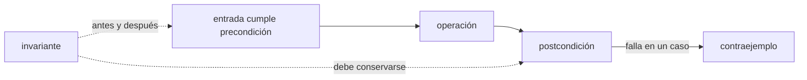
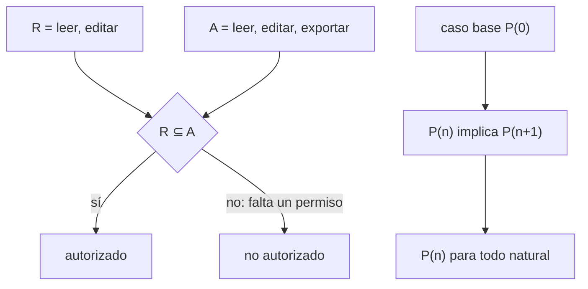
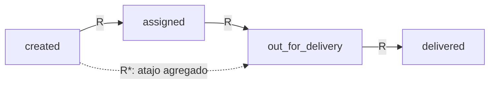
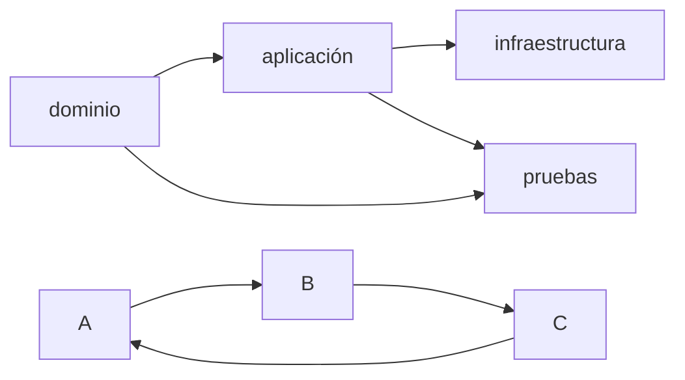
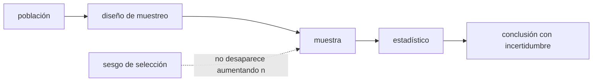

# Módulo 9: Matemáticas discretas, lógica y probabilidad para software

**Entorno comprobado para esta edición (2026-11-24):** Python 3.13.18 en Linux x86_64 y Hypothesis 6.170.17,
instalado en un entorno virtual. Todas las salidas se obtuvieron ejecutando el código mostrado ese día, en la carpeta
de práctica `/home/estudiante/labs/discretas` (tu `~/labs/discretas`). Los resultados exactos (conteos, fracciones,
tablas de verdad y simulaciones con semilla) deben coincidir con los tuyos. Los **milisegundos** del Tema 4 cambian en
cada máquina y en cada ejecución: lo que se mantiene es la proporción entre ellos. Los comandos para Windows no se
ejecutaron.

Las matemáticas de este módulo no son una colección de fórmulas para memorizar. Son un lenguaje para decir exactamente
qué debe ocurrir, detectar contradicciones, justificar algoritmos y distinguir una mejora real de una coincidencia.
Cada idea llega en tres formas: en español, en símbolos y en un programa de Python que la calcula o la comprueba.

#### Objetivos del módulo
Al terminar este módulo podrás:
- escribir reglas de negocio como proposiciones y especificaciones, y encontrar contraejemplos de forma automática;
- operar con conjuntos, clasificar relaciones y demostrar por inducción una propiedad de un algoritmo;
- contar casos con reglas de conteo, permutaciones y combinaciones sin tener que listarlos;
- modelar dependencias como un grafo dirigido, detectar ciclos y obtener un orden topológico;
- calcular probabilidades exactas, condicionales y esperanzas, y comprobarlas con una simulación reproducible;
- medir con percentiles y comunicar una conclusión sin falsear su precisión.

#### Esquema del módulo
1. Lógica para especificar antes de programar.
2. Conjuntos, relaciones, funciones e inducción.
3. Conteo, grafos y estructuras conectadas.
4. Probabilidad y evidencia para decisiones técnicas.
5. Proyecto 9: cuaderno de propiedades, grafos y evidencia.

**Qué necesitas saber antes:** caso de prueba, `assert` y excepción (Módulo 1, Tema 1); condiciones y bucles
(Módulo 1, Tema 3); funciones (Módulo 1, Tema 4); clases (Módulo 1, Tema 6); listas, diccionarios y conjuntos de
Python (Módulo 2, Tema 1); precondición, postcondición e invariante de ciclo (Módulo 2, Tema 3); complejidad,
recursión y caso base (Módulo 2, Tema 4); grafos, lista de adyacencia y DFS (Módulo 2, Tema 7); entorno virtual
(Módulo 5, Tema 2).

#### Cómo leer las fórmulas de este módulo
Las fórmulas son abreviaturas de frases. Cada símbolo se explica la primera vez que aparece. Esta tabla los reúne para
que vuelvas a ella cuando lo necesites.

| Símbolo | Se lee | En Python | Tema |
|---|---|---|---|
| ¬p | «no p» | `not p` | 1 |
| p ∧ q | «p y q» | `p and q` | 1 |
| p ∨ q | «p o q» (o las dos) | `p or q` | 1 |
| p → q | «si p, entonces q» | `(not p) or q` | 1 |
| p ↔ q | «p si y solo si q» | `p == q` (con booleanos) | 1 |
| ∀x | «para todo x» | `all(...)` | 1 |
| ∃x | «existe al menos un x» | `any(...)` | 1 |
| x ∈ A | «x pertenece a A» | `x in A` | 2 |
| A ⊆ B | «A es subconjunto de B» | `A <= B` | 2 |
| A ∪ B, A ∩ B, A − B | unión, intersección, diferencia | `A \| B`, `A & B`, `A - B` | 2 |
| A × B | producto cartesiano | `itertools.product(A, B)` | 2 |
| \|A\| | cardinal: cuántos elementos tiene A | `len(A)` | 2 |
| Σ | suma de varios términos | `sum(...)` | 2 |
| n! | factorial de n | `math.factorial(n)` | 3 |
| C(n, k) | combinaciones de n en k | `math.comb(n, k)` | 3 |
| P(A) | probabilidad del evento A | `Fraction(casos_A, casos_total)` | 4 |
| P(A \| B) | probabilidad de A dado B | `p_ambos / p_b` | 4 |
| E[X] | esperanza (valor esperado) de X | `sum(x * p for x, p in ...)` | 4 |


## Aprende construyendo


### Tema 1: Lógica para especificar antes de programar · Avanzado · 70 min

<details open>
<summary><strong>Capa 1 — Lectura</strong></summary>

#### Objetivos
Al terminar este tema podrás:
- traducir una regla escrita en español a proposiciones unidas por conectivos, en símbolos y en Python;
- construir la tabla de verdad de una fórmula y decidir si dos fórmulas son equivalentes;
- escribir la precondición, la postcondición y el invariante de una operación como implicaciones verificables;
- encontrar un contraejemplo revisando todos los casos de un dominio pequeño y con Hypothesis.

**Conceptos clave:** proposición, conectivo lógico, tabla de verdad, implicación, equivalencia lógica, cuantificador, contraejemplo, invariante, prueba basada en propiedades

#### El problema
La bodega de RutaFlow tiene una regla escrita en un correo: «no se puede retirar más de lo que hay». Dos personas la
programan. Una revisa que haya stock; la otra, que el stock alcance para el pedido. Las dos dicen «funciona» porque
probaron un par de casos. ¿Cómo escribes la regla para que una máquina decida quién tiene razón, y cómo encuentras el
caso exacto que la rompe?

Este tema usa lo que ya conoces: **precondición** y **postcondición** tienen su ficha en el Módulo 2, Tema 3;
**assert** y **caso de prueba**, en el Módulo 1, Tema 1. Aquí no se redefinen.

#### Glosario del tema

**proposición**
- **Definición técnica:** enunciado que, en un contexto dado, es verdadero o falso, sin ambigüedad. Su valor de verdad se representa con `True` o `False`.
- **En palabras sencillas:** una frase a la que puedes contestar «es cierto» o «no es cierto».
- **Dónde se rompe la comparación:** «el stock está bajo» suena a proposición, pero no lo es hasta que defines «bajo»; `stock < 10` sí lo es.
- **Ejemplo:** \(p\): «la cantidad pedida no supera el stock». En Python, `cantidad <= stock` produce `True` o `False`.
- **Error típico:** tratar una pregunta o una orden («¿hay stock?», «retira 3») como proposición: no tienen valor de verdad.

**conectivo lógico**
- **Definición técnica:** operador que forma una proposición compuesta a partir de otras: negación \(\neg p\), conjunción \(p \land q\) y disyunción \(p \lor q\). En Python son `not`, `and` y `or`.
- **En palabras sencillas:** las palabras «no», «y» y «o» del español, pero con un significado fijo que no depende del tono.
- **Dónde se rompe la comparación:** el «o» lógico es inclusivo: \(p \lor q\) es verdadera también cuando las dos lo son. En español, «café o té» suele excluir una opción.
- **Ejemplo:** `stock > 0 and cantidad <= stock` une dos proposiciones con «y».
- **Error típico:** escribir `estado == "creado" or "asignado"`. Python lo lee como `(estado == "creado") or "asignado"` y devuelve `'asignado'`, que cuenta como verdadero siempre.

**tabla de verdad**
- **Definición técnica:** tabla que lista todas las combinaciones de valores de las proposiciones simples y el valor de la fórmula en cada una. Con \(n\) proposiciones tiene \(2^n\) filas.
- **En palabras sencillas:** probar la fórmula con todas las entradas posibles, sin saltarte ninguna.
- **Dónde se rompe la comparación:** solo es práctica con pocas proposiciones: con 30 tendría más de mil millones de filas.
- **Ejemplo:** con \(p\) y \(q\) hay \(2^2 = 4\) filas: verdadero-verdadero, verdadero-falso, falso-verdadero y falso-falso.
- **Error típico:** escribir las filas a mano y olvidar una; `itertools.product([True, False], repeat=2)` las genera todas.

**implicación**
- **Definición técnica:** conectivo \(p \to q\), «si \(p\), entonces \(q\)». Es falsa solo cuando \(p\) es verdadera y \(q\) es falsa; equivale a \(\neg p \lor q\). \(p\) se llama antecedente y \(q\), consecuente.
- **En palabras sencillas:** una promesa: «si llueve, llevo paraguas». Solo la rompes si llueve y no lo llevas.
- **Dónde se rompe la comparación:** en español, «si» sugiere causa. En lógica no: cuando \(p\) es falsa, \(p \to q\) es verdadera, pase lo que pase con \(q\).
- **Ejemplo:** «si el retiro se acepta, el stock nuevo es mayor o igual que 0» se escribe `(not aceptado) or stock_nuevo >= 0`.
- **Error típico:** confundirla con su recíproca \(q \to p\). La tabla de verdad del Problema resuelto 1.1 muestra que no dicen lo mismo.

**equivalencia lógica**
- **Definición técnica:** dos fórmulas son lógicamente equivalentes (\(\equiv\)) si tienen el mismo valor de verdad en todas las filas de su tabla.
- **En palabras sencillas:** dos maneras distintas de decir exactamente lo mismo.
- **Dónde se rompe la comparación:** coincidir en algunas filas no basta; una sola fila distinta las hace diferentes.
- **Ejemplo:** la ley de De Morgan \(\neg(p \land q) \equiv \neg p \lor \neg q\) y la contrapositiva \(p \to q \equiv \neg q \to \neg p\).
- **Error típico:** negar `a and b` como `not a and not b`. Lo correcto, por De Morgan, es `not a or not b`.

**cuantificador**
- **Definición técnica:** símbolo que indica para cuántos elementos de un dominio vale una propiedad: el universal \(\forall x\) («para todo \(x\)») y el existencial \(\exists x\) («existe al menos un \(x\)»). En Python se evalúan con `all` y `any`.
- **En palabras sencillas:** «todos cumplen» frente a «al menos uno cumple».
- **Dónde se rompe la comparación:** `all` y `any` recorren una colección finita; un \(\forall\) sobre todos los enteros no se puede revisar caso por caso.
- **Ejemplo:** \(\forall s \in \{0, 1, \dots, 5\}: s \ge 0\) se escribe `all(s >= 0 for s in range(6))` y da `True`.
- **Error típico:** olvidar que `all([])` devuelve `True`. Si la lista llegó vacía por un error, la comprobación «pasa» sin revisar nada.

**contraejemplo**
- **Definición técnica:** elemento del dominio para el que la propiedad es falsa. Uno solo basta para refutar un \(\forall\).
- **En palabras sencillas:** el caso concreto que demuestra que «siempre» era falso.
- **Dónde se rompe la comparación:** no encontrar contraejemplos no demuestra la propiedad; quizá buscaste donde no estaban.
- **Ejemplo:** `stock=1, cantidad=2` refuta «todo retiro deja stock ≥ 0» en la versión con defecto de `retirar`.
- **Error típico:** descartarlo como «caso raro». Con miles de pedidos al día, los casos raros ocurren todos los días.

**invariante**
- **Definición técnica:** propiedad del estado de un sistema que se cumple antes y después de cada operación válida. Generaliza el invariante de ciclo del Módulo 2, Tema 3, de un bucle a todo el sistema.
- **En palabras sencillas:** una regla que nunca se rompe, haga lo que haga el programa.
- **Dónde se rompe la comparación:** dentro de una operación puede romperse un instante; lo que se exige es que vuelva a cumplirse al terminar.
- **Ejemplo:** «para todo producto, stock ≥ 0»: \(\forall x \in \text{Productos}: \text{stock}(x) \ge 0\).
- **Error típico:** comprobarlo solo al crear el objeto y no después de cada operación que lo modifica.

**prueba basada en propiedades**
- **Definición técnica:** prueba que afirma una propiedad para todas las entradas de un tipo y deja que una herramienta genere cientos de entradas buscando un contraejemplo. Si lo encuentra, lo reduce al más simple (*shrinking*). En Python la herramienta habitual es Hypothesis.
- **En palabras sencillas:** en vez de inventar tú cinco casos, describes la regla y una máquina intenta romperla.
- **Dónde se rompe la comparación:** genera muchos casos, no todos. Que pase es evidencia fuerte, no una demostración.
- **Ejemplo:** `@given(stock=st.integers(min_value=0), cantidad=st.integers(min_value=1))` genera parejas de enteros con esos límites.
- **Error típico:** escribir una propiedad que repite el código probado (`assert retirar(s, c) == retirar(s, c)`): nunca falla y no prueba nada.

#### ► CÓMO FUNCIONA
Especificar es escribir la regla de forma que no admita dos lecturas. Lo haces en tres pasos.

**Paso 1: separa las proposiciones.** «No se puede retirar más de lo que hay» contiene dos ideas que se pueden
comprobar: \(a\): «el retiro se acepta» y \(c\): «la cantidad no supera el stock», es decir, \(\text{cantidad} \le \text{stock}\).

**Paso 2: únelas con conectivos.** La regla dice que se acepta exactamente cuando alcanza. Eso es un «si y solo si»:

\[ a \leftrightarrow c \]

Se lee «\(a\) si y solo si \(c\)». El símbolo \(\leftrightarrow\) significa \((a \to c) \land (c \to a)\): cada una implica
a la otra. Con booleanos, en Python es `a == c`. La implicación \(p \to q\) es la pieza central. Su tabla:

| p | q | p → q | Por qué |
|---|---|---|---|
| V | V | V | Llovió y llevaste paraguas: cumpliste |
| V | F | F | Llovió y no lo llevaste: rompiste la promesa |
| F | V | V | No llovió: la promesa no se puso a prueba |
| F | F | V | No llovió: tampoco se puso a prueba |

Las dos últimas filas sorprenden. Una promesa sobre la lluvia no se rompe en un día seco.

**Paso 3: cuantifica.** Una especificación habla de **todas** las entradas válidas. Con \(s\) para el stock, \(k\) para
la cantidad y \(s'\) («ese prima») para el stock después del retiro:

\[ \forall s \ge 0,\ \forall k \ge 1:\quad a \to s' \ge 0 \]

Se lee: «para todo stock \(s\) mayor o igual que 0 y toda cantidad \(k\) mayor o igual que 1, si el retiro se acepta,
el stock nuevo no es negativo». La coma separa los cuantificadores; los dos puntos significan «se cumple que».

La forma general de una especificación es: **precondición → postcondición**, y el **invariante** se conserva antes y
después. En texto plano, para `retirar` y para el cambio de estado de un envío:

```text
Pre: cantidad > 0 y producto existe
Transición: stock_nuevo = stock_anterior - cantidad
Post: retiro aceptado implica stock_nuevo >= 0
Invariante global: para todo producto, stock >= 0
```

Para refutar un \(\forall\) basta un contraejemplo. Por eso la negación de «para todo» es «existe uno que no»:

\[ \neg\,\forall x: P(x) \;\equiv\; \exists x: \neg P(x) \]

Tienes dos formas de buscar ese \(x\). Si el dominio es pequeño, lo recorres entero con `all` y `any`. Si es enorme,
como todos los enteros, dejas que Hypothesis genere ejemplos y reduzca el fallo al caso mínimo.



#### Problema resuelto 1.1
Construye con Python la tabla de verdad de los conectivos y de la implicación. Luego decide tres preguntas: ¿\(p \to q\)
equivale a su recíproca \(q \to p\)? ¿Y a su contrapositiva \(\neg q \to \neg p\)? ¿Se cumple De Morgan?

**Razonamiento:**
1. Python no tiene operador de implicación; lo defines como función con su equivalencia \(\neg p \lor q\).
2. `itertools.product([True, False], repeat=2)` genera las \(2^2 = 4\) filas sin olvidar ninguna.
3. Dos fórmulas son equivalentes si coinciden en **todas** las filas: eso es un `all(...)` sobre las cuatro.

```python
# tabla_verdad.py — tablas de verdad de los conectivos y de la implicación
from itertools import product


def implica(p, q):
    return (not p) or q


casos = list(product([True, False], repeat=2))
print("p     q     | no p   p y q  p o q  p→q")
for p, q in casos:
    fila = [not p, p and q, p or q, implica(p, q)]
    print(f"{p!s:5} {q!s:5} | " + "  ".join(f"{v!s:5}" for v in fila))

print("p→q equivale a q→p:", all(implica(p, q) == implica(q, p) for p, q in casos))
print("p→q equivale a no q → no p:", all(implica(p, q) == implica(not q, not p) for p, q in casos))
print("no (p y q) equivale a (no p) o (no q):", all((not (p and q)) == ((not p) or (not q)) for p, q in casos))
```

```text
$ python3 tabla_verdad.py
p     q     | no p   p y q  p o q  p→q
True  True  | False  True   True   True
True  False | False  False  True   False
False True  | True   False  True   True
False False | True   False  False  True
p→q equivale a q→p: False
p→q equivale a no q → no p: True
no (p y q) equivale a (no p) o (no q): True
```

**Explicación por partes.**
- Líneas 5–6: `implica` traduce \(p \to q \equiv \neg p \lor q\). Solo devuelve `False` cuando `p` es `True` y `q` es `False`.
- Línea 9: `product` combina `[True, False]` consigo misma; `list` guarda las cuatro filas para reutilizarlas.
- Líneas 12–13: cada fila calcula cuatro columnas. En `{p!s:5}`, `!s` convierte el valor en texto y `:5` lo rellena hasta 5 caracteres.
- En la salida, la columna `p→q` solo tiene `False` en la fila `True False`: la promesa rota.
- Línea 15: la recíproca da `False`; en la fila `False True`, \(p \to q\) es verdadera y \(q \to p\) es falsa.
- Líneas 16–17: la contrapositiva y De Morgan coinciden en las cuatro filas: son equivalencias.

> **Error común.** Escribir la implicación con una flecha, como en matemáticas: `print(p -> q)`. Python se detiene con
> `SyntaxError: invalid syntax` y marca `->` con `^^`. Python no tiene operador de implicación; escribe `(not p) or q`.

> **Buena práctica.** Cuando una condición tenga más de dos conectivos, comprueba tu simplificación con una tabla de
> verdad generada por código antes de cambiar el `if`. Diez líneas de Python evitan un error que nadie ve en revisión.

#### Problema resuelto 1.2
Esta es la versión de `retirar` que «funciona» según quien la escribió. Comprueba la especificación \(a \leftrightarrow c\)
y \(a \to s' \ge 0\): primero en todos los casos de un dominio pequeño y después con Hypothesis.

```python
# inventario.py — retiro de cajas (versión con defecto)
from dataclasses import dataclass


@dataclass(frozen=True)
class Resultado:
    aceptado: bool
    stock: int


def retirar(stock: int, cantidad: int) -> Resultado:
    if stock > 0:
        return Resultado(True, stock - cantidad)
    return Resultado(False, stock)
```

**Razonamiento:**
1. La especificación tiene dos partes; cada una es una proposición que la función `cumple` evalúa.
2. Dominio pequeño: stock de 0 a 5 y cantidad de 1 a 5. Son \(6 \cdot 5 = 30\) casos; se revisan todos con `all` y `any`.
3. Dominio enorme: todos los enteros válidos. Ahí Hypothesis genera ejemplos y reduce el fallo al más simple.
4. Si aparece un contraejemplo, se corrige la función y se ejecutan las dos comprobaciones otra vez.

```python
# para_todo.py — comprueba la especificación en TODOS los casos de un dominio pequeño
from inventario import retirar


def cumple(stock, cantidad):
    r = retirar(stock, cantidad)
    post_1 = (not r.aceptado) or r.stock >= 0          # aceptado → stock nuevo ≥ 0
    post_2 = r.aceptado == (cantidad <= stock)          # aceptado ↔ cantidad ≤ stock
    return post_1 and post_2


dominio = [(s, c) for s in range(0, 6) for c in range(1, 6)]
contraejemplos = [(s, c) for s, c in dominio if not cumple(s, c)]
print("casos revisados:", len(dominio))
print("¿se cumple para todo caso?", all(cumple(s, c) for s, c in dominio))
print("¿existe un contraejemplo?", any(not cumple(s, c) for s, c in dominio))
print("primeros contraejemplos:", contraejemplos[:3])
```

```text
$ python3 para_todo.py
casos revisados: 30
¿se cumple para todo caso? False
¿existe un contraejemplo? True
primeros contraejemplos: [(1, 2), (1, 3), (1, 4)]
```

Ahora la prueba basada en propiedades. Ejecútala dentro del entorno virtual donde instalaste Hypothesis:

```python
# prueba_propiedades.py — Hypothesis busca un contraejemplo por ti
from hypothesis import given, strategies as st

from inventario import retirar


@given(stock=st.integers(min_value=0), cantidad=st.integers(min_value=1))
def test_retirar_preserva_stock_no_negativo(stock, cantidad):
    resultado = retirar(stock, cantidad)
    assert resultado.stock >= 0
    assert resultado.aceptado == (cantidad <= stock)


if __name__ == "__main__":
    test_retirar_preserva_stock_no_negativo()
    print("propiedad cumplida en todos los ejemplos generados")
```

```text
$ python prueba_propiedades.py
Traceback (most recent call last):
  File "/home/estudiante/labs/discretas/logica/prueba_propiedades.py", line 15, in <module>
    test_retirar_preserva_stock_no_negativo()
    ~~~~~~~~~~~~~~~~~~~~~~~~~~~~~~~~~~~~~~~^^
  File "/home/estudiante/labs/discretas/logica/prueba_propiedades.py", line 8, in test_retirar_preserva_stock_no_negativo
    def test_retirar_preserva_stock_no_negativo(stock, cantidad):
                   ^^^
  File "/home/estudiante/labs/discretas/.venv/lib/python3.13/site-packages/hypothesis/core.py", line 2334, in wrapped_test
    raise the_error_hypothesis_found
  File "/home/estudiante/labs/discretas/logica/prueba_propiedades.py", line 10, in test_retirar_preserva_stock_no_negativo
    assert resultado.stock >= 0
           ^^^^^^^^^^^^^^^^^^^^
AssertionError
Failing test case: test_retirar_preserva_stock_no_negativo(
    stock=1,
    cantidad=2,
)
```

Hypothesis encontró `stock=1, cantidad=2`: hay stock, así que la versión con defecto acepta, y deja el stock en \(-1\).
La corrección cambia la condición de la línea 12 por la proposición \(c\) de la especificación:

```python
# inventario.py — retiro de cajas (corregido)
from dataclasses import dataclass


@dataclass(frozen=True)
class Resultado:
    aceptado: bool
    stock: int


def retirar(stock: int, cantidad: int) -> Resultado:
    if cantidad <= stock:  # acepta solo si el stock alcanza
        return Resultado(True, stock - cantidad)
    return Resultado(False, stock)
```

```text
$ python3 para_todo.py
casos revisados: 30
¿se cumple para todo caso? True
¿existe un contraejemplo? False
primeros contraejemplos: []
```

```text
$ python prueba_propiedades.py
propiedad cumplida en todos los ejemplos generados
```

**Explicación por partes.**
- `inventario.py`, líneas 5–8: `@dataclass(frozen=True)` escribe por ti el `__init__` de la clase (Módulo 1, Tema 6) y prohíbe cambiar sus atributos después.
- `inventario.py`, línea 12: la versión con defecto pregunta \(s > 0\) («hay stock»); la especificación pide \(k \le s\) («alcanza»).
- `para_todo.py`, línea 7: \(a \to s' \ge 0\) escrita como \(\neg a \lor s' \ge 0\).
- `para_todo.py`, línea 8: \(a \leftrightarrow c\) escrita como `==` entre dos booleanos.
- `para_todo.py`, líneas 15–16: `all` es \(\forall\) y `any` es \(\exists\). Una es la negación de la otra: si no todos cumplen, existe uno que no.
- `prueba_propiedades.py`, línea 7: `st.integers(min_value=0)` describe el dominio; la precondición queda dentro de la estrategia.
- `prueba_propiedades.py`, línea 15: al llamar la función decorada, Hypothesis ejecuta unas 100 entradas distintas.
- En la salida con defecto, `Failing test case` muestra el contraejemplo ya reducido. Hypothesis lo guarda en la carpeta `.hypothesis` y lo prueba primero en la siguiente ejecución.

> **Error común.** Ejecutar la prueba con el Python del sistema y no con el del entorno virtual. El programa termina con
> `ModuleNotFoundError: No module named 'hypothesis'` en la línea 2. Activa el entorno con `source .venv/bin/activate`
> y ejecuta `python prueba_propiedades.py`.

> **Prevenir errores.** Imprime siempre cuántos casos revisaste, como la línea 14 de `para_todo.py`. Si ves
> `casos revisados: 0`, sabes que `all` dio `True` sobre una lista vacía y la comprobación no vale nada.

#### Checkpoint 1.1
La regla es «si un envío está entregado, entonces tiene firma». Un envío está pendiente y no tiene firma. ¿Ese envío
rompe la regla?

Respuesta: no. El antecedente «está entregado» es falso, y una implicación con antecedente falso es verdadera. La regla
solo se rompe con un envío entregado sin firma.

#### Checkpoint 1.2
Escribe la negación de «todo retiro aceptado deja stock mayor o igual que 0».

Respuesta: «existe un retiro aceptado que deja stock menor que 0». La negación de \(\forall\) es \(\exists\) con la
propiedad negada, y \(\neg(a \to s' \ge 0) \equiv a \land s' < 0\). El caso `stock=1, cantidad=2` es un ejemplo.

</details>

<details>
<summary><strong>Capa 2 — Construcción</strong></summary>

#### Paso 1 · Prepara la carpeta y el entorno virtual
Crea `~/labs/discretas/logica` y, dentro de `~/labs/discretas`, el entorno virtual como en el Módulo 5, Tema 2:
`python3 -m venv .venv`, `source .venv/bin/activate` y `python -m pip install hypothesis`. Comprueba la instalación con
`python -c "import hypothesis; print(hypothesis.__version__)"`: debe mostrar `6.170.17` o una versión posterior. En
Windows la activación es `.venv\Scripts\activate`.

#### Paso 2 · Genera tablas de verdad
Entra en `logica`, escribe `tabla_verdad.py` y ejecútalo. La salida debe coincidir con la del Problema resuelto 1.1.
Agrega una columna para \(p \leftrightarrow q\) (`p == q`) y comprueba que solo es `True` en las filas `True True` y
`False False`.

#### Paso 3 · Encuentra el contraejemplo y corrige
Escribe `inventario.py` con el defecto, `para_todo.py` y `prueba_propiedades.py`. Ejecuta los dos programas y confirma
el contraejemplo `stock=1, cantidad=2`. Corrige la línea 12 y ejecútalos otra vez hasta ver los dos mensajes de éxito.

#### Paso 4 · Especifica `transition()`
Los envíos de RutaFlow cambian de estado con `transition`. Su especificación en texto plano es esta:

```text
Pre: current es un ShipmentStatus válido; requested es un ShipmentStatus válido
Transición: si requested ∈ ALLOWED_TRANSITIONS[current], devuelve requested; si no, lanza ValueError
Post: transition(current, requested) == requested implica requested ∈ ALLOWED_TRANSITIONS[current]
Invariante: ningún envío llega a DELIVERED sin haber pasado por ASSIGNED y OUT_FOR_DELIVERY en orden
```

Escribe `domain.py`, que usarás también en los Temas 2 y 3:

```python
# domain.py — estados de un envío de RutaFlow y transiciones permitidas
from enum import Enum


class ShipmentStatus(str, Enum):
    CREATED = "created"
    ASSIGNED = "assigned"
    OUT_FOR_DELIVERY = "out_for_delivery"
    DELIVERED = "delivered"


ALLOWED_TRANSITIONS = {
    ShipmentStatus.CREATED: {ShipmentStatus.ASSIGNED},
    ShipmentStatus.ASSIGNED: {ShipmentStatus.OUT_FOR_DELIVERY},
    ShipmentStatus.OUT_FOR_DELIVERY: {ShipmentStatus.DELIVERED},
    ShipmentStatus.DELIVERED: set(),
}


def transition(current: ShipmentStatus, requested: ShipmentStatus) -> ShipmentStatus:
    if requested not in ALLOWED_TRANSITIONS[current]:
        raise ValueError(f"invalid shipment transition: {current.value} -> {requested.value}")
    return requested
```

Con solo 4 estados hay \(4 \cdot 4 = 16\) pares (actual, pedido). Son pocos: puedes comprobar la postcondición en
**todos**, como un \(\forall\) exacto y no una muestra. Escribe `transiciones.py`:

```python
# transiciones.py — verifica la postcondición de transition() en los 16 pares posibles
from itertools import product

from domain import ALLOWED_TRANSITIONS, ShipmentStatus, transition

aceptadas, rechazadas = [], []
for actual, pedido in product(ShipmentStatus, repeat=2):
    try:
        transition(actual, pedido)
        aceptadas.append((actual.value, pedido.value))
    except ValueError:
        rechazadas.append((actual.value, pedido.value))

# Post: aceptada → pedido ∈ ALLOWED_TRANSITIONS[actual]
post = all(ShipmentStatus(b) in ALLOWED_TRANSITIONS[ShipmentStatus(a)] for a, b in aceptadas)
print("pares revisados:", len(aceptadas) + len(rechazadas))
print("aceptadas:", aceptadas)
print("rechazadas:", len(rechazadas))
print("postcondición para todo par:", post)
try:
    transition(ShipmentStatus.CREATED, ShipmentStatus.DELIVERED)
except ValueError as error:
    print("ejemplo de rechazo:", error)
```

```text
$ python3 transiciones.py
pares revisados: 16
aceptadas: [('created', 'assigned'), ('assigned', 'out_for_delivery'), ('out_for_delivery', 'delivered')]
rechazadas: 13
postcondición para todo par: True
ejemplo de rechazo: invalid shipment transition: created -> delivered
```

La línea 7 recorre los 16 pares; la 15 evalúa la implicación «aceptada → permitida» sobre los aceptados. El
invariante de la última línea de la especificación se demuestra en el Tema 3, recorriendo los caminos del grafo.

#### Resumen
- Una **proposición** es verdadera o falsa; los **conectivos lógicos** `not`, `and`, `or` forman proposiciones compuestas.
- Una **tabla de verdad** revisa las \(2^n\) combinaciones; dos fórmulas son **lógicamente equivalentes** si coinciden en todas.
- La **implicación** \(p \to q\) solo es falsa con \(p\) verdadera y \(q\) falsa; no equivale a su recíproca.
- Los **cuantificadores** \(\forall\) y \(\exists\) se evalúan con `all` y `any` en dominios finitos.
- Un **contraejemplo** refuta un \(\forall\); no encontrarlo no demuestra nada.
- Un **invariante** se conserva antes y después de cada operación; la especificación es precondición → postcondición.
- La **prueba basada en propiedades** (Hypothesis) busca contraejemplos en dominios enormes y los reduce al caso mínimo.

#### Ejercicio verificable 1
Básico. Agrega a `tabla_verdad.py` una columna con \(\neg p \lor q\) y compárala con la columna `p→q`. Antes de
ejecutar, predice los cuatro valores.

Respuesta esperada: `True`, `False`, `True`, `True`, en el orden de las filas del programa. Es idéntica a `p→q` porque
\(p \to q \equiv \neg p \lor q\).

#### Ejercicio verificable 2
Intermedio. La regla es «un envío urgente se despacha antes de las 10 o se cancela». Escríbela con \(u\) (urgente),
\(d\) (despachado antes de las 10) y \(c\) (cancelado). Escribe su negación y compruébala con una tabla de 8 filas.

Respuesta esperada: la regla es \(u \to (d \lor c)\). Su negación es \(u \land \neg d \land \neg c\): un envío urgente
que ni se despachó a tiempo ni se canceló. Con `product([True, False], repeat=3)`, la expresión
`all((not implica(u, d or c)) == (u and not d and not c) for u, d, c in filas)` devuelve `True`.

#### Ejercicio verificable 3
Reto. Agrega a `prueba_propiedades.py` una segunda prueba con dos propiedades: «si se acepta, stock nuevo más cantidad
es el stock anterior» y «si se rechaza, el stock no cambia». Ejecútala con la versión con defecto. ¿Encuentra el fallo?

Respuesta esperada: las aserciones son `assert (not r.aceptado) or r.stock + cantidad == stock` y
`assert r.aceptado or r.stock == stock`. Con la versión con defecto, la prueba **pasa**: las dos propiedades se
cumplen aunque el stock quede negativo. La lección: cada propiedad vigila una parte de la regla; ninguna sola basta.

#### En el trabajo
En un equipo, la especificación aparece como criterios de aceptación de un ticket. Escritos como implicaciones («si
el pago se rechaza, el pedido queda pendiente»), se convierten en pruebas sin discusión. Las pruebas basadas en
propiedades son comunes en sistemas de pagos, inventarios y lectores de formatos. Los invariantes también viven en la
base de datos, como la restricción `CHECK (stock >= 0)` del Módulo 4.

</details>

### Tema 2: Conjuntos, relaciones, funciones e inducción · Avanzado · 75 min

<details open>
<summary><strong>Capa 1 — Lectura</strong></summary>

#### Objetivos
Al terminar este tema podrás:
- operar con conjuntos (pertenencia, subconjunto, unión, intersección, diferencia y producto cartesiano) en símbolos y en Python;
- decidir si una relación es reflexiva, simétrica, antisimétrica o transitiva, y si es un orden parcial o una equivalencia;
- reconocer cuándo una relación es una función matemática;
- demostrar por inducción una propiedad de un algoritmo recursivo y escribir sus supuestos.

**Conceptos clave:** subconjunto, operaciones de conjuntos, producto cartesiano, relación, propiedades de una relación, orden parcial, relación de equivalencia, función matemática, inducción matemática

#### El problema
En RutaFlow aparecen tres discusiones a la vez. Permisos decide «a ojo» si un rol puede hacer una tarea. Un ticket
dice que `ALLOWED_TRANSITIONS` «es un orden» y otro, que «es como una equivalencia». Y la función recursiva `suma`
pasó cinco pruebas: ¿funciona para **toda** lista? Necesitas un lenguaje para decidir las tres cosas con certeza.

El **conjunto** de Python tiene su ficha en el Módulo 2, Tema 1; **recursión** y **caso base**, en el Módulo 2,
Tema 4. Aquí se usa la notación matemática de los conjuntos, que se explica en «Cómo funciona».

#### Glosario del tema

**subconjunto**
- **Definición técnica:** \(A \subseteq B\) si todo elemento de \(A\) también pertenece a \(B\): \(\forall x: x \in A \to x \in B\). En Python, `A <= B`.
- **En palabras sencillas:** \(A\) cabe completo dentro de \(B\); no le sobra nada por fuera.
- **Dónde se rompe la comparación:** todo conjunto es subconjunto de sí mismo, y el conjunto vacío \(\varnothing\) es subconjunto de cualquiera.
- **Ejemplo:** `{"leer", "editar"} <= {"leer", "editar", "exportar"}` da `True`.
- **Error típico:** usar `<` (subconjunto propio, que exige \(A \ne B\)) y negar permiso a quien tiene exactamente los requeridos.

**operaciones de conjuntos (∪, ∩, −)**
- **Definición técnica:** la unión \(A \cup B\) reúne los elementos que están en \(A\) o en \(B\); la intersección \(A \cap B\), los que están en ambos; la diferencia \(A - B\), los de \(A\) que no están en \(B\). En Python: `|`, `&` y `-`.
- **En palabras sencillas:** juntar todo, quedarte con lo común y ver lo que sobra.
- **Dónde se rompe la comparación:** la diferencia no es simétrica: \(A - B\) y \(B - A\) casi nunca coinciden.
- **Ejemplo:** `{"leer", "editar"} - {"leer"}` da `{'editar'}`: el permiso que le falta al auditor.
- **Error típico:** crear un conjunto vacío con `{}`. Eso es un diccionario, y `vacio.add("leer")` falla con `AttributeError: 'dict' object has no attribute 'add'`. Usa `set()`.

**producto cartesiano**
- **Definición técnica:** \(A \times B = \{(a, b) : a \in A,\ b \in B\}\), el conjunto de todos los pares ordenados con primer elemento en \(A\) y segundo en \(B\). Tiene \(\lvert A \rvert \cdot \lvert B \rvert\) elementos.
- **En palabras sencillas:** todas las combinaciones de «una cosa de cada lista», como las casillas de una tabla de filas por columnas.
- **Dónde se rompe la comparación:** en un par el orden importa: \((a, b)\) y \((b, a)\) son pares distintos.
- **Ejemplo:** 2 roles × 3 acciones dan \(2 \cdot 3 = 6\) pares; `itertools.product(roles, acciones)` los genera.
- **Error típico:** confundirlo con la unión: \(\{1, 2\} \cup \{3\}\) tiene 3 elementos, pero \(\{1, 2\} \times \{3\}\) tiene 2 pares.

**relación**
- **Definición técnica:** una relación binaria \(R\) sobre un conjunto \(S\) es un subconjunto de \(S \times S\). Se escribe \(a \mathrel{R} b\) cuando \((a, b) \in R\).
- **En palabras sencillas:** una lista de parejas «conectadas» según alguna regla.
- **Dónde se rompe la comparación:** la relación no dice por qué dos elementos se conectan; solo registra que lo están.
- **Ejemplo:** las transiciones de RutaFlow forman \(R\) con 3 pares de los 16 posibles, como `("created", "assigned")`.
- **Error típico:** olvidar la dirección: \((\text{created}, \text{assigned}) \in R\) no implica \((\text{assigned}, \text{created}) \in R\).

**propiedades de una relación**
- **Definición técnica:** \(R\) es **reflexiva** si \(\forall a: a \mathrel{R} a\); **simétrica** si \(a \mathrel{R} b \to b \mathrel{R} a\); **antisimétrica** si \((a \mathrel{R} b \land b \mathrel{R} a) \to a = b\); **transitiva** si \((a \mathrel{R} b \land b \mathrel{R} c) \to a \mathrel{R} c\).
- **En palabras sencillas:** cuatro preguntas: ¿cada uno se conecta consigo mismo? ¿la conexión va en los dos sentidos? ¿nunca hay ida y vuelta entre distintos? ¿se puede encadenar?
- **Dónde se rompe la comparación:** antisimétrica no es «lo contrario» de simétrica. Una relación vacía es las dos cosas a la vez.
- **Ejemplo:** \(R\) es antisimétrica pero no transitiva: hay created → assigned → out_for_delivery, pero no created → out_for_delivery.
- **Error típico:** revisar la transitividad con un solo encadenamiento; hay que revisar todos los pares \((a, b)\), \((b, c)\).

**orden parcial**
- **Definición técnica:** relación reflexiva, antisimétrica y transitiva. Se suele escribir \(a \preceq b\): «\(a\) va antes que \(b\) o es igual».
- **En palabras sencillas:** una forma consistente de decir «esto va antes que aquello», sin vueltas atrás.
- **Dónde se rompe la comparación:** «parcial» significa que puede haber pares que no se comparan. \(\{\text{leer}\}\) y \(\{\text{editar}\}\) no son subconjunto uno del otro.
- **Ejemplo:** «puede llegar a», el cierre de las transiciones de RutaFlow, es un orden parcial.
- **Error típico:** llamar orden a la relación de un solo paso \(R\): sin su cierre no es reflexiva ni transitiva.

**relación de equivalencia**
- **Definición técnica:** relación reflexiva, simétrica y transitiva. Divide el conjunto en **clases de equivalencia**: grupos cuyos elementos se relacionan todos entre sí.
- **En palabras sencillas:** «es del mismo grupo que».
- **Dónde se rompe la comparación:** en una equivalencia todo va en los dos sentidos; un flujo de estados que avanza nunca lo cumple.
- **Ejemplo:** «tiene el mismo estado que» entre envíos; o «da el mismo resto al dividir entre 7» entre números.
- **Error típico:** tratar como equivalencia una relación no transitiva, como «está a menos de 1 km de»: A cerca de B y B cerca de C no implica A cerca de C.

**función matemática**
- **Definición técnica:** relación \(f \subseteq A \times B\) en la que cada \(a \in A\) se relaciona con **exactamente un** \(b \in B\). Se escribe \(f: A \to B\) y \(f(a) = b\).
- **En palabras sencillas:** una máquina que, para cada entrada válida, da una y solo una salida.
- **Dónde se rompe la comparación:** una función de Python puede dar resultados distintos con la misma entrada, por ejemplo si lee la hora; una función matemática, nunca.
- **Ejemplo:** \(R\) no es función de \(S\) en \(S\): `delivered` no tiene sucesor. Sin `delivered` en el dominio, sí lo sería.
- **Error típico:** creer que dos entradas no pueden dar la misma salida. Eso sí se permite; lo prohibido es una entrada con dos salidas.

**inducción matemática**
- **Definición técnica:** método para demostrar \(\forall n \ge 0: P(n)\). Se prueba el **caso base** \(P(0)\) y el **paso inductivo**: para todo \(n\), si \(P(n)\) es verdadera, entonces \(P(n+1)\) también. La suposición \(P(n)\) se llama **hipótesis inductiva**.
- **En palabras sencillas:** una fila de fichas de dominó: si cae la primera y cada una tumba a la siguiente, caen todas.
- **Dónde se rompe la comparación:** la fila de dominó es finita; la inducción cubre infinitos valores de \(n\) sin probarlos uno a uno.
- **Ejemplo:** \(1 + 2 + \dots + n = \frac{n(n+1)}{2}\) para todo \(n \ge 0\).
- **Error típico:** probar solo el paso inductivo y olvidar el caso base. Sin la primera ficha, nada cae.

#### ► CÓMO FUNCIONA
**Notación de conjuntos.** Un conjunto se escribe entre llaves: \(A = \{\text{leer}, \text{editar}\}\). \(x \in A\) se
lee «\(x\) pertenece a \(A\)» y \(x \notin A\), «no pertenece». \(\lvert A \rvert\) es el **cardinal**: cuántos
elementos tiene, como `len(A)`. \(\varnothing\) es el conjunto vacío. Los elementos no se repiten ni tienen orden.

**De conjuntos a relaciones.** Con los estados \(S\) de un envío, \(S \times S\) tiene \(4 \cdot 4 = 16\) pares. Una
relación elige algunos: \(R\) elige 3. Para saber si \(R\) es un orden o una equivalencia, revisas sus cuatro
propiedades con `all`, igual que un \(\forall\) del Tema 1.

**Del paso a la alcanzabilidad.** \(R\) habla de un solo paso. «Puede llegar a, en cero o más pasos» se obtiene con
el **cierre reflexivo y transitivo** \(R^*\): agregas cada par \((a, a)\) y, mientras haya cadenas
\((a, b), (b, c)\) sin su atajo \((a, c)\), lo agregas. Cuando no aparece ningún par nuevo, terminaste.

**Inducción, paso a paso.** El símbolo \(\sum_{i=1}^{n} i\) se lee «suma de \(i\), desde \(i = 1\) hasta \(n\)»:
\(1 + 2 + \dots + n\). La \(i\) es la variable que cambia; el 1 de abajo y la \(n\) de arriba son los límites. Se
quiere demostrar:

\[ P(n):\quad \sum_{i=1}^{n} i = \frac{n(n+1)}{2} \]

- **Caso base** \(n = 0\): la suma no tiene términos y vale 0; la fórmula da \(\frac{0 \cdot 1}{2} = 0\). Coinciden.
- **Hipótesis inductiva:** supones \(P(n)\) verdadera para un \(n\) cualquiera.
- **Paso inductivo:** la suma hasta \(n+1\) es la suma hasta \(n\) más el término \(n+1\). Usas la hipótesis y sacas factor común \((n+1)\):

\[ \sum_{i=1}^{n+1} i = \frac{n(n+1)}{2} + (n+1) = \frac{n(n+1) + 2(n+1)}{2} = \frac{(n+1)(n+2)}{2} \]

El resultado es la fórmula con \(n+1\) en lugar de \(n\): eso es \(P(n+1)\). Caso base más paso dan \(P(n)\) para todo
\(n\). La misma técnica demuestra que un algoritmo recursivo es correcto: el caso base del código es el caso base de la
demostración, y la llamada recursiva es la hipótesis inductiva.



#### Problema resuelto 2.1
Una tarea requiere los permisos `leer` y `editar`. Decide con conjuntos si la coordinadora y el auditor pueden hacerla,
qué le falta al auditor y cuántas combinaciones rol-acción existen.

**Razonamiento:**
1. «Puede hacer la tarea» es \(\text{requeridos} \subseteq \text{asignados}\): todo permiso requerido está asignado.
2. «Qué le falta» es la diferencia \(\text{requeridos} - \text{asignados}\).
3. Las combinaciones rol-acción son el producto cartesiano; su tamaño es \(\lvert \text{roles} \rvert \cdot \lvert \text{acciones} \rvert\).

```python
# permisos.py — conjuntos para decidir si una persona puede hacer una tarea
from itertools import product

requeridos = {"leer", "editar"}
coordinadora = {"leer", "editar", "exportar"}
auditor = {"leer"}

print("'exportar' ∈ coordinadora:", "exportar" in coordinadora)
print("requeridos ⊆ coordinadora:", requeridos <= coordinadora)
print("requeridos ⊆ auditor:", requeridos <= auditor)
print("faltan al auditor (requeridos − auditor):", sorted(requeridos - auditor))
print("coordinadora ∪ auditor:", sorted(coordinadora | auditor))
print("coordinadora ∩ auditor:", sorted(coordinadora & auditor))

roles = ["auditor", "coordinadora"]
acciones = ["editar", "exportar", "leer"]
pares = list(product(roles, acciones))
print("roles × acciones tiene", len(pares), "pares; el primero es", pares[0])
```

```text
$ python3 permisos.py
'exportar' ∈ coordinadora: True
requeridos ⊆ coordinadora: True
requeridos ⊆ auditor: False
faltan al auditor (requeridos − auditor): ['editar']
coordinadora ∪ auditor: ['editar', 'exportar', 'leer']
coordinadora ∩ auditor: ['leer']
roles × acciones tiene 6 pares; el primero es ('auditor', 'editar')
```

**Explicación por partes.**
- Líneas 4–6: tres conjuntos de Python escritos con llaves; el orden en que escribes los elementos no importa.
- Línea 8: `in` es \(\in\). Línea 9: `<=` es \(\subseteq\); la coordinadora tiene los dos permisos requeridos.
- Líneas 10–11: el auditor no cumple \(\subseteq\), y la diferencia dice exactamente por qué: le falta `editar`.
- Líneas 11–13: `sorted` convierte el conjunto en lista ordenada, para que la salida sea siempre igual.
- Líneas 15–18: `product` genera los \(2 \cdot 3 = 6\) pares; el primero es `('auditor', 'editar')`.

> **Error común.** Crear el conjunto de permisos vacío con `permisos = {}` y luego `permisos.add("leer")`. El programa
> se detiene con `AttributeError: 'dict' object has no attribute 'add'`: `{}` es un diccionario. Escribe `set()`.

#### Problema resuelto 2.2
Decide si la relación de transiciones \(R\) es un orden parcial o una equivalencia. Haz lo mismo con «puede llegar a»
(\(R^*\)) y responde si \(R\) es una función de \(S\) en \(S\). Usa `domain.py` del Tema 1, Paso 4.



**Razonamiento:**
1. \(S\) son los 4 estados y \(R\), los pares de `ALLOWED_TRANSITIONS`.
2. Cada propiedad es un \(\forall\) sobre pares; se escribe con `all`.
3. El cierre agrega pares hasta que no aparezca ninguno nuevo; luego se revisan sus propiedades.
4. Para ser función, cada estado debe tener exactamente un sucesor.

```python
# relacion.py — propiedades de la relación de transiciones de RutaFlow
from domain import ALLOWED_TRANSITIONS, ShipmentStatus

S = [estado.value for estado in ShipmentStatus]
R = {(a.value, b.value) for a, destinos in ALLOWED_TRANSITIONS.items() for b in destinos}


def propiedades(rel):
    return {
        "reflexiva": all((a, a) in rel for a in S),
        "simétrica": all((b, a) in rel for (a, b) in rel),
        "antisimétrica": all((b, a) not in rel for (a, b) in rel if a != b),
        "transitiva": all((a, d) in rel for (a, b) in rel for (c, d) in rel if b == c),
    }


def cierre_reflexivo_transitivo(rel):
    cierre = set(rel) | {(a, a) for a in S}
    while True:
        nuevos = {(a, d) for (a, b) in cierre for (c, d) in cierre if b == c} - cierre
        if not nuevos:
            return cierre
        cierre |= nuevos


print("R tiene", len(R), "pares de", len(S) * len(S), "posibles en S × S")
print("R:", propiedades(R))
alcanza = cierre_reflexivo_transitivo(R)
print("«puede llegar a» tiene", len(alcanza), "pares")
p = propiedades(alcanza)
print("«puede llegar a»:", p)
print("¿orden parcial?", p["reflexiva"] and p["antisimétrica"] and p["transitiva"])
print("¿equivalencia?", p["reflexiva"] and p["simétrica"] and p["transitiva"])
print("¿R es función de S en S?", all(sum(1 for (x, _) in R if x == a) == 1 for a in S))
```

```text
$ python3 relacion.py
R tiene 3 pares de 16 posibles en S × S
R: {'reflexiva': False, 'simétrica': False, 'antisimétrica': True, 'transitiva': False}
«puede llegar a» tiene 10 pares
«puede llegar a»: {'reflexiva': True, 'simétrica': False, 'antisimétrica': True, 'transitiva': True}
¿orden parcial? True
¿equivalencia? False
¿R es función de S en S? False
```

**Explicación por partes.**
- Línea 5: comprensión de conjunto que convierte el diccionario en pares \((a, b)\), con el texto de cada estado.
- Líneas 10–13: cada propiedad del glosario, escrita con `all`. La implicación de la antisimetría vive en el `if a != b`.
- Línea 18: `|` une \(R\) con los pares reflexivos \((a, a)\).
- Líneas 19–23: `nuevos` son los atajos \((a, d)\) que faltan. Cuando el conjunto queda vacío, el cierre está completo.
- Salida: \(R\) solo es antisimétrica; \(R^*\) tiene 10 pares (4 reflexivos, 3 de un paso, 2 de dos pasos y 1 de tres) y es un orden parcial.
- Línea 34: cuenta los sucesores de cada estado; `delivered` tiene 0, así que \(R\) no es función.

> **Error común.** Revisar la transitividad solo con `R` y concluir «no es un orden». El ticket hablaba de «poder
> llegar», que es \(R^*\). Antes de afirmar una propiedad, escribe sobre qué relación exacta la afirmas.

> **Buena práctica.** Cuando un ticket diga «esto es un orden» o «esto es equivalente», pídele la relación exacta y
> compruébala con las cuatro propiedades. Una discusión de media hora se vuelve una ejecución de un segundo.

#### Problema resuelto 2.3
Demuestra por inducción que la función recursiva `suma` devuelve la suma de los elementos de cualquier lista de
enteros. Escribe los supuestos y compara la demostración con comprobar casos.

**Razonamiento:**
1. \(P(k)\): «para toda lista de longitud \(k\), `suma` devuelve la suma de sus elementos».
2. Caso base \(k = 0\): la lista vacía; las líneas 3–4 devuelven 0, que es la suma de ningún número.
3. Paso inductivo: una lista de longitud \(k + 1\) tiene un primer elemento y un resto `valores[1:]` de longitud \(k\).
   Por la hipótesis inductiva, `suma(valores[1:])` es correcta; la línea 5 le suma el primero. Resultado correcto.
4. Supuestos: los elementos son enteros, y la lista es corta, porque cada llamada ocupa un lugar en la pila de Python.
5. Comprobar 501 casos da evidencia; la inducción cubre todos.

```python
# induccion.py — comprueba casos de dos propiedades que se demuestran por inducción
def suma(valores: list[int]) -> int:
    if not valores:                 # caso base
        return 0
    return valores[0] + suma(valores[1:])


def gauss(n: int) -> int:
    return n * (n + 1) // 2


for n in range(0, 6):
    lista = list(range(1, n + 1))
    print(f"n={n}  suma={suma(lista):2}  gauss={gauss(n):2}  sum={sum(lista):2}")

casos = range(0, 501)
print("¿coinciden para n de 0 a 500?", all(suma(list(range(1, n + 1))) == gauss(n) for n in casos))
```

```text
$ python3 induccion.py
n=0  suma= 0  gauss= 0  sum= 0
n=1  suma= 1  gauss= 1  sum= 1
n=2  suma= 3  gauss= 3  sum= 3
n=3  suma= 6  gauss= 6  sum= 6
n=4  suma=10  gauss=10  sum=10
n=5  suma=15  gauss=15  sum=15
¿coinciden para n de 0 a 500? True
```

**Explicación por partes.**
- Líneas 3–4: el caso base del código es el caso base de la demostración.
- Línea 5: `valores[1:]` es la lista sin su primer elemento; la llamada recursiva es la hipótesis inductiva en acción.
- Líneas 8–9: `gauss` aplica \(\frac{n(n+1)}{2}\); `//` es la división entera y aquí es exacta, porque \(n(n+1)\) siempre es par.
- Líneas 12–14: para \(n\) de 0 a 5, la recursión, la fórmula y `sum` de Python coinciden.
- Líneas 16–17: 501 casos coinciden. Es evidencia, no demostración: la demostración es la del razonamiento.

> **Error común.** Olvidar el supuesto de tamaño. `suma(list(range(5000)))` termina con
> `RecursionError: maximum recursion depth exceeded`. La demostración es correcta para enteros matemáticos; el programa
> real tiene un límite de unas 1000 llamadas anidadas. Por eso los supuestos se escriben junto a la demostración.

> **Ingeniería de software.** `valores[1:]` copia la lista en cada llamada, así que `suma` hace \(O(n^2)\) copias en
> total (Módulo 2, Tema 4). La demostración prueba que el resultado es correcto, no que sea eficiente; son preguntas distintas.

#### Checkpoint 2.1
Entre los envíos de un día, la relación «tiene el mismo estado que». ¿Es un orden parcial o una equivalencia?

Respuesta: una equivalencia. Es reflexiva (cada envío tiene su mismo estado), simétrica y transitiva. No es
antisimétrica: dos envíos distintos pendientes se relacionan en los dos sentidos. Sus clases son los cuatro estados.

#### Checkpoint 2.2
¿Cuál es la diferencia entre probar muchos casos y demostrar una propiedad?

Respuesta: probar casos revisa una cantidad finita, como los 501 de `induccion.py`; un caso no revisado puede fallar.
Una demostración, como la inducción, justifica la propiedad para **todo** \(n\) a partir del caso base y el paso.

</details>

<details>
<summary><strong>Capa 2 — Construcción</strong></summary>

#### Paso 1 · Prepara la carpeta
Crea `~/labs/discretas/conjuntos`, entra y copia ahí `domain.py` del Tema 1. Escribe `permisos.py` y comprueba que la
salida coincide con la del Problema resuelto 2.1.

#### Paso 2 · Clasifica la relación
Escribe `relacion.py` y ejecútalo. Dibuja en papel los 4 estados y las 3 flechas de \(R\). Luego agrega, en otro
color, los 7 pares que el cierre suma, y cuenta: deben ser 10 en total.

#### Paso 3 · Demuestra y comprueba
Escribe `induccion.py` y ejecútalo. En un archivo `demostracion.txt`, escribe con tus palabras el caso base, la
hipótesis inductiva y el paso inductivo de `suma`, y una línea con los supuestos.

#### Paso 4 · Rompe un supuesto
En el intérprete, ejecuta `from induccion import suma` y luego `suma(list(range(5000)))`. Confirma que la última línea
es `RecursionError: maximum recursion depth exceeded` y anótala en `demostracion.txt` como supuesto comprobado.

#### Resumen
- Un **subconjunto** \(A \subseteq B\) cabe dentro de \(B\); en Python, `A <= B`.
- Las **operaciones de conjuntos** \(\cup\), \(\cap\), \(-\) se escriben `|`, `&`, `-`; el vacío es `set()`, no `{}`.
- El **producto cartesiano** \(A \times B\) tiene \(\lvert A \rvert \cdot \lvert B \rvert\) pares ordenados.
- Una **relación** es un subconjunto de \(S \times S\); sus **propiedades** se revisan con `all`.
- Un **orden parcial** es reflexivo, antisimétrico y transitivo; una **relación de equivalencia**, reflexiva, simétrica y transitiva.
- Una **función matemática** asigna a cada entrada exactamente una salida.
- La **inducción matemática** demuestra \(P(n)\) para todo \(n\) con un caso base y un paso inductivo; los supuestos del programa se escriben aparte.

#### Ejercicio verificable 1
Básico. Con \(A = \{\text{leer}, \text{editar}, \text{exportar}\}\) y \(B = \{\text{leer}, \text{borrar}\}\), calcula a
mano \(A \cup B\), \(A \cap B\), \(A - B\), \(B - A\) y \(\lvert A \times B \rvert\). Comprueba con Python.

Respuesta esperada: \(A \cup B = \{\text{borrar}, \text{editar}, \text{exportar}, \text{leer}\}\);
\(A \cap B = \{\text{leer}\}\); \(A - B = \{\text{editar}, \text{exportar}\}\); \(B - A = \{\text{borrar}\}\);
\(\lvert A \times B \rvert = 3 \cdot 2 = 6\).

#### Ejercicio verificable 2
Intermedio. Sobre \(S = \{0, 1, \dots, 13\}\), define \(a \mathrel{E} b\) si `a % 7 == b % 7`. Adapta `propiedades`
de `relacion.py` para revisarla. ¿Es equivalencia? ¿Cuántos pares tiene y cuántas clases?

Respuesta esperada: es reflexiva, simétrica y transitiva: una equivalencia. Tiene 28 pares (cada resto agrupa 2
números y da \(2 \cdot 2 = 4\) pares; \(7 \cdot 4 = 28\)) y 7 clases, una por resto: \(\{0, 7\}, \{1, 8\}, \dots, \{6, 13\}\).

#### Ejercicio verificable 3
Reto. Demuestra por inducción que \(\sum_{i=1}^{n} (2i - 1) = n^2\): la suma de los primeros \(n\) impares es \(n^2\).
Comprueba después los casos de 0 a 100 con `all`.

Respuesta esperada: caso base \(n = 0\): \(0 = 0^2\). Paso: suponiendo \(\sum_{i=1}^{n} (2i - 1) = n^2\), se suma el
término \(2(n+1) - 1 = 2n + 1\) y queda \(n^2 + 2n + 1 = (n+1)^2\). La expresión
`all(sum(2 * i - 1 for i in range(1, n + 1)) == n * n for n in range(101))` devuelve `True`.

#### En el trabajo
Los sistemas de permisos (RBAC) son conjuntos: un rol es un conjunto de permisos y autorizar es comprobar \(\subseteq\).
Los flujos de estado de pedidos, pagos o tickets son relaciones, y el cierre dice qué estados se pueden alcanzar. Las
demostraciones por inducción aparecen al revisar algoritmos recursivos y migraciones por lotes: «si el lote \(n\) deja
la tabla consistente, el lote \(n + 1\) también».

</details>

### Tema 3: Conteo, grafos y estructuras conectadas · Avanzado · 70 min

<details open>
<summary><strong>Capa 1 — Lectura</strong></summary>

#### Objetivos
Al terminar este tema podrás:
- contar casos con la regla del producto y la regla de la suma, sin listarlos;
- distinguir permutaciones de combinaciones y calcularlas con fórmulas y con `math`;
- tratar `ALLOWED_TRANSITIONS` como un grafo dirigido, detectar ciclos y enumerar caminos;
- obtener un orden topológico con `graphlib` y leer el `CycleError` cuando existe un ciclo.

**Conceptos clave:** regla del producto, regla de la suma, factorial, permutación, combinación, grafo dirigido, ciclo, grafo acíclico dirigido, orden topológico

#### El problema
RutaFlow quiere tres respuestas. ¿Cuántos números de guía distintos admite el formato `RF-dddd`? ¿Por qué no se
prueban todas las rutas posibles para 20 paradas y se elige la mejor? Y el equipo de arquitectura sospecha que un
cambio creó una dependencia circular entre capas del código. Contar a mano y revisar flechas a ojo no escala.

**Grafo**, **vértice**, **arista**, **lista de adyacencia** y **DFS** tienen su ficha en el Módulo 2, Tema 7;
**relación** y **producto cartesiano**, en el Tema 2 de este módulo. Aquí no se redefinen.

#### Glosario del tema

**regla del producto**
- **Definición técnica:** si una tarea se hace en \(k\) pasos sucesivos con \(n_1, n_2, \dots, n_k\) opciones cada uno, y las opciones de un paso no dependen de lo elegido antes, hay \(n_1 \cdot n_2 \cdots n_k\) maneras de hacerla.
- **En palabras sencillas:** un menú con 3 entradas y 4 platos fuertes da \(3 \cdot 4 = 12\) almuerzos distintos.
- **Dónde se rompe la comparación:** si lo que eliges en un paso cambia las opciones del siguiente (no repetir), multiplicas números distintos: eso lleva a las permutaciones.
- **Ejemplo:** una guía `RF-dddd` tiene 4 dígitos con 10 opciones cada uno: \(10 \cdot 10 \cdot 10 \cdot 10 = 10^4 = 10\,000\).
- **Error típico:** sumar en vez de multiplicar: \(10 + 10 + 10 + 10 = 40\) cuenta dígitos sueltos, no guías.

**regla de la suma**
- **Definición técnica:** si algo se elige de un grupo \(A\) **o** de un grupo \(B\), y los grupos no comparten elementos, hay \(\lvert A \rvert + \lvert B \rvert\) maneras.
- **En palabras sencillas:** tomas un camino u otro; las opciones de cada camino se suman.
- **Dónde se rompe la comparación:** si los grupos se solapan, lo común se cuenta dos veces: \(\lvert A \cup B \rvert = \lvert A \rvert + \lvert B \rvert - \lvert A \cap B \rvert\).
- **Ejemplo:** guías `RF-dddd` o `EX-ddd`: \(10^4 + 10^3 = 11\,000\).
- **Error típico:** sumar grupos que comparten elementos, como «envíos urgentes» y «envíos de Bogotá».

**factorial**
- **Definición técnica:** \(n! = n \cdot (n-1) \cdots 2 \cdot 1\) para \(n \ge 1\), y \(0! = 1\). Se lee «\(n\) factorial».
- **En palabras sencillas:** el número de maneras de poner \(n\) cosas distintas en fila.
- **Dónde se rompe la comparación:** crece más rápido que cualquier potencia fija: \(20!\) ya tiene 19 cifras.
- **Ejemplo:** \(4! = 4 \cdot 3 \cdot 2 \cdot 1 = 24\); en Python, `math.factorial(4)`.
- **Error típico:** pedir el factorial de un negativo: `math.factorial(-1)` produce `ValueError: factorial() not defined for negative values`.

**permutación**
- **Definición técnica:** secuencia ordenada de \(k\) elementos distintos tomados de \(n\). Su número es \(P(n, k) = \frac{n!}{(n-k)!}\); con \(k = n\), \(n!\). En Python: `itertools.permutations` y `math.perm`.
- **En palabras sencillas:** cuántas filas distintas puedes armar cuando el orden importa.
- **Dónde se rompe la comparación:** cuenta como distintas «Ana conduce, Beto ayuda» y «Beto conduce, Ana ayuda»; si los papeles no importan, sobra.
- **Ejemplo:** conductor y ayudante entre 6 mensajeros: \(P(6, 2) = 6 \cdot 5 = 30\).
- **Error típico:** usar permutaciones cuando el orden no importa: cada grupo se cuenta \(k!\) veces.

**combinación**
- **Definición técnica:** subconjunto de \(k\) elementos tomados de \(n\), sin orden. Su número es \(C(n, k) = \binom{n}{k} = \frac{n!}{k!\,(n-k)!}\), que se lee «\(n\) en \(k\)». En Python: `itertools.combinations` y `math.comb`.
- **En palabras sencillas:** cuántos grupos distintos puedes formar cuando el orden no importa.
- **Dónde se rompe la comparación:** \(C(n, k) = P(n, k) / k!\): divides entre las \(k!\) maneras de ordenar el mismo grupo.
- **Ejemplo:** parejas de turno entre 6 mensajeros: \(C(6, 2) = \frac{30}{2} = 15\).
- **Error típico:** esperar un error con \(k > n\): `math.comb(3, 5)` devuelve `0` sin avisar, porque no hay grupos de 5 entre 3.

**grafo dirigido**
- **Definición técnica:** grafo cuyas aristas tienen dirección: la arista \((u, v)\) va de \(u\) a \(v\), y no al revés. Es lo mismo que una relación sobre los vértices (Tema 2).
- **En palabras sencillas:** un mapa de calles de una sola vía.
- **Dónde se rompe la comparación:** en un mapa siempre puedes dar la vuelta a la manzana; en un grafo dirigido, a veces no hay camino de regreso.
- **Ejemplo:** `ALLOWED_TRANSITIONS` tiene 4 vértices y 3 aristas: created → assigned → out_for_delivery → delivered.
- **Error típico:** recorrerlo como si no fuera dirigido y «encontrar» caminos que no existen, como delivered → out_for_delivery.

**ciclo**
- **Definición técnica:** camino \(v_0 \to v_1 \to \dots \to v_k\) con \(k \ge 1\) y \(v_k = v_0\): termina donde empezó.
- **En palabras sencillas:** una vuelta que regresa al punto de partida.
- **Dónde se rompe la comparación:** en un grafo de dependencias, la «vuelta» significa que nada puede construirse primero.
- **Ejemplo:** aplicación → infraestructura → dominio → aplicación.
- **Error típico:** detectarlo con un solo conjunto `visitados`. En un rombo (A → B, A → C, B → D, C → D), D se ve dos veces y se reporta un ciclo falso.

**grafo acíclico dirigido (DAG)**
- **Definición técnica:** grafo dirigido sin ciclos. En inglés, *directed acyclic graph*, de ahí la sigla DAG.
- **En palabras sencillas:** un flujo que siempre avanza y nunca vuelve atrás.
- **Dónde se rompe la comparación:** «sin ciclos» no significa «una sola línea»: un DAG puede ramificarse y volver a juntarse, como el rombo.
- **Ejemplo:** las transiciones de RutaFlow y las capas dominio → aplicación → infraestructura son DAG.
- **Error típico:** asumir que un grafo es DAG porque «así se diseñó»; un cambio de una línea puede crear un ciclo.

**orden topológico**
- **Definición técnica:** lista de todos los vértices de un DAG en la que, para cada arista \(u \to v\), \(u\) aparece antes que \(v\). Existe si y solo si el grafo no tiene ciclos. En Python: `graphlib.TopologicalSorter`.
- **En palabras sencillas:** un orden de trabajo que respeta todas las dependencias: nada se construye antes de lo que necesita.
- **Dónde se rompe la comparación:** puede haber varios órdenes válidos; la herramienta devuelve uno.
- **Ejemplo:** `['dominio', 'aplicación', 'infraestructura', 'pruebas']`.
- **Error típico:** pedir el orden de un grafo con ciclo: `graphlib` lanza `CycleError` y muestra el ciclo.

#### ► CÓMO FUNCIONA
**Contar sin listar.** Primero preguntas: ¿la tarea se hace por pasos (multiplica) o por caminos alternativos (suma)?
Después: ¿importa el orden? ¿se puede repetir? Estas dos preguntas eligen la fórmula.

| ¿Importa el orden? | ¿Se repite? | Fórmula | Ejemplo |
|---|---|---|---|
| Sí | Sí | \(n^k\) | guías de 4 dígitos: \(10^4\) |
| Sí | No | \(P(n, k) = \frac{n!}{(n-k)!}\) | conductor y ayudante: \(P(6, 2) = 30\) |
| No | No | \(C(n, k) = \frac{n!}{k!\,(n-k)!}\) | parejas de turno: \(C(6, 2) = 15\) |

Para ordenar \(n\) paradas hay \(n!\) rutas. Con 20 paradas son más de \(2 \times 10^{18}\): aunque revisaras mil
millones por segundo, tardarías más de 70 años. Por eso RutaFlow usa una heurística como el vecino más cercano.

**Detectar ciclos con DFS.** `tiene_ciclo` recorre el grafo en profundidad y marca cada vértice en uno de tres estados:

1. **No visitado:** todavía no lo tocas.
2. **Activo:** estás dentro de él; su recorrido no ha terminado. Está en el conjunto `activos`.
3. **Terminado:** ya revisaste todo lo que alcanza. Está en `visitados`.

Si desde un vértice activo llegas a otro vértice **activo**, encontraste una arista que regresa al camino actual: un
ciclo. Llegar a un vértice **terminado** no es ciclo: solo es otro camino hacia algo ya revisado, como D en el rombo.

**Orden topológico.** Si no hay ciclos, siempre existe un vértice sin dependencias pendientes. Lo sacas, lo pones en la
lista y repites. Si en algún momento todos los que quedan esperan a otro, hay un ciclo.



#### Problema resuelto 3.1
Cuenta los números de guía posibles, las rutas de 4 paradas, las parejas y los equipos ordenados de mensajeros.
Compara la fórmula con la lista completa que genera `itertools`, y mira cómo crece \(n!\).

**Razonamiento:**
1. Guía: 4 pasos con 10 opciones, el orden importa y se repite: \(10^4\). Agregar el formato `EX-ddd` es regla de la suma.
2. Rutas: ordenar 4 paradas distintas es \(4!\).
3. Parejas sin papel: \(C(6, 2)\). Conductor y ayudante: \(P(6, 2)\).
4. Listar con `itertools` solo sirve para comprobar números pequeños; para 20 paradas solo se puede calcular.

```python
# conteo.py — contar sin listar y comprobar listando
from itertools import combinations, permutations, product
from math import comb, factorial, perm

digitos = range(10)
guias = list(product(digitos, repeat=4))
print("guías RF-dddd:", len(guias), "=", 10**4)
print("guías RF- o EX-ddd:", 10**4 + 10**3)

paradas = ["A", "B", "C", "D"]
ordenes = list(permutations(paradas))
print("órdenes de 4 paradas:", len(ordenes), "= 4! =", factorial(4))
print("los tres primeros:", ["".join(o) for o in ordenes[:3]])

mensajeros = ["Ana", "Beto", "Caro", "Dani", "Eva", "Fede"]
parejas = list(combinations(mensajeros, 2))
print("parejas de 6 mensajeros:", len(parejas), "= C(6,2) =", comb(6, 2))
print("conductor y ayudante:", len(list(permutations(mensajeros, 2))), "= P(6,2) =", perm(6, 2))

for n in (5, 10, 15, 20):
    print(f"{n} paradas → {factorial(n):,} órdenes posibles")
```

```text
$ python3 conteo.py
guías RF-dddd: 10000 = 10000
guías RF- o EX-ddd: 11000
órdenes de 4 paradas: 24 = 4! = 24
los tres primeros: ['ABCD', 'ABDC', 'ACBD']
parejas de 6 mensajeros: 15 = C(6,2) = 15
conductor y ayudante: 30 = P(6,2) = 30
5 paradas → 120 órdenes posibles
10 paradas → 3,628,800 órdenes posibles
15 paradas → 1,307,674,368,000 órdenes posibles
20 paradas → 2,432,902,008,176,640,000 órdenes posibles
```

**Explicación por partes.**
- Línea 6: `product(digitos, repeat=4)` genera las 10 000 guías como tuplas; `len` comprueba la regla del producto.
- Línea 8: regla de la suma: los dos formatos no comparten guías, así que se suman.
- Líneas 11–13: `permutations` genera las 24 filas; `ABCD` y `ABDC` difieren solo en el orden de las dos últimas.
- Líneas 16–18: las 30 permutaciones de 2 son exactamente el doble de las 15 combinaciones: \(C(6, 2) = P(6, 2) / 2!\).
- Líneas 20–21: `{factorial(n):,}` separa los miles con comas. De 10 a 20 paradas, las rutas pasan de 3 millones a 2 trillones.

> **Error común.** Pasar a `factorial` un número calculado que resultó negativo, por ejemplo `factorial(paradas - 5)`
> con 3 paradas. El programa se detiene con `ValueError: factorial() not defined for negative values`. Valida la
> precondición \(n \ge 0\) antes de calcular.

#### Problema resuelto 3.2
Comprueba que `ALLOWED_TRANSITIONS` es un DAG y demuestra el invariante del Tema 1: «ningún envío llega a delivered sin
pasar por assigned y out_for_delivery». Después detecta el ciclo que crea un cambio en las capas del código y obtén el
orden de construcción.

**Razonamiento:**
1. Convierte el diccionario de estados en una lista de adyacencia con texto: \(\{\text{estado}: \{\text{destinos}\}\}\).
2. `tiene_ciclo` (DFS con `activos` y `visitados`) responde si es DAG.
3. En un DAG finito, los caminos entre dos vértices son finitos: puedes listarlos todos. Si todos pasan por assigned y out_for_delivery, el invariante está demostrado.
4. Para las capas, la flecha \(u \to v\) significa «\(v\) depende de \(u\)»: \(u\) se construye antes.

```python
# grafo.py — ciclos y caminos en grafos dirigidos
from domain import ALLOWED_TRANSITIONS


def tiene_ciclo(grafo: dict[str, set[str]]) -> bool:
    visitados, activos = set(), set()

    def visitar(nodo: str) -> bool:
        if nodo in activos:
            return True
        if nodo in visitados:
            return False
        activos.add(nodo)
        for vecino in grafo.get(nodo, set()):
            if visitar(vecino):
                return True
        activos.remove(nodo)
        visitados.add(nodo)
        return False

    return any(visitar(n) for n in grafo)


def caminos(grafo, origen, destino):
    if origen == destino:
        return [[destino]]
    return [[origen] + resto for vecino in sorted(grafo.get(origen, set()))
            for resto in caminos(grafo, vecino, destino)]


estados = {a.value: {b.value for b in destinos} for a, destinos in ALLOWED_TRANSITIONS.items()}
print("estados:", len(estados), "aristas:", sum(len(v) for v in estados.values()))
print("¿ciclo en transiciones?", tiene_ciclo(estados))
print("caminos created → delivered:", caminos(estados, "created", "delivered"))

capas = {
    "dominio": {"aplicación", "pruebas"},
    "aplicación": {"infraestructura", "pruebas"},
    "infraestructura": set(),
    "pruebas": set(),
}
print("¿ciclo en capas?", tiene_ciclo(capas))
capas["infraestructura"].add("dominio")
print("tras infraestructura → dominio:", tiene_ciclo(capas))
```

```text
$ python3 grafo.py
estados: 4 aristas: 3
¿ciclo en transiciones? False
caminos created → delivered: [['created', 'assigned', 'out_for_delivery', 'delivered']]
¿ciclo en capas? False
tras infraestructura → dominio: True
```

Hay un único camino de created a delivered y pasa por los dos estados intermedios, en orden: el invariante se cumple
para todo envío. Ahora el orden de construcción con la biblioteca estándar, antes y después del cambio que crea el ciclo:

```python
# orden.py — orden topológico con la biblioteca estándar
from graphlib import TopologicalSorter

# cada clave depende de los elementos de su conjunto
depende_de = {
    "aplicación": {"dominio"},
    "infraestructura": {"aplicación"},
    "pruebas": {"dominio", "aplicación"},
}
print("orden de construcción:", list(TopologicalSorter(depende_de).static_order()))

depende_de["dominio"] = {"infraestructura"}
print(list(TopologicalSorter(depende_de).static_order()))
```

```text
$ python3 orden.py
orden de construcción: ['dominio', 'aplicación', 'infraestructura', 'pruebas']
Traceback (most recent call last):
  File "/home/estudiante/labs/discretas/grafos/orden.py", line 13, in <module>
    print(list(TopologicalSorter(depende_de).static_order()))
          ~~~~^^^^^^^^^^^^^^^^^^^^^^^^^^^^^^^^^^^^^^^^^^^^^^
  File "/usr/local/lib/python3.13/graphlib.py", line 244, in static_order
    self.prepare()
    ~~~~~~~~~~~~^^
  File "/usr/local/lib/python3.13/graphlib.py", line 106, in prepare
    raise CycleError(f"nodes are in a cycle", cycle)
graphlib.CycleError: ('nodes are in a cycle', ['aplicación', 'infraestructura', 'dominio', 'aplicación'])
```

**Explicación por partes.**
- `grafo.py`, líneas 9–10: llegar a un vértice **activo** es volver al camino actual: ciclo.
- `grafo.py`, líneas 11–12: llegar a uno **terminado** no es ciclo; se descarta sin repetir trabajo.
- `grafo.py`, líneas 17–18: al terminar un vértice, sale de `activos` y entra en `visitados`.
- `grafo.py`, líneas 24–28: `caminos` es recursiva. Su caso base es llegar al destino; termina porque el grafo no tiene ciclos.
- `grafo.py`, línea 43: una sola arista nueva, infraestructura → dominio, convierte el DAG en un grafo con ciclo.
- `orden.py`, líneas 5–9: `TopologicalSorter` recibe «quién depende de quién», en sentido contrario a las flechas del diagrama.
- `orden.py`, línea 13: con el ciclo no existe orden topológico; la excepción nombra el ciclo completo.

> **Error común.** Pedir un orden topológico sin revisar ciclos. El programa termina con
> `graphlib.CycleError: ('nodes are in a cycle', ['aplicación', 'infraestructura', 'dominio', 'aplicación'])`. Lee la
> lista de izquierda a derecha: cada elemento depende del anterior, y el último repite el primero.

> **Prevenir errores.** Agrega `tiene_ciclo` (o `TopologicalSorter(...).prepare()`) como prueba automática del grafo de
> dependencias. Así el ciclo aparece en la integración continua, no meses después en una compilación que nadie entiende.

#### Checkpoint 3.1
Si RutaFlow agrega un quinto estado, `cancelled`, ¿cuántos pares (actual, pedido) debe revisar `transiciones.py`?

Respuesta: \(5 \cdot 5 = 25\). Es el producto cartesiano \(S \times S\) con \(\lvert S \rvert = 5\), por la regla del producto.

#### Checkpoint 3.2
¿Cómo ayuda un grafo a detectar un ciclo de dependencias?

Respuesta: cada módulo es un vértice y cada dependencia, una arista dirigida. Un ciclo de dependencias es un ciclo del
grafo, y un DFS lo encuentra cuando llega a un vértice que sigue activo en el camino actual.

</details>

<details>
<summary><strong>Capa 2 — Construcción</strong></summary>

#### Paso 1 · Prepara la carpeta
Crea `~/labs/discretas/grafos`, entra y copia ahí `domain.py` del Tema 1.

#### Paso 2 · Cuenta y comprueba
Escribe `conteo.py` y ejecútalo. Antes de cada línea de la salida, escribe en papel tu predicción con la fórmula de
la tabla de «Cómo funciona».

#### Paso 3 · Detecta el ciclo
Escribe `grafo.py` y ejecútalo. Luego agrega `estados["delivered"].add("created")` antes de la línea 33 y vuelve a
ejecutarlo: `¿ciclo en transiciones?` debe pasar a `True`. Quita esa línea al terminar.

#### Paso 4 · Ordena la construcción
Escribe `orden.py` y ejecútalo. Confirma que la primera línea muestra el orden y que la excepción final nombra el ciclo
`aplicación → infraestructura → dominio → aplicación`.

#### Resumen
- La **regla del producto** multiplica las opciones de pasos sucesivos; la **regla de la suma** suma caminos sin solapamiento.
- El **factorial** \(n!\) cuenta las filas de \(n\) elementos; crece tan rápido que probar todas las rutas es imposible.
- La **permutación** \(P(n, k)\) cuenta con orden; la **combinación** \(C(n, k)\), sin orden: \(C(n, k) = P(n, k) / k!\).
- Un **grafo dirigido** es una relación con dirección; un **ciclo** vuelve a su punto de partida.
- Un **grafo acíclico dirigido** no tiene ciclos; en él los caminos son finitos y se pueden enumerar.
- El DFS detecta un ciclo al llegar a un vértice activo; llegar a uno terminado no es ciclo.
- Un **orden topológico** existe solo en un DAG; `graphlib` lanza `CycleError` si hay ciclo.

#### Ejercicio verificable 1
Básico. Los casilleros de una bodega se nombran con 2 letras (26 opciones cada una) y 3 dígitos. ¿Cuántos nombres
distintos hay? Comprueba con Python.

Respuesta esperada: \(26^2 \cdot 10^3 = 676\,000\), por la regla del producto. En Python, `26**2 * 10**3` da `676000`.

#### Ejercicio verificable 2
Intermedio. De 8 paradas pendientes, un mensajero lleva 3 en la primera ronda. ¿Cuántos grupos de 3 hay? ¿Y cuántas
maneras de elegir 3 y además ordenarlas?

Respuesta esperada: grupos: \(C(8, 3) = 56\). Grupos ordenados: \(P(8, 3) = 8 \cdot 7 \cdot 6 = 336\). Se cumple
\(336 = 56 \cdot 3!\). `math.comb(8, 3)` y `math.perm(8, 3)` lo confirman.

#### Ejercicio verificable 3
Reto. Escribe `ciclo_ingenuo(grafo)`, un DFS con un solo conjunto `visitados` que devuelve `True` al llegar a un vértice
ya visitado. Ejecútalo con el rombo `{"A": {"B", "C"}, "B": {"D"}, "C": {"D"}, "D": set()}` y compáralo con `tiene_ciclo`.

Respuesta esperada: `ciclo_ingenuo` devuelve `True` y `tiene_ciclo` devuelve `False`. El rombo no tiene ciclos: D se
alcanza por dos caminos, pero ninguno vuelve atrás. Sin el estado «activo», la función confunde «ya lo vi» con «estoy dentro».

#### En el trabajo
Los gestores de paquetes (`pip`, `npm`, Maven), los sistemas de compilación y los orquestadores de tareas como Airflow
modelan dependencias como DAG y ejecutan en orden topológico. Cuando reportan una «dependencia circular», es un
`CycleError` como el de este tema. El conteo aparece al dimensionar: cuántos casos de prueba requiere una
combinación de opciones, o cuántos identificadores admite un formato antes de agotarse.

</details>

### Tema 4: Probabilidad y evidencia para decisiones técnicas · Avanzado · 80 min

<details open>
<summary><strong>Capa 1 — Lectura</strong></summary>

#### Objetivos
Al terminar este tema podrás:
- calcular probabilidades exactas contando casos de un espacio muestral, y comprobarlas con una simulación con semilla;
- aplicar la independencia, la probabilidad condicional y la esperanza a datos de entregas;
- medir la distribución de tiempos de `nearest_neighbor_route` con mediana y percentil 95 en varios tamaños;
- distinguir correlación de causalidad y reconocer el sesgo de selección antes de concluir.

**Conceptos clave:** espacio muestral, evento, probabilidad, independencia, probabilidad condicional, esperanza, percentil, semilla, sesgo de selección, correlación

#### El problema
En RutaFlow cada envío se entrega en el primer intento 9 de cada 10 veces. ¿Qué tan probable es que una ruta de 3
envíos salga perfecta? Además, alguien propone «contratar más mensajeros porque los días con más pedidos hay más
retrasos», y otro afirma que la ruta «tarda 0.2 ms» tras medirla una vez. Necesitas números que separen evidencia de
intuición.

**Complejidad** \(O(n^2)\) y **`perf_counter`** tienen su ficha en el Módulo 2, Temas 4 y 2. **Conjunto**,
**subconjunto** e **intersección** vienen del Tema 2 de este módulo; **producto cartesiano** y **regla del producto**,
de los Temas 2 y 3.

#### Glosario del tema

**espacio muestral**
- **Definición técnica:** conjunto \(\Omega\) («omega») de todos los resultados posibles de un experimento aleatorio, es decir, de un proceso cuyo resultado no se conoce de antemano.
- **En palabras sencillas:** la lista completa de lo que puede pasar.
- **Dónde se rompe la comparación:** en la vida real casi nunca puedes listarlo entero; por eso se simula o se mide.
- **Ejemplo:** lanzar dos dados: \(\Omega = \{1, \dots, 6\} \times \{1, \dots, 6\}\), con \(\lvert \Omega \rvert = 36\) pares.
- **Error típico:** contar (1, 6) y (6, 1) como un solo resultado; entonces los resultados ya no son igual de probables.

**evento**
- **Definición técnica:** subconjunto \(A \subseteq \Omega\) de resultados. Se dice que \(A\) ocurre si el resultado obtenido pertenece a \(A\).
- **En palabras sencillas:** una pregunta de sí o no sobre el resultado, como «¿los dados suman 7?».
- **Dónde se rompe la comparación:** un evento no es un resultado: «suma 7» agrupa 6 resultados distintos.
- **Ejemplo:** \(A = \{(1,6), (2,5), (3,4), (4,3), (5,2), (6,1)\}\), con \(\lvert A \rvert = 6\).
- **Error típico:** escribir un evento que no es subconjunto de \(\Omega\), como «suma 13» con dos dados: es el vacío y su probabilidad es 0.

**probabilidad**
- **Definición técnica:** función \(P\) que asigna a cada evento un número entre 0 y 1, con \(P(\Omega) = 1\) y \(P(A \cup B) = P(A) + P(B)\) si \(A \cap B = \varnothing\). Si todos los resultados son igual de probables, \(P(A) = \frac{\lvert A \rvert}{\lvert \Omega \rvert}\).
- **En palabras sencillas:** la fracción de las veces que algo ocurriría si repitieras el experimento muchísimas veces.
- **Dónde se rompe la comparación:** «casos favorables entre casos posibles» solo vale si los resultados son igual de probables. Ganar la lotería tiene dos resultados y no vale 1/2.
- **Ejemplo:** \(P(\text{suma } 7) = \frac{6}{36} = \frac{1}{6}\). Y el complemento: \(P(\text{no } A) = 1 - P(A)\).
- **Error típico:** calcular con decimales y comparar: `0.1 + 0.2 == 0.3` da `False`. `Fraction` da resultados exactos.

**independencia**
- **Definición técnica:** los eventos \(A\) y \(B\) son independientes si \(P(A \cap B) = P(A) \cdot P(B)\).
- **En palabras sencillas:** saber que ocurrió uno no cambia la probabilidad del otro.
- **Dónde se rompe la comparación:** independiente no es «sin relación visible», ni lo mismo que disjunto. Dos eventos disjuntos con probabilidad positiva nunca son independientes.
- **Ejemplo:** 3 envíos independientes con \(P = \frac{9}{10}\) cada uno: \(\left(\frac{9}{10}\right)^3 = \frac{729}{1000}\).
- **Error típico:** multiplicar probabilidades de eventos dependientes, como lluvia y retraso.

**probabilidad condicional**
- **Definición técnica:** \(P(A \mid B) = \frac{P(A \cap B)}{P(B)}\), con \(P(B) > 0\). Se lee «probabilidad de \(A\) dado \(B\)».
- **En palabras sencillas:** la probabilidad recalculada sabiendo que \(B\) ocurrió: miras solo los casos donde pasó \(B\).
- **Dónde se rompe la comparación:** el orden importa: \(P(A \mid B)\) y \(P(B \mid A)\) casi nunca son iguales.
- **Ejemplo:** \(P(\text{retraso} \mid \text{lluvia}) = \frac{60}{200} = \frac{3}{10}\).
- **Error típico:** invertirla. \(P(\text{lluvia} \mid \text{retraso}) = \frac{60}{140} = \frac{3}{7}\) responde otra pregunta.

**esperanza**
- **Definición técnica:** para una variable aleatoria \(X\) (un número que depende del resultado), \(E[X] = \sum_x x \cdot P(X = x)\): el promedio de sus valores, cada uno pesado por su probabilidad.
- **En palabras sencillas:** el promedio que verías a la larga si repitieras el experimento muchas veces.
- **Dónde se rompe la comparación:** puede no ser un valor posible: se esperan 0.3 fallos por ruta, aunque nunca falla «0.3 envíos».
- **Ejemplo:** con 3 envíos y \(P(\text{fallo}) = \frac{1}{10}\), \(E[\text{fallos}] = 3 \cdot \frac{1}{10} = \frac{3}{10}\).
- **Error típico:** resumir datos de cola larga solo con la media; unos pocos valores enormes la arrastran hacia arriba.

**percentil**
- **Definición técnica:** el percentil \(q\) es un valor que deja por debajo aproximadamente el \(q\,\%\) de los datos. El percentil 50 (p50) es la mediana. `statistics.quantiles(datos, n=100)` devuelve los 99 cortes del p1 al p99.
- **En palabras sencillas:** «el 95 % de las peticiones tardó menos que esto».
- **Dónde se rompe la comparación:** con pocos datos es una estimación muy inestable; el p95 de 20 mediciones depende de una o dos.
- **Ejemplo:** `quantiles(latencias, n=100)[94]` es el p95: el índice 94 porque la lista empieza en el p1 con índice 0.
- **Error típico:** usar el índice 95, que es el p96.

**semilla**
- **Definición técnica:** valor inicial de un generador de números pseudoaleatorios; con la misma semilla produce la misma secuencia. En Python, `random.seed(2026)`.
- **En palabras sencillas:** el número de una receta: misma semilla, mismos «dados».
- **Dónde se rompe la comparación:** los números no son aleatorios de verdad; no sirven para contraseñas ni tokens (para eso, `secrets`, Módulo 6).
- **Ejemplo:** `latencias.py` muestra el mismo `p95` en cada ejecución porque fija la semilla en la línea 5.
- **Error típico:** no fijarla y luego no poder repetir el resultado raro que viste una vez.

**sesgo de selección**
- **Definición técnica:** error sistemático que aparece cuando la **muestra** (los datos que mides) no representa a la **población** (todos los casos que te interesan) por la forma en que se eligió.
- **En palabras sencillas:** preguntar por la calidad del servicio solo a los clientes que volvieron a comprar.
- **Dónde se rompe la comparación:** no desaparece midiendo más: mil mediciones sesgadas siguen sesgadas.
- **Ejemplo:** medir la ruta solo con 50 paradas y concluir que «tarda 0.2 ms» para cualquier ruta.
- **Error típico:** medir solo de noche, con el servidor libre, y prometer esos tiempos en hora pico.

**correlación**
- **Definición técnica:** el coeficiente de Pearson \(r\), entre \(-1\) y \(1\), mide qué tan bien una recta describe la relación entre dos variables. En Python, `statistics.correlation(x, y)`.
- **En palabras sencillas:** si una variable sube, ¿la otra tiende a subir (\(r\) cerca de 1), a bajar (cerca de −1) o ninguna (cerca de 0)?
- **Dónde se rompe la comparación:** correlación no implica causalidad: las dos pueden depender de una tercera variable.
- **Ejemplo:** pedidos y retraso tienen \(r = 0.94\), pero dentro de un mismo nivel de tráfico \(r = 0.09\).
- **Error típico:** calcularla con una lista constante: `StatisticsError: at least one of the inputs is constant`.

#### ► CÓMO FUNCIONA
Hay tres caminos hacia un número, del más exacto al más realista:

1. **Contar:** si puedes listar \(\Omega\) y los resultados son igual de probables, \(P(A) = \lvert A \rvert / \lvert \Omega \rvert\).
2. **Simular:** si contar es difícil, repites el experimento con un generador con semilla y mides la frecuencia.
3. **Medir:** con datos reales, la probabilidad se estima con frecuencias de una muestra, que puede estar sesgada.

**Reglas que usarás.** Para eventos independientes, «y» multiplica: \(P(A \cap B) = P(A) \cdot P(B)\). Para «al menos
uno», usa el complemento: \(P(\text{al menos un fallo}) = 1 - P(\text{ningún fallo})\). La barra vertical \(\mid\) se lee
«dado»: \(P(R \mid L)\) es la probabilidad de \(R\) mirando solo los casos con \(L\).

Para 3 envíos independientes, cada uno con \(P(\text{entrega}) = \frac{9}{10}\):

\[ P(\text{los 3 entregados}) = \frac{9}{10} \cdot \frac{9}{10} \cdot \frac{9}{10} = \frac{729}{1000} = 0.729 \]

**Medir tiempos.** Una distribución de tiempos casi nunca es simétrica: la mayoría son rápidos y unos pocos, muy
lentos (cola larga). La media se va hacia la cola; la mediana (p50) describe el caso típico y el p95, el peor caso
frecuente. Una conclusión honesta dice tamaño de muestra, condiciones y dispersión, no solo un número.



#### Problema resuelto 4.1
Calcula la probabilidad exacta de que dos dados sumen 7. Luego, para una ruta de 3 envíos independientes con
probabilidad \(\frac{9}{10}\) de entrega cada uno, calcula: que salga perfecta, que tenga al menos un fallo y cuántos
fallos se esperan. Compara con una simulación de 100 000 rutas.

**Razonamiento:**
1. \(\Omega\) de dos dados es el producto cartesiano de \(\{1, \dots, 6\}\) consigo mismo; el evento se filtra con una condición.
2. Cada ruta es una tupla de 3 booleanos: \(2^3 = 8\) resultados. No son igual de probables, así que se multiplica la probabilidad de cada envío.
3. \(E[\text{fallos}] = \sum (\text{fallos de la ruta}) \cdot P(\text{ruta})\) sobre las 8 rutas.
4. `Fraction` mantiene las fracciones exactas; la simulación con semilla da una frecuencia cercana y repetible.

```python
# probabilidad.py — probabilidad exacta contando casos y comprobación por simulación
import random
from fractions import Fraction
from itertools import product

# 1. Dos dados: espacio muestral y un evento
omega = list(product(range(1, 7), repeat=2))
suma_siete = [r for r in omega if r[0] + r[1] == 7]
print("|Ω| =", len(omega), " |A| =", len(suma_siete), " P(A) =", Fraction(len(suma_siete), len(omega)))

# 2. Ruta de 3 envíos; cada uno se entrega con probabilidad 9/10, de forma independiente
p_ok = Fraction(9, 10)
prob = {True: p_ok, False: 1 - p_ok}
rutas = list(product([True, False], repeat=3))
p_todos = sum(prob[a] * prob[b] * prob[c] for a, b, c in rutas if a and b and c)
esperanza = sum((prob[a] * prob[b] * prob[c]) * [a, b, c].count(False) for a, b, c in rutas)
print("resultados posibles:", len(rutas))
print("P(los 3 entregados) =", p_todos, "=", float(p_todos))
print("P(al menos un fallo) =", 1 - p_todos)
print("E[fallos por ruta] =", esperanza)

# 3. Simulación con semilla: la frecuencia se acerca a la probabilidad
random.seed(2026)
n = 100_000
exitos = sum(all(random.random() < 0.9 for _ in range(3)) for _ in range(n))
print("frecuencia simulada:", exitos / n)
```

```text
$ python3 probabilidad.py
|Ω| = 36  |A| = 6  P(A) = 1/6
resultados posibles: 8
P(los 3 entregados) = 729/1000 = 0.729
P(al menos un fallo) = 271/1000
E[fallos por ruta] = 3/10
frecuencia simulada: 0.7313
```

**Explicación por partes.**
- Línea 7: `product(range(1, 7), repeat=2)` construye los 36 pares de \(\Omega\).
- Línea 9: `Fraction(6, 36)` se simplifica sola a `1/6`.
- Línea 13: `prob[True]` es \(\frac{9}{10}\) y `prob[False]`, su complemento \(\frac{1}{10}\).
- Línea 15: solo la ruta (True, True, True) cumple `a and b and c`; su probabilidad es el producto, por independencia.
- Línea 16: cada ruta aporta su número de fallos (`count(False)`) por su probabilidad; la suma es \(E[X] = \frac{3}{10}\).
- Líneas 23–25: con la semilla 2026, 73 130 de 100 000 rutas simuladas salieron perfectas: 0.7313, cerca de 0.729.

> **Error común.** Calcular con decimales y comparar con `==`. `0.1 + 0.2 == 0.3` da `False` por el error de redondeo
> del punto flotante (Módulo 1, Tema 5). Con `Fraction(1, 10) + Fraction(2, 10) == Fraction(3, 10)` obtienes `True`.

> **Buena práctica.** Cuando puedas, calcula el valor exacto **y** simula. Si la simulación se aleja mucho del cálculo,
> uno de los dos tiene un error. Es la misma idea de la prueba basada en propiedades: dos caminos que deben coincidir.

#### Problema resuelto 4.2
El registro del trimestre tiene 1000 entregas clasificadas por clima y resultado. Calcula \(P(R \mid L)\) (retraso dado
lluvia) y decide si lluvia y retraso son independientes. Después revisa la propuesta: «más pedidos causan más retrasos».

**Razonamiento:**
1. Cada probabilidad es una frecuencia: casos del evento entre 1000.
2. \(P(R \mid L) = P(R \cap L) / P(L)\): mira solo las 200 entregas con lluvia.
3. Independencia: comparar \(P(R \cap L)\) con \(P(R) \cdot P(L)\).
4. Para la propuesta, calcula la correlación entre pedidos y retraso, y luego dentro de un nivel fijo de tráfico.

```python
# condicional.py — probabilidad condicional e independencia con un registro histórico
from fractions import Fraction

# 1000 entregas del último trimestre, contadas por clima y resultado
conteo = {
    ("lluvia", "retraso"): 60, ("lluvia", "a tiempo"): 140,
    ("seco", "retraso"): 80, ("seco", "a tiempo"): 720,
}
total = sum(conteo.values())


def p(condicion):
    return Fraction(sum(v for k, v in conteo.items() if condicion(k)), total)


p_lluvia = p(lambda k: k[0] == "lluvia")
p_retraso = p(lambda k: k[1] == "retraso")
p_ambos = p(lambda k: k == ("lluvia", "retraso"))
print("P(L) =", p_lluvia, " P(R) =", p_retraso, " P(R ∩ L) =", p_ambos)
print("P(R | L) =", p_ambos / p_lluvia)
print("P(R | no L) =", p(lambda k: k == ("seco", "retraso")) / (1 - p_lluvia))
print("P(R) · P(L) =", p_retraso * p_lluvia)
print("¿independientes?", p_ambos == p_retraso * p_lluvia)
```

```text
$ python3 condicional.py
P(L) = 1/5  P(R) = 7/50  P(R ∩ L) = 3/50
P(R | L) = 3/10
P(R | no L) = 1/10
P(R) · P(L) = 7/250
¿independientes? False
```

Con lluvia, el retraso es 3 veces más probable (\(\frac{3}{10}\) frente a \(\frac{1}{10}\)). \(P(R \cap L) = \frac{3}{50}\)
no es \(P(R) \cdot P(L) = \frac{7}{250}\): no son independientes. Ahora la propuesta de los pedidos, con datos simulados
en los que el tráfico causa las dos cosas:

```python
# correlacion.py — dos variables correlacionadas por una causa común
import random
from statistics import correlation

random.seed(7)
trafico, pedidos, retraso = [], [], []
for _ in range(500):
    t = random.uniform(0, 10)                        # congestión de la ciudad, de 0 a 10
    trafico.append(t)
    pedidos.append(20 + 3 * t + random.gauss(0, 2))  # la hora pico trae más pedidos
    retraso.append(5 + 4 * t + random.gauss(0, 3))   # y también más minutos de retraso

print("correlación pedidos–retraso:", round(correlation(pedidos, retraso), 2))
franja = [i for i, t in enumerate(trafico) if 4 <= t < 5]
print("en la franja de tráfico 4–5:", len(franja), "observaciones,",
      "correlación", round(correlation([pedidos[i] for i in franja], [retraso[i] for i in franja]), 2))
```

```text
$ python3 correlacion.py
correlación pedidos–retraso: 0.94
en la franja de tráfico 4–5: 44 observaciones, correlación 0.09
```

**Explicación por partes.**
- `condicional.py`, líneas 12–13: `p` recibe una condición y suma los conteos de las claves que la cumplen.
- `condicional.py`, líneas 16–18: `lambda k: ...` crea una función sin nombre de una línea (Módulo 2, Tema 8); `k` es la clave (clima, resultado).
- `condicional.py`, línea 20: dividir dos `Fraction` aplica la fórmula de la probabilidad condicional sin redondeo.
- `correlacion.py`, líneas 8–11: el tráfico `t` sube los pedidos y el retraso; los pedidos **no** aparecen en la fórmula del retraso.
- `correlacion.py`, línea 13: aun así, la correlación es 0.94.
- `correlacion.py`, líneas 14–16: al fijar el tráfico entre 4 y 5, la correlación cae a 0.09: la relación venía del tráfico.

> **Error común.** Calcular la correlación de una variable que no cambia, por ejemplo los pedidos de días con cupo fijo.
> `statistics.correlation` se detiene con `StatisticsError: at least one of the inputs is constant`: sin variación no
> hay nada que relacionar.

#### Problema resuelto 4.3
El equipo afirma que la ruta «tarda 0.2 ms». Primero compara media, mediana y p95 de una muestra de latencias con cola
larga. Después mide la distribución real de `nearest_neighbor_route` con 50, 100, 200 y 400 paradas.

**Razonamiento:**
1. Con una muestra de cola larga, la media y la mediana se separan; el p95 muestra la cola.
2. Una sola medición no tiene dispersión. Se repite 30 veces cada tamaño y se reportan p50, p95 y máximo.
3. Medir varios tamaños evita el sesgo de selección de probar solo el caso pequeño.
4. La heurística es \(O(n^2)\) (Módulo 2, Tema 4): al duplicar \(n\), el tiempo debería multiplicarse por cerca de 4.

```python
# latencias.py — media, mediana y percentil 95 de una muestra con cola larga
import random
from statistics import mean, median, quantiles

random.seed(2026)  # misma muestra en cada ejecución
# latencias simuladas en ms, con cola larga a la derecha
latencias = [random.lognormvariate(4.6, 0.4) for _ in range(100)]
p50 = median(latencias)
p95 = quantiles(latencias, n=100)[94]
print({"n": len(latencias), "media": round(mean(latencias), 1), "p50": round(p50, 1), "p95": round(p95, 1)})
print("mínimo:", round(min(latencias), 1), " máximo:", round(max(latencias), 1))
print("por encima de p95:", sum(x > p95 for x in latencias), "de", len(latencias))
```

```text
$ python3 latencias.py
{'n': 100, 'media': 109.4, 'p50': 98.0, 'p95': 205.9}
mínimo: 38.8  máximo: 270.8
por encima de p95: 5 de 100
```

La media (109.4) supera a la mediana (98.0) porque la cola larga la arrastra. Exactamente 5 de 100 valores superan el
p95. Ahora la heurística de rutas, en su propio `domain.py` dentro de `probabilidad`:

```python
# domain.py — heurística de ruta de RutaFlow
from dataclasses import dataclass
from math import hypot


@dataclass(frozen=True)
class Stop:
    shipment_id: str
    latitude: float
    longitude: float


def nearest_neighbor_route(origin: tuple[float, float], stops: list[Stop]) -> list[Stop]:
    """Heurística educativa O(n²); no afirma encontrar la ruta óptima."""
    remaining = stops.copy()
    ordered = []
    position = origin
    while remaining:
        selected = min(remaining, key=lambda stop: hypot(
            stop.latitude - position[0], stop.longitude - position[1]))
        ordered.append(selected)
        remaining.remove(selected)
        position = (selected.latitude, selected.longitude)
    return ordered
```

```python
# medir.py — distribución de tiempos de nearest_neighbor_route por tamaño de entrada
import time
from statistics import median, quantiles

from domain import Stop, nearest_neighbor_route

for tamano in (50, 100, 200, 400):
    paradas = [Stop(f"RF-{i}", i % 7, i % 5) for i in range(tamano)]
    tiempos_ms = []
    for _ in range(30):
        inicio = time.perf_counter()
        nearest_neighbor_route((0, 0), paradas)
        tiempos_ms.append((time.perf_counter() - inicio) * 1000)
    p50 = median(tiempos_ms)
    p95 = quantiles(tiempos_ms, n=100)[94]
    print(f"n={tamano:3}  p50={p50:7.2f} ms  p95={p95:7.2f} ms  máx={max(tiempos_ms):7.2f} ms")
```

```text
$ python3 medir.py
n= 50  p50=   0.20 ms  p95=   0.24 ms  máx=   0.25 ms
n=100  p50=   0.77 ms  p95=   0.92 ms  máx=   0.95 ms
n=200  p50=   3.14 ms  p95=   3.73 ms  máx=   3.83 ms
n=400  p50=  12.40 ms  p95=  18.51 ms  máx=  20.43 ms
```

Tus milisegundos serán otros. Lo estable es la proporción: al duplicar las paradas, el p50 se multiplica por cerca de 4
(0.20 → 0.77 → 3.14 → 12.40), como predice \(O(n^2)\).

**Explicación por partes.**
- `latencias.py`, línea 5: la semilla hace que la muestra sea idéntica en cada ejecución.
- `latencias.py`, línea 7: `lognormvariate` produce valores positivos con cola larga a la derecha, como las latencias reales.
- `latencias.py`, línea 9: índice 94 de los 99 cortes: el p95.
- `domain.py`, líneas 18–23: en cada vuelta, `min` revisa todas las paradas restantes; \(n\) vueltas de hasta \(n\) revisiones dan \(O(n^2)\).
- `medir.py`, líneas 10–13: 30 repeticiones por tamaño, con `perf_counter` (Módulo 2, Tema 2), convertidas a milisegundos.
- `medir.py`, líneas 14–16: p50, p95 y máximo resumen la distribución; el máximo muestra el peor caso observado.

> **Error común.** Calcular un percentil con una sola medición. `quantiles([12.5], n=100)[94]` devuelve `12.5` sin
> ningún aviso: un «p95» que no significa nada. Con la lista vacía, en cambio, falla con
> `StatisticsError: must have at least one data point`. Reporta siempre el tamaño de la muestra junto al percentil.

> **Rendimiento.** Reporta el p95 junto al p50. Un usuario que hace 20 peticiones por sesión tiene una probabilidad de
> \(1 - 0.95^{20} \approx 0.64\) de sufrir al menos una petición más lenta que el p95.

#### Checkpoint 4.1
Si cada envío se entrega con probabilidad 0.9, de forma independiente, ¿cuál es la probabilidad de al menos un fallo
en una ruta de 10 envíos?

Respuesta: \(1 - 0.9^{10} \approx 0.651\). Es más probable tener al menos un fallo que no tenerlo. Se usa el complemento
porque «ningún fallo» es un solo caso fácil de calcular.

#### Checkpoint 4.2
¿Por qué correlación no implica causalidad?

Respuesta: porque dos variables pueden moverse juntas porque ambas dependen de una tercera. En `correlacion.py`, pedidos
y retraso tienen \(r = 0.94\), pero el tráfico causa los dos; con el tráfico fijo, la correlación cae a 0.09.

</details>

<details>
<summary><strong>Capa 2 — Construcción</strong></summary>

#### Paso 1 · Prepara la carpeta
Crea `~/labs/discretas/probabilidad` y entra. Todos los programas de este tema usan solo la biblioteca estándar.

#### Paso 2 · Cuenta y simula
Escribe `probabilidad.py` y ejecútalo; las fracciones deben coincidir exactamente. Cambia la semilla a 1 y ejecuta otra
vez: la frecuencia simulada cambia un poco, pero sigue cerca de 0.729.

#### Paso 3 · Condiciona y busca la causa común
Escribe `condicional.py` y `correlacion.py` y ejecútalos. Agrega a `condicional.py` el cálculo de
\(P(L \mid R)\) y confirma que da `3/7`, distinto de \(P(R \mid L)\).

#### Paso 4 · Mide con percentiles
Escribe `latencias.py`, `domain.py` y `medir.py`, y ejecuta `medir.py` dos veces. Anota cuánto cambian tus p95 entre
ejecuciones: esa variación es parte de la evidencia y va en el informe.

#### Resumen
- El **espacio muestral** \(\Omega\) reúne todos los resultados; un **evento** es un subconjunto de \(\Omega\).
- Con resultados igual de probables, la **probabilidad** es \(\lvert A \rvert / \lvert \Omega \rvert\); `Fraction` la calcula exacta.
- Con **independencia**, «y» multiplica; para «al menos uno», usa el complemento.
- La **probabilidad condicional** \(P(A \mid B)\) mira solo los casos de \(B\) y no es igual a \(P(B \mid A)\).
- La **esperanza** es el promedio pesado por probabilidad; puede no ser un valor posible.
- Un **percentil** describe la cola mejor que la media; la **semilla** hace reproducible una simulación.
- El **sesgo de selección** no se corrige con más datos, y la **correlación** no prueba causalidad.

#### Ejercicio verificable 1
Básico. Con dos dados, calcula \(P(\text{suma} \ge 10)\) contando casos. Comprueba con `probabilidad.py`.

Respuesta esperada: los casos son (4, 6), (5, 5), (6, 4), (5, 6), (6, 5) y (6, 6): 6 de 36. \(P = \frac{6}{36} = \frac{1}{6}\),
y `Fraction(6, 36)` muestra `1/6`.

#### Ejercicio verificable 2
Intermedio. Con la tabla de `condicional.py`, calcula \(P(L \mid R)\): la probabilidad de que haya llovido sabiendo
que la entrega se retrasó. Explica por qué no es \(\frac{3}{10}\).

Respuesta esperada: \(P(L \mid R) = \frac{60}{140} = \frac{3}{7} \approx 0.43\). Mira las 140 entregas retrasadas, no las
200 con lluvia. \(P(R \mid L) = \frac{3}{10}\) responde otra pregunta: cuántas de las entregas con lluvia se retrasaron.

#### Ejercicio verificable 3
Reto. Cambia `medir.py` para repetir 100 veces cada tamaño y para imprimir, al final, el cociente
`p50(400) / p50(200)`. Ejecútalo dos veces y escribe una conclusión de dos líneas con tamaño de muestra y dispersión.

Respuesta esperada: el cociente queda cerca de 4, por lo general entre 3.5 y 4.5, por la complejidad \(O(n^2)\). Una
conclusión válida dice, por ejemplo: «con 100 repeticiones por tamaño en esta máquina, el p50 con 400 paradas fue
unas 4 veces el de 200; el p95 varió entre ejecuciones». No promete tiempos fijos para otra máquina.

#### En el trabajo
Los equipos de operaciones definen objetivos con percentiles («p95 menor que 300 ms»), no con promedios. Las pruebas
A/B de producto son probabilidad condicional y control de sesgos: si solo miras a quienes completaron la compra,
concluyes cualquier cosa. Antes de aprobar «contratar más mensajeros», una analista pregunta qué otra variable podría
explicar la correlación.

</details>

### Proyecto 9: cuaderno de propiedades, grafos y evidencia

<details open>
<summary><strong>Capa 1 — Lectura</strong></summary>

El proyecto une los cuatro temas en un cuaderno reproducible del inventario de RutaFlow: especificaciones lógicas,
pruebas generativas, análisis de grafos y un experimento probabilístico. No hay técnicas nuevas: cada entrega remite al
tema donde se explicó. Puede ser una carpeta con programas de Python y un archivo de texto que los explique.

</details>

<details>
<summary><strong>Capa 2 — Construcción</strong></summary>

#### Entregables
1. **Especificación.** Pre, post e invariante de dos operaciones del inventario, en texto plano y en símbolos, con una tabla de verdad de al menos una regla compuesta (Tema 1).
2. **Contraejemplo automático.** Una prueba con Hypothesis que encontró un defecto real o sembrado, su contraejemplo mínimo y la corrección (Tema 1).
3. **Demostración.** Una prueba por inducción de una propiedad de una función recursiva del inventario, con sus supuestos escritos y uno de ellos comprobado (Tema 2).
4. **Grafo.** Las dependencias del inventario como grafo dirigido, con `tiene_ciclo`, un orden topológico y un ejemplo de `CycleError` provocado y explicado (Tema 3).
5. **Experimento.** Una medición con semilla o repeticiones, en varios tamaños, que reporte n, p50 y p95, y una conclusión que nombre sus límites y posibles sesgos (Tema 4).

#### Criterio de terminado
Otra persona clona la carpeta, crea un entorno virtual nuevo, instala `hypothesis` y ejecuta cada programa. Obtiene las
mismas salidas exactas, salvo los tiempos, y puede seguir cada conclusión desde el dato que la respalda.

</details>
