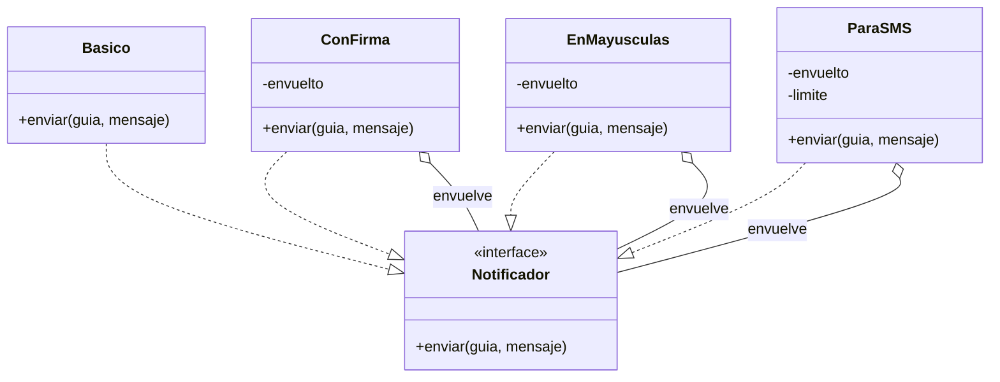
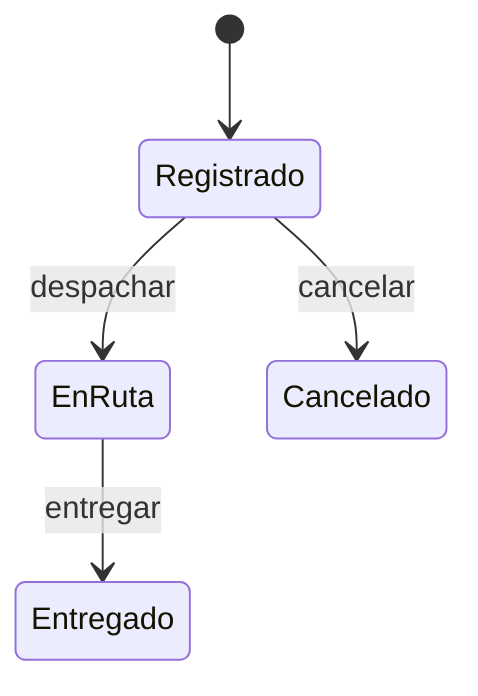
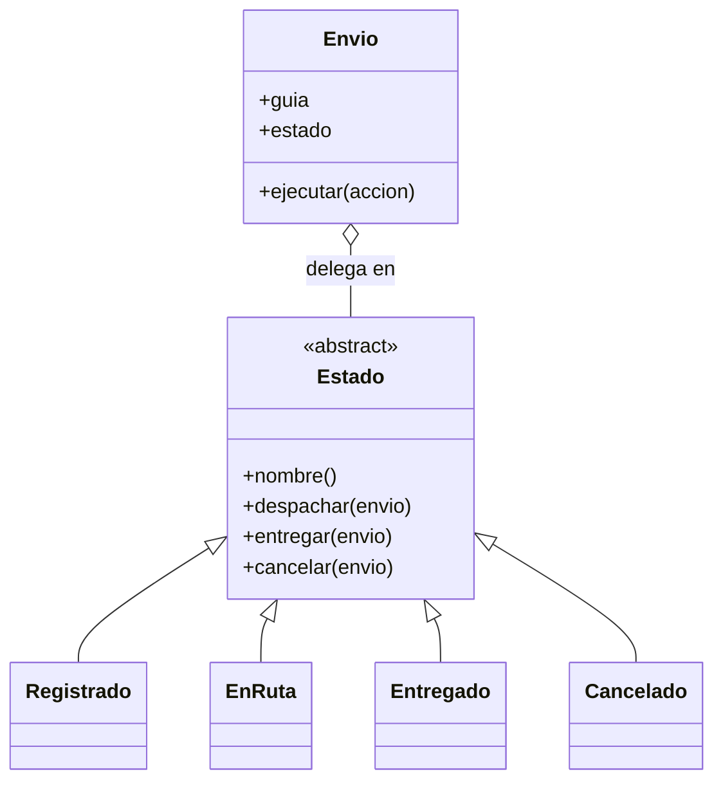
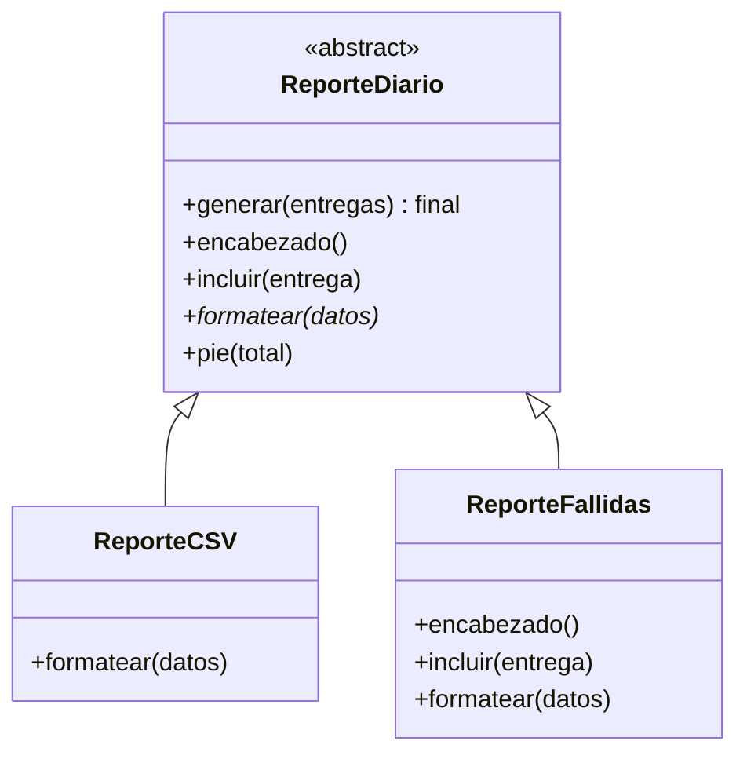
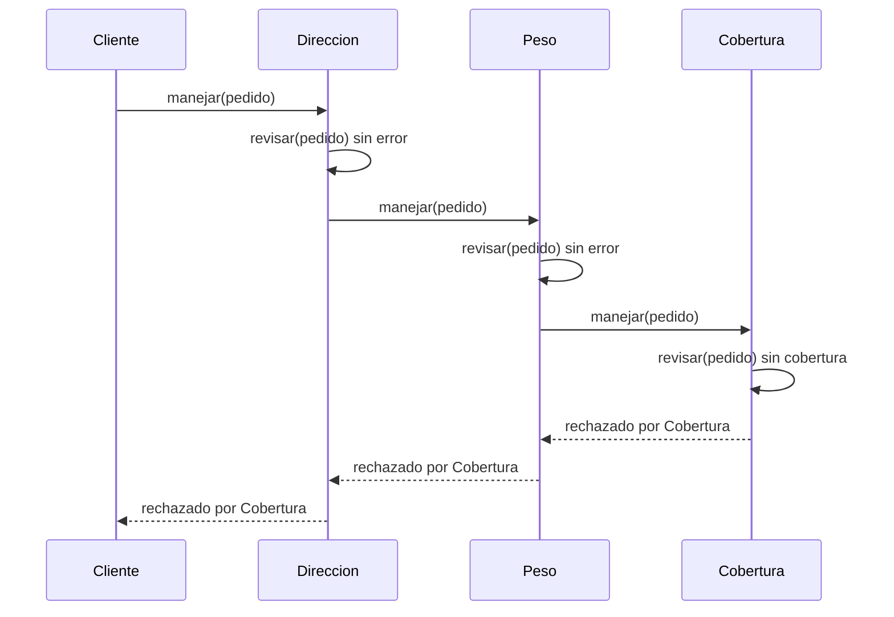
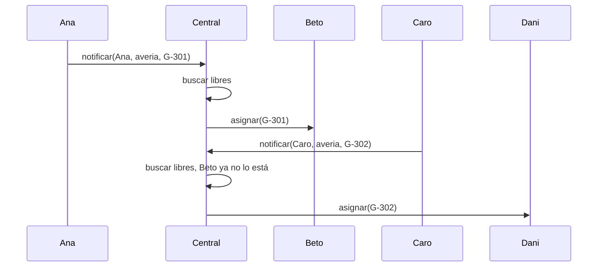
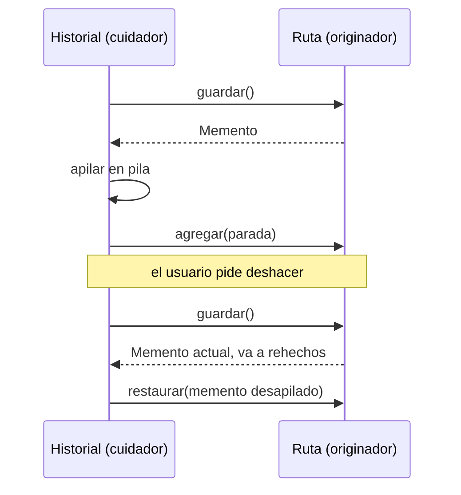
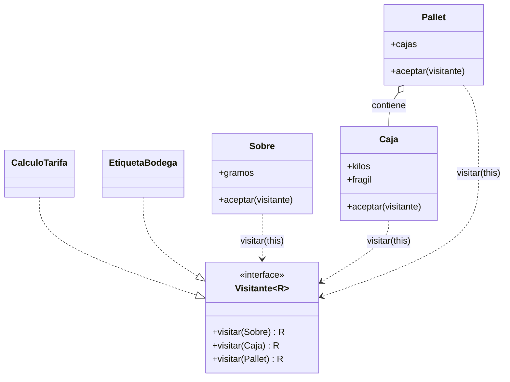
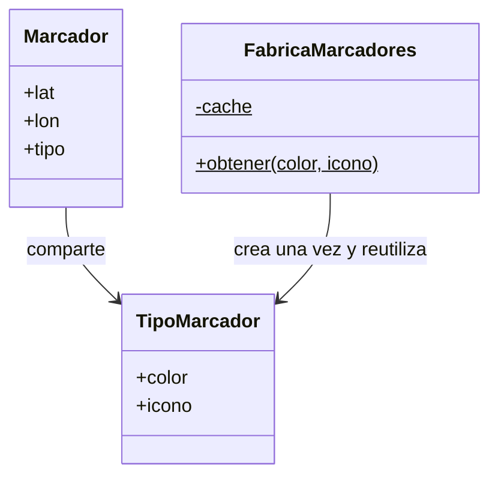

# Módulo 9: Catálogo de patrones de diseño

**Entorno comprobado para esta edición (2026-11-24):** OpenJDK 25.0.5.1 en Linux x86_64, solo con la biblioteca estándar de Java. Todas las transcripciones son literales de esa ejecución, en la carpeta de práctica `/home/estudiante/labs/patrones` (tu `~/labs/patrones`). Los tiempos en milisegundos, los bytes medidos y las direcciones que Java imprime para los objetos (como `@7ee955a8`) cambian en tu equipo; los textos y los conteos no.

## Apertura del módulo

Al terminar este módulo podrás:
- reconocer en código de RutaFlow el problema que resuelve cada uno de ocho patrones de diseño;
- transformar una versión «antes» con `if`, copias o referencias cruzadas en una versión con el patrón, sin cambiar el resultado correcto;
- dibujar el diagrama de clases o de secuencia de cada patrón y explicar quién llama a quién;
- demostrar con una ejecución real el fallo que el patrón evita;
- justificar cuándo **no** usar un patrón y qué alternativa más simple elegir.

**Esquema del módulo:** Decorator (Tema 1), State (Tema 2), Template Method (Tema 3), Chain of Responsibility (Tema 4), Mediator (Tema 5), Memento (Tema 6), Visitor (Tema 7) y Flyweight (Tema 8). Cierra con el Proyecto 13, que los une en un núcleo de envíos.

**Qué necesitas saber antes:** clase, objeto, atributo, método, constructor y `this` (Módulo 1, Tema 6); herencia, `super`, sobrescritura con `@Override`, composición, clase abstracta, método abstracto, interfaz y polimorfismo (Módulo 1, Tema 7); excepción y record (Módulo 1, Tema 1); método y parámetro (Módulo 1, Tema 4); `List`, `Map`, `Set`, lambdas y objetos mutables (Módulo 2, Tema 1); pila (Módulo 2, Tema 2). Esas fichas no se repiten aquí: cada tema las enlaza.

## Antes de empezar: cómo usar este catálogo

Este módulo es la referencia de patrones del curso; el Módulo 7 (Tema 3) solo practica Repository y Adapter y remite aquí. Cada tema sigue el mismo recorrido: un **antes** con el problema real en código de RutaFlow, ejecutado; un **después** con el patrón, ejecutado con la misma entrada; un diagrama; y un apartado **Cuándo no usarlo**.

No empieces eligiendo patrón. Identifica primero el problema, las fuerzas que tiran en direcciones distintas y la alternativa más simple. Un patrón innecesario agrega archivos, saltos y conceptos que alguien tendrá que leer.

La alternativa simple que más vas a ver se llama **Strategy**: pasar un objeto o una función intercambiable. Ya la usaste con los avisos del Módulo 1, Tema 7, cuando `Envio` recibía un `AvisoConsola` o un `AvisoMemoria`.

Prepara la carpeta una sola vez; todos los programas del módulo viven ahí y algunos usan clases de otros archivos de la misma carpeta:

```bash
mkdir -p ~/labs/patrones && cd ~/labs/patrones
```

## Aprende construyendo

### Tema 1: Decorator: agregar comportamiento sin heredar · Avanzado · 60 min

<details open>
<summary><strong>Capa 1 — Lectura</strong></summary>

#### Objetivos
Al terminar este tema podrás:
- explicar qué es un patrón de diseño y qué problema resuelve el patrón Decorator;
- envolver un objeto con decoradores apilables y predecir cómo cambia el resultado al cambiar el orden;
- distinguir el patrón Decorator, sobre objetos, de una envoltura de funciones con lambdas;
- conservar el nombre de una operación envuelta, que una lambda no tiene.

**Conceptos clave:** patrón de diseño, Decorator, envoltura de función, interfaz funcional, nombre de una lambda

Ya los conoces y no se repiten: *clase*, *objeto*, *método* y *constructor* (Módulo 1, Tema 6); *herencia*,
*sobrescritura*, `super`, *interfaz* y *composición* (Módulo 1, Tema 7); *método* y *lambda* (Módulos 1 y 2).

#### El problema
RutaFlow avisa a sus clientes cuándo sale cada paquete. Unos clientes quieren el aviso firmado, otros en mayúsculas,
otros recortado para SMS, y algunos todo a la vez. Si cada combinación es una subclase, cada extra nuevo duplica el
número de clases. ¿Cómo agregas comportamiento a un objeto, en cualquier combinación, sin crear una clase por mezcla?

#### Glosario del tema

**patrón de diseño**
- **Definición técnica:** solución con nombre a un problema de diseño que se repite, descrita por su estructura de clases, sus colaboraciones y sus consecuencias.
- **En palabras sencillas:** una receta probada para organizar clases cuando aparece un problema conocido; el nombre permite hablar de ella en una frase.
- **Dónde se rompe la comparación:** una receta se sigue al pie de la letra; un patrón se adapta al lenguaje y al problema, y a veces la mejor decisión es no usarlo.
- **Ejemplo:** «usa un Decorator para la firma» le dice a otra persona qué clases esperar sin dibujarlas.
- **Error típico:** buscar dónde meter un patrón antes de tener el problema que resuelve.

**Decorator**
- **Definición técnica:** patrón estructural en el que un objeto envoltorio implementa la misma interfaz que el objeto que envuelve, le delega la llamada y agrega trabajo antes o después.
- **En palabras sencillas:** como meter un regalo en varias bolsas: cada bolsa agrega algo, pero por fuera sigue siendo «algo que se entrega».
- **Dónde se rompe la comparación:** las bolsas no cambian el regalo; un decorador sí puede cambiar los datos que pasan, como el mensaje en mayúsculas.
- **Ejemplo:** `new ConFirma(new EnMayusculas(new Basico()))` responde a `enviar` igual que cualquier `Notificador`.
- **Error típico:** olvidar delegar: si `ConFirma.enviar` no llama a `envuelto.enviar`, el aviso original se pierde.

**envoltura de función**
- **Definición técnica:** método que recibe una función (por ejemplo, un `IntUnaryOperator`) y devuelve otra función del mismo tipo que llama a la original y agrega trabajo antes o después.
- **En palabras sencillas:** un envoltorio para funciones: la llamas igual que antes y por dentro hace algo extra, como medir el tiempo.
- **Dónde se rompe la comparación:** es la misma idea del patrón Decorator, pero sobre una sola función y no sobre un objeto con varios métodos.
- **Ejemplo:** `cronometrado("calcularTarifa", this::calcularTarifa)` devuelve una función que calcula la tarifa e imprime cuánto tardó.
- **Error típico:** olvidar el `return resultado` dentro de la lambda de la envoltura: el programa no compila.

**interfaz funcional**
- **Definición técnica:** interfaz con un solo método abstracto; una lambda o una referencia a método (`this::calcularTarifa`) puede ocupar su lugar. `IntUnaryOperator` recibe un `int` y devuelve un `int` con `applyAsInt`.
- **En palabras sencillas:** el «enchufe» que dice qué forma debe tener una función para conectarse ahí.
- **Dónde se rompe la comparación:** un enchufe acepta cualquier aparato; aquí el compilador revisa que los tipos de entrada y salida coincidan.
- **Ejemplo:** `cronometrado` recibe un `IntUnaryOperator` y devuelve otro: por eso las envolturas se pueden apilar.
- **Error típico:** escribir una envoltura para cada firma posible; antes revisa si alguna interfaz de `java.util.function` ya sirve.

**nombre de una lambda**
- **Definición técnica:** una lambda no tiene nombre propio; su `toString()` muestra el nombre de una clase que genera la JVM, como `Cronometro$$Lambda/0x000000004715d800@1e802ef9`.
- **En palabras sencillas:** la envoltura no trae etiqueta; si quieres saber qué función es, tienes que ponérsela tú.
- **Dónde se rompe la comparación:** la etiqueta que le pongas (un `String` o un record) es solo información; no cambia lo que hace la función.
- **Ejemplo:** el record `Operacion(String nombre, IntUnaryOperator funcion)` guarda la función junto a su nombre.
- **Error típico:** imprimir la lambda en un registro esperando ver el nombre del método: sale un texto que nadie entiende.

#### ► CÓMO FUNCIONA
Cada decorador **tiene** un objeto con el mismo método `enviar` y lo guarda en el campo `envuelto`: es composición. Al
llamar `enviar`, el decorador de afuera hace su parte y le pasa la llamada al de adentro. El cliente no sabe cuántas
capas hay: solo ve algo que responde a `enviar`.



Todos implementan la interfaz `Notificador`, y cada envoltorio guarda un `Notificador` cualquiera: un `ConFirma`
puede envolver un `EnMayusculas`. Por eso las capas se apilan en cualquier orden.

#### Problema resuelto 1.1
Antes del patrón. Implementa los avisos con herencia: una subclase para cada combinación de firma y mayúsculas.

**Razonamiento:**
1. La firma y las mayúsculas son extras; cada combinación necesita su clase.
2. `NotificadorMayusculasConFirma` hereda de `NotificadorMayusculas` y copia la firma.
3. Cuenta cuántas clases harían falta si cada extra se puede combinar con todos.

```java
// NotificadorHerencia.java — cada combinación de extras pide una subclase
static class Notificador {
    String enviar(String guia, String mensaje) {
        return "[" + guia + "] " + mensaje;
    }
}

static class NotificadorConFirma extends Notificador {
    @Override
    String enviar(String guia, String mensaje) {
        return super.enviar(guia, mensaje) + " -- RutaFlow";
    }
}

static class NotificadorMayusculas extends Notificador {
    @Override
    String enviar(String guia, String mensaje) {
        return super.enviar(guia, mensaje.toUpperCase());
    }
}

static class NotificadorMayusculasConFirma extends NotificadorMayusculas {
    @Override
    String enviar(String guia, String mensaje) {
        return super.enviar(guia, mensaje) + " -- RutaFlow";   // firma copiada otra vez
    }
}

void main() {
    List<Notificador> todos = List.of(new Notificador(), new NotificadorConFirma(),
            new NotificadorMayusculas(), new NotificadorMayusculasConFirma());
    for (Notificador n : todos) {
        IO.println("%-30s %s".formatted(n.getClass().getSimpleName(), n.enviar("G-101", "Tu paquete salió")));
    }
    for (int extras = 2; extras <= 4; extras++) {
        IO.println("Con %d extras combinables necesitas %d clases".formatted(extras, 1 << extras));
    }
}
```

```text
$ java NotificadorHerencia.java
Notificador                    [G-101] Tu paquete salió
NotificadorConFirma            [G-101] Tu paquete salió -- RutaFlow
NotificadorMayusculas          [G-101] TU PAQUETE SALIÓ
NotificadorMayusculasConFirma  [G-101] TU PAQUETE SALIÓ -- RutaFlow
Con 2 extras combinables necesitas 4 clases
Con 3 extras combinables necesitas 8 clases
Con 4 extras combinables necesitas 16 clases
```

**Explicación por partes.**
- Líneas 8–13 y 22–27: la firma ` -- RutaFlow` aparece escrita dos veces. Si cambia, hay que acordarse de las dos.
- Línea 22: para combinar dos extras hace falta una clase nueva que herede de una y copie la otra.
- Línea 36: cada extra puede estar o no, así que con *n* extras hay 2ⁿ combinaciones (`1 << extras` es 2 elevado a
  `extras`). Con cuatro, 16 clases.

#### Problema resuelto 1.2
Después del patrón. Escribe cada extra como un envoltorio independiente y apílalos en el orden que pida cada cliente.

**Razonamiento:**
1. `Notificador` pasa a ser una interfaz. Cada extra es una clase que la implementa y guarda otro `Notificador` en `envuelto`.
2. `enviar` delega en `envuelto` y agrega su parte antes o después.
3. Un extra nuevo, como el recorte para SMS, es una clase nueva; ninguna clase anterior cambia.

```java
// Decorator.java — envoltorios con la misma interfaz que se apilan
interface Notificador {
    String enviar(String guia, String mensaje);
}

static class Basico implements Notificador {           // componente base
    public String enviar(String guia, String mensaje) {
        return "[" + guia + "] " + mensaje;
    }
}

static class ConFirma implements Notificador {         // decorador: misma interfaz, envuelve otro notificador
    private final Notificador envuelto;
    ConFirma(Notificador envuelto) { this.envuelto = envuelto; }
    public String enviar(String guia, String mensaje) {
        return envuelto.enviar(guia, mensaje) + " -- RutaFlow";
    }
}

static class EnMayusculas implements Notificador {
    private final Notificador envuelto;
    EnMayusculas(Notificador envuelto) { this.envuelto = envuelto; }
    public String enviar(String guia, String mensaje) {
        return envuelto.enviar(guia, mensaje.toUpperCase());
    }
}

static class ParaSMS implements Notificador {          // extra nuevo: no toca ninguna clase anterior
    private final Notificador envuelto;
    private final int limite;
    ParaSMS(Notificador envuelto, int limite) { this.envuelto = envuelto; this.limite = limite; }
    public String enviar(String guia, String mensaje) {
        String texto = envuelto.enviar(guia, mensaje);
        return texto.substring(0, Math.min(limite, texto.length()));
    }
}

void main() {
    Notificador simple = new Basico();
    Notificador completo = new ConFirma(new EnMayusculas(new Basico()));
    IO.println(simple.enviar("G-101", "Tu paquete salió"));
    IO.println(completo.enviar("G-101", "Tu paquete salió"));

    String largo = "Tu paquete salió de la bodega de Fontibón";
    IO.println(new ParaSMS(new ConFirma(new Basico()), 32).enviar("G-101", largo));   // recorta y pierde la firma
    IO.println(new ConFirma(new ParaSMS(new Basico(), 32)).enviar("G-101", largo));   // recorta y luego firma
}
```

```text
$ java Decorator.java
[G-101] Tu paquete salió
[G-101] TU PAQUETE SALIÓ -- RutaFlow
[G-101] Tu paquete salió de la b
[G-101] Tu paquete salió de la b -- RutaFlow
```

**Explicación por partes.**
- Líneas 2–4: la interfaz que comparten el componente base y todos los envoltorios.
- Líneas 12–18: `ConFirma` guarda el objeto envuelto y agrega la firma **después** de su respuesta.
- Líneas 20–26: `EnMayusculas` cambia el mensaje **antes** de delegar.
- Líneas 28–36: `ParaSMS` es el extra nuevo. Recorta con `substring` lo que devuelve la capa de adentro; `Math.min`
  evita salirse del texto si es más corto que el límite.
- Líneas 45–46: las mismas tres clases en distinto orden dan resultados distintos. En la línea 45 la firma se recorta;
  en la 46 la firma se agrega después del recorte y el texto pasa de 32 caracteres.

Con *n* extras ahora tienes *n* clases, no 2ⁿ. La combinación se decide al crear el objeto, no al escribir clases.

#### Problema resuelto 1.3
La misma idea sirve para funciones sueltas. Apila dos envolturas sobre `calcularTarifa`: una mide el tiempo y
recibe el nombre de la operación; otra registra la llamada sin recibirlo.

**Razonamiento:**
1. Una envoltura recibe un `IntUnaryOperator` y devuelve otro: una lambda que llama a la original.
2. Las envolturas se aplican de adentro hacia afuera: primero `cronometrado`, luego `registrado`.
3. Para ver qué se pierde, imprime la función final: una lambda no tiene nombre.

```java
// Cronometro.java — envoltorios de funciones: lambdas que agregan trabajo antes y después
record Operacion(String nombre, IntUnaryOperator funcion) {}   // la función con su nombre

IntUnaryOperator cronometrado(String nombre, IntUnaryOperator funcion) {
    return kilos -> {                         // la envoltura: misma interfaz que la función original
        long inicio = System.nanoTime();
        int resultado = funcion.applyAsInt(kilos);
        IO.println("  %s tardó %d ms".formatted(nombre, (System.nanoTime() - inicio) / 1_000_000));
        return resultado;
    };
}

IntUnaryOperator registrado(IntUnaryOperator funcion) {   // mismo esquema, pero sin recibir el nombre
    return kilos -> {
        IO.println("  llamada a " + funcion + " con " + kilos);
        return funcion.applyAsInt(kilos);
    };
}

int calcularTarifa(int kilos) {               // tarifa base de 4000 más 1200 por kilo
    try {
        Thread.sleep(50);
    } catch (InterruptedException e) {
        Thread.currentThread().interrupt();
    }
    return 4000 + kilos * 1200;
}

void main() {
    IntUnaryOperator tarifa = registrado(cronometrado("calcularTarifa", this::calcularTarifa));
    IO.println("Tarifa: " + tarifa.applyAsInt(3));
    IO.println("Nombre visible: " + tarifa);

    Operacion conNombre = new Operacion("calcularTarifa", tarifa);
    IO.println("Con record: " + conNombre.nombre());
}
```

```text
$ java Cronometro.java
  llamada a Cronometro$$Lambda/0x000000003115c460@7ee955a8 con 3
  calcularTarifa tardó 50 ms
Tarifa: 7600
Nombre visible: Cronometro$$Lambda/0x000000003115d800@1e802ef9
Con record: calcularTarifa
```

**Explicación por partes.**
- Líneas 4–11: `cronometrado` devuelve una lambda. La lambda recuerda `nombre` y `funcion` aunque `cronometrado` ya
  terminó: se dice que los **captura**.
- Líneas 13–18: `registrado` tiene el mismo esquema, pero no recibe el nombre: solo puede imprimir la función.
- Línea 30: `this::calcularTarifa` convierte el método en un `IntUnaryOperator`; `registrado(cronometrado(...))`
  apila las dos envolturas.
- Salida, línea 1: `registrado` imprime la lambda que recibió: `Cronometro$$Lambda/...`, un nombre que genera la JVM.
- Salida, línea 4: la función final tampoco tiene nombre legible. El tiempo (`51 ms`) y las direcciones después de
  `@` cambian en tu equipo.
- Líneas 34–35: el record `Operacion` guarda la función junto a su nombre: así no se pierde quién es.

> **Error común.** Olvidar `return resultado;` dentro de la lambda de la envoltura. Java no compila:

```java
{rd('SinReturn.java')}```

```text
$ java SinReturn.java
{run('SinReturn.java')}```

> El compilador dice que la lambda debía devolver un `int` («missing return value»). El error aparece antes de
> ejecutar, en la línea de la envoltura, no donde se llama.

> **Buena práctica.** Cuando una envoltura escriba registros, pásale el nombre de la operación (o un record como
> `Operacion`). Los registros y los mensajes de error deben decir qué falló, no `Lambda/0x…`.

> **Ingeniería de software.** El orden de los envoltorios es una decisión de negocio. Escribe en un solo lugar cómo
> se arma cada notificador (por ejemplo, una función `notificador_para(cliente)`), para que nadie apile capas al revés.

#### Cuándo no usarlo
- Si solo existe una combinación, un método con un parámetro (`enviar(guia, mensaje, boolean firmado)`) es más corto y más claro.
- Si los extras no se combinan sino que se reemplazan uno por otro, pasa un objeto intercambiable: es Strategy.
- Si necesitas preguntar «¿este aviso tiene firma?», las capas lo esconden; ahí conviene un objeto con atributos explícitos.
- Más de tres o cuatro capas hacen difícil depurar: cada llamada atraviesa todos los `enviar`.

#### Checkpoint 1.1
¿Qué imprime `new EnMayusculas(new ConFirma(new Basico())).enviar("G-9", "ok")`? ¿La firma sale en mayúsculas?

Respuesta: `[G-9] OK -- RutaFlow`. `EnMayusculas` convierte el mensaje **antes** de delegar, y la firma se agrega
dentro, en `ConFirma`, después de recibir el mensaje ya convertido. La firma no pasa por `toUpperCase()`.

</details>

<details>
<summary><strong>Capa 2 — Construcción</strong></summary>

#### Paso 1 · Mide el problema
En `~/labs/patrones`, escribe `NotificadorHerencia.java` y ejecútalo con `java NotificadorHerencia.java`. Comprueba
las cuatro clases y la línea `Con 4 extras combinables necesitas 16 clases`.

#### Paso 2 · Envuelve en lugar de heredar
Escribe `Decorator.java` y ejecútalo. Comprueba que las dos últimas líneas difieren solo por el orden de `ParaSMS` y
`ConFirma`. Cambia los dos `32` por `20` y predice la salida antes de ejecutar.

#### Paso 3 · Envuelve funciones y conserva el nombre
Escribe `Cronometro.java` y ejecútalo: verás `Nombre visible: Cronometro$$Lambda/...`. Escribe también
`SinReturn.java` y lee el error de compilación.

#### Resumen
- Un **patrón de diseño** es una solución con nombre a un problema que se repite, con sus consecuencias.
- **Decorator** envuelve un objeto con otro de la misma interfaz que delega y agrega trabajo.
- Los envoltorios se apilan: *n* extras son *n* clases, y el **orden** de las capas cambia el resultado.
- Una **envoltura de función** devuelve otra función del mismo tipo que llama a la original y agrega trabajo.
- Una **interfaz funcional** como `IntUnaryOperator` define la forma de la función; por eso las envolturas se apilan.
- Una lambda no tiene **nombre**: si lo necesitas en los registros, guárdalo tú, por ejemplo en un record.

#### Ejercicio verificable 1
Básico. Escribe un decorador `ConPrefijo` que anteponga `RutaFlow: ` al mensaje antes de delegar. ¿Qué imprime
`new ConPrefijo(new Basico()).enviar("G-7", "Llegó")`?

Respuesta esperada: `[G-7] RutaFlow: Llegó`. La clase implementa `Notificador`, guarda `envuelto` y su `enviar`
devuelve `envuelto.enviar(guia, "RutaFlow: " + mensaje)`.

#### Ejercicio verificable 2
Intermedio. Cambia `registrado` en `Cronometro.java` para que reciba el nombre, como `cronometrado`, y úsalo en el
mensaje. ¿Qué cambia en la salida?

Respuesta esperada: la primera línea pasa a ser `  llamada a calcularTarifa con 3`. La tarifa sigue siendo `7600`, y
`Nombre visible` sigue mostrando una lambda: el nombre vive en tu mensaje, no en la función.

#### Ejercicio verificable 3
Reto. Un SMS admite 32 caracteres y debe conservar la firma completa. Arma el notificador solo con `ConFirma`,
`ParaSMS` y `Basico`, sin escribir clases nuevas, y comprueba la longitud con `length()`.

Respuesta esperada: `new ConFirma(new ParaSMS(new Basico(), 32 - " -- RutaFlow".length()))`. Con el mensaje largo de
`Decorator.java` imprime `[G-101] Tu paquete s -- RutaFlow`, y `length()` de ese texto da `32`.

#### En el trabajo
El patrón Decorator aparece en los *middlewares* de los frameworks web: cada capa envuelve la petición para medir
tiempos, revisar permisos o comprimir la respuesta. En Java, `java.io` es un catálogo de decoradores:
`new BufferedReader(new InputStreamReader(new FileInputStream(...)))` apila capas que agregan búfer y conversión
de caracteres. En Spring, anotaciones como `@Transactional` o `@Cacheable` funcionan porque el framework envuelve tu
objeto en otro de la misma interfaz que agrega la transacción o la caché: el mismo patrón, generado automáticamente.

</details>

### Tema 2: State: un objeto que cambia de comportamiento según su estado · Avanzado · 60 min

<details open>
<summary><strong>Capa 1 — Lectura</strong></summary>

#### Objetivos
Al terminar este tema podrás:
- dibujar la máquina de estados de un envío con sus transiciones permitidas;
- reemplazar una cadena de `if (estado.equals(...))` por un objeto por estado;
- rechazar transiciones inválidas con una excepción y comprobar las 12 combinaciones de estado y acción;
- convertir el texto de una acción en un `enum` y leer el error de una acción mal escrita.

**Conceptos clave:** máquina de estados, transición, State, `enum` y `valueOf`

Ya los conoces y no se repiten: *clase*, *objeto*, *atributo* y *método* (Módulo 1, Tema 6); *herencia*,
*sobrescritura* y *polimorfismo* (Módulo 1, Tema 7); *excepción* (Módulo 1, Tema 1); *patrón de diseño* (Tema 1 de este módulo).

#### El problema
Un envío de RutaFlow pasa por estados: registrado, en ruta, entregado o cancelado. No todas las acciones valen en
todos los estados: un envío entregado no se cancela. Hoy esas reglas viven en un `if/else` largo, y una condición
olvidada deja pasar una acción prohibida sin ningún error. ¿Cómo haces que cada estado decida qué acciones admite?

#### Glosario del tema

**máquina de estados**
- **Definición técnica:** modelo con un conjunto finito de estados, un estado inicial y reglas que dicen a qué estado se pasa con cada acción.
- **En palabras sencillas:** el mapa de los caminos posibles de un envío: desde dónde se puede ir a dónde, y nada más.
- **Dónde se rompe la comparación:** en un mapa real puedes salir del camino; en una máquina de estados bien hecha, lo que no está dibujado no se puede hacer.
- **Ejemplo:** registrado → en ruta → entregado; registrado → cancelado.
- **Error típico:** dibujar solo el camino feliz y olvidar decidir qué pasa con las acciones inválidas.

**transición**
- **Definición técnica:** cambio de un estado a otro provocado por una acción; cada transición tiene un estado de origen, una acción y un estado de destino.
- **En palabras sencillas:** una flecha del mapa: «si estás aquí y haces esto, llegas allá».
- **Dónde se rompe la comparación:** una flecha no dice qué pasa si intentas una acción sin flecha; el programa sí debe decirlo, normalmente con un error.
- **Ejemplo:** en ruta + entregar = entregado.
- **Error típico:** permitir una transición por omisión, como cancelar sin preguntar el estado actual.

**State**
- **Definición técnica:** patrón de comportamiento en el que un objeto delega sus acciones en un objeto estado; cada clase de estado implementa solo las acciones que admite y la transición se hace cambiando ese objeto.
- **En palabras sencillas:** el envío no se pregunta «¿en qué estado estoy?»; le pasa la acción a su estado y el estado sabe qué hacer.
- **Dónde se rompe la comparación:** parece que el envío cambia de clase; en realidad sigue siendo el mismo objeto `Envio` y solo cambia lo que guarda en su campo `estado`.
- **Ejemplo:** `new Estado.Registrado().despachar(envio)` cambia `envio.estado` a un objeto `EnRuta`.
- **Error típico:** crear las clases de estado pero dejar el `if` en `Envio`: el patrón queda a medias y las reglas, duplicadas.

**`enum` y `valueOf`**
- **Definición técnica:** un `enum` es un tipo con una lista fija de valores con nombre; `valueOf("DESPACHAR")` devuelve el valor cuyo nombre coincide exactamente con el texto y lanza `IllegalArgumentException` si no existe.
- **En palabras sencillas:** la lista cerrada de acciones válidas, y la forma de pasar del texto de una petición a una de ellas.
- **Dónde se rompe la comparación:** el texto se comprueba al ejecutar; en el código, en cambio, escribir `Accion.DESPACAR` ni compila.
- **Ejemplo:** `Accion.desde("despachar")` devuelve `Accion.DESPACHAR`.
- **Error típico:** pasar un nombre que no existe: `IllegalArgumentException: No enum constant Accion.DESPACAR`.

#### ► CÓMO FUNCIONA
Primero el mapa. Las flechas son las únicas transiciones permitidas:



Después las clases. La clase base `Estado` rechaza las tres acciones con `IllegalStateException`. Cada subclase
sobrescribe solo las acciones que tienen flecha. `Envio` guarda un objeto estado y le delega cada acción:



Una flecha nueva en el mapa es un método nuevo en una sola clase de estado. Un estado nuevo es una clase nueva.

#### Problema resuelto 2.1
Antes del patrón. Implementa las transiciones con `if/else` y prueba la secuencia despachar, entregar, cancelar.

**Razonamiento:**
1. Cada rama del `if` combina una acción con el estado de origen que la permite.
2. Si ninguna rama coincide, se lanza `IllegalStateException`.
3. Cancelar después de entregar debería caer en el `else`.

```java
// EstadoConIf.java — las reglas de transición repartidas en if/else
static class Envio {
    final String guia;
    String estado = "registrado";

    Envio(String guia) {
        this.guia = guia;
    }

    void ejecutar(String accion) {
        if (accion.equals("despachar") && estado.equals("registrado")) {
            estado = "en ruta";
        } else if (accion.equals("entregar") && estado.equals("en ruta")) {
            estado = "entregado";
        } else if (accion.equals("cancelar")) {        // olvidó preguntar por el estado
            estado = "cancelado";
        } else {
            throw new IllegalStateException("No se puede " + accion + " en estado " + estado);
        }
        IO.println("%s: %-9s -> %s".formatted(guia, accion, estado));
    }
}

void main() {
    Envio envio = new Envio("G-202");
    envio.ejecutar("despachar");
    envio.ejecutar("entregar");
    envio.ejecutar("cancelar");                        // un envío entregado no debería cancelarse
}
```

```text
$ java EstadoConIf.java
G-202: despachar -> en ruta
G-202: entregar  -> entregado
G-202: cancelar  -> cancelado
```

**Explicación por partes.**
- Líneas 11–14: despachar y entregar preguntan acción **y** estado de origen.
- Línea 15: cancelar solo pregunta la acción. Falta `&& estado.equals("registrado")`.
- Salida, línea 3: un envío entregado quedó cancelado. No hubo error: el defecto es silencioso.

El fallo no es de sintaxis, es de diseño: las reglas de los cuatro estados están mezcladas en un solo método, y
cada estado nuevo agrega condiciones a todas las ramas.

#### Problema resuelto 2.2
Después del patrón. Escribe un objeto por estado y deja que cada uno decida.

**Razonamiento:**
1. La clase base rechaza todo: así, lo que una subclase no permite queda prohibido por defecto.
2. Cada estado sobrescribe solo sus flechas y, para transitar, reemplaza `envio.estado`.
3. `Envio.ejecutar` no pregunta por el estado: convierte el texto en una `Accion` y llama al método del estado.
4. `Estado` declara sus subclases dentro de su propio archivo (`Estado.Registrado`, `Estado.EnRuta`…), porque `java`
   busca cada clase de primer nivel en el archivo de su mismo nombre.

```java
// Accion.java — las acciones que se le pueden pedir a un envío
enum Accion {
    DESPACHAR, ENTREGAR, CANCELAR;

    /** Convierte el texto de una petición ("despachar") en la acción; falla si no existe. */
    static Accion desde(String texto) {
        return valueOf(texto.toUpperCase());
    }

    @Override
    public String toString() {
        return name().toLowerCase();
    }
}
```

```java
// Estado.java — cada estado es un objeto que sabe qué acciones admite
abstract class Estado {
    abstract String nombre();

    void despachar(Envio envio) { throw new IllegalStateException("No se puede despachar en estado " + nombre()); }
    void entregar(Envio envio) { throw new IllegalStateException("No se puede entregar en estado " + nombre()); }
    void cancelar(Envio envio) { throw new IllegalStateException("No se puede cancelar en estado " + nombre()); }

    static final class Registrado extends Estado {
        String nombre() { return "registrado"; }
        @Override void despachar(Envio envio) { envio.estado = new EnRuta(); }
        @Override void cancelar(Envio envio) { envio.estado = new Cancelado(); }
    }

    static final class EnRuta extends Estado {
        String nombre() { return "en ruta"; }
        @Override void entregar(Envio envio) { envio.estado = new Entregado(); }
    }

    static final class Entregado extends Estado {
        String nombre() { return "entregado"; }
    }

    static final class Cancelado extends Estado {
        String nombre() { return "cancelado"; }
    }
}
```

```java
// Envio.java — el envío no pregunta en qué estado está: le pasa la acción a su estado
class Envio {
    final String guia;
    Estado estado = new Estado.Registrado();

    Envio(String guia) {
        this.guia = guia;
    }

    void ejecutar(String texto) {
        Accion accion = Accion.desde(texto);
        switch (accion) {                      // elige qué método llamar; la regla la decide el estado
            case DESPACHAR -> estado.despachar(this);
            case ENTREGAR -> estado.entregar(this);
            case CANCELAR -> estado.cancelar(this);
        }
        IO.println("%s: %-9s -> %s".formatted(guia, accion, estado.nombre()));
    }
}
```

```java
// State.java — prueba el envío con el patrón State
void main() {
    Envio envio = new Envio("G-202");
    envio.ejecutar("despachar");
    envio.ejecutar("entregar");
    try {
        envio.ejecutar("cancelar");
    } catch (IllegalStateException error) {
        IO.println("Rechazado: " + error.getMessage());
    }
}
```

```text
$ java State.java
G-202: despachar -> en ruta
G-202: entregar  -> entregado
Rechazado: No se puede cancelar en estado entregado
```

**Explicación por partes.**
- `Accion.java`, líneas 6–8: `desde` pasa el texto a mayúsculas y lo busca entre los valores del `enum`. Líneas
  10–13: `toString` lo muestra otra vez en minúsculas.
- `Estado.java`, líneas 5–7: `Estado` es la regla por defecto: cualquier acción lanza `IllegalStateException` con el
  nombre del estado.
- `Estado.java`, líneas 9–13: `Registrado` admite despachar y cancelar. Cada método cambia el estado del envío que recibe.
- `Estado.java`, líneas 20–26: `Entregado` y `Cancelado` no sobrescriben nada: son estados finales.
- `Envio.java`, líneas 12–16: el `switch` solo elige qué método llamar; no pregunta por el estado. La regla la
  decide el objeto `estado`.
- `State.java`, líneas 6–10: cancelar un envío entregado ahora se rechaza con un mensaje claro.

#### Problema resuelto 2.3
Comprueba que **todas** las transiciones inválidas se rechazan: prueba las tres acciones desde los cuatro estados.

**Razonamiento:**
1. Son 4 estados por 3 acciones: 12 combinaciones.
2. Para cada una, crea un envío, ponle el estado y ejecuta la acción dentro de `try`. `Accion.values()` recorre las tres acciones.
3. Compara la tabla impresa con el diagrama: solo las flechas dibujadas deben aceptarse.

```java
// Transiciones.java — prueba todas las acciones desde cada estado
void main() {
    List<Estado> estados = List.of(new Estado.Registrado(), new Estado.EnRuta(),
            new Estado.Entregado(), new Estado.Cancelado());
    for (Estado estado : estados) {
        for (Accion accion : Accion.values()) {
            Envio envio = new Envio("G-204");
            envio.estado = estado;
            String resultado;
            try {
                switch (accion) {
                    case DESPACHAR -> estado.despachar(envio);
                    case ENTREGAR -> estado.entregar(envio);
                    case CANCELAR -> estado.cancelar(envio);
                }
                resultado = envio.estado.nombre();
            } catch (IllegalStateException e) {
                resultado = "rechazada";
            }
            IO.println("%-10s + %-9s = %s".formatted(estado.nombre(), accion, resultado));
        }
    }
}
```

```text
$ java Transiciones.java
registrado + despachar = en ruta
registrado + entregar  = rechazada
registrado + cancelar  = cancelado
en ruta    + despachar = rechazada
en ruta    + entregar  = entregado
en ruta    + cancelar  = rechazada
entregado  + despachar = rechazada
entregado  + entregar  = rechazada
entregado  + cancelar  = rechazada
cancelado  + despachar = rechazada
cancelado  + entregar  = rechazada
cancelado  + cancelar  = rechazada
```

Tres combinaciones aceptadas, las mismas tres flechas del diagrama. Las nueve restantes se rechazan.

> **Error común.** Escribir mal el nombre de la acción. Como el texto se convierte con `valueOf`, el error aparece
> al ejecutar: `IllegalArgumentException: No enum constant Accion.DESPACAR`. No es una transición inválida (eso
> sería `IllegalStateException`), es una acción que no existe.

```java
// EstadoTypo.java — una acción mal escrita
void main() {
    Envio envio = new Envio("G-203");
    envio.ejecutar("despacar");
}
```

```text
$ java EstadoTypo.java
Exception in thread "main" java.lang.IllegalArgumentException: No enum constant Accion.DESPACAR
	at java.base/java.lang.Enum.valueOf(Enum.java:293)
	at Accion.valueOf(Accion.java:2)
	at Accion.desde(Accion.java:7)
	at Envio.ejecutar(Envio.java:11)
	at EstadoTypo.main(EstadoTypo.java:4)
```

> **Prevenir errores.** Guarda la tabla de `Transiciones.java` como prueba: cada estado nuevo debe pasarla. Así una
> flecha olvidada o sobrante aparece en la prueba, no en producción.

> **Buena práctica.** Haz que la clase base rechace todo y que cada estado permita lo suyo. Al revés (permitir todo
> y prohibir caso por caso) repite el defecto del `if/else`.

#### Cuándo no usarlo
- Con dos o tres estados y una regla simple, un mapa de transiciones permitidas es más corto: `Map.of("registrado", Set.of("despachar", "cancelar"), ...)`.
- Si los estados solo cambian una etiqueta y no el comportamiento, basta un `enum` de estados y una validación.
- Si las reglas las define el negocio y cambian cada semana, guárdalas como datos (tabla o archivo), no como clases.

#### Checkpoint 2.1
En `Estado.java`, ¿qué clase cambias para permitir cancelar un envío que está en ruta? ¿Cuántas clases tocas?

Respuesta: solo `EnRuta`. Le agregas `@Override void cancelar(Envio envio) { envio.estado = new Cancelado(); }`. La clase base, los
otros estados y `Envio` no cambian.

</details>

<details>
<summary><strong>Capa 2 — Construcción</strong></summary>

#### Paso 1 · Reproduce el defecto
Escribe `EstadoConIf.java` y ejecútalo. Comprueba que la última línea dice `cancelar  -> cancelado` aunque el envío
ya estaba entregado.

#### Paso 2 · Un objeto por estado
Escribe `Accion.java`, `Estado.java`, `Envio.java` y `State.java`, y ejecuta `java State.java`. La última línea debe ser `Rechazado: No se puede cancelar en estado entregado`.

#### Paso 3 · Comprueba la tabla completa
Escribe `Transiciones.java` y ejecútalo. Cuenta las líneas que no dicen `rechazada`: deben ser tres.

#### Resumen
- Una **máquina de estados** fija qué **transiciones** existen; lo que no está dibujado no se permite.
- El patrón **State** delega cada acción en un objeto estado; cambiar de estado es reemplazar ese objeto.
- La clase base rechaza todo con `IllegalStateException` y cada estado sobrescribe solo sus flechas.
- Un **`enum`** fija la lista de acciones; `valueOf` convierte el texto y, si está mal escrito, lanza `IllegalArgumentException`.
- Una tabla de todas las combinaciones prueba que ninguna transición inválida se cuela.

#### Ejercicio verificable 1
Básico. Agrega el estado `Devuelto` y la acción `devolver`, permitida solo desde `EnRuta`. ¿Qué imprime despachar y
luego devolver el envío `G-205`?

Respuesta esperada: `DEVOLVER` en `Accion`; en `Estado`, un `devolver` que lanza `IllegalStateException`; una clase
`Devuelto` cuyo `nombre()` devuelve `"devuelto"`; en `EnRuta`, `@Override void devolver(Envio envio) { envio.estado =
new Devuelto(); }`; y en el `switch` de `Envio`, `case DEVOLVER -> estado.devolver(this);`. Imprime
`G-205: despachar -> en ruta` y `G-205: devolver  -> devuelto`. Cuidado: si olvidas el `case` en `Envio`, el programa
compila igual (un `switch` de instrucciones no exige cubrir todos los valores) e imprime `devolver  -> en ruta` sin
ningún error.

#### Ejercicio verificable 2
Intermedio. Después del Ejercicio 1, agrega `new Estado.Devuelto()` a la lista de `Transiciones.java` y el `case DEVOLVER`
a su `switch`. ¿Cuántas
combinaciones hay y cuántas se aceptan?

Respuesta esperada: 5 estados por 4 acciones, 20 combinaciones. Se aceptan 4: las tres de antes y
`en ruta + devolver = devuelto`.

#### Ejercicio verificable 3
Reto. Haz que `Envio` guarde la lista de estados por los que pasó, sin tocar ninguna clase de estado.

Respuesta esperada: un campo `final List<String> historial = new ArrayList<>(List.of("registrado"));` y, en
`ejecutar`, después del `switch`, `historial.add(estado.nombre());`. Tras despachar y entregar, `historial` vale
`[registrado, en ruta, entregado]`. Una acción rechazada no agrega nada, porque la excepción sale antes.

#### En el trabajo
Pedidos, pagos, tickets de soporte y envíos tienen máquinas de estados. En un backend, la regla «no se cancela lo
entregado» se valida en el servidor, no solo en la pantalla, porque cualquiera puede enviar la petición a mano.
Muchas empresas dibujan el diagrama de estados en la documentación del API y prueban cada flecha.

</details>

### Tema 3: Template Method: un algoritmo fijo con pasos variables · Avanzado · 60 min

<details open>
<summary><strong>Capa 1 — Lectura</strong></summary>

#### Objetivos
Al terminar este tema podrás:
- identificar en dos funciones parecidas los pasos que se repiten y los que cambian;
- escribir un método plantilla que fija el orden de los pasos en una clase base abstracta;
- distinguir un paso obligatorio (método abstracto) de un gancho con valor por defecto;
- leer el error de compilación de una subclase que olvida el paso obligatorio y proteger los ganchos con `@Override`.

**Conceptos clave:** Template Method, gancho

Ya los conoces y no se repiten: *herencia*, *sobrescritura*, *clase abstracta*, *método abstracto* y *polimorfismo*
(Módulo 1, Tema 7); *record* y *lista* (Módulos 1 y 2); *patrón de diseño* (Tema 1 de este módulo).

#### El problema
Cada noche RutaFlow genera reportes de entregas: uno completo en CSV para contabilidad y otro solo con las fallidas
para el equipo de reclamos. Los dos siguen los mismos pasos: encabezado, filtrar, dar formato y pie con el total.
Hoy son dos métodos copiados, y la copia del pie quedó mal. ¿Cómo fijas el orden de los pasos una sola vez y dejas
variar solo lo que cambia?

#### Glosario del tema

**Template Method y método plantilla**
- **Definición técnica:** patrón de comportamiento en el que una clase base define un método, el método plantilla, que ejecuta un algoritmo en un orden fijo llamando a otros métodos que las subclases implementan o sobrescriben.
- **En palabras sencillas:** un formulario con casillas en orden fijo; cada reporte llena las casillas a su manera, pero nadie cambia el orden.
- **Dónde se rompe la comparación:** en un formulario las casillas son independientes; aquí un paso recibe el resultado del anterior, como el formato que recibe los datos ya filtrados.
- **Ejemplo:** `ReporteDiario.generar` llama a `incluir`, `formatear`, `encabezado` y `pie`, siempre en ese orden.
- **Error típico:** sobrescribir el método plantilla en una subclase: se rompe el orden que el patrón debía proteger. Por eso en Java se declara `final`.

**gancho**
- **Definición técnica:** método de la clase base con una implementación por defecto, a menudo vacía o trivial, que el método plantilla llama y que una subclase puede sobrescribir si lo necesita (en inglés, *hook*).
- **En palabras sencillas:** una casilla que ya viene llena con un valor normal; la cambias solo si tu reporte lo necesita.
- **Dónde se rompe la comparación:** a diferencia de un paso abstracto, nadie te obliga a sobrescribirlo; si te equivocas en el nombre y no escribiste `@Override`, Java no avisa y se usa el valor por defecto.
- **Ejemplo:** `incluir` devuelve `true` para todo; `ReporteFallidas` lo sobrescribe para quedarse solo con las fallidas.
- **Error típico:** escribir `boolean incluye(Entrega entrega)` en la subclase sin `@Override`: es un método nuevo, no sobrescribe el gancho y el reporte incluye todo.

#### ► CÓMO FUNCIONA
La clase base es abstracta y tiene el método plantilla `generar`, declarado `final`. Ese método nunca cambia: llama a los pasos en
orden. `formatear` es abstracto, así que toda subclase debe implementarlo. `encabezado`, `incluir` y `pie` son
ganchos con un valor por defecto.



El asterisco marca el método abstracto. Fíjate en el sentido de las llamadas: la clase base llama a métodos de la
subclase. Es al revés de `super`, donde la subclase llama a la base.

#### Problema resuelto 3.1
Antes del patrón. Escribe los dos reportes como métodos independientes y ejecútalos con cuatro entregas.

**Razonamiento:**
1. Cada método arma el texto en cuatro pasos: encabezado, filas, filtro (solo una) y pie.
2. El segundo método nace copiando el primero.
3. Compara el total de cada reporte con el número de filas que muestra.

```java
// ReportesCopiados.java — dos reportes que repiten los mismos pasos a mano
record Entrega(String guia, String estado) {}

String reporteCsv(List<Entrega> entregas) {
    String texto = "Reporte RutaFlow\n";
    texto += "guia,estado\n";
    for (Entrega e : entregas) texto += e.guia() + "," + e.estado() + "\n";
    return texto + "Total: " + entregas.size() + "\n";
}

String reporteFallidas(List<Entrega> entregas) {
    String texto = "Entregas fallidas\n";
    for (Entrega e : entregas) {
        if (e.estado().equals("fallida")) texto += "- " + e.guia() + "\n";
    }
    return texto + "Total: " + entregas.size() + "\n";   // pie copiado: cuenta todas, no las fallidas
}

void main() {
    List<Entrega> entregas = List.of(new Entrega("G-1", "entregada"), new Entrega("G-2", "fallida"),
            new Entrega("G-3", "entregada"), new Entrega("G-4", "fallida"));
    IO.println(reporteCsv(entregas));
    IO.println(reporteFallidas(entregas));
}
```

```text
$ java ReportesCopiados.java
Reporte RutaFlow
guia,estado
G-1,entregada
G-2,fallida
G-3,entregada
G-4,fallida
Total: 4

Entregas fallidas
- G-2
- G-4
Total: 4

```

**Explicación por partes.**
- Líneas 4–9 y 11–17: los dos cuerpos repiten la misma secuencia; solo cambian el encabezado, el filtro y el formato de fila.
- Línea 16: el pie se copió con `entregas.size()`. Debía contar las filas filtradas.
- Salida: el reporte de fallidas muestra dos guías y dice `Total: 4`. Nadie lo nota hasta que reclamos pregunta.

#### Problema resuelto 3.2
Después del patrón. Mueve el orden de los pasos a una clase base y deja que cada reporte cambie solo lo suyo.

**Razonamiento:**
1. El orden (filtrar, formatear, encabezado, pie) va en un solo método: `generar`.
2. El pie recibe `datos.size()`, los datos ya filtrados; así ningún reporte puede contar mal.
3. El formato cambia siempre: es abstracto. Encabezado, filtro y pie casi nunca: son ganchos.
4. `generar` es `final`: ninguna subclase puede reemplazarlo.

```java
// Entrega.java — una entrega del día: guía y estado
record Entrega(String guia, String estado) {}
```

```java
// ReporteDiario.java — el orden de los pasos vive en un solo lugar
import java.util.List;

abstract class ReporteDiario {
    final String generar(List<Entrega> entregas) {   // método plantilla: final, nadie cambia el orden
        List<Entrega> datos = entregas.stream().filter(this::incluir).toList();
        String cuerpo = formatear(datos);
        return encabezado() + cuerpo + pie(datos.size());
    }

    String encabezado() {                            // paso con implementación por defecto (gancho)
        return "Reporte RutaFlow\n";
    }

    boolean incluir(Entrega entrega) {
        return true;
    }

    abstract String formatear(List<Entrega> datos);  // paso obligatorio para cada subclase

    String pie(int total) {
        return "Total: " + total + "\n";
    }
}
```

```java
// TemplateMethod.java — dos reportes que solo cambian sus pasos
static class ReporteCSV extends ReporteDiario {
    @Override
    String formatear(List<Entrega> datos) {
        return "guia,estado\n" + datos.stream().map(e -> e.guia() + "," + e.estado() + "\n").collect(Collectors.joining());
    }
}

static class ReporteFallidas extends ReporteDiario {
    @Override
    String encabezado() {
        return "Entregas fallidas\n";
    }

    @Override
    boolean incluir(Entrega entrega) {
        return entrega.estado().equals("fallida");
    }

    @Override
    String formatear(List<Entrega> datos) {
        return datos.stream().map(e -> "- " + e.guia() + "\n").collect(Collectors.joining());
    }
}

void main() {
    List<Entrega> entregas = List.of(new Entrega("G-1", "entregada"), new Entrega("G-2", "fallida"),
            new Entrega("G-3", "entregada"), new Entrega("G-4", "fallida"));
    IO.println(new ReporteCSV().generar(entregas));
    IO.println(new ReporteFallidas().generar(entregas));
}
```

```text
$ java TemplateMethod.java
Reporte RutaFlow
guia,estado
G-1,entregada
G-2,fallida
G-3,entregada
G-4,fallida
Total: 4

Entregas fallidas
- G-2
- G-4
Total: 2

```

**Explicación por partes.**
- `ReporteDiario.java`, líneas 5–9: el método plantilla. Filtra con el gancho `incluir`, formatea y une encabezado,
  cuerpo y pie. `final` impide que una subclase lo sobrescriba.
- Línea 8: el pie recibe `datos.size()`. El defecto del Problema resuelto 3.1 ya no se puede repetir.
- Líneas 11–23: tres ganchos con valor por defecto y un paso abstracto (línea 19).
- `TemplateMethod.java`, líneas 2–7: `ReporteCSV` solo implementa el paso obligatorio.
- Líneas 9–24: `ReporteFallidas` cambia dos ganchos y el formato, y hereda el pie correcto. Cada sobrescritura lleva
  `@Override`.
- Salida: el reporte de fallidas termina en `Total: 2`.

> **Error común.** Crear una subclase sin el paso abstracto. Java no compila el programa: el mensaje nombra la
> clase incompleta y el método que falta.

```java
// ReporteIncompleto.java — una subclase que olvida el paso obligatorio
static class ReporteJSON extends ReporteDiario {
    @Override
    String encabezado() {
        return "[\n";
    }
}

void main() {
    IO.println(new ReporteJSON().generar(List.of(new Entrega("G-1", "entregada"))));
}
```

```text
$ java ReporteIncompleto.java
ReporteIncompleto.java:2: error: ReporteJSON is not abstract and does not override abstract method formatear(List<Entrega>) in ReporteDiario
static class ReporteJSON extends ReporteDiario {
       ^
1 error
error: compilation failed
```

> **Prevenir errores.** Un gancho mal escrito no da error por sí solo: es un método nuevo que nadie llama. Si lo
> marcas con `@Override`, el compilador lo detecta:

```java
// GanchoMalEscrito.java — un gancho con el nombre equivocado
static class ReporteFallidas extends ReporteDiario {
    @Override
    boolean incluye(Entrega entrega) {               // debía llamarse incluir
        return entrega.estado().equals("fallida");
    }

    @Override
    String formatear(List<Entrega> datos) {
        return datos.stream().map(e -> "- " + e.guia() + "\n").collect(Collectors.joining());
    }
}

void main() {
    IO.println(new ReporteFallidas().generar(List.of(new Entrega("G-1", "entregada"))));
}
```

```text
$ java GanchoMalEscrito.java
GanchoMalEscrito.java:3: error: method does not override or implement a method from a supertype
    @Override
    ^
1 error
error: compilation failed
```

> Sin el `@Override` de la línea 3, el programa compila y el reporte de fallidas incluye `- G-1`, una entrega
> exitosa, y termina en `Total: 1`. Pon `@Override` en cada sobrescritura y prueba cada subclase con datos donde el
> gancho importe.

> **Buena práctica.** Deja pocos pasos abstractos y pocos ganchos. Si la clase base tiene ocho ganchos, cada
> subclase nueva obliga a leerlos todos para saber cuáles tocar.

#### Cuándo no usarlo
- Si solo cambia un paso, pasa ese paso como función o como objeto (Strategy): `generar(entregas, this::aCsv)`. No necesitas herencia.
- Si los pasos cambian de orden según el caso, no hay algoritmo fijo que proteger.
- Si hay un solo reporte, un método basta. Extrae la clase cuando aparezca el segundo y veas qué se repite.

#### Checkpoint 3.1
Quieres un reporte con todas las entregas, en CSV, pero con el encabezado `Contabilidad`. ¿Qué escribes?

Respuesta: una subclase de `ReporteCSV` que solo sobrescribe el gancho `encabezado` y devuelve `"Contabilidad\n"`.
Hereda el formato de `ReporteCSV` y el filtro y el pie de `ReporteDiario`.

</details>

<details>
<summary><strong>Capa 2 — Construcción</strong></summary>

#### Paso 1 · Encuentra la copia
Escribe `ReportesCopiados.java` y ejecútalo. Marca en el código qué líneas se repiten y cuáles cambian entre los dos
métodos.

#### Paso 2 · Fija el orden en la clase base
Escribe `Entrega.java`, `ReporteDiario.java` y `TemplateMethod.java`, y ejecuta `java TemplateMethod.java`. El reporte de fallidas debe cerrar con `Total: 2`.

#### Paso 3 · Rompe el contrato a propósito
Escribe `ReporteIncompleto.java` y ejecútalo para ver el error de compilación. Después agrega a `ReporteJSON` un
`formatear` que devuelva `""` y ejecuta otra vez: ya compila. Luego escribe `GanchoMalEscrito.java`, lee su error y
quita el `@Override` para ver el defecto silencioso.

#### Resumen
- El patrón **Template Method** fija el orden de un algoritmo en un **método plantilla** de la clase base.
- Los pasos obligatorios son **métodos abstractos**; Java no compila una subclase que no los implemente.
- Un **gancho** trae un valor por defecto y se sobrescribe solo cuando hace falta; `@Override` detecta un nombre mal escrito.
- El método plantilla se declara `final` para que ninguna subclase cambie el orden.
- La clase base llama a los métodos de la subclase: el control va de arriba abajo.
- Si solo varía un paso, pasar una función (Strategy) es más simple que heredar.

#### Ejercicio verificable 1
Básico. Escribe `ReporteEntregadas` con el encabezado `Entregas exitosas`, que incluya solo las entregas con estado
`entregada` y las liste con `- `. ¿Qué imprime con las cuatro entregas del ejemplo?

Respuesta esperada: `Entregas exitosas`, `- G-1`, `- G-3` y `Total: 2`. La subclase sobrescribe `encabezado`,
`incluir` y `formatear`; el pie se hereda.

#### Ejercicio verificable 2
Intermedio. Completa `ReporteJSON` para que con las dos primeras entregas imprima un arreglo JSON entre `[` y `]`, un
objeto por línea. ¿Qué gancho tienes que sobrescribir además de `encabezado` y `formatear`?

Respuesta esperada: `pie`, para que devuelva `"]\n"` en vez de `Total: ...`. Con un `formatear` que une con
`Collectors.joining(",\n", "", "\n")` líneas como `  {"guia": "G-1", "estado": "entregada"}`, la salida es `[`, las
dos líneas separadas por coma y `]`.

#### Ejercicio verificable 3
Reto. Un compañero propone sobrescribir `generar` en `ReporteFallidas` «para optimizarlo». ¿Qué dice Java? Y si
alguien quita el `final` para permitirlo, ¿qué riesgo concreto introduce? Justifica con el defecto del Problema
resuelto 3.1.

Respuesta esperada: Java no compila: `generar(List<Entrega>) in ReporteFallidas cannot override generar(List<Entrega>)
in ReporteDiario`, con la nota `overridden method is final`. Sin el `final`, la subclase vuelve a tener su propia
copia del algoritmo. Si esa copia calcula el pie con la
lista completa, reaparece `Total: 4`. El método plantilla existe para que el orden y el conteo vivan en un solo
lugar; las subclases solo deben tocar pasos y ganchos.

#### En el trabajo
Los frameworks están llenos de métodos plantilla: JUnit llama a los métodos `@BeforeEach`, a la prueba y a los
`@AfterEach` en ese orden, y tú solo llenas los pasos. Lo mismo pasa con `HttpServlet`, que decide cuándo llamar a tu
`doGet` o `doPost`, con `JdbcTemplate` de Spring o con los ciclos de vida de Android. En un equipo, el método plantilla protege reglas que no se negocian, como registrar siempre la auditoría al
final de un proceso.

</details>

### Tema 4: Chain of Responsibility: una cadena de validadores · Avanzado · 60 min

<details open>
<summary><strong>Capa 1 — Lectura</strong></summary>

#### Objetivos
Al terminar este tema podrás:
- separar reglas anidadas en manejadores independientes enlazados en una cadena;
- cortar la cadena en el primer error y explicar por qué el orden de los eslabones importa;
- reutilizar una parte de la cadena para otro caso sin copiar reglas;
- demostrar una falla silenciosa en una cadena mal armada y saber por qué un `assert` de Java no la detecta si no lo activas.

**Conceptos clave:** Chain of Responsibility, manejador, sucesor

Ya los conoces y no se repiten: *herencia*, *sobrescritura* y *polimorfismo* (Módulo 1, Tema 7); *record* y
*conjunto* (Módulos 1 y 2); *patrón de diseño* (Tema 1 de este módulo).

#### El problema
Antes de aceptar un pedido, RutaFlow revisa tres reglas: que tenga dirección, que pese entre 0 y 30 kg y que la
ciudad tenga cobertura. Hoy son tres `if` anidados en un método. Ahora llegan los puntos de recogida, que no piden
dirección pero sí las otras reglas. ¿Cómo combinas reglas distintas para casos distintos sin copiar el método?

#### Glosario del tema

**Chain of Responsibility**
- **Definición técnica:** patrón de comportamiento que pasa una petición por una secuencia de objetos manejadores; cada uno decide si la atiende, la corta o la entrega al siguiente.
- **En palabras sencillas:** una fila de revisores en una oficina: cada uno mira una cosa y, si está bien, pasa el papel al siguiente.
- **Dónde se rompe la comparación:** en una oficina el último revisor sabe que es el último; aquí un eslabón no sabe cuántos vienen después, solo si tiene siguiente o no.
- **Ejemplo:** `new Direccion(new Peso(new Cobertura()))` revisa dirección, luego peso, luego cobertura.
- **Error típico:** armar la cadena por partes y dejar un eslabón sin enlazar: la regla existe en el código, pero nunca se ejecuta.

**manejador**
- **Definición técnica:** cada objeto de la cadena; expone un método común (aquí `manejar`) y contiene una sola regla (aquí `revisar`).
- **En palabras sencillas:** un revisor que sabe revisar una sola cosa.
- **Dónde se rompe la comparación:** un revisor humano puede notar otros problemas; un manejador solo ve lo que su `revisar` mira.
- **Ejemplo:** `Peso` rechaza un pedido de 45 kg con `45 kg fuera de rango`.
- **Error típico:** meter dos reglas en el mismo manejador: ya no se pueden usar por separado.

**sucesor**
- **Definición técnica:** el manejador siguiente al que se entrega la petición; cada manejador guarda una referencia a él, o `null` si es el último.
- **En palabras sencillas:** a quién le pasa el papel cada revisor.
- **Dónde se rompe la comparación:** si un revisor no tiene a quién pasarlo, en esta cadena eso significa «aprobado», no «perdido».
- **Ejemplo:** en `new Direccion(new Peso())`, el sucesor de `Direccion` es el objeto `Peso` y el de `Peso` es `null`.
- **Error típico:** asumir que la cadena tiene un eslabón porque creaste el objeto: si no está como sucesor de nadie, no participa.

#### ► CÓMO FUNCIONA
Cada validador recibe su sucesor al crearse. `manejar` llama a `revisar`; si hay error, responde y la cadena se
corta. Si no, pasa el pedido al sucesor. El último, sin sucesor, responde `aceptado`.



El diagrama muestra el pedido de Leticia: pasa dos eslabones y lo corta el tercero. La respuesta vuelve por el
mismo camino.

#### Problema resuelto 4.1
Antes del patrón. Escribe la validación con `if` anidados y copia el método para los puntos de recogida.

**Razonamiento:**
1. Cada `if` revisa una regla y, si falla, devuelve el rechazo.
2. Los puntos de recogida no piden dirección: se copia el método y se quita esa regla.
3. Prueba los dos con un pedido de 45 kg.

```java
// Pedido.java — lo que llega antes de aceptar un envío
record Pedido(String direccion, int kilos, String ciudad) {}
```

```java
// ValidarTodo.java — todas las reglas anidadas en un solo método
final Set<String> CIUDADES = Set.of("Bogotá", "Medellín", "Cali");

String validar(Pedido pedido) {
    if (pedido.direccion() != null && !pedido.direccion().isBlank()) {
        if (pedido.kilos() > 0 && pedido.kilos() <= 30) {
            if (CIUDADES.contains(pedido.ciudad())) {
                return "aceptado";
            }
            return "rechazado: sin cobertura en " + pedido.ciudad();
        }
        return "rechazado: " + pedido.kilos() + " kg fuera de rango";
    }
    return "rechazado: falta la dirección";
}

String validarPuntoRecogida(Pedido pedido) {    // copia sin la regla de dirección...
    if (CIUDADES.contains(pedido.ciudad())) {   // ...y sin la de peso, por descuido
        return "aceptado";
    }
    return "rechazado: sin cobertura en " + pedido.ciudad();
}

void main() {
    IO.println(validar(new Pedido("Cl 80 # 5-12", 45, "Bogotá")));
    IO.println(validarPuntoRecogida(new Pedido(null, 45, "Bogotá")));
}
```

```text
$ java ValidarTodo.java
rechazado: 45 kg fuera de rango
aceptado
```

**Explicación por partes.**
- Líneas 4–15: tres niveles de `if`. Una regla nueva agrega otro nivel y obliga a reordenar los `return`.
- Líneas 17–22: la copia quitó la dirección y, por descuido, también el peso.
- Salida, línea 2: el punto de recogida acepta 45 kg. La regla de peso existe, pero solo en el otro método.

#### Problema resuelto 4.2
Después del patrón. Escribe cada regla como un manejador y arma cadenas distintas con las mismas piezas.

**Razonamiento:**
1. Una clase base abstracta `Validador` hace el trabajo común: revisar y, si no hay error, pasar al sucesor.
2. Cada subclase implementa solo `revisar` y devuelve un texto de error o `null`. Cada una vive en su propio archivo.
3. Para los puntos de recogida, arma otra cadena sin `Direccion`. Las reglas no se copian.

```java
// Validador.java — un eslabón de la cadena: revisa una regla y, si pasa, entrega al siguiente
abstract class Validador {
    final Validador siguiente;                 // el sucesor; null si es el último

    Validador(Validador siguiente) {
        this.siguiente = siguiente;
    }

    final String manejar(Pedido pedido) {
        String error = revisar(pedido);
        if (error != null) {
            return "rechazado por " + getClass().getSimpleName() + ": " + error;
        }
        return siguiente != null ? siguiente.manejar(pedido) : "aceptado";
    }

    abstract String revisar(Pedido pedido);   // devuelve el error, o null si la regla se cumple
}
```

```java
// Direccion.java — regla: el pedido trae dirección
class Direccion extends Validador {
    Direccion(Validador siguiente) { super(siguiente); }
    Direccion() { this(null); }

    @Override
    String revisar(Pedido pedido) {
        boolean tiene = pedido.direccion() != null && !pedido.direccion().isBlank();
        return tiene ? null : "falta la dirección";
    }
}
```

```java
// Peso.java — regla: entre 0 y 30 kg
class Peso extends Validador {
    Peso(Validador siguiente) { super(siguiente); }
    Peso() { this(null); }

    @Override
    String revisar(Pedido pedido) {
        return pedido.kilos() > 0 && pedido.kilos() <= 30 ? null : pedido.kilos() + " kg fuera de rango";
    }
}
```

```java
// Cobertura.java — regla: la ciudad tiene cobertura
import java.util.Set;

class Cobertura extends Validador {
    static final Set<String> CIUDADES = Set.of("Bogotá", "Medellín", "Cali");

    Cobertura(Validador siguiente) { super(siguiente); }
    Cobertura() { this(null); }

    @Override
    String revisar(Pedido pedido) {
        return CIUDADES.contains(pedido.ciudad()) ? null : "sin cobertura en " + pedido.ciudad();
    }
}
```

```java
// Chain.java — arma cadenas distintas con las mismas reglas
void main() {
    Validador cadena = new Direccion(new Peso(new Cobertura()));   // el orden es una decisión de diseño
    List<Pedido> pedidos = List.of(
            new Pedido("Cra 7 # 10-20", 4, "Cali"),
            new Pedido("", 4, "Cali"),
            new Pedido("Cl 80 # 5-12", 45, "Bogotá"),
            new Pedido("Av 30 # 2-1", 2, "Leticia"));
    for (Pedido pedido : pedidos) IO.println(cadena.manejar(pedido));

    Validador recogida = new Peso(new Cobertura());                 // punto de recogida: sin regla de dirección
    IO.println("Recogida: " + recogida.manejar(new Pedido(null, 45, "Bogotá")));
}
```

```text
$ java Chain.java
aceptado
rechazado por Direccion: falta la dirección
rechazado por Peso: 45 kg fuera de rango
rechazado por Cobertura: sin cobertura en Leticia
Recogida: rechazado por Peso: 45 kg fuera de rango
```

**Explicación por partes.**
- `Validador.java`, líneas 3–7: el sucesor llega al crear el objeto y no cambia después (`final`).
- Líneas 9–15: `manejar` corta en el primer error. `getClass().getSimpleName()` da el nombre de la clase que rechazó.
  Es `final`: ningún validador puede saltarse el paso de entregar al siguiente.
- Línea 14: si hay sucesor, le pasa el pedido; si no, este es el último eslabón y acepta.
- `Direccion`, `Peso` y `Cobertura`: tres reglas en tres clases. Ninguna sabe que las otras existen. Cada una tiene
  un segundo constructor sin sucesor, para ser la última.
- `Chain.java`, línea 3: se lee de afuera hacia adentro: dirección, peso, cobertura.
- Líneas 11–12: la cadena de recogida reutiliza `Peso` y `Cobertura`, y el pedido de 45 kg se rechaza.

#### Problema resuelto 4.3
La falla silenciosa. Arma una cadena en la que `Cobertura` se crea pero no se enlaza, y escribe una comprobación
que lo detecte.

**Razonamiento:**
1. Un pedido a Leticia debería rechazarse por cobertura.
2. Si `Cobertura` no es sucesor de nadie, la cadena termina en `Peso` y acepta.
3. Recorre la cadena siguiendo `siguiente` y compara la lista de nombres con la esperada usando `assert`.

```java
// CadenaRota.java — los eslabones existen, pero uno quedó suelto
List<String> eslabones(Validador cadena) {     // recorre la cadena y devuelve los nombres
    List<String> nombres = new ArrayList<>();
    while (cadena != null) {
        nombres.add(cadena.getClass().getSimpleName());
        cadena = cadena.siguiente;
    }
    return nombres;
}

void main() {
    Validador cobertura = new Cobertura();
    Validador rota = new Direccion(new Peso());    // se creó Cobertura, pero nadie la enlazó
    Pedido pedido = new Pedido("Av 30 # 2-1", 2, "Leticia");
    IO.println(rota.manejar(pedido));
    IO.println("Eslabones: " + eslabones(rota));
    assert eslabones(rota).equals(List.of("Direccion", "Peso", "Cobertura")) : "la cadena no tiene los tres validadores";
    IO.println("fin del programa");
}
```

```text
$ java CadenaRota.java
aceptado
Eslabones: [Direccion, Peso]
fin del programa
$ java -ea CadenaRota.java
aceptado
Eslabones: [Direccion, Peso]
Exception in thread "main" java.lang.AssertionError: la cadena no tiene los tres validadores
	at CadenaRota.main(CadenaRota.java:17)
```

**Explicación por partes.**
- Línea 11: el objeto `Cobertura` existe, pero ninguna línea lo pasa como sucesor.
- Salida, línea 1: el pedido a Leticia sale `aceptado`. No hay excepción: es una falla silenciosa.
- Líneas 2–9: `eslabones` sigue `siguiente` hasta llegar a `null` y anota cada clase.
- Línea 16: el `assert` debía convertir la falla silenciosa en un error visible. Pero en la primera ejecución el
  programa llega a `fin del programa`: Java **ignora** los `assert` salvo que ejecutes con `-ea` (*enable
  assertions*). Con `java -ea` aparece el `AssertionError` con su mensaje.

> **Error común.** Dejar un eslabón suelto. El programa no falla: acepta pedidos que debía rechazar. El único
> mensaje que verás es el de tu propia comprobación, y solo si la activas:
> `java.lang.AssertionError: la cadena no tiene los tres validadores`. Para una comprobación que debe correr
> siempre, usa un `if` que lance una excepción, o una prueba JUnit (Módulo 4), que sí falla sin `-ea`.

> **Prevenir errores.** Arma cada cadena en un solo método con nombre (`cadenaDomicilio()`,
> `cadenaRecogida()`) y prueba su lista de eslabones. Así el orden y los eslabones quedan escritos en un solo lugar.

> **Ingeniería de software.** El orden es una decisión: pon primero las reglas baratas y las que más rechazan. Si una
> regla consulta un servicio externo (por ejemplo, la cobertura), que vaya al final para no llamarla de más.

#### Cuándo no usarlo
- Si las reglas son pocas y siempre las mismas, una lista de funciones (`List<Function<Pedido, String>>`) recorrida con `for` hace lo mismo con menos clases.
- Si necesitas **todos** los errores a la vez (por ejemplo, para un formulario), no cortes en el primero: recorre todas las reglas y junta los mensajes.
- Si una regla depende del resultado de otra de forma compleja, una cadena lineal no lo expresa bien.

#### Checkpoint 4.1
Con la cadena `new Direccion(new Peso(new Cobertura()))`, ¿qué responde un pedido sin dirección, de 45 kg, a Leticia?

Respuesta: `rechazado por Direccion: falta la dirección`. La cadena corta en el primer error, así que `Peso` y
`Cobertura` nunca lo revisan.

</details>

<details>
<summary><strong>Capa 2 — Construcción</strong></summary>

#### Paso 1 · Copia y rompe
Escribe `Pedido.java` y `ValidarTodo.java`, y ejecuta `java ValidarTodo.java`. Comprueba que el punto de recogida acepta 45 kg.

#### Paso 2 · Una regla por eslabón
Escribe `Validador.java`, `Direccion.java`, `Peso.java`, `Cobertura.java` y `Chain.java`, y ejecuta `java Chain.java`. Comprueba las cuatro respuestas y la línea `Recogida: rechazado por Peso: 45 kg fuera de rango`.

#### Paso 3 · Detecta la cadena rota
Escribe `CadenaRota.java` en la misma carpeta, porque usa las clases de la cadena. Ejecútalo con `java` y después
con `java -ea`: solo la segunda vez verás el `AssertionError`. Cambia la línea 12 por
`Validador rota = new Direccion(new Peso(cobertura));` y ejecuta otra vez con `-ea`: debe imprimir el rechazo por
cobertura y terminar sin error.

#### Resumen
- **Chain of Responsibility** pasa una petición por una cadena de **manejadores**; cada uno revisa una regla.
- Cada manejador guarda su **sucesor**; el último, sin sucesor, acepta.
- La cadena corta en el primer error, así que el orden decide qué mensaje ve el usuario.
- Las mismas piezas arman cadenas distintas sin copiar reglas.
- Un eslabón sin enlazar es una falla silenciosa: pruébala con la lista de eslabones. Un `assert` solo corre con `java -ea`.

#### Ejercicio verificable 1
Básico. La bodega de Medellín no recibe bultos de más de 20 kg. Agrega un validador `Bodega` que rechace esos pedidos
y ponlo al final de la cadena. ¿Qué responde un pedido válido en lo demás, de 25 kg, a Medellín?

Respuesta esperada: `rechazado por Bodega: 25 kg supera el tope de 20 en Medellín`. `revisar` devuelve ese texto si
la ciudad es Medellín y los kilos pasan de 20, y `null` si no. La cadena queda
`new Direccion(new Peso(new Cobertura(new Bodega())))`.

#### Ejercicio verificable 2
Intermedio. Para un pedido sin dirección, de 2 kg, a Leticia, compara la respuesta de
`new Direccion(new Peso(new Cobertura()))` con la de `new Cobertura(new Direccion(new Peso()))`.

Respuesta esperada: la primera responde `rechazado por Direccion: falta la dirección`; la segunda,
`rechazado por Cobertura: sin cobertura en Leticia`. Las dos rechazan, pero el mensaje depende del orden.

#### Ejercicio verificable 3
Reto. Escribe `armar(...)`, que construya la cadena a partir de los constructores en orden
(`armar(Direccion::new, Peso::new, Cobertura::new)`), para que nadie tenga que anidar a mano. Compruébala con
`eslabones`.

Respuesta esperada: el método recibe `Function<Validador, Validador>... pasos` (lleva `@SafeVarargs` y `final`),
empieza con `Validador cadena = null` y recorre los pasos del último al primero haciendo
`cadena = pasos[i].apply(cadena)`. `eslabones(armar(Direccion::new, Peso::new, Cobertura::new))` da
`[Direccion, Peso, Cobertura]`, y el pedido a Leticia
responde `rechazado por Cobertura: sin cobertura en Leticia`.

#### En el trabajo
Los *middlewares* de un servidor web forman una cadena (en Java, los `Filter` de servlets y la cadena de filtros
de Spring Security): autenticación, límite de peticiones, validación y
finalmente el código del endpoint; cualquiera puede cortar con un 401 o un 429. Los sistemas de aprobación de gastos
y los filtros de correo siguen la misma idea. En producción, la lista de eslabones se registra al arrancar para
poder confirmar que ninguno quedó fuera.

</details>

### Tema 5: Mediator: coordinar objetos sin que se conozcan · Avanzado · 60 min

<details open>
<summary><strong>Capa 1 — Lectura</strong></summary>

#### Objetivos
Al terminar este tema podrás:
- medir el acoplamiento de un grupo de objetos contando las referencias entre ellos;
- centralizar la coordinación en un mediador para que los colegas no se conozcan entre sí;
- agregar un colega nuevo con una sola línea de registro;
- reconocer cuándo el mediador crece tanto que se vuelve un problema.

**Conceptos clave:** acoplamiento, Mediator, colega

Ya los conoces y no se repiten: *clase*, *objeto* y *atributo* (Módulo 1, Tema 6); *composición* (Módulo 1, Tema 7);
*`List`* y *`Map`* (Módulo 2, Tema 1); *patrón de diseño* (Tema 1 de este módulo).

#### El problema
Cuando la moto de un mensajero de RutaFlow se avería, su paquete pasa al primer compañero libre. Hoy cada mensajero
guarda la lista de todos los demás y decide a quién pasarlo. Al entrar un mensajero nuevo hay que actualizar la lista
de todos, y basta olvidar una para que un paquete quede sin dueño. ¿Cómo coordinas a varios objetos sin que cada
uno conozca a todos?

#### Glosario del tema

**acoplamiento**
- **Definición técnica:** grado en que un módulo o clase depende de los detalles de otros; con acoplamiento alto, un cambio en uno obliga a cambiar los demás.
- **En palabras sencillas:** cuántos hilos te atan a otras piezas; con muchos hilos, mover una pieza mueve todas.
- **Dónde se rompe la comparación:** algunos hilos son necesarios; el objetivo no es cero acoplamiento sino depender de pocas piezas y estables.
- **Ejemplo:** con 4 mensajeros que se conocen entre todos hay 4 × 3 = 12 referencias; con una central, 4.
- **Error típico:** medir el acoplamiento por número de archivos y no por número de dependencias entre objetos.

**Mediator**
- **Definición técnica:** patrón de comportamiento que encapsula en un objeto mediador cómo interactúa un grupo de objetos; los objetos se comunican solo con el mediador, que decide a quién avisar.
- **En palabras sencillas:** la central de despacho: los mensajeros llaman a la central, y la central reparte; ningún mensajero necesita el teléfono de otro.
- **Dónde se rompe la comparación:** una central humana tiene juicio; el mediador solo aplica las reglas que escribiste, y si acumula demasiadas se vuelve difícil de cambiar.
- **Ejemplo:** `central.notificar(emisor, "averia", guia)` busca un mensajero libre y le asigna la guía.
- **Error típico:** dejar que el mediador crezca hasta tener la lógica de todo el sistema: el acoplamiento no desaparece, se concentra.

**colega**
- **Definición técnica:** cada objeto coordinado por un mediador; guarda una referencia al mediador y le notifica sus eventos, sin referencias a otros colegas.
- **En palabras sencillas:** cada mensajero: sabe hablar con la central y nada más.
- **Dónde se rompe la comparación:** un colega sin central no puede hacer nada coordinado; uno que no se registró falla al primer aviso.
- **Ejemplo:** `Mensajero.reportarAveria` llama a `central.notificar(...)`.
- **Error típico:** usar un colega antes de registrarlo: su campo `central` vale `null` y aparece una `NullPointerException`.

#### ► CÓMO FUNCIONA
Cada mensajero se registra una vez en la central, que lo guarda en un mapa y le deja una referencia a sí
misma. Cuando un mensajero reporta una avería, solo avisa a la central. La central busca un libre y le asigna la guía.



Ana no conoce a Beto ni a Dani, y Caro tampoco. Si mañana entra Eva, solo la central se entera.

#### Problema resuelto 5.1
Antes del patrón. Cada mensajero guarda la lista de sus compañeros y busca él mismo a uno libre.

**Razonamiento:**
1. Cada mensajero tiene `companeros`; al averiarse, recorre la lista y asigna al primero libre.
2. Entra Dani: hay que agregarlo a la lista de los otros tres.
3. Cuenta las referencias: con 4 mensajeros deberían ser 4 × 3 = 12.

```java
// MensajerosAcoplados.java — cada mensajero guarda la lista de todos los demás
static class Mensajero {
    final String nombre;
    boolean libre;
    List<Mensajero> companeros = new ArrayList<>();

    Mensajero(String nombre, boolean libre) {
        this.nombre = nombre;
        this.libre = libre;
    }

    void reportarAveria(String guia) {
        libre = false;
        IO.println(nombre + " reporta avería con " + guia);
        for (Mensajero otro : companeros) {         // cada uno decide a quién pasar el envío
            if (otro.libre) {
                otro.asignar(guia);
                return;
            }
        }
        IO.println("  " + nombre + ": nadie libre para " + guia);
    }

    void asignar(String guia) {
        libre = false;
        IO.println("  " + nombre + " recibe " + guia);
    }
}

void main() {
    Mensajero ana = new Mensajero("Ana", false), beto = new Mensajero("Beto", true), caro = new Mensajero("Caro", true);
    Mensajero dani = new Mensajero("Dani", true);   // entra un mensajero nuevo
    ana.companeros = List.of(beto, caro, dani);
    beto.companeros = List.of(ana, caro, dani);
    caro.companeros = List.of(ana, beto);           // aquí se olvidó agregar a Dani
    dani.companeros = List.of(ana, beto, caro);

    ana.reportarAveria("G-301");
    caro.reportarAveria("G-302");
    int referencias = Stream.of(ana, beto, caro, dani).mapToInt(m -> m.companeros.size()).sum();
    IO.println("Referencias entre mensajeros: " + referencias);
}
```

```text
$ java MensajerosAcoplados.java
Ana reporta avería con G-301
  Beto recibe G-301
Caro reporta avería con G-302
  Caro: nadie libre para G-302
Referencias entre mensajeros: 11
```

**Explicación por partes.**
- Líneas 15–20: la regla de reparto está dentro de cada mensajero. Cambiarla es cambiar la clase de todos.
- Línea 35: la lista de Caro no tiene a Dani.
- Salida, línea 4: Caro dice que nadie está libre, y Dani sí lo estaba.
- Salida, línea 5: 11 referencias en vez de 12. Cada mensajero nuevo agrega 2 × *n* referencias que alguien debe mantener.

#### Problema resuelto 5.2
Después del patrón. Una central registra a los mensajeros y reparte las averías; los mensajeros solo la conocen a ella.

**Razonamiento:**
1. La central guarda a los mensajeros en un mapa y lleva un registro de eventos.
2. Al registrarse, cada mensajero recibe la referencia a la central.
3. La regla «primer libre que no sea el emisor» vive en un solo lugar: `Central.notificar`.
4. `Central` y `Mensajero` se usan desde varios programas, así que cada una va en su propio archivo.

```java
// Central.java — mediador: el único que conoce a todos los mensajeros
import java.util.ArrayList;
import java.util.LinkedHashMap;
import java.util.List;
import java.util.Map;

class Central {
    final Map<String, Mensajero> mensajeros = new LinkedHashMap<>();
    final List<String> registro = new ArrayList<>();

    void registrar(Mensajero mensajero) {
        mensajeros.put(mensajero.nombre, mensajero);
        mensajero.central = this;
    }

    void notificar(Mensajero emisor, String evento, String dato) {
        registro.add(emisor.nombre + " " + evento + " " + dato);
        if (evento.equals("averia")) {
            List<Mensajero> libres = mensajeros.values().stream()
                    .filter(m -> m != emisor && m.libre).toList();
            if (!libres.isEmpty()) {
                libres.getFirst().asignar(dato);
            } else {
                IO.println("  Central: nadie libre para " + dato + ", queda en espera");
            }
        }
    }
}
```

```java
// Mensajero.java — colega: solo conoce a la central
class Mensajero {
    final String nombre;
    boolean libre;
    Central central;                               // la pone la central al registrarlo

    Mensajero(String nombre, boolean libre) {
        this.nombre = nombre;
        this.libre = libre;
    }

    void reportarAveria(String guia) {
        libre = false;
        IO.println(nombre + " reporta avería con " + guia);
        central.notificar(this, "averia", guia);   // no conoce a los otros mensajeros
    }

    void asignar(String guia) {
        libre = false;
        IO.println("  " + nombre + " recibe " + guia);
    }
}
```

```java
// Mediator.java — una central coordina; los mensajeros solo la conocen a ella
void main() {
    Central central = new Central();
    Mensajero ana = new Mensajero("Ana", false), beto = new Mensajero("Beto", true), caro = new Mensajero("Caro", true);
    Mensajero dani = new Mensajero("Dani", true);
    for (Mensajero m : List.of(ana, beto, caro, dani)) {   // un mensajero nuevo = una sola línea de registro
        central.registrar(m);
    }
    ana.reportarAveria("G-301");
    caro.reportarAveria("G-302");
    beto.reportarAveria("G-303");
    IO.println("Eventos registrados: " + central.registro.size());
}
```

```text
$ java Mediator.java
Ana reporta avería con G-301
  Beto recibe G-301
Caro reporta avería con G-302
  Dani recibe G-302
Beto reporta avería con G-303
  Central: nadie libre para G-303, queda en espera
Eventos registrados: 3
```

**Explicación por partes.**
- `Central.java`, líneas 11–14: registrar guarda al mensajero y le entrega la central. Es la única conexión que necesita.
- Líneas 16–27: la regla de reparto. `m != emisor` compara referencias: evita asignarle el paquete a quien se averió.
- `Mensajero.java`, línea 15: el mensajero avisa a la central y no sabe quién recibirá la guía.
- `Mediator.java`, líneas 6–8: los cuatro mensajeros entran con el mismo `for`. Un mensajero nuevo es una línea más.
- Salida: Dani recibe la guía de Caro. Cuando ya no hay libres, la central lo dice y el evento queda registrado.

> **Error común.** Usar un mensajero que no se registró. Su campo `central` sigue en `null` y la primera avería
> termina con una `NullPointerException`. Java dice exactamente qué era `null`: `"this.central"`. La línea señalada
> es la llamada a la central, pero la causa está antes: falta `central.registrar(eva)`.

```java
// SinRegistrar.java — un mensajero que nunca se registró en la central
void main() {
    Central central = new Central();
    Mensajero eva = new Mensajero("Eva", true);
    eva.reportarAveria("G-304");
}
```

```text
$ java SinRegistrar.java
Eva reporta avería con G-304
Exception in thread "main" java.lang.NullPointerException: Cannot invoke "Central.notificar(Mensajero, String, String)" because "this.central" is null
	at Mensajero.reportarAveria(Mensajero.java:15)
	at SinRegistrar.main(SinRegistrar.java:5)
```

> **Buena práctica.** Deja que el mediador registre lo que coordina (aquí, `registro`). Cuando un paquete se
> pierde, ese registro dice quién avisó, qué evento y cuándo.

> **Ingeniería de software.** Vigila el tamaño del mediador. Si `notificar` acumula diez tipos de evento con reglas
> distintas, divídelo: una central de averías, otra de turnos. El patrón concentra el acoplamiento; no lo elimina.

#### Cuándo no usarlo
- Con dos objetos que se hablan en un solo sentido, una referencia directa es más clara que un intermediario.
- Si los objetos solo necesitan enterarse de un evento y no hay reglas de coordinación, basta una lista de suscriptores que reciben el aviso (el patrón Observer).
- Si el mediador terminaría con toda la lógica del programa, separa responsabilidades antes de centralizarlas.

#### Checkpoint 5.1
Con el mediador, ¿cuántas líneas cambias para agregar a Eva y cuántas habrías cambiado en la versión acoplada?

Respuesta: con el mediador, dos líneas: crear a Eva y registrarla. En la versión acoplada, la lista de Eva y las
cuatro listas de los demás: cinco listas que mantener, y cualquier olvido repite el defecto de Caro.

</details>

<details>
<summary><strong>Capa 2 — Construcción</strong></summary>

#### Paso 1 · Cuenta los hilos
Escribe `MensajerosAcoplados.java` y ejecútalo. Comprueba que Caro dice `nadie libre` y que hay 11 referencias.
Agrega `dani` a la lista de Caro y confirma que ahora Dani recibe `G-302` y hay 12 referencias.

#### Paso 2 · Una central para todos
Escribe `Central.java`, `Mensajero.java` y `Mediator.java`, y ejecuta `java Mediator.java`. Comprueba que `Eventos registrados: 3`.

#### Paso 3 · Olvida registrar a propósito
Escribe `SinRegistrar.java` y ejecútalo para ver la `NullPointerException`. Agrega `central.registrar(eva)` antes de la
avería y ejecuta otra vez: la central responde `nadie libre para G-304, queda en espera`.

#### Resumen
- El **acoplamiento** mide cuánto depende un objeto de otros; con *n* objetos que se conocen entre todos hay *n* × (*n* − 1) referencias.
- El patrón **Mediator** pone la coordinación en un objeto central; cada **colega** solo lo conoce a él.
- Agregar un colega es una línea de registro; la regla de coordinación vive en un solo lugar.
- Un colega sin registrar falla con `NullPointerException` sobre su campo `central`.
- El mediador concentra el acoplamiento: si crece demasiado, divídelo.

#### Ejercicio verificable 1
Básico. Agrega a Eva, libre, y regístrala junto con los otros cuatro. ¿Quién recibe `G-303` cuando Beto se avería?

Respuesta esperada: `  Eva recibe G-303`. Ana, Caro y Dani ya no están libres y Beto es el emisor, así que la
central elige a Eva.

#### Ejercicio verificable 2
Intermedio. RutaFlow tendrá 10 mensajeros. ¿Cuántas referencias entre mensajeros hay en la versión acoplada y
cuántas referencias a la central en la versión con mediador?

Respuesta esperada: 10 × 9 = 90 en la versión acoplada; 10 en la versión con mediador, una por mensajero (más las 10
que la central guarda en su mapa).

#### Ejercicio verificable 3
Reto. Haz que la central guarde las guías que quedan en espera y que, cuando un mensajero avise
`"libre"`, le asigne la primera pendiente.

Respuesta esperada: la central tiene `final Deque<String> pendientes = new ArrayDeque<>();`. En la rama sin libres
hace `pendientes.addLast(dato)`. Agrega la rama `else if (evento.equals("libre") && !pendientes.isEmpty())` con
`emisor.asignar(pendientes.pollFirst())`. El mensajero necesita un método `quedarLibre` que ponga `libre = true` y
llame a `central.notificar(this, "libre", null)`. Con el ejemplo de `Mediator.java`, si Ana llama a `quedarLibre()`
al final, imprime `  Ana recibe G-303`.

#### En el trabajo
Las pantallas con muchos controles usan un mediador: al cambiar la ciudad, el formulario actualiza la lista de
barrios y la tarifa sin que los controles se conozcan. En logística, los sistemas de despacho son mediadores entre
mensajeros, vehículos y pedidos. En arquitecturas grandes, un *broker* de mensajes cumple un papel parecido entre
servicios.

</details>

### Tema 6: Memento: guardar y restaurar estado para deshacer · Avanzado · 60 min

<details open>
<summary><strong>Capa 1 — Lectura</strong></summary>

#### Objetivos
Al terminar este tema podrás:
- explicar con una ejecución por qué un alias o una copia superficial no sirven como historial;
- implementar deshacer y rehacer con instantáneas inmutables y dos pilas;
- separar al originador, que crea y lee las instantáneas, del cuidador, que solo las guarda;
- leer el error de compilación y la excepción que aparecen al intentar modificar una instantánea inmutable.

**Conceptos clave:** Memento, originador, cuidador, copia superficial, record y `List.copyOf`

Ya los conoces y no se repiten: *clase*, *objeto* y `toString` (Módulo 1, Tema 6); *`List`*, *`Map`*, *record* y
*mutable* (Módulos 1 y 2); *pila* (Módulo 2, Tema 2); *patrón de diseño* (Tema 1 de este módulo).

#### El problema
El planificador de RutaFlow arma la ruta del día agregando paradas. Cuando se equivoca, quiere deshacer, y a veces
rehacer lo que deshizo. Guardar «la ruta de antes» parece fácil, pero si guardas la misma lista o una copia a medias,
el cambio de ahora también modifica la versión guardada. ¿Cómo guardas una foto del estado que nadie pueda alterar?

#### Glosario del tema

**Memento**
- **Definición técnica:** patrón de comportamiento que captura el estado interno de un objeto en un objeto aparte, la instantánea o memento, para restaurarlo después sin exponer cómo está construido por dentro.
- **En palabras sencillas:** una foto de la ruta en un momento; para deshacer, vuelves a poner la ruta como sale en la foto.
- **Dónde se rompe la comparación:** una foto de papel no cambia sola; un memento sí puede cambiar si guarda objetos mutables compartidos con el original.
- **Ejemplo:** `ruta.guardar()` devuelve un `Ruta.Memento` con las paradas de ese instante.
- **Error típico:** guardar la lista original en vez de una copia: la «foto» se mueve con cada cambio.

**originador**
- **Definición técnica:** el objeto cuyo estado se guarda; es el único que crea sus mementos y el único que sabe leerlos para restaurarse.
- **En palabras sencillas:** la ruta: se toma la foto a sí misma y sabe volver a ser como en la foto.
- **Dónde se rompe la comparación:** aquí otras clases de la carpeta pueden leer el memento con `paradas()`; la separación es una convención que el diseño respeta (con módulos y paquetes Java puede volverse una regla).
- **Ejemplo:** `Ruta.guardar` y `Ruta.restaurar`.
- **Error típico:** dejar que el historial arme las instantáneas leyendo los atributos internos de la ruta.

**cuidador**
- **Definición técnica:** el objeto que pide mementos al originador, los guarda y decide cuándo devolver uno, sin mirar ni modificar su contenido.
- **En palabras sencillas:** el álbum de fotos: guarda las fotos en orden y las entrega cuando se las piden.
- **Dónde se rompe la comparación:** el álbum no entiende las fotos; si una foto se daña por dentro, el cuidador no lo nota.
- **Ejemplo:** `Historial` guarda mementos en dos `ArrayDeque`: `pila` y `rehechos`.
- **Error típico:** olvidar vaciar la pila de rehacer al hacer un cambio nuevo: rehacer aplicaría un estado de otra historia.

**copia superficial**
- **Definición técnica:** copia que crea un contenedor nuevo pero conserva las mismas referencias a los elementos; `new ArrayList<>(lista)` y `List.copyOf(lista)` son copias superficiales.
- **En palabras sencillas:** fotocopiar el índice de una carpeta, no las hojas: la carpeta nueva señala las mismas hojas.
- **Dónde se rompe la comparación:** si los elementos son inmutables, como `String` o records de campos inmutables, la copia superficial basta, porque nadie puede cambiar las hojas.
- **Ejemplo:** tras `superficial = new ArrayList<>(ruta)`, `superficial.getFirst() == ruta.getFirst()` da `true`.
- **Error típico:** copiar una lista de mapas con `new ArrayList<>(...)` y luego editar un mapa: el cambio aparece en las dos.

**record y `List.copyOf`**
- **Definición técnica:** los campos de un record son privados y `final`, así que no se pueden reasignar; `List.copyOf` crea una lista inmutable: `add`, `remove` y `set` lanzan `UnsupportedOperationException`.
- **En palabras sencillas:** una ficha que se llena una vez al crearla y después queda plastificada, dentro de una carpeta sellada.
- **Dónde se rompe la comparación:** el plástico protege el campo, no lo que hay dentro de él: si un campo de un record guarda una lista mutable, esa lista sí se puede cambiar. Por eso el memento copia con `List.copyOf`.
- **Ejemplo:** `record Parada(String nombre, String hora)` y `Memento` con `paradas = List.copyOf(paradas)`.
- **Error típico:** asignar un campo: `error: hora has private access in Parada`. El compilador no deja ni intentarlo.

#### ► CÓMO FUNCIONA
Antes de cada cambio, el historial le pide a la ruta una instantánea y la apila. Para deshacer, desapila la última y
se la devuelve a la ruta. Para poder rehacer, antes de restaurar guarda la foto actual en otra pila.



La instantánea funciona porque es inmutable de punta a punta: un record `Memento` con una lista inmutable de records
`Parada`. Ningún cambio posterior la alcanza.

#### Problema resuelto 6.1
Antes del patrón. Guarda «la ruta de antes» de dos formas ingenuas y compáralas después de dos cambios.

**Razonamiento:**
1. Intento 1: otro nombre para la misma lista (alias).
2. Intento 2: una copia superficial con `new ArrayList<>(ruta)`.
3. Haz dos cambios: agrega una parada y edita la hora de la primera. Una foto correcta no debería mostrar ninguno.

```java
// DeshacerRoto.java — dos «fotos» de la ruta que no son fotos
void main() {
    List<Map<String, String>> ruta = new ArrayList<>();
    ruta.add(new LinkedHashMap<>(Map.of("parada", "Depósito")));
    ruta.getFirst().put("hora", "08:00");

    List<Map<String, String>> alias = ruta;                         // intento 1: el mismo objeto con otro nombre
    List<Map<String, String>> superficial = new ArrayList<>(ruta);  // intento 2: copia solo la lista exterior

    Map<String, String> suba = new LinkedHashMap<>();
    suba.put("parada", "Suba");
    suba.put("hora", "09:30");
    ruta.add(suba);                                    // cambio 1: agregar una parada
    ruta.getFirst().put("hora", "07:45");              // cambio 2: editar una parada que ya existía

    IO.println("Actual:      " + ruta);
    IO.println("Alias:       " + alias);
    IO.println("Superficial: " + superficial);
    IO.println("¿Misma lista? " + (alias == ruta) + " | ¿Mismo mapa? " + (superficial.getFirst() == ruta.getFirst()));
}
```

```text
$ java DeshacerRoto.java
Actual:      [{parada=Depósito, hora=07:45}, {parada=Suba, hora=09:30}]
Alias:       [{parada=Depósito, hora=07:45}, {parada=Suba, hora=09:30}]
Superficial: [{parada=Depósito, hora=07:45}]
¿Misma lista? true | ¿Mismo mapa? true
```

**Explicación por partes.**
- Línea 7: `alias` no es una copia: es el mismo objeto. La salida lo confirma con `¿Misma lista? true`.
- Línea 8: `new ArrayList<>(ruta)` crea una lista nueva que señala los mismos mapas.
- Línea 13: agregar una parada no afecta a `superficial`, porque su lista exterior es otra.
- Línea 14: editar la hora sí la afecta: `superficial` muestra `07:45`. Deshacer con ella dejaría una hora que nunca se guardó.

#### Problema resuelto 6.2
Después del patrón. Guarda mementos inmutables y agrega rehacer con una segunda pila.

**Razonamiento:**
1. Cada parada es un record; el memento es un record que guarda una lista inmutable de paradas.
2. Solo la ruta crea y lee mementos (por eso `Memento` está declarado dentro de `Ruta`); el historial los guarda en dos pilas.
3. Deshacer guarda la foto actual en `rehechos`; rehacer hace lo inverso. Un cambio nuevo vacía `rehechos`.

```java
// Parada.java — valor inmutable: nadie la edita por dentro
record Parada(String nombre, String hora) {}
```

```java
// Ruta.java — originador: crea y lee sus propios mementos
import java.util.ArrayList;
import java.util.List;
import java.util.stream.Collectors;

class Ruta {
    record Memento(List<Parada> paradas) {   // instantánea inmutable y opaca para el historial
        Memento {
            paradas = List.copyOf(paradas);  // copia que no admite agregar, quitar ni cambiar
        }
    }

    private List<Parada> paradas = new ArrayList<>();

    void agregar(Parada parada) {
        paradas.add(parada);
    }

    Memento guardar() {
        return new Memento(paradas);
    }

    void restaurar(Memento memento) {
        paradas = new ArrayList<>(memento.paradas());   // lista nueva para seguir editando
    }

    @Override
    public String toString() {
        if (paradas.isEmpty()) return "(vacía)";
        return paradas.stream().map(p -> p.nombre() + " " + p.hora()).collect(Collectors.joining(" -> "));
    }
}
```

```java
// Historial.java — cuidador: guarda mementos sin mirar su interior
import java.util.ArrayDeque;
import java.util.Deque;

class Historial {
    final Ruta ruta;
    final Deque<Ruta.Memento> pila = new ArrayDeque<>();
    final Deque<Ruta.Memento> rehechos = new ArrayDeque<>();

    Historial(Ruta ruta) {
        this.ruta = ruta;
    }

    void cambiar(Parada parada) {
        pila.push(ruta.guardar());
        rehechos.clear();                    // un cambio nuevo invalida lo que podías rehacer
        ruta.agregar(parada);
    }

    void deshacer() {
        if (!pila.isEmpty()) {
            rehechos.push(ruta.guardar());
            ruta.restaurar(pila.pop());
        }
    }

    void rehacer() {
        if (!rehechos.isEmpty()) {
            pila.push(ruta.guardar());
            ruta.restaurar(rehechos.pop());
        }
    }
}
```

```java
// Deshacer.java — instantáneas inmutables para deshacer y rehacer
void main() {
    Ruta ruta = new Ruta();
    Historial historial = new Historial(ruta);
    historial.cambiar(new Parada("Depósito", "08:00"));
    historial.cambiar(new Parada("Chapinero", "08:40"));
    historial.cambiar(new Parada("Suba", "09:30"));
    IO.println("Actual:   " + ruta);
    historial.deshacer();
    IO.println("Deshacer: " + ruta);
    historial.deshacer();
    IO.println("Deshacer: " + ruta);
    historial.rehacer();
    IO.println("Rehacer:  " + ruta);
}
```

```text
$ java Deshacer.java
Actual:   Depósito 08:00 -> Chapinero 08:40 -> Suba 09:30
Deshacer: Depósito 08:00 -> Chapinero 08:40
Deshacer: Depósito 08:00
Rehacer:  Depósito 08:00 -> Chapinero 08:40
```

**Explicación por partes.**
- `Ruta.java`, líneas 7–11: el constructor compacto del record `Memento` copia la lista con `List.copyOf`: nadie
  puede agregar, quitar ni reemplazar paradas, ni siquiera quien tenía la lista original.
- Líneas 13–25: la ruta crea su memento y sabe restaurarse. `new ArrayList<>(...)` crea una lista nueva para seguir
  editando.
- `Historial.java`, líneas 14–18: antes de cada cambio se apila la foto (`push`). La línea 16 descarta lo que se
  podía rehacer.
- Líneas 20–32: deshacer y rehacer son simétricos: guardan la foto actual en una pila y restauran la otra.
- Salida: dos deshacer quitan Suba y Chapinero; rehacer devuelve Chapinero con su hora original.

> **Error común.** Intentar corregir una parada guardada editándola. Como `Parada` es un record, Java no compila la
> asignación. Y si alguien intenta modificar la lista de un memento, la lista inmutable lo rechaza al ejecutar. Para
> cambiar la hora, crea una `Parada` nueva y regístrala con `historial.cambiar`, así el cambio también se puede deshacer.

```java
// EditarParada.java — intentar cambiar por dentro una parada guardada
void main() {
    Parada parada = new Parada("Depósito", "08:00");
    parada.hora = "07:45";
}
```

```text
$ java EditarParada.java
EditarParada.java:4: error: hora has private access in Parada
    parada.hora = "07:45";
          ^
1 error
error: compilation failed
```

```java
// MementoAlterado.java — intentar modificar la lista de un memento
void main() {
    Ruta ruta = new Ruta();
    ruta.agregar(new Parada("Depósito", "08:00"));
    Ruta.Memento foto = ruta.guardar();
    foto.paradas().add(new Parada("Suba", "09:30"));
}
```

```text
$ java MementoAlterado.java
Exception in thread "main" java.lang.UnsupportedOperationException
	at java.base/java.util.ImmutableCollections.uoe(ImmutableCollections.java:159)
	at java.base/java.util.ImmutableCollections$AbstractImmutableCollection.add(ImmutableCollections.java:164)
	at MementoAlterado.main(MementoAlterado.java:6)
```

> **Prevenir errores.** Antes de confiar en un historial, prueba lo que hizo fallar a `DeshacerRoto.java`: guarda,
> modifica un elemento **existente** y compara. Agregar elementos no basta para detectar una copia superficial.

> **Rendimiento.** Cada memento guarda la ruta completa. Con rutas de miles de paradas y cientos de cambios, limita
> el historial (por ejemplo, a los últimos 50) o guarda solo el cambio y su inverso.

#### Cuándo no usarlo
- Si el estado es un solo valor inmutable, como un número o un texto, guarda los valores anteriores en una lista: no necesitas clases.
- Si el estado es enorme y los cambios pequeños, guardar fotos completas desperdicia memoria; guarda las operaciones y su inverso.
- Si el estado vive en una base de datos, usa sus transacciones o una tabla de versiones en lugar de fotos en memoria.

#### Checkpoint 6.1
Después de deshacer dos veces en `Deshacer.java`, el planificador agrega `Usaquén 09:10`. ¿Qué hace `rehacer()` y por qué?

Respuesta: nada. `cambiar` vacía `rehechos` (`Historial.java`, línea 16), así que no queda nada que rehacer. La ruta queda
`Depósito 08:00 -> Usaquén 09:10`.

</details>

<details>
<summary><strong>Capa 2 — Construcción</strong></summary>

#### Paso 1 · Demuestra la foto falsa
Escribe `DeshacerRoto.java` y ejecútalo. Comprueba que `Superficial` muestra la hora `07:45` aunque se copió antes del cambio.

#### Paso 2 · Instantáneas inmutables
Escribe `Parada.java`, `Ruta.java`, `Historial.java` y `Deshacer.java`, y ejecuta `java Deshacer.java`. Las cuatro líneas deben terminar en Suba, Chapinero, Depósito y otra vez Chapinero.

#### Paso 3 · Prueba el candado
Escribe `EditarParada.java` y `MementoAlterado.java` y ejecútalos. Después, en `Ruta.java`, quita la línea
`paradas = List.copyOf(paradas);` y ejecuta otra vez `MementoAlterado.java`: el `add` pasa sin error y la foto quedó
alterada. Vuelve a poner la línea.

#### Resumen
- Un **alias** no es una copia, y una **copia superficial** comparte los elementos con el original.
- El patrón **Memento** guarda instantáneas del estado para restaurarlo sin exponer su estructura interna.
- El **originador** crea y lee sus mementos; el **cuidador** solo los guarda en orden.
- Deshacer y rehacer usan dos **pilas**; un cambio nuevo vacía la de rehacer.
- Un **record** con una lista hecha con **`List.copyOf`** hace que la instantánea no se pueda alterar.

#### Ejercicio verificable 1
Básico. En `DeshacerRoto.java`, agrega una tercera foto, una **copia profunda** que copie también cada mapa:
`List<Map<String, String>> profunda = ruta.stream().map(m -> (Map<String, String>) new LinkedHashMap<>(m)).toList();`,
justo después de `superficial`. Imprímela al final. ¿Qué muestra?

Respuesta esperada: `[{parada=Depósito, hora=08:00}]`. Es la ruta tal como estaba: ni la parada nueva ni la
hora editada la alcanzan.

#### Ejercicio verificable 2
Intermedio. Reproduce el Checkpoint 6.1 en código: tres cambios, dos deshacer, un cambio nuevo con
`new Parada("Usaquén", "09:10")` y un rehacer. Imprime la ruta.

Respuesta esperada: `Depósito 08:00 -> Usaquén 09:10`. El rehacer no tiene efecto porque el cambio nuevo vació `rehechos`.

#### Ejercicio verificable 3
Reto. Escribe `HistorialLimitado`, subclase de `Historial`, que conserve como máximo 3 mementos para deshacer. Haz 5
cambios (`P1` a `P5`) y luego 5 deshacer. ¿Cómo queda la ruta?

Respuesta esperada: sobrescribe `cambiar`, llama a `super.cambiar(parada)` y, si `pila.size() > 3`, descarta el
más viejo con `pila.removeLast()` (`push` agrega al frente, así que el más viejo está al final). Tras 5 deshacer la ruta queda `P1 08:00 -> P2 08:00` (si todas usan la hora
`08:00`): solo se pudieron deshacer los últimos 3 cambios.

#### En el trabajo
Los editores de texto, las herramientas de diseño y los formularios largos usan instantáneas para deshacer. En
aplicaciones web, el estado de la pantalla suele guardarse como objetos inmutables por la misma razón: comparar o
restaurar una versión anterior es seguro si nadie la pudo modificar. En bases de datos, la misma idea aparece como
versiones de un registro o como puntos de restauración.

</details>

### Tema 7: Visitor: operaciones nuevas sin tocar las clases · Avanzado · 60 min

<details open>
<summary><strong>Capa 1 — Lectura</strong></summary>

#### Objetivos
Al terminar este tema podrás:
- reconocer el costo de repetir `instanceof` en cada operación sobre una familia de clases;
- separar operaciones (tarifa, etiqueta) en visitantes usando doble despacho;
- agregar una operación nueva escribiendo una sola clase;
- calcular qué cuesta agregar un tipo nuevo y leer el error de compilación que produce un visitante incompleto.

**Conceptos clave:** Visitor, doble despacho

Ya los conoces y no se repiten: *clase*, *objeto* y *método* (Módulo 1, Tema 6); `instanceof`, *interfaz* y
*polimorfismo* (Módulo 1, Tema 7); *record* (Módulo 1, Tema 1); *patrón de diseño* (Tema 1 de este módulo).

#### El problema
RutaFlow maneja tres tipos de paquete: sobre, caja y pallet. Sobre ellos corren varias operaciones: calcular la
tarifa, imprimir la etiqueta de bodega y, pronto, calcular el peso total. Hoy cada operación es un método con una
cadena de `instanceof`, y si a una le falta un caso, devuelve `null` sin avisar. ¿Cómo agregas operaciones sin
repetir la pregunta por el tipo y sin olvidar casos?

#### Glosario del tema

**Visitor**
- **Definición técnica:** patrón de comportamiento que separa una operación de la jerarquía de clases sobre la que actúa; la operación es un objeto visitante con un método `visitar` por clase, y cada clase tiene un método `aceptar` que llama al que le corresponde.
- **En palabras sencillas:** un inspector que recorre la bodega con una lista: «si es sobre, haz esto; si es caja, esto otro». Un inspector nuevo trae una lista nueva sin cambiar los paquetes.
- **Dónde se rompe la comparación:** el inspector no mira el paquete para saber qué es; el paquete le dice «soy una caja» al llamar a `visitar(this)`, donde `this` tiene el tipo `Caja`.
- **Ejemplo:** `paquete.aceptar(new CalculoTarifa())` devuelve la tarifa de cualquier tipo de paquete.
- **Error típico:** usar Visitor cuando los tipos cambian a menudo: cada tipo nuevo obliga a editar todos los visitantes.

**doble despacho**
- **Definición técnica:** mecanismo en el que el método que se ejecuta depende del tipo de dos objetos: primero el del elemento (que elige su `aceptar`) y luego el del visitante (que elige su `visitar`). En Java, dentro de `aceptar`, el compilador elige la sobrecarga de `visitar` por el tipo de `this`.
- **En palabras sencillas:** dos llamadas en vez de un `if`: el paquete dice qué es, y el visitante dice qué hacer con eso.
- **Dónde se rompe la comparación:** «doble» no significa que la operación se haga dos veces; son dos pasos para elegir una sola implementación.
- **Ejemplo:** `Caja.aceptar(v)` llama a `v.visitar(this)` con `this` de tipo `Caja`; si `v` es `CalculoTarifa`, se ejecuta la tarifa de caja.
- **Error típico:** escribir un solo `aceptar` en una clase base común con `v.visitar(this)`: ahí `this` no es ni `Sobre` ni `Caja`, y el compilador no encuentra la sobrecarga. Cada clase necesita su propio `aceptar`.

#### ► CÓMO FUNCIONA
Cada clase de paquete tiene un solo método nuevo, `aceptar`, que llama al método de su tipo en el visitante. Cada
visitante implementa la interfaz `Visitante<R>`, con un `visitar` por tipo de paquete; `R` es el tipo del resultado
(`Integer` para la tarifa, `String` para la etiqueta). Para calcular una tarifa no se pregunta el tipo: se le pide al
paquete que acepte al visitante.



Cada paquete llama al método de su tipo en cualquier visitante. Un visitante nuevo es una clase con tres métodos. Un
tipo de paquete nuevo es un método más en la interfaz y en **cada** visitante; el compilador señala los que falten.

#### Problema resuelto 7.1
Antes del patrón. Escribe la tarifa y la etiqueta como métodos que preguntan el tipo con `instanceof`.

**Razonamiento:**
1. Cada método revisa los tres tipos en orden y devuelve el resultado del que coincida.
2. El pallet suma la tarifa de sus cajas llamando al mismo método.
3. Imprime etiqueta y tarifa de una carga con los tres tipos.

```java
// OperacionesConIf.java — cada operación pregunta el tipo con instanceof
record Sobre(int gramos) {}
record Caja(int kilos, boolean fragil) {}
record Pallet(List<Caja> cajas) {}

int tarifa(Object paquete) {
    if (paquete instanceof Sobre) return 3000;
    if (paquete instanceof Caja c) return 5000 + c.kilos() * 1500 + (c.fragil() ? 4000 : 0);
    if (paquete instanceof Pallet p) return 50000 + p.cajas().stream().mapToInt(this::tarifa).sum();
    throw new IllegalArgumentException("tipo desconocido: " + paquete);
}

String etiqueta(Object paquete) {
    if (paquete instanceof Sobre s) return "SOBRE " + s.gramos() + " g";
    if (paquete instanceof Caja c) return "CAJA " + c.kilos() + " kg" + (c.fragil() ? " FRÁGIL" : "");
    return null;   // el compilador exigía un return; el caso Pallet quedó olvidado
}

void main() {
    List<Object> carga = List.of(new Sobre(120), new Caja(4, true),
            new Pallet(List.of(new Caja(10, false), new Caja(12, true))));
    for (Object paquete : carga) IO.println(etiqueta(paquete) + " | tarifa " + tarifa(paquete));
}
```

```text
$ java OperacionesConIf.java
SOBRE 120 g | tarifa 3000
CAJA 4 kg FRÁGIL | tarifa 15000
null | tarifa 97000
```

**Explicación por partes.**
- Líneas 6–11 y 13–17: la misma escalera de `instanceof` en cada operación. La tercera operación la repetirá.
- Línea 8: `paquete instanceof Caja c` pregunta el tipo y, si coincide, da la variable `c` ya convertida.
  `(c.fragil() ? 4000 : 0)` vale 4000 si es frágil y 0 si no.
- Línea 16: falta el caso `Pallet`. El compilador exigía un `return` al final y alguien puso `return null`.
- Salida, línea 3: la etiqueta del pallet sale `null` y nadie recibe un error.

#### Problema resuelto 7.2
Después del patrón. Cada operación es un visitante y cada paquete sabe aceptarlo.

**Razonamiento:**
1. La interfaz `Visitante<R>` declara un `visitar` por tipo de paquete.
2. Cada paquete implementa `Paquete` con un método `aceptar(visitante)` que llama a `visitante.visitar(this)`.
3. Cada operación es una clase que implementa `Visitante`. Si le falta un método, no compila.
4. Las piezas viven en archivos separados, porque las usan varios programas.

```java
// Visitante.java — una operación sobre paquetes: un método por cada tipo
interface Visitante<R> {
    R visitar(Sobre sobre);
    R visitar(Caja caja);
    R visitar(Pallet pallet);
}
```

```java
// Paquete.java — todo paquete sabe aceptar a un visitante
interface Paquete {
    <R> R aceptar(Visitante<R> visitante);
}
```

```java
// Sobre.java
record Sobre(int gramos) implements Paquete {
    public <R> R aceptar(Visitante<R> v) { return v.visitar(this); }   // this es un Sobre
}
```

```java
// Caja.java
record Caja(int kilos, boolean fragil) implements Paquete {
    public <R> R aceptar(Visitante<R> v) { return v.visitar(this); }   // this es una Caja
}
```

```java
// Pallet.java
import java.util.List;

record Pallet(List<Caja> cajas) implements Paquete {
    public <R> R aceptar(Visitante<R> v) { return v.visitar(this); }   // this es un Pallet
}
```

```java
// CalculoTarifa.java — una operación nueva = un visitante nuevo
class CalculoTarifa implements Visitante<Integer> {
    public Integer visitar(Sobre s) { return 3000; }
    public Integer visitar(Caja c) { return 5000 + c.kilos() * 1500 + (c.fragil() ? 4000 : 0); }
    public Integer visitar(Pallet p) { return 50000 + p.cajas().stream().mapToInt(c -> c.aceptar(this)).sum(); }
}
```

```java
// EtiquetaBodega.java — otra operación, sin tocar los paquetes
class EtiquetaBodega implements Visitante<String> {
    public String visitar(Sobre s) { return "SOBRE " + s.gramos() + " g"; }
    public String visitar(Caja c) { return "CAJA " + c.kilos() + " kg" + (c.fragil() ? " FRÁGIL" : ""); }
    public String visitar(Pallet p) { return "PALLET con " + p.cajas().size() + " cajas"; }
}
```

```java
// Visitor.java — cada operación es un visitante; cada paquete sabe aceptarlo
void main() {
    List<Paquete> carga = List.of(new Sobre(120), new Caja(4, true),
            new Pallet(List.of(new Caja(10, false), new Caja(12, true))));
    for (Paquete paquete : carga) {
        IO.println(String.format(Locale.ROOT, "%-22s tarifa $%,d",
                paquete.aceptar(new EtiquetaBodega()), paquete.aceptar(new CalculoTarifa())));
    }
}
```

```text
$ java Visitor.java
SOBRE 120 g            tarifa $3,000
CAJA 4 kg FRÁGIL       tarifa $15,000
PALLET con 2 cajas     tarifa $97,000
```

**Explicación por partes.**
- `Visitante.java`: tres métodos con el mismo nombre y distinto tipo de parámetro (sobrecarga).
- `Sobre.java`, `Caja.java` y `Pallet.java`, línea `aceptar`: el primer despacho. Cada record elige el `visitar`
  que corresponde a su tipo, porque `this` tiene ese tipo.
- `CalculoTarifa.java`: la tarifa completa en una clase. El pallet suma sus cajas pidiéndoles que acepten al mismo
  visitante.
- `EtiquetaBodega.java`: la etiqueta completa en otra clase. Los paquetes no cambiaron para agregarla.
- `Visitor.java`, línea 6: `%-22s` rellena el texto a 22 caracteres alineado a la izquierda; `%,d` agrega
  separadores de miles.

> **Error común.** Agregar un tipo de paquete sin preparar a los visitantes. Java no compila: no hay ningún
> `visitar` que acepte una `Bolsa`.

```java
// TipoNuevo.java — llega un tipo de paquete que los visitantes no conocen
record Bolsa(int kilos) implements Paquete {
    public <R> R aceptar(Visitante<R> v) { return v.visitar(this); }
}

void main() {
    IO.println(new Bolsa(2).aceptar(new EtiquetaBodega()));
}
```

```text
$ java TipoNuevo.java
TipoNuevo.java:3: error: no suitable method found for visitar(Bolsa)
    public <R> R aceptar(Visitante<R> v) { return v.visitar(this); }
                                                   ^
    method Visitante.visitar(Sobre) is not applicable
      (argument mismatch; Bolsa cannot be converted to Sobre)
    method Visitante.visitar(Caja) is not applicable
      (argument mismatch; Bolsa cannot be converted to Caja)
    method Visitante.visitar(Pallet) is not applicable
      (argument mismatch; Bolsa cannot be converted to Pallet)
  where R is a type-variable:
    R extends Object declared in method <R>aceptar(Visitante<R>)
1 error
error: compilation failed
```

> El arreglo no es convertir la bolsa en otra cosa: es agregar `R visitar(Bolsa bolsa);` a `Visitante`. Entonces el
> compilador señala cada visitante que todavía no la sabe tratar, por ejemplo
> `EtiquetaBodega is not abstract and does not override abstract method visitar(Bolsa) in Visitante`. Ningún
> visitante incompleto llega a ejecutarse.

> **Ingeniería de software.** Visitor intercambia un costo por otro. Operación nueva: una clase, cero cambios en los
> paquetes. Tipo nuevo: un método en cada visitante. Elígelo cuando los tipos estén quietos y las operaciones crezcan.

#### Cuándo no usarlo
- Si los tipos cambian más que las operaciones, pon cada operación como método de cada clase (polimorfismo, Módulo 1, Tema 7): un tipo nuevo es una clase completa.
- Con dos tipos y una operación, un `if` con `instanceof` corto es más legible que dos métodos `aceptar` y una clase visitante.
- Desde Java 21 hay una alternativa sin visitante: una interfaz `sealed` con los tipos permitidos y un `switch` con
  patrones (`case Caja c -> ...`). Si falta un tipo, el `switch` no compila, igual que con Visitor.
- Si las operaciones necesitan los atributos privados de cada clase, el visitante obliga a exponerlos.

#### Checkpoint 7.1
¿Cuántos métodos escribes para agregar la operación `PesoTotal` y cuántos para agregar el tipo `Bolsa`?

Respuesta: `PesoTotal` son tres métodos `visitar` en una clase nueva. `Bolsa` es su `aceptar`, un `visitar(Bolsa)` en
la interfaz y uno en cada visitante existente: con dos visitantes, cuatro métodos repartidos en cuatro archivos, y uno
más por cada visitante futuro.

</details>

<details>
<summary><strong>Capa 2 — Construcción</strong></summary>

#### Paso 1 · Encuentra el caso olvidado
Escribe `OperacionesConIf.java` y ejecútalo. Comprueba que la tercera línea empieza con `null`.

#### Paso 2 · Visitantes
Escribe los archivos de `Visitante.java` a `Visitor.java` y ejecuta `java Visitor.java`. La tarifa del pallet debe ser `$97,000`: 50 000 más 20 000 y 27 000 de sus cajas.

#### Paso 3 · Agrega un tipo y mira qué se rompe
Escribe `TipoNuevo.java` y ejecútalo para ver el error. Mueve el record `Bolsa` a su propio archivo `Bolsa.java`,
quítalo de `TipoNuevo.java` y agrega `R visitar(Bolsa bolsa);` a `Visitante`. Ejecuta otra vez y lee qué visitantes
señala el compilador. Agrega a cada uno su `visitar(Bolsa b)` (en `EtiquetaBodega`, por ejemplo,
`return "BOLSA " + b.kilos() + " kg";`) hasta que `TipoNuevo.java` imprima `BOLSA 2 kg`.

#### Resumen
- Repetir `instanceof` en cada operación multiplica los lugares donde se puede olvidar un caso.
- El patrón **Visitor** pone cada operación en una clase visitante con un método por tipo.
- El **doble despacho** elige la implementación en dos llamadas: `aceptar` en el paquete y `visitar` en el visitante.
- Operación nueva: una clase. Tipo nuevo: un método en cada visitante.
- Un visitante incompleto no compila; con `instanceof` el caso olvidado devuelve `null` en silencio.

#### Ejercicio verificable 1
Básico. Escribe el visitante `PesoTotal`, que implementa `Visitante<Double>` y devuelve kilos: el sobre convierte
gramos a kilos, la caja da sus kilos y el pallet suma sus cajas. ¿Qué lista da
`carga.stream().map(p -> p.aceptar(new PesoTotal())).toList()`?

Respuesta esperada: `[0.12, 4.0, 22.0]`. `visitar(Sobre s)` devuelve `s.gramos() / 1000.0` (con `.0`, para no
dividir enteros) y `visitar(Pallet p)` suma `c.aceptar(this)` de cada caja.

#### Ejercicio verificable 2
Intermedio. Agrega a `OperacionesConIf.java` el caso que falta en `etiqueta`. ¿Qué tienes que revisar además para
estar seguro de que no falta otro?

Respuesta esperada: agregar `if (paquete instanceof Pallet p) return "PALLET con " + p.cajas().size() + " cajas";`
antes del `return null`; la salida coincide con la de `Visitor.java` salvo el formato. Además, revisar **todos** los
métodos con `instanceof` sobre paquetes, porque el compilador no avisa cuál quedó incompleto.

#### Ejercicio verificable 3
Reto. RutaFlow tiene 3 tipos de paquete y 4 operaciones. Compara cuántas clases tocas para agregar un tipo y una
operación en el diseño con Visitor y en el diseño con un método por operación en cada clase.

Respuesta esperada: con Visitor, un tipo nuevo toca 4 visitantes más la clase nueva; una operación nueva es 1 clase
nueva. Con métodos en cada clase, un tipo nuevo es 1 clase nueva con sus 4 métodos; una operación nueva toca las 3
clases. Visitor gana si las operaciones crecen más que los tipos.

#### En el trabajo
Los compiladores y las herramientas de análisis de código usan visitantes: el árbol de un programa tiene tipos de
nodo estables y aparecen operaciones nuevas (revisar estilo, calcular complejidad, traducir). El propio compilador de
Java ofrece `TreeVisitor` para recorrer el árbol de un programa, y `java.nio.file.FileVisitor` recorre carpetas con
la misma forma. En aplicaciones de negocio es menos común: allí los tipos cambian a
menudo y el polimorfismo simple suele ganar.

</details>

### Tema 8: Flyweight: compartir estado para ahorrar memoria · Avanzado · 60 min

<details open>
<summary><strong>Capa 1 — Lectura</strong></summary>

#### Objetivos
Al terminar este tema podrás:
- separar el estado intrínseco (compartido) del extrínseco (propio de cada objeto);
- compartir objetos con una fábrica que devuelve siempre el mismo objeto para la misma clave;
- medir con `Runtime` la memoria antes y después de aplicar el patrón;
- explicar por qué un objeto compartido debe ser inmutable y demostrarlo con una ejecución.

**Conceptos clave:** Flyweight, estado intrínseco, estado extrínseco, fábrica, método estático, identidad e igualdad, memoria usada del heap

Ya los conoces y no se repiten: *clase*, *objeto* y *atributo* (Módulo 1, Tema 6); *`Map`*, *`List`* y *`Set`*
(Módulo 2, Tema 1); *tabla hash* y `equals` (Módulo 2, Tema 6); *record* inmutable (Tema 6 de este módulo).

#### El problema
El mapa de seguimiento de RutaFlow pinta un marcador por cada entrega del día: diez mil en Bogotá. Cada marcador tiene
su posición y un ícono según el estado: verde para entregado, rojo para fallido, azul para en ruta. Si cada marcador
guarda su propia copia del ícono, el mapa ocupa casi 150 MB para mostrar tres dibujos distintos. ¿Cómo compartes lo
que se repite sin mezclar lo que es de cada uno?

#### Glosario del tema

**Flyweight**
- **Definición técnica:** patrón estructural que reduce la memoria compartiendo, entre muchos objetos, la parte de su estado que es igual, y dejando en cada objeto solo la parte que lo distingue.
- **En palabras sencillas:** en vez de imprimir diez mil veces el mismo sello, tienes tres sellos y cada marcador anota cuál usa.
- **Dónde se rompe la comparación:** si alguien raspa un sello, cambian todos los marcadores que lo usan; por eso lo compartido no se debe modificar.
- **Ejemplo:** 10 000 marcadores apuntan a solo 3 objetos `TipoMarcador`.
- **Error típico:** aplicarlo sin medir: con pocos objetos o datos pequeños, el ahorro no compensa la complejidad.

**estado intrínseco y estado extrínseco**
- **Definición técnica:** el intrínseco es la parte del estado que no depende del contexto y puede compartirse; el extrínseco depende de cada caso y se guarda aparte, en cada objeto o en quien lo usa.
- **En palabras sencillas:** intrínseco es «cómo se ve un marcador verde»; extrínseco es «dónde está este marcador».
- **Dónde se rompe la comparación:** la frontera la decides tú según los datos: si cada marcador tuviera su propio color, el color pasaría a ser extrínseco.
- **Ejemplo:** color e ícono son intrínsecos (`TipoMarcador`); latitud y longitud son extrínsecas (`Marcador`).
- **Error típico:** meter un dato propio de cada entrega, como la guía, en el objeto compartido.

**fábrica**
- **Definición técnica:** objeto o método cuya responsabilidad es crear objetos y decidir cómo; en el patrón Flyweight, la fábrica devuelve un objeto ya existente si hay uno con la misma clave.
- **En palabras sencillas:** la ventanilla donde pides un sello: si ya existe te dan ese, y si no, lo fabrican y lo guardan.
- **Dónde se rompe la comparación:** la ventanilla no avisa si te dio uno nuevo o uno viejo; para comprobarlo comparas identidades con `==`.
- **Ejemplo:** `FabricaMarcadores.obtener("verde", "entregado")` devuelve siempre el mismo objeto.
- **Error típico:** crear `new TipoMarcador(...)` directamente en otra parte del código: ese objeto no se comparte.

**método estático (`static`)**
- **Definición técnica:** método que pertenece a la clase y no a un objeto; se llama sobre la clase (`FabricaMarcadores.obtener(...)`) y solo ve los campos `static`.
- **En palabras sencillas:** una acción de la ventanilla, no de un sello concreto.
- **Dónde se rompe la comparación:** un campo `static` es uno solo para todo el programa; si guarda una caché que nadie vacía, crece mientras el programa corra.
- **Ejemplo:** `FabricaMarcadores.obtener` usa el mapa `static` `cache`.
- **Error típico:** quitar `static` del método: entonces hay que crear una fábrica para usarla, y cada fábrica nueva tendría que compartir la misma caché.

**identidad e igualdad**
- **Definición técnica:** `a == b` compara identidad: si son el mismo objeto en memoria. `a.equals(b)` compara contenido; en un record, campo por campo.
- **En palabras sencillas:** dos sellos con el mismo dibujo son iguales (`equals`), pero solo uno es *tu* sello (`==`).
- **Dónde se rompe la comparación:** dos objetos iguales ocupan memoria dos veces; el patrón busca que sean el mismo.
- **Ejemplo:** un `TipoMarcador` creado con `new` es `equals` al de la fábrica, pero `==` da `false`.
- **Error típico:** contar objetos distintos con un `HashSet` normal: junta los iguales por contenido y esconde las copias. Para contar identidades se usa un conjunto basado en `IdentityHashMap`.

**memoria usada del heap**
- **Definición técnica:** la JVM guarda los objetos en el *heap*; `Runtime.getRuntime().totalMemory() - freeMemory()` da los bytes ocupados en ese momento. `System.gc()` pide recoger antes los objetos que ya nadie usa.
- **En palabras sencillas:** una báscula aproximada para la memoria del programa: vacías la basura, pesas, creas objetos y vuelves a pesar.
- **Dónde se rompe la comparación:** `System.gc()` es una petición, no una orden, y la JVM reserva memoria por bloques: la medición es aproximada, buena para diferencias grandes, no para contar bytes.
- **Ejemplo:** `memoriaUsada()` llama tres veces a `System.gc()` y resta `freeMemory()` de `totalMemory()`.
- **Error típico:** medir sin recoger la basura antes: la resta incluye objetos muertos y puede salir hasta negativa.

#### ► CÓMO FUNCIONA
Cada `Marcador` guarda solo su posición y una referencia a un `TipoMarcador`. La fábrica guarda los tipos en un
mapa con la clave `List.of(color, icono)`. La primera vez crea el tipo; las demás devuelve el mismo objeto.



El signo `$` marca lo que es `static`. La flecha de `Marcador` a `TipoMarcador` es una referencia: diez mil flechas
llegan a solo tres objetos.

#### Problema resuelto 8.1
Antes del patrón. Crea diez mil marcadores, cada uno con su propio ícono, y mide la memoria.

**Razonamiento:**
1. El ícono se simula con un texto repetido 2000 veces, unos 18 000 caracteres.
2. `icono.repeat(2000)` crea un texto nuevo en cada marcador.
3. Mide la memoria usada antes de crear los marcadores y después.

```java
// MarcadoresCopiados.java — cada marcador del mapa carga su propio ícono
static class Marcador {
    final double lat, lon;
    final String color, icono;

    Marcador(double lat, double lon, String color, String icono) {
        this.lat = lat;
        this.lon = lon;
        this.color = color;
        this.icono = icono.repeat(2000);       // simula un ícono pesado: copia propia
    }
}

long memoriaUsada() {
    for (int i = 0; i < 3; i++) System.gc();   // pide recoger la basura antes de medir
    Runtime r = Runtime.getRuntime();
    return r.totalMemory() - r.freeMemory();
}

void main() {
    long antes = memoriaUsada();
    String[][] estados = {{"verde", "entregado"}, {"rojo", "fallido"}, {"azul", "en ruta"}};
    List<Marcador> marcadores = new ArrayList<>();
    for (int i = 0; i < 10_000; i++) {
        String[] e = estados[i % 3];
        marcadores.add(new Marcador(4.6 + i * 1e-4, -74.08, e[0], e[1]));
    }
    long despues = memoriaUsada();
    Set<String> distintos = Collections.newSetFromMap(new IdentityHashMap<>());   // compara con ==
    for (Marcador m : marcadores) distintos.add(m.icono);
    IO.println("Marcadores: " + marcadores.size());
    IO.println("Íconos distintos en memoria: " + distintos.size());
    IO.println(String.format(Locale.ROOT, "Memoria medida: %.1f MB", (despues - antes) / 1024.0 / 1024));
}
```

```text
$ java MarcadoresCopiados.java
Marcadores: 10000
Íconos distintos en memoria: 10000
Memoria medida: 150.1 MB
```

**Explicación por partes.**
- Línea 10: cada marcador fabrica su propio texto largo. Tres estados, pero diez mil copias.
- Líneas 14–18: la báscula. Tres `System.gc()` vacían la basura antes de pesar.
- Líneas 25–26: `1e-4` es 0.0001 escrito en notación científica; `estados[i % 3]` reparte los tres estados en orden.
- Líneas 29–30: el conjunto basado en `IdentityHashMap` compara con `==`: cuenta cuántos íconos distintos hay en memoria, 10 000.
- Salida: unos 149 MB para tres dibujos. Tu número puede variar un poco.

#### Problema resuelto 8.2
Después del patrón. Comparte el ícono a través de una fábrica y mide otra vez.

**Razonamiento:**
1. Lo que se repite (color e ícono) va a `TipoMarcador`; lo propio (latitud, longitud) se queda en `Marcador`.
2. La fábrica guarda los tipos en un `HashMap`: buscar una clave cuesta lo mismo con 3 o con 300 tipos.
3. Mide igual que en 8.1; calcula también cuántos caracteres habría si cada marcador tuviera su copia. Los íconos son
   texto ASCII, que Java guarda con un byte por carácter.

```java
// TipoMarcador.java — estado intrínseco: compartido e inmutable
record TipoMarcador(String color, String icono) {}
```

```java
// FabricaMarcadores.java — devuelve siempre el mismo tipo para la misma clave
import java.util.HashMap;
import java.util.List;
import java.util.Map;

final class FabricaMarcadores {
    private static final Map<List<String>, TipoMarcador> cache = new HashMap<>();

    private FabricaMarcadores() {}

    static TipoMarcador obtener(String color, String icono) {
        return cache.computeIfAbsent(List.of(color, icono),
                clave -> new TipoMarcador(color, icono.repeat(2000)));   // se crea una vez por clave
    }

    static int tiposCreados() {
        return cache.size();
    }

    static long caracteresCompartidos() {
        return cache.values().stream().mapToLong(t -> t.icono().length()).sum();
    }
}
```

```java
// Marcador.java — estado extrínseco: lo propio de cada entrega, más una referencia al tipo
record Marcador(double lat, double lon, TipoMarcador tipo) {}
```

```java
// Flyweight.java — los marcadores comparten el ícono a través de una fábrica
long memoriaUsada() {
    for (int i = 0; i < 3; i++) System.gc();   // pide recoger la basura antes de medir
    Runtime r = Runtime.getRuntime();
    return r.totalMemory() - r.freeMemory();
}

void main() {
    long antes = memoriaUsada();
    String[][] estados = {{"verde", "entregado"}, {"rojo", "fallido"}, {"azul", "en ruta"}};
    List<Marcador> marcadores = new ArrayList<>();
    for (int i = 0; i < 10_000; i++) {
        String[] e = estados[i % 3];
        marcadores.add(new Marcador(4.6 + i * 1e-4, -74.08, FabricaMarcadores.obtener(e[0], e[1])));
    }
    long despues = memoriaUsada();
    Set<TipoMarcador> tipos = Collections.newSetFromMap(new IdentityHashMap<>());
    for (Marcador m : marcadores) tipos.add(m.tipo());
    long sinCompartir = marcadores.stream().mapToLong(m -> m.tipo().icono().length()).sum();
    IO.println("Marcadores: " + marcadores.size());
    IO.println("Objetos de tipo distintos: " + tipos.size());
    IO.println("Caracteres de íconos compartidos: " + FabricaMarcadores.caracteresCompartidos() / 1024 + " K");
    IO.println("Sin compartir serían: " + sinCompartir / 1024 / 1024 + " M caracteres");
    IO.println(String.format(Locale.ROOT, "Memoria medida: %.1f MB", (despues - antes) / 1024.0 / 1024));
}
```

```text
$ java Flyweight.java
Marcadores: 10000
Objetos de tipo distintos: 3
Caracteres de íconos compartidos: 44 K
Sin compartir serían: 146 M caracteres
Memoria medida: 0.3 MB
```

**Explicación por partes.**
- `TipoMarcador.java`: el estado intrínseco, como record: nadie puede cambiar su color ni su ícono.
- `FabricaMarcadores.java`, líneas 11–14: `computeIfAbsent` crea el tipo solo si la clave no está; en cualquier caso
  devuelve el guardado. El texto largo se crea una vez por tipo.
- Línea 9: el constructor privado impide crear fábricas: se usa solo a través de sus métodos `static`.
- `Marcador.java`: el estado extrínseco, la posición, más una referencia al tipo compartido.
- `Flyweight.java`, líneas 17–18: el conjunto de identidades confirma que solo hay 3 objetos de tipo.
- Línea 19: suma el largo del ícono una vez por marcador, como si cada uno tuviera su copia: 146 millones de caracteres.
- Salida, última línea: la medición baja de unos 149 MB a 0.3 MB. Tu número puede variar unas décimas.

> **Error común.** Crear un tipo con `new` en vez de pedirlo a la fábrica. No hay mensaje de error: el objeto es
> igual por contenido, pero no se comparte, y cada uno que se cree así vuelve a ocupar memoria.

```java
// SinFabrica.java — un tipo creado con new, sin pasar por la fábrica
void main() {
    TipoMarcador deFabrica = FabricaMarcadores.obtener("verde", "entregado");
    TipoMarcador suelto = new TipoMarcador("verde", "entregado".repeat(2000));
    IO.println("¿Iguales por contenido? " + deFabrica.equals(suelto));
    IO.println("¿El mismo objeto?       " + (deFabrica == suelto));
}
```

```text
$ java SinFabrica.java
¿Iguales por contenido? true
¿El mismo objeto?       false
```

> **Error común.** Modificar el objeto compartido «solo para un marcador». Si el tipo compartido tiene un campo que se
> puede cambiar, no hay mensaje de error: cambian todos los que lo comparten. La salida `[negro, negro, negro]` es el
> síntoma.

```java
// FlyweightMutado.java — cambiar el estado compartido desde un solo marcador
static class TipoMutable {                      // versión con un campo que sí se puede cambiar
    String color;
    TipoMutable(String color) { this.color = color; }
}

record MarcadorMutable(double lat, double lon, TipoMutable tipo) {}

void main() {
    Map<String, TipoMutable> fabrica = new HashMap<>();
    List<MarcadorMutable> marcadores = new ArrayList<>();
    for (int i = 0; i < 3; i++) {
        TipoMutable verde = fabrica.computeIfAbsent("verde", TipoMutable::new);
        marcadores.add(new MarcadorMutable(4.6 + i * 1e-4, -74.08, verde));
    }
    marcadores.getFirst().tipo().color = "negro";   // «solo quería cambiar el primero»
    IO.println(marcadores.stream().map(m -> m.tipo().color).toList());
}
```

```text
$ java FlyweightMutado.java
[negro, negro, negro]
```

> **Prevenir errores.** Haz inmutable el estado intrínseco, como el record `TipoMarcador` (Tema 6 de este módulo).
> Así, el mismo intento ni siquiera compila, en vez de pintar de negro todo el mapa:

```java
// TipoInmutable.java — el mismo intento contra el TipoMarcador del patrón
void main() {
    Marcador m = new Marcador(4.61, -74.08, FabricaMarcadores.obtener("verde", "entregado"));
    m.tipo().color = "negro";
}
```

```text
$ java TipoInmutable.java
TipoInmutable.java:4: error: color has private access in TipoMarcador
    m.tipo().color = "negro";
            ^
1 error
error: compilation failed
```

> **Rendimiento.** Mide antes de aplicar el patrón. Aquí el ahorro es enorme porque el dato compartido pesa 18 KB.
> Si fuera un texto de 5 letras, la fábrica y la indirección costarían más de lo que ahorran.

#### Cuándo no usarlo
- Con cientos de objetos, o con datos compartidos pequeños, la diferencia de memoria no se nota.
- Si cada objeto necesita modificar su parte «compartida», no hay nada que compartir: es estado extrínseco.
- Si los datos vienen de una base de datos, a menudo basta guardar una clave (`"verde"`) y buscar el ícono en un mapa: es la misma idea sin clases nuevas.

#### Checkpoint 8.1
Si agregas a `estados` un cuarto par `{"gris", "devuelto"}` y usas `estados[i % 4]`, ¿cuántos objetos de tipo
distintos habrá? ¿Cambia la memoria de forma notable?

Respuesta: 4 objetos de tipo. La memoria medida casi no cambia, porque solo se agrega un ícono compartido de unos
16 KB; los marcadores siguen guardando solo una referencia.

</details>

<details>
<summary><strong>Capa 2 — Construcción</strong></summary>

#### Paso 1 · Mide el problema
Escribe `MarcadoresCopiados.java` y ejecútalo. Anota la memoria medida: debe rondar los 149 MB.

#### Paso 2 · Comparte y vuelve a medir
Escribe `TipoMarcador.java`, `FabricaMarcadores.java`, `Marcador.java` y `Flyweight.java`, y ejecuta `java Flyweight.java`. Comprueba `Objetos de tipo distintos: 3` y compara la última línea con el Paso 1.

#### Paso 3 · Comprueba los dos candados
Escribe `SinFabrica.java`, `FlyweightMutado.java` y `TipoInmutable.java` y ejecútalos. El primero muestra un objeto
igual pero no compartido; el segundo imprime tres veces `negro` sin ningún error; el tercero no compila.

#### Resumen
- El patrón **Flyweight** comparte entre muchos objetos la parte del estado que es igual.
- El **estado intrínseco** se comparte; el **estado extrínseco** queda en cada objeto.
- Una **fábrica** con un mapa devuelve siempre el mismo objeto para la misma clave.
- Un **método estático** pertenece a la clase y no necesita un objeto.
- La **identidad** (`==`) dice si dos referencias son el mismo objeto; la **igualdad** (`equals`), si tienen el mismo contenido.
- La **memoria usada del heap**, medida después de `System.gc()`, bajó de unos 149 MB a 0.3 MB.
- Lo compartido debe ser inmutable: un cambio en un objeto compartido cambia a todos.

#### Ejercicio verificable 1
Básico. En `Flyweight.java`, cambia `10_000` por `30_000`. ¿Cuántos objetos de tipo distintos hay y cuánto marca la
memoria medida?

Respuesta esperada: siguen siendo 3 objetos de tipo y la memoria medida sube a cerca de 1 MB. `Sin compartir serían`
pasa a 438 M caracteres: el ahorro crece con el número de marcadores.

#### Ejercicio verificable 2
Intermedio. Agrega el cuarto estado del Checkpoint 8.1 y ejecuta. ¿Qué tres líneas cambian en la salida?

Respuesta esperada: `Objetos de tipo distintos: 4`, `Caracteres de íconos compartidos: 60 K` y
`Sin compartir serían: 147 M caracteres`. La memoria medida sigue cerca de `0.3 MB`.

#### Ejercicio verificable 3
Reto. En `FlyweightMutado.java`, reemplaza `TipoMutable` por el record `TipoMarcador` y usa la fábrica de verdad.
¿Qué tienes que cambiar en la línea que pone `negro` y qué pasa con los otros dos marcadores?

Respuesta esperada: la asignación ya no compila (`color has private access in TipoMarcador`). La única forma de
«cambiar el color de un marcador» es darle otro tipo: `FabricaMarcadores.obtener("negro", "entregado")` en un
`Marcador` nuevo. Los otros dos siguen apuntando al tipo verde y conservan su color.

#### En el trabajo
Los mapas, los videojuegos y los editores de texto comparten íconos, texturas y estilos de letra entre miles de
elementos. Java lo hace por dentro: `Integer.valueOf` devuelve el mismo objeto para los números de −128 a 127, y los textos
literales iguales del código comparten un solo `String`. En un servicio, el mismo criterio aparece al cachear objetos de configuración que se leen miles de veces
por segundo; ahí la regla «lo compartido no se modifica» evita fallos difíciles de rastrear.

</details>

### Proyecto 13: núcleo de envíos con patrones

<details open>
<summary><strong>Capa 1 — Lectura</strong></summary>

El proyecto une los patrones del módulo en un solo proyecto Java con Gradle (Módulo 4) para RutaFlow. No hay técnicas nuevas: cada
pieza remite al tema donde se explicó. La regla del proyecto es la del módulo: cada patrón entra solo si un requisito
lo pide, y el README dice cuál requisito y qué alternativa más simple se descartó.

</details>

<details>
<summary><strong>Capa 2 — Construcción</strong></summary>

#### Entregables
1. **Estados.** `Envio` con objetos estado y una prueba que recorre todas las combinaciones de estado y acción (Tema 2).
2. **Validación.** Cadenas `cadenaDomicilio()` y `cadenaRecogida()` armadas en métodos, con una prueba de sus eslabones (Tema 4).
3. **Notificaciones.** Avisos decorados con firma y recorte para SMS, y una envoltura de función que registre cada envío de aviso con el nombre de la operación (Tema 1).
4. **Deshacer.** Planificador de ruta con deshacer y rehacer sobre mementos inmutables, y una prueba que edite una parada existente (Tema 6).
5. **Reportes y tarifas.** Reportes diarios con método plantilla y tarifas calculadas por un visitante (Temas 3 y 7).
6. **README.** Para cada patrón: el requisito que lo justifica, la alternativa más simple y por qué no bastó. Incluye al menos un patrón del catálogo que decidiste **no** usar y por qué.

#### Criterio de terminado
`./gradlew test` pasa en un clon limpio de la carpeta, y cada prueba del README se puede señalar en el código.
Mediator y Flyweight son opcionales: inclúyelos solo si tu README muestra el requisito que los pide (por ejemplo,
una medición de memoria con `Runtime`).

</details>
