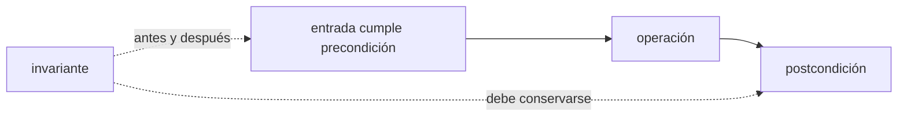
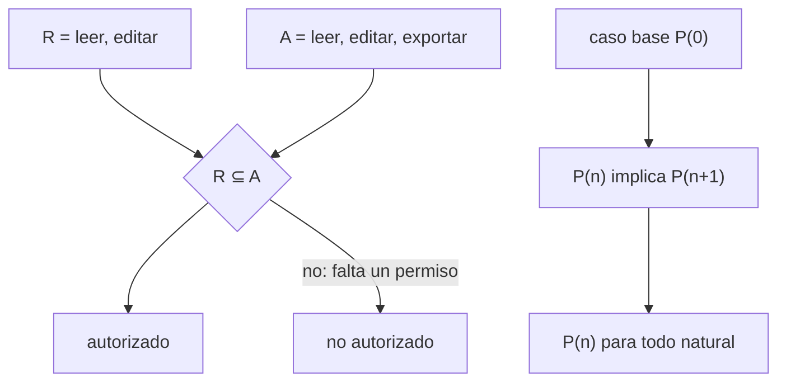
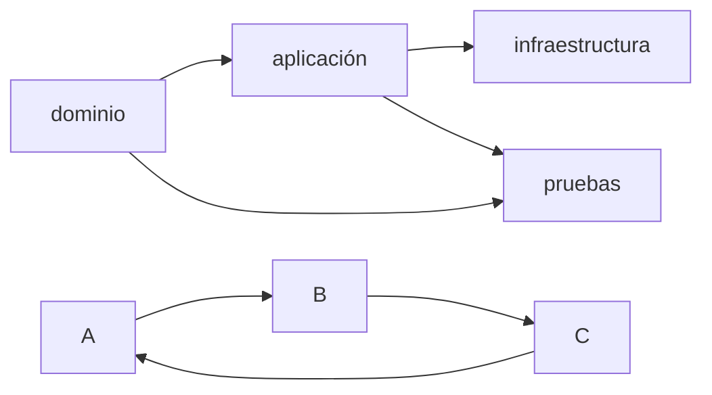
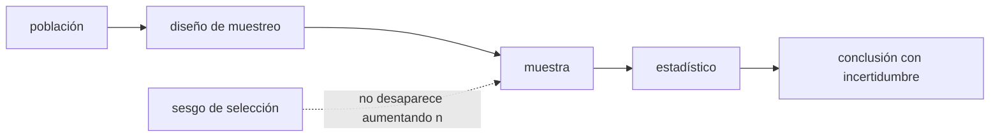

# Módulo 9: Matemáticas discretas, lógica y probabilidad para software

Las matemáticas de este módulo no son una colección de fórmulas para memorizar. Son un lenguaje para decir exactamente qué debe ocurrir, detectar contradicciones, justificar algoritmos y distinguir una mejora real de una coincidencia. Trabajarás sobre el inventario acumulativo y convertirás afirmaciones vagas en propiedades verificables.


## Aprende construyendo


### Tema 1: Lógica para especificar antes de programar · Avanzado · 45 min

<details open>
<summary><strong>Capa 1 — Lectura</strong></summary>

#### ► DE QUÉ TRATA
Al finalizar vas a escribir pre/postcondiciones formales para transition() de RutaFlow y a buscarle un contraejemplo con hypothesis. Prerrequisitos: instala la dependencia en tu entorno con python3 -m pip install hypothesis.

#### ► CÓMO FUNCIONA


</details>

<details>
<summary><strong>Capa 2 — Construcción</strong></summary>

#### Código y verificación
```text
Pre: cantidad > 0 y producto existe
Transición: stock_nuevo = stock_anterior - cantidad
Post: retiro aceptado implica stock_nuevo >= 0
Invariante global: para todo producto, stock >= 0
```

```python
from hypothesis import given, strategies as st

@given(stock=st.integers(min_value=0), cantidad=st.integers(min_value=1))
def test_retirar_preserva_stock_no_negativo(stock, cantidad):
    resultado = retirar(stock, cantidad)
    assert resultado.stock >= 0
    assert resultado.aceptado == (cantidad <= stock)
```


```bash
mkdir ejemplo-logica && cd ejemplo-logica
```

```text
Pre: current es un ShipmentStatus válido; requested es un ShipmentStatus válido
Transición: si requested ∈ ALLOWED_TRANSITIONS[current], devuelve requested; si no, lanza ValueError
Post: transition(current, requested) == requested implica requested ∈ ALLOWED_TRANSITIONS[current]
Invariante: ningún envío llega a DELIVERED sin haber pasado por ASSIGNED y OUT_FOR_DELIVERY en orden
```

```python
from enum import Enum

class ShipmentStatus(str, Enum):
    CREATED = "created"
    ASSIGNED = "assigned"
    OUT_FOR_DELIVERY = "out_for_delivery"
    DELIVERED = "delivered"

ALLOWED_TRANSITIONS = {
    ShipmentStatus.CREATED: {ShipmentStatus.ASSIGNED},
    ShipmentStatus.ASSIGNED: {ShipmentStatus.OUT_FOR_DELIVERY},
    ShipmentStatus.OUT_FOR_DELIVERY: {ShipmentStatus.DELIVERED},
    ShipmentStatus.DELIVERED: set(),
}

def transition(current: ShipmentStatus, requested: ShipmentStatus) -> ShipmentStatus:
    if requested not in ALLOWED_TRANSITIONS[current]:
        raise ValueError(f"invalid shipment transition: {current} -> {requested}")
    return requested
```

</details>

### Tema 2: Conjuntos, relaciones, funciones e inducción · Avanzado · 45 min

<details open>
<summary><strong>Capa 1 — Lectura</strong></summary>

#### ► DE QUÉ TRATA
Al finalizar vas a confirmar que ALLOWED_TRANSITIONS de RutaFlow es, matemáticamente, una relación de orden parcial — no una de equivalencia. Prerrequisitos: Python 3 instalado.

#### ► CÓMO FUNCIONA


</details>

<details>
<summary><strong>Capa 2 — Construcción</strong></summary>

#### Código y verificación
```python
def suma(valores: list[int]) -> int:
    if not valores:                 # caso base
        return 0
    return valores[0] + suma(valores[1:])
```


```bash
mkdir ejemplo-relacion && cd ejemplo-relacion
```

```python
from enum import Enum

class ShipmentStatus(str, Enum):
    CREATED = "created"
    ASSIGNED = "assigned"
    OUT_FOR_DELIVERY = "out_for_delivery"
    DELIVERED = "delivered"

ALLOWED_TRANSITIONS = {
    ShipmentStatus.CREATED: {ShipmentStatus.ASSIGNED},
    ShipmentStatus.ASSIGNED: {ShipmentStatus.OUT_FOR_DELIVERY},
    ShipmentStatus.OUT_FOR_DELIVERY: {ShipmentStatus.DELIVERED},
    ShipmentStatus.DELIVERED: set(),
}
```

```python
from domain import ALLOWED_TRANSITIONS

pares = {(a, b) for a, destinos in ALLOWED_TRANSITIONS.items() for b in destinos}
simetrica = all((b, a) in pares for (a, b) in pares)
antisimetrica = all((b, a) not in pares for (a, b) in pares if a != b)
print("pares:", len(pares))
print("simétrica:", simetrica)
print("antisimétrica:", antisimetrica)
```

```bash
python3 relacion.py
```

</details>

### Tema 3: Conteo, grafos y estructuras conectadas · Avanzado · 45 min

<details open>
<summary><strong>Capa 1 — Lectura</strong></summary>

#### ► DE QUÉ TRATA
Al finalizar vas a tratar ALLOWED_TRANSITIONS como el grafo dirigido que realmente es, y a confirmar con el tiene_ciclo() de este mismo Tema que es un DAG. Prerrequisitos: Tema 2 de este módulo y Módulo 2, Tema 7 (grafos, lista de adyacencia, BFS y DFS), que es la introducción ún…

#### ► CÓMO FUNCIONA


</details>

<details>
<summary><strong>Capa 2 — Construcción</strong></summary>

#### Código y verificación
```python
def tiene_ciclo(grafo: dict[str, set[str]]) -> bool:
    visitados, activos = set(), set()

    def visitar(nodo: str) -> bool:
        if nodo in activos:
            return True
        if nodo in visitados:
            return False
        activos.add(nodo)
        for vecino in grafo.get(nodo, set()):
            if visitar(vecino):
                return True
        activos.remove(nodo)
        visitados.add(nodo)
        return False

    return any(visitar(n) for n in grafo)
```


```bash
mkdir ejemplo-grafo && cd ejemplo-grafo
```

```python
from enum import Enum

class ShipmentStatus(str, Enum):
    CREATED = "created"
    ASSIGNED = "assigned"
    OUT_FOR_DELIVERY = "out_for_delivery"
    DELIVERED = "delivered"

ALLOWED_TRANSITIONS = {
    ShipmentStatus.CREATED: {ShipmentStatus.ASSIGNED},
    ShipmentStatus.ASSIGNED: {ShipmentStatus.OUT_FOR_DELIVERY},
    ShipmentStatus.OUT_FOR_DELIVERY: {ShipmentStatus.DELIVERED},
    ShipmentStatus.DELIVERED: set(),
}
```

```python
from domain import ALLOWED_TRANSITIONS

grafo = {estado.value: {destino.value for destino in destinos} for estado, destinos in ALLOWED_TRANSITIONS.items()}

def tiene_ciclo(grafo):
    visitados, activos = set(), set()
    def visitar(nodo):
        if nodo in activos: return True
        if nodo in visitados: return False
        activos.add(nodo)
        for vecino in grafo.get(nodo, set()):
            if visitar(vecino): return True
        activos.remove(nodo); visitados.add(nodo)
        return False
    return any(visitar(n) for n in grafo)

print("nodos:", len(grafo))
print("tiene ciclo:", tiene_ciclo(grafo))
```

```bash
python3 grafo.py
```

</details>

### Tema 4: Probabilidad y evidencia para decisiones técnicas · Avanzado · 45 min

<details open>
<summary><strong>Capa 1 — Lectura</strong></summary>

#### ► DE QUÉ TRATA
Al finalizar vas a medir la distribución real de tiempos de nearest_neighbor_route de RutaFlow sobre distintos tamaños de entrada, con percentiles reales, no solo un promedio. Prerrequisitos: Python 3 instalado.

#### ► CÓMO FUNCIONA


</details>

<details>
<summary><strong>Capa 2 — Construcción</strong></summary>

#### Código y verificación
```python
import random
from statistics import mean, median, quantiles

random.seed(2026)  # misma muestra en cada ejecución
# latencias simuladas en ms, con cola larga a la derecha
latencias = [random.lognormvariate(4.6, 0.4) for _ in range(100)]
p50 = median(latencias)
p95 = quantiles(latencias, n=100)[94]
print({"n": len(latencias), "media": round(mean(latencias), 1), "p50": round(p50, 1), "p95": round(p95, 1)})
```


```bash
mkdir ejemplo-medicion && cd ejemplo-medicion
```

```python
from dataclasses import dataclass
from math import hypot

@dataclass(frozen=True)
class Stop:
    shipment_id: str
    latitude: float
    longitude: float

def nearest_neighbor_route(origin: tuple[float, float], stops: list[Stop]) -> list[Stop]:
    """Heurística educativa O(n²); no afirma encontrar la ruta óptima."""
    remaining = stops.copy()
    ordered = []
    position = origin
    while remaining:
        selected = min(remaining, key=lambda stop: hypot(
            stop.latitude - position[0], stop.longitude - position[1]))
        ordered.append(selected)
        remaining.remove(selected)
        position = (selected.latitude, selected.longitude)
    return ordered
```

```python
import time
from statistics import mean, median, quantiles
from domain import Stop, nearest_neighbor_route

tiempos = []
for _ in range(30):
    paradas = [Stop(f"RF-{i}", i % 7, i % 5) for i in range(200)]
    inicio = time.perf_counter()
    nearest_neighbor_route((0, 0), paradas)
    tiempos.append(time.perf_counter() - inicio)

p50 = median(tiempos)
p95 = quantiles(tiempos, n=100)[94]
print({"n": len(tiempos), "media": mean(tiempos), "p50": p50, "p95": p95})
```

```bash
python3 medir.py
```

</details>

### Proyecto 9: cuaderno de propiedades, grafos y evidencia

<details open>
<summary><strong>Capa 1 — Lectura</strong></summary>

</details>

<details>
<summary><strong>Capa 2 — Construcción</strong></summary>

#### Nota de construcción
Este tema es principalmente conceptual en esta versión. La verificación se realiza con las preguntas de comprensión y el criterio de cuándo NO usar proyecto 9: cuaderno de propiedades, grafos y evidencia.

</details>
