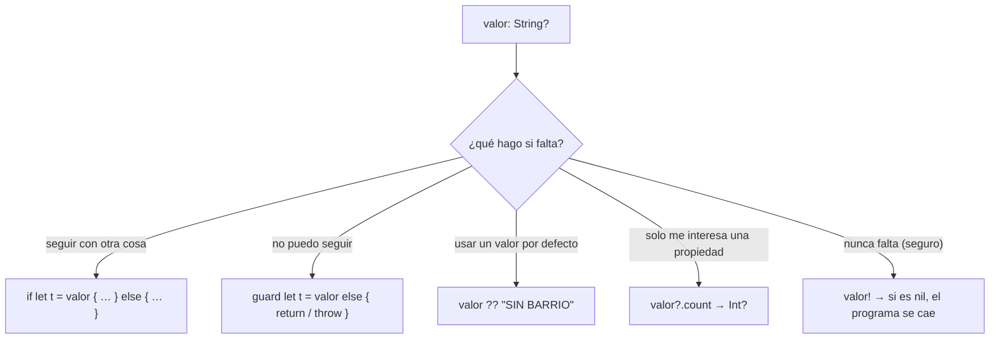
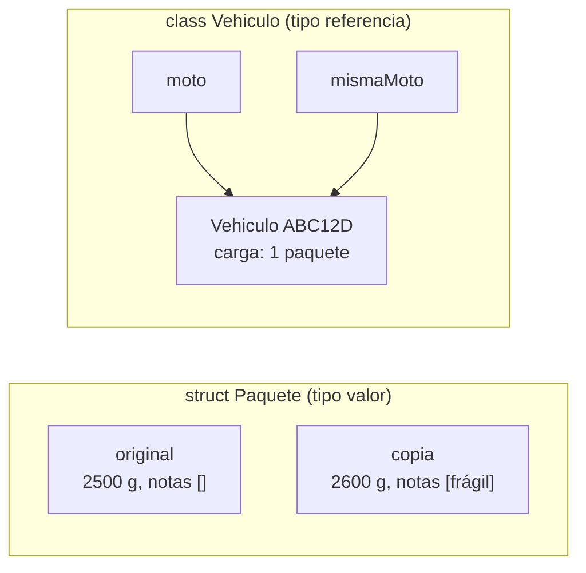
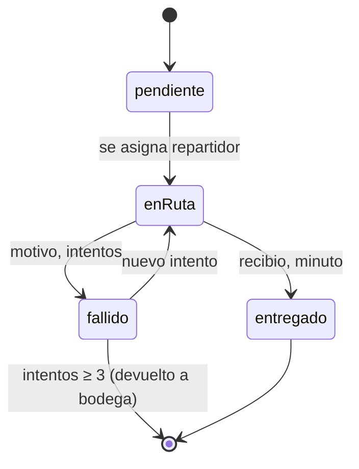
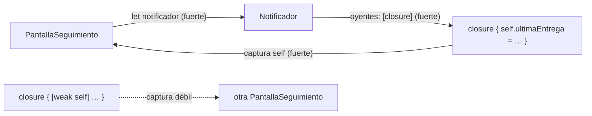
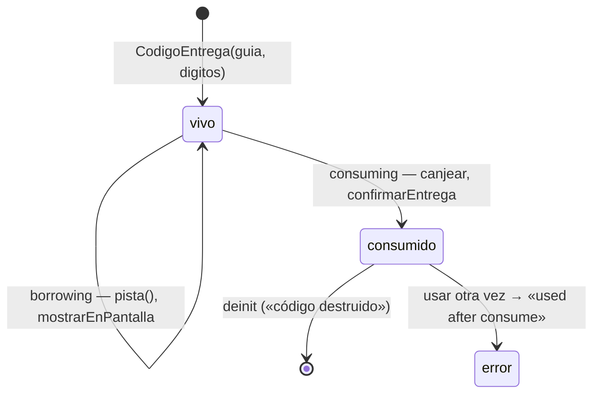

# Módulo 0: Fundamentos de Swift

**Entorno comprobado para esta edición (2026-11-25):** Swift 6.4.3 en Linux x86_64 (Ubuntu 24.04), con Swift Testing
6.4.3, para todo el código de este módulo: es Swift puro y no necesita Apple. El mismo paquete, sin cambios, se ejecutó después en
una Mac (Apple Silicon, macOS 27.2) con el Swift 6.4.2 de Xcode 27.2: las 17 pruebas pasaron y las demostraciones
dieron las mismas salidas; solo cambia el choque del Tema 1, como se muestra allí. Todo está en `/home/estudiante/labs/ios/ios0` (tu
`~/labs/ios/ios0`); cada salida que ves aquí se copió de una ejecución real, incluidos los errores de compilación y
el programa que se cae. Límite honesto: en este módulo no hay interfaz; SwiftUI empieza en el Módulo 1 y solo se
compila en la Mac.

Swift es el lenguaje de las apps de iOS, pero no depende de iOS: corre en macOS, en Linux y en Windows. Por eso los
fundamentos se aprenden mejor con un paquete de línea de órdenes y pruebas, sin simulador ni pantallas que distraigan.
Este módulo cubre lo que más se usa (y más se rompe) en el código de una app: los valores que pueden faltar, la
diferencia entre copiar y compartir, los estados de un envío como tipos, las colecciones con closures y genéricos, y
el modelo de propiedad que Swift 6 permite escribir de forma explícita.

**Al terminar este módulo podrás:**
- leer datos incompletos con opcionales sin forzar nada con `!`, y lanzar errores tipados cuando falta algo
  obligatorio;
- decidir entre `struct` y `class` por lo que el dato representa, y explicar la copia al escribir;
- modelar estados con `enum` y valores asociados, y comportamiento común con protocolos y extensiones;
- transformar colecciones con closures, escribir funciones y tipos genéricos, y evitar ciclos de retención;
- escribir un tipo `~Copyable` que el compilador impide usar dos veces.

**Esquema del módulo:** Tema 1 (opcionales) → Tema 2 (`struct` frente a `class`) → Tema 3 (enums con valores
asociados y protocolos) → Tema 4 (closures, colecciones y genéricos) → Tema 5 (ownership y tipos `~Copyable`) →
Proyecto 37.

**Qué necesitas saber antes:** este es el primer módulo del curso de iOS. Necesitas manejar una terminal (cambiar de
carpeta, ejecutar una orden) y haber programado antes en algún lenguaje: variables, funciones, condicionales y
ciclos. No hace falta saber nada de Swift.

**Qué no se repite:** la sintaxis básica (`let`, `var`, `if`, `for`, funciones) se usa sin explicarla: la
documentación oficial *The Swift Programming Language* la cubre bien. La concurrencia (`async`, actores, `Sendable`)
es el Módulo 4; aquí solo aparece `Sendable` en las declaraciones, sin explicarlo todavía.

**Prepara el proyecto:**

```text
$ mkdir -p ~/labs/ios/ios0 && cd ~/labs/ios/ios0
$ mkdir nucleo && cd nucleo
$ swift package init --type library --name Nucleo
$ swift --version
Swift version 6.4.3 (swift-6.4.3-RELEASE)
Target: x86_64-unknown-linux-gnu
```

Reemplaza el `Package.swift` que crea `swift package init` por este, que agrega un ejecutable `Demos` para las
demostraciones de cada tema:

```swift
// swift-tools-version: 6.0
import PackageDescription

let package = Package(
    name: "Nucleo",
    targets: [
        .target(name: "Nucleo"),
        .executableTarget(name: "Demos", dependencies: ["Nucleo"]),
        .testTarget(name: "NucleoTests", dependencies: ["Nucleo"]),
    ]
)
```

En la Mac no necesitas Xcode para este módulo: las mismas órdenes (`swift build`, `swift run`, `swift test`)
funcionan en la Terminal con el Swift que trae Xcode. Para dar formato se usa `swift format` (viene con Swift 6) con
líneas de 120 columnas y sangría de 4 espacios, en el archivo `.swift-format`:

```text
{
  "version": 1,
  "lineLength": 120,
  "indentation": { "spaces": 4 }
}
```

La estructura final:

```text
ios0/
├── .swift-format
├── nucleo/
│   ├── Package.swift
│   ├── Sources/Nucleo/          Opcionales, Valores, Estados, Colecciones, Firma
│   ├── Sources/Demos/           main.swift y una demostración por tema
│   └── Tests/NucleoTests/       una suite de pruebas por tema (17 pruebas)
├── ejemplos_que_fallan/         código que NO compila, a propósito
└── mac.sh                       lo que se ejecuta en la Mac
```


## Aprende construyendo


### Tema 1: Opcionales: datos que pueden faltar, sin forzar nada · Básico · 45 min

<details open>
<summary><strong>Capa 1 — Lectura</strong></summary>

#### Objetivos
Al terminar este tema podrás:
- declarar como opcional (`T?`) lo que puede faltar, y nada más;
- sacar el valor con `if let`, `guard let`, `?.` y `??`, cada uno en su lugar;
- distinguir «falta un dato que es opcional» de «falta un dato obligatorio», y lanzar un error tipado en el segundo
  caso;
- leer el choque que produce `!` sobre un `nil` y saber por qué no debe estar en el código de una app.

**Conceptos clave:** opcional, `if let` y `guard let`, encadenamiento opcional, operador `??`, desenvolvimiento
forzado, `throws` tipado

#### El problema
La bodega envía la ruta del día como líneas de texto: `EN-4472;Luis Pardo;;800;`. Ese envío no tiene teléfono ni
barrio, y es normal. Otra línea trae `cero` en el peso, y eso no es normal: es un error. Un lector de códigos de
barras devuelve `EN-44X1` porque leyó mal un dígito. Si el código trata todo como si siempre estuviera presente, la
app se cae en la calle, con el repartidor esperando.

Este tema no usa temas anteriores: es el punto de partida.

#### Glosario del tema

**opcional**
- **Definición técnica:** tipo `Optional<T>` (escrito `T?`), un `enum` con dos casos: `.some(valor)` y `.none` (que se escribe `nil`); el compilador no deja usar un `T?` donde se espera un `T`.
- **En palabras sencillas:** una caja que puede venir con algo o vacía, y hay que abrirla para saberlo.
- **Dónde se rompe la comparación:** la caja no se puede ignorar: el compilador obliga a abrirla antes de usar lo de adentro.
- **Ejemplo:** `var telefono: String?` en `Destinatario`; `Int("4471")` devuelve `Int?`.
- **Error típico:** declarar todo como opcional «por si acaso», y llenar el código de comprobaciones que nunca fallan.

**`if let` y `guard let`**
- **Definición técnica:** enlace opcional: si el valor existe, se asigna a una constante del tipo no opcional; `if let` la deja disponible dentro del bloque, `guard let` en el resto de la función, y su `else` debe salir (`return`, `throw`).
- **En palabras sencillas:** `if let` = «si hay, haz esto»; `guard let` = «si no hay, me voy».
- **Dónde se rompe la comparación:** `guard` no es solo para opcionales: también acepta condiciones (`peso > 0`) en la misma línea.
- **Ejemplo:** `guard let peso = Int(campos[3]), peso > 0 else { throw .pesoInvalido(campos[3]) }`.
- **Error típico:** anidar cinco `if let` en lugar de usar `guard let` y dejar el camino feliz sin sangría.

**encadenamiento opcional**
- **Definición técnica:** `a?.b?.c` evalúa cada paso solo si el anterior no es `nil`; si alguno es `nil`, toda la expresión vale `nil`, y su tipo es opcional.
- **En palabras sencillas:** preguntar «¿y el teléfono de su destinatario?» y aceptar «no hay» como respuesta.
- **Dónde se rompe la comparación:** el resultado siempre es opcional, aunque la última propiedad no lo sea: `telefono?.count` es `Int?`.
- **Ejemplo:** `envio?.destinatario.telefono?.count`.
- **Error típico:** encadenar y olvidar que el resultado sigue siendo opcional, y terminar con `Optional(…)` en un texto.

**operador `??`**
- **Definición técnica:** `a ?? b` devuelve el valor de `a` si existe y `b` si `a` es `nil`; `b` solo se evalúa si hace falta.
- **En palabras sencillas:** «si no hay, usa esto».
- **Dónde se rompe la comparación:** un valor por defecto puede esconder un error: un peso `?? 0` no es lo mismo que «sin peso».
- **Ejemplo:** `envio.barrio?.uppercased() ?? "SIN BARRIO"`.
- **Error típico:** usar `??` con datos obligatorios, y cobrar $0 por un paquete sin peso.

**desenvolvimiento forzado**
- **Definición técnica:** `valor!` afirma que el opcional no es `nil`; si lo es, el programa se detiene con `Fatal error: Unexpectedly found nil while unwrapping an Optional value`.
- **En palabras sencillas:** abrir la caja sin mirar y aceptar que, si está vacía, todo se cae.
- **Dónde se rompe la comparación:** no es más rápido ni más limpio: es una promesa que el compilador ya no comprueba.
- **Ejemplo:** `numeroDeGuia("EN-44X1")!` detiene el programa con el código 132 en Linux.
- **Error típico:** usar `!` porque «aquí nunca es nil», con datos que vienen de afuera (texto, red, escáner).

#### ► CÓMO FUNCIONA
Un opcional es un `enum` de la biblioteca estándar. El compilador lleva la cuenta: mientras un valor sea `T?`, solo se
puede usar a través de una de las formas de abrirlo. Cada forma responde a una pregunta distinta sobre qué hacer si
falta.



#### Problema resuelto 1.1
Lee las líneas de la ruta del día: los campos vacíos de teléfono y barrio son `nil`; una guía, un peso o una
cantidad de campos inválidos son errores con su motivo. Después, provoca el choque de un `!` sobre una guía mal
escaneada.

**Razonamiento:**
1. El teléfono y el barrio pueden faltar de verdad: son `String?`. El nombre, la guía y el peso no: son `String` e
   `Int`, y si faltan es un error de la línea.
2. `numeroDeGuia` devuelve `Int?`, porque «no es una guía» es una respuesta normal, no un error.
3. `leerEnvio` usa `guard` para cada campo obligatorio, y `throws(ErrorDeLectura)`: quien llama sabe exactamente qué
   errores pueden salir.
4. `lineaDeContacto` usa `if let` porque hay algo útil que hacer en los dos casos; `zona` usa `?.` y `??`.
5. El choque se provoca en un ejecutable aparte (`Demos forzar`) para ver el mensaje real.

```swift
// Opcionales.swift — leer un envío cuyos datos pueden faltar, sin forzar nada con «!»

/// La persona que recibe. El teléfono puede no existir: por eso es `String?`.
public struct Destinatario: Equatable, Sendable {
    public var nombre: String
    public var telefono: String?

    public init(nombre: String, telefono: String? = nil) {
        self.nombre = nombre
        self.telefono = telefono
    }
}

public struct Envio: Equatable, Sendable {
    public let guia: String
    public var destinatario: Destinatario
    public var pesoGramos: Int
    public var barrio: String?

    public init(guia: String, destinatario: Destinatario, pesoGramos: Int, barrio: String? = nil) {
        self.guia = guia
        self.destinatario = destinatario
        self.pesoGramos = pesoGramos
        self.barrio = barrio
    }
}

/// «EN-4471» → 4471. Cualquier otro formato → nil (no hay número que devolver).
public func numeroDeGuia(_ texto: String) -> Int? {
    guard texto.hasPrefix("EN-") else { return nil }
    return Int(texto.dropFirst(3))  // Int(_:) ya devuelve Int?: «EN-44X1» → nil
}

/// `if let`: usa el teléfono solo si existe.
public func lineaDeContacto(_ envio: Envio) -> String {
    if let telefono = envio.destinatario.telefono {
        return "\(envio.destinatario.nombre) · tel. \(telefono)"
    }
    return "\(envio.destinatario.nombre) · sin teléfono"
}

/// Encadenamiento opcional (`?.`) y valor por defecto (`??`).
public func zona(_ envio: Envio) -> String {
    envio.barrio?.uppercased() ?? "SIN BARRIO"
}

public enum ErrorDeLectura: Error, Equatable {
    case camposIncompletos(Int)
    case guiaInvalida(String)
    case pesoInvalido(String)
}

/// Lee «guía;nombre;teléfono;peso;barrio». Un campo vacío es nil; un campo obligatorio malo es un error.
/// `guard let` saca el valor y deja seguir con él ya desenvuelto; si falta, sale de la función.
public func leerEnvio(_ linea: String) throws(ErrorDeLectura) -> Envio {
    let campos = linea.split(separator: ";", omittingEmptySubsequences: false).map(String.init)
    guard campos.count == 5 else { throw .camposIncompletos(campos.count) }
    guard numeroDeGuia(campos[0]) != nil else { throw .guiaInvalida(campos[0]) }
    guard let peso = Int(campos[3]), peso > 0 else { throw .pesoInvalido(campos[3]) }
    let telefono = campos[2].isEmpty ? nil : campos[2]
    let barrio = campos[4].isEmpty ? nil : campos[4]
    return Envio(
        guia: campos[0], destinatario: Destinatario(nombre: campos[1], telefono: telefono),
        pesoGramos: peso, barrio: barrio)
}
```

```swift
// Demo1Opcionales.swift — Tema 1: opcionales
import Nucleo

/// Lee guías y líneas de texto con datos que pueden faltar.
func demoOpcionales() {
    for texto in ["EN-4471", "EN-44X1", "4471"] {
        print("numeroDeGuia(\"\(texto)\") = \(String(describing: numeroDeGuia(texto)))")
    }
    let lineas = [
        "EN-4471;Ana Ruiz;3105550101;2500;Chapinero",
        "EN-4472;Luis Pardo;;800;",
        "EN-4473;Marta Gil;3005550199;cero;Suba",
        "EN-4474;Pedro Díaz",
    ]
    for linea in lineas {
        do {
            let envio = try leerEnvio(linea)
            print("\(envio.guia): \(lineaDeContacto(envio)) · \(zona(envio))")
        } catch {
            print("no se pudo leer «\(linea)»: \(error)")  // `error` ya es ErrorDeLectura (throws tipado)
        }
    }
    let envio = try? leerEnvio("EN-4472;Luis Pardo;;800;")
    print("teléfono con ?.: \(String(describing: envio?.destinatario.telefono))")
    print("dígitos del teléfono: \(envio?.destinatario.telefono?.count ?? 0)")
}

/// Fuerza un opcional que es nil: el programa se cae.
func demoForzar() {
    let escaneado = "EN-44X1"  // el lector leyó mal un dígito
    print("vamos a forzar numeroDeGuia(\"\(escaneado)\")!")
    let numero = numeroDeGuia(escaneado)!
    print("número: \(numero)")  // nunca se llega aquí
}
```

Desde `~/labs/ios/ios0/nucleo`:

```text
$ swift run -q Demos opcionales
numeroDeGuia("EN-4471") = Optional(4471)
numeroDeGuia("EN-44X1") = nil
numeroDeGuia("4471") = nil
EN-4471: Ana Ruiz · tel. 3105550101 · CHAPINERO
EN-4472: Luis Pardo · sin teléfono · SIN BARRIO
no se pudo leer «EN-4473;Marta Gil;3005550199;cero;Suba»: pesoInvalido("cero")
no se pudo leer «EN-4474;Pedro Díaz»: camposIncompletos(2)
teléfono con ?.: nil
dígitos del teléfono: 0
```

Ahora la guía mal escaneada, abierta con `!` (con `SWIFT_BACKTRACE=enable=no` para que Linux imprima la traza corta
en lugar del informe completo de registros):

```text
$ SWIFT_BACKTRACE=enable=no swift run -q Demos forzar
Demos/Demo1Opcionales.swift:32: Fatal error: Unexpectedly found nil while unwrapping an Optional value
Current stack trace:
0    libswiftCore.so                    0x00007fcefe562cd0 swift_reportError + 33
1    libswiftCore.so                    0x00007fcefe91abe0 _swift_stdlib_reportFatalErrorInFile + 109
2    libswiftCore.so                    0x00007fcefe57327b <unavailable> + 1520251
3    libswiftCore.so                    0x00007fcefe70b2b0 _assertionFailure(_:_:file:line:flags:) + 284
4    Demos                              0x000056315a4e0c60 demoForzar() + 589
5    Demos                              0x000056315a4e83a0 main + 663
6    libc.so.6                          0x00007fcefe02a1ca <unavailable> + 172490
7    libc.so.6                          0x00007fcefe02a200 __libc_start_main + 139
8    Demos                              0x000056315a4deff0 _start + 37
bash: line 1:  5107 Illegal instruction     SWIFT_BACKTRACE=enable=no swift run -q Demos forzar
[código de salida: 132]
```

Y lo que pasa si se intenta usar el opcional sin abrirlo:

```swift
// t1_sin_desenvolver.swift — usar un String? como si fuera String (no compila, a propósito)
let telefono: String? = nil
let digitos = telefono.count
let enlace = "tel:" + telefono
```

```text
$ swiftc -swift-version 6 -typecheck ejemplos_que_fallan/t1_sin_desenvolver.swift
ejemplos_que_fallan/t1_sin_desenvolver.swift:3:15: error: value of optional type 'String?' must be unwrapped to refer to member 'count' of wrapped base type 'String'
1 | // t1_sin_desenvolver.swift — usar un String? como si fuera String (no compila, a propósito)
2 | let telefono: String? = nil
3 | let digitos = telefono.count
  |               |- error: value of optional type 'String?' must be unwrapped to refer to member 'count' of wrapped base type 'String'
  |               |- note: chain the optional using '?' to access member 'count' only for non-'nil' base values
  |               `- note: force-unwrap using '!' to abort execution if the optional value contains 'nil'
4 | let enlace = "tel:" + telefono
5 | 

ejemplos_que_fallan/t1_sin_desenvolver.swift:4:23: error: value of optional type 'String?' must be unwrapped to a value of type 'String'
2 | let telefono: String? = nil
3 | let digitos = telefono.count
4 | let enlace = "tel:" + telefono
  |                       |- error: value of optional type 'String?' must be unwrapped to a value of type 'String'
  |                       |- note: coalesce using '??' to provide a default when the optional value contains 'nil'
  |                       `- note: force-unwrap using '!' to abort execution if the optional value contains 'nil'
5 | 
[código de salida: 1]
```

**Explicación por partes.**
- `numeroDeGuia` devuelve `Optional(4471)` para la guía buena y `nil` para `EN-44X1` y para `4471` sin prefijo.
  `print` muestra el `Optional(…)` porque se imprimió el opcional sin abrir, a propósito.
- De las cuatro líneas, dos se leen: `EN-4472` sale con «sin teléfono» y «SIN BARRIO» porque sus campos vacíos se
  convirtieron en `nil`. Las otras dos no: `pesoInvalido("cero")` y `camposIncompletos(2)` dicen qué falló y dónde.
- `envio?.destinatario.telefono` vale `nil` (el envío existe, el teléfono no), y `?.count ?? 0` da `0`.
- El choque: `Fatal error: Unexpectedly found nil while unwrapping an Optional value` en
  `Demo1Opcionales.swift:32`, la línea del `!`, y el proceso termina con el código 132 (`Illegal instruction`: Swift
  detiene el programa con una instrucción inválida a propósito).
- La línea `vamos a forzar…` que se imprime **antes** del `!` no aparece. No es un error de la captura: cuando la
  salida no va a una terminal, `print` la guarda en un búfer, y el proceso murió antes de vaciarlo. Un registro de
  depuración puede desaparecer justo en el choque que querías investigar.
- Los dos errores de compilación muestran las salidas que el propio compilador sugiere: `?.`, `??` o `!`. Elegir la
  tercera solo porque es la que menos se escribe es el origen del choque anterior.

En la Mac, el mismo programa con el Swift de Xcode:

```text
$ swift run -q Demos forzar
Demos/Demo1Opcionales.swift:32: Fatal error: Unexpectedly found nil while unwrapping an Optional value
mac.sh: line 4: 76484 Trace/BPT trap: 5       swift run -q Demos forzar
[código de salida: 133]
```

Mismo mensaje y misma línea (`Demo1Opcionales.swift:32`), sin variable de entorno. Cambian dos cosas: en macOS (Apple
Silicon) el proceso termina con `Trace/BPT trap: 5` y el código 133 (señal de trampa, 128 + 5) en lugar de
`Illegal instruction` y 132, y no imprime traza en la terminal (en una app, la traza queda en el informe de fallo).
La línea `vamos a forzar…` tampoco aparece en la Mac: el búfer se pierde igual.

> **Error común.** Abrir con `!` un dato que viene de afuera: texto, red, escáner, archivos. En el ejemplo, un dígito
> mal leído basta para que el programa se cierre sin decir qué guía era.

> **Error común.** Usar `??` para tapar un dato obligatorio: `Int(campos[3]) ?? 0` habría convertido «cero» en un
> paquete de 0 gramos con tarifa mínima, sin ningún aviso.

> **Buena práctica.** Haz opcional solo lo que puede faltar en el dominio (un teléfono). Lo obligatorio se valida una
> vez, en la frontera (`leerEnvio`), y de ahí hacia adentro el tipo ya no es opcional.

> **Prevenir errores.** Busca `!` con `grep -n '!' Sources` antes de entregar. Cada uno debe tener un comentario que
> explique por qué nunca es `nil`; si no puedes escribir ese comentario, cámbialo por `guard let`.

#### Checkpoint 1.1
¿Qué tipo tiene `envio?.destinatario.telefono?.count` si `envio` es `Envio?`, y qué vale para `EN-4472`?

Respuesta: `Int?`. El encadenamiento opcional vuelve opcional el resultado aunque `count` sea `Int`. Para `EN-4472`
vale `nil`, porque el teléfono está vacío; por eso la demostración usa `?? 0`.

</details>

<details>
<summary><strong>Capa 2 — Construcción</strong></summary>

#### Paso 1 · Crea el paquete
Crea `nucleo/` con el `Package.swift` de arriba y el archivo `.swift-format`. Comprueba con `swift build`.

#### Paso 2 · Escribe los tipos
Crea `Opcionales.swift` con `Destinatario`, `Envio`, `numeroDeGuia`, `lineaDeContacto` y `zona`.

#### Paso 3 · Lee las líneas
Agrega `ErrorDeLectura` y `leerEnvio`, y la demostración `Demo1Opcionales.swift`. Ejecuta
`swift run -q Demos opcionales`.

#### Paso 4 · Provoca el choque
Ejecuta `SWIFT_BACKTRACE=enable=no swift run -q Demos forzar` y busca en la salida el archivo y la línea del `!`.
Después, ejecútalo sin la variable y mira el informe completo.

#### Paso 5 · Prueba
Crea `Tests/NucleoTests/OpcionalesTests.swift` y ejecuta `swift test`:

```swift
// OpcionalesTests.swift — Tema 1
import Testing

@testable import Nucleo

@Test(arguments: [("EN-4471", 4471), ("EN-0007", 7)])
func guiaValida(texto: String, numero: Int) {
    #expect(numeroDeGuia(texto) == numero)
}

@Test(arguments: ["EN-44X1", "4471", "EN-", "en-4471"])
func guiaInvalidaEsNil(texto: String) {
    #expect(numeroDeGuia(texto) == nil)
}

@Test func camposVaciosSonNil() throws {
    let envio = try leerEnvio("EN-4472;Luis Pardo;;800;")
    #expect(envio.destinatario.telefono == nil)
    #expect(envio.barrio == nil)
    #expect(zona(envio) == "SIN BARRIO")
    #expect(lineaDeContacto(envio) == "Luis Pardo · sin teléfono")
}

@Test func pesoInvalidoLanzaErrorTipado() {
    #expect(throws: ErrorDeLectura.pesoInvalido("cero")) {
        try leerEnvio("EN-4473;Marta Gil;3005550199;cero;Suba")
    }
    #expect(throws: ErrorDeLectura.pesoInvalido("-5")) {
        try leerEnvio("EN-4473;Marta Gil;;-5;Suba")
    }
}

@Test func requireDesenvuelveOFalla() throws {
    let envio = try #require(try? leerEnvio("EN-4471;Ana Ruiz;3105550101;2500;Chapinero"))
    let telefono = try #require(envio.destinatario.telefono)
    #expect(telefono.count == 10)
}
```

`#require` es el `guard let` de las pruebas: si el valor es `nil`, la prueba falla ahí mismo con un mensaje claro, en
lugar de chocar con `!`.

#### Resumen
- Un **opcional** dice en el tipo que algo puede faltar.
- **`if let`** cuando hay algo que hacer en los dos casos; **`guard let`** cuando sin el valor no se puede seguir.
- **`?.`** pregunta sin caerse; **`??`** pone un valor por defecto, solo si ese valor tiene sentido.
- El **desenvolvimiento forzado** (`!`) detiene el programa si se equivoca.
- Un dato obligatorio que falta es un error: **`throws` tipado** dice cuál.

#### Ejercicio verificable 1
Básico. ¿Qué imprime `numeroDeGuia("EN-0007")` y por qué no es `nil`?

Respuesta esperada: `Optional(7)`. Tiene el prefijo `EN-` y `Int("0007")` es `7`: los ceros a la izquierda se
aceptan. La prueba `guiaValida` lo comprueba.

#### Ejercicio verificable 2
Intermedio. ¿Qué error lanza `leerEnvio("EN-4473;Marta Gil;;-5;Suba")` y qué parte del `guard` lo produce?

Respuesta esperada: `ErrorDeLectura.pesoInvalido("-5")`. `Int("-5")` sí es un número (`-5`), así que el
`guard let peso = …` no falla; falla la segunda condición, `peso > 0`. Lo comprueba `pesoInvalidoLanzaErrorTipado`.

#### Ejercicio verificable 3
Reto. Cambia `numeroDeGuia` para que acepte también `en-4471` (en minúsculas) sin usar `!`. ¿Qué prueba debes cambiar y
cómo?

Respuesta esperada: por ejemplo, `let texto = texto.uppercased()` al empezar la función. La prueba
`guiaInvalidaEsNil` tiene `"en-4471"` entre sus argumentos y falla así (salida real con ese cambio):
`✘ Test guiaInvalidaEsNil(texto:) recorded an issue with 1 argument texto → "en-4471" at OpcionalesTests.swift:13:5:
Expectation failed: numeroDeGuia(texto) == nil`, seguido de `numeroDeGuia(texto) → 4471`. Hay que mover ese texto a
los argumentos de `guiaValida`, con el número `4471`.

#### En el trabajo
Los choques por `!` son de los más frecuentes en los informes de fallos de las apps de iOS, y casi siempre vienen de
datos externos: un JSON con un campo nuevo, una respuesta vacía, un permiso negado. Muchos equipos activan reglas de
estilo que prohíben `!` fuera de las pruebas, y revisan cada excepción en el pull request.

</details>

### Tema 2: `struct` frente a `class`: copiar o compartir · Básico · 45 min

<details open>
<summary><strong>Capa 1 — Lectura</strong></summary>

#### Objetivos
Al terminar este tema podrás:
- explicar la diferencia entre un tipo valor y un tipo referencia con un ejemplo que se ejecuta;
- elegir `struct` para los datos y `class` para lo que tiene identidad;
- usar `let`, `var` y `mutating` sabiendo qué protegen en cada caso;
- comprobar la copia al escribir de un arreglo.

**Conceptos clave:** tipo valor, tipo referencia, `mutating`, identidad (`===`), copia al escribir

#### El problema
La pantalla del detalle recibe el paquete `EN-4471` y le agrega la nota «frágil». En la lista, el mismo paquete aparece
sin la nota… o con ella, según quién lo programó. Al revés, dos pantallas que deberían ver la misma moto ven cargas
distintas porque cada una tiene su copia. El error no está en la pantalla: está en haber elegido `struct` o `class` sin
pensar qué significa copiar ese dato.

Este tema usa **los opcionales** (Tema 1).

#### Glosario del tema

**tipo valor**
- **Definición técnica:** tipo (`struct`, `enum`, tuplas, y en la biblioteca `Int`, `String`, `Array`, `Dictionary`) cuya asignación o paso a una función produce una copia independiente.
- **En palabras sencillas:** una fotocopia: si escribes en la tuya, la mía no cambia.
- **Dónde se rompe la comparación:** Swift no copia de verdad hasta que alguien escribe (copia al escribir), así que copiar no es caro.
- **Ejemplo:** `var copia = original; copia.agregarNota("frágil")` deja `original.notas` vacío.
- **Error típico:** esperar que un cambio hecho en otra pantalla aparezca en la tuya.

**tipo referencia**
- **Definición técnica:** tipo (`class`, `actor`, closures) cuya asignación copia la referencia, no el objeto: todas las variables apuntan a la misma instancia.
- **En palabras sencillas:** varias personas con la llave de la misma moto.
- **Dónde se rompe la comparación:** que la variable sea `let` no impide cambiar el objeto: solo impide apuntar a otro.
- **Ejemplo:** `let mismaMoto = moto; mismaMoto.cargar(…)` cambia `moto.carga`.
- **Error típico:** usar `class` para datos simples y descubrir que un cambio «se cuela» en otra parte de la app.

**`mutating`**
- **Definición técnica:** marca un método de un tipo valor que modifica `self`; solo se puede llamar sobre un `var`.
- **En palabras sencillas:** un aviso en la puerta: «este método escribe».
- **Dónde se rompe la comparación:** las clases no lo necesitan: sus métodos siempre pueden cambiar las propiedades `var`.
- **Ejemplo:** `mutating func agregarNota(_ nota: String)`.
- **Error típico:** declarar el paquete con `let` y no entender el error `cannot use mutating member on immutable value`.

**identidad (`===`)**
- **Definición técnica:** operador que compara si dos referencias apuntan a la misma instancia de una clase; `==` compara contenido y requiere `Equatable`.
- **En palabras sencillas:** «¿es la misma moto?» y no «¿es una moto igual?».
- **Dónde se rompe la comparación:** los tipos valor no tienen identidad: `===` no se puede usar con un `struct`.
- **Ejemplo:** `moto === mismaMoto` es `true`.
- **Error típico:** comparar objetos con `==` y creer que son el mismo porque tienen los mismos datos.

**copia al escribir**
- **Definición técnica:** estrategia de `Array`, `Dictionary`, `Set` y `String`: al copiar se comparte el almacenamiento, y solo al escribir en una de las copias se duplica (si hay más de un dueño).
- **En palabras sencillas:** dos personas leen el mismo cuaderno hasta que una quiere escribir; en ese momento se saca una fotocopia.
- **Dónde se rompe la comparación:** tus propios `struct` no la tienen automáticamente: copian sus propiedades, y son las colecciones de adentro las que la aplican.
- **Ejemplo:** la dirección del almacenamiento es la misma antes de escribir y distinta después.
- **Error típico:** evitar `struct` «porque copiar arreglos es caro».

#### ► CÓMO FUNCIONA
Con un tipo valor, cada variable tiene su propio valor. Con un tipo referencia, cada variable tiene una flecha al mismo
objeto. La elección no es de rendimiento: es de significado. Un paquete es un dato (su contenido lo define); una moto
es una cosa con identidad (hay una sola con esa placa).



#### Problema resuelto 2.1
Modela el paquete como `struct` y la moto como `class`. Comprueba con una ejecución que la copia del paquete es
independiente, que las dos referencias ven la misma moto, que lo que se cargó en la moto no cambia si después cambia el
paquete original, y que un arreglo copiado comparte su almacenamiento hasta que se escribe.

**Razonamiento:**
1. `Paquete` es un dato: `struct`, con `let guia` (no cambia nunca) y `var` para lo que sí.
2. `Vehiculo` tiene identidad: `final class` (`final` porque nadie la hereda), con `private(set)` para que solo ella
   cambie su carga.
3. `cargar` guarda una **copia** del paquete dentro de la moto: es un tipo valor.
4. Para ver la copia al escribir se compara la dirección del primer elemento con `withUnsafeBufferPointer`.
5. Los errores de `let` se provocan en un archivo aparte que no compila.

```swift
// Valores.swift — struct (tipo valor) frente a class (tipo referencia)

/// Un paquete es un dato: copiarlo da otro paquete independiente.
public struct Paquete: Equatable, Sendable {
    public let guia: String
    public var pesoGramos: Int
    public var notas: [String] = []

    public init(guia: String, pesoGramos: Int) {
        self.guia = guia
        self.pesoGramos = pesoGramos
    }

    /// `mutating`: el método cambia el propio valor, por eso solo se puede llamar sobre un `var`.
    public mutating func agregarNota(_ nota: String) {
        notas.append(nota)
    }
}

/// Un vehículo tiene identidad: hay UNA moto con esa placa, y todos los que la usan ven la misma.
public final class Vehiculo {
    public let placa: String
    public private(set) var carga: [Paquete] = []

    public init(placa: String) {
        self.placa = placa
    }

    public func cargar(_ paquete: Paquete) {
        carga.append(paquete)
    }

    public var pesoTotal: Int { carga.reduce(0) { $0 + $1.pesoGramos } }
}

/// Dirección del primer elemento del almacenamiento de un arreglo (para ver la copia al escribir).
public func direccion(_ arreglo: [Paquete]) -> String {
    arreglo.withUnsafeBufferPointer { String(describing: $0.baseAddress!) }
}
```

```swift
// Demo2Valores.swift — Tema 2: struct frente a class
import Nucleo

/// Copia un struct, comparte una class y mira la copia al escribir de un arreglo.
func demoValores() {
    var original = Paquete(guia: "EN-4471", pesoGramos: 2500)
    var copia = original  // struct: copia independiente
    copia.agregarNota("frágil")
    copia.pesoGramos = 2600
    print("struct  original: \(original.pesoGramos) g, notas \(original.notas)")
    print("struct  copia:    \(copia.pesoGramos) g, notas \(copia.notas)")

    let moto = Vehiculo(placa: "ABC12D")
    let mismaMoto = moto  // class: otra referencia al MISMO objeto
    mismaMoto.cargar(original)
    print("class   moto.carga: \(moto.carga.count) paquete(s), \(moto.pesoTotal) g")
    print("class   moto === mismaMoto: \(moto === mismaMoto)")

    original.agregarNota("cambio después de cargar")
    print("lo cargado no cambia: \(moto.carga[0].notas)")

    let lista = [original, copia]
    var otraLista = lista
    print("antes de escribir, mismo almacenamiento: \(direccion(lista) == direccion(otraLista))")
    otraLista[0].pesoGramos = 1
    print("después de escribir, mismo almacenamiento: \(direccion(lista) == direccion(otraLista))")
}
```

```text
$ swift run -q Demos valores
struct  original: 2500 g, notas []
struct  copia:    2600 g, notas ["frágil"]
class   moto.carga: 1 paquete(s), 2500 g
class   moto === mismaMoto: true
lo cargado no cambia: []
antes de escribir, mismo almacenamiento: true
después de escribir, mismo almacenamiento: false
```

```swift
// t2_let_struct.swift — cambiar un struct declarado con let (no compila, a propósito)
struct Paquete {
    let guia: String
    var pesoGramos: Int
    var notas: [String] = []
    mutating func agregarNota(_ nota: String) { notas.append(nota) }
}

let paquete = Paquete(guia: "EN-4471", pesoGramos: 2500)
paquete.pesoGramos = 2600
paquete.agregarNota("frágil")
```

```text
$ swiftc -swift-version 6 -typecheck ejemplos_que_fallan/t2_let_struct.swift
ejemplos_que_fallan/t2_let_struct.swift:10:9: error: cannot assign to property: 'paquete' is a 'let' constant
 7 | }
 8 | 
 9 | let paquete = Paquete(guia: "EN-4471", pesoGramos: 2500)
   | `- note: change 'let' to 'var' to make it mutable
10 | paquete.pesoGramos = 2600
   |         `- error: cannot assign to property: 'paquete' is a 'let' constant
11 | paquete.agregarNota("frágil")
12 | 

ejemplos_que_fallan/t2_let_struct.swift:11:9: error: cannot use mutating member on immutable value: 'paquete' is a 'let' constant
 7 | }
 8 | 
 9 | let paquete = Paquete(guia: "EN-4471", pesoGramos: 2500)
   | `- note: change 'let' to 'var' to make it mutable
10 | paquete.pesoGramos = 2600
11 | paquete.agregarNota("frágil")
   |         `- error: cannot use mutating member on immutable value: 'paquete' is a 'let' constant
12 | 
[código de salida: 1]
```

**Explicación por partes.**
- `original` sigue con 2500 g y sin notas; `copia` tiene 2600 g y `["frágil"]`: son dos valores.
- La moto tiene 1 paquete (2500 g) aunque se cargó a través de `mismaMoto`, y `moto === mismaMoto` es `true`.
- `lo cargado no cambia: []`: la nota agregada a `original` después de cargarlo no llega a la moto, que guardó su
  propia copia del paquete.
- La copia al escribir, medida: `true` (mismo almacenamiento) antes de escribir y `false` después. Copiar el arreglo
  no copió los paquetes; escribir sí.
- Los dos errores de compilación: con `let`, un `struct` no deja cambiar ni una propiedad ni llamar a un método
  `mutating`, y el compilador sugiere cambiar a `var`.

> **Error común.** Usar `class` para un modelo de datos (`class Paquete`) porque «así se hace en otros lenguajes». Dos
> pantallas que reciben el mismo objeto se lo cambian una a la otra, y el error aparece lejos de donde se causó.

> **Error común.** Creer que `let moto = Vehiculo(…)` protege la moto. Solo protege la variable: `moto.cargar(…)`
> sigue funcionando, porque cambia el objeto, no la referencia.

> **Buena práctica.** Empieza con `struct`. Cambia a `class` solo cuando el dato tenga identidad propia (una conexión,
> un controlador, un objeto que varias partes deben ver igual) o necesites `deinit`.

> **Prevenir errores.** Marca las clases como `final` y las propiedades con `private(set)` cuando solo la clase deba
> cambiarlas. Si dos partes de la app cambian el mismo objeto, que sea a través de métodos que puedas buscar.

#### Checkpoint 2.1
Si `Vehiculo` fuera un `struct`, ¿qué imprimiría `moto.carga` después de `mismaMoto.cargar(original)`, y compilaría
el código tal como está?

Respuesta: no compilaría: `cargar` tendría que ser `mutating`, y `mismaMoto` es `let`. Con `var mismaMoto` y
`mutating`, `moto.carga` quedaría vacía (0 paquetes), porque `mismaMoto` sería una copia.

</details>

<details>
<summary><strong>Capa 2 — Construcción</strong></summary>

#### Paso 1 · Escribe los tipos
Crea `Valores.swift` con `Paquete`, `Vehiculo` y `direccion`.

#### Paso 2 · Ejecuta la demostración
Crea `Demo2Valores.swift` y ejecuta `swift run -q Demos valores`.

#### Paso 3 · Provoca los errores de `let`
Crea `ejemplos_que_fallan/t2_let_struct.swift` y, desde `ios0/`, compílalo con
`swiftc -swift-version 6 -typecheck ejemplos_que_fallan/t2_let_struct.swift`.

#### Paso 4 · Prueba
Crea `ValoresTests.swift`:

```swift
// ValoresTests.swift — Tema 2
import Testing

@testable import Nucleo

@Test func structSeCopia() {
    let original = Paquete(guia: "EN-4471", pesoGramos: 2500)
    var copia = original
    copia.agregarNota("frágil")
    #expect(original.notas.isEmpty)
    #expect(copia.notas == ["frágil"])
    #expect(original != copia)
}

@Test func classSeComparte() {
    let moto = Vehiculo(placa: "ABC12D")
    let otraReferencia = moto
    otraReferencia.cargar(Paquete(guia: "EN-4471", pesoGramos: 2500))
    #expect(moto.pesoTotal == 2500)
    #expect(moto === otraReferencia)
}

@Test func arregloSeCopiaAlEscribir() {
    let lista = [Paquete(guia: "EN-4471", pesoGramos: 2500)]
    var otra = lista
    #expect(direccion(lista) == direccion(otra))
    otra[0].pesoGramos = 1
    #expect(direccion(lista) != direccion(otra))
    #expect(lista[0].pesoGramos == 2500)
}
```

#### Paso 5 · Cambia `Vehiculo` a `struct`
Hazlo en una copia y sigue los errores del compilador hasta que compile. ¿Qué prueba falla y por qué?

#### Resumen
- Un **tipo valor** se copia; un **tipo referencia** se comparte.
- **`mutating`** marca los métodos que cambian un `struct`, y exige `var`.
- **`===`** compara identidad; `==`, contenido.
- La **copia al escribir** hace que copiar colecciones sea barato hasta que alguien escribe.

#### Ejercicio verificable 1
Básico. ¿Qué imprime la demostración en `moto === mismaMoto` y por qué no se puede escribir `original === copia`?

Respuesta esperada: `true`. `===` compara identidad de instancias de clase; `Paquete` es un `struct`, que no tiene
identidad, y el compilador lo rechaza.

#### Ejercicio verificable 2
Intermedio. En el Paso 5, ¿qué prueba falla?

Respuesta esperada: primero no compila: `cannot use mutating member on immutable value: 'mismaMoto' is a 'let'
constant` y, en `===`, `argument type 'Vehiculo' expected to be an instance of a class or class-constrained type`.
Con `var` y sin la línea de `===`, falla `classSeComparte` en `moto.pesoTotal == 2500`, con `moto.pesoTotal → 0`:
`otraReferencia` es una copia.

#### Ejercicio verificable 3
Reto. ¿Por qué `arregloSeCopiaAlEscribir` compara direcciones y no solo `lista[0].pesoGramos == 2500`?

Respuesta esperada: el valor comprueba que las copias son independientes (eso lo garantiza ser un tipo valor); las
direcciones comprueban **cuándo** se copia: el almacenamiento se comparte hasta la escritura y se duplica en ella.

#### En el trabajo
SwiftUI se apoya en los tipos valor: las vistas son `struct` y el estado se compara para decidir qué redibujar
(Módulo 2). Los equipos revisan en los pull requests cada `class` nueva y piden una razón; las clases quedan para los
servicios, los modelos observables y lo que tiene identidad.

</details>

### Tema 3: Enums con valores asociados y protocolos · Básico · 40 min

<details open>
<summary><strong>Capa 1 — Lectura</strong></summary>

#### Objetivos
Al terminar este tema podrás:
- modelar los estados de un envío con un `enum` cuyos casos llevan solo los datos que les corresponden;
- usar `switch` exhaustivo, `where` y `if case`, y dejar que el compilador avise cuando aparece un caso nuevo;
- escribir un protocolo con una implementación por defecto en una extensión;
- distinguir `some` de `any` y reconocer cuándo una extensión no se comporta como un método del tipo.

**Conceptos clave:** `enum` con valores asociados, `switch` exhaustivo, protocolo, extensión de protocolo, `some` y
`any`

#### El problema
El estado de un envío se guardó como texto (`"entregado"`), con campos sueltos: `repartidor`, `recibio`, `motivo`,
`intentos`. Nada impide un envío «pendiente» con firma de recibido, ni un «fallido» sin motivo. Cuando se agrega el
estado «devuelto», nadie sabe qué pantallas hay que actualizar. Y cobrar envíos urbanos y nacionales necesita
fórmulas distintas en la misma lista.

Este tema usa **los opcionales** (Tema 1) y **los `struct`** (Tema 2).

#### Glosario del tema

**`enum` con valores asociados**
- **Definición técnica:** enumeración cuyos casos pueden llevar datos propios, con tipos y etiquetas distintos en cada caso; un valor está en un solo caso a la vez.
- **En palabras sencillas:** un formulario distinto para cada situación, con solo las casillas que esa situación necesita.
- **Dónde se rompe la comparación:** no se pueden leer los datos sin preguntar primero en qué caso está (con `switch` o `if case`).
- **Ejemplo:** `case entregado(recibio: String, minuto: Int)`.
- **Error típico:** un `struct` con un texto de estado y cinco opcionales que solo valen en algunos estados.

**`switch` exhaustivo**
- **Definición técnica:** sobre un `enum`, el `switch` debe cubrir todos los casos; si falta uno, no compila (`switch must be exhaustive`), salvo que haya un `default`.
- **En palabras sencillas:** una lista de chequeo que no deja cerrar si falta una casilla.
- **Dónde se rompe la comparación:** un `default` desactiva el aviso: el caso nuevo cae ahí sin que nadie lo note.
- **Ejemplo:** `describir(_:)` trata los 4 casos, uno de ellos dos veces con `where`.
- **Error típico:** poner `default:` en un `switch` sobre un `enum` propio «para que compile».

**protocolo**
- **Definición técnica:** lista de requisitos (propiedades, métodos) que un tipo promete cumplir; permite escribir código para cualquier tipo que lo cumpla.
- **En palabras sencillas:** el contrato «sé calcular mi tarifa».
- **Dónde se rompe la comparación:** el contrato puede traer cláusulas ya escritas (extensiones), y ahí empiezan las sorpresas.
- **Ejemplo:** `protocol Tarifable { var guia: String { get }; func tarifa() -> Int }`.
- **Error típico:** crear un protocolo para un solo tipo, que nadie más va a cumplir.

**extensión de protocolo**
- **Definición técnica:** implementación que reciben todos los tipos que cumplen el protocolo; si el método no es requisito del protocolo, se elige según el tipo **estático** (el que ve el compilador), no el real.
- **En palabras sencillas:** una cláusula común en todos los contratos.
- **Dónde se rompe la comparación:** si un tipo escribe su propia versión de un método que no es requisito, solo se usa cuando el compilador sabe que es ese tipo.
- **Ejemplo:** `recibo()` dentro de `[any Tarifable]` usa la de la extensión, no la de `EnvioNacional`.
- **Error típico:** «sobrescribir» un método de la extensión y esperar que funcione en una lista del protocolo.

**`some` y `any`**
- **Definición técnica:** `some P` es un tipo concreto que cumple `P` y que el compilador conoce aunque se oculte a quien llama; `any P` es una caja existencial que puede tener cualquier tipo que cumpla `P`, y cambiarlo en cada elemento.
- **En palabras sencillas:** `some` = «un tipo fijo que no te digo»; `any` = «cualquiera, puede variar».
- **Dónde se rompe la comparación:** `any` tiene un costo (la caja) y limita lo que se puede hacer con el valor; por eso Swift pide escribirlo.
- **Ejemplo:** `func envioDePrueba() -> some Tarifable`; `let envios: [any Tarifable]`.
- **Error típico:** escribir `[Tarifable]` sin `any`: en Swift 6 todavía compila, pero con la función futura `ExistentialAny` es una advertencia que anuncia un error.

#### ► CÓMO FUNCIONA
El `enum` hace imposibles los estados que no existen: no hay forma de construir un `pendiente` con firma. El
`switch` obliga a decidir qué hacer en cada caso, y el compilador recuerda los casos nuevos. El protocolo separa «qué
se puede hacer» (tarifa, recibo) de «cómo lo hace cada tipo».



#### Problema resuelto 3.1
Modela los estados de un envío con valores asociados y descríbelos para la pantalla; un envío con 3 intentos fallidos
se describe como devuelto. Cobra en una sola lista envíos urbanos (por peso) y nacionales (por ciudad), y observa qué
`recibo()` se usa en cada caso.

**Razonamiento:**
1. Cada caso lleva solo sus datos: `enRuta` el repartidor, `entregado` quién recibió y a qué minuto del día.
2. `MotivoFallo` es un `enum` con valor de texto (`String`) y `CaseIterable` para listar los motivos.
3. `where intentos >= 3` separa el fallido definitivo; va **antes** del caso general, porque el `switch` usa el
   primero que coincide.
4. `Tarifable` exige `guia` y `tarifa()`; `recibo()` viene de una extensión, y `EnvioNacional` escribe el suyo.
5. La lista mezclada es `[any Tarifable]`; la función de prueba devuelve `some Tarifable`.

```swift
// Estados.swift — enums con valores asociados y protocolos con implementación por defecto

public enum MotivoFallo: String, CaseIterable, Sendable {
    case nadieEnCasa = "nadie en casa"
    case direccionErrada = "dirección errada"
    case rechazado = "rechazado"
}

/// Cada caso lleva SOLO los datos que tienen sentido en ese estado.
public enum EstadoEnvio: Equatable, Sendable {
    case pendiente
    case enRuta(repartidor: String)
    case entregado(recibio: String, minuto: Int)  // minuto del día (0…1439)
    case fallido(MotivoFallo, intentos: Int)
}

public func describir(_ estado: EstadoEnvio) -> String {
    switch estado {
    case .pendiente:
        return "pendiente"
    case .enRuta(let repartidor):
        return "en ruta con \(repartidor)"
    case .entregado(let recibio, let minuto):
        return "entregado a \(recibio) a las \(minuto / 60):\(String(format2: minuto % 60))"
    case .fallido(let motivo, let intentos) where intentos >= 3:
        return "devuelto a bodega (\(motivo.rawValue), \(intentos) intentos)"
    case .fallido(let motivo, let intentos):
        return "fallido: \(motivo.rawValue) (intento \(intentos) de 3)"
    }
}

extension String {
    /// 5 → "05"
    init(format2 n: Int) { self = n < 10 ? "0\(n)" : "\(n)" }
}

/// Cualquier cosa que se pueda cobrar.
public protocol Tarifable {
    var guia: String { get }
    func tarifa() -> Int  // en pesos
}

extension Tarifable {
    /// Implementación por defecto: todos los tipos la reciben sin escribirla.
    public func recibo() -> String { "\(guia): $\(tarifa())" }
}

public struct EnvioUrbano: Tarifable, Sendable {
    public let guia: String
    public let pesoGramos: Int
    public init(guia: String, pesoGramos: Int) {
        self.guia = guia
        self.pesoGramos = pesoGramos
    }
    /// $5.000 hasta 1 kg y $1.000 por cada kilo (o fracción) adicional.
    public func tarifa() -> Int { 5000 + max(0, (pesoGramos - 1) / 1000) * 1000 }
}

public struct EnvioNacional: Tarifable, Sendable {
    public let guia: String
    public let ciudad: String
    public init(guia: String, ciudad: String) {
        self.guia = guia
        self.ciudad = ciudad
    }
    public func tarifa() -> Int { ciudad == "Medellín" ? 14000 : 18000 }
    public func recibo() -> String { "\(guia) → \(ciudad): $\(tarifa())" }  // reemplaza el de la extensión
}

/// `some`: un tipo concreto que el compilador conoce aunque quien llama no lo vea.
public func envioDePrueba() -> some Tarifable { EnvioUrbano(guia: "EN-4400", pesoGramos: 800) }

/// `any`: una caja que puede tener cualquier tipo que cumpla el protocolo (lista mezclada).
public func totalACobrar(_ envios: [any Tarifable]) -> Int {
    envios.reduce(0) { $0 + $1.tarifa() }
}
```

```swift
// Demo3Estados.swift — Tema 3: enums y protocolos
import Nucleo

/// Describe estados con valores asociados y cobra envíos de tipos distintos.
func demoEstados() {
    let estados: [EstadoEnvio] = [
        .pendiente, .enRuta(repartidor: "Camilo"), .entregado(recibio: "Ana Ruiz", minuto: 605),
        .fallido(.nadieEnCasa, intentos: 1), .fallido(.direccionErrada, intentos: 3),
    ]
    for estado in estados { print(describir(estado)) }
    if case .entregado(let recibio, _) = estados[2] { print("if case: recibió \(recibio)") }
    print("motivos: \(MotivoFallo.allCases.map(\.rawValue))")

    let nacional = EnvioNacional(guia: "EN-4473", ciudad: "Cali")
    let envios: [any Tarifable] = [EnvioUrbano(guia: "EN-4471", pesoGramos: 2500), nacional]
    print("total a cobrar: $\(totalACobrar(envios))")
    print("recibo con el tipo concreto: \(nacional.recibo())")
    print("recibo dentro de [any Tarifable]: \(envios[1].recibo())")
    print("envioDePrueba(): \(envioDePrueba().recibo())")
}
```

```text
$ swift run -q Demos estados
pendiente
en ruta con Camilo
entregado a Ana Ruiz a las 10:05
fallido: nadie en casa (intento 1 de 3)
devuelto a bodega (dirección errada, 3 intentos)
if case: recibió Ana Ruiz
motivos: ["nadie en casa", "dirección errada", "rechazado"]
total a cobrar: $25000
recibo con el tipo concreto: EN-4473 → Cali: $18000
recibo dentro de [any Tarifable]: EN-4473: $18000
envioDePrueba(): EN-4400: $5000
```

Se agrega el caso `devuelto` al `enum` y un `switch` queda sin tratarlo:

```swift
// t3_switch_incompleto.swift — se agregó un caso al enum y un switch quedó sin tratarlo (no compila, a propósito)
enum EstadoEnvio {
    case pendiente
    case enRuta(repartidor: String)
    case entregado(recibio: String, minuto: Int)
    case devuelto(motivo: String)  // caso nuevo
}

func icono(_ estado: EstadoEnvio) -> String {
    switch estado {
    case .pendiente: "reloj"
    case .enRuta: "moto"
    case .entregado: "check"
    }
}
```

```text
$ swiftc -swift-version 6 -typecheck ejemplos_que_fallan/t3_switch_incompleto.swift
ejemplos_que_fallan/t3_switch_incompleto.swift:10:5: error: switch must be exhaustive
 8 | 
 9 | func icono(_ estado: EstadoEnvio) -> String {
10 |     switch estado {
   |     |- error: switch must be exhaustive
   |     `- note: add missing case: '.devuelto(motivo: let motivo)'
11 |     case .pendiente: "reloj"
12 |     case .enRuta: "moto"
[código de salida: 1]
```

**Explicación por partes.**
- `entregado a Ana Ruiz a las 10:05`: el minuto 605 se convierte en 10:05. El mismo motivo con 1 y con 3 intentos da
  dos textos distintos gracias a `where`.
- `if case .entregado(let recibio, _)` saca un dato de un caso sin escribir el `switch` completo.
- `total a cobrar: $25000`: 7000 del urbano de 2500 g (5000 + 2 kilos adicionales) más 18000 del nacional a Cali.
- Las dos líneas de `recibo`: con el tipo concreto sale `EN-4473 → Cali: $18000` (la versión de `EnvioNacional`);
  dentro de `[any Tarifable]` sale `EN-4473: $18000` (la de la extensión). `recibo()` no es requisito del protocolo, así
  que el compilador elige por el tipo que ve: `any Tarifable`.
- El error: `switch must be exhaustive`, con la sugerencia exacta `add missing case: '.devuelto(motivo: let motivo)'`.
  Cada `switch` sobre `EstadoEnvio` en la app se convierte en una lista de tareas.

> **Error común.** Poner `default:` en un `switch` sobre un `enum` propio. Cuando se agregue `devuelto`, ese `switch`
> lo tratará como el `default` sin avisar, y la pantalla mostrará, por ejemplo, el ícono de pendiente.

> **Error común.** Escribir en un tipo un método con el mismo nombre que uno de la extensión del protocolo y creer
> que lo reemplaza siempre. Como muestra la demostración, dentro de `[any Tarifable]` se usa el de la extensión. Si
> cada tipo debe poder cambiarlo, declara `func recibo() -> String` dentro del protocolo.

> **Buena práctica.** Haz que cada caso del `enum` lleve exactamente los datos que existen en ese estado. Si te
> encuentras escribiendo opcionales «que solo valen cuando…», es un caso del `enum`.

> **Prevenir errores.** Activa la función futura `ExistentialAny` (`swiftSettings: [.enableUpcomingFeature
> ("ExistentialAny")]` en `Package.swift`) para que cada `any` sea visible: el costo de la caja queda escrito.

#### Checkpoint 3.1
¿Qué imprime `describir(.fallido(.rechazado, intentos: 3))` si se intercambian los dos casos `.fallido` del
`switch`?

Respuesta: `fallido: rechazado (intento 3 de 3)`. El caso general coincide primero y el de `where` ya no se alcanza
nunca. Y el compilador **no avisa**: se comprobó compilando esa versión con Swift 6.4.3, sin ninguna advertencia,
porque no analiza las condiciones de `where`. Por eso la prueba `describeCadaEstado` tiene un caso con 3 intentos.

</details>

<details>
<summary><strong>Capa 2 — Construcción</strong></summary>

#### Paso 1 · Escribe el `enum`
Crea `Estados.swift` con `MotivoFallo`, `EstadoEnvio` y `describir`.

#### Paso 2 · Escribe el protocolo
Agrega `Tarifable`, su extensión, `EnvioUrbano`, `EnvioNacional`, `envioDePrueba` y `totalACobrar`.

#### Paso 3 · Ejecuta
Crea `Demo3Estados.swift` y ejecuta `swift run -q Demos estados`.

#### Paso 4 · Agrega un caso
Agrega `case devuelto(motivo: MotivoFallo)` a `EstadoEnvio` y compila. Sigue el error hasta que `describir` lo trate.
Después, para seguir con el módulo, quítalo.

#### Paso 5 · Prueba
Crea `EstadosTests.swift`:

```swift
// EstadosTests.swift — Tema 3
import Testing

@testable import Nucleo

@Test func describeCadaEstado() {
    #expect(describir(.entregado(recibio: "Ana Ruiz", minuto: 605)) == "entregado a Ana Ruiz a las 10:05")
    #expect(describir(.fallido(.rechazado, intentos: 2)) == "fallido: rechazado (intento 2 de 3)")
    #expect(describir(.fallido(.rechazado, intentos: 3)) == "devuelto a bodega (rechazado, 3 intentos)")
}

@Test(arguments: [(1000, 5000), (1001, 6000), (2500, 7000), (300, 5000)])
func tarifaUrbana(peso: Int, tarifa: Int) {
    #expect(EnvioUrbano(guia: "EN-1", pesoGramos: peso).tarifa() == tarifa)
}

@Test func elReciboDependeDelTipoEstatico() {
    let nacional = EnvioNacional(guia: "EN-4473", ciudad: "Cali")
    let comoProtocolo: any Tarifable = nacional
    #expect(nacional.recibo() == "EN-4473 → Cali: $18000")
    #expect(comoProtocolo.recibo() == "EN-4473: $18000")  // usa la extensión, no el del struct
}
```

#### Resumen
- Un **`enum` con valores asociados** hace imposibles los estados que no existen.
- El **`switch` exhaustivo** convierte cada caso nuevo en un error de compilación útil.
- Un **protocolo** describe qué se puede hacer; la **extensión de protocolo** da implementaciones comunes, elegidas
  por el tipo estático si no son requisitos.
- **`some`** oculta un tipo fijo; **`any`** guarda tipos distintos en una caja.

#### Ejercicio verificable 1
Básico. ¿Cuánto cobra `EnvioUrbano` por 1001 g, y por qué no 5000?

Respuesta esperada: 6000. `(1001 - 1) / 1000` es 1 kilo adicional; la prueba `tarifaUrbana` tiene ese caso.

#### Ejercicio verificable 2
Intermedio. Agrega `func recibo() -> String` como requisito de `Tarifable`. ¿Qué imprime ahora la línea `recibo
dentro de [any Tarifable]`, y qué prueba falla?

Respuesta esperada: `EN-4473 → Cali: $18000`, porque ahora el método se elige por el tipo real. Falla
`elReciboDependeDelTipoEstatico`, cuya segunda expectativa esperaba `EN-4473: $18000`.

#### Ejercicio verificable 3
Reto. ¿Por qué `totalACobrar` no puede recibir `[some Tarifable]` con un urbano y un nacional en la misma lista?

Respuesta esperada: `some` significa **un** tipo concreto para todo el arreglo; un urbano y un nacional son dos
tipos. Para mezclarlos hace falta la caja de `any`.

#### En el trabajo
Los estados de pantalla de una app SwiftUI (cargando, datos, vacío, error) se modelan con este mismo patrón, y los
equipos evitan `default` en esos `switch` para que el compilador señale cada pantalla afectada por un estado nuevo.
Los protocolos se usan sobre todo en las fronteras (repositorios, servicios) para poder reemplazarlos en las pruebas
(Módulo 9).

</details>

### Tema 4: Closures, colecciones y genéricos con propósito · Intermedio · 45 min

<details open>
<summary><strong>Capa 1 — Lectura</strong></summary>

#### Objetivos
Al terminar este tema podrás:
- transformar la lista de envíos con `map`, `compactMap`, `reduce`, `sorted` y `Dictionary(grouping:by:)`;
- escribir una función genérica y un tipo genérico, y restringirlos solo donde hace falta;
- reconocer un closure que escapa y por qué necesita `@escaping`;
- encontrar un ciclo de retención con un contador y romperlo con `[weak self]`.

**Conceptos clave:** closure, `@escaping`, función de orden superior, genérico con restricción, ciclo de retención

#### El problema
El resumen de la ruta se calcula con tres ciclos `for` anidados, una variable acumuladora por cada total y una
función de «los más pesados» copiada para «los nombres más largos». Y la pantalla de seguimiento, que se cierra cada
vez que el repartidor vuelve a la lista, nunca se libera: tras una jornada hay decenas de pantallas vivas en memoria
que siguen recibiendo avisos.

Este tema usa **los opcionales** (Tema 1), **las clases y su identidad** (Tema 2) y **los protocolos** (Tema 3).

#### Glosario del tema

**closure**
- **Definición técnica:** función sin nombre que se puede guardar en una variable o pasar como argumento, y que **captura** las variables que usa de su entorno (a las clases, por referencia fuerte).
- **En palabras sencillas:** una instrucción escrita en un papel que se le entrega a otro para que la ejecute.
- **Dónde se rompe la comparación:** el papel se lleva consigo lo que menciona: si menciona `self`, lo mantiene vivo.
- **Ejemplo:** `{ guia in self.ultimaEntrega = guia }`.
- **Error típico:** no ver que `self` dentro de un closure guardado es una referencia fuerte.

**`@escaping`**
- **Definición técnica:** marca un parámetro closure que puede usarse después de que la función termine (porque se guarda o se ejecuta más tarde); sin la marca, el compilador no deja guardarlo.
- **En palabras sencillas:** «este papel me lo quedo».
- **Dónde se rompe la comparación:** es la marca la que obliga a pensar en la captura de `self`; un closure que no escapa no puede crear ciclos.
- **Ejemplo:** `func alEntregar(_ oyente: @escaping (String) -> Void)`.
- **Error típico:** agregar `@escaping` para quitar el error sin revisar qué captura el closure.

**función de orden superior**
- **Definición técnica:** función que recibe o devuelve funciones: `map`, `filter`, `compactMap`, `reduce`, `sorted(by:)`, `Dictionary(grouping:by:)`.
- **En palabras sencillas:** decir **qué** quieres de la lista, no **cómo** recorrerla.
- **Dónde se rompe la comparación:** encadenar diez no siempre es más claro que un `for`; la meta es leer, no lucirse.
- **Ejemplo:** `textos.compactMap(numeroDeGuia)` pasa la función por su nombre.
- **Error típico:** `map` seguido de `filter { $0 != nil }` y `!`, en lugar de `compactMap`.

**genérico con restricción**
- **Definición técnica:** función o tipo con parámetros de tipo (`<Elemento, Clave: Comparable>`) que se escribe una vez y funciona con cualquier tipo que cumpla las restricciones; las restricciones dicen qué operaciones se pueden usar.
- **En palabras sencillas:** una plantilla con huecos, y una nota de qué puede ir en cada hueco.
- **Dónde se rompe la comparación:** el compilador genera una versión específica o una genérica según el caso; para ti, es una sola función.
- **Ejemplo:** `losMayores(2, de: envios, por: \.pesoGramos)` y `extension Pagina: Equatable where Elemento: Equatable`.
- **Error típico:** usar `>` sobre un `T` sin decir `T: Comparable`.

**ciclo de retención**
- **Definición técnica:** dos o más objetos se retienen con referencias fuertes entre sí (aquí: pantalla → notificador → closure → pantalla), así que el conteo de referencias nunca llega a cero y ninguno se libera.
- **En palabras sencillas:** dos personas que se toman de la mano y no se sueltan, aunque nadie más las necesite.
- **Dónde se rompe la comparación:** Swift no tiene un recolector que los encuentre: ARC solo cuenta referencias.
- **Ejemplo:** la pantalla creada con `fuerte: true` sigue viva al terminar el bloque.
- **Error típico:** `[weak self]` en todos los closures «por si acaso», incluso en los que no escapan.

#### ► CÓMO FUNCIONA
Las funciones de orden superior reciben un closure que dice qué hacer con cada elemento. Los genéricos permiten
escribir esa lógica una vez para cualquier tipo. Cuando un closure se guarda (`@escaping`), lo que captura vive tanto
como él; si captura a quien lo guardó, se forma un ciclo.



#### Problema resuelto 4.1
Con la lista de envíos del día: agrúpalos por barrio, suma los kilos, saca las guías válidas de una lista escrita a
mano, encuentra los más pesados y el nombre más largo con **una** función genérica, y pagina la lista. Después,
demuestra con un contador que la pantalla que captura `self` con fuerza no se libera.

**Razonamiento:**
1. `Dictionary(grouping:by:)` agrupa; `mapValues` deja solo las guías, ordenadas.
2. `compactMap(numeroDeGuia)` usa la función del Tema 1, que ya devuelve `Int?`: los `nil` se descartan solos.
3. `losMayores` no sabe nada de envíos: recibe la lista y una función que da la clave, restringida a `Comparable`.
4. `Pagina<Elemento>` es genérica, y solo es `Equatable` si sus elementos lo son.
5. `PantallaSeguimiento.vivas` cuenta instancias: sube en `init` y baja en `deinit`.

```swift
// Colecciones.swift — closures, colecciones y genéricos con un propósito concreto

/// Pendientes agrupados por barrio, cada grupo ordenado por guía.
public func pendientesPorBarrio(_ envios: [Envio]) -> [String: [String]] {
    Dictionary(grouping: envios, by: { $0.barrio ?? "sin barrio" })
        .mapValues { grupo in grupo.map(\.guia).sorted() }
}

/// Peso total en kilos, con `reduce`.
public func kilos(_ envios: [Envio]) -> Double {
    Double(envios.reduce(0) { suma, envio in suma + envio.pesoGramos }) / 1000
}

/// Las guías válidas de una lista escrita a mano: `compactMap` descarta los nil.
public func guiasValidas(_ textos: [String]) -> [Int] {
    textos.compactMap(numeroDeGuia)
}

/// Genérico: los `n` mayores de cualquier lista, según la clave que se le pase.
public func losMayores<Elemento, Clave: Comparable>(
    _ n: Int, de lista: [Elemento], por clave: (Elemento) -> Clave
) -> [Elemento] {
    Array(lista.sorted { clave($0) > clave($1) }.prefix(n))
}

/// Genérico con restricción: una página de resultados de cualquier tipo.
public struct Pagina<Elemento> {
    public let elementos: [Elemento]
    public let numero: Int
    public let hayMas: Bool
}

public func paginar<Elemento>(_ lista: [Elemento], tamano: Int, numero: Int) -> Pagina<Elemento> {
    let inicio = min(numero * tamano, lista.count)
    let fin = min(inicio + tamano, lista.count)
    return Pagina(elementos: Array(lista[inicio..<fin]), numero: numero, hayMas: fin < lista.count)
}

extension Pagina: Equatable where Elemento: Equatable {}  // solo si los elementos se pueden comparar

// MARK: - closures que escapan y ciclos de retención

/// Guarda closures para llamarlos DESPUÉS: por eso son `@escaping`.
public final class Notificador {
    private var oyentes: [(String) -> Void] = []
    public init() {}
    public func alEntregar(_ oyente: @escaping (String) -> Void) { oyentes.append(oyente) }
    public func avisar(_ guia: String) { for oyente in oyentes { oyente(guia) } }
}

/// Pantalla que escucha entregas. `fuerte` decide si el closure retiene a la pantalla.
public final class PantallaSeguimiento {
    public let notificador: Notificador
    public private(set) var ultimaEntrega: String?
    nonisolated(unsafe) public static var vivas = 0  // contador para la demostración (un solo hilo)

    public init(notificador: Notificador, fuerte: Bool) {
        self.notificador = notificador
        PantallaSeguimiento.vivas += 1
        if fuerte {
            notificador.alEntregar { guia in self.ultimaEntrega = guia }  // self → notificador → closure → self
        } else {
            notificador.alEntregar { [weak self] guia in self?.ultimaEntrega = guia }
        }
    }

    deinit { PantallaSeguimiento.vivas -= 1 }
}
```

```swift
// Demo4Colecciones.swift — Tema 4: closures, colecciones y genéricos
import Nucleo

/// Agrupa, suma, filtra y pagina envíos; muestra un ciclo de retención.
func demoColecciones() {
    let envios = [
        Envio(guia: "EN-4473", destinatario: Destinatario(nombre: "Marta Gil"), pesoGramos: 1200, barrio: "Suba"),
        Envio(guia: "EN-4471", destinatario: Destinatario(nombre: "Ana Ruiz"), pesoGramos: 2500, barrio: "Chapinero"),
        Envio(guia: "EN-4475", destinatario: Destinatario(nombre: "Sara León"), pesoGramos: 300, barrio: "Suba"),
        Envio(guia: "EN-4472", destinatario: Destinatario(nombre: "Luis Pardo"), pesoGramos: 800),
    ]
    for (barrio, guias) in pendientesPorBarrio(envios).sorted(by: { $0.key < $1.key }) {
        print("\(barrio): \(guias)")
    }
    print("kilos: \(kilos(envios))")
    print("guías válidas: \(guiasValidas(["EN-4471", "en-4472", "EN-4473", "EN-", "EN-4480"]))")
    print("2 más pesados: \(losMayores(2, de: envios, por: \.pesoGramos).map(\.guia))")
    print("nombre más largo: \(losMayores(1, de: envios, por: \.destinatario.nombre.count).map(\.guia))")
    let pagina = paginar(envios.map(\.guia), tamano: 3, numero: 1)
    print("página 1: \(pagina.elementos), hay más: \(pagina.hayMas)")

    let notificador = Notificador()
    do {
        _ = PantallaSeguimiento(notificador: notificador, fuerte: true)
        _ = PantallaSeguimiento(notificador: notificador, fuerte: false)
    }
    print("pantallas vivas después de cerrar las dos: \(PantallaSeguimiento.vivas)")
    notificador.avisar("EN-4471")
}
```

```text
$ swift run -q Demos colecciones
Chapinero: ["EN-4471"]
Suba: ["EN-4473", "EN-4475"]
sin barrio: ["EN-4472"]
kilos: 4.8
guías válidas: [4471, 4473, 4480]
2 más pesados: ["EN-4471", "EN-4473"]
nombre más largo: ["EN-4472"]
página 1: ["EN-4472"], hay más: false
pantallas vivas después de cerrar las dos: 1
```

Y dos errores frecuentes, cada uno con su causa:

```swift
// t4_closures_genericos.swift — dos errores frecuentes con closures y genéricos (no compila, a propósito)
final class Notificador {
    private var oyentes: [(String) -> Void] = []
    func alEntregar(_ oyente: (String) -> Void) {  // falta @escaping
        oyentes.append(oyente)
    }
}

func elMayor<T>(_ a: T, _ b: T) -> T {  // falta T: Comparable
    a > b ? a : b
}
```

```text
$ swiftc -swift-version 6 -typecheck ejemplos_que_fallan/t4_closures_genericos.swift
ejemplos_que_fallan/t4_closures_genericos.swift:5:24: error: converting non-escaping parameter 'oyente' to generic parameter 'Element' may allow it to escape
 3 |     private var oyentes: [(String) -> Void] = []
 4 |     func alEntregar(_ oyente: (String) -> Void) {  // falta @escaping
 5 |         oyentes.append(oyente)
   |                        `- error: converting non-escaping parameter 'oyente' to generic parameter 'Element' may allow it to escape
 6 |     }
 7 | }

ejemplos_que_fallan/t4_closures_genericos.swift:10:7: error: referencing operator function '>' on 'Comparable' requires that 'T' conform to 'Comparable'
 8 | 
 9 | func elMayor<T>(_ a: T, _ b: T) -> T {  // falta T: Comparable
10 |     a > b ? a : b
   |       `- error: referencing operator function '>' on 'Comparable' requires that 'T' conform to 'Comparable'
11 | }
12 | 

Swift.Comparable:1:17: note: where 'Self' = 'T'
1 | public protocol Comparable : Equatable, ~Copyable, ~Escapable {
  |                 `- note: where 'Self' = 'T'
2 |     static func < (lhs: borrowing Self, rhs: borrowing Self) -> Bool
3 |     static func <= (lhs: borrowing Self, rhs: borrowing Self) -> Bool
[código de salida: 1]
```

**Explicación por partes.**
- Tres barrios: Suba con 2 guías ordenadas, Chapinero con 1, y `sin barrio` para `EN-4472`, cuyo barrio es `nil`
  (el `??` del Tema 1 dentro de un closure).
- `kilos: 4.8`: 1200 + 2500 + 300 + 800 gramos.
- `[4471, 4473, 4480]`: `en-4472` (minúsculas) y `EN-` dan `nil` y desaparecen.
- La misma función genérica da los 2 más pesados (`EN-4471`, `EN-4473`) y el nombre más largo (`Luis Pardo`, 10
  caracteres con el espacio).
- La página 1 de tamaño 3 tiene solo el cuarto elemento y `hay más: false`.
- `pantallas vivas después de cerrar las dos: 1`: se crearon dos y se salió del bloque; la de `[weak self]` se
  liberó, la que captura `self` con fuerza no. Nadie tiene ya una variable que apunte a ella, pero sigue en memoria y
  recibe el aviso de `EN-4471`.
- Los errores: guardar un closure sin `@escaping` (`may allow it to escape`) y usar `>` con un `T` sin restricción
  (`requires that 'T' conform to 'Comparable'`). En Swift 6.4, la nota del segundo muestra que `Comparable` se
  declara con `~Copyable, ~Escapable`: también sirve para los tipos no copiables del Tema 5.

> **Error común.** Capturar `self` con fuerza en un closure que se guarda en un objeto que `self` también guarda. La
> pantalla no se libera, y cada vez que se abre se suma otra que sigue recibiendo avisos.

> **Error común.** Duplicar una función para otro tipo o para otra clave. `losMayores` cubre peso, nombre y cualquier
> otra clave `Comparable` sin una línea más.

> **Buena práctica.** Usa `[weak self]` en los closures que **escapan** y viven en otro objeto (notificadores,
> temporizadores, suscripciones). En los que no escapan (`map`, `filter`, `sorted`) no hace falta: terminan antes de
> que la función vuelva.

> **Prevenir errores.** Cuenta instancias en `init` y `deinit` (o usa una referencia `weak` en una prueba, como
> `weakSelfEvitaElCiclo`) para cada pantalla o servicio que deba liberarse. Un ciclo no da error: solo se ve si se
> mide.

#### Checkpoint 4.1
¿Por qué `losMayores` necesita `Clave: Comparable` pero no pide nada a `Elemento`?

Respuesta: la única operación sobre las claves es `>` al ordenar, y eso exige `Comparable`. A los elementos solo se
les pasa a la función `clave` y se copian al arreglo resultado: no se comparan, así que cualquier tipo sirve.

</details>

<details>
<summary><strong>Capa 2 — Construcción</strong></summary>

#### Paso 1 · Escribe las funciones de colección
Crea `Colecciones.swift` con `pendientesPorBarrio`, `kilos`, `guiasValidas`, `losMayores`, `Pagina` y `paginar`.

#### Paso 2 · Escribe el notificador
Agrega `Notificador` y `PantallaSeguimiento`, y `Demo4Colecciones.swift`. Ejecuta `swift run -q Demos colecciones`.

#### Paso 3 · Provoca los errores
Compila `ejemplos_que_fallan/t4_closures_genericos.swift`, arréglalo con `@escaping` y `T: Comparable` y vuelve a
compilar.

#### Paso 4 · Prueba
Crea `ColeccionesTests.swift`:

```swift
// ColeccionesTests.swift — Tema 4
import Testing

@testable import Nucleo

let envios = [
    Envio(guia: "EN-4473", destinatario: Destinatario(nombre: "Marta Gil"), pesoGramos: 1200, barrio: "Suba"),
    Envio(guia: "EN-4471", destinatario: Destinatario(nombre: "Ana Ruiz"), pesoGramos: 2500, barrio: "Chapinero"),
    Envio(guia: "EN-4472", destinatario: Destinatario(nombre: "Luis Pardo"), pesoGramos: 800),
]

@Test func agrupaYOrdena() {
    #expect(pendientesPorBarrio(envios) == ["Suba": ["EN-4473"], "Chapinero": ["EN-4471"], "sin barrio": ["EN-4472"]])
    #expect(kilos(envios) == 4.5)
}

@Test func paginaGenerica() {
    #expect(paginar([1, 2, 3, 4, 5], tamano: 2, numero: 0) == Pagina(elementos: [1, 2], numero: 0, hayMas: true))
    #expect(paginar([1, 2, 3, 4, 5], tamano: 2, numero: 2) == Pagina(elementos: [5], numero: 2, hayMas: false))
    #expect(paginar(["a"], tamano: 2, numero: 9).elementos.isEmpty)
}

@Test func losMayoresConCualquierClave() {
    #expect(losMayores(1, de: envios, por: \.pesoGramos).map(\.guia) == ["EN-4471"])
    #expect(losMayores(5, de: [3, 9, 1], por: { $0 }) == [9, 3, 1])
}

@Test func weakSelfEvitaElCiclo() {
    let notificador = Notificador()
    weak var fuerte: PantallaSeguimiento?
    weak var debil: PantallaSeguimiento?
    do {
        let a = PantallaSeguimiento(notificador: notificador, fuerte: true)
        let b = PantallaSeguimiento(notificador: notificador, fuerte: false)
        fuerte = a
        debil = b
    }
    #expect(fuerte != nil)  // sigue viva: el closure la retiene
    #expect(debil == nil)  // liberada
    notificador.avisar("EN-4471")
    #expect(fuerte?.ultimaEntrega == "EN-4471")
}
```

#### Paso 5 · Escribe un genérico propio
Escribe `contar(_:por:) -> [Clave: Int]`, que cuente cuántos elementos tienen cada clave, con
`reduce(into:)`.

#### Resumen
- Un **closure** captura lo que usa; si se guarda, necesita **`@escaping`**.
- Las **funciones de orden superior** dicen qué quieres de la lista.
- Un **genérico con restricción** se escribe una vez y pide solo lo que usa.
- Un **ciclo de retención** no da error: se mide, y se rompe con `[weak self]`.

#### Ejercicio verificable 1
Básico. ¿Qué devuelve `guiasValidas(["EN-4471", "en-4472", "EN-4473", "EN-", "EN-4480"])`?

Respuesta esperada: `[4471, 4473, 4480]`, como en la salida de la demostración.

#### Ejercicio verificable 2
Intermedio. Si las dos pantallas de la demostración se crean con `fuerte: true`, ¿qué imprime la línea de pantallas
vivas?

Respuesta esperada: `pantallas vivas después de cerrar las dos: 2` (comprobado con ese cambio).

#### Ejercicio verificable 3
Reto. En el Paso 5, ¿qué devuelve `contar(envios, por: { $0.barrio ?? "sin barrio" })` con los 4 envíos de la
demostración, ordenado por clave? ¿Y `contar([1, 2, 3, 4, 5], por: { $0 % 2 == 0 })`?

Respuesta esperada: una solución es `lista.reduce(into: [:]) { cuenta, e in cuenta[clave(e), default: 0] += 1 }`,
con `Clave: Hashable`. Da `Chapinero: 1, Suba: 2, sin barrio: 1`, y `[true: 2, false: 3]` (el orden en que se
imprime un diccionario puede cambiar entre ejecuciones; los valores no).

#### En el trabajo
En una app real, los closures que escapan están en todas partes: suscripciones (Módulo 7), tareas (Módulo 4),
manejadores de red. Las fugas de memoria por ciclos se buscan con el *Memory Graph Debugger* de Xcode y con
Instruments (Módulo 10); un contador o una prueba con `weak` las encuentra antes, en el CI.

</details>

### Tema 5: Ownership: `borrowing`, `consuming` y tipos `~Copyable` · Experto · 45 min

<details open>
<summary><strong>Capa 1 — Lectura</strong></summary>

#### Objetivos
Al terminar este tema podrás:
- declarar un tipo `~Copyable` cuando copiarlo sería un error del dominio;
- marcar parámetros y métodos como `borrowing` o `consuming`, y leer los errores del verificador de propiedad;
- escribir un genérico que acepte tipos no copiables con `T: ~Copyable`;
- usar `deinit` en un `struct` no copiable y saber cuándo se ejecuta.

**Conceptos clave:** `~Copyable`, `borrowing`, `consuming`, `deinit` en un `struct`, verificador de propiedad

#### El problema
Para confirmar una entrega, el destinatario dicta un código de 6 dígitos. En el código de la app, ese código es un
`String` que se pasa de la pantalla al servicio, se guarda en una variable «por si falla» y se reintenta. Un error de
programación usa la misma variable dos veces y el mismo código confirma dos entregas. Con tipos copiables, nada lo
impide; las pruebas lo encuentran solo si alguien pensó en ese caso.

Este tema usa **`struct` y tipos valor** (Tema 2) y **los genéricos** (Tema 4).

#### Glosario del tema

**`~Copyable`**
- **Definición técnica:** marca que **quita** el requisito implícito `Copyable` de un tipo: sus valores no se copian, se mueven, y el compilador comprueba que cada valor tenga un solo dueño a la vez.
- **En palabras sencillas:** un boleto de un solo uso: si se lo das a alguien, tú ya no lo tienes.
- **Dónde se rompe la comparación:** se puede prestar (`borrowing`) sin entregarlo, como mostrar el boleto sin soltarlo.
- **Ejemplo:** `public struct CodigoEntrega: ~Copyable`.
- **Error típico:** hacer no copiable un tipo que solo es «grande»; esto es para el significado, no para la velocidad.

**`borrowing`**
- **Definición técnica:** modificador de parámetro (o de método) que recibe el valor prestado: se puede leer, pero no consumir ni guardar.
- **En palabras sencillas:** «déjame verlo».
- **Dónde se rompe la comparación:** para los tipos copiables casi no cambia nada; su efecto se nota con `~Copyable`.
- **Ejemplo:** `func mostrarEnPantalla(_ codigo: borrowing CodigoEntrega) -> String`.
- **Error típico:** intentar canjear un valor prestado: `'codigo' is borrowed and cannot be consumed`.

**`consuming`**
- **Definición técnica:** modificador de parámetro (o de método) que se queda con el valor: después de la llamada, quien lo pasó ya no puede usarlo.
- **En palabras sencillas:** «dámelo».
- **Dónde se rompe la comparación:** consumir no siempre destruye: quien lo recibe puede guardarlo o devolverlo.
- **Ejemplo:** `consuming func canjear(_ dictado: String) -> Comprobante?`.
- **Error típico:** usar la variable después de pasarla: `'codigo' used after consume`.

**`deinit` en un `struct`**
- **Definición técnica:** solo los tipos no copiables (y las clases) pueden tener `deinit`; se ejecuta cuando el último dueño deja de tenerlo, incluido al final de un método `consuming` que no lo devuelve.
- **En palabras sencillas:** lo que pasa cuando el boleto se rompe.
- **Dónde se rompe la comparación:** `discard self` lo evita, pero solo en tipos cuyas propiedades se destruyen trivialmente (sin `String`, por ejemplo), como se ve abajo.
- **Ejemplo:** `deinit { Registro.eventos.append("código de \(guia) destruido") }`.
- **Error típico:** esperar que un `deinit` de `struct` copiable compile: no se puede.

**verificador de propiedad**
- **Definición técnica:** fase del compilador (después del análisis de tipos, al generar SIL) que sigue cada valor no copiable y rechaza usos después de consumirlo, consumos dobles y consumos de valores prestados.
- **En palabras sencillas:** el portero que revisa que nadie entre dos veces con el mismo boleto.
- **Dónde se rompe la comparación:** como corre después del análisis de tipos, `swiftc -typecheck` no muestra sus errores: hace falta compilar más allá (`-emit-sil` o `swift build`).
- **Ejemplo:** `error: 'otro' used after consume`, con `note: consumed here` y `note: used here`.
- **Error típico:** creer que el código está bien porque `-typecheck` no dio errores.

#### ► CÓMO FUNCIONA
Un valor copiable se duplica cada vez que se asigna. Uno `~Copyable` se mueve: la asignación y el paso como
`consuming` lo entregan, y el nombre anterior queda vacío. `borrowing` lo presta sin moverlo. El compilador sigue cada
valor por todos los caminos del código y rechaza los usos imposibles.



#### Problema resuelto 5.1
Escribe el código de entrega como tipo no copiable: se puede mostrar (prestado) muchas veces y canjear (consumido) una
sola. Comprueba cuándo se ejecuta su `deinit`, escribe un genérico que lo acepte, y provoca los errores del verificador
de propiedad.

**Razonamiento:**
1. `CodigoEntrega: ~Copyable`, con los dígitos `private`: nadie los lee desde afuera.
2. `pista()` es `borrowing` y `canjear` es `consuming`; las funciones libres repiten la idea en sus parámetros.
3. `deinit` anota en `Registro` para ver en qué momento se destruye cada código.
4. `describirPrestado<T: ~Copyable>` acepta tipos copiables **y** no copiables.
5. Los errores se provocan en archivos aparte, compilados con `-emit-sil` para que el verificador de propiedad corra.

```swift
// Firma.swift — ownership: un código de entrega que solo se puede usar una vez (~Copyable)

/// El código de 6 dígitos que el destinatario dicta al repartidor. No se puede copiar: si existiera
/// una copia, el mismo código podría confirmar dos entregas.
public struct CodigoEntrega: ~Copyable {
    public let guia: String
    private let digitos: String

    public init(guia: String, digitos: String) {
        self.guia = guia
        self.digitos = digitos
    }

    /// `borrowing`: mira el valor sin quedárselo. Se puede llamar muchas veces.
    public borrowing func pista() -> String { "••••" + String(digitos.suffix(2)) }

    /// `consuming`: se queda con el valor. Después de esto el código ya no existe para quien lo tenía.
    public consuming func canjear(_ dictado: String) -> Comprobante? {
        dictado == digitos ? Comprobante(guia: guia) : nil
    }

    deinit { Registro.eventos.append("código de \(guia) destruido") }
}

public struct Comprobante: Equatable, Sendable {
    public let guia: String
}

/// Registro de lo que pasa, para verlo en la demostración y en las pruebas (un solo hilo).
public enum Registro {
    nonisolated(unsafe) public static var eventos: [String] = []
}

/// Recibe el código prestado: no puede canjearlo ni guardarlo.
public func mostrarEnPantalla(_ codigo: borrowing CodigoEntrega) -> String {
    "Guía \(codigo.guia), código \(codigo.pista())"
}

/// Recibe el código para quedárselo: quien llama lo pierde.
public func confirmarEntrega(_ codigo: consuming CodigoEntrega, dictado: String) -> Comprobante? {
    codigo.canjear(dictado)
}

/// Genérico que acepta tipos no copiables: `T: ~Copyable` QUITA el requisito implícito de Copyable.
public func describirPrestado<T: ~Copyable>(_ valor: borrowing T, _ texto: (borrowing T) -> String) -> String {
    "[" + texto(valor) + "]"
}
```

```swift
// Demo5Firma.swift — Tema 5: ownership
import Nucleo

/// Presta, consume y destruye códigos de entrega no copiables.
func demoFirma() {
    let codigo = CodigoEntrega(guia: "EN-4471", digitos: "482913")
    print(mostrarEnPantalla(codigo))
    print(mostrarEnPantalla(codigo))  // prestar no gasta
    print(describirPrestado(codigo) { $0.pista() })
    let comprobante = confirmarEntrega(codigo, dictado: "482913")  // aquí el código se consume
    print("comprobante: \(String(describing: comprobante))")
    let otro = CodigoEntrega(guia: "EN-4472", digitos: "100200")
    print("canje con error: \(String(describing: otro.canjear("100201")))")
    print("registro: \(Registro.eventos)")
}
```

```text
$ swift run -q Demos firma
Guía EN-4471, código ••••13
Guía EN-4471, código ••••13
[••••13]
comprobante: Optional(Nucleo.Comprobante(guia: "EN-4471"))
canje con error: nil
registro: ["código de EN-4471 destruido", "código de EN-4472 destruido"]
```

Tres usos imposibles del código:

```swift
// t5_ownership.swift — usar un valor ~Copyable después de consumirlo (no compila, a propósito)
struct CodigoEntrega: ~Copyable {
    let digitos: String
    borrowing func pista() -> String { "••••" + String(digitos.suffix(2)) }
    consuming func canjear(_ dictado: String) -> Bool { dictado == digitos }
}

func repartir() {
    let codigo = CodigoEntrega(digitos: "482913")
    let bien = codigo.canjear("482913")
    print(bien, codigo.pista())  // el código ya se gastó

    let otro = CodigoEntrega(digitos: "100200")
    let copia = otro  // esto MUEVE, no copia
    print(otro.pista(), copia.pista())
}

func mostrar(_ codigo: borrowing CodigoEntrega) -> Bool {
    codigo.canjear("000000")  // prestado: no se puede consumir
}
```

```text
$ swiftc -swift-version 6 -emit-sil -o /dev/null ejemplos_que_fallan/t5_ownership.swift
ejemplos_que_fallan/t5_ownership.swift:13:9: error: 'otro' used after consume
11 |     print(bien, codigo.pista())  // el código ya se gastó
12 | 
13 |     let otro = CodigoEntrega(digitos: "100200")
   |         `- error: 'otro' used after consume
14 |     let copia = otro  // esto MUEVE, no copia
   |                 `- note: consumed here
15 |     print(otro.pista(), copia.pista())
   |           `- note: used here
16 | }
17 | 

ejemplos_que_fallan/t5_ownership.swift:9:9: error: 'codigo' used after consume
 7 | 
 8 | func repartir() {
 9 |     let codigo = CodigoEntrega(digitos: "482913")
   |         `- error: 'codigo' used after consume
10 |     let bien = codigo.canjear("482913")
   |                `- note: consumed here
11 |     print(bien, codigo.pista())  // el código ya se gastó
   |                 `- note: used here
12 | 
13 |     let otro = CodigoEntrega(digitos: "100200")

ejemplos_que_fallan/t5_ownership.swift:18:16: error: 'codigo' is borrowed and cannot be consumed
16 | }
17 | 
18 | func mostrar(_ codigo: borrowing CodigoEntrega) -> Bool {
   |                `- error: 'codigo' is borrowed and cannot be consumed
19 |     codigo.canjear("000000")  // prestado: no se puede consumir
   |            `- note: consumed here
20 | }
21 | 
[código de salida: 1]
```

Un genérico escrito sin pensar en los tipos no copiables:

```swift
// t5_generico.swift — un genérico normal exige Copyable sin decirlo (no compila, a propósito)
struct CodigoEntrega: ~Copyable {
    let digitos: String
}

func registrar<T>(_ valor: T) { print(valor) }

registrar(CodigoEntrega(digitos: "555000"))
```

```text
$ swiftc -swift-version 6 -typecheck ejemplos_que_fallan/t5_generico.swift
ejemplos_que_fallan/t5_generico.swift:8:1: error: global function 'registrar' requires that 'CodigoEntrega' conform to 'Copyable'
4 | }
5 | 
6 | func registrar<T>(_ valor: T) { print(valor) }
  |      `- note: 'where T: Copyable' is implicit here
7 | 
8 | registrar(CodigoEntrega(digitos: "555000"))
  | `- error: global function 'registrar' requires that 'CodigoEntrega' conform to 'Copyable'
9 | 
[código de salida: 1]
```

**Explicación por partes.**
- El código se muestra dos veces y una más con el genérico: prestar no lo gasta, y el registro sigue vacío hasta el
  canje (lo comprueba la prueba `elCodigoSeCanjeaUnaVezYSeDestruye`).
- `confirmarEntrega` consume el código, `canjear` devuelve el comprobante y, al terminar, el código se destruye: el
  registro dice `código de EN-4471 destruido`. Con el código errado (`100201`) no hay comprobante, y el código también
  se destruye: canjear lo gasta aunque falle, así que un segundo intento necesita un código nuevo.
- Los tres errores del verificador: `'codigo' used after consume` (usado después de canjear), `'otro' used after
  consume` (la asignación `let copia = otro` lo movió) y `'codigo' is borrowed and cannot be consumed`. Cada uno trae
  dónde se consumió y dónde se usó.
- El genérico `registrar<T>` exige `Copyable` sin escribirlo: `'where T: Copyable' is implicit here`. Con
  `T: ~Copyable` en la declaración (como `describirPrestado`), acepta el código.

> **Error común.** Comprobar el código con `swiftc -typecheck` y creer que compila. Los errores de propiedad salen
> después: en este archivo, `-typecheck` termina sin errores y `-emit-sil` (o `swift build`) da los tres.

> **Error común.** Querer evitar el `deinit` al canjear con `discard self` en un tipo con propiedades `String`. Con
> Swift 6.4.3 no compila:

```text
$ swiftc -swift-version 6 -emit-sil -o /dev/null ejemplos_que_fallan/t5_discard.swift
ejemplos_que_fallan/t5_discard.swift:7:9: error: can only 'discard' type 'CodigoEntrega' if it contains trivially-destroyed stored properties at this time
 1 | // t5_discard.swift — «discard self» para no ejecutar el deinit al canjear (no compila, a propósito)
 2 | struct CodigoEntrega: ~Copyable {
 3 |     let guia: String
   |         `- note: type 'String' cannot be trivially destroyed
 4 |     let digitos: String
 5 |     consuming func canjear(_ dictado: String) -> Bool {
 6 |         guard dictado == digitos else { return false }
 7 |         discard self
   |         `- error: can only 'discard' type 'CodigoEntrega' if it contains trivially-destroyed stored properties at this time
 8 |         return true
 9 |     }
[código de salida: 1]
```

> **Buena práctica.** Usa `~Copyable` para lo que el dominio dice que es único: un código de un solo uso, un archivo
> abierto, un token de sesión que se intercambia una vez. Para todo lo demás, los tipos copiables de siempre.

> **Prevenir errores.** Al escribir una función genérica de utilidad, pregúntate si debería aceptar tipos no
> copiables. Si solo lee el valor, decláralo `T: ~Copyable` y `borrowing T`, como `describirPrestado`.

#### Checkpoint 5.1
En la demostración, ¿por qué el registro final tiene `EN-4472` aunque el canje falló, y qué cambiarías para que un
código mal dictado se pueda reintentar?

Respuesta: `canjear` es `consuming`: al terminar el método, el código ya no tiene dueño y se destruye, falle o no. Para
reintentar, `canjear` podría devolver el código cuando falla (por ejemplo, un `enum` con
`case aceptado(Comprobante)` y `case rechazado(CodigoEntrega)`), de modo que quien llama lo recupere.

</details>

<details>
<summary><strong>Capa 2 — Construcción</strong></summary>

#### Paso 1 · Escribe el tipo
Crea `Firma.swift` con `CodigoEntrega`, `Comprobante`, `Registro` y las dos funciones libres.

#### Paso 2 · Ejecuta
Crea `Demo5Firma.swift` y ejecuta `swift run -q Demos firma`.

#### Paso 3 · Provoca los errores
Compila `t5_ownership.swift` primero con `-typecheck` y después con `-emit-sil -o /dev/null`. Compara.

#### Paso 4 · Prueba
Crea `FirmaTests.swift`:

```swift
// FirmaTests.swift — Tema 5
import Testing

@testable import Nucleo

/// `.serialized`: las dos pruebas escriben en `Registro.eventos`, que es global; en paralelo se pisarían.
@Suite(.serialized) struct FirmaTests {
    @Test func elCodigoSeCanjeaUnaVezYSeDestruye() {
        Registro.eventos = []
        let codigo = CodigoEntrega(guia: "EN-4471", digitos: "482913")
        #expect(mostrarEnPantalla(codigo) == "Guía EN-4471, código ••••13")
        #expect(Registro.eventos.isEmpty)  // prestar no destruye
        let comprobante = confirmarEntrega(codigo, dictado: "482913")
        #expect(comprobante == Comprobante(guia: "EN-4471"))
        #expect(Registro.eventos == ["código de EN-4471 destruido"])
    }

    @Test func codigoErradoNoDaComprobante() {
        let codigo = CodigoEntrega(guia: "EN-4472", digitos: "100200")
        #expect(codigo.canjear("100201") == nil)
    }
}
```

Ejecuta toda la suite del módulo, desde `nucleo/`:

```text
$ swift test 2>&1 | grep -E '^(✔|✘)'
✔ Test losMayoresConCualquierClave() passed after 0.002 seconds.
✔ Test guiaValida(texto:numero:) with 2 test cases passed after 0.003 seconds.
✔ Test elReciboDependeDelTipoEstatico() passed after 0.002 seconds.
✔ Test requireDesenvuelveOFalla() passed after 0.002 seconds.
✔ Test paginaGenerica() passed after 0.002 seconds.
✔ Test arregloSeCopiaAlEscribir() passed after 0.003 seconds.
✔ Test agrupaYOrdena() passed after 0.003 seconds.
✔ Test guiaInvalidaEsNil(texto:) with 4 test cases passed after 0.003 seconds.
✔ Test classSeComparte() passed after 0.003 seconds.
✔ Test pesoInvalidoLanzaErrorTipado() passed after 0.003 seconds.
✔ Test camposVaciosSonNil() passed after 0.003 seconds.
✔ Test weakSelfEvitaElCiclo() passed after 0.003 seconds.
✔ Test structSeCopia() passed after 0.003 seconds.
✔ Test tarifaUrbana(peso:tarifa:) with 4 test cases passed after 0.003 seconds.
✔ Test describeCadaEstado() passed after 0.003 seconds.
✔ Test elCodigoSeCanjeaUnaVezYSeDestruye() passed after 0.001 seconds.
✔ Test codigoErradoNoDaComprobante() passed after 0.001 seconds.
✔ Suite FirmaTests passed after 0.004 seconds.
✔ Test run with 17 tests in 1 suite passed after 0.004 seconds.
```

#### Paso 5 · Quita `.serialized`
Quita `.serialized` de la suite y ejecuta `swift test` varias veces. Las dos pruebas escriben en el mismo arreglo
global, en paralelo.

#### Resumen
- **`~Copyable`** convierte «solo uno» en una regla del compilador.
- **`borrowing`** presta, **`consuming`** entrega.
- Un **`deinit` en un `struct`** solo existe en los no copiables y marca el fin del dueño.
- El **verificador de propiedad** corre al compilar, después del análisis de tipos.

#### Ejercicio verificable 1
Básico. ¿Cuántas pruebas tiene el módulo y cuántas suites? (Mira la última línea de la salida de `swift test`.)

Respuesta esperada: `Test run with 17 tests in 1 suite passed`: 17 pruebas; la única suite declarada es
`FirmaTests`, y las demás son funciones `@Test` sueltas.

#### Ejercicio verificable 2
Intermedio. Cambia el parámetro de `confirmarEntrega` a `borrowing`. ¿Qué dice el compilador?

Respuesta esperada: el mismo error que el tercero de `t5_ownership`: `'codigo' is borrowed and cannot be consumed`,
señalando la llamada a `codigo.canjear(dictado)` como `consumed here`.

#### Ejercicio verificable 3
Reto. ¿Por qué `nonisolated(unsafe)` en `Registro.eventos`, y qué tiene que ver con el Paso 5?

Respuesta esperada: Swift 6 no deja declarar una variable global o estática mutable sin protección, porque podría
usarse desde varios hilos a la vez. `nonisolated(unsafe)` le dice al compilador «confía en mí»; el Paso 5 muestra por
qué es peligroso: Swift Testing ejecuta las pruebas en paralelo y las dos escriben en el mismo arreglo. El Módulo 4
explica las formas seguras (actores, `Mutex`).

#### En el trabajo
Los tipos no copiables son recientes y se usan poco en el código de pantallas, pero aparecen en las bibliotecas de
sistema (`Mutex` de la biblioteca `Synchronization`, por ejemplo, es `~Copyable`) y en código donde un recurso debe
tener un solo dueño. Saber leer sus errores es lo que más se necesita: al usar esas APIs, el compilador habla de
`consume` y `borrow`.

</details>

### Proyecto 37: la libreta de la ruta del día

<details open>
<summary><strong>Capa 1 — Lectura</strong></summary>

Vas a escribir el núcleo de una libreta de ruta, sin interfaz: un paquete SwiftPM que lee la ruta del día desde texto,
modela los estados de cada envío, calcula el resumen del repartidor y confirma entregas con un código de un solo uso.
Es Swift puro: se prueba en Linux y en la Mac con las mismas órdenes, y es la base que los módulos siguientes ponen
detrás de una interfaz.

**Qué debe cumplir:**
- `leerRuta(_ texto: String)` lee un archivo de líneas `guía;nombre;teléfono;peso;barrio`, devuelve los envíos
  válidos y la lista de errores con su número de línea, sin ningún `!` (Tema 1).
- Los envíos son `struct`; el repartidor y su vehículo, una `final class` con `private(set)`; una prueba demuestra
  que modificar una copia de un envío no cambia la ruta (Tema 2).
- `EstadoEnvio` tiene al menos los casos `pendiente`, `enRuta`, `entregado`, `fallido` y `devuelto` con valores
  asociados, y ningún `switch` sobre él usa `default`; la tarifa se calcula con un protocolo para envíos urbanos y
  nacionales (Tema 3).
- El resumen (pendientes por barrio, kilos, los 3 más pesados, cobro total) usa funciones de orden superior y al menos
  una función genérica propia; un notificador de entregas libera a sus oyentes, comprobado con una prueba (Tema 4).
- La entrega se confirma con un `CodigoEntrega: ~Copyable` que no se puede canjear dos veces, y un archivo en
  `ejemplos_que_fallan/` muestra el error del compilador (Tema 5).

</details>

<details>
<summary><strong>Capa 2 — Construcción</strong></summary>

**Pruebas que debes ejecutar y su evidencia esperada:**

| Prueba | Cómo | Evidencia esperada |
|---|---|---|
| Lectura | `swift test` con un archivo de 10 líneas, 3 malas | 7 envíos y 3 errores con su número de línea y motivo |
| Valores | prueba de copia | la ruta no cambia al modificar una copia |
| Estados | prueba por cada caso | un texto por caso; el `switch` sin `default` |
| Resumen | pruebas con datos fijos | barrios, kilos y cobro con valores calculados a mano |
| Fugas | prueba con `weak` | el oyente se libera al salir del bloque |
| Código único | `swiftc -swift-version 6 -emit-sil` sobre el ejemplo | `used after consume` |
| Mac | `swift test` en la Mac | la misma cantidad de pruebas, todas en verde |

Resultado de este módulo en la Mac (el mismo paquete, sin cambios):

```text
$ swift test 2>&1 | grep -Ev 'started\.$|^Test Suite|Executed 0 tests|^\[|^Building|^Build complete|Compiling|Write'
↳ Testing Library Version: 2403
↳ Target Platform: arm64e-apple-macos14.0
✔ Test describeCadaEstado() passed after 0.001 seconds.
✔ Test elReciboDependeDelTipoEstatico() passed after 0.001 seconds.
✔ Test weakSelfEvitaElCiclo() passed after 0.001 seconds.
✔ Test structSeCopia() passed after 0.001 seconds.
✔ Test agrupaYOrdena() passed after 0.001 seconds.
✔ Test classSeComparte() passed after 0.001 seconds.
✔ Test arregloSeCopiaAlEscribir() passed after 0.001 seconds.
✔ Test losMayoresConCualquierClave() passed after 0.001 seconds.
✔ Test tarifaUrbana(peso:tarifa:) with 4 test cases passed after 0.001 seconds.
✔ Test requireDesenvuelveOFalla() passed after 0.001 seconds.
✔ Test paginaGenerica() passed after 0.001 seconds.
✔ Test elCodigoSeCanjeaUnaVezYSeDestruye() passed after 0.001 seconds.
✔ Test guiaInvalidaEsNil(texto:) with 4 test cases passed after 0.001 seconds.
✔ Test camposVaciosSonNil() passed after 0.001 seconds.
✔ Test guiaValida(texto:numero:) with 2 test cases passed after 0.001 seconds.
✔ Test codigoErradoNoDaComprobante() passed after 0.001 seconds.
✔ Suite FirmaTests passed after 0.001 seconds.
✔ Test pesoInvalidoLanzaErrorTipado() passed after 0.001 seconds.
✔ Test run with 17 tests in 1 suite passed after 0.001 seconds.
```

Las mismas 17 pruebas en 1 suite, en otro orden (se ejecutan en paralelo). La Mac usa la biblioteca de pruebas que
trae Xcode (`Testing Library Version: 2403`) sobre `arm64e-apple-macos14.0`; en Linux, la 6.4.3 sobre
`x86_64-unknown-linux-gnu`. El código no cambió ni una línea.

**Entregables:** el paquete con sus pruebas; la salida de `swift test` en Linux y en la Mac; los archivos de
`ejemplos_que_fallan/` con la salida de su compilación; y `decisiones.md` con, por cada tipo, por qué es `struct`,
`class`, `enum` o `~Copyable`.

</details>
