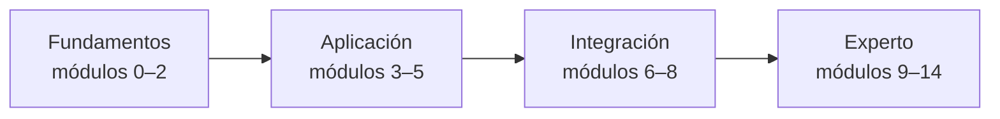
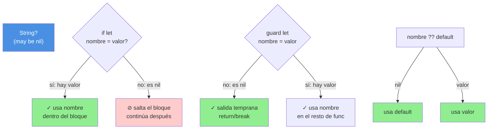
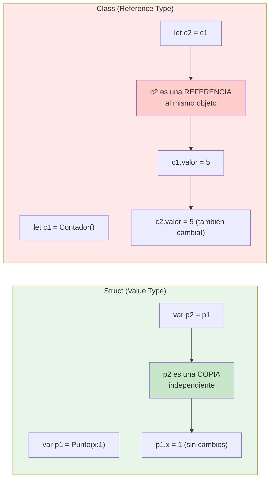
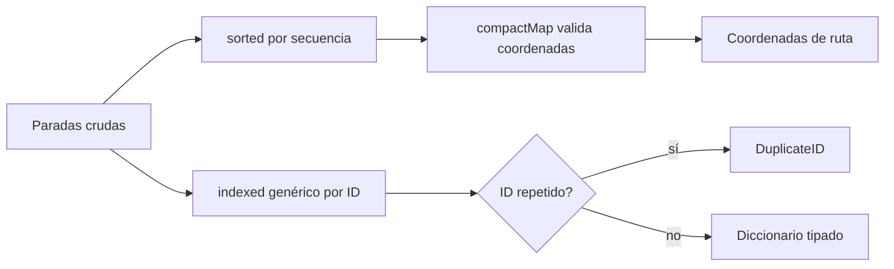
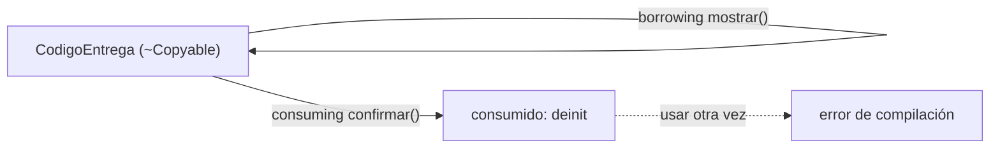

# Módulo 0: Fundamentos de Swift


## Antes de comenzar: qué equipo necesitas realmente

Para crear, ejecutar, firmar y publicar una app iOS necesitas **macOS y Xcode**. Apple no ofrece Xcode para Windows o Linux. En esos sistemas puedes aprender sintaxis Swift y practicar lógica, pero necesitarás acceso posterior a un Mac físico o un servicio Mac remoto para completar el track de aplicaciones.

### macOS: entorno completo recomendado

1. Instala Xcode 26 o posterior desde App Store (incluye Swift 6.2 y necesita macOS Sequoia 15.6 o posterior) y ábrelo una vez para aceptar la licencia y descargar componentes.
2. En Xcode abre **Settings → Platforms** e instala un simulador de iOS.
3. Ejecuta `xcode-select -p`, `xcodebuild -version` y `swift --version` en Terminal.
4. Crea **File → New → Project → iOS App**, Interface SwiftUI y Language Swift.
5. Selecciona un iPhone Simulator y pulsa Run. No necesitas cuenta de pago para el simulador.

### Windows y Linux: etapa de fundamentos

Instala Swift desde [swift.org/install](https://www.swift.org/install/) y VS Code con la extensión Swift. Verifica `swift --version`, crea `hola.swift` con `print("Hola, Swift")` y ejecuta `swift hola.swift`. Esta configuración sirve para Módulo 0 y lógica independiente; SwiftUI, simulador, firma y App Store requieren macOS.

**Sobre otros cursos de la academia.** Algunas explicaciones comparan Swift con Kotlin, Android, React, Angular o Spring Boot y citan el módulo de ese curso. Son comparaciones opcionales: no necesitas haber hecho esos cursos para seguir este. Si no los conoces, sáltalas; todo lo que necesitas está en este curso.

Si Xcode indica que no encuentra un runtime, instálalo en Settings → Platforms. Si falla la licencia, ejecuta `sudo xcodebuild -license accept`. Conserva espacio libre suficiente: Xcode y los simuladores pueden ocupar decenas de GB.

## Mapa de la ruta

«iOS con SwiftUI» tiene 15 módulos en 4 etapas. Cada etapa se apoya en la anterior; usa la tabla para saltar a un módulo concreto.



| Módulo | Etapa | Qué aprendes |
|---|---|---|
| 0 | Fundamentos | [Fundamentos de Swift](/curso/ios/0) |
| 1 | Fundamentos | [SwiftUI: vistas y layout declarativo](/curso/ios/1) |
| 2 | Fundamentos | [Estado y data flow](/curso/ios/2) |
| 3 | Aplicación | [Navegación](/curso/ios/3) |
| 4 | Aplicación | [Concurrencia moderna: async/await](/curso/ios/4) |
| 5 | Aplicación | [Networking con URLSession](/curso/ios/5) |
| 6 | Integración | [Persistencia con SwiftData](/curso/ios/6) |
| 7 | Integración | [Combine y programación reactiva](/curso/ios/7) |
| 8 | Integración | [Arquitectura MVVM](/curso/ios/8) |
| 9 | Experto | [Testing en iOS](/curso/ios/9) |
| 10 | Experto | [Performance, accesibilidad y HIG](/curso/ios/10) |
| 11 | Experto | [Publicación en App Store](/curso/ios/11) |
| 12 | Experto | [Proyecto integrador: app SwiftUI completa](/curso/ios/12) |
| 13 | Experto | [iOS en producción: seguridad, sincronización y operación](/curso/ios/13) |
| 14 | Experto | [SwiftUI Master: pruebas, animación e interoperabilidad](/curso/ios/14) |

## Aprende construyendo

### Tema 1: Optionals y unwrapping seguro · Básico · 45 min

#### Paso 1 · Objetivo y preparación
Al finalizar vas a desenvolver un `String?` de forma segura con `guard let`, evitando el crash de un force unwrap sobre un destinatario ausente. Prerrequisitos: Swift 6.2 o posterior (Xcode 26 en macOS, o el toolchain de swift.org en Windows/Linux). Verifica `swift --version` y, en macOS, `xcodebuild -version`.

**Diagrama: Caminos de Desenvolvimiento Seguro**



#### Paso 2 · Contexto y caso real
Al etiquetar un paquete para entrega, el nombre del destinatario puede no estar disponible todavía (un pedido recién creado, sin asignar); el código que etiqueta la caja debe expresar esa ausencia sin crashear.

#### Paso 3 · Teoría, modelo mental y analogía
`String?` es un tipo formalmente distinto de `String` para el compilador: Swift obliga a desenvolver el optional antes de usarlo, convirtiendo en error de compilación lo que en otros lenguajes sería un crash en producción. La analogía: una etiqueta de paquete que declara explícitamente si el campo puede estar vacío, en vez de asumir que siempre hay un valor.

**Conceptos clave:** ausencia de valor modelada en el sistema de tipos, no como un valor especial oculto.

Modelar cada dato que puede faltar (`nombre: String?`, un conductor aún no asignado) con optionals explícitos es el hábito base del proyecto integrador (app SwiftUI completa, Módulo 12): cada vista de ese proyecto desenvolverá datos de red con `guard let`/`if let`, nunca con force unwrap.

**Cuándo no usarlo:** el force unwrap (`!`) solo es aceptable cuando el flujo del programa garantiza matemáticamente que el valor no puede ser `nil` en ese punto exacto (por ejemplo, un recurso empaquetado en el propio bundle de la app); fuera de ese caso, reintroduce exactamente el riesgo de crash que los optionals existen para eliminar.

```swift
var nombre: String? = nil // explícitamente puede no tener valor

if let nombreDesenvuelto = nombre {
    print(nombreDesenvuelto) // solo accesible aquí dentro, ya seguro
}

let saludo = nombre ?? "Invitado" // nil coalescing: valor por defecto
```

Swift incorpora la ausencia de valor directamente en el sistema de tipos mediante el modificador `?`: `String?` y `String` son tipos formalmente distintos para el compilador, de modo que intentar usar un `String?` donde se espera un `String` sin desenvolverlo primero produce un error de compilación, no un crash en tiempo de ejecución. Esta decisión de diseño reduce mucho la categoría de errores que en otros lenguajes aparece como `NullPointerException` (Java) o `undefined is not a function` (JavaScript): mientras desenvuelvas con `if let`, `guard let` o `??`, el compilador rechaza el código inseguro antes de ejecutarlo. No la elimina por completo: `!`, `try!` y `as!` le dicen al compilador «confía en mí», y si el valor falta el programa se detiene en tiempo de ejecución, como verás en el fallo deliberado del Paso 4.

`if let` desenvuelve el optional de forma segura y condicional (el bloque solo se ejecuta si hay un valor presente); `guard let` desenvuelve de forma temprana con una salida obligatoria en caso de `nil` (apropiado para validaciones al inicio de una función); `??` (nil coalescing) provee un valor por defecto en una única expresión cuando el optional es `nil`. Todas estas son alternativas seguras al "force unwrap" (`nombre!`), que sí puede provocar un crash en tiempo de ejecución si el valor resulta ser `nil`, y que por eso se reserva para casos donde se tiene certeza absoluta (verificada por el propio programador, no por el compilador) de que el valor nunca será `nil` en ese punto específico del código.

**Analogía:** un optional es como una caja que declara explícitamente en su etiqueta si puede estar vacía o no; abrirla con `if let` es revisar con cuidado antes de asumir que contiene algo, mientras que forzar la apertura con `!` es asumir a ciegas que hay contenido, arriesgándose a una sorpresa desagradable si la caja resulta estar vacía.

**¿Por qué es importante?** El sistema de optionals de Swift detecta en tiempo de compilación casi todos los errores de "acceder a un valor ausente" (salvo los que fuerzas con `!`), en vez de dejar que se manifiesten como crashes en producción como ocurre en lenguajes sin este mecanismo incorporado al sistema de tipos.

#### Paso 4 · Demostración guiada desde cero
Parte de una **carpeta vacía** y crea un ejecutable dedicado a valores ausentes:
```bash
mkdir SwiftOptionals
cd SwiftOptionals
swift package init --type executable
rm Sources/SwiftOptionals/SwiftOptionals.swift
```

`--type` es la bandera que elige la plantilla del paquete Swift (`executable`, un programa que corre directamente; más abajo verás `library`, un paquete pensado para ser importado).

La plantilla `executable` crea `Sources/SwiftOptionals/SwiftOptionals.swift` con un tipo `@main`; el `rm` lo borra porque un módulo no puede tener a la vez `@main` y `main.swift`. Usa nombres sin guiones: con `swift-optionals`, Swift 6.4 crea la carpeta `Sources/swift_optionals` y las rutas de esta lección dejarían de coincidir.

Guarda `Sources/SwiftOptionals/main.swift`:

```swift
func etiquetaDestinatario(_ nombre: String?) -> String {
    // guard let abre la caja solo cuando realmente contiene un String.
    guard let nombre, !nombre.isEmpty else { return "Sin destinatario" }
    return "Entregar a: \(nombre)"
}

print(etiquetaDestinatario("Ana"))
print(etiquetaDestinatario(nil))
```

Ejecuta `swift run`. **Resultado esperado:** `Entregar a: Ana` y luego `Sin destinatario`. **Fallo deliberado:** reemplaza `guard let` por `return nombre!`; la segunda llamada termina con un error fatal. El diagnóstico es un *force unwrap* de `nil`; restaura el desenvolvimiento seguro.

#### Paso 5 · Práctica guiada
Pista: reemplazá `guard let nombre, !nombre.isEmpty else { return "Sin destinatario" }` por `return "Entregar a: \(nombre!)"`. Ese es el fallo deliberado: la segunda llamada (`etiquetaDestinatario(nil)`) termina con un *force unwrap* de `nil`, un error fatal que detiene el programa, en vez del mensaje controlado "Sin destinatario" que `guard let` producía.

#### Paso 6 · Práctica independiente
Corregí el Paso 5 restaurando `guard let`, y agregá un tercer caso de prueba con un nombre que contenga solo espacios (`"   "`) confirmando que `!nombre.isEmpty` por sí solo no lo detecta — documentá si haría falta `trimmingCharacters` para ese caso.

#### Paso 7 · Cierre
Entregá la función con `guard let` del Paso 4, el crash por force unwrap del Paso 5, y el caso de nombre vacío del Paso 6; explicá por qué Swift convierte en error de compilación lo que en otros lenguajes sería un crash en producción. Siguiente paso: modelá identidad compartida frente a copia con struct y class. Errores comunes: usar force unwrap (`!`) por comodidad en vez de `guard let`/`if let`; confiar en `isEmpty` sin recortar espacios cuando el dato viene de un formulario de usuario real. Fuentes oficiales: https://docs.swift.org/swift-book/documentation/the-swift-programming-language/thebasics/#Optionals y https://developer.apple.com/documentation/swift/optional.
**Implicación práctica:** Modelar la ausencia de valor en el sistema de tipos convierte en error de compilación lo que en otros lenguajes es un crash en producción cuando un dato esperado no llegó.

### Tema 2: struct vs class · Básico · 45 min

#### Paso 1 · Objetivo y preparación
Al finalizar vas a demostrar con código real la diferencia entre copiar un `struct` (independiente) y compartir una instancia de `class` (misma referencia), usando un paquete y una sesión de conductor como ejemplo. Prerrequisitos: Swift 6.2 o posterior (Xcode 26 en macOS, o el toolchain de swift.org en Windows/Linux). Verifica `swift --version` y, en macOS, `xcodebuild -version`.

**Diagrama: Value Type vs Reference Type**



#### Paso 2 · Contexto y caso real
Al pasar los datos de una sesión de conductor activa entre dos partes del código, si el tipo elegido es el equivocado (struct cuando se necesita identidad compartida, o class cuando se necesita independencia), un cambio en un lugar inesperado termina afectando a otro que no debería verse alterado.

#### Paso 3 · Teoría, modelo mental y analogía
Un `struct` es un value type — cada asignación crea una copia independiente; una `class` es un reference type — una asignación equivalente comparte la misma instancia. La analogía: fotocopiar un documento antes de entregarlo (struct) frente a entregar el original directamente (class).
**Conceptos clave:** copia independiente vs instancia compartida.

```swift
struct Punto { var x: Int; var y: Int }     // value type: se copia al asignar
class Contador { var valor = 0 }              // reference type: se comparte la misma instancia

var p1 = Punto(x: 1, y: 1)
var p2 = p1
p2.x = 99 // p1.x sigue siendo 1 — son copias independientes
```

Un `struct` es un value type: cada asignación (`var p2 = p1`) crea una copia completamente independiente, de modo que modificar `p2` nunca afecta a `p1`; una `class` es un reference type: una asignación equivalente simplemente copia una referencia hacia la misma instancia subyacente en memoria, de modo que modificar el objeto a través de cualquiera de las dos variables afecta a ambas por igual, dado que en realidad apuntan al mismo objeto. Esta distinción, poco común como default en otros lenguajes mainstream (donde todo objeto es típicamente reference type salvo tipos primitivos), es una decisión de diseño deliberada de Swift que empuja hacia modelos de datos inmutables y predecibles por defecto (usando `struct` para la mayoría de los modelos de dominio) reservando `class` específicamente para casos donde la identidad compartida y la mutación observada desde múltiples lugares es intencional (como un `ViewModel` observado por varias vistas).

Esta elección tiene consecuencias prácticas directas en el razonamiento sobre el código: un `struct` pasado a una función nunca puede ser mutado inesperadamente por esa función de forma que afecte al llamador (a menos que se declare explícitamente como `inout`), mientras que una `class` pasada de la misma forma sí podría ser mutada por la función receptora, afectando también al llamador original, dado que ambos comparten la misma instancia subyacente.

**Analogía:** un `struct` es como fotocopiar un documento antes de entregarlo: cualquier anotación que el receptor haga en su copia nunca aparece en el original; una `class` es como entregar el documento original directamente: cualquier anotación que el receptor haga sí modifica ese mismo documento que el remitente sigue teniendo en su poder.

**¿Por qué es importante?** Elegir `struct` para un modelo de datos previene mutaciones inesperadas compartidas entre distintas partes del código, mientras que `class` es apropiada cuando la identidad compartida y la observación de mutaciones desde múltiples lugares es exactamente el comportamiento deseado.

**Código del ejemplo:**

```swift
struct Punto { var x: Int; var y: Int }   // value type: copia independiente
class Contador { var valor = 0 }            // reference type: instancia compartida
```

**Transferencia al proyecto integrador «Aplicación del repartidor iOS»:** Representa la entrega como valor y el coordinador de sincronización como objeto con identidad. Prueba copiar una entrega y cambiar su estado sin modificar el snapshot que muestra otra pantalla.

#### Paso 4 · Demostración guiada desde cero
Desde una **carpeta vacía**, crea un ejemplo que haga visible copia frente a identidad:
```bash
mkdir SwiftIdentidad
cd SwiftIdentidad
swift package init --type executable
rm Sources/SwiftIdentidad/SwiftIdentidad.swift
```
Guarda `Sources/SwiftIdentidad/main.swift`:

```swift
struct Paquete { var estado: String }
final class Sesion { var conductor = "Ana" }

var original = Paquete(estado: "creado")
var copia = original
copia.estado = "en ruta"       // Cambia la copia, no el valor original.

let sesionA = Sesion()
let sesionB = sesionA
sesionB.conductor = "Luis"      // Ambas referencias observan la misma instancia.

print(original.estado, copia.estado)
print(sesionA.conductor, sesionB.conductor)
```

Ejecuta `swift run`. **Salida esperada:** `creado en ruta` y `Luis Luis`. **Fallo deliberado:** declara `original` con `let` e intenta cambiar `original.estado`; el compilador explica que una constante no puede mutarse. Decide si el modelo debe ser mutable, en vez de cambiarlo a `class` solo para silenciar el error.

#### Paso 5 · Práctica guiada
Pista: declará `original` con `let` en vez de `var`, y luego intentá `original.estado = "en ruta"` directamente sobre `original` (sin pasar por `copia`). Ese es el fallo deliberado: el compilador rechaza la mutación porque una constante (`let`) de un value type no puede mutarse, un error de compilación que confirma que `struct` + `let` es inmutable incluso para su propio dueño, no solo para quien lo copia.

#### Paso 6 · Práctica independiente
Corregí el Paso 5 decidiendo explícitamente si `original` debe ser mutable (`var`) o no (`let`) según el caso de uso real, en vez de cambiar `Paquete` a `class` solo para silenciar el error del compilador; documentá en un comentario por qué esa sustitución habría sido incorrecta.

#### Paso 7 · Cierre
Entregá la copia independiente y la referencia compartida del Paso 4, el error de mutación sobre `let` del Paso 5, y la decisión documentada del Paso 6; explicá por qué Swift elige `struct` como default para la mayoría de los modelos de dominio, reservando `class` para identidad compartida intencional. Siguiente paso: modelá contratos de comportamiento con protocolos y estados con enums. Errores comunes: usar `class` por defecto para modelos de datos simples; cambiar un tipo de `struct` a `class` para evitar un error de mutabilidad en vez de resolver la causa real. Fuentes oficiales: https://docs.swift.org/swift-book/documentation/the-swift-programming-language/classesandstructures/ y https://developer.apple.com/documentation/swift/choosing-between-structures-and-classes.
**Implicación práctica:** Elegir struct o class según identidad compartida (y no por costumbre) evita que un cambio en un lugar inesperado del código afecte a datos que debían permanecer independientes.

### Tema 3: Protocolos y enums con valores asociados · Básico · 40 min

#### Paso 1 · Objetivo y preparación
Al finalizar vas a modelar el estado de una entrega como un enum con valores asociados, y vas a comprobar que el compilador exige manejar exhaustivamente cada caso en un `switch`. Prerrequisitos: Swift 6.2 o posterior (Xcode 26 en macOS, o el toolchain de swift.org en Windows/Linux). Verifica `swift --version` y, en macOS, `xcodebuild -version`.

#### Paso 2 · Contexto y caso real
El estado de una entrega (creada, en ruta con un conductor, fallida con un motivo) no es un simple string — cada estado lleva consigo datos propios distintos, y un nuevo estado agregado en el futuro no debería poder "olvidarse" silenciosamente en la lógica que ya reacciona a los estados existentes.

#### Paso 3 · Teoría, modelo mental y analogía
Un enum con valores asociados modela un conjunto cerrado de casos posibles, cada uno con sus propios datos; el compilador verifica que un `switch` sobre ese enum sea exhaustivo. La analogía: un formulario con un menú desplegable de opciones fijas, donde cada opción revela campos adicionales específicos de esa elección.

**Conceptos clave:** contrato de comportamiento compartido entre tipos no relacionados; estado modelado como un conjunto cerrado de casos con datos propios.

```swift
protocol Describible {
    func describir() -> String
}

extension Int: Describible {
    func describir() -> String { "El número es \(self)" }
}
```

Un protocolo declara un contrato de comportamiento (métodos y propiedades requeridas) que cualquier tipo puede adoptar, incluso tipos que Swift ya define de antemano (`Int`, mediante una extensión, sin necesidad de modificar el código fuente original de `Int`); esto habilita un patrón de composición de comportamiento sin depender de jerarquías de herencia rígidas, permitiendo que tipos completamente no relacionados entre sí (un `Int` y un `struct` propio) compartan el mismo contrato `Describible` de forma uniforme.

```swift
enum Resultado {
    case exito(String)
    case error(mensaje: String, codigo: Int)
}

switch resultado {
case .exito(let datos): print(datos)
case .error(let mensaje, let codigo): print("\(mensaje) (\(codigo))")
}
```

Un enum con valores asociados modela un estado como un conjunto cerrado y exhaustivo de casos posibles, cada uno pudiendo llevar consigo datos propios específicos de ese caso (`exito` lleva un `String`, `error` lleva un `mensaje` y un `codigo`); el compilador de Swift verifica la exhaustividad de un `switch` sobre ese enum, obligando a manejar explícitamente todos los casos posibles (o proveer un caso `default` deliberado), lo que hace que agregar un nuevo caso al enum en el futuro genere errores de compilación en cada `switch` existente que no lo contemple, forzando una actualización consciente en vez de un comportamiento silenciosamente incorrecto. Este mismo patrón de "modelado de estado con casos cerrados y verificación de exhaustividad" es análogo a las sealed classes de Kotlin (Módulo 1 del track de Kotlin Multiplatform), aunque con la diferencia de que Swift verifica la exhaustividad de forma nativa e incorporada al lenguaje sin necesidad de configuración adicional.

**Analogía:** un protocolo es como un certificado de competencia que cualquier profesional puede obtener independientemente de su formación original, permitiendo agrupar a profesionales de trasfondos completamente distintos bajo un mismo estándar reconocido de habilidad; un enum con valores asociados es como un formulario con un menú desplegable de opciones fijas, donde cada opción seleccionada revela campos adicionales específicos de esa elección, y el sistema exige completar la sección correspondiente sin importar cuál se haya elegido.

**¿Por qué es importante?** Los protocolos permiten composición de comportamiento entre tipos no relacionados sin depender de herencia rígida; los enums con valores asociados modelan estado de forma exhaustiva y verificada por el compilador, previniendo casos no manejados que pasarían desapercibidos en un modelo menos estricto.

**Transferencia al proyecto integrador «Aplicación del repartidor iOS»:** Modela el resultado de confirmar como enum con éxito y errores explícitos. Prueba cada variante y verifica que el consumidor no confunde falta de red con falta de autorización.

#### Paso 4 · Demostración guiada desde cero
Desde una **carpeta vacía**, crea un contrato y un estado imposible de representar mal:
```bash
mkdir SwiftProtocolosEstados
cd SwiftProtocolosEstados
swift package init --type executable
rm Sources/SwiftProtocolosEstados/SwiftProtocolosEstados.swift
```
Guarda `Sources/SwiftProtocolosEstados/main.swift`:

```swift
protocol Describible { var descripcion: String { get } }

enum EstadoEntrega: Describible {
    case creada
    case enRuta(conductor: String)
    case fallida(motivo: String)

    var descripcion: String {
        switch self {
        case .creada: return "Creada"
        case .enRuta(let conductor): return "En ruta con \(conductor)"
        case .fallida(let motivo): return "Fallida: \(motivo)"
        }
    }
}

print(EstadoEntrega.enRuta(conductor: "Ana").descripcion)
```

Ejecuta `swift run`. **Resultado esperado:** `En ruta con Ana`. **Fallo deliberado:** añade `case entregada` y no modifiques el `switch`; el compilador informa que no es exhaustivo. Agrega el caso de manera consciente y evita un `default` que oculte futuros estados.

#### Paso 5 · Práctica guiada
Pista: agregá el caso `case entregada` al enum `EstadoEntrega` sin modificar el `switch` de `descripcion`. Ese es el fallo deliberado: el compilador reporta que el `switch` ya no es exhaustivo, señalando exactamente el caso nuevo sin cubrir, en vez de dejar que ese estado produzca silenciosamente un comportamiento indefinido en producción.

#### Paso 6 · Práctica independiente
Corregí el Paso 5 agregando el caso `entregada` al `switch` de forma consciente (no con un `default` genérico), y agregá un segundo `switch` en otra función (por ejemplo, para decidir si una entrega todavía puede cancelarse) confirmando que el compilador también exige cubrir `entregada` ahí.

#### Paso 7 · Cierre
Entregá el enum exhaustivo del Paso 4, el error de exhaustividad al agregar `entregada` del Paso 5, y el segundo `switch` corregido del Paso 6; explicá por qué un `default` genérico en un `switch` sobre un enum propio oculta exactamente la protección que la exhaustividad del compilador existe para dar. Siguiente paso: reutilizá comportamiento con closures y genéricos. Errores comunes: agregar un `default` genérico a un switch sobre un enum propio, ocultando casos nuevos sin manejar; modelar un estado con múltiples banderas booleanas sueltas en vez de un enum con valores asociados. Fuentes oficiales: https://docs.swift.org/swift-book/documentation/the-swift-programming-language/enumerations/ y https://docs.swift.org/swift-book/documentation/the-swift-programming-language/protocols/.
**Implicación práctica:** La exhaustividad del `switch` sobre un enum propio obliga a decidir conscientemente qué hacer con cada caso nuevo, en vez de que un `default` genérico lo oculte silenciosamente en producción.

### Tema 4: Closures, colecciones y genéricos con propósito · Básico · 30 min

#### Paso 1 · Objetivo y preparación
Al finalizar vas a filtrar coordenadas válidas de una lista de paradas con `compactMap`, y a indexar elementos por un identificador genérico sin perder el tipo concreto. Prerrequisitos: Swift 6.2 o posterior (Xcode 26 en macOS, o el toolchain de swift.org en Windows/Linux). Verifica `swift --version` y, en macOS, `xcodebuild -version`.

#### Paso 2 · Contexto y caso real
Una lista de paradas de una ruta puede traer coordenadas ausentes o fuera de rango (una latitud de 120 grados no existe); descartarlas en silencio sin una regla explícita puede ocultar un error de datos real en vez de uno esperado.

#### Paso 3 · Teoría, modelo mental y analogía
`compactMap` transforma y descarta los resultados `nil` en una sola operación; un algoritmo genérico con una restricción como `ID: Hashable` expresa una relación entre tipos sin perder información al caer en `Any`. La analogía: una banda transportadora con estaciones que ordenan, seleccionan y transforman, donde un genérico describe la forma de la máquina sin exigir que todo se convierta en cajas sin etiqueta.

**Conceptos clave:** función como valor, closure de escape, lista de captura, `map`, `filter`, `compactMap`, `reduce`, parámetro genérico y cláusula `where`.

Construiremos una preparación de ruta para nuestra app. Una closure es una función que puede almacenarse, pasarse y ejecutarse después. SwiftUI, `URLSession`, Combine y UIKit dependen de ellas; por eso debes comprender parámetros, retorno, captura y duración antes de usar sintaxis abreviada como `$0` en todas partes.

**Requisitos previos:** temas 1–3 y Swift instalado. Crea `Sources/RutaFoundation/RoutePreparation.swift` y `Tests/RutaFoundationTests/RoutePreparationTests.swift`. En macOS, Windows o Linux puedes practicar este tema como paquete independiente:

```bash
mkdir RutaFoundation && cd RutaFoundation
swift package init --type library
swift test
```

Empieza con transformaciones pequeñas y nombradas. `filter` conserva elementos, `map` transforma uno por uno, `compactMap` transforma y descarta resultados `nil`, y `reduce` acumula todos en un resultado.

```swift
import Foundation

public struct Stop: Equatable, Sendable {
    public let id: UUID
    public let sequence: Int
    public let address: String
    public let latitude: Double?
    public let longitude: Double?
}

public struct Coordinate: Equatable, Sendable {
    public let latitude: Double
    public let longitude: Double
}

public func validCoordinates(from stops: [Stop]) -> [Coordinate] {
    stops
        .sorted { $0.sequence < $1.sequence }
        .compactMap { stop in
            guard let latitude = stop.latitude,
                  let longitude = stop.longitude,
                  (-90...90).contains(latitude),
                  (-180...180).contains(longitude) else { return nil }
            return Coordinate(latitude: latitude, longitude: longitude)
        }
}
```

La forma larga `{ stop in ... }` es preferible cuando hay varias reglas; `$0` funciona bien en una expresión corta. `compactMap` no debe usarse para esconder datos inválidos sin una decisión: aquí el nombre de la función declara que solo devuelve coordenadas válidas; en un proceso contable quizá debas devolver errores en vez de descartar.

Un algoritmo genérico expresa una relación entre tipos sin perder información en `Any`. La restricción `ID: Hashable` permite usar un diccionario y mantiene el tipo concreto del identificador:

```swift
public enum DuplicateID<ID: Hashable>: Error, Equatable {
    case found(ID)
}

public func indexed<Element, ID: Hashable>(
    _ elements: [Element],
    by id: (Element) -> ID
) throws -> [ID: Element] {
    try elements.reduce(into: [:]) { result, element in
        let key = id(element)
        guard result.updateValue(element, forKey: key) == nil else {
            throw DuplicateID.found(key)
        }
    }
}

// Uso, desde una función o una prueba: let stopsByID = try indexed(stops, by: \.id)
```

El parámetro `by` es una closure no escapante: se usa antes de que termine `indexed`. Cuando una función guarda una closure para ejecutarla después, el parámetro necesita `@escaping`. Esa diferencia importa para vida de objetos y captura de `self`.

```swift
public final class RouteObserver {
    private var onUpdate: (([Stop]) -> Void)?

    public func observe(_ action: @escaping ([Stop]) -> Void) {
        onUpdate = action
    }

    public func publish(_ stops: [Stop]) { onUpdate?(stops) }
}
```

Una lista de captura fija cómo se toma un valor. `[expectedRouteID]` captura el valor actual; capturar una clase toma su referencia. `[weak self]` es relevante solamente cuando la closure puede sobrevivir a la llamada y existe una cadena de propiedad capaz de formar ciclo, no como decoración obligatoria de cada closure.



**Analogía:** las funciones de orden superior son estaciones de una banda transportadora: cada una ordena, selecciona o transforma. Un genérico describe la forma de la máquina sin exigir que todos los paquetes se conviertan en cajas sin etiqueta como ocurriría con `Any`.

**¿Por qué es importante?** Closures permiten separar una política variable del algoritmo que la usa; genéricos reutilizan el algoritmo conservando comprobación del compilador. Sin comprender captura y restricciones aparecen ciclos de memoria, errores escondidos y APIs difíciles de entender.

**Ejecución y resultado esperado:** ejecuta `swift test`. Una lista desordenada debe producir coordenadas ordenadas, las posiciones imposibles deben quedar fuera y dos paradas con el mismo ID deben producir `DuplicateID.found(id)` sin crash ni `Any`.

**Fallo deliberado:** cambia `compactMap` por `map` y observa que el resultado se vuelve `[Coordinate?]`; después elimina la detección de duplicados y verifica cómo el último elemento sobrescribe silenciosamente al primero. Restablece ambas garantías y documenta cuándo descartar un inválido sería incorrecto.

**Modificación sin copiar:** generaliza la preparación para aceptar una política `(Stop) -> Result<Coordinate, ValidationError>`. Devuelve válidos y errores por separado, y demuestra con tests que ninguna parada desaparece sin explicación.

---

**Transferencia al proyecto integrador «Aplicación del repartidor iOS»:** Transforma y ordena la ruta mediante funciones sobre colecciones y un criterio inyectado. Prueba empates y lista vacía, evitando que un closure retenga innecesariamente el modelo de pantalla.

#### Paso 4 · Demostración guiada desde cero
Desde una **carpeta vacía**, crea una transformación tipada de paradas:
```bash
mkdir SwiftColecciones
cd SwiftColecciones
swift package init --type library
```
Guarda `Sources/SwiftColecciones/RoutePreparation.swift` y `Tests/SwiftColeccionesTests/RoutePreparationTests.swift`:

```swift
public func coordenadasValidas(_ valores: [Double?]) -> [Double] {
    valores.compactMap { valor in
        // La closure descarta nil y posiciones fuera del rango de latitud.
        guard let valor, (-90...90).contains(valor) else { return nil }
        return valor
    }
}
```

```swift
import Testing
@testable import SwiftColecciones

@Test func filtraAusenciasYValoresImposibles() {
    #expect(coordenadasValidas([4.6, nil, 120]) == [4.6])
}
```

Ejecuta `swift test`. **Resultado esperado:** una prueba aprobada. **Fallo deliberado:** cambia el rango a `(-180...180)`; la prueba falla porque `120` deja de descartarse. El diagnóstico muestra que una regla de latitud se confundió con una de longitud.

#### Paso 5 · Práctica guiada
Pista: cambiá el rango de latitud válida de `(-90...90)` a `(-180...180)` en `coordenadasValidas`. Ese es el fallo deliberado: la prueba `filtraAusenciasYValoresImposibles` falla porque `120` (una longitud válida, pero no una latitud válida) ya no se descarta, revelando que una regla de longitud se confundió con una de latitud.

#### Paso 6 · Práctica independiente
Corregí el Paso 5 restaurando el rango `(-90...90)` para latitud, y agregá una segunda función que valide longitud con su propio rango `(-180...180)`, confirmando con un test que ambas reglas se verifican de forma independiente y no se mezclan.

#### Paso 7 · Cierre
Entregá el filtro de coordenadas del Paso 4, la prueba fallida por rango de latitud/longitud confundidos del Paso 5, y la validación de longitud independiente del Paso 6; explicá por qué nombrar explícitamente cada regla de rango (latitud vs longitud) evita que una se confunda silenciosamente con la otra. Siguiente paso: construí una app SwiftUI completa que use estos mismos modelos. Errores comunes: usar `$0` en closures con varias reglas distintas, perdiendo legibilidad; descartar valores inválidos con `compactMap` sin documentar si esconder el dato inválido es realmente la decisión correcta para ese caso. Fuentes oficiales: https://docs.swift.org/swift-book/documentation/the-swift-programming-language/closures/ y https://docs.swift.org/swift-book/documentation/the-swift-programming-language/generics/.
**Implicación práctica:** Nombrar explícitamente cada regla de filtrado (latitud vs longitud) evita que una se confunda silenciosamente con otra al descartar datos con `compactMap`.

### Tema 5: Ownership en Swift: borrowing, consuming y tipos ~Copyable · Experto · 45 min

**Prerrequisito:** tema «struct vs class» de este módulo.

**Al finalizar podrás:** modelar un recurso que no se puede copiar con `~Copyable`, pasarlo a funciones como `borrowing` o `consuming` y comprobar que el compilador impide usarlo después de consumirlo.

**¿Por qué es importante?** Algunos valores no deben duplicarse: un token de un solo uso, un descriptor de archivo, un permiso de entrega. Con `~Copyable`, el compilador garantiza que existe una sola copia y que nadie lo usa después de entregarlo.

#### Paso 1 · Objetivo y preparación

Usa Swift 6.2 o posterior (Xcode 26). Crea un paquete de línea de comandos con `mkdir Propiedad && cd Propiedad && swift package init --type executable`, borra el archivo generado con `rm Sources/Propiedad/Propiedad.swift` y escribe el código en `Sources/Propiedad/main.swift`.

#### Paso 2 · Contexto y caso real

En RutaFlow, cada entrega genera un código de confirmación de un solo uso. Un error permitía usar el mismo código dos veces, porque se copiaba en varios lugares. Un tipo no copiable hace imposible ese error: el compilador lo rechaza.

#### Paso 3 · Teoría, modelo mental y analogía

**Conceptos clave:** propiedad (*ownership*), copia implícita, `~Copyable`, `borrowing`, `consuming`, `deinit` en structs, uso después de consumir.

Por defecto, los tipos de valor de Swift son **copiables**: asignar o pasar un `struct` crea una copia. Con `struct Token: ~Copyable` declaras que el tipo **no** se puede copiar: solo se **mueve**.

Al pasar un valor no copiable a una función, eliges cómo:

| Modificador | Significa | Después de la llamada |
|---|---|---|
| `borrowing` | la función lo mira, sin quedárselo | sigues teniéndolo |
| `consuming` | la función se lo queda | ya no lo puedes usar |

Un tipo `~Copyable` puede tener `deinit`, que corre cuando el valor se destruye. Si intentas usar un valor después de consumirlo, el compilador da un error, no un fallo en ejecución.

**Analogía:** un tipo no copiable es una llave física única: puedes prestarla para que alguien mire el llavero (`borrowing`) o entregarla (`consuming`), pero no fotocopiarla. La analogía falla en que el compilador vigila cada entrega, algo que con llaves reales nadie hace.

**Límite de uso:** los tipos `~Copyable` todavía no funcionan con todas las APIs genéricas de la biblioteca estándar (por ejemplo, muchos métodos de colecciones). Úsalos para recursos únicos, no para modelos de datos comunes.



#### Paso 4 · Demostración guiada desde cero

Archivo `Propiedad/Sources/Propiedad/main.swift`:

```swift
struct CodigoEntrega: ~Copyable {
    let valor: String
    deinit { print("código \(valor) destruido") }
}

// Solo mira el código: quien llama lo conserva.
func mostrar(_ codigo: borrowing CodigoEntrega) {
    print("mostrando \(codigo.valor)")
}

// Se queda con el código: después de esto nadie más puede usarlo.
func confirmar(_ codigo: consuming CodigoEntrega) {
    print("confirmando entrega con \(codigo.valor)")
}

// Una constante local (dentro de una función) se puede consumir;
// por eso el ejemplo no declara `codigo` como variable global.
func entregar() {
    let codigo = CodigoEntrega(valor: "7Q4K")
    mostrar(codigo)
    mostrar(codigo)    // se puede mirar varias veces
    confirmar(codigo)  // lo entrega
    // confirmar(codigo) // ❌ error: 'codigo' consumed more than once
    print("fin")
}

entregar()
```

Ejecútalo:

```bash
cd Propiedad
swift run
```

**Explicación por bloques:** `CodigoEntrega` es `~Copyable`, así que no se copia al pasarlo. `mostrar` lo recibe como `borrowing`: lo lee y lo devuelve. `confirmar` lo recibe como `consuming`: se lo queda, y al terminar la función el valor se destruye y corre el `deinit`. La línea comentada es el error que el compilador evita: usar el código después de entregarlo.

**Resultado esperado:**

```text
mostrando 7Q4K
mostrando 7Q4K
confirmando entrega con 7Q4K
código 7Q4K destruido
fin
```

**Fallo deliberado:** descomenta la segunda llamada a `confirmar(codigo)`. **Error esperado:** el compilador rechaza el programa con `'codigo' consumed more than once`. **Diagnóstico:** el código ya se entregó; la regla de un solo uso se cumple antes de ejecutar. Esa es la ventaja frente a una comprobación en tiempo de ejecución.

#### Paso 5 · Práctica guiada

1. **Reproducción:** ejecuta el programa y explica por qué el `deinit` sale antes de «fin».
2. **Variación:** quita `~Copyable` y observa que ahora puedes confirmar dos veces.
3. **Diagnóstico:** reproduce el fallo deliberado y lee el mensaje del compilador.
4. **Integración:** agrega un método `consuming func usar() -> String` al struct y llámalo en lugar de la función libre.
5. **Diseño:** lista qué valores de RutaFlow deberían ser de un solo uso.

**Pista:** si dudas entre `borrowing` y `consuming`, pregunta: ¿quien llama necesita el valor después?

#### Paso 6 · Práctica independiente

Modela un `PermisoEscritura: ~Copyable` para un archivo de reporte: solo quien tiene el permiso puede escribir, y al cerrar (`consuming func cerrar()`) el permiso desaparece.

#### Paso 7 · Cierre

- [ ] Explicas qué cambia `~Copyable`.
- [ ] El programa imprime las cinco líneas esperadas.
- [ ] Reprodujiste el error de uso después de consumir.
- [ ] Eliges entre `borrowing` y `consuming` con criterio.

Si fallas dos o más, vuelve al Paso 3. **Errores comunes:** usar `~Copyable` para modelos comunes, olvidar que `consuming` destruye el valor al final y esperar que funcione con todas las APIs genéricas. **Siguiente paso:** el tema «Protocolos y enums con valores asociados» combina estos tipos con protocolos.

**Transferencia al proyecto integrador «RutaFlow»:** modela el código de confirmación de entrega de RutaFlow como `~Copyable` y consúmelo al confirmar.

**Fuente oficial:** [Swift Evolution — SE-0390 Noncopyable structs and enums](https://github.com/swiftlang/swift-evolution/blob/main/proposals/0390-noncopyable-structs-and-enums.md) y [The Swift Programming Language — Memory Safety](https://docs.swift.org/swift-book/documentation/the-swift-programming-language/memorysafety/).

## Ruta de proyecto progresivo desde carpeta vacía

No crees un proyecto desechable por módulo. Conserva un único repositorio que evoluciona durante todo el track y etiqueta cada hito (`git tag modulo-N`). La sección siguiente crea ese repositorio paso a paso: la carpeta `academia-ios`, el proyecto `RutaFlowApp` y el primer commit.

| Hito | Evolución acumulativa | Antes de avanzar |
|---|---|---|
| Base | SwiftUI, estado y navegación. | Arranque reproducible, commit limpio y prueba mínima. |
| Aplicación | concurrencia, red y SwiftData. | Casos normales, límite y error automatizados. |
| Integración | Conecta capas y reemplaza dobles por infraestructura controlada. | Diagrama, contratos y prueba de integración. |
| Experto | testing, seguridad y TestFlight. | Perfil o threat model, telemetría y runbook de recuperación. |

Al iniciar cada laboratorio crea una rama `modulo-N`, implementa el incremento, verifica el criterio de éxito y fusiona solo con pruebas verdes. Si un módulo necesita un experimento aislado, colócalo en `experiments/modulo-N/`; el producto acumulativo permanece ejecutable. Al terminar, otra persona debe poder clonar el repositorio y reproducir el último hito siguiendo únicamente el README.

## Crea el proyecto base RutaFlowApp

Desde el capítulo 1, cada tema termina con «Ejecuta el ejemplo» y un comando `xcodebuild -scheme RutaFlowApp`. Ese esquema no existe hasta que lo creas aquí, una sola vez; después el mismo proyecto crece durante todo el curso. Etiqueta cada hito con `git tag modulo-N`.

1. Crea una carpeta vacía `academia-ios` y ábrela en Finder.
2. En Xcode: **File → New → Project… → iOS → App**. Escribe estos valores y no cambies los demás:
   - **Product Name:** `RutaFlowApp`
   - **Interface:** SwiftUI
   - **Language:** Swift
   - **Testing System:** Swift Testing con XCTest UI Tests, para que se creen `RutaFlowAppTests` y `RutaFlowAppUITests`
   - **Storage:** None. SwiftData se agrega a mano en el capítulo 6.
3. Guárdalo dentro de `academia-ios` y marca **Create Git repository on my Mac**.
4. Comprueba en Terminal que el esquema existe:

```bash
cd academia-ios/RutaFlowApp
xcodebuild -list                     # debe listar el esquema RutaFlowApp
xcrun simctl list devices available  # elige un simulador instalado, por ejemplo iPhone 17
xcodebuild -scheme RutaFlowApp -destination 'generic/platform=iOS Simulator' build
```

Resultado esperado: `xcodebuild -list` muestra `RutaFlowApp` en **Schemes**, y el build termina con `** BUILD SUCCEEDED **`. Si dice que no encuentra el esquema, estás en otra carpeta: entra a la que contiene `RutaFlowApp.xcodeproj`.

| El código del tema es… | Dónde lo pegas | Cómo lo ejecutas |
|---|---|---|
| Una vista (`struct X: View`) o un modelo, servicio o tipo | Un archivo nuevo en el grupo `RutaFlowApp` (**File → New → File… → Swift File**) | `xcodebuild … build`, luego ⌘R o el canvas de Preview (⌥⌘↵) |
| Pruebas con `@Test` o `XCTestCase` | Un archivo dentro de `RutaFlowAppTests` o `RutaFlowAppUITests` | `xcodebuild … test` con un simulador concreto |
| Instrucciones sueltas al nivel superior (`let`, `await`, `print` fuera de una función) | Un paquete aparte: `mkdir Practica && cd Practica && swift package init --type executable`, borra `Sources/Practica/Practica.swift` y pon el código en `Sources/Practica/main.swift` | `swift run` dentro de `Practica` |

Las instrucciones sueltas no compilan dentro de la app, porque en un target de app solo `main.swift` admite código de nivel superior y `RutaFlowApp` usa `@main`.


| Hito | Evolución acumulativa | Antes de avanzar |
|---|---|---|
| Base | SwiftUI, estado y navegación. | Arranque reproducible, commit limpio y prueba mínima. |
| Aplicación | concurrencia, red y SwiftData. | Casos normales, límite y error automatizados. |
| Integración | Conecta capas y reemplaza dobles por infraestructura controlada. | Diagrama, contratos y prueba de integración. |
| Experto | testing, seguridad y TestFlight. | Perfil o threat model, telemetría y runbook de recuperación. |

Al iniciar cada laboratorio crea una rama `modulo-N`, implementa el incremento, verifica el criterio de éxito y fusiona solo con pruebas verdes. Si un módulo necesita un experimento aislado, colócalo en `experiments/modulo-N/`; el producto acumulativo permanece ejecutable. Al terminar, otra persona debe poder clonar el repositorio y reproducir el último hito siguiendo únicamente el README.

## Laboratorio práctico

**Objetivo del laboratorio:** construir un modelo de dominio usando structs, enums con valores asociados y sin force-unwrap.

**Requisitos previos:** Xcode instalado, conocimientos básicos de programación.

| Paso | Acción | Código | Explicación |
|---|---|---|---|
| 1 | Declarar un optional y usarlo sin desenvolver | Ver Tema 1 | Observa el error del compilador |
| 2 | Desenvolver con `if let`, `guard let` y `??` | Ver Tema 1 | Formas seguras, sin force-unwrap |
| 3 | Crear un `struct` y una `class`, comparar copias | Ver Tema 2 | Value type vs reference type |
| 4 | Definir un protocolo y dos implementaciones | Ver Tema 3 | Tipos no relacionados compartiendo contrato |
| 5 | Modelar un estado con un enum con valores asociados | Ver Tema 3 | `switch` exhaustivo |
| 6 | Preparar coordenadas con closures | Ver Tema 4 | Ordena, valida y transforma sin force-unwrap |
| 7 | Indexar elementos genéricamente | Ver Tema 4 | Conserva tipos y detecta IDs duplicados |

**Verificación:** el laboratorio se considera exitoso si el código no contiene ningún force-unwrap (`!`) innecesario, y si el `switch` sobre el enum modelado maneja explícitamente todos los casos posibles sin un `default` genérico que oculte casos no considerados.

**Errores comunes y soluciones**

- **Usar force-unwrap (`!`) por comodidad en vez de `if let`/`guard let`.** Arriesga un crash en producción; resérvalo solo para certeza absoluta verificada manualmente.
- **Usar `class` por defecto para modelos de datos simples.** Prefiere `struct` para prevenir mutaciones compartidas inesperadas.
- **Agregar un `default` genérico a un `switch` sobre un enum propio.** Oculta la falta de manejo explícito de casos nuevos agregados en el futuro.
- **Usar `$0` en closures con varias reglas.** Nombra el parámetro cuando mejore la lectura y separa reglas que necesiten prueba propia.
- **Borrar duplicados o inválidos silenciosamente.** Decide si descartar es parte explícita del contrato o si debes devolver un error.

---
