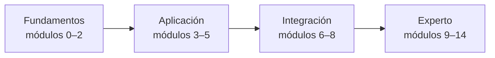
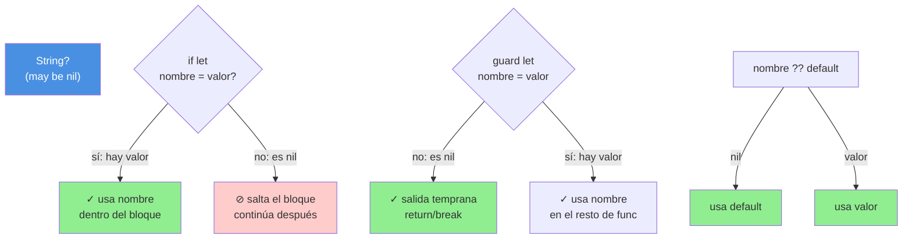
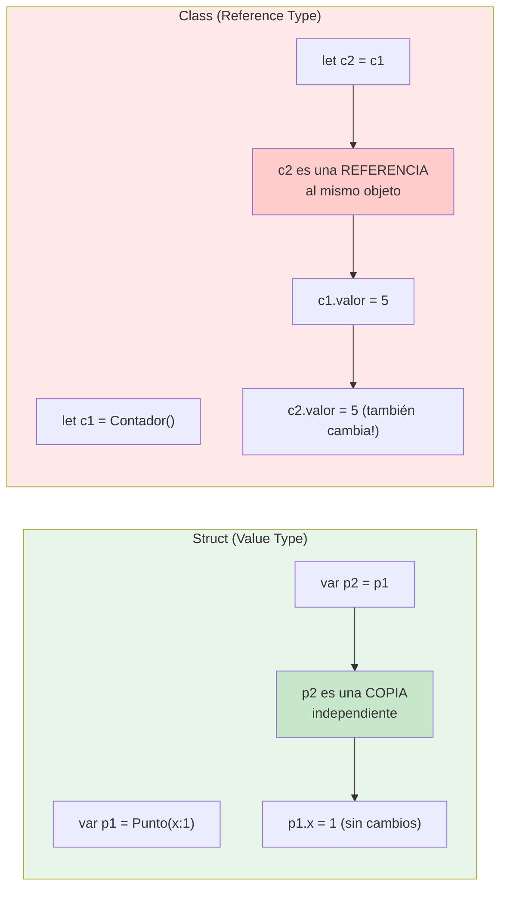
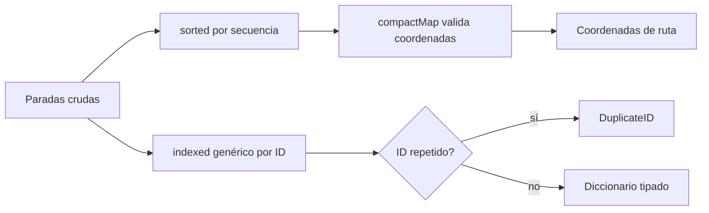
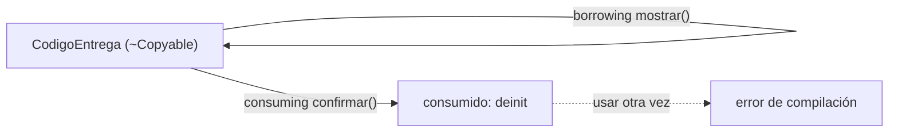

# Módulo 0: Fundamentos de Swift


## Antes de comenzar: qué equipo necesitas realmente

Para crear, ejecutar, firmar y publicar una app iOS necesitas **macOS y Xcode**. Apple no ofrece Xcode para Windows o Linux. En esos sistemas puedes aprender sintaxis Swift y practicar lógica, pero necesitarás acceso posterior a un Mac físico o un servicio Mac remoto para completar el track de aplicaciones.


### macOS: entorno completo recomendado

<details open>
<summary><strong>Capa 1 — Lectura</strong></summary>

#### ► DE QUÉ TRATA
Este tema te guía por macos: entorno completo recomendado con foco en comprensión antes de implementación.

#### ► LA IDEA EN UNA FRASE
**Entender macos: entorno completo recomendado te permite tomar mejores decisiones técnicas.**

#### ► POR QUÉ EXISTE ESTO
Resuelve un problema real de diseño o implementación y evita decisiones a ciegas.

#### ► LA ANALOGÍA
Piensa en macos: entorno completo recomendado como una herramienta de taller: útil cuando conoces su propósito y sus límites.
**Dónde se rompe la analogía:** en software, los efectos dependen del contexto, la escala y los trade-offs.

#### ► CÓMO FUNCIONA
1. Identifica el problema que macos: entorno completo recomendado resuelve.
2. Observa sus componentes y relaciones.
3. Aplica la opción más simple que funcione.
4. Verifica el resultado y los límites.

#### ► LO QUE PUEDE SALIR MAL
| Síntoma | Causa probable | Arreglo |
|---|---|---|
| macOS: entorno completo recomendado se aplica pero el resultado no mejora | Se usó sin medir el problema real | Mide antes y compara contra la alternativa simple |
| Aparece complejidad inesperada | Se adoptó la técnica sin comprender sus trade-offs | Vuelve a la sección de trade-offs y reduce el alcance |
| Falla en un caso límite | Se asumió un contexto que no se cumple | Prueba el caso límite y documenta cuándo NO usarlo |

#### ► TRADE-OFFS
| Opción | Cuándo usarla | Cuándo NO usarla |
|---|---|---|
| Usar macOS: entorno completo recomendado | Cuando el problema coincide con su propósito y el beneficio es observable | Cuando agrega complejidad sin resolver un problema real |
| Alternativa más simple | Cuando el contexto es pequeño, estable o fácil de razonar | Cuando ya demostró no escalar o no cumplir el requisito |
| Postergar la decisión | Cuando falta evidencia del problema | Cuando el costo de esperar es mayor que el costo de probar |

#### ► CUÁNDO NO USAR ESTO
No uses macos: entorno completo recomendado por defecto. Aplícalo cuando el problema lo justifique y puedas verificar el beneficio; si una alternativa más simple resuelve igual, prefiérela.

#### ► DE VUELTA A LA ANALOGÍA
Volviendo a la analogía: macos: entorno completo recomendado funciona como el modelo inicial, pero recuerda dónde se rompe: en producción importan la evidencia, la escala y el costo de equivocarte.

#### ► LO QUE DEBES RECORDAR
- macOS: entorno completo recomendado existe para resolver un problema específico.
- Mide antes de adoptar complejidad.
- Conoce el caso donde NO usarlo.
- Verifica con evidencia observable.

#### ► PREGUNTAS PARA PENSAR
1. ¿Qué problema concreto resuelve macos: entorno completo recomendado en tu contexto?
2. ¿Cómo sabrías que macos: entorno completo recomendado no está funcionando bien?
3. ¿Qué alternativa más simple considerarías antes de usar macos: entorno completo recomendado?

</details>

<details>
<summary><strong>Capa 2 — Construcción</strong></summary>

#### Nota de construcción
Este tema es principalmente conceptual en esta versión. La verificación se realiza con las preguntas de comprensión y el criterio de cuándo NO usar macos: entorno completo recomendado.

</details>

### Windows y Linux: etapa de fundamentos

<details open>
<summary><strong>Capa 1 — Lectura</strong></summary>

#### ► DE QUÉ TRATA
Este tema te guía por windows y linux: etapa de fundamentos con foco en comprensión antes de implementación.

#### ► LA IDEA EN UNA FRASE
**Entender windows y linux: etapa de fundamentos te permite tomar mejores decisiones técnicas.**

#### ► POR QUÉ EXISTE ESTO
Resuelve un problema real de diseño o implementación y evita decisiones a ciegas.

#### ► LA ANALOGÍA
Piensa en windows y linux: etapa de fundamentos como una herramienta de taller: útil cuando conoces su propósito y sus límites.
**Dónde se rompe la analogía:** en software, los efectos dependen del contexto, la escala y los trade-offs.

#### ► CÓMO FUNCIONA


#### ► LO QUE PUEDE SALIR MAL
| Síntoma | Causa probable | Arreglo |
|---|---|---|
| Windows y Linux: etapa de fundamentos se aplica pero el resultado no mejora | Se usó sin medir el problema real | Mide antes y compara contra la alternativa simple |
| Aparece complejidad inesperada | Se adoptó la técnica sin comprender sus trade-offs | Vuelve a la sección de trade-offs y reduce el alcance |
| Falla en un caso límite | Se asumió un contexto que no se cumple | Prueba el caso límite y documenta cuándo NO usarlo |

#### ► TRADE-OFFS
| Opción | Cuándo usarla | Cuándo NO usarla |
|---|---|---|
| Usar Windows y Linux: etapa de fundamentos | Cuando el problema coincide con su propósito y el beneficio es observable | Cuando agrega complejidad sin resolver un problema real |
| Alternativa más simple | Cuando el contexto es pequeño, estable o fácil de razonar | Cuando ya demostró no escalar o no cumplir el requisito |
| Postergar la decisión | Cuando falta evidencia del problema | Cuando el costo de esperar es mayor que el costo de probar |

#### ► CUÁNDO NO USAR ESTO
No uses windows y linux: etapa de fundamentos por defecto. Aplícalo cuando el problema lo justifique y puedas verificar el beneficio; si una alternativa más simple resuelve igual, prefiérela.

#### ► DE VUELTA A LA ANALOGÍA
Volviendo a la analogía: windows y linux: etapa de fundamentos funciona como el modelo inicial, pero recuerda dónde se rompe: en producción importan la evidencia, la escala y el costo de equivocarte.

#### ► LO QUE DEBES RECORDAR
- Windows y Linux: etapa de fundamentos existe para resolver un problema específico.
- Mide antes de adoptar complejidad.
- Conoce el caso donde NO usarlo.
- Verifica con evidencia observable.

#### ► PREGUNTAS PARA PENSAR
1. ¿Qué problema concreto resuelve windows y linux: etapa de fundamentos en tu contexto?
2. ¿Cómo sabrías que windows y linux: etapa de fundamentos no está funcionando bien?
3. ¿Qué alternativa más simple considerarías antes de usar windows y linux: etapa de fundamentos?

</details>

<details>
<summary><strong>Capa 2 — Construcción</strong></summary>

#### Código y verificación


</details>

### Tema 1: Optionals y unwrapping seguro · Básico · 45 min

<details open>
<summary><strong>Capa 1 — Lectura</strong></summary>

#### ► DE QUÉ TRATA
Al finalizar vas a desenvolver un String? de forma segura con guard let, evitando el crash de un force unwrap sobre un destinatario ausente. Prerrequisitos: Swift 6.2 o posterior (Xcode 26 en macOS, o el toolchain de swift.org en Windows/Linux). Verifica swift --version y, en mac…

#### ► LA IDEA EN UNA FRASE
**Al finalizar vas a desenvolver un String?**

#### ► POR QUÉ EXISTE ESTO
Resuelve un problema real de diseño o implementación y evita decisiones a ciegas.

#### ► LA ANALOGÍA
`String?` es un tipo formalmente distinto de `String` para el compilador: Swift obliga a desenvolver el optional antes de usarlo, convirtiendo en error de compilación lo que en otros lenguajes sería un crash en producción. La analogía: una etiqueta de paquete que declara explícitamente si el campo puede estar vacío, en vez de asumir que siempre hay un valor.

**Conceptos clave:** ausencia de valor modelada en el sistema de tipos, no como un valor especial oculto.

Modelar cada dato que puede faltar (`nombre: String?`, un conductor aún no asignado) con optionals explícitos es el hábito base del proyecto integrador (app SwiftUI completa, Módulo 12): cada vista de ese proyecto desenvolverá datos de red con `guard let`/`if let`, nunca con force unwrap.

**Cuándo no usarlo:** el force unwrap (`!`) solo es aceptable cuando el flujo del programa garantiza matemáticamente que el valor no puede ser `nil` en ese punto exacto (por ejemplo, un recurso empaquetado en el propio bundle de la app); fuera de ese caso, reintroduce exactamente el riesgo de crash que los optionals existen para eliminar.

```swift
var nombre: String? = nil // explícitamente puede no tener valor

if let nombreDesenvuelto = nombre {
    print(nombreDesenvuelto) // solo accesible aquí dentro, ya seguro
}

let saludo = nombre ?? "Invitado" // nil coalescing: valor por defecto
```

Swift incorpora la ausencia de valor directamente en el sistema de tipos mediante el modificador `?`: `String?` y `String` son tipos formalmente distintos para el compilador, de modo que intentar usar un `String?` donde se espera un `String` sin desenvolverlo primero produce un error de compilación, no un crash en tiempo de ejecución. Esta decisión de diseño reduce mucho la categoría de errores que en otros lenguajes aparece como `NullPointerException` (Java) o `undefined is not a function` (JavaScript): mientras desenvuelvas con `if let`, `guard let` o `??`, el compilador rechaza el código inseguro antes de ejecutarlo. No la elimina por completo: `!`, `try!` y `as!` le dicen al compilador «confía en mí», y si el valor falta el programa se detiene en tiempo de ejecución, como verás en el fallo deliberado del Paso 4.

`if let` desenvuelve el optional de forma segura y condicional (el bloque solo se ejecuta si hay un valor presente); `guard let` desenvuelve de forma temprana con una salida obligatoria en caso de `nil` (apropiado para validaciones al inicio de una función); `??` (nil coalescing) provee un valor por defecto en una única expresión cuando el optional es `nil`. Todas estas son alternativas seguras al "force unwrap" (`nombre!`), que sí puede provocar un crash en tiempo de ejecución si el valor resulta ser `nil`, y que por eso se reserva para casos donde se tiene certeza absoluta (verificada por el propio programador, no por el compilador) de que el valor nunca será `nil` en ese punto específico del código.

**Analogía:** un optional es como una caja que declara explícitamente en su etiqueta si puede estar vacía o no; abrirla con `if let` es revisar con cuidado antes de asumir que contiene algo, mientras que forzar la apertura con `!` es asumir a ciegas que hay contenido, arriesgándose a una sorpresa desagradable si la caja resulta estar vacía.

**¿Por qué es importante?** El sistema de optionals de Swift detecta en tiempo de compilación casi todos los errores de "acceder a un valor ausente" (salvo los que fuerzas con `!`), en vez de dejar que se manifiesten como crashes en producción como ocurre en lenguajes sin este mecanismo incorporado al sistema de tipos.

**Dónde se rompe la analogía:** el modelo simplifica la realidad; en producción influyen escala, fallos, costo y contexto.

#### ► CÓMO FUNCIONA


#### ► LO QUE PUEDE SALIR MAL
| Síntoma | Causa probable | Arreglo |
|---|---|---|
| Optionals y unwrapping seguro se aplica pero el resultado no mejora | Se usó sin medir el problema real | Mide antes y compara contra la alternativa simple |
| Aparece complejidad inesperada | Se adoptó la técnica sin comprender sus trade-offs | Vuelve a la sección de trade-offs y reduce el alcance |
| Falla en un caso límite | Se asumió un contexto que no se cumple | Prueba el caso límite y documenta cuándo NO usarlo |

#### ► TRADE-OFFS
| Opción | Cuándo usarla | Cuándo NO usarla |
|---|---|---|
| Usar Optionals y unwrapping seguro | Cuando el problema coincide con su propósito y el beneficio es observable | Cuando agrega complejidad sin resolver un problema real |
| Alternativa más simple | Cuando el contexto es pequeño, estable o fácil de razonar | Cuando ya demostró no escalar o no cumplir el requisito |
| Postergar la decisión | Cuando falta evidencia del problema | Cuando el costo de esperar es mayor que el costo de probar |

#### ► CUÁNDO NO USAR ESTO
No uses optionals y unwrapping seguro por defecto. Aplícalo cuando el problema lo justifique y puedas verificar el beneficio; si una alternativa más simple resuelve igual, prefiérela.

#### ► DE VUELTA A LA ANALOGÍA
Volviendo a la analogía: optionals y unwrapping seguro funciona como el modelo inicial, pero recuerda dónde se rompe: en producción importan la evidencia, la escala y el costo de equivocarte.

#### ► LO QUE DEBES RECORDAR
- Optionals y unwrapping seguro existe para resolver un problema específico.
- Mide antes de adoptar complejidad.
- Conoce el caso donde NO usarlo.
- Verifica con evidencia observable.

#### ► PREGUNTAS PARA PENSAR
1. ¿Qué problema concreto resuelve optionals y unwrapping seguro en tu contexto?
2. ¿Cómo sabrías que optionals y unwrapping seguro no está funcionando bien?
3. ¿Qué alternativa más simple considerarías antes de usar optionals y unwrapping seguro?

</details>

<details>
<summary><strong>Capa 2 — Construcción</strong></summary>

#### Código y verificación


```swift
var nombre: String? = nil // explícitamente puede no tener valor

if let nombreDesenvuelto = nombre {
    print(nombreDesenvuelto) // solo accesible aquí dentro, ya seguro
}

let saludo = nombre ?? "Invitado" // nil coalescing: valor por defecto
```

```bash
mkdir SwiftOptionals
cd SwiftOptionals
swift package init --type executable
rm Sources/SwiftOptionals/SwiftOptionals.swift
```

```swift
func etiquetaDestinatario(_ nombre: String?) -> String {
    // guard let abre la caja solo cuando realmente contiene un String.
    guard let nombre, !nombre.isEmpty else { return "Sin destinatario" }
    return "Entregar a: \(nombre)"
}

print(etiquetaDestinatario("Ana"))
print(etiquetaDestinatario(nil))
```

</details>

### Tema 2: struct vs class · Básico · 45 min

<details open>
<summary><strong>Capa 1 — Lectura</strong></summary>

#### ► DE QUÉ TRATA
Al finalizar vas a demostrar con código real la diferencia entre copiar un struct (independiente) y compartir una instancia de class (misma referencia), usando un paquete y una sesión de conductor como ejemplo. Prerrequisitos: Swift 6.2 o posterior (Xcode 26 en macOS, o el toolch…

#### ► LA IDEA EN UNA FRASE
**Al finalizar vas a demostrar con código real la diferencia entre copiar un struct (independiente) y compartir una instancia de class (misma referencia), usando un paquete y una sesión de conductor como ejemplo.**

#### ► POR QUÉ EXISTE ESTO
Resuelve un problema real de diseño o implementación y evita decisiones a ciegas.

#### ► LA ANALOGÍA
Piensa en struct vs class como una herramienta de taller: útil cuando conoces su propósito y sus límites.
**Dónde se rompe la analogía:** en software, los efectos dependen del contexto, la escala y los trade-offs.

#### ► CÓMO FUNCIONA


#### ► REGLA PRÁCTICA
Usa `struct` cuando cada variable debe tener su propia copia independiente de los datos, sin efectos compartidos al asignarla o pasarla; usa `class` cuando necesitas que varias referencias compartan y muten el mismo objeto.

#### ► LO QUE PUEDE SALIR MAL
| Síntoma | Causa probable | Arreglo |
|---|---|---|
| struct vs class se aplica pero el resultado no mejora | Se usó sin medir el problema real | Mide antes y compara contra la alternativa simple |
| Aparece complejidad inesperada | Se adoptó la técnica sin comprender sus trade-offs | Vuelve a la sección de trade-offs y reduce el alcance |
| Falla en un caso límite | Se asumió un contexto que no se cumple | Prueba el caso límite y documenta cuándo NO usarlo |

#### ► TRADE-OFFS
| Opción | Cuándo usarla | Cuándo NO usarla |
|---|---|---|
| Usar struct vs class | Cuando el problema coincide con su propósito y el beneficio es observable | Cuando agrega complejidad sin resolver un problema real |
| Alternativa más simple | Cuando el contexto es pequeño, estable o fácil de razonar | Cuando ya demostró no escalar o no cumplir el requisito |
| Postergar la decisión | Cuando falta evidencia del problema | Cuando el costo de esperar es mayor que el costo de probar |

#### ► CUÁNDO NO USAR ESTO
No uses struct vs class por defecto. Aplícalo cuando el problema lo justifique y puedas verificar el beneficio; si una alternativa más simple resuelve igual, prefiérela.

#### ► DE VUELTA A LA ANALOGÍA
Volviendo a la analogía: struct vs class funciona como el modelo inicial, pero recuerda dónde se rompe: en producción importan la evidencia, la escala y el costo de equivocarte.

#### ► LO QUE DEBES RECORDAR
- struct vs class existe para resolver un problema específico.
- Mide antes de adoptar complejidad.
- Conoce el caso donde NO usarlo.
- Verifica con evidencia observable.

#### ► PREGUNTAS PARA PENSAR
1. ¿Qué problema concreto resuelve struct vs class en tu contexto?
2. ¿Cómo sabrías que struct vs class no está funcionando bien?
3. ¿Qué alternativa más simple considerarías antes de usar struct vs class?

</details>

<details>
<summary><strong>Capa 2 — Construcción</strong></summary>

#### Código y verificación


```swift
struct Punto { var x: Int; var y: Int }     // value type: se copia al asignar
class Contador { var valor = 0 }              // reference type: se comparte la misma instancia

var p1 = Punto(x: 1, y: 1)
var p2 = p1
p2.x = 99 // p1.x sigue siendo 1 — son copias independientes
```

```swift
struct Punto { var x: Int; var y: Int }   // value type: copia independiente
class Contador { var valor = 0 }            // reference type: instancia compartida
```

```bash
mkdir SwiftIdentidad
cd SwiftIdentidad
swift package init --type executable
rm Sources/SwiftIdentidad/SwiftIdentidad.swift
```

```swift
struct Paquete { var estado: String }
final class Sesion { var conductor = "Ana" }

var original = Paquete(estado: "creado")
var copia = original
copia.estado = "en ruta"       // Cambia la copia, no el valor original.

let sesionA = Sesion()
let sesionB = sesionA
sesionB.conductor = "Luis"      // Ambas referencias observan la misma instancia.

print(original.estado, copia.estado)
print(sesionA.conductor, sesionB.conductor)
```

</details>

### Tema 3: Protocolos y enums con valores asociados · Básico · 40 min

<details open>
<summary><strong>Capa 1 — Lectura</strong></summary>

#### ► DE QUÉ TRATA
Al finalizar vas a modelar el estado de una entrega como un enum con valores asociados, y vas a comprobar que el compilador exige manejar exhaustivamente cada caso en un switch. Prerrequisitos: Swift 6.2 o posterior (Xcode 26 en macOS, o el toolchain de swift.org en Windows/Linux…

#### ► LA IDEA EN UNA FRASE
**Al finalizar vas a modelar el estado de una entrega como un enum con valores asociados, y vas a comprobar que el compilador exige manejar exhaustivamente cada caso en un switch.**

#### ► POR QUÉ EXISTE ESTO
Resuelve un problema real de diseño o implementación y evita decisiones a ciegas.

#### ► LA ANALOGÍA
Piensa en protocolos y enums con valores asociados como una herramienta de taller: útil cuando conoces su propósito y sus límites.
**Dónde se rompe la analogía:** en software, los efectos dependen del contexto, la escala y los trade-offs.

#### ► CÓMO FUNCIONA
1. Identifica el problema que protocolos y enums con valores asociados resuelve.
2. Observa sus componentes y relaciones.
3. Aplica la opción más simple que funcione.
4. Verifica el resultado y los límites.

#### ► LO QUE PUEDE SALIR MAL
| Síntoma | Causa probable | Arreglo |
|---|---|---|
| Protocolos y enums con valores asociados se aplica pero el resultado no mejora | Se usó sin medir el problema real | Mide antes y compara contra la alternativa simple |
| Aparece complejidad inesperada | Se adoptó la técnica sin comprender sus trade-offs | Vuelve a la sección de trade-offs y reduce el alcance |
| Falla en un caso límite | Se asumió un contexto que no se cumple | Prueba el caso límite y documenta cuándo NO usarlo |

#### ► TRADE-OFFS
| Opción | Cuándo usarla | Cuándo NO usarla |
|---|---|---|
| Usar Protocolos y enums con valores asociados | Cuando el problema coincide con su propósito y el beneficio es observable | Cuando agrega complejidad sin resolver un problema real |
| Alternativa más simple | Cuando el contexto es pequeño, estable o fácil de razonar | Cuando ya demostró no escalar o no cumplir el requisito |
| Postergar la decisión | Cuando falta evidencia del problema | Cuando el costo de esperar es mayor que el costo de probar |

#### ► CUÁNDO NO USAR ESTO
No uses protocolos y enums con valores asociados por defecto. Aplícalo cuando el problema lo justifique y puedas verificar el beneficio; si una alternativa más simple resuelve igual, prefiérela.

#### ► DE VUELTA A LA ANALOGÍA
Volviendo a la analogía: protocolos y enums con valores asociados funciona como el modelo inicial, pero recuerda dónde se rompe: en producción importan la evidencia, la escala y el costo de equivocarte.

#### ► LO QUE DEBES RECORDAR
- Protocolos y enums con valores asociados existe para resolver un problema específico.
- Mide antes de adoptar complejidad.
- Conoce el caso donde NO usarlo.
- Verifica con evidencia observable.

#### ► PREGUNTAS PARA PENSAR
1. ¿Qué problema concreto resuelve protocolos y enums con valores asociados en tu contexto?
2. ¿Cómo sabrías que protocolos y enums con valores asociados no está funcionando bien?
3. ¿Qué alternativa más simple considerarías antes de usar protocolos y enums con valores asociados?

</details>

<details>
<summary><strong>Capa 2 — Construcción</strong></summary>

#### Código y verificación
```swift
protocol Describible {
    func describir() -> String
}

extension Int: Describible {
    func describir() -> String { "El número es \(self)" }
}
```

```swift
enum Resultado {
    case exito(String)
    case error(mensaje: String, codigo: Int)
}

switch resultado {
case .exito(let datos): print(datos)
case .error(let mensaje, let codigo): print("\(mensaje) (\(codigo))")
}
```

```bash
mkdir SwiftProtocolosEstados
cd SwiftProtocolosEstados
swift package init --type executable
rm Sources/SwiftProtocolosEstados/SwiftProtocolosEstados.swift
```

```swift
protocol Describible { var descripcion: String { get } }

enum EstadoEntrega: Describible {
    case creada
    case enRuta(conductor: String)
    case fallida(motivo: String)

    var descripcion: String {
        switch self {
        case .creada: return "Creada"
        case .enRuta(let conductor): return "En ruta con \(conductor)"
        case .fallida(let motivo): return "Fallida: \(motivo)"
        }
    }
}

print(EstadoEntrega.enRuta(conductor: "Ana").descripcion)
```

</details>

### Tema 4: Closures, colecciones y genéricos con propósito · Básico · 30 min

<details open>
<summary><strong>Capa 1 — Lectura</strong></summary>

#### ► DE QUÉ TRATA
Al finalizar vas a filtrar coordenadas válidas de una lista de paradas con compactMap, y a indexar elementos por un identificador genérico sin perder el tipo concreto. Prerrequisitos: Swift 6.2 o posterior (Xcode 26 en macOS, o el toolchain de swift.org en Windows/Linux). Verific…

#### ► LA IDEA EN UNA FRASE
**Al finalizar vas a filtrar coordenadas válidas de una lista de paradas con compactMap, y a indexar elementos por un identificador genérico sin perder el tipo concreto.**

#### ► POR QUÉ EXISTE ESTO
Resuelve un problema real de diseño o implementación y evita decisiones a ciegas.

#### ► LA ANALOGÍA
`compactMap` transforma y descarta los resultados `nil` en una sola operación; un algoritmo genérico con una restricción como `ID: Hashable` expresa una relación entre tipos sin perder información al caer en `Any`. La analogía: una banda transportadora con estaciones que ordenan, seleccionan y transforman, donde un genérico describe la forma de la máquina sin exigir que todo se convierta en cajas sin etiqueta.

**Conceptos clave:** función como valor, closure de escape, lista de captura, `map`, `filter`, `compactMap`, `reduce`, parámetro genérico y cláusula `where`.

Construiremos una preparación de ruta para nuestra app. Una closure es una función que puede almacenarse, pasarse y ejecutarse después. SwiftUI, `URLSession`, Combine y UIKit dependen de ellas; por eso debes comprender parámetros, retorno, captura y duración antes de usar sintaxis abreviada como `$0` en todas partes.

**Requisitos previos:** temas 1–3 y Swift instalado. Crea `Sources/RutaFoundation/RoutePreparation.swift` y `Tests/RutaFoundationTests/RoutePreparationTests.swift`. En macOS, Windows o Linux puedes practicar este tema como paquete independiente:

```bash
mkdir RutaFoundation && cd RutaFoundation
swift package init --type library
swift test
```

Empieza con transformaciones pequeñas y nombradas. `filter` conserva elementos, `map` transforma uno por uno, `compactMap` transforma y descarta resultados `nil`, y `reduce` acumula todos en un resultado.

```swift
import Foundation

public struct Stop: Equatable, Sendable {
    public let id: UUID
    public let sequence: Int
    public let address: String
    public let latitude: Double?
    public let longitude: Double?
}

public struct Coordinate: Equatable, Sendable {
    public let latitude: Double
    public let longitude: Double
}

public func validCoordinates(from stops: [Stop]) -> [Coordinate] {
    stops
        .sorted { $0.sequence < $1.sequence }
        .compactMap { stop in
            guard let latitude = stop.latitude,
                  let longitude = stop.longitude,
                  (-90...90).contains(latitude),
                  (-180...180).contains(longitude) else { return nil }
            return Coordinate(latitude: latitude, longitude: longitude)
        }
}
```

La forma larga `{ stop in ... }` es preferible cuando hay varias reglas; `$0` funciona bien en una expresión corta. `compactMap` no debe usarse para esconder datos inválidos sin una decisión: aquí el nombre de la función declara que solo devuelve coordenadas válidas; en un proceso contable quizá debas devolver errores en vez de descartar.

Un algoritmo genérico expresa una relación entre tipos sin perder información en `Any`. La restricción `ID: Hashable` permite usar un diccionario y mantiene el tipo concreto del identificador:

```swift
public enum DuplicateID<ID: Hashable>: Error, Equatable {
    case found(ID)
}

public func indexed<Element, ID: Hashable>(
    _ elements: [Element],
    by id: (Element) -> ID
) throws -> [ID: Element] {
    try elements.reduce(into: [:]) { result, element in
        let key = id(element)
        guard result.updateValue(element, forKey: key) == nil else {
            throw DuplicateID.found(key)
        }
    }
}

// Uso, desde una función o una prueba: let stopsByID = try indexed(stops, by: \.id)
```

El parámetro `by` es una closure no escapante: se usa antes de que termine `indexed`. Cuando una función guarda una closure para ejecutarla después, el parámetro necesita `@escaping`. Esa diferencia importa para vida de objetos y captura de `self`.

```swift
public final class RouteObserver {
    private var onUpdate: (([Stop]) -> Void)?

    public func observe(_ action: @escaping ([Stop]) -> Void) {
        onUpdate = action
    }

    public func publish(_ stops: [Stop]) { onUpdate?(stops) }
}
```

Una lista de captura fija cómo se toma un valor. `[expectedRouteID]` captura el valor actual; capturar una clase toma su referencia. `[weak self]` es relevante solamente cuando la closure puede sobrevivir a la llamada y existe una cadena de propiedad capaz de formar ciclo, no como decoración obligatoria de cada closure.



**Analogía:** las funciones de orden superior son estaciones de una banda transportadora: cada una ordena, selecciona o transforma. Un genérico describe la forma de la máquina sin exigir que todos los paquetes se conviertan en cajas sin etiqueta como ocurriría con `Any`.

**¿Por qué es importante?** Closures permiten separar una política variable del algoritmo que la usa; genéricos reutilizan el algoritmo conservando comprobación del compilador. Sin comprender captura y restricciones aparecen ciclos de memoria, errores escondidos y APIs difíciles de entender.

**Ejecución y resultado esperado:** ejecuta `swift test`. Una lista desordenada debe producir coordenadas ordenadas, las posiciones imposibles deben quedar fuera y dos paradas con el mismo ID deben producir `DuplicateID.found(id)` sin crash ni `Any`.

**Fallo deliberado:** cambia `compactMap` por `map` y observa que el resultado se vuelve `[Coordinate?]`; después elimina la detección de duplicados y verifica cómo el último elemento sobrescribe silenciosamente al primero. Restablece ambas garantías y documenta cuándo descartar un inválido sería incorrecto.

**Modificación sin copiar:** generaliza la preparación para aceptar una política `(Stop) -> Result<Coordinate, ValidationError>`. Devuelve válidos y errores por separado, y demuestra con tests que ninguna parada desaparece sin explicación.

---

**Transferencia al proyecto integrador «Aplicación del repartidor iOS»:** Transforma y ordena la ruta mediante funciones sobre colecciones y un criterio inyectado. Prueba empates y lista vacía, evitando que un closure retenga innecesariamente el modelo de pantalla.

**Dónde se rompe la analogía:** el modelo simplifica la realidad; en producción influyen escala, fallos, costo y contexto.

#### ► CÓMO FUNCIONA


#### ► LO QUE PUEDE SALIR MAL
| Síntoma | Causa probable | Arreglo |
|---|---|---|
| Closures, colecciones y genéricos con propósito se aplica pero el resultado no mejora | Se usó sin medir el problema real | Mide antes y compara contra la alternativa simple |
| Aparece complejidad inesperada | Se adoptó la técnica sin comprender sus trade-offs | Vuelve a la sección de trade-offs y reduce el alcance |
| Falla en un caso límite | Se asumió un contexto que no se cumple | Prueba el caso límite y documenta cuándo NO usarlo |

#### ► TRADE-OFFS
| Opción | Cuándo usarla | Cuándo NO usarla |
|---|---|---|
| Usar Closures, colecciones y genéricos con propósito | Cuando el problema coincide con su propósito y el beneficio es observable | Cuando agrega complejidad sin resolver un problema real |
| Alternativa más simple | Cuando el contexto es pequeño, estable o fácil de razonar | Cuando ya demostró no escalar o no cumplir el requisito |
| Postergar la decisión | Cuando falta evidencia del problema | Cuando el costo de esperar es mayor que el costo de probar |

#### ► CUÁNDO NO USAR ESTO
No uses closures, colecciones y genéricos con propósito por defecto. Aplícalo cuando el problema lo justifique y puedas verificar el beneficio; si una alternativa más simple resuelve igual, prefiérela.

#### ► DE VUELTA A LA ANALOGÍA
Volviendo a la analogía: closures, colecciones y genéricos con propósito funciona como el modelo inicial, pero recuerda dónde se rompe: en producción importan la evidencia, la escala y el costo de equivocarte.

#### ► LO QUE DEBES RECORDAR
- Closures, colecciones y genéricos con propósito existe para resolver un problema específico.
- Mide antes de adoptar complejidad.
- Conoce el caso donde NO usarlo.
- Verifica con evidencia observable.

#### ► PREGUNTAS PARA PENSAR
1. ¿Qué problema concreto resuelve closures, colecciones y genéricos con propósito en tu contexto?
2. ¿Cómo sabrías que closures, colecciones y genéricos con propósito no está funcionando bien?
3. ¿Qué alternativa más simple considerarías antes de usar closures, colecciones y genéricos con propósito?

</details>

<details>
<summary><strong>Capa 2 — Construcción</strong></summary>

#### Código y verificación
```bash
mkdir RutaFoundation && cd RutaFoundation
swift package init --type library
swift test
```

```swift
import Foundation

public struct Stop: Equatable, Sendable {
    public let id: UUID
    public let sequence: Int
    public let address: String
    public let latitude: Double?
    public let longitude: Double?
}

public struct Coordinate: Equatable, Sendable {
    public let latitude: Double
    public let longitude: Double
}

public func validCoordinates(from stops: [Stop]) -> [Coordinate] {
    stops
        .sorted { $0.sequence < $1.sequence }
        .compactMap { stop in
            guard let latitude = stop.latitude,
                  let longitude = stop.longitude,
                  (-90...90).contains(latitude),
                  (-180...180).contains(longitude) else { return nil }
            return Coordinate(latitude: latitude, longitude: longitude)
        }
}
```

```swift
public enum DuplicateID<ID: Hashable>: Error, Equatable {
    case found(ID)
}

public func indexed<Element, ID: Hashable>(
    _ elements: [Element],
    by id: (Element) -> ID
) throws -> [ID: Element] {
    try elements.reduce(into: [:]) { result, element in
        let key = id(element)
        guard result.updateValue(element, forKey: key) == nil else {
            throw DuplicateID.found(key)
        }
    }
}

// Uso, desde una función o una prueba: let stopsByID = try indexed(stops, by: \.id)
```

```swift
public final class RouteObserver {
    private var onUpdate: (([Stop]) -> Void)?

    public func observe(_ action: @escaping ([Stop]) -> Void) {
        onUpdate = action
    }

    public func publish(_ stops: [Stop]) { onUpdate?(stops) }
}
```


```bash
mkdir SwiftColecciones
cd SwiftColecciones
swift package init --type library
```

</details>

### Tema 5: Ownership en Swift: borrowing, consuming y tipos ~Copyable · Experto · 45 min

<details open>
<summary><strong>Capa 1 — Lectura</strong></summary>

#### ► DE QUÉ TRATA
Usa Swift 6.2 o posterior (Xcode 26). Crea un paquete de línea de comandos con mkdir Propiedad && cd Propiedad && swift package init --type executable, borra el archivo generado con rm Sources/Propiedad/Propiedad.swift y escribe el código en Sources/Propiedad/main.swift.

#### ► LA IDEA EN UNA FRASE
**Usa Swift 6.2 o posterior (Xcode 26).**

#### ► POR QUÉ EXISTE ESTO
Resuelve un problema real de diseño o implementación y evita decisiones a ciegas.

#### ► LA ANALOGÍA
Piensa en ownership en swift: borrowing, consuming y tipos ~copyable como una herramienta de taller: útil cuando conoces su propósito y sus límites.
**Dónde se rompe la analogía:** en software, los efectos dependen del contexto, la escala y los trade-offs.

#### ► CÓMO FUNCIONA


#### ► LO QUE PUEDE SALIR MAL
| Síntoma | Causa probable | Arreglo |
|---|---|---|
| Ownership en Swift: borrowing, consuming y tipos ~Copyable se aplica pero el resultado no mejora | Se usó sin medir el problema real | Mide antes y compara contra la alternativa simple |
| Aparece complejidad inesperada | Se adoptó la técnica sin comprender sus trade-offs | Vuelve a la sección de trade-offs y reduce el alcance |
| Falla en un caso límite | Se asumió un contexto que no se cumple | Prueba el caso límite y documenta cuándo NO usarlo |

#### ► TRADE-OFFS
| Opción | Cuándo usarla | Cuándo NO usarla |
|---|---|---|
| Usar Ownership en Swift: borrowing, consuming y tipos ~Copyable | Cuando el problema coincide con su propósito y el beneficio es observable | Cuando agrega complejidad sin resolver un problema real |
| Alternativa más simple | Cuando el contexto es pequeño, estable o fácil de razonar | Cuando ya demostró no escalar o no cumplir el requisito |
| Postergar la decisión | Cuando falta evidencia del problema | Cuando el costo de esperar es mayor que el costo de probar |

#### ► CUÁNDO NO USAR ESTO
No uses ownership en swift: borrowing, consuming y tipos ~copyable por defecto. Aplícalo cuando el problema lo justifique y puedas verificar el beneficio; si una alternativa más simple resuelve igual, prefiérela.

#### ► DE VUELTA A LA ANALOGÍA
Volviendo a la analogía: ownership en swift: borrowing, consuming y tipos ~copyable funciona como el modelo inicial, pero recuerda dónde se rompe: en producción importan la evidencia, la escala y el costo de equivocarte.

#### ► LO QUE DEBES RECORDAR
- Ownership en Swift: borrowing, consuming y tipos ~Copyable existe para resolver un problema específico.
- Mide antes de adoptar complejidad.
- Conoce el caso donde NO usarlo.
- Verifica con evidencia observable.

#### ► PREGUNTAS PARA PENSAR
1. ¿Qué problema concreto resuelve ownership en swift: borrowing, consuming y tipos ~copyable en tu contexto?
2. ¿Cómo sabrías que ownership en swift: borrowing, consuming y tipos ~copyable no está funcionando bien?
3. ¿Qué alternativa más simple considerarías antes de usar ownership en swift: borrowing, consuming y tipos ~copyable?

</details>

<details>
<summary><strong>Capa 2 — Construcción</strong></summary>

#### Código y verificación


```swift
struct CodigoEntrega: ~Copyable {
    let valor: String
    deinit { print("código \(valor) destruido") }
}

// Solo mira el código: quien llama lo conserva.
func mostrar(_ codigo: borrowing CodigoEntrega) {
    print("mostrando \(codigo.valor)")
}

// Se queda con el código: después de esto nadie más puede usarlo.
func confirmar(_ codigo: consuming CodigoEntrega) {
    print("confirmando entrega con \(codigo.valor)")
}

// Una constante local (dentro de una función) se puede consumir;
// por eso el ejemplo no declara `codigo` como variable global.
func entregar() {
    let codigo = CodigoEntrega(valor: "7Q4K")
    mostrar(codigo)
    mostrar(codigo)    // se puede mirar varias veces
    confirmar(codigo)  // lo entrega
    // confirmar(codigo) // ❌ error: 'codigo' consumed more than once
    print("fin")
}

entregar()
```

```bash
cd Propiedad
swift run
```

```text
mostrando 7Q4K
mostrando 7Q4K
confirmando entrega con 7Q4K
código 7Q4K destruido
fin
```

```bash
cd academia-ios/RutaFlowApp
xcodebuild -list                     # debe listar el esquema RutaFlowApp
xcrun simctl list devices available  # elige un simulador instalado, por ejemplo iPhone 17
xcodebuild -scheme RutaFlowApp -destination 'generic/platform=iOS Simulator' build
```

</details>
