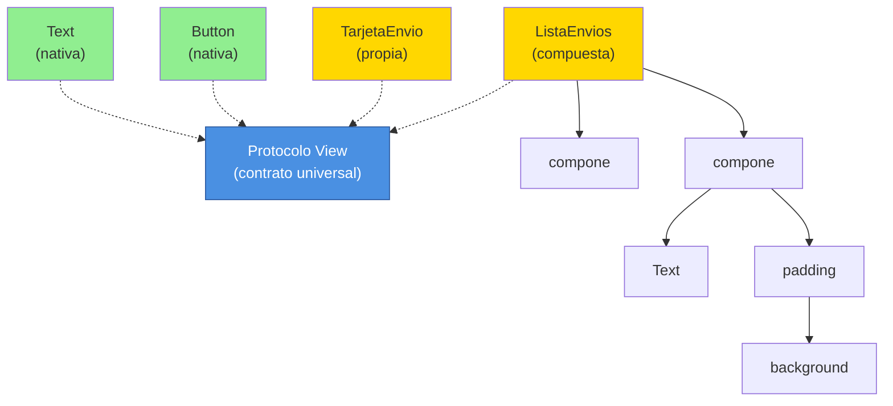
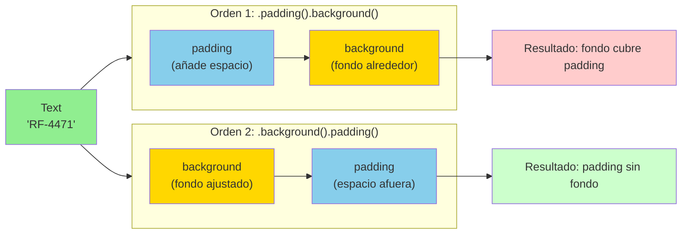
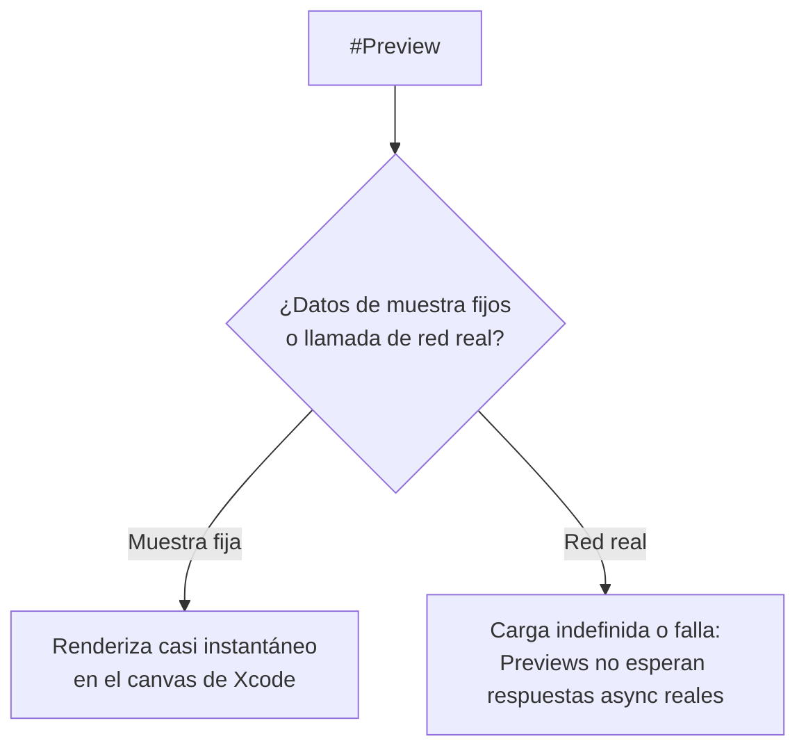

# Módulo 1: SwiftUI: vistas y layout declarativo


## Aprende construyendo


### Tema 1: El protocolo View y composición · Básico · 45 min

<details open>
<summary><strong>Capa 1 — Lectura</strong></summary>

#### ► DE QUÉ TRATA
Al finalizar vas a construir TarjetaEnvio, una vista propia que muestra un envío de RutaFlow, y a componerla dentro de otra vista como si fuera nativa. Prerrequisitos: macOS, Xcode y Swift; verifica xcodebuild -version.

#### ► LA IDEA EN UNA FRASE
**Al finalizar vas a construir TarjetaEnvio, una vista propia que muestra un envío de RutaFlow, y a componerla dentro de otra vista como si fuera nativa.**

#### ► POR QUÉ EXISTE ESTO
Resuelve un problema real de diseño o implementación y evita decisiones a ciegas.

#### ► LA ANALOGÍA
Piensa en el protocolo view y composición como una herramienta de taller: útil cuando conoces su propósito y sus límites.
**Dónde se rompe la analogía:** en software, los efectos dependen del contexto, la escala y los trade-offs.

#### ► CÓMO FUNCIONA


#### ► LO QUE PUEDE SALIR MAL
| Síntoma | Causa probable | Arreglo |
|---|---|---|
| El protocolo View y composición se aplica pero el resultado no mejora | Se usó sin medir el problema real | Mide antes y compara contra la alternativa simple |
| Aparece complejidad inesperada | Se adoptó la técnica sin comprender sus trade-offs | Vuelve a la sección de trade-offs y reduce el alcance |
| Falla en un caso límite | Se asumió un contexto que no se cumple | Prueba el caso límite y documenta cuándo NO usarlo |

#### ► TRADE-OFFS
| Opción | Cuándo usarla | Cuándo NO usarla |
|---|---|---|
| Usar El protocolo View y composición | Cuando el problema coincide con su propósito y el beneficio es observable | Cuando agrega complejidad sin resolver un problema real |
| Alternativa más simple | Cuando el contexto es pequeño, estable o fácil de razonar | Cuando ya demostró no escalar o no cumplir el requisito |
| Postergar la decisión | Cuando falta evidencia del problema | Cuando el costo de esperar es mayor que el costo de probar |

#### ► CUÁNDO NO USAR ESTO
No uses el protocolo view y composición por defecto. Aplícalo cuando el problema lo justifique y puedas verificar el beneficio; si una alternativa más simple resuelve igual, prefiérela.

#### ► DE VUELTA A LA ANALOGÍA
Volviendo a la analogía: el protocolo view y composición funciona como el modelo inicial, pero recuerda dónde se rompe: en producción importan la evidencia, la escala y el costo de equivocarte.

#### ► LO QUE DEBES RECORDAR
- El protocolo View y composición existe para resolver un problema específico.
- Mide antes de adoptar complejidad.
- Conoce el caso donde NO usarlo.
- Verifica con evidencia observable.

#### ► PREGUNTAS PARA PENSAR
1. ¿Qué problema concreto resuelve el protocolo view y composición en tu contexto?
2. ¿Cómo sabrías que el protocolo view y composición no está funcionando bien?
3. ¿Qué alternativa más simple considerarías antes de usar el protocolo view y composición?

</details>

<details>
<summary><strong>Capa 2 — Construcción</strong></summary>

#### Código y verificación


```swift
import SwiftUI

struct TarjetaEnvio: View {
    let guia: String
    let entregada: Bool

    var body: some View {
        HStack {
            VStack(alignment: .leading) {
                Text("Guía: \(guia)").font(.headline)
                Text(entregada ? "Entregada" : "En ruta")
            }
            Spacer()
            Image(systemName: entregada ? "checkmark.circle.fill" : "truck.box")
                .foregroundStyle(entregada ? .green : .blue)
        }
        .padding()
        .background(Color(.systemGray6))
        .clipShape(.rect(cornerRadius: 8))
    }
}

struct ListaEnvios: View {
    var body: some View {
        VStack {
            TarjetaEnvio(guia: "RF-4471", entregada: false)
            TarjetaEnvio(guia: "RF-5002", entregada: true)
        }
    }
}
```

```swift
struct TarjetaTarea: View {
    let titulo: String
    var body: some View {
        Text(titulo).padding().background(Color.blue.opacity(0.1))
    }
}
```

```swift
struct TarjetaEnvio: View {
    let guia: String
    let estado: String
    var body: some View {
        Text("\(guia): \(estado)").padding().background(Color.blue.opacity(0.1))
    }
}

struct ListaEnvios: View {
    var body: some View {
        VStack {
            TarjetaEnvio(guia: "RF-4471", estado: "en ruta")
            TarjetaEnvio(guia: "RF-5002", estado: "entregado")
        }
    }
}
```

```bash
xcodebuild -scheme RutaFlowApp -destination 'generic/platform=iOS Simulator' build
```

```swift
struct ListaEnviosConDuplicacion: View {
    var body: some View {
        VStack {
            TarjetaEnvio(guia: "RF-4471", estado: "en ruta")
            TarjetaEnvio(guia: "RF-5002", estado: "entregado")
            // Fallo deliberado: duplicación de código
            Text("RF-5003: en ruta").padding().background(Color.blue.opacity(0.1))
        }
    }
}
```

</details>

### Tema 2: Orden de modificadores y layout con stacks · Básico · 45 min

<details open>
<summary><strong>Capa 1 — Lectura</strong></summary>

#### ► DE QUÉ TRATA
Al finalizar vas a ver con tus propios ojos por qué .padding().background() y .background().padding() se ven distinto en TarjetaEnvio (Tema 1). Prerrequisitos: Tema 1 de este módulo.

#### ► LA IDEA EN UNA FRASE
**Al finalizar vas a ver con tus propios ojos por qué .padding().background() y .background().padding() se ven distinto en TarjetaEnvio (Tema 1).**

#### ► POR QUÉ EXISTE ESTO
Resuelve un problema real de diseño o implementación y evita decisiones a ciegas.

#### ► LA ANALOGÍA
Piensa en orden de modificadores y layout con stacks como una herramienta de taller: útil cuando conoces su propósito y sus límites.
**Dónde se rompe la analogía:** en software, los efectos dependen del contexto, la escala y los trade-offs.

#### ► CÓMO FUNCIONA


#### ► LO QUE PUEDE SALIR MAL
| Síntoma | Causa probable | Arreglo |
|---|---|---|
| Orden de modificadores y layout con stacks se aplica pero el resultado no mejora | Se usó sin medir el problema real | Mide antes y compara contra la alternativa simple |
| Aparece complejidad inesperada | Se adoptó la técnica sin comprender sus trade-offs | Vuelve a la sección de trade-offs y reduce el alcance |
| Falla en un caso límite | Se asumió un contexto que no se cumple | Prueba el caso límite y documenta cuándo NO usarlo |

#### ► TRADE-OFFS
| Opción | Cuándo usarla | Cuándo NO usarla |
|---|---|---|
| Usar Orden de modificadores y layout con stacks | Cuando el problema coincide con su propósito y el beneficio es observable | Cuando agrega complejidad sin resolver un problema real |
| Alternativa más simple | Cuando el contexto es pequeño, estable o fácil de razonar | Cuando ya demostró no escalar o no cumplir el requisito |
| Postergar la decisión | Cuando falta evidencia del problema | Cuando el costo de esperar es mayor que el costo de probar |

#### ► CUÁNDO NO USAR ESTO
No uses orden de modificadores y layout con stacks por defecto. Aplícalo cuando el problema lo justifique y puedas verificar el beneficio; si una alternativa más simple resuelve igual, prefiérela.

#### ► DE VUELTA A LA ANALOGÍA
Volviendo a la analogía: orden de modificadores y layout con stacks funciona como el modelo inicial, pero recuerda dónde se rompe: en producción importan la evidencia, la escala y el costo de equivocarte.

#### ► LO QUE DEBES RECORDAR
- Orden de modificadores y layout con stacks existe para resolver un problema específico.
- Mide antes de adoptar complejidad.
- Conoce el caso donde NO usarlo.
- Verifica con evidencia observable.

#### ► PREGUNTAS PARA PENSAR
1. ¿Qué problema concreto resuelve orden de modificadores y layout con stacks en tu contexto?
2. ¿Cómo sabrías que orden de modificadores y layout con stacks no está funcionando bien?
3. ¿Qué alternativa más simple considerarías antes de usar orden de modificadores y layout con stacks?

</details>

<details>
<summary><strong>Capa 2 — Construcción</strong></summary>

#### Código y verificación


```swift
Text("Hola").padding().background(Color.blue)   // padding queda DENTRO del fondo azul
Text("Hola").background(Color.blue).padding()    // padding queda FUERA, el fondo no lo cubre
```

```swift
VStack(spacing: 8) {
    HStack { Text("Izquierda"); Spacer(); Text("Derecha") }
    ZStack { Image("fondo"); Text("Superpuesto") }
}
```

```swift
Text("RF-4471: en ruta").padding().background(Color.blue)   // el fondo cubre también el padding
Text("RF-4471: en ruta").background(Color.blue).padding()   // el fondo queda ajustado al texto, el padding se ve sin cubrir
```

```bash
xcodebuild -scheme RutaFlowApp -destination 'generic/platform=iOS Simulator' build
```

```swift
struct TarjetaEnvioConOrderIncorrecto: View {
    let guia: String
    let estado: String
    
    var body: some View {
        Text("\(guia): \(estado)")
            .padding()                          // primer padding
            .background(Color.blue)             // fondo azul alrededor
            .padding()                          // SEGUNDO padding (¿esperando que se sume?)
    }
}
```

</details>

### Tema 3: Previews, LazyVGrid/ScrollView y property wrappers · Básico · 45 min

<details open>
<summary><strong>Capa 1 — Lectura</strong></summary>

#### ► DE QUÉ TRATA
Al finalizar vas a mostrar una lista completa de envíos de RutaFlow con LazyVGrid dentro de un ScrollView, e iterar su diseño con Previews sin correr la app. Prerrequisitos: Temas 1-2 de este módulo.

#### ► LA IDEA EN UNA FRASE
**Al finalizar vas a mostrar una lista completa de envíos de RutaFlow con LazyVGrid dentro de un ScrollView, e iterar su diseño con Previews sin correr la app.**

#### ► POR QUÉ EXISTE ESTO
Resuelve un problema real de diseño o implementación y evita decisiones a ciegas.

#### ► LA ANALOGÍA
Piensa en previews, lazyvgrid/scrollview y property wrappers como una herramienta de taller: útil cuando conoces su propósito y sus límites.
**Dónde se rompe la analogía:** en software, los efectos dependen del contexto, la escala y los trade-offs.

#### ► CÓMO FUNCIONA


#### ► LO QUE PUEDE SALIR MAL
| Síntoma | Causa probable | Arreglo |
|---|---|---|
| Previews, LazyVGrid/ScrollView y property wrappers se aplica pero el resultado no mejora | Se usó sin medir el problema real | Mide antes y compara contra la alternativa simple |
| Aparece complejidad inesperada | Se adoptó la técnica sin comprender sus trade-offs | Vuelve a la sección de trade-offs y reduce el alcance |
| Falla en un caso límite | Se asumió un contexto que no se cumple | Prueba el caso límite y documenta cuándo NO usarlo |

#### ► TRADE-OFFS
| Opción | Cuándo usarla | Cuándo NO usarla |
|---|---|---|
| Usar Previews, LazyVGrid/ScrollView y property wrappers | Cuando el problema coincide con su propósito y el beneficio es observable | Cuando agrega complejidad sin resolver un problema real |
| Alternativa más simple | Cuando el contexto es pequeño, estable o fácil de razonar | Cuando ya demostró no escalar o no cumplir el requisito |
| Postergar la decisión | Cuando falta evidencia del problema | Cuando el costo de esperar es mayor que el costo de probar |

#### ► CUÁNDO NO USAR ESTO
No uses previews, lazyvgrid/scrollview y property wrappers por defecto. Aplícalo cuando el problema lo justifique y puedas verificar el beneficio; si una alternativa más simple resuelve igual, prefiérela.

#### ► DE VUELTA A LA ANALOGÍA
Volviendo a la analogía: previews, lazyvgrid/scrollview y property wrappers funciona como el modelo inicial, pero recuerda dónde se rompe: en producción importan la evidencia, la escala y el costo de equivocarte.

#### ► LO QUE DEBES RECORDAR
- Previews, LazyVGrid/ScrollView y property wrappers existe para resolver un problema específico.
- Mide antes de adoptar complejidad.
- Conoce el caso donde NO usarlo.
- Verifica con evidencia observable.

#### ► PREGUNTAS PARA PENSAR
1. ¿Qué problema concreto resuelve previews, lazyvgrid/scrollview y property wrappers en tu contexto?
2. ¿Cómo sabrías que previews, lazyvgrid/scrollview y property wrappers no está funcionando bien?
3. ¿Qué alternativa más simple considerarías antes de usar previews, lazyvgrid/scrollview y property wrappers?

</details>

<details>
<summary><strong>Capa 2 — Construcción</strong></summary>

#### Código y verificación
```swift
#Preview {
    TarjetaTarea(titulo: "Comprar leche")
}
```


```swift
import SwiftUI

struct TarjetaEnvio: View {
    let guia: String
    let estado: String

    var body: some View {
        Text("\(guia): \(estado)")
            .padding()
            .background(Color.blue.opacity(0.1))
    }
}
```

```swift
struct ListaEnviosGrid: View {
    let envios: [(guia: String, estado: String)]
    var body: some View {
        ScrollView {
            LazyVGrid(columns: [GridItem(.adaptive(minimum: 150))]) {
                ForEach(envios, id: \.guia) { envio in
                    TarjetaEnvio(guia: envio.guia, estado: envio.estado)
                }
            }
        }
    }
}

#Preview {
    ListaEnviosGrid(envios: [("RF-4471", "en ruta"), ("RF-5002", "entregado")])
}
```

```bash
xcodebuild -scheme RutaFlowApp -destination 'generic/platform=iOS Simulator' build
```

</details>
