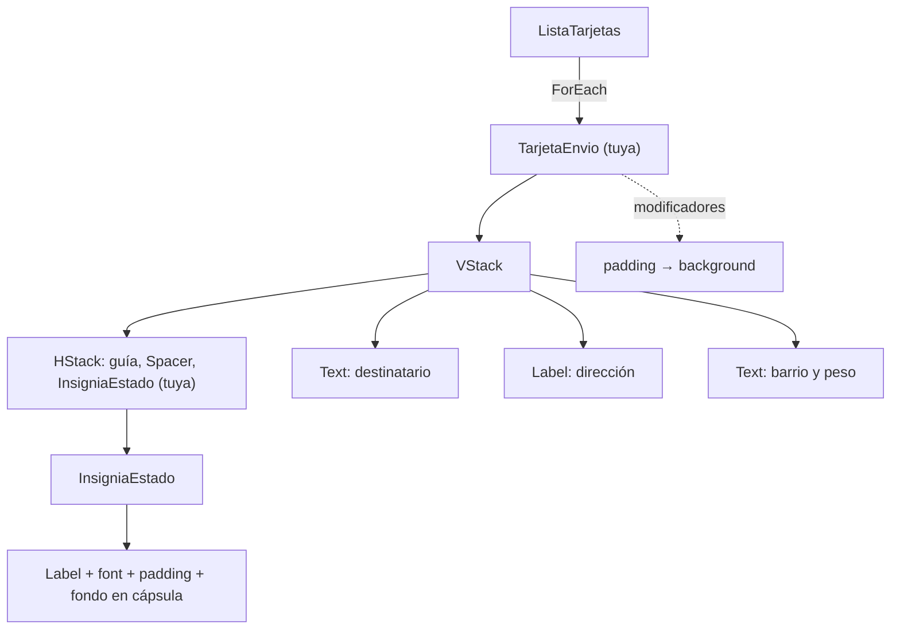
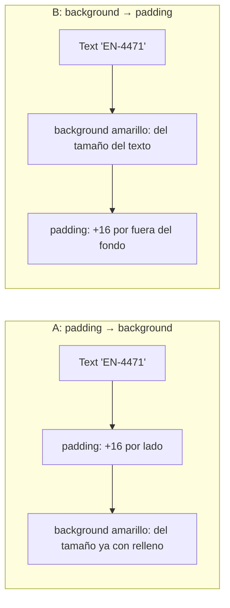
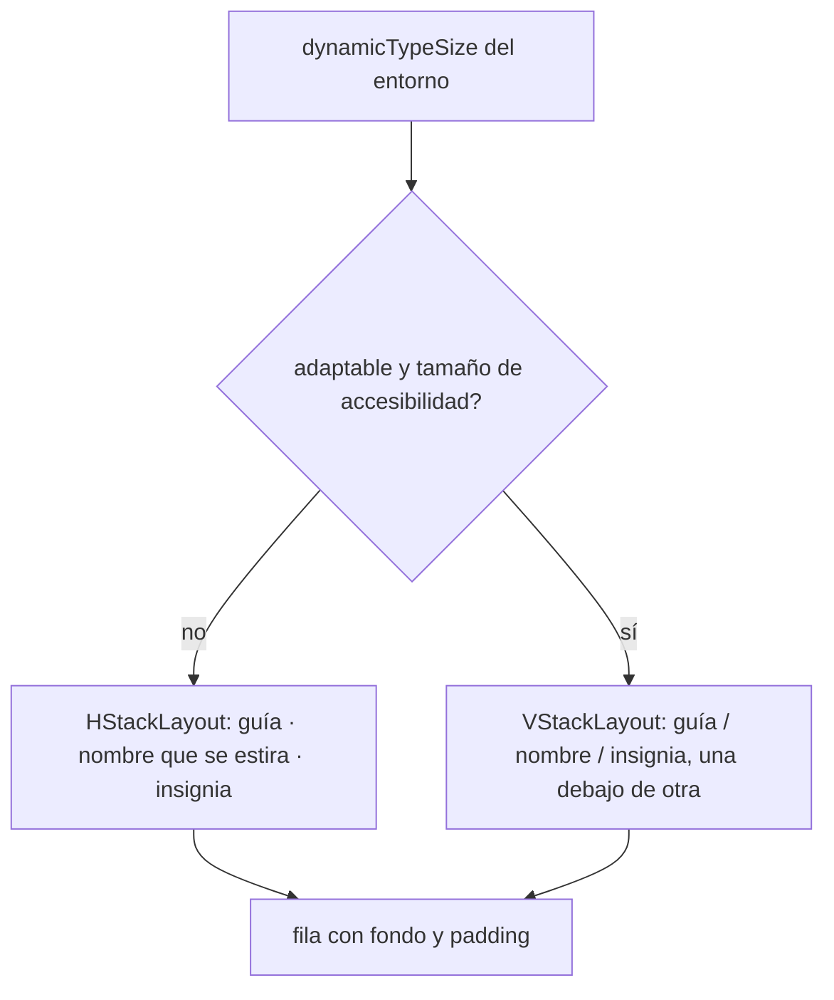
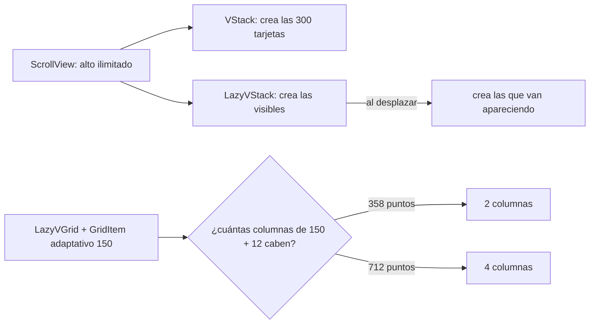

# Módulo 1: SwiftUI: vistas y diseño declarativo

**Entorno comprobado para esta edición (2026-11-25):** dos máquinas. En Linux, Swift 6.4.3 compiló y ejecutó todo lo
que es Swift puro: el núcleo de la app (modelo, textos y el cálculo de columnas) con sus pruebas de Swift Testing y un
«SwiftUI de juguete» que muestra qué tipo arma un `body`. En una Mac con macOS 27.2, Xcode 27.2 (27B52) y Swift 6.4.2
se compiló la app de iOS (`Maqueta`), se ejecutaron sus pruebas en el simulador del iPhone 17 con iOS 27.2 y se tomaron
todos los pantallazos: los de componentes, desde pruebas alojadas en la app, y los de pantalla completa, con la app
real abierta en el simulador. Los errores de compilación se provocaron a propósito y se capturaron con el compilador
del SDK del simulador. Límites honestos: SwiftUI no existe en Linux (lo verás en el Tema 1), y el lienzo de vistas
previas de Xcode no se puede fotografiar desde la terminal; en su lugar, las mismas vistas se capturan desde pruebas.

SwiftUI describe la interfaz como un valor: dices **qué** se ve para unos datos y el sistema decide **cómo** dibujarlo.
Este módulo enseña a componer pantallas con vistas pequeñas, a leer el orden de los modificadores, a repartir el
espacio con pilas, `Spacer`, `frame` y `padding`, y a mostrar listas y cuadrículas largas sin gastar de más. Todo se
comprueba con pantallazos y medidas tomadas en el simulador, incluidos errores de maquetación reales.

**Al terminar este módulo podrás:**
- escribir vistas propias, componerlas y explicar qué tipo arma el compilador con su `body`;
- predecir el resultado de una cadena de modificadores y comprobarlo con medidas;
- maquetar filas y pantallas que aguanten textos largos, texto de accesibilidad y botones fijos abajo;
- elegir entre `VStack` y `LazyVStack`, armar una `LazyVGrid` adaptativa y preparar vistas previas útiles.

**Esquema del módulo:** Tema 1 (el protocolo `View` y la composición) → Tema 2 (el orden de los modificadores) →
Tema 3 (pilas, `Spacer`, `frame` y `padding`) → Tema 4 (`ScrollView`, pilas perezosas, `LazyVGrid` y vistas previas)
→ Proyecto 38.

**Qué necesitas saber antes:** del Módulo 0, **`struct` frente a `class`** (Tema 2), **protocolos y `enum` con
valores asociados** (Tema 3) y **closures y genéricos** (Tema 4). Un `body` es un valor de un tipo genérico armado con
closures, así que esas tres piezas aparecen desde el primer ejemplo.

**Qué no se repite:** el estado (`@State`, `@Binding`, `@Observable`) es el Módulo 2, y la navegación
(`NavigationStack`, hojas, pestañas) es el Módulo 3. Aquí las vistas solo reciben datos y los dibujan; el
`NavigationStack` de la pantalla final está solo para tener título.

**Prepara el proyecto:**

```text
$ mkdir -p ~/labs/ios/ios1 && cd ~/labs/ios/ios1
$ mkdir nucleo && cd nucleo && swift package init --type library --name Nucleo
```

El laboratorio tiene tres partes: `nucleo/`, un paquete de Swift sin SwiftUI que se prueba en cualquier sistema
(también en Linux); `app/`, el proyecto de Xcode `Maqueta` (plantilla *App*, interfaz SwiftUI, iOS 18 como mínimo,
pruebas con Swift Testing), con el código de la app en `App/` y las pruebas en `Pruebas/`; y `errores/`, archivos que
no compilan a propósito. En Xcode 16 o posterior las carpetas del proyecto están sincronizadas: lo que copies a
`App/` entra a la app sin tocar el proyecto. Copia `nucleo/Sources/Nucleo` a `app/App/Nucleo` (es lo que hace
`mac.sh` antes de compilar) y `Captura.swift` a `app/Pruebas/`.


## Aprende construyendo


### Tema 1: El protocolo View y la composición · Básico · 45 min

<details open>
<summary><strong>Capa 1 — Lectura</strong></summary>

#### Objetivos
Al terminar este tema podrás:
- explicar qué pide el protocolo `View` y por qué `body` devuelve `some View`;
- escribir una vista pequeña y reutilizarla dentro de otra como si fuera del sistema;
- leer el tipo que arma `@ViewBuilder` con varias líneas y con un `if`;
- reconocer los dos errores de compilación más comunes al empezar.

**Conceptos clave:** protocolo `View`, `body`, tipo opaco (`some View`), `@ViewBuilder`, composición

#### El problema
La app de la ruta muestra cada envío en una tarjeta: guía, estado, destinatario, dirección, barrio y peso. La primera
versión es una sola vista de 80 líneas con todo dentro. Cuando el estado aparece también en el detalle y en el
historial, alguien lo copia y pega tres veces, y al cambiar el color de «Fallido» se le olvida una. Además, cada vez
que agrega un `if` dentro de `body` recibe un error que no entiende.

Este tema usa **`struct` y valores** (Módulo 0, Tema 2), **protocolos con tipo asociado** (Módulo 0, Tema 3) y
**closures y genéricos** (Módulo 0, Tema 4).

#### Glosario del tema

**protocolo `View`**
- **Definición técnica:** protocolo de SwiftUI con un tipo asociado `Body: View` y un requisito, `var body: Body`; las vistas primitivas (`Text`, `Image`) tienen `Body == Never` y SwiftUI las dibuja directamente.
- **En palabras sencillas:** el contrato «sé describir cómo me veo usando otras vistas».
- **Dónde se rompe la comparación:** una vista no es lo que ves en pantalla: es una descripción barata que SwiftUI crea y descarta muchas veces; lo que se dibuja lo administra SwiftUI aparte.
- **Ejemplo:** `struct InsigniaEstado: View { let estado: EstadoEnvio; var body: some View { Label(…) } }`.
- **Error típico:** guardar en la vista cosas que deben durar (una conexión, un contador) en propiedades normales: el `struct` se vuelve a crear y se pierden.

**`body`**
- **Definición técnica:** propiedad calculada que devuelve la descripción de la vista; SwiftUI la evalúa cuando necesita saber qué dibujar y su `getter` lleva implícito `@ViewBuilder`.
- **En palabras sencillas:** la receta que SwiftUI lee cada vez que necesita.
- **Dónde se rompe la comparación:** no es una función que «dibuja»: no puedes llamarla para refrescar la pantalla, ni conviene hacer trabajo pesado ahí.
- **Ejemplo:** el `body` de `TarjetaEnvio` es un `VStack` con una fila, tres textos, un `padding` y un fondo.
- **Error típico:** poner `print(…)` u otra instrucción suelta dentro: no es una vista y no compila (lo verás en este tema).

**tipo opaco (`some View`)**
- **Definición técnica:** `some View` declara que `body` devuelve **un** tipo concreto que cumple `View`, sin escribirlo; el compilador lo conoce exacto y el que llama solo ve el protocolo.
- **En palabras sencillas:** «devuelvo una vista concreta; no te digo cuál porque el nombre es larguísimo».
- **Dónde se rompe la comparación:** a diferencia de `any View`, no permite devolver tipos distintos según una condición: el tipo es uno solo y fijo.
- **Ejemplo:** el tipo real del `body` de `InsigniaEstado` es una cadena de `ModifiedContent<…>` que ocupa varias líneas.
- **Error típico:** devolver `Image` en un `if` y `Text` en el `else` desde una propiedad `some View` sin `@ViewBuilder`.

**`@ViewBuilder`**
- **Definición técnica:** *result builder* que convierte las líneas de un closure en un solo valor: varias vistas seguidas en un `TupleView`, un `if`/`else` en un `_ConditionalContent` con las dos ramas en el tipo.
- **En palabras sencillas:** el que junta varias vistas sueltas en un paquete con un tipo exacto.
- **Dónde se rompe la comparación:** solo acepta lo que sabe convertir: vistas, `if`, `switch`, `for` no (para eso está `ForEach`), declaraciones `let` sí.
- **Ejemplo:** en el juguete de Linux, `Pila { Texto; Texto; InsigniaEstado }` se vuelve `Pila<TuplaDe3<Texto, Texto, InsigniaEstado>>`.
- **Error típico:** extraer parte de un `body` a otra propiedad y olvidar ponerle `@ViewBuilder`.

**composición**
- **Definición técnica:** construir una vista a partir de otras más pequeñas, cada una con sus datos de entrada (`let`) y su propio `body`.
- **En palabras sencillas:** armar la pantalla con fichas de LEGO que tú mismo fabricaste.
- **Dónde se rompe la comparación:** partir en vistas pequeñas no cuesta rendimiento en SwiftUI; al contrario, ayuda a que redibuje menos (Módulo 2).
- **Ejemplo:** `TarjetaEnvio` usa `InsigniaEstado`, y `ListaTarjetas` usa `TarjetaEnvio`.
- **Error típico:** copiar y pegar el mismo trozo de interfaz en vez de extraerlo a una vista con parámetros.

#### ► CÓMO FUNCIONA

##### 1. La idea en lenguaje sencillo
Piensa en cómo se pide un mueble a un carpintero. No le dices qué movimientos hacer con el serrucho: le entregas un
plano con medidas. Él decide cómo cortar, y si cambias una medida, rehace solo la pieza afectada.

SwiftUI trabaja así. Tú no dibujas la tarjeta de un envío ni la borras cuando cambia. Escribes una descripción: «una
columna con la guía, el destinatario, la dirección y la insignia del estado». SwiftUI lee esa descripción y se
encarga de los píxeles. A este estilo se le llama **declarativo**: declaras qué se ve, no cómo pintarlo.

La segunda idea del tema es la composición. Si la insignia del estado aparece en la tarjeta, en el detalle y en el
historial, la escribes una vez como vista propia. Las tres pantallas la usan igual que usan un `Text` del sistema, y
el color de «Fallido» se cambia en un solo lugar.

##### 2. Definición formal y vocabulario
La documentación de Apple define el **protocolo `View`** como un tipo que representa parte de la interfaz de tu app y
proporciona modificadores para configurarla. Su único requisito es la propiedad **`body`**, cuyo tipo es el tipo
asociado `Body`, que a su vez debe cumplir `View`.

Esa definición es recursiva: una vista se describe con otras vistas. La recursión termina en las **vistas
primitivas**, como `Text` o `Image`. Su `Body` es `Never`, un tipo sin valores, y SwiftUI las dibuja directamente.

`body` se declara como **tipo opaco (`some View`)**. Su tipo real existe y el compilador lo conoce exacto, pero tú no
lo escribes. La salida real del tema muestra por qué: el tipo de `InsigniaEstado.Body` ocupa varias líneas de
`ModifiedContent`.

**`@ViewBuilder`** es un **result builder**, una función especial de Swift que transforma las líneas de un closure en
un solo valor. La **composición** es construir vistas grandes con vistas pequeñas, cada una con sus datos de entrada
como propiedades `let`.

##### 3. Cómo funciona por dentro, paso a paso
Sigue el camino de `TarjetaEnvio` desde que la escribes hasta que aparece en el simulador:

1. Al compilar, Swift ve que `body` de `View` lleva `@ViewBuilder`. Lo aplica también a tu `body`, aunque no lo
   escribas.
2. El result builder recorre las líneas del `VStack`. Cada expresión que es una vista se convierte en un argumento.
   Al final llama a `buildBlock` con todas, y el resultado es un `TupleView` con un elemento por línea.
3. Cada modificador, como `.padding()`, devuelve una vista nueva que envuelve a la anterior. El tipo resultante es
   `ModifiedContent<VistaAnterior, Modificador>`.
4. El compilador deduce el tipo completo y lo guarda como el tipo real de `some View`. Ese tipo describe la
   estructura entera de la tarjeta.
5. Al ejecutar, SwiftUI crea el `struct`, lee su `body` y recorre el árbol. Si la vista es tuya, lee su `body`; si es
   primitiva, la dibuja.
6. Cuando los datos cambian, SwiftUI vuelve a pedir el `body`, compara el árbol nuevo con el anterior y actualiza
   solo lo distinto en pantalla.



El paso 2 se puede hacer a mano con el juguete del tema, en Linux. Esta llamada es lo que el compilador escribe por
ti cuando pones dos `Texto` dentro de un cuerpo:

```swift
let cuerpo = ConstructorDeVistas.buildBlock(Texto("EN-4471"), Texto("Ana Ruiz"))
print(type(of: cuerpo))
```

```text
TuplaDe2<Texto, Texto>
```

Con un `if`, el builder llama a `buildEither(first:)` o a `buildEither(second:)` según la rama. Las dos devuelven el
mismo tipo, que guarda las dos ramas como parámetros genéricos. Así el `body` tiene un solo tipo, aunque el contenido
cambie al ejecutar.

¿Por qué tanto esfuerzo en los tipos? Porque el tipo le dice a SwiftUI la forma del árbol antes de ejecutar nada.
Sabe que la tarjeta siempre tiene una fila, tres textos, un relleno y un fondo. Al comparar dos versiones, solo mira
los valores dentro de esa forma fija.

##### 4. Reglas, variantes y casos límite
Una vista debe ser un tipo valor ligero. SwiftUI crea y descarta tus `struct` muchas veces por segundo. Lo que deba
durar entre dibujos no va en propiedades normales: va en el estado del Módulo 2.

`body` solo debe calcular la descripción. No llames a la red ni hagas trabajo pesado ahí, porque SwiftUI decide
cuándo y cuántas veces lo evalúa. Con el SDK de iOS 18, el protocolo `View` está aislado al actor principal: `body`
siempre se evalúa en el hilo de la interfaz.

Dentro de un `@ViewBuilder` valen expresiones que producen vistas, declaraciones `let`, `if`, `if let`, `switch` e
`if #available`. No vale un ciclo `for`: para repetir vistas usas `ForEach`. Una instrucción que no produce vista,
como `print`, da el error `type '()' cannot conform to 'View'`.

Un `if` sin `else` se convierte en un opcional de la vista con `buildOptional`. Un `if` con `else` usa `buildEither` y
produce `_ConditionalContent`. Fuera de un builder, el `if` es una expresión normal y sus ramas deben tener el mismo
tipo. De ahí el error `branches have mismatching types 'Image' and 'Text'`.

Los result builders se formalizaron en Swift 5.4 (SE-0289); SwiftUI ya usaba una versión previa desde 2019. Hasta
Xcode 14, `buildBlock` aceptaba como máximo diez vistas por bloque. Con Swift 5.9 y Xcode 15, los parameter packs
(SE-0393) quitaron ese límite.

Si necesitas tipos distintos en un mismo lugar sin builder, existe `AnyView`, que borra el tipo concreto. Úsalo con
cuidado: SwiftUI pierde la forma del árbol y compara peor. Casi siempre es mejor `@ViewBuilder` o una vista nueva.

##### 5. Relación con lo que ya sabes y lo que viene
Todo este tema se apoya en el Módulo 0. Las vistas son `struct` porque son descripciones que se copian sin costo
(Módulo 0, Tema 2). `some View` es el tipo opaco que conociste con `some Tarifable` (Módulo 0, Tema 3). Los
`ModifiedContent<…>` son tipos genéricos anidados, y el contenido de cada pila es un closure (Módulo 0, Tema 4).

Si vienes de UIKit o de Android con XML, la diferencia es de fondo. Allí creas objetos de interfaz que viven en
memoria y los modificas tú. Aquí escribes valores que se descartan, y el sistema mantiene los objetos reales aparte.

El Tema 2 de este módulo estudia la otra mitad de la tarjeta: cada modificador envuelve la vista. Por eso el orden
cambia el resultado. En el Módulo 2 verás por qué partir en vistas pequeñas, como `InsigniaEstado`, hace que SwiftUI
redibuje menos cuando cambian los datos.

#### Problema resuelto 1.1
Escribe la tarjeta de un envío con una insignia de estado reutilizable, muéstrala para los cuatro envíos de muestra y
averigua qué tipo arma el compilador con cada `body`: primero con un SwiftUI de juguete en Linux y después con el real
en el simulador.

**Razonamiento:**
1. Los datos (guía, estado, peso) y su texto («12,5 kg», «En ruta») van en el núcleo, sin SwiftUI: se prueban en
   Linux y la vista solo los dibuja.
2. El estado se traduce a un **tono** (gris, azul, verde, rojo); solo la app sabe qué `Color` es cada tono.
3. `InsigniaEstado` recibe un `EstadoEnvio` y nada más: así sirve en la tarjeta, en el detalle y en el historial.
4. `TarjetaEnvio` compone la insignia con vistas del sistema; `ListaTarjetas` repite la tarjeta con `ForEach`.
5. Para ver el tipo, una prueba imprime `type(of: vista.body)`; en Linux, el juguete hace lo mismo con nombres en
   español.

```swift
import Foundation

/// Estado de una entrega en la ruta del día.
enum EstadoEnvio: String, CaseIterable, Codable, Sendable {
    case pendiente, enRuta, entregado, fallido

    /// Texto corto para la insignia.
    var etiqueta: String {
        switch self {
        case .pendiente: "Pendiente"
        case .enRuta: "En ruta"
        case .entregado: "Entregado"
        case .fallido: "Fallido"
        }
    }

    /// Nombre del símbolo de SF Symbols que acompaña la etiqueta.
    var simbolo: String {
        switch self {
        case .pendiente: "clock"
        case .enRuta: "truck.box"
        case .entregado: "checkmark.circle.fill"
        case .fallido: "exclamationmark.triangle.fill"
        }
    }

    /// Tono semántico; la app lo traduce a un `Color` (el núcleo no conoce SwiftUI).
    var tono: Tono {
        switch self {
        case .pendiente: .gris
        case .enRuta: .azul
        case .entregado: .verde
        case .fallido: .rojo
        }
    }
}

enum Tono: Sendable { case gris, azul, verde, rojo }

/// Un envío de la ruta: lo que se dibuja en cada tarjeta.
struct Envio: Identifiable, Hashable, Codable, Sendable {
    let guia: String
    let destinatario: String
    let direccion: String
    let barrio: String
    let pesoKg: Double
    var estado: EstadoEnvio

    var id: String { guia }
}
```

```swift
import SwiftUI

/// El núcleo habla de tonos; solo la app sabe qué `Color` es cada uno.
extension Tono {
    var color: Color {
        switch self {
        case .gris: .gray
        case .azul: .blue
        case .verde: .green
        case .rojo: .red
        }
    }
}

/// Fondo común de las tarjetas: gris translúcido, se ve bien en claro y en oscuro.
var fondoTarjeta: Color { Color.gray.opacity(0.12) }
```

```swift
import SwiftUI

/// Insignia con el símbolo y la etiqueta del estado: una vista pequeña y reutilizable.
struct InsigniaEstado: View {
    let estado: EstadoEnvio

    var body: some View {
        Label(estado.etiqueta, systemImage: estado.simbolo)
            .font(.caption.bold())
            .padding(.horizontal, 8)
            .padding(.vertical, 4)
            .foregroundStyle(estado.tono.color)
            .background(estado.tono.color.opacity(0.15), in: Capsule())
    }
}

/// La tarjeta de un envío: compone vistas del sistema y una vista propia (la insignia).
struct TarjetaEnvio: View {
    let envio: Envio

    var body: some View {
        VStack(alignment: .leading, spacing: 6) {
            HStack {
                Text(envio.guia).font(.headline.monospaced())
                Spacer()
                InsigniaEstado(estado: envio.estado)
            }
            Text(envio.destinatario)
            Label(envio.direccion, systemImage: "mappin.and.ellipse")
                .font(.subheadline)
                .foregroundStyle(.secondary)
            Text("\(envio.barrio) · \(Formato.peso(envio.pesoKg))")
                .font(.footnote)
                .foregroundStyle(.secondary)
        }
        .padding()
        .background(fondoTarjeta, in: RoundedRectangle(cornerRadius: 12))
    }
}

/// Varias tarjetas, una debajo de otra, con desplazamiento.
struct ListaTarjetas: View {
    let envios: [Envio]

    var body: some View {
        ScrollView {
            VStack(spacing: 12) {
                ForEach(envios) { envio in
                    TarjetaEnvio(envio: envio)
                }
            }
            .padding()
        }
    }
}

#Preview("Tarjeta en ruta") {
    TarjetaEnvio(envio: Muestras.envios[1]).padding()
}

#Preview("Lista de tarjetas") {
    ListaTarjetas(envios: Muestras.envios)
}
```


Ahora, en Linux, el juguete. `Vista`, `@ConstructorDeVistas`, `Pila`, `Texto` y `ConRelleno` imitan a `View`,
`@ViewBuilder`, `VStack`, `Text` y el modificador `padding`:

```swift
// Un «SwiftUI de juguete» en Swift puro: el mismo truco de `View` + `@ViewBuilder`, con nombres en español,
// para ver en Linux qué tipo arma el compilador con un `body`. No dibuja píxeles: imprime el árbol.

/// Lo que es `View` en SwiftUI: algo con un cuerpo que, a su vez, es otra vista.
protocol Vista {
    associatedtype Cuerpo: Vista
    @ConstructorDeVistas var cuerpo: Cuerpo { get }  // como `@ViewBuilder var body` en SwiftUI
}

/// Las vistas primitivas no tienen cuerpo (en SwiftUI, su `Body` es `Never`).
extension Never: Vista {
    var cuerpo: Never { fatalError("una vista primitiva no tiene cuerpo") }
}

/// Las primitivas saben dibujarse a sí mismas (y a sus hijas).
protocol Primitiva {
    func lineas(_ nivel: Int) -> [String]
}

func sangria(_ nivel: Int) -> String { String(repeating: "  ", count: nivel) }

/// Recorre el árbol: si la vista es primitiva se dibuja; si es tuya, se dibuja su cuerpo.
func dibujar<V: Vista>(_ vista: V, _ nivel: Int = 0) -> [String] {
    if let primitiva = vista as? any Primitiva { return primitiva.lineas(nivel) }
    return ["\(sangria(nivel))\(V.self) → su cuerpo:"] + dibujar(vista.cuerpo, nivel + 1)
}

struct Texto: Vista, Primitiva {
    let contenido: String
    init(_ contenido: String) { self.contenido = contenido }
    var cuerpo: Never { fatalError() }
    func lineas(_ nivel: Int) -> [String] { ["\(sangria(nivel))Texto(\"\(contenido)\")"] }
}

struct Imagen: Vista, Primitiva {
    let simbolo: String
    init(_ simbolo: String) { self.simbolo = simbolo }
    var cuerpo: Never { fatalError() }
    func lineas(_ nivel: Int) -> [String] { ["\(sangria(nivel))Imagen(\"\(simbolo)\")"] }
}

/// Como `VStack`: guarda su contenido, que el constructor arma a partir de varias líneas.
struct Pila<Contenido: Vista>: Vista, Primitiva {
    let contenido: Contenido
    init(@ConstructorDeVistas _ contenido: () -> Contenido) { self.contenido = contenido() }
    var cuerpo: Never { fatalError() }
    func lineas(_ nivel: Int) -> [String] { ["\(sangria(nivel))Pila"] + dibujar(contenido, nivel + 1) }
}

/// Como `TupleView`: dos o tres vistas seguidas.
struct TuplaDe2<A: Vista, B: Vista>: Vista, Primitiva {
    let a: A, b: B
    var cuerpo: Never { fatalError() }
    func lineas(_ nivel: Int) -> [String] { dibujar(a, nivel) + dibujar(b, nivel) }
}

struct TuplaDe3<A: Vista, B: Vista, C: Vista>: Vista, Primitiva {
    let a: A, b: B, c: C
    var cuerpo: Never { fatalError() }
    func lineas(_ nivel: Int) -> [String] { dibujar(a, nivel) + dibujar(b, nivel) + dibujar(c, nivel) }
}

/// Como `_ConditionalContent`: el tipo guarda LAS DOS ramas; el valor dice cuál se tomó.
struct Condicional<Si: Vista, No: Vista>: Vista, Primitiva {
    enum Rama {
        case si(Si)
        case no(No)
    }
    let rama: Rama
    var cuerpo: Never { fatalError() }
    func lineas(_ nivel: Int) -> [String] {
        switch rama {
        case .si(let v): ["\(sangria(nivel))si:"] + dibujar(v, nivel + 1)
        case .no(let v): ["\(sangria(nivel))no:"] + dibujar(v, nivel + 1)
        }
    }
}

/// Como `ModifiedContent<…, _PaddingLayout>`: un modificador ENVUELVE a la vista en otra.
struct ConRelleno<Contenido: Vista>: Vista, Primitiva {
    let contenido: Contenido
    let puntos: Int
    var cuerpo: Never { fatalError() }
    func lineas(_ nivel: Int) -> [String] {
        ["\(sangria(nivel))ConRelleno(\(puntos))"] + dibujar(contenido, nivel + 1)
    }
}

extension Vista {
    func relleno(_ puntos: Int = 16) -> ConRelleno<Self> { ConRelleno(contenido: self, puntos: puntos) }
}

/// El equivalente a `@ViewBuilder`: convierte las líneas de un cuerpo en UN valor con un tipo concreto.
@resultBuilder
enum ConstructorDeVistas {
    static func buildBlock<V: Vista>(_ v: V) -> V { v }
    static func buildBlock<A: Vista, B: Vista>(_ a: A, _ b: B) -> TuplaDe2<A, B> { TuplaDe2(a: a, b: b) }
    static func buildBlock<A: Vista, B: Vista, C: Vista>(_ a: A, _ b: B, _ c: C) -> TuplaDe3<A, B, C> {
        TuplaDe3(a: a, b: b, c: c)
    }
    static func buildEither<S: Vista, N: Vista>(first: S) -> Condicional<S, N> { Condicional(rama: .si(first)) }
    static func buildEither<S: Vista, N: Vista>(second: N) -> Condicional<S, N> { Condicional(rama: .no(second)) }
}
```

```swift
// swift run MiniVistas: compone una tarjeta con el «SwiftUI de juguete» e imprime su tipo y su árbol.

struct InsigniaEstado: Vista {
    let entregado: Bool
    var cuerpo: some Vista {
        if entregado {
            Imagen("checkmark.circle.fill")
        } else {
            Texto("En ruta")
        }
    }
}

struct TarjetaEnvio: Vista {
    let guia: String
    let destinatario: String
    let entregado: Bool
    var cuerpo: some Vista {
        Pila {
            Texto(guia)
            Texto(destinatario)
            InsigniaEstado(entregado: entregado)  // una vista tuya se usa igual que una primitiva
        }
        .relleno()
    }
}

let tarjeta = TarjetaEnvio(guia: "EN-4471", destinatario: "Ana Ruiz", entregado: false)
print("Tipo de TarjetaEnvio.cuerpo:")
print("  \(type(of: tarjeta.cuerpo))")
print("Tipo de InsigniaEstado.cuerpo:")
print("  \(type(of: InsigniaEstado(entregado: true).cuerpo))")
print("Árbol con entregado = false:")
for linea in dibujar(tarjeta) { print("  \(linea)") }
print("Árbol de la insignia con entregado = true:")
for linea in dibujar(InsigniaEstado(entregado: true)) { print("  \(linea)") }
```

```text
$ .build/debug/MiniVistas
Tipo de TarjetaEnvio.cuerpo:
  ConRelleno<Pila<TuplaDe3<Texto, Texto, InsigniaEstado>>>
Tipo de InsigniaEstado.cuerpo:
  Condicional<Imagen, Texto>
Árbol con entregado = false:
  TarjetaEnvio → su cuerpo:
    ConRelleno(16)
      Pila
        Texto("EN-4471")
        Texto("Ana Ruiz")
        InsigniaEstado → su cuerpo:
          no:
            Texto("En ruta")
Árbol de la insignia con entregado = true:
  InsigniaEstado → su cuerpo:
    si:
      Imagen("checkmark.circle.fill")
```

Y el tipo real, impreso por la prueba `t1TarjetasYTipos` en el simulador:

```text
InsigniaEstado.Body =
ModifiedContent<ModifiedContent<ModifiedContent<ModifiedContent<ModifiedContent<Label<Text, Image>, _EnvironmentKeyWritingModifier<Optional<Font>>>, _PaddingLayout>, _PaddingLayout>, _ForegroundStyleModifier<Color>>, _InsettableBackgroundShapeModifier<Color, Capsule>>

TarjetaEnvio.Body =
ModifiedContent<ModifiedContent<VStack<TupleView<(HStack<TupleView<(Text, Spacer, InsigniaEstado)>>, Text, ModifiedContent<ModifiedContent<Label<Text, Image>, _EnvironmentKeyWritingModifier<Optional<Font>>>, _ForegroundStyleModifier<HierarchicalShapeStyle>>, Text)>>, _PaddingLayout>, _InsettableBackgroundShapeModifier<Color, RoundedRectangle>>
```

**Explicación por partes.**
- En el juguete, el cuerpo de la tarjeta es `ConRelleno<Pila<TuplaDe3<Texto, Texto, InsigniaEstado>>>`: tres líneas
  dentro de `Pila` se volvieron **una** tupla de tres, y el modificador `.relleno()` **envolvió** a la pila. El tipo
  dice la estructura entera.
- El `if` de la insignia se volvió `Condicional<Imagen, Texto>`: **las dos ramas** están en el tipo; el valor
  (`si:` o `no:`) dice cuál se tomó. Por eso un `body` puede tener un `if` y seguir teniendo un solo tipo.
- `InsigniaEstado` aparece en el árbol como una vista más, con su propio cuerpo debajo: componer vistas propias es
  igual que usar las del sistema.
- En el simulador, el tipo de `InsigniaEstado.Body` tiene **cinco** capas de `ModifiedContent` alrededor de
  `Label<Text, Image>`, una por modificador y en el mismo orden en que se escribieron: la fuente, los dos `padding`
  (horizontal y vertical, cada uno su `_PaddingLayout`), el `foregroundStyle` y el fondo en cápsula
  (`_InsettableBackgroundShapeModifier<Color, Capsule>`). Un detalle revelador: `.font(...)` aparece como
  `_EnvironmentKeyWritingModifier<Optional<Font>>`, es decir, la fuente no se le «pone» al texto: se escribe en el
  **entorno** y la leen las vistas de dentro (Módulo 2, Tema 4).
- El de `TarjetaEnvio` es la misma idea que el juguete: un `VStack<TupleView<(HStack<…>, Text, …, Text)>>` con las
  cuatro líneas del `body` en la tupla, la fila `HStack<TupleView<(Text, Spacer, InsigniaEstado)>>` dentro, y el
  `padding` y el fondo redondeado envolviendo todo. `InsigniaEstado` aparece con su nombre: el tipo de la tarjeta no
  necesita saber cómo está hecha la insignia. No hay `_ConditionalContent` porque este `body` no tiene `if`.
- El pantallazo muestra la composición: la misma `InsigniaEstado` en cuatro colores (verde, azul, gris y rojo) y la
  dirección larga de EN-4474 partida en dos líneas sin romper la tarjeta.

Dos errores provocados a propósito, compilados con el SDK del simulador. El primero extrae el `if` de la insignia a
una propiedad `some View` **sin** `@ViewBuilder` (`errores/t1-ramas.swift`):

```text
$ xcrun --sdk iphonesimulator swiftc -typecheck -swift-version 6 -target arm64-apple-ios18.0-simulator errores/t1-ramas.swift
errores/t1-ramas.swift:9:13: error: branches have mismatching types 'Image' and 'Text'
 7 |     var icono: some View {  // falta @ViewBuilder
 8 |         if entregado {
 9 |             Image(systemName: "checkmark.circle.fill")
   |             `- error: branches have mismatching types 'Image' and 'Text'
10 |         } else {
11 |             Text("En ruta")
[código de salida: 1]
```

El segundo mete un `print` para depurar dentro de `body` (`errores/t1-print.swift`):

```text
$ xcrun --sdk iphonesimulator swiftc -typecheck -swift-version 6 -target arm64-apple-ios18.0-simulator errores/t1-print.swift
errores/t1-print.swift:8:9: error: type '()' cannot conform to 'View' [#ProtocolTypeNonConformance]
 5 |     let guia: String
 6 | 
 7 |     var body: some View {
   |               `- note: required by opaque return type of property 'body'
 8 |         print("dibujando \(guia)")
   |         |- error: type '()' cannot conform to 'View' [#ProtocolTypeNonConformance]
   |         `- note: only concrete types such as structs, enums and classes can conform to protocols
 9 |         Text(guia)
10 |     }

[#ProtocolTypeNonConformance]: <https://docs.swift.org/compiler/documentation/diagnostics/protocol-type-non-conformance>
[código de salida: 1]
```

El primero dice exactamente lo que pasa: `branches have mismatching types 'Image' and 'Text'`. Sin `@ViewBuilder`,
el `if` es una expresión de Swift y sus dos ramas deben tener el mismo tipo. El segundo, `type '()' cannot conform to
'View'`: `print` devuelve `()` (nada), y el constructor intenta tratar ese «nada» como una vista más del cuerpo.


Y lo que pasa si intentas compilar una vista en Linux:

```text
$ swiftc -typecheck linux/sin-swiftui.swift
linux/sin-swiftui.swift:2:8: error: no such module 'SwiftUI'
1 | // En Linux no existe SwiftUI: este archivo compila en la Mac, no aquí.
2 | import SwiftUI
  |        `- error: no such module 'SwiftUI'
3 | 
4 | struct Hola: View {
[código de salida: 1]
```

> **Error común.** Extraer un trozo del `body` a una propiedad y olvidar `@ViewBuilder`. Sin el constructor, el
> compilador trata el `if`/`else` como una expresión de Swift, cuyas dos ramas deben ser del mismo tipo. Ponle
> `@ViewBuilder` a la propiedad o conviértela en otra vista.

> **Error común.** Meter una instrucción que no es una vista dentro de `body`, como un `print`. Si de verdad
> necesitas una traza, la forma que acepta el constructor es una declaración: `let _ = print(…)`.

> **Buena práctica.** Una vista pequeña recibe solo lo que dibuja (`let estado: EstadoEnvio`, no el envío entero ni
> el modelo de la pantalla). Así sirve en varios lugares y, como verás en el Módulo 2, SwiftUI la redibuja menos.

> **Prevenir errores.** Pon en el núcleo, sin `import SwiftUI`, todo lo que no sea dibujo: textos, formatos y
> cálculos. Ese código se prueba en segundos en cualquier sistema, también en Linux, donde SwiftUI no existe (el
> `no such module 'SwiftUI'` de arriba).

#### Checkpoint 1.1
En el juguete, ¿qué tipo tendría el cuerpo de una `Pila` con dos `Texto` y una `Imagen` dentro de un `if` sin
`else`?

Respuesta: `Pila<TuplaDe3<Texto, Texto, …>>` con un tercer elemento opcional: el constructor necesitaría
`buildOptional` (que el juguete no tiene, así que no compilaría). En SwiftUI, `@ViewBuilder` sí lo tiene y el tipo
queda `Optional<Image>` dentro del `TupleView`.

</details>

<details>
<summary><strong>Capa 2 — Construcción</strong></summary>

#### Paso 1 · Crea el núcleo
Crea `Envio.swift` en `nucleo/Sources/Nucleo` y ejecuta `swift test` en `nucleo/` (el archivo de pruebas está en el
Tema 4). Copia la carpeta a `app/App/Nucleo`.

#### Paso 2 · Escribe la insignia y la tarjeta
Crea `Estilo.swift` y `T1Composicion.swift`. Abre las vistas previas «Tarjeta en ruta» y «Lista de tarjetas» en Xcode.

#### Paso 3 · Ejecuta el juguete
En `nucleo/`, ejecuta `swift build` y `.build/debug/MiniVistas`. Cambia `entregado` a `true` en la tarjeta y mira qué
cambia en el árbol y qué no cambia en el tipo.

#### Paso 4 · Provoca los dos errores
Compila `errores/t1-ramas.swift` y `errores/t1-print.swift` (en Xcode o con `swiftc -typecheck`) y corrígelos: el
primero con `@ViewBuilder`, el segundo con `let _ = print(…)`.

#### Paso 5 · Reutiliza la insignia
Escribe `FilaHistorial(envio:)` con la guía a la izquierda y la `InsigniaEstado` a la derecha, sin copiar nada de la
insignia.

#### Resumen
- Una vista es un `struct` que cumple el **protocolo `View`** y describe su aspecto en **`body`**.
- **`some View`** es un **tipo opaco**: uno solo, exacto, que el compilador conoce.
- **`@ViewBuilder`** junta varias líneas en un `TupleView` y un `if` en un tipo con las dos ramas.
- La **composición** con vistas pequeñas evita copiar y pegar interfaz.

#### Ejercicio verificable 1
Básico. Según la salida de `MiniVistas`, ¿qué tipo tiene el cuerpo de `InsigniaEstado`?

Respuesta esperada: `Condicional<Imagen, Texto>`.

#### Ejercicio verificable 2
Intermedio. Agrega al juguete un cuarto `Texto` dentro de la `Pila` de la tarjeta y compila. ¿Qué pasa y por qué?

Respuesta esperada: no compila, porque `ConstructorDeVistas` solo tiene `buildBlock` para una, dos y tres vistas
(no hay `TuplaDe4`). `@ViewBuilder` resuelve lo mismo con *parameter packs*, sin límite fijo.

#### Ejercicio verificable 3
Reto. ¿Por qué `TarjetaEnvio` recibe un `Envio` pero `InsigniaEstado` recibe solo un `EstadoEnvio`?

Respuesta esperada: la insignia solo dibuja el estado; si recibiera el envío entero no serviría donde no hay envío
(un filtro por estado, por ejemplo) y dependería de datos que no usa.

#### En el trabajo
Los equipos mantienen un catálogo de vistas pequeñas (insignias, filas, botones) con sus vistas previas, a veces en un
paquete aparte. En las revisiones de código, un `body` de más de una pantalla es señal de que falta extraer vistas, y
la lógica de formato fuera de la vista es lo primero que se pide para poder probarla.

</details>

### Tema 2: El orden de los modificadores · Básico · 40 min

<details open>
<summary><strong>Capa 1 — Lectura</strong></summary>

#### Objetivos
Al terminar este tema podrás:
- explicar que cada modificador envuelve a la vista anterior en una vista nueva;
- predecir el tamaño y el aspecto de `padding`, `background`, `frame`, `border` y `offset` según su orden;
- medir el marco real de una vista con `onGeometryChange`;
- entender por qué algunos modificadores dejan de existir después de otros.

**Conceptos clave:** modificador, `ModifiedContent`, propuesta de tamaño, marco, `offset`

#### El problema
El diseño pide un fondo amarillo con aire alrededor del código de la guía. En el código hay
`.background(.yellow).padding()` y el fondo sale pegado al texto, con el aire por fuera. Otra persona agrega
`.frame(width: 200)` para alinear las guías y el fondo amarillo no se estira. Y un ícono deja de compilar cuando
alguien mueve `.resizable()` al final.

Este tema usa **el `body` y la composición** (Tema 1) y **los genéricos** (Módulo 0, Tema 4).

#### Glosario del tema

**modificador**
- **Definición técnica:** método de `View` (`padding`, `background`, `frame`…) que devuelve **otra** vista que contiene a la original; no cambia la vista sobre la que se llama.
- **En palabras sencillas:** una capa que se pone encima: papel de regalo sobre la caja.
- **Dónde se rompe la comparación:** algunas capas afectan al tamaño (`padding`, `frame`) y otras solo al dibujo (`offset`, `foregroundStyle`); hay que saber de cuál es cada una.
- **Ejemplo:** `Text("EN-4471").padding()` es un texto envuelto en una capa de relleno.
- **Error típico:** pensar que el orden no importa porque «son propiedades de la vista».

**`ModifiedContent`**
- **Definición técnica:** el tipo genérico `ModifiedContent<Contenido, Modificador>` que SwiftUI usa para representar «esta vista con esta capa»; una cadena de modificadores es una cadena de `ModifiedContent` anidados.
- **En palabras sencillas:** la etiqueta que dice qué capa va sobre qué.
- **Dónde se rompe la comparación:** algunos métodos de un tipo concreto (`Text.bold()`, `Image.resizable()`) devuelven el mismo tipo y no un `ModifiedContent`.
- **Ejemplo:** el tipo de `A` y el de `B` que imprime la prueba de este tema.
- **Error típico:** llamar `resizable()` después de `frame`, cuando ya no hay una `Image` sino un `ModifiedContent`.

**propuesta de tamaño**
- **Definición técnica:** el padre ofrece un tamaño a su hija, la hija elige el suyo y el padre la coloca; cada modificador de tamaño participa: `padding` ofrece menos y devuelve más, `frame` ofrece el suyo.
- **En palabras sencillas:** «tienes este espacio, ¿cuánto vas a usar?».
- **Dónde se rompe la comparación:** la hija decide: un texto de una palabra puede no ocupar todo lo ofrecido, y uno largo puede no caber.
- **Ejemplo:** `frame(width: 200)` ofrece 200 al texto; el texto usa menos y queda centrado en los 200.
- **Error típico:** creer que `frame` estira a la vista de dentro.

**marco**
- **Definición técnica:** el rectángulo final que ocupa una vista en su padre (posición y tamaño), que se lee con `GeometryProxy.frame(in:)`; en este laboratorio lo anota `.medir("nombre")`.
- **En palabras sencillas:** la caja que de verdad ocupa la vista.
- **Dónde se rompe la comparación:** el dibujo puede salirse del marco (sombras, `offset`) sin que el marco cambie.
- **Ejemplo:** el borde rojo de cada fila del catálogo marca el marco de la cadena completa.
- **Error típico:** confiar en lo que «parece» en la pantalla en vez de medirlo.

**`offset`**
- **Definición técnica:** modificador que desplaza el dibujo de la vista sin cambiar su marco ni el espacio que reserva en el padre.
- **En palabras sencillas:** mover la calcomanía sin mover la caja.
- **Dónde se rompe la comparación:** los vecinos no se enteran: si quieres que se aparten, usa `padding` o un `Spacer`.
- **Ejemplo:** en la fila F, el fondo amarillo de EN-4471 se monta sobre EN-4472.
- **Error típico:** usar `offset` para maquetar y descubrir que se encima con otras vistas en pantallas más angostas.

#### ► CÓMO FUNCIONA

##### 1. La idea en lenguaje sencillo
Imagina que empacas un regalo. Si primero lo envuelves en papel amarillo y luego lo metes en una caja más grande, ves
la caja por fuera. El papel queda escondido, con aire alrededor. Si primero lo metes en la caja y después la
envuelves, el papel amarillo cubre todo, aire incluido. Las mismas dos operaciones, en distinto orden, dan dos
paquetes distintos.

Los modificadores de SwiftUI funcionan igual. `.padding()` agrega aire, `.background(Color.yellow)` pone papel
amarillo, y cada uno se aplica sobre lo que ya había. Leer una cadena es leer cómo se empacó la vista, de adentro
hacia afuera.

En la app de la ruta, esto decide si la guía tiene el fondo con aire que pidió el diseño. La alternativa es un fondo
pegado al texto. También explica por qué un `frame` de 200 puntos no estira el fondo amarillo cuando va después de él.

##### 2. Definición formal y vocabulario
Un **modificador** es un método de `View` que devuelve una vista nueva con un comportamiento o aspecto agregado. La
vista original no cambia: queda dentro de la nueva. Por eso escribir `.padding()` no «configura» el texto; crea
otra vista que lo contiene.

El tipo de esa vista nueva es **`ModifiedContent`**, un genérico con dos parámetros: el contenido y el modificador.
Una cadena de tres modificadores produce tres `ModifiedContent` anidados. El tipo que imprime la prueba deja ver el
orden exacto.

La **propuesta de tamaño** es la forma en que SwiftUI reparte el espacio. Cada padre le propone un tamaño a su hija,
la hija decide el suyo y el padre la coloca. El **marco** es el rectángulo que la vista termina ocupando: su posición
y su tamaño dentro del padre.

Algunos modificadores participan en esa negociación, como `padding` y `frame`. Otros solo cambian el dibujo y no el
marco. **`offset`** es el caso más claro: mueve los píxeles y deja el espacio reservado donde estaba.

##### 3. Cómo funciona por dentro, paso a paso
Sigue la cadena A, `Text("EN-4471").padding().background(Color.yellow)`, cuando la fila le ofrece espacio:

1. La fila le propone un tamaño a la capa más externa, el `background`. Un fondo no cambia la propuesta: se la pasa
   igual a su contenido.
2. El `padding` recibe la propuesta, le resta 16 puntos por lado y le ofrece el resto al texto.
3. El texto decide su tamaño según su contenido y su fuente: 67,3 × 20,3 puntos, como mide G en la salida real.
4. El `padding` responde hacia afuera con el tamaño del texto más 32 en cada eje: 99,3 × 52,3. Es el marco medido
   para A.
5. El `background` toma ese tamaño como el suyo y pinta el amarillo detrás, con ese mismo tamaño. Por eso el
   amarillo incluye el relleno.



En la cadena B cambian los pasos 4 y 5. El fondo envuelve directamente al texto, así que se pinta de 67,3 × 20,3. El
`padding` llega después y agrega el aire por fuera del amarillo. El marco final mide lo mismo, 99,3 × 52,3; solo
cambia dónde quedó el color.

Con `frame(width: 200)` pasa algo parecido. El `frame` le propone 200 de ancho al texto, el texto elige los 67,3 que
necesita y el `frame` lo centra dentro de sus 200. Si el fondo va después del `frame`, como en D, se pinta de 200.
Si va antes, como en E, se pinta del ancho del texto.

El `offset` no participa en ninguno de esos pasos. Cuando SwiftUI ya colocó la vista, `offset` corre el dibujo. Por
eso el marco de F mide 67,3 de ancho en x = 16,0, igual que G. El amarillo, en cambio, aparece 40 puntos más a la
derecha.

No todos los modificadores siguen esta lógica de capas de tamaño. Los que escriben en el **entorno**, como `font`,
pasan un valor hacia todas las vistas de dentro. Observa este fragmento:

```swift
VStack {
    Text("EN-4471")
    Text("Ana Ruiz").font(.caption)
}
.font(.headline)
```

La guía sale en `.headline` porque recibe la fuente del `VStack`. El destinatario sale en `.caption`, porque el valor
más cercano a la vista gana. Aquí el orden también importa, pero por cercanía, no por tamaño.

##### 4. Reglas, variantes y casos límite
La regla general es «la hija decide su tamaño». Un texto puede usar menos de lo que le ofrecen, como en D, o pedir
más de lo que hay y partirse en varias líneas. `frame(width:)` fija la propuesta; no obliga al contenido a
llenarla.

Algunos métodos pertenecen a un tipo concreto y devuelven ese mismo tipo. `Image.resizable()` devuelve una `Image`, y
`Text.bold()` devuelve un `Text`. Después de un modificador general ya no tienes una `Image`, sino un `some View`.
De ahí el error real `value of type 'some View' has no member 'resizable'`.

`background` tiene varias sobrecargas, es decir, varias versiones con el mismo nombre y distintos parámetros. Desde
iOS 15, `background(Color.yellow)` usa la versión que recibe un estilo de relleno, y el tipo muestra
`_BackgroundStyleModifier<Color>`. Para poner otra vista detrás existe `background { … }` con un closure.

Hay una propuesta especial que vale conocer. Si el padre propone `nil` en un eje, pide el tamaño ideal de la hija. Si
propone infinito, pregunta cuánto puede crecer. El protocolo `Layout`, de iOS 16, expone estas propuestas con el tipo
`ProposedViewSize`.

Para medir sin adivinar, el tema usa `onGeometryChange`. SwiftUI llama al primer closure con un `GeometryProxy` cada
vez que cambia la geometría, y al segundo solo si el valor calculado cambió. Es más barato que envolver la vista en
un `GeometryReader`, que además ocupa todo el espacio ofrecido.

Por último, el borde rojo de `.border(Color.red)` también es un modificador. Dibuja sobre el marco de lo que tiene
dentro en ese punto de la cadena. Por eso se pone al final, cuando quieres ver el marco de todo lo anterior.

##### 5. Relación con lo que ya sabes y lo que viene
El Tema 1 te mostró que cada modificador añade una capa `ModifiedContent` al tipo de `InsigniaEstado`. Este tema
explica qué hace cada capa al ejecutar. También vuelve la idea de genérico del Módulo 0, Tema 4:
`ModifiedContent<Contenido, Modificador>` es un tipo genérico como `Pagina<Elemento>`.

Si vienes de CSS, el `padding` te sonará conocido, pero el modelo es otro. En CSS las propiedades de una caja se
aplican juntas y el orden de escritura no importa. En SwiftUI cada modificador es una caja nueva alrededor de la
anterior.

El Tema 3 usa esta negociación para repartir una fila entera con pilas, `Spacer`, `frame(maxWidth:)` y prioridad de
diseño. El Tema 4 la aplica a listas largas. El entorno que escribe `.font` vuelve en el Módulo 2, Tema 4.

#### Problema resuelto 2.1
Arma un catálogo con las mismas piezas en distinto orden (A a F) y un texto solo (G) de referencia. Fotografíalo en el
simulador, imprime el tipo de A y de B, y mide el marco de cada cadena.

**Razonamiento:**
1. Cada fila envuelve su cadena con `.border(Color.red)`: el borde rojo muestra el marco final.
2. `.medir("A")` anota el marco con `onGeometryChange`, que SwiftUI llama cuando la geometría cambia; la prueba lee
   los valores anotados.
3. G mide el texto sin nada: con él se calcula cuánto agrega cada modificador.
4. Se usa `Color.yellow` explícito (y no `.yellow`) para que no haya dudas de qué sobrecarga de `background` se usa.
5. La prueba imprime `type(of:)` de A y B para ver las capas en el tipo.

```swift
import SwiftUI

/// Registro de mediciones reales que leen las pruebas: cuántas veces se evaluó un `body` y dónde quedó una vista.
@MainActor
enum Medidor {
    static var cuerpos: [String: Int] = [:]
    static var marcos: [String: CGRect] = [:]

    /// Se llama desde un `body` con `let _ = Medidor.cuerpo("Nombre")`.
    static func cuerpo(_ nombre: String) { cuerpos[nombre, default: 0] += 1 }

    static func reiniciar() {
        cuerpos = [:]
        marcos = [:]
    }
}

extension View {
    /// Anota el marco final de esta vista (en coordenadas de la ventana) con un nombre.
    func medir(_ nombre: String) -> some View {
        onGeometryChange(for: CGRect.self) { proxy in
            proxy.frame(in: .global)
        } action: { marco in
            MainActor.assumeIsolated { Medidor.marcos[nombre] = marco }
        }
    }
}
```

```swift
import SwiftUI

/// Las mismas piezas en distinto orden. El borde rojo marca el marco final de cada cadena.
struct CatalogoOrden: View {
    var body: some View {
        VStack(alignment: .leading, spacing: 16) {
            fila("G · el texto solo") {
                Text("EN-4471").medir("G")
            }
            fila("A · padding y después background") {
                Text("EN-4471").padding().background(Color.yellow).medir("A")
            }
            fila("B · background y después padding") {
                Text("EN-4471").background(Color.yellow).padding().medir("B")
            }
            fila("C · padding, fondo, padding, fondo") {
                Text("EN-4471").padding(8).background(Color.yellow).padding(8).background(Color.blue).medir("C")
            }
            fila("D · frame y después background") {
                Text("EN-4471").frame(width: 200).background(Color.yellow).medir("D")
            }
            fila("E · background y después frame") {
                Text("EN-4471").background(Color.yellow).frame(width: 200).medir("E")
            }
            fila("F · offset mueve el dibujo, no el espacio") {
                HStack {
                    Text("EN-4471").background(Color.yellow).offset(x: 40).medir("F")
                    Text("EN-4472").background(Color.mint)
                }
            }
        }
        .padding()
        .frame(maxWidth: .infinity, alignment: .leading)
    }

    private func fila<Contenido: View>(_ titulo: String, @ViewBuilder _ contenido: () -> Contenido) -> some View {
        VStack(alignment: .leading, spacing: 6) {
            Text(titulo).font(.caption).foregroundStyle(.secondary)
            contenido().border(Color.red)
        }
    }
}

#Preview("Orden de modificadores") {
    CatalogoOrden()
}
```


```text
Tipos:
A = ModifiedContent<ModifiedContent<Text, _PaddingLayout>, _BackgroundStyleModifier<Color>>
B = ModifiedContent<ModifiedContent<Text, _BackgroundStyleModifier<Color>>, _PaddingLayout>

Marcos medidos (puntos):
  A: 99.3 × 52.3 en (16.0, 169.7)
  B: 99.3 × 52.3 en (16.0, 258.3)
  C: 99.3 × 52.3 en (16.0, 347.0)
  D: 200.0 × 20.3 en (16.0, 435.7)
  E: 200.0 × 20.3 en (16.0, 492.3)
  F: 67.3 × 20.3 en (16.0, 549.0)
  G: 67.3 × 20.3 en (16.0, 113.0)
```

**Explicación por partes.**
- El texto solo (G) mide 67,3 × 20,3 puntos. A **y** B miden 99,3 × 52,3: exactamente G + 32 en cada eje (16 por
  lado). Miden lo mismo aunque se vean distintos: el borde rojo es igual; cambia dónde está el amarillo.
- Los tipos lo confirman: en A, `ModifiedContent<ModifiedContent<Text, _PaddingLayout>, _BackgroundStyleModifier<Color>>`
  (el relleno **dentro** del fondo); en B, `ModifiedContent<ModifiedContent<Text, _BackgroundStyleModifier<Color>>,
  _PaddingLayout>` (el relleno **fuera**).
- C: dos rellenos de 8 y dos fondos hacen anillos, y mide otra vez 99,3 × 52,3 (8 + 8 por lado).
- D y E miden lo mismo (200,0 × 20,3), pero en D el fondo se pinta con el ancho del `frame` y en E con el del texto.
  `frame` no estira al texto: le ofrece 200 y lo centra.
- F: el marco medido está en x = 16,0 y mide 67,3 de ancho, igual que G, aunque el dibujo se corrió 40 puntos a la
  derecha y se montó sobre EN-4472. El vecino no se apartó: `offset` no cambia el marco.

El error de compilación que provoca `errores/t2-resizable.swift`, que llama `.resizable()` después de `.frame`:

```text
$ xcrun --sdk iphonesimulator swiftc -typecheck -swift-version 6 -target arm64-apple-ios18.0-simulator errores/t2-resizable.swift
errores/t2-resizable.swift:8:14: error: value of type 'some View' has no member 'resizable'
 6 |         Image(systemName: "truck.box")
 7 |             .frame(width: 48, height: 48)
 8 |             .resizable()
   |              `- error: value of type 'some View' has no member 'resizable'
 9 |     }
10 | }
[código de salida: 1]
```

El compilador lo dice sin rodeos: `value of type 'some View' has no member 'resizable'`.

> **Error común.** Poner `.background` antes de `.padding` cuando quieres el fondo con aire. El relleno queda fuera
> del fondo, como en B. Lee la cadena de izquierda a derecha: «el texto, con relleno, con fondo».

> **Error común.** Llamar un método propio de `Image` después de un modificador general: `.frame` devuelve un
> `some View`, que ya no tiene `resizable()` (el error está justo arriba). Los métodos de `Image` (`resizable`,
> `renderingMode`) van primero.

> **Buena práctica.** Cuando un diseño no cuadra, ponle `.border(Color.red)` a la vista sospechosa: verás su marco
> real. Quítalo antes de entregar.

> **Prevenir errores.** Para maquetar, usa `padding`, `frame` y `Spacer`, que reservan espacio. Deja `offset` para
> animaciones y ajustes visuales que no deban empujar a nadie.

#### Checkpoint 2.1
¿Cuánto mide `Text("EN-4471").padding(8).padding(8)` comparado con `.padding(16)`, y se ven distintos?

Respuesta: miden lo mismo (16 más por lado) y se ven igual, porque no hay nada entre los dos rellenos que se pinte. Si
pones un fondo entre ellos, como en C, sí se distinguen.

</details>

<details>
<summary><strong>Capa 2 — Construcción</strong></summary>

#### Paso 1 · Crea el medidor
Crea `Medidor.swift`. `medir(_:)` es un modificador propio: una extensión de `View` que aplica `onGeometryChange`.

#### Paso 2 · Arma el catálogo
Crea `T2Orden.swift` y ábrelo en la vista previa «Orden de modificadores».

#### Paso 3 · Mídelo
Ejecuta la prueba `t2OrdenDeModificadores` (en Xcode, el rombo junto a la prueba; en la terminal, `xcodebuild test`)
y abre `t2-orden.txt`.

#### Paso 4 · Agrega una fila
Agrega la fila H: `Text("EN-4471").padding().background(Color.yellow).clipShape(.capsule)`. Antes de ejecutar,
predice su marco. Después, cambia `clipShape` de lugar (antes de `background`) y explica la diferencia.

#### Paso 5 · Provoca el error
Compila `errores/t2-resizable.swift` y corrígelo moviendo `.resizable()` antes de `.frame`.

#### Resumen
- Cada **modificador** envuelve a la vista en una nueva: el tipo es un **`ModifiedContent`** anidado.
- El tamaño se negocia con una **propuesta de tamaño** y el resultado es el **marco**.
- El fondo toma el tamaño de lo que tiene dentro en ese punto de la cadena.
- **`offset`** mueve el dibujo, no el marco.

#### Ejercicio verificable 1
Básico. ¿Qué fila del catálogo tiene el fondo amarillo más grande: A o B?

Respuesta esperada: A, porque su fondo incluye el relleno; en B el fondo es del tamaño del texto.

#### Ejercicio verificable 2
Intermedio. Con las medidas de `t2-orden.txt`, ¿cuántos puntos agrega `padding()` sin argumentos por cada lado?

Respuesta esperada: (99,3 − 67,3) / 2 = 16 puntos.

#### Ejercicio verificable 3
Reto. En el Paso 4, ¿qué cambia al poner `clipShape(.capsule)` antes de `background`?

Respuesta esperada: el recorte se aplica al texto con relleno (que no tiene fondo) y el fondo amarillo, pintado
después, queda rectangular; para un fondo en cápsula, el fondo va antes del recorte o se usa
`background(_:in: Capsule())`, como en la insignia.

#### En el trabajo
En las revisiones de diseño, la pregunta «¿por qué este fondo no tiene aire?» casi siempre es el orden de dos
modificadores. Los equipos acuerdan un orden de lectura (contenido, tamaño, relleno, fondo, borde, efectos) y lo
mantienen en todas las vistas para que las cadenas se lean igual.

</details>

### Tema 3: Pilas, Spacer, frame y padding: filas que no se rompen · Intermedio · 50 min

<details open>
<summary><strong>Capa 1 — Lectura</strong></summary>

#### Objetivos
Al terminar este tema podrás:
- repartir el espacio de una fila con `HStack`, `VStack`, `Spacer` y `frame(maxWidth:alignment:)`;
- reconocer tres errores de maquetación reales: ancho fijo, texto de accesibilidad y `Spacer` dentro de `ScrollView`;
- cambiar de fila a columna con `AnyLayout` según el tamaño del texto;
- fijar un botón abajo con `safeAreaInset` sin perder el desplazamiento.

**Conceptos clave:** `HStack` y `VStack`, `Spacer`, `frame(maxWidth:alignment:)`, Dynamic Type, `AnyLayout`, `safeAreaInset`

#### El problema
La fila de una parada se ve bien en el iPhone de quien la diseñó. Una repartidora con el texto del sistema en tamaño
de accesibilidad abre la app y la guía sale cortada en dos líneas, la insignia se aplasta y el nombre no se lee. Otra
pantalla, la de confirmar entrega, tiene el botón «abajo» con un `Spacer`… hasta que alguien la mete en un
`ScrollView` para que quepa en pantallas pequeñas, y el botón sube pegado a la tarjeta. Y la insignia, para «alinear»,
tiene `.frame(width: 70)`.

Este tema usa **el orden de los modificadores y el marco** (Tema 2) y **la insignia y la tarjeta** (Tema 1).

#### Glosario del tema

**`HStack` y `VStack`**
- **Definición técnica:** contenedores que colocan a sus hijas en fila o en columna, con `alignment` (en el otro eje) y `spacing`; reparten el espacio ofreciéndolo primero a las hijas menos flexibles.
- **En palabras sencillas:** una repisa horizontal o una vertical.
- **Dónde se rompe la comparación:** no estiran a sus hijas: cada una decide su tamaño; para que una ocupe lo que sobra, se lo pides con `Spacer` o `frame(maxWidth: .infinity)`.
- **Ejemplo:** la fila de la parada: guía, nombre e insignia en un `HStack(spacing: 8)`.
- **Error típico:** meter demasiadas cosas en un `HStack` sin pensar en un iPhone angosto ni en texto grande.

**`Spacer`**
- **Definición técnica:** vista flexible que ocupa el espacio sobrante en el eje de la pila que la contiene (con un mínimo, `minLength`).
- **En palabras sencillas:** un resorte que empuja a los vecinos.
- **Dónde se rompe la comparación:** solo empuja si hay espacio que sobre; dentro de un `ScrollView` vertical el alto es ilimitado y el resorte no tiene contra qué empujar.
- **Ejemplo:** el `Spacer` entre la tarjeta y el botón en `ConfirmarEntrega`.
- **Error típico:** esperar que un `Spacer` dentro de un `ScrollView` baje el botón.

**`frame(maxWidth:alignment:)`**
- **Definición técnica:** modificador que acepta cualquier ancho hasta el máximo dado y coloca el contenido según `alignment`; con `.infinity` ocupa todo lo que le ofrezcan.
- **En palabras sencillas:** «toma todo el ancho que haya y pon el contenido a la izquierda».
- **Dónde se rompe la comparación:** `frame(width: 70)` es otra cosa: un ancho fijo, haya o no haya espacio.
- **Ejemplo:** el nombre del destinatario con `.frame(maxWidth: .infinity, alignment: .leading)` empuja la insignia a la derecha.
- **Error típico:** usar anchos fijos para «alinear» columnas de texto.

**Dynamic Type**
- **Definición técnica:** tamaño de texto que elige la persona en Ajustes (de `xSmall` a `accessibility5`); los estilos de fuente (`.body`, `.headline`) escalan con él y SwiftUI lo expone en `\.dynamicTypeSize`.
- **En palabras sencillas:** la letra grande del teléfono, que tu app debe respetar.
- **Dónde se rompe la comparación:** los tamaños de accesibilidad son mucho más grandes que los normales: una fila que cabe en `large` puede necesitar el triple de ancho.
- **Ejemplo:** `.dynamicTypeSize(.accessibility3)` en la prueba simula la elección de la persona.
- **Error típico:** probar solo con el tamaño por defecto.

**`AnyLayout` y `safeAreaInset`**
- **Definición técnica:** `AnyLayout` envuelve un `Layout` (`HStackLayout`, `VStackLayout`) para cambiar de disposición sin cambiar la identidad de las hijas; `safeAreaInset(edge:)` coloca una vista en un borde y reduce el área segura del contenido para que no quede tapado.
- **En palabras sencillas:** una fila que sabe volverse columna; una franja fija abajo que el contenido respeta.
- **Dónde se rompe la comparación:** `AnyLayout` no decide solo: tú le dices cuándo cambiar (aquí, `isAccessibilitySize`).
- **Ejemplo:** `adaptable && tamanoTexto.isAccessibilitySize ? AnyLayout(VStackLayout…) : AnyLayout(HStackLayout…)`.
- **Error típico:** escribir un `if` con un `HStack` y un `VStack` con el mismo contenido duplicado.

#### ► CÓMO FUNCIONA

##### 1. La idea en lenguaje sencillo
Piensa en una repisa donde acomodas tres cajas: una pequeña, una mediana y una que se puede aplastar. Primero pones
las cajas que no ceden, y la flexible se queda con el hueco que sobra. Si la repisa es demasiado corta, ninguna
estrategia alcanza y tienes que poner las cajas una encima de otra.

Una fila de SwiftUI reparte su ancho de la misma forma. La guía y la insignia tienen un tamaño natural y poco margen
para ceder. El nombre del destinatario puede recortarse con puntos suspensivos. Cuando el texto crece por la
configuración de accesibilidad, la fila ya no alcanza, y lo correcto es pasar a columna.

El tema también resuelve un malentendido frecuente. Un `Spacer` empuja hacia el fondo solo si hay un fondo. Dentro de
una lista que se desplaza, el alto no tiene final, y el botón «Confirmar entrega» sube pegado a la tarjeta.

##### 2. Definición formal y vocabulario
**`HStack` y `VStack`** son contenedores de disposición: colocan a sus hijas en fila o en columna. Reciben un
`alignment`, que alinea en el eje contrario, y un `spacing`, que separa a las hijas. No estiran a nadie: cada hija
decide su tamaño a partir de lo que le ofrecen.

Un **`Spacer`** es una vista flexible que ocupa el espacio sobrante en el eje de la pila que lo contiene. Si no
sobra nada, mide su mínimo. **`frame(maxWidth:alignment:)`** acepta cualquier ancho hasta el máximo dado; con
`.infinity` se queda con todo lo que le ofrezcan y coloca el contenido según `alignment`.

**Dynamic Type** es el sistema de tamaños de texto de iOS. La persona elige uno en Ajustes, y los estilos como
`.body` o `.headline` escalan solos. Hay siete tamaños normales, de `xSmall` a `xxxLarge`, y cinco de
accesibilidad, de `accessibility1` a `accessibility5`.

**`AnyLayout`** envuelve una disposición, como `HStackLayout` o `VStackLayout`, para cambiarla sin reconstruir a
las hijas. **`safeAreaInset(edge:)`** coloca una vista en un borde y reduce el área segura del contenido, que es la
zona donde nada queda tapado.

##### 3. Cómo funciona por dentro, paso a paso
Sigue el reparto de una fila de `FilaParada` con texto normal:

1. La fila recibe el ancho que le ofrece la lista, menos el `padding`. Resta los dos espacios de 8 puntos entre las
   tres hijas.
2. El `HStack` pregunta a cada hija qué tan flexible es. La guía y la insignia casi no cambian de ancho; el nombre,
   con `frame(maxWidth: .infinity)`, acepta cualquier ancho.
3. Ofrece espacio primero a las hijas menos flexibles. La guía toma 73,7 puntos y la insignia entre 78,0 y 99,3,
   según la salida real.
4. Lo que sobra va al nombre. El `frame` lo ocupa entero y alinea el texto a la izquierda. Si el nombre no cabe,
   `lineLimit(1)` lo recorta con puntos suspensivos.
5. El `HStack` coloca a las tres en fila y las centra en vertical, su alineación por defecto.

Con `accessibility3`, el paso 3 fracasa. Las hijas «poco flexibles» necesitan más ancho del que existe y empiezan a
partir su texto en renglones. Por eso la guía pasa a medir 99,0 × 96,0 y las insignias crecen hasta 164 de alto.



La disposición adaptable lee `dynamicTypeSize` del entorno y elige `VStackLayout` cuando
`isAccessibilitySize` es verdadero. Como el contenido está dentro de un solo `AnyLayout`, SwiftUI ve las mismas tres
hijas en las dos disposiciones. Si cambias el tamaño con la app abierta, las hijas se mueven sin recrearse.

El caso del botón se explica con la propuesta del Tema 2. Un `VStack` dentro de la pantalla recibe un alto finito, y
el `Spacer` se queda con lo que sobra. El botón baja a y = 773,7. Un `ScrollView` vertical, en cambio, no limita el
alto de su contenido. El `Spacer` no tiene sobrante que ocupar y mide su mínimo: el botón queda en y = 247,3.

`safeAreaInset(edge: .bottom)` saca el botón del contenido desplazable. Lo coloca en el borde inferior y le dice al
`ScrollView` que su área segura termina encima del botón. Así el último elemento de la lista nunca queda tapado.

##### 4. Reglas, variantes y casos límite
`Spacer` tiene un parámetro `minLength`. Si no lo das, usa el espaciado estándar del sistema como mínimo. Fuera de
una pila, un `Spacer` se expande en los dos ejes.

Puedes cambiar el orden del reparto con `.layoutPriority(_:)`. Una hija con prioridad mayor recibe su espacio antes
que las demás. La prioridad por defecto es 0. Úsala para proteger lo que nunca debe recortarse, como la guía.

`.fixedSize()` hace lo contrario de ceder: obliga a la vista a usar su tamaño ideal, aunque no quepa. Sirve para
que un texto corto no se parta, pero puede desbordar la pantalla si lo aplicas a uno largo.

`frame(width: 70)` y `frame(maxWidth: 70)` no son lo mismo. El primero ofrece exactamente 70 y mide 70 siempre. El
segundo acepta menos si el contenido es más pequeño. La salida real muestra el costo del primero: «Entregado» se
parte en «En-» / «tre…».

`AnyLayout`, `HStackLayout`, `VStackLayout` y el protocolo `Layout` existen desde iOS 16. Para el mismo problema,
iOS 16 también trae `ViewThatFits`, que prueba varias opciones y usa la primera que cabe:

```swift
ViewThatFits(in: .horizontal) {
    HStack { Text(envio.guia); InsigniaEstado(estado: envio.estado) }
    VStack(alignment: .leading) { Text(envio.guia); InsigniaEstado(estado: envio.estado) }
}
```

`ViewThatFits` decide por el espacio real, no por el tamaño de texto. A cambio, cada opción es una vista distinta y
no conserva la identidad al cambiar. `AnyLayout` decide por la regla que tú escribes y conserva a las hijas.

`safeAreaInset` existe desde iOS 15. Para ignorar el área segura a propósito, como un fondo de color hasta el borde,
se usa `ignoresSafeArea()`, que es otra herramienta.

##### 5. Relación con lo que ya sabes y lo que viene
Este tema aplica la propuesta de tamaño del Tema 2 a contenedores con varias hijas. Allí un `padding` restaba y
sumaba; aquí un `HStack` divide. La `InsigniaEstado` y la `TarjetaEnvio` del Tema 1 son las piezas que se acomodan.

Si vienes de la web, `HStack` y `Spacer` recuerdan a flexbox con `flex-grow`. La diferencia es que en SwiftUI la hija
siempre tiene la última palabra sobre su tamaño. Ningún contenedor la estira sin que ella lo acepte.

El `@Environment(\.dynamicTypeSize)` de la fila es tu primer contacto con el entorno, que el Módulo 2, Tema 4 explica
a fondo. El Tema 4 de este módulo lleva las pilas a listas largas con `ScrollView` y pilas perezosas. Allí el alto
ilimitado que viste con el botón vuelve a importar.

#### Problema resuelto 3.1
Maqueta la fila de una parada y fotografíala con el texto normal y con `accessibility3`, sin y con la disposición
adaptable. Después reproduce dos errores reales (insignia con ancho fijo y botón con `Spacer` dentro de un
`ScrollView`), mídelos y arréglalos.

**Razonamiento:**
1. El nombre lleva `lineLimit(1)` y `frame(maxWidth: .infinity, alignment: .leading)`: ocupa lo que sobra y no
   empuja a la insignia fuera de la pantalla.
2. `AnyLayout` cambia entre fila y columna con el mismo contenido; las tres hijas conservan su identidad.
3. Las pruebas aplican `.dynamicTypeSize(…)` a la lista: así se ve el mismo código con otro tamaño de texto.
4. Las insignias se miden libres y con `frame(width: 70)`.
5. Para el botón se comparan tres variantes y se anota su posición vertical en una ventana de 844 puntos.

```swift
import SwiftUI

/// Una parada en una fila. Con `adaptable`, pasa a columna cuando el texto es de accesibilidad.
struct FilaParada: View {
    let envio: Envio
    var adaptable = false
    @Environment(\.dynamicTypeSize) private var tamanoTexto

    var body: some View {
        let disposicion =
            adaptable && tamanoTexto.isAccessibilitySize
            ? AnyLayout(VStackLayout(alignment: .leading, spacing: 8))
            : AnyLayout(HStackLayout(spacing: 8))
        disposicion {
            Text(envio.guia).font(.headline.monospaced()).medir("\(envio.guia) · guía")
            Text(envio.destinatario)
                .lineLimit(1)
                .frame(maxWidth: .infinity, alignment: .leading)  // empuja la insignia al borde derecho
            InsigniaEstado(estado: envio.estado).medir("\(envio.guia) · insignia")
        }
        .padding()
        .background(fondoTarjeta, in: RoundedRectangle(cornerRadius: 12))
    }
}

struct ListaParadas: View {
    let envios: [Envio]
    var adaptable = false

    var body: some View {
        VStack(spacing: 12) {
            ForEach(envios) { envio in
                FilaParada(envio: envio, adaptable: adaptable)
            }
        }
        .padding()
    }
}

/// La misma insignia, libre y encerrada en un ancho fijo.
struct CatalogoAnchos: View {
    private let estados: [EstadoEnvio] = [.entregado, .fallido]

    var body: some View {
        VStack(alignment: .leading, spacing: 12) {
            Text("Sin ancho fijo").font(.caption).foregroundStyle(.secondary)
            HStack {
                ForEach(estados, id: \.self) { estado in
                    InsigniaEstado(estado: estado).medir("libre · \(estado.etiqueta)")
                }
            }
            Text("Con .frame(width: 70)").font(.caption).foregroundStyle(.secondary)
            HStack {
                ForEach(estados, id: \.self) { estado in
                    InsigniaEstado(estado: estado).frame(width: 70).medir("ancho 70 · \(estado.etiqueta)")
                }
            }
        }
        .padding()
        .frame(maxWidth: .infinity, alignment: .leading)
    }
}

/// Tres maneras de poner el botón «abajo».
enum VarianteConfirmar: String, CaseIterable {
    case sinScroll = "sin-scroll"  // Spacer en un VStack: funciona, pero el contenido no se desplaza
    case scrollConSpacer = "scroll-spacer"  // el error: dentro de un ScrollView, Spacer no empuja nada
    case scrollConInset = "scroll-inset"  // el arreglo: el botón va en el borde inferior, fuera del scroll
}

struct ConfirmarEntrega: View {
    let envio: Envio
    let variante: VarianteConfirmar

    var body: some View {
        switch variante {
        case .sinScroll:
            VStack(spacing: 16) {
                TarjetaEnvio(envio: envio)
                Spacer()
                boton
            }
            .padding()
        case .scrollConSpacer:
            ScrollView {
                VStack(spacing: 16) {
                    TarjetaEnvio(envio: envio)
                    Spacer()
                    boton
                }
                .padding()
            }
        case .scrollConInset:
            ScrollView {
                TarjetaEnvio(envio: envio).padding()
            }
            .safeAreaInset(edge: .bottom) {
                boton.padding().background(.regularMaterial)
            }
        }
    }

    private var boton: some View {
        Button {
        } label: {
            Text("Confirmar entrega").frame(maxWidth: .infinity)  // el frame va DENTRO de la etiqueta
        }
        .buttonStyle(.borderedProminent)
        .controlSize(.large)
        .medir("botón")
    }
}

#Preview("Paradas") {
    ListaParadas(envios: Muestras.envios)
}

#Preview("Paradas con texto AX3") {
    ListaParadas(envios: Muestras.envios, adaptable: true).dynamicTypeSize(.accessibility3)
}
```

![Tres capturas de la misma lista de cuatro paradas, lado a lado. Izquierda, texto normal: filas compactas con la guía en monoespaciada, el nombre y la insignia a la derecha; el nombre largo se recorta en «Jorge Ramírez Cas…». Centro, texto de accesibilidad 3 en fila: la guía se parte en dos renglones («EN-4» / «471»), el nombre queda en dos o tres letras con puntos suspensivos («Ana…», «Luis…») y la insignia se vuelve una columna angosta con la palabra partida letra a letra («En / tre / g…», «E / n / r / …», «Fa / lli- / do»). Derecha, texto de accesibilidad 3 con la disposición adaptable: cada parada en columna, con la guía, el nombre y la insignia completos uno debajo del otro; solo el nombre largo se recorta en «Jorge Ramírez Ca…»](content/figures/ios/ios1-t3-filas.png)

```text
— normal —
  EN-4471 · guía: 73.7 × 20.3 en (32.0, 340.8)
  EN-4471 · insignia: 99.3 × 22.4 en (258.7, 339.8)
  EN-4472 · guía: 73.7 × 20.3 en (32.0, 407.7)
  EN-4472 · insignia: 86.7 × 23.3 en (271.3, 406.2)
  EN-4473 · guía: 73.7 × 20.3 en (32.0, 474.5)
  EN-4473 · insignia: 97.7 × 22.4 en (260.3, 473.5)
  EN-4474 · guía: 73.7 × 20.3 en (32.0, 540.9)
  EN-4474 · insignia: 78.0 × 22.3 en (280.0, 539.9)
— ax3 —
  EN-4471 · guía: 99.0 × 96.0 en (32.0, 111.2)
  EN-4471 · insignia: 102.3 × 124.3 en (255.7, 97.0)
  EN-4472 · guía: 99.0 × 96.0 en (32.0, 299.3)
  EN-4472 · insignia: 103.3 × 163.9 en (254.7, 265.4)
  EN-4473 · guía: 99.0 × 96.0 en (32.0, 507.0)
  EN-4473 · insignia: 101.7 × 163.3 en (256.3, 473.3)
  EN-4474 · guía: 99.0 × 96.0 en (32.0, 694.8)
  EN-4474 · insignia: 101.7 × 124.3 en (256.3, 680.6)
— ax3-adaptable —
  EN-4471 · guía: 173.3 × 48.0 en (32.0, 67.3)
  EN-4471 · insignia: 212.0 × 46.3 en (32.0, 179.3)
  EN-4472 · guía: 173.3 × 48.0 en (32.0, 269.7)
  EN-4472 · insignia: 181.7 × 48.3 en (32.0, 381.7)
  EN-4473 · guía: 173.3 × 48.0 en (32.0, 474.0)
  EN-4473 · insignia: 208.3 × 46.3 en (32.0, 586.0)
  EN-4474 · guía: 173.3 × 48.0 en (32.0, 676.3)
  EN-4474 · insignia: 158.7 × 46.3 en (32.0, 788.3)
```


```text
Insignias:
  ancho 70 · Entregado: 70.0 × 38.4 en (16.0, 165.3)
  ancho 70 · Fallido: 70.0 × 38.3 en (94.0, 165.4)
  libre · Entregado: 99.3 × 22.4 en (16.0, 104.6)
  libre · Fallido: 78.0 × 22.3 en (123.3, 104.6)

Botón «Confirmar entrega» (ventana de 844 de alto):
  sin-scroll → botón: 358.0 × 50.3 en (16.0, 773.7)
  scroll-spacer → botón: 358.0 × 50.3 en (16.0, 247.3)
  scroll-inset → botón: 358.0 × 50.3 en (16.0, 773.7)
```

Y la app real a pantalla completa en el iPhone 17, antes y después del arreglo (`-escena confirmar-roto` y
`-escena confirmar-arreglado`):


**Explicación por partes.**
- Con texto normal, la fila cabe: cada guía mide 73,7 × 20,3 puntos y las insignias entre 78,0 («Fallido») y 99,3
  («Entregado») de ancho, con unos 22 de alto.
- Con `accessibility3` en fila, el ancho no alcanza y la fila se rompe de verdad: la guía pasa a 99,0 × 96,0 (dos
  renglones, «EN-4» / «471»), las insignias quedan en unos 102 de ancho pero entre 124 y 164 de **alto**, con la
  palabra partida letra a letra, y el nombre se reduce a dos o tres letras con puntos suspensivos.
- Con la disposición adaptable, cada parada pasa a columna y todo se lee: la guía mide 173,3 × 48,0 (un solo
  renglón) y las insignias 46 a 48 de alto, todas en x = 32,0, alineadas a la izquierda con la guía.
- Insignias: libres, «Entregado» mide 99,3 × 22,4 y «Fallido» 78,0 × 22,3. Con `frame(width: 70)` el marco mide
  70,0 y el alto sube a 38,4: el texto no se recorta en una línea, se **parte en dos con guion** («En-» / «tre…»,
  «Falli-» / «do»).
- Botón: sin `ScrollView` y con `safeAreaInset`, el botón queda en y = 773,7 (abajo: 773,7 + 50,3 de alto + 20 de
  margen = 844); con `ScrollView` y `Spacer`, en y = 247,3, pegado a la tarjeta. Lo mismo se ve en la app real a
  pantalla completa. El `Spacer` dentro del `ScrollView` no empujó nada porque el alto disponible es ilimitado.

> **Error común.** Dar anchos fijos a vistas con texto para «alinearlas». En otro idioma, con otra fuente o con texto
> grande, el texto no cabe. Deja que el texto decida su ancho y alinea con pilas, `Spacer` y `frame(maxWidth:)`.

> **Error común.** Un `Spacer` dentro de un `ScrollView` para empujar un botón al fondo. No hay fondo: el alto es
> ilimitado y el resorte mide su mínimo. Usa `safeAreaInset(edge: .bottom)` para el botón y deja que el contenido se
> desplace.

> **Buena práctica.** Para que un botón ocupe todo el ancho, el `frame(maxWidth: .infinity)` va **dentro** de la
> etiqueta del botón (`label: { Text(…).frame(maxWidth: .infinity) }`), no después de `.buttonStyle`: así crece el
> área que se toca y el fondo del botón, no un marco vacío alrededor.

> **Prevenir errores.** Ten una vista previa o una prueba con `.dynamicTypeSize(.accessibility3)` para cada fila y
> cada pantalla importante, y otra con el texto más largo de tus datos de muestra (aquí, EN-4474).

#### Checkpoint 3.1
En la fila, ¿qué pasaría si quitas `lineLimit(1)` del nombre?

Respuesta: el nombre podría ocupar varias líneas en vez de recortarse, y la fila crecería en alto. Con un nombre muy
largo la fila se vería desigual con las demás, pero nada se saldría de la pantalla.

</details>

<details>
<summary><strong>Capa 2 — Construcción</strong></summary>

#### Paso 1 · Maqueta la fila
Crea `T3Stacks.swift`. Abre las vistas previas «Paradas» y «Paradas con texto AX3».

#### Paso 2 · Rómpela a propósito
En la vista previa AX3, cambia `adaptable: true` por `false` y mira cómo se rompe. En el simulador, cambia el texto
en Ajustes ▸ Accesibilidad ▸ Pantalla y tamaño del texto ▸ Texto más grande.

#### Paso 3 · Mide las insignias
Ejecuta `t3AnchoFijoYBotonAbajo` y compara los anchos de `t3-anchos-boton.txt` con 70.

#### Paso 4 · Arregla el botón
Compara las tres variantes de `ConfirmarEntrega` en la app (`-escena confirmar-roto` y `-escena
confirmar-arreglado`). Después, pon tres tarjetas en `scrollConInset` y comprueba que el contenido pasa por debajo de
la franja del botón al desplazarse.

#### Paso 5 · Usa `ViewThatFits`
Escribe otra versión de la fila con `ViewThatFits { HStack {…}; VStack {…} }`, que elige la primera disposición que
cabe. Compárala con `AnyLayout` en AX3: ¿cuál conserva el estado de las hijas al cambiar?

#### Resumen
- **`HStack` y `VStack`** reparten el espacio; las hijas deciden su tamaño.
- **`Spacer`** empuja solo si sobra espacio; **`frame(maxWidth:)`** pide todo el que haya.
- **Dynamic Type** de accesibilidad rompe las filas apretadas: **`AnyLayout`** las vuelve columna.
- **`safeAreaInset`** fija un botón abajo sin `Spacer` dentro del `ScrollView`.

#### Ejercicio verificable 1
Básico. ¿Qué ancho mide el marco de una insignia con `.frame(width: 70)`?

Respuesta esperada: 70 puntos (lo dice la medida), aunque el texto necesite más.

#### Ejercicio verificable 2
Intermedio. ¿En qué variante el botón queda más arriba, y por qué?

Respuesta esperada: `scroll-spacer`, en y = 247,3 frente a 773,7 de las otras dos, porque dentro del `ScrollView` el
`Spacer` no tiene espacio sobrante que ocupar.

#### Ejercicio verificable 3
Reto. En el Paso 5, ¿cuál conserva el estado de las hijas (por ejemplo, un `@State` dentro de la insignia) al pasar
de fila a columna?

Respuesta esperada: `AnyLayout`: su documentación dice que cambiar el tipo de disposición no destruye el estado de
las subvistas, porque son las mismas con otra disposición. Con `ViewThatFits` escribiste dos copias distintas del
contenido; al cambiar se muestra la otra copia, que tiene su propio estado.

#### En el trabajo
Las auditorías de accesibilidad (y la revisión de la App Store cuando la app declara soporte de texto grande) prueban
los tamaños de accesibilidad. Los equipos guardan capturas de las pantallas principales en tamaño normal y en AX3, en
claro y en oscuro, y las comparan en cada versión para detectar filas rotas antes que las personas usuarias.

</details>

### Tema 4: ScrollView, pilas perezosas, LazyVGrid y vistas previas · Intermedio · 50 min

<details open>
<summary><strong>Capa 1 — Lectura</strong></summary>

#### Objetivos
Al terminar este tema podrás:
- elegir entre `VStack` y `LazyVStack` dentro de un `ScrollView` según cuántas vistas crea cada uno;
- armar una cuadrícula adaptativa con `LazyVGrid` y `GridItem(.adaptive(minimum:))`;
- comparar un modelo del reparto de columnas con lo que hace SwiftUI de verdad;
- preparar vistas previas con datos de muestra, en claro, en oscuro y con tamaño ajustado.

**Conceptos clave:** `ScrollView`, `LazyVStack`, `LazyVGrid`, `GridItem(.adaptive(minimum:))`, `#Preview`

#### El problema
El jefe de bodega carga 300 envíos en la pantalla de la ruta y la app tarda en abrir. El encabezado tiene cuatro cifras
(entregados, por entregar, fallidos, carga) en una cuadrícula que en el iPhone se ve en dos columnas y en el iPad
«debería» verse en cuatro, pero nadie lo comprobó. Y cada vez que alguien cambia la tarjeta tiene que ejecutar la app,
navegar hasta la pantalla y esperar.

Este tema usa **la tarjeta** (Tema 1), **el medidor** (Tema 2) y **las pilas y el marco** (Tema 3).

#### Glosario del tema

**`ScrollView`**
- **Definición técnica:** contenedor que deja desplazar su contenido en un eje; ofrece a su contenido un alto (o ancho) ilimitado en ese eje.
- **En palabras sencillas:** una hoja larga que se mueve detrás de una ventana.
- **Dónde se rompe la comparación:** no crea filas a demanda por sí mismo: eso depende de la pila que tenga dentro.
- **Ejemplo:** `ScrollView { LazyVStack { ForEach(envios) { … } } }`.
- **Error típico:** meter un `VStack` con cientos de filas y sorprenderse de que todas se creen al abrir.

**`LazyVStack`**
- **Definición técnica:** pila vertical que crea y evalúa a sus hijas solo cuando están por aparecer en pantalla, y no antes.
- **En palabras sencillas:** una fila de cajas que se arman cuando llega su turno.
- **Dónde se rompe la comparación:** crear a demanda no es gratis: al desplazar, las filas nuevas se evalúan mientras la persona mira; la prueba cuenta cuántas.
- **Ejemplo:** la prueba `t4PerezosaContraNormal` cuenta cuántas tarjetas se evaluaron con cada pila.
- **Error típico:** usar `LazyVStack` para cinco filas fijas: no gana nada y complica la medición.

**`LazyVGrid`**
- **Definición técnica:** cuadrícula vertical perezosa cuyas columnas se describen con un arreglo de `GridItem`.
- **En palabras sencillas:** una tabla que llena filas de izquierda a derecha.
- **Dónde se rompe la comparación:** las columnas las describes tú; las filas salen solas según cuántos elementos haya.
- **Ejemplo:** el tablero de métricas de la ruta.
- **Error típico:** fijar dos columnas `.flexible()` y que en el iPad queden dos tarjetas enormes.

**`GridItem(.adaptive(minimum:))`**
- **Definición técnica:** un `GridItem` que se convierte en **tantas columnas como quepan** con ese ancho mínimo (y el `spacing` dado), repartiendo el ancho sobrante.
- **En palabras sencillas:** «pon todas las columnas de al menos 150 puntos que entren».
- **Dónde se rompe la comparación:** el modelo de este tema (`Cuadricula.adaptativa`) es una predicción; la verdad es la medida en el simulador.
- **Ejemplo:** 358 puntos de contenido → el modelo predice 2 columnas de 173.
- **Error típico:** confundirlo con `.flexible(minimum:)`, que es **una** columna.

**`#Preview`**
- **Definición técnica:** macro que registra una vista previa para el lienzo de Xcode, con nombre opcional y rasgos (`traits: .sizeThatFitsLayout`, orientación); el código se compila con la app.
- **En palabras sencillas:** una foto en vivo de la vista mientras la escribes.
- **Dónde se rompe la comparación:** el lienzo es para iterar; no reemplaza las pruebas ni las capturas que se guardan.
- **Ejemplo:** `#Preview("Ruta de hoy · oscuro") { RutaDeHoy(…).preferredColorScheme(.dark) }`.
- **Error típico:** vistas previas que dependen de la red o de una base de datos real y nunca cargan.

#### ► CÓMO FUNCIONA

##### 1. La idea en lenguaje sencillo
Piensa en un restaurante con un menú de trescientos platos. Ninguna cocina prepara los trescientos al abrir por si
alguien los pide. Cocina lo que se ordena, cuando se ordena. El cliente no nota la diferencia, y la cocina no se
llena de platos que nadie va a comer.

Una pila normal dentro de un `ScrollView` se comporta como la cocina que lo prepara todo. Con 300 envíos, crea 300
tarjetas al abrir la pantalla, aunque solo quepan seis. Una pila **perezosa** es la cocina sensata: crea las tarjetas
visibles y las demás a medida que la persona desplaza.

El tema suma dos herramientas más. La cuadrícula adaptativa decide sola cuántas columnas de métricas caben en un
iPhone o en un iPad. Las vistas previas te muestran la tarjeta mientras la escribes, sin ejecutar la app ni navegar
hasta la pantalla.

##### 2. Definición formal y vocabulario
Un **`ScrollView`** es un contenedor que permite desplazar su contenido en uno o en los dos ejes. En el eje de
desplazamiento le ofrece a su contenido un tamaño ilimitado. Él mismo no decide cuántas vistas se crean: eso depende
de la pila que lleve dentro.

Una **`LazyVStack`** es una pila vertical que crea y evalúa a sus hijas solo cuando están por aparecer en pantalla.
La palabra técnica es **perezosa** (lazy): no hace un trabajo hasta que alguien lo necesita.

Una **`LazyVGrid`** es una cuadrícula vertical perezosa. Sus columnas se describen con un arreglo de **`GridItem`**,
y las filas salen solas según cuántos elementos haya. `GridItem(.adaptive(minimum:))` no es una columna: es una
instrucción para crear tantas columnas de ese ancho mínimo como quepan.

**`#Preview`** es una macro, es decir, código que el compilador expande en más código. Registra una vista previa que
Xcode muestra en su lienzo. Puede llevar un nombre y **rasgos** (traits), como `.sizeThatFitsLayout`, que ajusta el
lienzo al tamaño de la vista.

##### 3. Cómo funciona por dentro, paso a paso
Sigue lo que pasa al mostrar `ListaLarga` con 300 envíos y `perezosa` en verdadero:

1. El `ScrollView` le ofrece a la `LazyVStack` el ancho de la pantalla y un alto ilimitado.
2. La `LazyVStack` recibe el `ForEach` con 300 elementos. Gracias a que `Envio` es `Identifiable`, conoce la
   identidad de cada uno sin crear ninguna vista.
3. Calcula qué parte del contenido es visible y crea solo esas tarjetas, más alguna de reserva. La prueba cuenta 6
   evaluaciones de `body`.
4. Para estimar el alto total, y así dibujar la barra de desplazamiento, usa las tarjetas que ya midió.
5. Al desplazar 6 000 puntos, crea las tarjetas que entran en pantalla en la posición nueva. La cuenta sube a 13.

Con una `VStack`, el paso 3 no existe. La pila necesita medir a todas sus hijas para calcular su propio alto, así que
evalúa las 300 de entrada. Desplazar después no cuesta nada más, porque ya estaban todas: 300 al mostrarse y 300
tras desplazar.



La cuadrícula sigue otro cálculo. Cada columna necesita su mínimo más el espaciado, salvo la última. El modelo del
núcleo lo escribe así:

```swift
let columnas = max(1, Int((ancho + espaciado) / (minimo + espaciado)))
let anchoColumna = (ancho - Double(columnas - 1) * espaciado) / Double(columnas)
```

Con 358 puntos, (358 + 12) / (150 + 12) da 2,28, y caben 2 columnas. El sobrante se reparte: cada una mide 173. Con
712 puntos caben 4 de 169. Son los valores que SwiftUI puso en el simulador, según la salida real.

Las vistas previas funcionan por compilación. La macro `#Preview` genera un tipo que Xcode encuentra en tu app
compilada. Xcode ejecuta solo ese fragmento y lo dibuja en el lienzo, con los datos que tú le pasas. Por eso una vista
previa debe usar datos de muestra, como `Muestras.envios`, y no depender de la red.

##### 4. Reglas, variantes y casos límite
`GridItem` tiene tres tamaños. `.fixed(ancho)` es una columna de ancho exacto. `.flexible(minimum:maximum:)` es una
columna que crece entre dos límites. `.adaptive(minimum:maximum:)` es un grupo de columnas que se multiplican según
el espacio.

El error frecuente es confundir los dos últimos. `[GridItem(.flexible()), GridItem(.flexible())]` siempre son dos
columnas, también en un iPad. `[GridItem(.adaptive(minimum: 150))]` son tantas como quepan.

El mínimo adaptativo no depende del tamaño del texto. Con `accessibility-extra-large`, la cuadrícula siguió en dos
columnas y «Entregados» se partió en dos renglones. El arreglo es el del Tema 3: cambiar la regla cuando
`isAccessibilitySize` es verdadero.

`LazyVStack`, `LazyHStack`, `LazyVGrid` y `LazyHGrid` existen desde iOS 14. `List` también es perezosa y añade
separadores, selección y acciones al deslizar. Desde iOS 16, SwiftUI también ofrece `Grid`, una cuadrícula no
perezosa que alinea celdas por filas y columnas; sirve para tablas pequeñas.

Perezosa no significa gratis. Cada tarjeta nueva se evalúa mientras la persona desplaza. Si su `body` es caro, se nota
como tirones. Con cinco filas fijas, una pila normal es más simple y no pierde nada.

La macro `#Preview` llegó con Swift 5.9 y Xcode 15. Antes se escribía un tipo que cumplía el protocolo
`PreviewProvider`, que todavía funciona. En Xcode 16, la macro `@Previewable` permite declarar estado dentro de una
vista previa.

##### 5. Relación con lo que ya sabes y lo que viene
El `ScrollView` es el mismo que rompió el `Spacer` del Tema 3. El alto ilimitado que allí impedía empujar el botón
es el que aquí permite que la lista crezca. `TarjetaContada` es la `TarjetaEnvio` del Tema 1, y las celdas se miden con
el `medir` del Tema 2.

Si vienes de UIKit, `LazyVStack` recuerda a `UITableView` y `UICollectionView`, que también crean celdas a demanda. La
diferencia es que no administras celdas reutilizables: describes la lista entera y SwiftUI decide qué crear.

La fórmula de columnas se probó en Linux como una función pura del Módulo 0, sin SwiftUI. Ese patrón, núcleo probado y
vista que dibuja, sigue en todo el curso. En el Módulo 2, cuando las tarjetas cambien con los datos, la identidad del
`ForEach` decidirá qué filas se redibujan.

#### Problema resuelto 4.1
Arma la pantalla «Ruta de hoy»: un resumen, un tablero de métricas en `LazyVGrid` y las paradas. Cuenta cuántas
tarjetas crea cada pila con 300 envíos, compara las columnas de la cuadrícula con el modelo del núcleo en dos anchos y
prepara vistas previas en claro y en oscuro.

**Razonamiento:**
1. Las métricas (y su texto, «46,8 kg») se calculan en el núcleo; la vista solo las dibuja.
2. `Cuadricula.adaptativa` modela el reparto: columnas = ⌊(ancho + espaciado) / (mínimo + espaciado)⌋. Se prueba en
   Linux con tres anchos y en el simulador se compara con las posiciones medidas.
3. `TarjetaContada` anota cada evaluación de su `body`; la prueba la monta con 300 envíos en las dos pilas, cuenta,
   desplaza 6 000 puntos el `UIScrollView` que SwiftUI usa por dentro y vuelve a contar.
4. Las vistas previas usan los datos de `Muestras`; la de tablero usa `.sizeThatFitsLayout`.
5. Las capturas de pantalla completa se toman con la apariencia y el tamaño de texto del simulador cambiados con
   `xcrun simctl ui`.

```swift
/// Modelo de cómo reparte el ancho `GridItem(.adaptive(minimum:), spacing:)`: caben tantas columnas como
/// permita el mínimo, y el ancho sobrante se reparte entre ellas. La Mac mide lo que hace SwiftUI de verdad.
enum Cuadricula {
    static func adaptativa(ancho: Double, minimo: Double, espaciado: Double) -> (columnas: Int, anchoColumna: Double) {
        let columnas = max(1, Int((ancho + espaciado) / (minimo + espaciado)))
        let anchoColumna = (ancho - Double(columnas - 1) * espaciado) / Double(columnas)
        return (columnas, anchoColumna)
    }
}
```

```swift
/// Una cifra del tablero de la ruta («Entregados: 1»). La vista solo la dibuja.
struct Metrica: Identifiable, Hashable, Sendable {
    let titulo: String
    let valor: String
    let simbolo: String

    var id: String { titulo }

    /// Las cuatro métricas del encabezado, calculadas a partir de los envíos.
    static func de(_ envios: [Envio]) -> [Metrica] {
        let contar = { (estado: EstadoEnvio) in envios.filter { $0.estado == estado }.count }
        let carga = envios.reduce(0) { $0 + $1.pesoKg }
        return [
            Metrica(titulo: "Entregados", valor: "\(contar(.entregado))", simbolo: "checkmark.circle"),
            Metrica(titulo: "Por entregar", valor: "\(contar(.pendiente) + contar(.enRuta))", simbolo: "shippingbox"),
            Metrica(titulo: "Fallidos", valor: "\(contar(.fallido))", simbolo: "exclamationmark.triangle"),
            Metrica(titulo: "Carga", valor: Formato.peso(carga), simbolo: "scalemass"),
        ]
    }
}
```

```swift
import Foundation

/// Textos que muestran las vistas. Se prueban en Linux y en el simulador con los mismos casos.
enum Formato {
    static let colombia = Locale(identifier: "es_CO")

    /// «12,5 kg»: una cifra decimal, coma decimal y punto de miles, como en Colombia.
    static func peso(_ kg: Double) -> String {
        kg.formatted(.number.precision(.fractionLength(1)).locale(colombia)) + " kg"
    }

    /// «3 de 4 entregados»: el resumen del encabezado de la ruta.
    static func avance(_ envios: [Envio]) -> String {
        let hechos = envios.filter { $0.estado == .entregado }.count
        return "\(hechos) de \(envios.count) entregados"
    }
}
```

```swift
import Testing

@testable import Nucleo

@Suite("Núcleo de la tarjeta de envío")
struct NucleoTests {
    @Test(
        "El peso usa coma decimal y punto de miles",
        arguments: [
            (2.5, "2,5 kg"), (12.5, "12,5 kg"), (0.8, "0,8 kg"), (1234.5, "1.234,5 kg"),
        ])
    func peso(kg: Double, esperado: String) {
        #expect(Formato.peso(kg) == esperado)
    }

    @Test func avanceDeLaRuta() {
        #expect(Formato.avance(Muestras.envios) == "1 de 4 entregados")
    }

    @Test func cadaEstadoTieneSimboloYEtiqueta() {
        for estado in EstadoEnvio.allCases {
            #expect(!estado.simbolo.isEmpty && !estado.etiqueta.isEmpty)
        }
        #expect(Set(EstadoEnvio.allCases.map(\.simbolo)).count == 4)  // ningún símbolo repetido
    }

    @Test(
        "Columnas que predice el modelo",
        arguments: [
            (358.0, 2, 173.0),  // iPhone 17 en vertical: 390 − 2 × 16 de margen
            (712.0, 4, 169.0),  // 744 − 32: iPad mini en vertical
            (288.0, 1, 288.0),  // 320 − 32: el iPhone más angosto
        ])
    func columnas(ancho: Double, columnas: Int, anchoColumna: Double) {
        let r = Cuadricula.adaptativa(ancho: ancho, minimo: 150, espaciado: 12)
        #expect(r.columnas == columnas)
        #expect(r.anchoColumna == anchoColumna)
    }

    @Test func muchosGeneraGuiasConsecutivas() {
        let lista = Muestras.muchos(300)
        #expect(lista.count == 300)
        #expect(lista.first?.guia == "EN-5000" && lista.last?.guia == "EN-5299")
    }
}

@Test func metricasDeLaRutaDeMuestra() {
    let m = Metrica.de(Muestras.envios)
    #expect(m.map(\.valor) == ["1", "2", "1", "46,8 kg"])
}
```

```text
$ swift test --disable-xctest 2>&1 | grep -E '✔|✘|error:'
✔ Test metricasDeLaRutaDeMuestra() passed after 0.002 seconds.
✔ Test "El peso usa coma decimal y punto de miles" with 4 test cases passed after 0.001 seconds.
✔ Test avanceDeLaRuta() passed after 0.001 seconds.
✔ Test cadaEstadoTieneSimboloYEtiqueta() passed after 0.001 seconds.
✔ Test "Columnas que predice el modelo" with 3 test cases passed after 0.001 seconds.
✔ Test muchosGeneraGuiasConsecutivas() passed after 0.001 seconds.
✔ Suite "Núcleo de la tarjeta de envío" passed after 0.003 seconds.
✔ Test run with 6 tests in 1 suite passed after 0.004 seconds.
```

```swift
import SwiftUI

/// Las métricas en una cuadrícula adaptativa: tantas columnas de al menos 150 puntos como quepan.
struct TableroMetricas: View {
    let metricas: [Metrica]
    private let columnas = [GridItem(.adaptive(minimum: 150), spacing: 12)]

    var body: some View {
        LazyVGrid(columns: columnas, spacing: 12) {
            ForEach(metricas) { metrica in
                VStack(alignment: .leading, spacing: 4) {
                    Image(systemName: metrica.simbolo).font(.title2).foregroundStyle(.tint)
                    Text(metrica.valor).font(.title.bold())
                    Text(metrica.titulo).font(.caption).foregroundStyle(.secondary)
                }
                .frame(maxWidth: .infinity, alignment: .leading)
                .padding(12)
                .background(fondoTarjeta, in: RoundedRectangle(cornerRadius: 12))
                .medir("celda \(metrica.titulo)")
            }
        }
    }
}

/// Una tarjeta que cuenta cuántas veces se evalúa su `body`.
struct TarjetaContada: View {
    let envio: Envio

    var body: some View {
        let _ = Medidor.cuerpo("TarjetaContada")
        TarjetaEnvio(envio: envio)
    }
}

/// Muchas tarjetas en un ScrollView, con una pila normal o una perezosa.
struct ListaLarga: View {
    let envios: [Envio]
    let perezosa: Bool

    var body: some View {
        ScrollView {
            if perezosa {
                LazyVStack(spacing: 12) {
                    ForEach(envios) { TarjetaContada(envio: $0) }
                }
                .padding(.horizontal)
            } else {
                VStack(spacing: 12) {
                    ForEach(envios) { TarjetaContada(envio: $0) }
                }
                .padding(.horizontal)
            }
        }
    }
}

/// La pantalla completa del módulo: resumen, tablero y paradas.
struct RutaDeHoy: View {
    let envios: [Envio]

    var body: some View {
        NavigationStack {
            ScrollView {
                VStack(alignment: .leading, spacing: 16) {
                    Text(Formato.avance(envios)).font(.subheadline).foregroundStyle(.secondary)
                    TableroMetricas(metricas: Metrica.de(envios))
                    Text("Paradas").font(.title3.bold())
                    ForEach(envios) { envio in
                        TarjetaEnvio(envio: envio)
                    }
                }
                .padding()
            }
            .navigationTitle("Ruta de hoy")
        }
    }
}

#Preview("Ruta de hoy") {
    RutaDeHoy(envios: Muestras.envios)
}

#Preview("Ruta de hoy · oscuro") {
    RutaDeHoy(envios: Muestras.envios).preferredColorScheme(.dark)
}

#Preview("Tablero", traits: .sizeThatFitsLayout) {
    TableroMetricas(metricas: Metrica.de(Muestras.envios)).padding()
}
```

```swift
import SwiftUI
import Testing
import UIKit

@testable import Maqueta

/// Pone una vista en una ventana real de la app anfitriona y la deja ahí para medirla o moverla.
@MainActor
final class Montaje {
    let ventana: UIWindow

    init<V: View>(_ vista: V, ancho: CGFloat = 390, alto: CGFloat = 844) {
        let escena = UIApplication.shared.connectedScenes.first as? UIWindowScene
        ventana = escena.map { UIWindow(windowScene: $0) } ?? UIWindow()
        ventana.frame = CGRect(x: 0, y: 0, width: ancho, height: alto)
        ventana.rootViewController = UIHostingController(rootView: vista)
        ventana.makeKeyAndVisible()
        esperar()
    }

    /// Deja correr el ciclo principal para que SwiftUI actualice y vuelva a dibujar.
    func esperar(_ segundos: Double = 0.6) {
        RunLoop.main.run(until: Date().addingTimeInterval(segundos))
    }

    /// El `UIScrollView` que SwiftUI usa por dentro de un `ScrollView`, si lo hay.
    func buscarScroll() -> UIScrollView? { buscar(en: ventana) }

    private func buscar(en vista: UIView) -> UIScrollView? {
        if let scroll = vista as? UIScrollView { return scroll }
        for hija in vista.subviews {
            if let scroll = buscar(en: hija) { return scroll }
        }
        return nil
    }

    func desmontar() {
        ventana.isHidden = true
        ventana.rootViewController = nil
    }
}

/// Escribe un texto en la carpeta de resultados (la variable SALIDA que pasa mac.sh).
func escribir(_ lineas: [String], _ nombre: String) throws {
    let salida = ProcessInfo.processInfo.environment["SALIDA"] ?? NSTemporaryDirectory()
    let ruta = URL(fileURLWithPath: salida).appendingPathComponent(nombre)
    try (lineas.joined(separator: "\n") + "\n").write(to: ruta, atomically: true, encoding: .utf8)
}

/// «173.0 × 98.3 en (16.0, 120.0)»: tamaño y posición de un marco medido.
@MainActor
func describir(_ nombre: String) -> String {
    guard let m = Medidor.marcos[nombre] else { return "\(nombre): sin medir" }
    return String(format: "%@: %.1f × %.1f en (%.1f, %.1f)", nombre, m.width, m.height, m.minX, m.minY)
}

@MainActor
func todasLasMedidas() -> [String] {
    Medidor.marcos.keys.sorted().map { "  " + describir($0) }
}
```

```swift
import SwiftUI
import Testing
import UIKit

@testable import Maqueta

/// Mediciones y capturas del Módulo 1, en el simulador. Van en serie porque comparten `Medidor`.
@MainActor
@Suite("Maqueta en el simulador", .serialized)
struct PruebasMaqueta {

    @Test func t1TarjetasYTipos() throws {
        try capturar(ListaTarjetas(envios: Muestras.envios), "ios1-t1-tarjetas", alto: 640)
        let insignia = InsigniaEstado(estado: .entregado)
        let tarjeta = TarjetaEnvio(envio: Muestras.envios[0])
        try escribir(
            [
                "InsigniaEstado.Body =", "\(type(of: insignia.body))", "",
                "TarjetaEnvio.Body =", "\(type(of: tarjeta.body))",
            ], "t1-tipos.txt")
    }

    @Test func t2OrdenDeModificadores() throws {
        Medidor.reiniciar()
        try capturar(CatalogoOrden(), "ios1-t2-orden", alto: 600)
        let a = Text("EN-4471").padding().background(Color.yellow)
        let b = Text("EN-4471").background(Color.yellow).padding()
        try escribir(
            ["Tipos:", "A = \(type(of: a))", "B = \(type(of: b))", "", "Marcos medidos (puntos):"]
                + todasLasMedidas(), "t2-orden.txt")
    }

    @Test func t3FilasConTextoGrande() throws {
        let casos: [(String, DynamicTypeSize, Bool)] = [
            ("normal", .large, false), ("ax3", .accessibility3, false), ("ax3-adaptable", .accessibility3, true),
        ]
        var lineas: [String] = []
        for (nombre, tamano, adaptable) in casos {
            Medidor.reiniciar()
            let vista = ListaParadas(envios: Muestras.envios, adaptable: adaptable).dynamicTypeSize(tamano)
            try capturar(vista, "ios1-t3-filas-\(nombre)")
            lineas += ["— \(nombre) —"] + todasLasMedidas()
        }
        try escribir(lineas, "t3-filas.txt")
    }

    @Test func t3AnchoFijoYBotonAbajo() throws {
        Medidor.reiniciar()
        try capturar(CatalogoAnchos(), "ios1-t3-ancho-fijo", alto: 220)
        var lineas = ["Insignias:"] + todasLasMedidas() + ["", "Botón «Confirmar entrega» (ventana de 844 de alto):"]
        for variante in VarianteConfirmar.allCases {
            Medidor.reiniciar()
            try capturar(
                ConfirmarEntrega(envio: Muestras.envios[1], variante: variante),
                "ios1-t3-confirmar-\(variante.rawValue)")
            lineas.append("  \(variante.rawValue) → " + describir("botón"))
        }
        try escribir(lineas, "t3-anchos-boton.txt")
    }

    @Test func t4PerezosaContraNormal() throws {
        var lineas = ["300 tarjetas en un ScrollView de 390 × 844 puntos:"]
        for perezosa in [false, true] {
            Medidor.reiniciar()
            let montaje = Montaje(ListaLarga(envios: Muestras.muchos(300), perezosa: perezosa))
            let alMostrar = Medidor.cuerpos["TarjetaContada"] ?? 0
            let scroll = montaje.buscarScroll()
            scroll?.setContentOffset(CGPoint(x: 0, y: 6000), animated: false)
            montaje.esperar()
            let trasDesplazar = Medidor.cuerpos["TarjetaContada"] ?? 0
            lineas.append(
                "  \(perezosa ? "LazyVStack" : "VStack    "): \(alMostrar) cuerpos al mostrarse, "
                    + "\(trasDesplazar) tras desplazar 6000 puntos (scroll encontrado: \(scroll != nil))")
            montaje.desmontar()
        }
        try escribir(lineas, "t4-perezosa.txt")
    }

    @Test func t4CuadriculaAdaptativa() throws {
        var lineas: [String] = []
        for ancho: CGFloat in [390, 744] {
            Medidor.reiniciar()
            let tablero = TableroMetricas(metricas: Metrica.de(Muestras.envios)).padding()
            try capturar(tablero, "ios1-t4-cuadricula-\(Int(ancho))", ancho: ancho, alto: 280)
            let modelo = Cuadricula.adaptativa(ancho: Double(ancho - 32), minimo: 150, espaciado: 12)
            let columnasMedidas = Set(Medidor.marcos.values.map { Int($0.minX.rounded()) }).count
            lineas +=
                [
                    "ventana de \(Int(ancho)) (contenido \(Int(ancho - 32))): el modelo predice \(modelo.columnas) "
                        + "columnas de \(modelo.anchoColumna); SwiftUI puso \(columnasMedidas) columnas"
                ] + todasLasMedidas()
        }
        try escribir(lineas, "t4-cuadricula.txt")
    }

    @Test func t4PantallaOscuraYPrevisualizacion() throws {
        try capturar(RutaDeHoy(envios: Muestras.envios), "ios1-t4-oscuro", estilo: .dark)
        try capturar(TarjetaEnvio(envio: Muestras.envios[3]).padding(), "ios1-t4-tarjeta-larga", alto: 200)
    }
}
```

En la primera ejecución en la Mac, `Montaje.swift` no tenía la línea `@testable import Maqueta`, y las pruebas no
compilaron:

```text
$ TEST_RUNNER_SALIDA="$SALIDA" xcodebuild test -scheme Maqueta -destination "$DESTINO" -derivedDataPath "$LAB/dd/Maqueta" > "$SALIDA/pruebas-completo.txt" 2>&1; c=$?; grep -E 'Test .*(passed|failed)|error:|\*\* TEST' "$SALIDA/pruebas-completo.txt"; (exit $c)
…/labs/ios1/app/Pruebas/Montaje.swift:51:19: error: cannot find 'Medidor' in scope
   |                   `- error: cannot find 'Medidor' in scope
…/labs/ios1/app/Pruebas/Montaje.swift:57:5: error: cannot find 'Medidor' in scope
   |     `- error: cannot find 'Medidor' in scope
** TEST FAILED **
[código de salida: 65]
```

Las pruebas son otro módulo (`Pruebas`): cada archivo que use un tipo interno de la app (aquí `Medidor`) necesita su
propio `@testable import Maqueta`; que otro archivo del mismo objetivo lo tenga no basta, porque los `import` son por
archivo. Con la línea agregada, las mismas pruebas del núcleo, más las de la app, en el simulador:

```text
$ TEST_RUNNER_SALIDA="$SALIDA" xcodebuild test -scheme Maqueta -destination "$DESTINO" -derivedDataPath "$LAB/dd/Maqueta" > "$SALIDA/pruebas-completo.txt" 2>&1; c=$?; grep -E 'Test .*(passed|failed)|error:|\*\* TEST' "$SALIDA/pruebas-completo.txt"; (exit $c)
Test Suite 'All tests' passed at 2026-11-25 05:56:09.950.
✔ Test avanceDeLaRuta() passed after 0.001 seconds.
✔ Test metricasDeLaRutaDeMuestra() passed after 0.001 seconds.
✔ Test muchosGeneraGuiasConsecutivas() passed after 0.001 seconds.
​​​​​​​✔ Test "El peso usa coma decimal y punto de miles" with 4 test cases passed after 0.033 seconds.
✔ Test cadaEstadoTieneSimboloYEtiqueta() passed after 0.032 seconds.
✔ Test "Columnas que predice el modelo" with 3 test cases passed after 0.033 seconds.
✔ Test t1TarjetasYTipos() passed after 1.029 seconds.
✔ Test t2OrdenDeModificadores() passed after 0.948 seconds.
✔ Test t3FilasConTextoGrande() passed after 2.930 seconds.
✔ Test t3AnchoFijoYBotonAbajo() passed after 3.589 seconds.
✔ Test t4PerezosaContraNormal() passed after 2.437 seconds.
✔ Test t4CuadriculaAdaptativa() passed after 1.868 seconds.
✔ Test t4PantallaOscuraYPrevisualizacion() passed after 1.856 seconds.
✔ Test run with 13 tests in 2 suites passed after 14.672 seconds.
** TEST SUCCEEDED **
```

```text
300 tarjetas en un ScrollView de 390 × 844 puntos:
  VStack    : 300 cuerpos al mostrarse, 300 tras desplazar 6000 puntos (scroll encontrado: true)
  LazyVStack: 6 cuerpos al mostrarse, 13 tras desplazar 6000 puntos (scroll encontrado: true)
```

```text
ventana de 390 (contenido 358): el modelo predice 2 columnas de 173.0; SwiftUI puso 2 columnas
  celda Carga: 173.0 × 107.0 en (201.0, 177.5)
  celda Entregados: 173.0 × 106.0 en (16.0, 58.5)
  celda Fallidos: 173.0 × 104.7 en (16.0, 178.7)
  celda Por entregar: 173.0 × 108.0 en (201.0, 57.5)
ventana de 744 (contenido 712): el modelo predice 4 columnas de 169.0; SwiftUI puso 4 columnas
  celda Carga: 169.0 × 107.0 en (559.0, 100.5)
  celda Entregados: 169.0 × 106.0 en (16.0, 101.0)
  celda Fallidos: 169.0 × 104.7 en (378.0, 101.7)
  celda Por entregar: 169.0 × 108.0 en (197.0, 100.0)
```


![Tres capturas de pantalla completa de la app en el iPhone 17, lado a lado. Izquierda, modo claro: título grande «Ruta de hoy», «1 de 4 entregados», el tablero en dos columnas con «1 Entregados», «2 Por entregar», «1 Fallidos» y «46,8 kg Carga», el título «Paradas» y las tarjetas de EN-4471 (insignia verde Entregado), EN-4472 (azul En ruta) y el comienzo de EN-4473 (gris Pendiente); en la barra de estado queda el atajo «◂ SondaApp» del simulador. Centro, la misma pantalla en modo oscuro: fondo negro, textos blancos, tarjetas gris oscuro y las mismas insignias de color. Derecha, con texto de accesibilidad extra grande: el tablero sigue en dos columnas pero las etiquetas se parten con guion («Entrega-dos»), «46,8 kg» ocupa dos líneas, cada celda es mucho más alta y la insignia de la primera tarjeta queda cortada como «Entre-»](content/figures/ios/ios1-app-ruta.png)

**Explicación por partes.**
- Las pruebas del núcleo pasaron en Linux (6 pruebas, 1 suite) y el modelo predice 2 columnas de 173 puntos en 358,
  4 de 169 en 712 y 1 de 288 en 288. En el simulador pasaron las mismas 6 (con el mismo «46,8 kg» y «1.234,5 kg»: el
  formato de Foundation coincide en Linux y en iOS) y las 7 de la app: 13 pruebas en 2 suites.
- Pilas: con `VStack`, las **300** tarjetas evaluaron su `body` al mostrarse, aunque en 844 puntos caben unas seis;
  al desplazar 6 000 puntos no hubo ninguna evaluación más (ya estaban todas). Con `LazyVStack`, **6** al mostrarse
  y 13 en total tras desplazar: solo las que llegaron a la pantalla. Es la diferencia entre crear 300 vistas o 13.
- Cuadrícula: el modelo acertó en los dos anchos. En 390 puntos, SwiftUI puso 2 columnas de 173,0 (x = 16 y 201);
  en 744, 4 columnas de 169,0 (x = 16, 197, 378 y 559): exactamente lo que predijo `Cuadricula.adaptativa` en Linux.
- Las capturas a pantalla completa se tomaron con la app real; el modo oscuro y el texto grande se cambiaron con
  `xcrun simctl ui` (salidas abajo), sin tocar el código: los colores semánticos (`.secondary`, `.tint`, el gris
  translúcido) se adaptan solos: en oscuro no hubo que tocar nada.
- **El texto grande sí rompe la pantalla.** Con `accessibility-extra-large` la cuadrícula sigue en dos columnas (el
  mínimo de 150 puntos no depende del texto), así que cada celda tiene la mitad del ancho para un texto enorme: «Entregados»
  se parte con guion en «Entrega-» / «dos» y «46,8 kg» baja a dos líneas. En la primera tarjeta, la insignia
  «Entregado» queda cortada en «Entre-», igual que la fila del Tema 3: es el mismo `HStack` sin plan para texto
  grande. Es un error de maquetación real de esta pantalla, y el arreglo es el del Tema 3: cambiar la disposición
  cuando `dynamicTypeSize.isAccessibilitySize` (en la cuadrícula, por ejemplo, un mínimo mayor para que quede una sola
  columna).

```text
$ xcrun simctl ui "$SIM" appearance dark && xcrun simctl ui "$SIM" appearance
dark
```

```text
$ xcrun simctl ui "$SIM" content_size accessibility-extra-large && xcrun simctl ui "$SIM" content_size
accessibility-extra-large
```


> **Error común.** Un `VStack` con cientos de filas dentro de un `ScrollView`. Todas se crean al abrir la pantalla,
> aunque solo se vean unas pocas. Con listas que crecen con los datos, usa `LazyVStack` o `List`.

> **Error común.** Dar por hecho cuántas columnas pone una cuadrícula adaptativa. Depende del ancho disponible
> (ventana menos márgenes) y del `spacing`; mídelo en los anchos reales donde corre la app, como en este tema.

> **Buena práctica.** Cada vista importante tiene vistas previas con nombre y datos de muestra: el caso típico, el
> texto más largo, modo oscuro y texto grande. Son la primera revisión visual, y los mismos datos sirven para las
> capturas de las pruebas.

> **Prevenir errores.** Antes de cambiar una pila por perezosa (o al revés), cuenta, como en
> `t4PerezosaContraNormal`. Con pocas filas fijas no hay nada que ahorrar, y una medida vale más que una regla.
> Y empieza cada archivo de pruebas nuevo con `@testable import` del módulo de la app: sin él, el error
> (`cannot find 'Medidor' in scope`) parece de nombres y no de módulos.

#### Checkpoint 4.1
Con `GridItem(.adaptive(minimum: 150), spacing: 12)` y 320 puntos de pantalla con 16 de margen por lado, ¿cuántas
columnas predice el modelo?

Respuesta: el contenido mide 288; (288 + 12) / (150 + 12) = 1,85 → 1 columna de 288 puntos (el tercer caso de las
pruebas del núcleo).

</details>

<details>
<summary><strong>Capa 2 — Construcción</strong></summary>

#### Paso 1 · Escribe el núcleo del tablero
Crea `Cuadricula.swift`, `Metrica.swift` y `Formato.swift` y sus pruebas; ejecuta `swift test` en `nucleo/`.

#### Paso 2 · Arma la pantalla
Crea `T4Cuadricula.swift`. Revisa las tres vistas previas: claro, oscuro y el tablero con `.sizeThatFitsLayout`.

#### Paso 3 · Cuenta las tarjetas
Ejecuta `t4PerezosaContraNormal`. Después cambia el desplazamiento de 6 000 a 600 puntos y vuelve a contar.

#### Paso 4 · Cambia el mínimo
Cambia el mínimo de la cuadrícula a 100 y, antes de ejecutar `t4CuadriculaAdaptativa`, agrega a las pruebas del
núcleo la predicción para 358 y 712 puntos. ¿Coincide con la medida?

#### Paso 5 · Captura todo
Ejecuta `mac.sh` (ver el Proyecto) o, en Xcode, las pruebas y la app con `-escena ruta` en claro, oscuro y texto
grande.

#### Resumen
- Un **`ScrollView`** ofrece alto ilimitado; la pila de dentro decide cuántas vistas crea.
- **`LazyVStack`** crea las filas a demanda; `VStack` las crea todas.
- **`LazyVGrid`** con **`GridItem(.adaptive(minimum:))`** pone tantas columnas como quepan.
- **`#Preview`** con datos de muestra acelera el diseño; las pruebas guardan la evidencia.

#### Ejercicio verificable 1
Básico. ¿Qué valores calcula `Metrica.de` para los cuatro envíos de muestra?

Respuesta esperada: «1», «2», «1» y «46,8 kg» (la prueba `metricasDeLaRutaDeMuestra`).

#### Ejercicio verificable 2
Intermedio. Con mínimo 100 y espaciado 12, ¿cuántas columnas predice el modelo para 358 puntos?

Respuesta esperada: (358 + 12) / 112 = 3,3 → 3 columnas de (358 − 24) / 3 ≈ 111,3 puntos.

#### Ejercicio verificable 3
Reto. ¿Por qué `TarjetaContada` cuenta evaluaciones de `body` y no inicializaciones del `struct`?

Respuesta esperada: porque crear el `struct` es barato y SwiftUI puede crearlo aunque no lo dibuje; lo que cuesta, y
lo que una pila perezosa evita, es evaluar su `body` y armar sus subvistas.

#### En el trabajo
Las pantallas con datos que crecen (pedidos, mensajes, inventario) usan `List` o pilas perezosas desde el primer día.
Los equipos revisan los diseños en iPhone pequeño, iPhone grande e iPad, y guardan las vistas previas con datos de
muestra en el mismo archivo de la vista para que cualquier persona pueda revisarlas sin ejecutar la app.

</details>


### Proyecto 38: la pantalla «Ruta de hoy», maquetada y comprobada

<details open>
<summary><strong>Capa 1 — Lectura</strong></summary>

Vas a construir la pantalla principal de la app de reparto con vistas pequeñas y reutilizables, que se vea bien en
cualquier iPhone, en claro y en oscuro, con cualquier tamaño de texto, y con evidencia de que es así.

**Qué debe cumplir:**
- Núcleo sin SwiftUI con el modelo, los textos y las métricas, con pruebas que pasan en Linux (o en macOS) y en el
  simulador (Tema 1 y Tema 4).
- `InsigniaEstado`, `TarjetaEnvio` y `FilaParada` como vistas propias, sin interfaz duplicada (Tema 1).
- Cadenas de modificadores en un orden consistente y sin anchos fijos en vistas con texto (Temas 2 y 3).
- Filas que pasan a columna en tamaños de accesibilidad y un botón de acción fijo abajo con `safeAreaInset`
  (Tema 3).
- Listas largas en pilas perezosas y un tablero en `LazyVGrid` adaptativa, con la cantidad de columnas medida en dos
  anchos (Tema 4).
- Vistas previas con nombre: caso típico, texto largo, oscuro y AX3.

</details>

<details>
<summary><strong>Capa 2 — Construcción</strong></summary>

El script que reunió la evidencia de este módulo en la Mac:

```bash
#!/bin/bash
# mac.sh — Módulo 1 (SwiftUI: vistas y diseño declarativo). Lo ejecuta ejecutar.sh en la Mac desde labs/ios1.
# Recibe SIM, DESTINO, SALIDA y LAB, y las funciones capmac, instalar y escena. Dos xcodebuild en total.
# PASOS elige qué partes ejecutar; la ejecución completa es PASOS="errores pruebas app". La segunda ronda solo
# repite las pruebas, que la primera no compiló (faltaba `@testable import` en Montaje.swift).
PASOS="${PASOS:-pruebas}"
pide() { [[ " $PASOS " == *" $1 "* ]]; }
# Apaga y enciende el simulador antes de empezar: quita cualquier aviso del sistema que otro módulo dejara abierto.
xcrun simctl shutdown "$SIM" > /dev/null 2>&1
xcrun simctl boot "$SIM" > /dev/null 2>&1
xcrun simctl bootstatus "$SIM" -b > /dev/null 2>&1
BUNDLE=com.academia.maqueta

# 0. El núcleo (probado en Linux) y sus pruebas entran a la app, sin referencias a paquetes.
mkdir -p app/App/Nucleo
cp -R nucleo/Sources/Nucleo/. app/App/Nucleo/
sed 's/@testable import Nucleo/@testable import Maqueta/' nucleo/Tests/NucleoTests/NucleoTests.swift \
    > app/Pruebas/NucleoTests.swift

# 1. Errores de compilación provocados a propósito: solo verificación de tipos con el SDK del simulador.
if pide errores; then
TC="xcrun --sdk iphonesimulator swiftc -typecheck -swift-version 6 -target $(uname -m)-apple-ios18.0-simulator"
for f in errores/*.swift; do
    capmac "$(basename "$f" .swift).txt" "$TC $f"
done
fi

# 2. Pruebas en el simulador: el núcleo, las mediciones y las capturas de componentes (xcodebuild 1).
cd app
pide pruebas && capmac pruebas.txt "TEST_RUNNER_SALIDA=\"\$SALIDA\" xcodebuild test -scheme Maqueta -destination \"\$DESTINO\" \
-derivedDataPath \"\$LAB/dd/Maqueta\" > \"\$SALIDA/pruebas-completo.txt\" 2>&1; c=\$?; \
grep -E 'Test .*(passed|failed)|error:|\\*\\* TEST' \"\$SALIDA/pruebas-completo.txt\"; (exit \$c)"

# 3. La app real en el simulador, a pantalla completa (xcodebuild 2, incremental).
if pide app; then
instalar . Maqueta || echo "falló la compilación de la app"
ESPERA=4 escena $BUNDLE ios1-app-ruta -escena ruta
escena $BUNDLE ios1-app-confirmar-roto -escena confirmar-roto
escena $BUNDLE ios1-app-confirmar-arreglado -escena confirmar-arreglado
capmac apariencia.txt "xcrun simctl ui \"\$SIM\" appearance dark && xcrun simctl ui \"\$SIM\" appearance"
ESPERA=4 escena $BUNDLE ios1-app-ruta-oscuro -escena ruta
xcrun simctl ui "$SIM" appearance light
capmac texto-grande.txt "xcrun simctl ui \"\$SIM\" content_size accessibility-extra-large \
&& xcrun simctl ui \"\$SIM\" content_size"
ESPERA=4 escena $BUNDLE ios1-app-ruta-ax -escena ruta
xcrun simctl ui "$SIM" content_size large
xcrun simctl terminate "$SIM" $BUNDLE 2>/dev/null
fi
ls "$SALIDA" > "$SALIDA/_archivos.txt"
```

**Pruebas que debes ejecutar y su evidencia esperada:**

| Prueba | Cómo | Evidencia esperada |
|---|---|---|
| Núcleo | `swift test` en `nucleo/` | 6 pruebas en verde, también en el simulador |
| Composición | `t1TarjetasYTipos` | captura de las cuatro tarjetas y el tipo de cada `body` |
| Orden | `t2OrdenDeModificadores` | catálogo con bordes y marcos medidos (A y B del mismo tamaño) |
| Texto grande | `t3FilasConTextoGrande` | capturas normal, AX3 en fila (rota) y AX3 adaptable (bien) |
| Botón abajo | `t3AnchoFijoYBotonAbajo` | y del botón en las tres variantes |
| Pilas | `t4PerezosaContraNormal` | cuerpos evaluados con `VStack` y con `LazyVStack` |
| Cuadrícula | `t4CuadriculaAdaptativa` | columnas medidas iguales a las del modelo |
| App real | `-escena ruta` en claro, oscuro y AX | tres capturas sin nada cortado (la del Tema 4 corta la insignia y parte «Entregados» en AX: arréglalo) |

**Entregables:** el laboratorio (`nucleo/`, `app/`, `errores/`, `mac.sh`); los textos de medidas
(`t2-orden.txt`, `t3-filas.txt`, `t3-anchos-boton.txt`, `t4-perezosa.txt`, `t4-cuadricula.txt`); las capturas de
componentes y de pantalla completa; y `diseno.md` con, para cada error de maquetación que encontraste, la captura del
antes, la del después y una línea con la causa.

</details>
