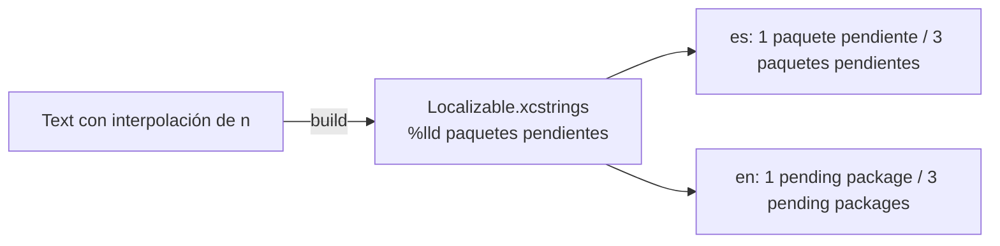
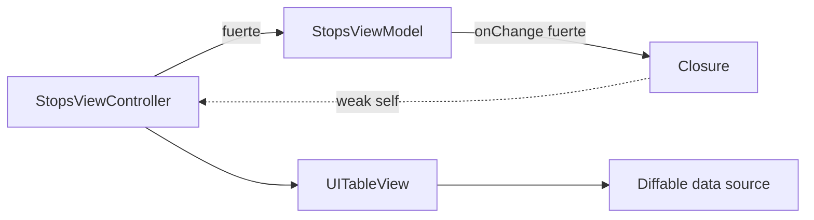

# Módulo 10: Performance, accesibilidad y HIG


**Proyecto del módulo:** para cada práctica, parte de una carpeta vacía y crea en Xcode (File ▸ New ▸ Project ▸ App, interfaz SwiftUI) un proyecto llamado `RutaFlowApp`; escribe manualmente todos los archivos indicados y compila, sin usar proyectos ya preparados.

## Aprende construyendo


### Tema 1: Instruments · Intermedio · 35 min

<details open>
<summary><strong>Capa 1 — Lectura</strong></summary>

#### ► DE QUÉ TRATA
Al finalizar vas a perfilar con Instruments (Time Profiler) el scroll de ListaEnvios y a medir qué función específica consume más CPU durante ese scroll. Prerrequisitos: Módulo 1 completo, Xcode con un dispositivo real o simulador.

</details>

<details>
<summary><strong>Capa 2 — Construcción</strong></summary>

#### Código y verificación
```
Time Profiler    → qué función consume más CPU
Allocations      → uso de memoria y posibles fugas
Core Animation   → frames perdidos en animaciones/scroll
```

```text
1. Abrí el proyecto y elegí Product > Profile (⌘I)
2. Seleccioná la plantilla "Time Profiler"
3. Grabá mientras hacés scroll en ListaEnvios
4. Detené la grabación y ordená por "Self Weight"
```

```bash
xcodebuild -scheme RutaFlowApp -destination 'generic/platform=iOS Simulator' build
```

</details>

### Tema 2: Accesibilidad con VoiceOver · Intermedio · 35 min

<details open>
<summary><strong>Capa 1 — Lectura</strong></summary>

#### ► DE QUÉ TRATA
Al finalizar vas a activar VoiceOver y navegar DetalleEnvio solo con gestos (sin mirar la pantalla), agregando .accessibilityLabel donde el lector de pantalla no describa nada útil. Prerrequisitos: Tema 1 de este módulo.

</details>

<details>
<summary><strong>Capa 2 — Construcción</strong></summary>

#### Código y verificación
```swift
Image(systemName: "trash")
    .accessibilityLabel("Eliminar tarea")
```

```swift
Image(systemName: "trash").accessibilityLabel("Eliminar tarea")
// Sin esto, VoiceOver lee simplemente "imagen" — inútil para el usuario
```

```swift
import SwiftUI

struct DetalleEntregaView: View {
    @State private var entregada = false

    var body: some View {
        VStack(spacing: 16) {
            Text(entregada ? "Entregada" : "Pendiente")
            Button(action: confirmarEntrega) {
                Image(systemName: "checkmark.circle") // sin texto visible
            }
            .accessibilityLabel("Confirmar entrega") // lo que VoiceOver lee
        }
    }

    private func confirmarEntrega() { entregada = true }
}
```

```bash
xcodebuild -scheme RutaFlowApp -destination 'generic/platform=iOS Simulator' build
```

</details>

### Tema 3: Human Interface Guidelines, Dynamic Type e interop con UIKit · Intermedio · 40 min

<details open>
<summary><strong>Capa 1 — Lectura</strong></summary>

#### ► DE QUÉ TRATA
Al finalizar vas a probar DetalleEnvio con el tamaño de Dynamic Type más grande disponible, y a revisar sus botones contra la medida mínima de 44x44 puntos que exige HIG. Prerrequisitos: Tema 2 de este módulo.

#### ► LA ANALOGÍA
Dynamic Type escala el texto según la configuración del usuario; HIG documenta convenciones (como el área táctil mínima de 44x44 puntos) que hacen que una app se sienta nativa — un código de vestimenta esperado en un ambiente profesional.
**Conceptos clave:** convenciones documentadas que hacen que una app se sienta nativa, más allá de usar SwiftUI.

Apple documenta convenciones esperadas de comportamiento e interacción en sus Human Interface Guidelines (HIG): tamaño mínimo de áreas táctiles (44x44 puntos, garantizando que elementos interactivos sean cómodamente presionables sin errores de precisión), iconografía consistente mediante SF Symbols (el sistema de íconos nativo de Apple, ya integrado visualmente con la tipografía del sistema), y patrones de navegación estándar (los estudiados en el Módulo 3); seguir estas convenciones documentadas hace que una app "se sienta nativa" de forma genuina, un resultado que usar SwiftUI por sí solo no garantiza automáticamente si las decisiones de diseño e interacción se apartan de esas convenciones esperadas por el usuario habitual de iOS.

```swift
Text("Título").font(.title) // escala automáticamente con la configuración de tamaño de texto del usuario
.preferredColorScheme(.dark) // para previsualizar dark mode explícitamente
```

Dynamic Type permite que el texto de la app escale automáticamente según la configuración de tamaño de texto que el usuario eligió en Ajustes de Accesibilidad, y probar la app específicamente en el tamaño de texto más grande disponible revela rápidamente layouts que se rompen con texto considerablemente más largo de lo esperado (etiquetas truncadas, botones desbordados); `UIViewRepresentable` y `UIViewControllerRepresentable` permiten embeber Views y ViewControllers de UIKit (el framework de UI imperativo anterior a SwiftUI) dentro de un árbol SwiftUI, útil durante una migración incremental o para integrar componentes de terceros que aún no ofrecen una versión SwiftUI nativa, el mismo patrón que `AndroidView`/`ComposeView` en Android (Módulo 10 de ese track).

**Analogía:** las Human Interface Guidelines son como el código de vestimenta y protocolo esperado en un ambiente profesional específico: seguirlas hace que alguien se perciba genuinamente parte de ese ambiente, mientras que ignorarlas, aun con las mejores intenciones y herramientas modernas disponibles, produce una impresión de no pertenecer del todo al contexto esperado.

**Diagrama:**

```
UIViewRepresentable            → embebe una View de UIKit DENTRO de SwiftUI
UIViewControllerRepresentable  → embebe un ViewController de UIKit DENTRO de SwiftUI
```

* Código: escribe la práctica en `ContentView.swift` y `DetalleEntregaView.swift` de tu propio proyecto `RutaFlowApp`.
* Proyecto: en el proyecto integrador RutaFlow, prueba el detalle con Dynamic Type y una vista UIKit envuelta.

**Límites y decisión de uso:** Seguir una guía visual no garantiza legibilidad con texto ampliado o idiomas largos. Prueba tamaños de accesibilidad y el ciclo de vida del componente UIKit incorporado, evitando supuestos de altura fija.

**¿Por qué es importante?** Porque seguir las HIG hace que una app se sienta nativa de forma genuina, un resultado que usar SwiftUI por sí solo no garantiza.

</details>

<details>
<summary><strong>Capa 2 — Construcción</strong></summary>

#### Código y verificación
```swift
Text("Título").font(.title) // escala automáticamente con la configuración de tamaño de texto del usuario
.preferredColorScheme(.dark) // para previsualizar dark mode explícitamente
```

```
UIViewRepresentable            → embebe una View de UIKit DENTRO de SwiftUI
UIViewControllerRepresentable  → embebe un ViewController de UIKit DENTRO de SwiftUI
```

```swift
import SwiftUI

struct TarjetaDireccion: View {
    let direccion: String
    let confirmarEntrega: () -> Void

    var body: some View {
        HStack {
            Text(direccion)
                .font(.body) // escala automáticamente con la configuración de Dynamic Type
            Spacer()
            Button(action: confirmarEntrega) {
                Image(systemName: "checkmark.circle").frame(width: 44, height: 44) // área táctil mínima
            }
            .accessibilityLabel("Confirmar entrega")
        }
    }
}

#Preview {
    TarjetaDireccion(direccion: "Calle 10 #5-20, Bogotá") {}
}
```

```bash
xcodebuild -scheme RutaFlowApp -destination 'generic/platform=iOS Simulator' build
```

</details>

### Tema 4: Localización con String Catalogs: textos, plurales y formatos por idioma · Intermedio · 40 min

<details open>
<summary><strong>Capa 1 — Lectura</strong></summary>

#### ► DE QUÉ TRATA
Usa Xcode 26 o superior, la versión base del curso. En RutaFlowApp, crea File > New > File > String Catalog con el nombre Localizable. Agrega el idioma inglés en Project > Info > Localizations.

#### ► CÓMO FUNCIONA


</details>

<details>
<summary><strong>Capa 2 — Construcción</strong></summary>

#### Código y verificación


```swift
import SwiftUI

struct ResumenDia: View {
    let pendientes: Int
    let cobrado: Decimal
    let cierre: Date

    var body: some View {
        VStack(alignment: .leading, spacing: 8) {
            Text("Resumen del día")
            // Una sola clave; las formas de plural van en el catálogo.
            Text("\(pendientes) paquetes pendientes")
            // Formatos del idioma del usuario, sin escribirlos a mano.
            Text("Cobrado: \(cobrado.formatted(.currency(code: "COP")))")
            Text("Cierre: \(cierre.formatted(date: .abbreviated, time: .shortened))")
        }
    }
}

#Preview("Español") { ResumenDia(pendientes: 1, cobrado: 52_000, cierre: .now) }
#Preview("English") {
    ResumenDia(pendientes: 3, cobrado: 52_000, cierre: .now).environment(\.locale, Locale(identifier: "en"))
}
```

```bash
xcodebuild -scheme RutaFlowApp -destination 'generic/platform=iOS Simulator' build
# abre Localizable.xcstrings: aparecen las claves extraídas; en "%lld paquetes pendientes" elige Vary by Plural
```

```text
Localizable.xcstrings contiene «Resumen del día», «%lld paquetes pendientes», «Cobrado: %@» y «Cierre: %@».
Vista previa en español con 1: «1 paquete pendiente».
Vista previa en inglés con 3: «3 pending packages» y la fecha en formato inglés.
```

</details>

### Tema 5: UIKit desde cero para mantener aplicaciones reales · Avanzado · 25 min

<details open>
<summary><strong>Capa 1 — Lectura</strong></summary>

#### ► DE QUÉ TRATA
Al finalizar vas a construir en UIKit la lista de paradas de RutaFlow (StopsViewController), entendiendo quién crea la vista, cuándo se carga, y por qué una referencia fuerte puede impedir que salga de memoria. Prerrequisitos: módulos 0-9, un proyecto iOS existente.

#### ► LA ANALOGÍA
Un `UIViewController` tiene un ciclo de vida explícito (`loadView`, `viewDidLoad`, `viewWillAppear`) y Auto Layout expresa relaciones, no posiciones absolutas — el controlador es el director de una terminal, y la fuente diffable mantiene el tablero de salidas por identificadores.
**Conceptos clave:** `UIViewController`, ciclo de vida, vista programática, Auto Layout, `UITableViewDiffableDataSource`, reutilización, ARC, captura débil y migración gradual.

Construiremos en UIKit la lista de paradas de nuestra app. Aunque un proyecto nuevo pueda elegir SwiftUI, muchas aplicaciones empresariales conservan pantallas UIKit, Storyboards o componentes de terceros. Saber envolver un controlador no basta: necesitas comprender quién crea la vista, cuándo se carga, cómo se actualiza y por qué una referencia fuerte puede impedir que salga de memoria.

**Requisitos previos:** módulos 0–9, Xcode y un proyecto iOS existente. Crea un grupo `Features/Stops/UIKit` y estos archivos:

```text
App/
├── Features/Stops/Domain/StopSummary.swift
├── Features/Stops/UIKit/StopsViewController.swift
├── Features/Stops/UIKit/StopCell.swift
├── Features/Stops/UIKit/StopsViewModel.swift
└── Features/Stops/UIKit/StopsViewControllerRepresentable.swift
AppTests/Features/Stops/StopsViewModelTests.swift
```

`loadView()` construye la jerarquía cuando no usas Storyboard. `viewDidLoad()` configura lo que debe ocurrir una vez; `viewWillAppear` sirve para trabajo que debe repetirse antes de cada presentación. No hagas una petición de red incondicional en cada aparición sin definir caché, cancelación y actualización.

```swift
import UIKit

@MainActor
final class StopsViewController: UIViewController {
    enum Section { case main }

    private let tableView = UITableView(frame: .zero, style: .insetGrouped)
    private let viewModel: StopsViewModel
    private lazy var dataSource = makeDataSource()

    init(viewModel: StopsViewModel) {
        self.viewModel = viewModel
        super.init(nibName: nil, bundle: nil)
    }

    @available(*, unavailable)
    required init?(coder: NSCoder) { fatalError("Usa init(viewModel:)") }

    override func loadView() {
        view = UIView()
        view.backgroundColor = .systemBackground
        tableView.translatesAutoresizingMaskIntoConstraints = false
        view.addSubview(tableView)
        NSLayoutConstraint.activate([
            tableView.leadingAnchor.constraint(equalTo: view.safeAreaLayoutGuide.leadingAnchor),
            tableView.trailingAnchor.constraint(equalTo: view.safeAreaLayoutGuide.trailingAnchor),
            tableView.topAnchor.constraint(equalTo: view.safeAreaLayoutGuide.topAnchor),
            tableView.bottomAnchor.constraint(equalTo: view.bottomAnchor)
        ])
    }

    override func viewDidLoad() {
        super.viewDidLoad()
        title = "Paradas"
        tableView.register(StopCell.self, forCellReuseIdentifier: StopCell.reuseID)
        viewModel.onChange = { [weak self] stops in self?.render(stops) }
        Task { await viewModel.load() }
    }
}
```

Auto Layout expresa relaciones, no posiciones absolutas. Al anclar la tabla a `safeAreaLayoutGuide`, el contenido respeta cámara, barra y orientaciones. `translatesAutoresizingMaskIntoConstraints = false` evita que UIKit genere restricciones implícitas que compitan con las tuyas.

Usa una fuente diffable para que identidad y cambios sean explícitos. `StopSummary.ID` debe ser estable; no uses el índice de la fila como identidad porque ordenar o insertar haría que la selección apunte a otra parada.

```swift
private func makeDataSource() -> UITableViewDiffableDataSource<Section, StopSummary.ID> {
    UITableViewDiffableDataSource(tableView: tableView) { [weak viewModel] table, path, id in
        let cell = table.dequeueReusableCell(
            withIdentifier: StopCell.reuseID,
            for: path
        ) as! StopCell
        if let stop = viewModel?.stop(id: id) { cell.configure(with: stop) }
        return cell
    }
}

private func render(_ stops: [StopSummary]) {
    var snapshot = NSDiffableDataSourceSnapshot<Section, StopSummary.ID>()
    snapshot.appendSections([.main])
    snapshot.appendItems(stops.map(\.id))
    dataSource.apply(snapshot, animatingDifferences: true)
}
```

La celda reutilizable debe restablecer contenido que podría pertenecer a una fila anterior. Si carga imágenes, conserva y cancela la tarea correspondiente en `prepareForReuse()`.

```swift
final class StopCell: UITableViewCell {
    static let reuseID = "StopCell"
    private var imageTask: Task<Void, Never>?

    func configure(with stop: StopSummary) {
        var content = defaultContentConfiguration()
        content.text = stop.recipientName
        content.secondaryText = stop.address
        contentConfiguration = content
        accessibilityLabel = "Entrega para \(stop.recipientName), \(stop.address)"
    }

    override func prepareForReuse() {
        super.prepareForReuse()
        imageTask?.cancel()
        imageTask = nil
        contentConfiguration = nil
        accessibilityLabel = nil
    }
}
```

ARC libera instancias cuando ya no existen referencias fuertes. El controlador retiene al ViewModel y, si el closure del ViewModel retiene al controlador, ambos forman un ciclo. `[weak self]` rompe ese ciclo cuando el callback no necesita prolongar la vida de la pantalla. No uses `unowned` por costumbre: fallará si el objeto ya fue liberado.



**Analogía:** el controlador es el director de una terminal, Auto Layout define acuerdos de espacio y la fuente diffable mantiene el tablero de salidas por identificadores. La celda es una pantalla reutilizada: debe limpiarse antes de anunciar otra parada.

**¿Por qué es importante?** UIKit sigue presente en aplicaciones productivas y SDKs. Comprender ciclo de vida, restricciones, reutilización y ARC permite mantenerlas, diagnosticar fugas y migrar pantalla por pantalla sin reescribir todo el producto.

**Ejecución y resultado esperado:** desde Xcode ejecuta el esquema en un iPhone pequeño y uno grande. Deben mostrarse paradas sin advertencias de constraints, Dynamic Type debe expandir texto sin superposición y al entrar/salir diez veces Instruments no debe conservar diez controladores.

**Fallo deliberado:** elimina `[weak self]`, abre y cierra la pantalla diez veces y usa Memory Graph. Identifica el ciclo `controller → viewModel → closure → controller`; restáuralo y verifica que `deinit` se ejecute. Después omite `prepareForReuse` y desplázate rápidamente para observar contenido incorrecto heredado.

**Modificación sin copiar:** presenta este controlador desde SwiftUI mediante `UIViewControllerRepresentable`, luego implementa el camino inverso con `UIHostingController`. Documenta cuál lado posee navegación y ciclo de vida durante una migración gradual.

---

**Transferencia al proyecto integrador «Aplicación del repartidor iOS»:** Integra una pantalla heredada UIKit de captura en el flujo de entrega. Prueba presentación, cancelación y retorno del resultado, manteniendo explícito quién administra su ciclo de vida.

#### ► CÓMO FUNCIONA


</details>

<details>
<summary><strong>Capa 2 — Construcción</strong></summary>

#### Código y verificación
```text
App/
├── Features/Stops/Domain/StopSummary.swift
├── Features/Stops/UIKit/StopsViewController.swift
├── Features/Stops/UIKit/StopCell.swift
├── Features/Stops/UIKit/StopsViewModel.swift
└── Features/Stops/UIKit/StopsViewControllerRepresentable.swift
AppTests/Features/Stops/StopsViewModelTests.swift
```

```swift
import UIKit

@MainActor
final class StopsViewController: UIViewController {
    enum Section { case main }

    private let tableView = UITableView(frame: .zero, style: .insetGrouped)
    private let viewModel: StopsViewModel
    private lazy var dataSource = makeDataSource()

    init(viewModel: StopsViewModel) {
        self.viewModel = viewModel
        super.init(nibName: nil, bundle: nil)
    }

    @available(*, unavailable)
    required init?(coder: NSCoder) { fatalError("Usa init(viewModel:)") }

    override func loadView() {
        view = UIView()
        view.backgroundColor = .systemBackground
        tableView.translatesAutoresizingMaskIntoConstraints = false
        view.addSubview(tableView)
        NSLayoutConstraint.activate([
            tableView.leadingAnchor.constraint(equalTo: view.safeAreaLayoutGuide.leadingAnchor),
            tableView.trailingAnchor.constraint(equalTo: view.safeAreaLayoutGuide.trailingAnchor),
            tableView.topAnchor.constraint(equalTo: view.safeAreaLayoutGuide.topAnchor),
            tableView.bottomAnchor.constraint(equalTo: view.bottomAnchor)
        ])
    }

    override func viewDidLoad() {
        super.viewDidLoad()
        title = "Paradas"
        tableView.register(StopCell.self, forCellReuseIdentifier: StopCell.reuseID)
        viewModel.onChange = { [weak self] stops in self?.render(stops) }
        Task { await viewModel.load() }
    }
}
```

```swift
private func makeDataSource() -> UITableViewDiffableDataSource<Section, StopSummary.ID> {
    UITableViewDiffableDataSource(tableView: tableView) { [weak viewModel] table, path, id in
        let cell = table.dequeueReusableCell(
            withIdentifier: StopCell.reuseID,
            for: path
        ) as! StopCell
        if let stop = viewModel?.stop(id: id) { cell.configure(with: stop) }
        return cell
    }
}

private func render(_ stops: [StopSummary]) {
    var snapshot = NSDiffableDataSourceSnapshot<Section, StopSummary.ID>()
    snapshot.appendSections([.main])
    snapshot.appendItems(stops.map(\.id))
    dataSource.apply(snapshot, animatingDifferences: true)
}
```

```swift
final class StopCell: UITableViewCell {
    static let reuseID = "StopCell"
    private var imageTask: Task<Void, Never>?

    func configure(with stop: StopSummary) {
        var content = defaultContentConfiguration()
        content.text = stop.recipientName
        content.secondaryText = stop.address
        contentConfiguration = content
        accessibilityLabel = "Entrega para \(stop.recipientName), \(stop.address)"
    }

    override func prepareForReuse() {
        super.prepareForReuse()
        imageTask?.cancel()
        imageTask = nil
        contentConfiguration = nil
        accessibilityLabel = nil
    }
}
```


```swift
import UIKit

// ViewModel mínimo para este paso; la versión completa usa StopSummary y onChange.
final class StopsViewModel {
    private(set) var paradas: [String] = []
    func load() async { paradas = ["Calle 10 #5-20", "Carrera 7 #45-10"] }
}

final class StopsViewController: UIViewController {
    private let tableView = UITableView(frame: .zero, style: .insetGrouped)
    private let viewModel: StopsViewModel
    init(viewModel: StopsViewModel) {
        self.viewModel = viewModel
        super.init(nibName: nil, bundle: nil)
    }
    required init?(coder: NSCoder) { fatalError("Usa init(viewModel:)") }
    override func viewDidLoad() {
        super.viewDidLoad()
        title = "Paradas"
        Task { await viewModel.load() }
    }
}
```

</details>
