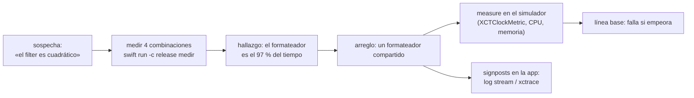
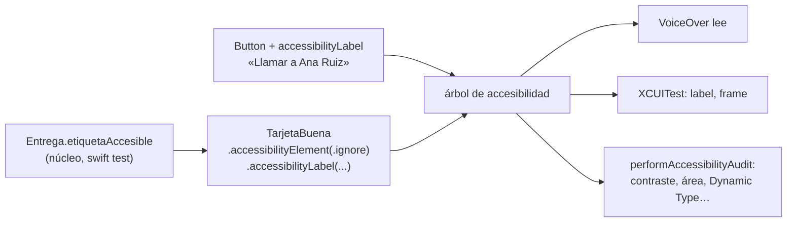
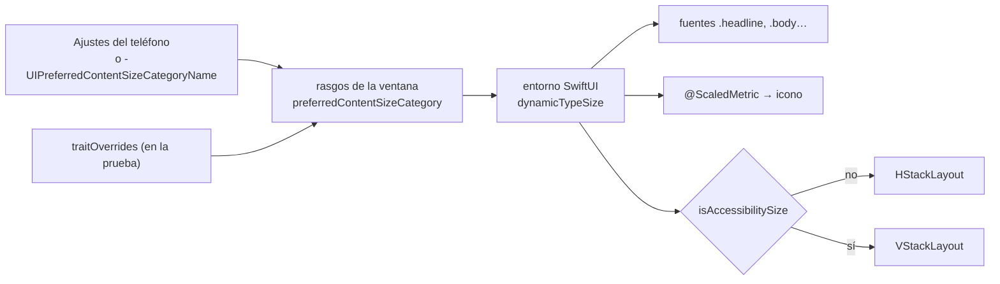
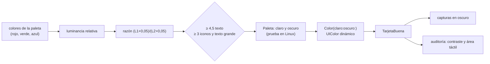

# Módulo 10: Rendimiento, accesibilidad y guías de interfaz de Apple

**Entorno comprobado para esta edición (2026-11-25):** Swift 6.4.3 en Linux x86_64 para la lógica pura: el paquete
`nucleo` (resumen de la semana y su medición, contraste WCAG, frases para VoiceOver), ejecutado con `swift test` y
`swift run` en `/home/estudiante/labs/ios/ios10` (tu `~/labs/ios/ios10`). Lo que necesita Apple se compiló y ejecutó
con Xcode 27.2 (27B52), Swift 6.4.2 y el simulador iPhone 17 con iOS 27.2, con el script `mac.sh`: la medición con
`measure` y signposts, la auditoría de accesibilidad de XCUITest, los pantallazos con varios tamaños de texto y en
modo oscuro, y un intento de perfil con `xctrace` (Instruments por terminal). Límites honestos: los tiempos de Linux
y del simulador no se comparan entre sí (otro procesador, otra Foundation); el simulador no reemplaza medir en un
iPhone real; y VoiceOver no se puede «escuchar» en una prueba automática: se comprueba lo que va a leer.

Una app de reparto se usa en la calle, con prisa, con el sol en la pantalla, con el texto grande porque el
repartidor no lleva gafas, y a veces con VoiceOver. Y se usa con miles de entregas en la semana. Este módulo
enseña a medir antes de optimizar y a construir pantallas que se puedan usar con cualquier tamaño de texto, con
VoiceOver, en modo oscuro y con buen contraste, comprobándolo con pruebas.

**Al terminar este módulo podrás:**
- medir con el reloj monotónico, `measure` de XCTest y signposts, y encontrar la parte lenta antes de cambiar código;
- dar a cada elemento una etiqueta útil para VoiceOver y comprobarla con una prueba y con la auditoría automática;
- diseñar tarjetas que se reorganizan con Dynamic Type en lugar de cortarse;
- calcular el contraste de tus colores, adaptarlos al modo oscuro y respetar el área táctil mínima.

**Esquema del módulo:** Tema 1 (medir: reloj, `measure` y signposts) → Tema 2 (VoiceOver y auditoría de
accesibilidad) → Tema 3 (Dynamic Type) → Tema 4 (contraste, modo oscuro y guías de interfaz) → Proyecto 47.

**Qué necesitas saber antes:** del Módulo 1, **los stacks y los modificadores**; del Módulo 2, **`@Environment`**;
del Módulo 9, **Swift Testing, las pruebas alojadas, las capturas con una ventana de la app y XCUITest**.

**Qué no se repite:** cómo se escriben y ejecutan pruebas, capturas y pruebas de interfaz (Módulo 9). Aquí se usan
para medir y para comprobar la accesibilidad.

**Prepara el proyecto:**

```text
$ mkdir -p ~/labs/ios/ios10/nucleo && cd ~/labs/ios/ios10/nucleo
$ swift package init --type library --name Nucleo
$ mkdir -p Sources/medir
```

Reemplaza `Package.swift` por el del Tema 1 y copia `Entrega.swift` del Módulo 9. El laboratorio trae
`app/RutaAccesible.xcodeproj` con la app `RutaAccesible`, las pruebas alojadas `Pruebas` y las de interfaz
`PruebasUI`, como en el Módulo 9; `mac.sh` copia el núcleo a la app antes de compilar. La app abre una de tres
pantallas según el argumento de lanzamiento `-escena`: `mala`, `buena` o `rendimiento`.


## Aprende construyendo


### Tema 1: Medir antes de optimizar: reloj, `measure` y signposts · Intermedio · 45 min

<details open>
<summary><strong>Capa 1 — Lectura</strong></summary>

#### Objetivos
Al terminar este tema podrás:
- medir un bloque varias veces con `ContinuousClock` y resumir con la mediana;
- separar un cálculo en sus decisiones y medir cada combinación para encontrar la parte cara;
- medir en el simulador con `measure` de XCTest y marcar intervalos con signposts;
- explicar por qué se mide en *release* y con datos de tamaño real.

**Conceptos clave:** reloj monotónico, mediana, compilación `release`, `measure` y línea base, signpost

#### El problema
El resumen de la semana agrupa por barrio las entregas y muestra cuánto falta por cobrar. Con las 3 entregas de
ejemplo es instantáneo; con 20 000 la pantalla se congela casi un segundo. La primera idea del equipo es «el `filter`
dentro del `map` es cuadrático, cambiémoslo por un diccionario». Puede ser, o puede no ser: sin medir, es una
apuesta.

Este tema usa **las colecciones y los cierres** (Módulo 0) y **las pruebas alojadas** (Módulo 9).

#### Glosario del tema

**reloj monotónico**
- **Definición técnica:** `ContinuousClock`: un reloj que solo avanza (no lo cambian la hora del sistema ni la zona horaria); `reloj.measure { … }` devuelve un `Duration`.
- **En palabras sencillas:** un cronómetro que nadie puede adelantar.
- **Dónde se rompe la comparación:** mide tiempo de pared, incluidas las pausas del sistema; no dice dónde se fue el tiempo.
- **Ejemplo:** `Medicion.medir("lento") { … }` con 5 repeticiones.
- **Error típico:** restar dos `Date()`: la hora del sistema puede saltar.

**mediana**
- **Definición técnica:** el valor del medio de las muestras ordenadas; a diferencia del promedio, una muestra atípica (la primera, con cachés frías, o una interrupción) no la mueve.
- **En palabras sencillas:** el tiempo «normal», sin contar el día malo.
- **Dónde se rompe la comparación:** con 5 muestras sigue habiendo ruido; dos ejecuciones dan números distintos.
- **Ejemplo:** `mediana 867.2 ms` frente a `mediana 22.4 ms`.
- **Error típico:** medir una sola vez y sacar conclusiones de diferencias del 10 %.

**compilación `release`**
- **Definición técnica:** compilar con optimizaciones (`swift run -c release`, o el esquema en *Release*); *debug* desactiva la optimización para poder depurar.
- **En palabras sencillas:** medir el coche con el motor de verdad, no con el de prácticas.
- **Dónde se rompe la comparación:** *debug* no frena todo igual: tu código se frena mucho, las bibliotecas del sistema ya vienen optimizadas.
- **Ejemplo:** en *debug*, filtrar por barrio parece costar más del doble (60,2 ms frente a 27,6 ms); en *release*, 26,1 frente a 22,4.
- **Error típico:** optimizar lo que en *debug* parece lento y en *release* no lo es.

**`measure` y línea base**
- **Definición técnica:** método de `XCTestCase` que ejecuta un bloque varias veces (5 por defecto) con métricas (`XCTClockMetric`, `XCTCPUMetric`, `XCTMemoryMetric`…) e informa promedio y desviación; en Xcode se puede fijar una línea base y la prueba falla si empeora.
- **En palabras sencillas:** el cronómetro oficial de las pruebas.
- **Dónde se rompe la comparación:** solo existe en XCTest (no en Swift Testing) y la línea base es por dispositivo.
- **Ejemplo:** `testResumenLento` y `testResumenRapido` en `RendimientoTests.swift`.
- **Error típico:** fijar la línea base en el simulador de tu Mac y compararla en la máquina de integración continua.

**signpost**
- **Definición técnica:** marca de intervalo con nombre que la app emite con `OSSignposter` (`withIntervalSignpost`, o `beginInterval`/`endInterval`) en un subsistema y categoría; Instruments y el registro del sistema la muestran en la línea de tiempo.
- **En palabras sencillas:** un banderín de «empieza» y «termina» en la cinta del tiempo.
- **Dónde se rompe la comparación:** cuesta casi nada si nadie escucha, pero solo marca; la duración y el contexto los muestra la herramienta.
- **Ejemplo:** `senales.withIntervalSignpost("resumen lento") { … }`.
- **Error típico:** usar `print` con tiempos: no aparece en Instruments y se queda en el código de producción.

#### ► CÓMO FUNCIONA

##### 1. La idea en lenguaje sencillo

Piensa en un trancón diario camino al trabajo. Puedes culpar al semáforo de la esquina, pero si cronometras cada
tramo una semana descubres que el retraso está en el puente. Sin el cronómetro habrías «arreglado» el semáforo y
seguirías llegando tarde.

Con el código pasa lo mismo. Cuando una pantalla tarda, la intuición señala lo que parece caro a la vista, como un
`filter` dentro de un `map`. Pero el procesador no lee el código como tú: el costo real puede estar en una línea
inocente. **Medir antes de optimizar** significa cronometrar primero y cambiar código después, solo donde los
números lo piden.

En el resumen de la semana, la sospecha del equipo era la agrupación por barrio. La medición del problema resuelto
muestra otra cosa: crear un `NumberFormatter` por entrega se lleva casi todo el tiempo. Este tema te da tres
herramientas para llegar ahí con datos. El reloj mide la lógica pura, `measure` mide en las pruebas y los
signposts marcan la app real.

##### 2. Definición formal y vocabulario

Una **medición** es un conjunto de muestras de duración de un mismo bloque de código, tomadas en condiciones
controladas y resumidas con un estadístico. Cada parte de esa definición tiene su ficha en el glosario.

El **reloj monotónico** es la fuente de las muestras. En Swift es `ContinuousClock`, un reloj que solo avanza: no
lo mueven los cambios de hora del sistema ni la zona horaria. Su método `measure(_:)` ejecuta un cierre y devuelve
un `Duration`, el tipo de la biblioteca estándar para intervalos de tiempo.

La **mediana** es el estadístico que resume las muestras. Ordenas las duraciones y tomas la del medio. Una muestra
atípica, como la primera con las cachés frías, no la desplaza; al promedio sí.

La **compilación *release*** es la condición controlada. Compilas con optimizaciones (`swift run -c release`), que
es como se compila la app que publicas. La compilación *debug* desactiva esas optimizaciones para que el depurador
pueda detenerse en cada línea.

**`measure` y línea base** son la versión de XCTest de todo lo anterior. `measure(metrics:)` repite el bloque con
varias métricas y reporta promedio y desviación estándar relativa. La línea base es el valor de referencia que
Xcode guarda; si el rendimiento empeora, la prueba falla.

El **signpost** es una marca con nombre en la línea de tiempo del sistema. Lo emites con `OSSignposter` y lo ves en
Instruments o con `log show --signpost`, junto al dibujo, la red y el disco de la app.

##### 3. Cómo funciona por dentro, paso a paso

El flujo completo del tema va de la sospecha a una medición que protege el resultado:



1. **Separas las decisiones.** El resumen recibe `Agrupacion` y `Formateo` como parámetros. Así mides cada
   combinación sin copiar el algoritmo, y cualquier diferencia se debe solo a esa decisión.
2. **Compilas en *release*.** El compilador aplica el nivel `-O`: integra funciones pequeñas, elimina copias y
   comprobaciones redundantes. Tu código cambia mucho; Foundation ya venía compilada así y casi no cambia.
3. **Tomas varias muestras con el reloj.** Cada `measure` lee el reloj antes y después del cierre.

```swift
let reloj = ContinuousClock()
let muestras = (0..<5).map { _ in reloj.measure { _ = ResumenSemana.rapido(semana) } }
let mediana = muestras.sorted()[muestras.count / 2]
```

   La primera línea crea el reloj; la segunda toma cinco `Duration`; la tercera ordena y toma la del medio.
   `Duration` es comparable, por eso `sorted()` funciona sin más.
4. **Compruebas que el resultado no cambió.** Una optimización que cambia la salida no es una optimización. Por eso
   la prueba `mismoResultado` compara la versión lenta con la rápida para varios tamaños.
5. **Mides en el simulador con XCTest.** `measure(metrics:)` ejecuta el bloque varias veces dentro de la app
   alojada. `XCTClockMetric` toma tiempo de reloj; `XCTCPUMetric`, ciclos, tiempo de CPU e instrucciones;
   `XCTMemoryMetric`, memoria física.
6. **Marcas intervalos en la app.** El signposter emite un inicio y un fin con el mismo identificador.

```swift
let senales = OSSignposter(subsystem: "com.academia.ios10", category: "Rendimiento")
let filas = senales.withIntervalSignpost("resumen rápido") { ResumenSemana.rapido(semana) }
```

   `withIntervalSignpost` devuelve lo que devuelve el cierre, así que no cambias la forma del código. El sistema
   guarda los dos eventos en su registro unificado, y Instruments los empareja en una barra con duración.

##### 4. Reglas, variantes y casos límite

**Qué reloj usar.** Swift 5.7 (SE-0329) trajo `ContinuousClock` y `SuspendingClock`. El primero sigue contando
mientras el dispositivo duerme; el segundo se detiene. Para medir un cálculo corto da igual; para medir esperas
largas, elige a conciencia. Lo que nunca debes usar es la resta de dos `Date()`, porque la hora del sistema puede
saltar.

**Cuántas muestras.** Cinco muestras quitan el ruido grueso, no el fino. Dos ejecuciones del mismo programa dan
números distintos; compara órdenes de magnitud y desconfía de diferencias del 10 %.

**Qué métrica fijar como línea base.** Las instrucciones de CPU retiradas son las más estables, porque no dependen
de cuánto esperó el proceso. El tiempo de reloj incluye interrupciones del sistema. La línea base se guarda por
dispositivo: la de tu simulador no sirve en otra máquina.

**Qué no se compara.** Nunca compares tiempos entre máquinas, ni entre Linux y el simulador. Compara versiones del
código en la misma máquina, con los mismos datos y la misma configuración.

**Límites de `measure`.** Existe solo en XCTest; Swift Testing no la ofrece. Por eso
el núcleo se mide con un ejecutable propio y las pruebas de rendimiento de la app siguen en `XCTestCase`.

**Costo de los signposts.** `OSSignposter` existe desde iOS 15; antes se usaba la función `os_signpost`, de iOS 12.
Si ninguna herramienta está grabando, emitir un signpost cuesta muy poco, así que puedes dejarlos en producción. Un
`print` con tiempos, en cambio, no aparece en Instruments y ensucia la salida.

**Tamaño de los datos.** Mide con datos de tamaño real. Con 3 entregas todo es instantáneo y ninguna decisión se
nota.

##### 5. Relación con lo que ya sabes y lo que viene

Este tema usa las colecciones y los cierres del Módulo 0, Tema 4: `map`, `filter`, `Dictionary(grouping:by:)` y el
cierre que recibe `measure`. También usa las pruebas alojadas del Módulo 9. `RendimientoTests` se ejecuta como
cualquier prueba de XCTest, pero reporta números en lugar de un sí o un no.

Distingue bien medir de probar. Una prueba de Swift Testing responde «¿el resultado es correcto?»; una medición
responde «¿cuánto cuesta obtenerlo?». Las dos van juntas: la prueba `mismoResultado` impide que la optimización
rompa el resumen.

Los signposts y el `Logger` usan el mismo subsistema. En el Módulo 13, Tema 3, vuelves a `os.Logger` con más
detalle, junto con MetricKit, que recoge métricas de rendimiento de los usuarios reales. Y el Proyecto 47 de este
módulo te pide repetir este ciclo con el cálculo más pesado de tu propia pantalla.

#### Problema resuelto 1.1
Mide las cuatro combinaciones del resumen (filtrar o diccionario; un formateador por entrega o uno compartido) con
2 000 y 20 000 entregas, en *release* y en *debug*. Después mide las dos versiones finales en el simulador con
`measure` y márcalas con signposts en la app.

**Razonamiento:**
1. El resumen se escribió con dos decisiones explícitas (`Agrupacion` y `Formateo`) para poder medir cada una por
   separado sin copiar código.
2. Las entregas de la semana son sintéticas pero reproducibles (`semana(n)`): 19 barrios, una de cada 4 entregada.
3. Cada combinación se compara con el resultado de la versión lenta: optimizar no puede cambiar el resultado, y una
   prueba lo comprueba con 0, 1, 19, 500 y 2 000 entregas.
4. En la app, el mismo cálculo va dentro de `withIntervalSignpost` y su tiempo se registra con `Logger`.

```swift
// swift-tools-version: 6.0
import PackageDescription

// La lógica pura del módulo: se prueba aquí con `swift test`, se mide con `swift run -c release medir`
// y la carpeta Sources/Nucleo se copia a la app de iOS.
let package = Package(
    name: "Nucleo",
    targets: [
        .target(name: "Nucleo"),
        .executableTarget(name: "medir", dependencies: ["Nucleo"]),
        .testTarget(name: "NucleoTests", dependencies: ["Nucleo"]),
    ]
)
```

```swift
import Foundation

/// Una fila del resumen de la semana: un barrio, cuántas entregas tiene y cuánto falta por cobrar, ya formateado.
public struct FilaBarrio: Equatable, Sendable {
    public let barrio: String
    public let entregas: Int
    public let pendientes: Int
    public let porCobrar: String
}

/// El resumen por barrio de todas las entregas de la semana. Dos decisiones cambian el costo, no el resultado:
/// cómo se agrupa (filtrar la lista entera por cada barrio, o un diccionario en un solo recorrido) y cuántos
/// formateadores se crean (uno por entrega, o uno para todo).
public enum ResumenSemana {
    public enum Agrupacion: Sendable { case filtrarPorBarrio, diccionario }
    public enum Formateo: Sendable { case unoPorEntrega, unoCompartido }

    /// La versión que se escribió primero.
    public static func lento(_ entregas: [Entrega]) -> [FilaBarrio] {
        resumen(entregas, agrupacion: .filtrarPorBarrio, formateo: .unoPorEntrega)
    }

    /// La versión corregida después de medir.
    public static func rapido(_ entregas: [Entrega]) -> [FilaBarrio] {
        resumen(entregas, agrupacion: .diccionario, formateo: .unoCompartido)
    }

    public static func resumen(_ entregas: [Entrega], agrupacion: Agrupacion, formateo: Formateo) -> [FilaBarrio] {
        let grupos: [(String, [Entrega])] =
            switch agrupacion {
            case .filtrarPorBarrio:  // b barrios × n entregas comparaciones
                Set(entregas.map(\.barrio)).sorted().map { barrio in (barrio, entregas.filter { $0.barrio == barrio }) }
            case .diccionario:  // un solo recorrido
                Dictionary(grouping: entregas, by: \.barrio).sorted { $0.key < $1.key }
            }
        let compartido = nuevoFormateador()
        return grupos.map { barrio, delBarrio in
            var total = 0
            var texto = ""
            for entrega in delBarrio where entrega.estado == .pendiente {
                total += entrega.contraentrega
                let formato = formateo == .unoPorEntrega ? nuevoFormateador() : compartido
                texto = formato.string(from: total as NSNumber) ?? ""
            }
            let pendientes = delBarrio.filter { $0.estado == .pendiente }.count
            return FilaBarrio(barrio: barrio, entregas: delBarrio.count, pendientes: pendientes, porCobrar: texto)
        }
    }

    static func nuevoFormateador() -> NumberFormatter {
        let formato = NumberFormatter()
        formato.numberStyle = .currency
        formato.locale = Locale(identifier: "es_CO")
        formato.maximumFractionDigits = 0
        return formato
    }

    /// Entregas sintéticas y reproducibles para medir: `n` entregas repartidas en 19 barrios.
    public static func semana(_ n: Int) -> [Entrega] {
        let barrios = [
            "Chapinero", "Usaquén", "Teusaquillo", "Suba", "Engativá", "Kennedy", "Bosa", "Fontibón", "Barrios Unidos",
            "Puente Aranda", "Los Mártires", "Antonio Nariño", "Rafael Uribe", "San Cristóbal", "Usme", "Tunjuelito",
            "Ciudad Bolívar", "Santa Fe", "La Candelaria",
        ]
        return (0..<n).map { i in
            Entrega(
                guia: "EN-\(10_000 + i)", destinatario: "Cliente \(i)", barrio: barrios[i % barrios.count],
                pesoKg: Double(i % 7) + 0.5, contraentrega: (i % 3 == 0) ? 0 : 10_000 + (i % 50) * 500,
                estado: i % 4 == 0 ? .entregada : .pendiente)
        }
    }
}
```

```swift
import Foundation

/// Mide un bloque varias veces con el reloj monotónico y resume: la mediana resiste a las ejecuciones atípicas.
public struct Medicion: Sendable {
    public let nombre: String
    public let muestras: [Duration]

    public var mediana: Duration { muestras.sorted()[muestras.count / 2] }
    public var minimo: Duration { muestras.min() ?? .zero }

    public static func medir(_ nombre: String, repeticiones: Int = 5, _ bloque: () -> Void) -> Medicion {
        let reloj = ContinuousClock()
        let muestras = (0..<repeticiones).map { _ in reloj.measure(bloque) }
        return Medicion(nombre: nombre, muestras: muestras)
    }
}

extension Duration {
    /// Milisegundos con un decimal, para imprimir.
    public var ms: String {
        let (s, a) = components
        let valor = Double(s) * 1_000 + Double(a) / 1e15
        return String(format: "%.1f ms", valor)
    }
}
```

```swift
import Nucleo

// Mide las cuatro combinaciones del resumen con 2 000 y 20 000 entregas. En release: `swift run -c release medir`.
let casos: [(String, ResumenSemana.Agrupacion, ResumenSemana.Formateo)] = [
    ("filtrar + formateador por entrega (lento)", .filtrarPorBarrio, .unoPorEntrega),
    ("diccionario + formateador por entrega", .diccionario, .unoPorEntrega),
    ("filtrar + formateador compartido", .filtrarPorBarrio, .unoCompartido),
    ("diccionario + formateador compartido (rápido)", .diccionario, .unoCompartido),
]
for n in [2_000, 20_000] {
    let semana = ResumenSemana.semana(n)
    let referencia = ResumenSemana.lento(semana)
    print("\(n) entregas en \(referencia.count) barrios")
    for (nombre, agrupacion, formateo) in casos {
        var filas: [FilaBarrio] = []
        let m = Medicion.medir(nombre) {
            filas = ResumenSemana.resumen(semana, agrupacion: agrupacion, formateo: formateo)
        }
        let igual = filas == referencia ? "" : "  ¡RESULTADO DISTINTO!"
        print("  \(nombre.padding(toLength: 46, withPad: " ", startingAt: 0)) mediana \(m.mediana.ms)\(igual)")
    }
}
```

```text
$ cd nucleo && swift run -c release medir 2>&1 | grep -vE 'safeExec|^\[|Build|Compiling|Planning|Building'
2000 entregas en 19 barrios
  filtrar + formateador por entrega (lento)      mediana 95.3 ms
  diccionario + formateador por entrega          mediana 87.1 ms
  filtrar + formateador compartido               mediana 2.3 ms
  diccionario + formateador compartido (rápido)  mediana 2.3 ms
20000 entregas en 19 barrios
  filtrar + formateador por entrega (lento)      mediana 867.2 ms
  diccionario + formateador por entrega          mediana 865.6 ms
  filtrar + formateador compartido               mediana 26.1 ms
  diccionario + formateador compartido (rápido)  mediana 22.4 ms
```

```text
$ cd nucleo && swift run medir 2>&1 | grep -vE 'safeExec|^\[|Build|Compiling|Planning|Building'
2000 entregas en 19 barrios
  filtrar + formateador por entrega (lento)      mediana 84.5 ms
  diccionario + formateador por entrega          mediana 82.9 ms
  filtrar + formateador compartido               mediana 6.3 ms
  diccionario + formateador compartido (rápido)  mediana 3.0 ms
20000 entregas en 19 barrios
  filtrar + formateador por entrega (lento)      mediana 1064.1 ms
  diccionario + formateador por entrega          mediana 834.8 ms
  filtrar + formateador compartido               mediana 60.2 ms
  diccionario + formateador compartido (rápido)  mediana 27.6 ms
```

En el simulador, con `measure`, signposts y registro:

```swift
import XCTest

@testable import RutaAccesible

/// `measure` ejecuta el bloque 5 veces y reporta promedio y desviación; con una línea base, falla si empeora.
final class RendimientoTests: XCTestCase {
    func testResumenLento() {
        let semana = ResumenSemana.semana(20_000)
        measure(metrics: [XCTClockMetric(), XCTCPUMetric(), XCTMemoryMetric()]) {
            _ = ResumenSemana.lento(semana)
        }
    }

    func testResumenRapido() {
        let semana = ResumenSemana.semana(20_000)
        measure(metrics: [XCTClockMetric(), XCTCPUMetric(), XCTMemoryMetric()]) {
            _ = ResumenSemana.rapido(semana)
        }
    }
}
```

```swift
import SwiftUI
import os

/// Signposts y registro con el mismo subsistema: Instruments y `log` los filtran por él.
@MainActor let senales = OSSignposter(subsystem: "com.academia.ios10", category: "Rendimiento")
let registro = Logger(subsystem: "com.academia.ios10", category: "Rendimiento")

/// Calcula el resumen de 20 000 entregas con las dos versiones, marcando cada una con un intervalo de signpost.
struct PantallaRendimiento: View {
    @State private var lineas: [String] = []

    var body: some View {
        NavigationStack {
            List(lineas, id: \.self) { Text($0).font(.body.monospacedDigit()) }
                .navigationTitle("Resumen de la semana")
                .task { lineas = medirResumen() }
        }
    }
}

@MainActor
func medirResumen() -> [String] {
    let semana = ResumenSemana.semana(20_000)
    let reloj = ContinuousClock()
    var lento: [FilaBarrio] = []
    var rapido: [FilaBarrio] = []
    let tLento = reloj.measure {
        lento = senales.withIntervalSignpost("resumen lento") { ResumenSemana.lento(semana) }
    }
    let tRapido = reloj.measure {
        rapido = senales.withIntervalSignpost("resumen rápido") { ResumenSemana.rapido(semana) }
    }
    registro.info("resumen lento: \(tLento.ms, privacy: .public); rápido: \(tRapido.ms, privacy: .public)")
    return [
        "20 000 entregas, \(rapido.count) barrios", "lento: \(tLento.ms)", "rápido: \(tRapido.ms)",
        "mismo resultado: \(lento == rapido ? "sí" : "no")",
    ]
}
```

```text
$ grep -oE 'testResumen[A-Za-z]+\]. measured \[[^]]*\] average: [0-9.]+, relative standard deviation: [0-9.]+%' registro_pruebas_alojadas.txt
testResumenLento]' measured [Memory Physical, kB] average: 6.554, relative standard deviation: 122.474%
testResumenLento]' measured [CPU Cycles, kC] average: 1152608.802, relative standard deviation: 2.143%
testResumenLento]' measured [Clock Monotonic Time, s] average: 0.290, relative standard deviation: 4.386%
testResumenLento]' measured [CPU Time, s] average: 0.293, relative standard deviation: 4.079%
testResumenLento]' measured [CPU Instructions Retired, kI] average: 5461259.916, relative standard deviation: 0.853%
testResumenLento]' measured [Memory Peak Physical, kB] average: 37613.558, relative standard deviation: 0.059%
testResumenRapido]' measured [Memory Physical, kB] average: 3.277, relative standard deviation: 200.000%
testResumenRapido]' measured [CPU Cycles, kC] average: 51483.729, relative standard deviation: 5.587%
testResumenRapido]' measured [Clock Monotonic Time, s] average: 0.012, relative standard deviation: 9.071%
testResumenRapido]' measured [CPU Time, s] average: 0.013, relative standard deviation: 7.691%
testResumenRapido]' measured [CPU Instructions Retired, kI] average: 265730.716, relative standard deviation: 0.273%
testResumenRapido]' measured [Memory Peak Physical, kB] average: 38036.266, relative standard deviation: 0.034%
```

```text
$ grep -v '^Filtering' "$SALIDA/log_stream_crudo.txt"
getpwuid_r did not find a match for uid 501
Timestamp               Ty Process[PID:TID]
2026-11-25 05:39:31.271 I  RutaAccesible[81383:25a51b] [com.academia.ios10:Rendimiento] resumen lento: 364.5 ms; rápido: 12.2 ms
Child process terminated with signal 15: Terminated
```

```text
$ xcrun simctl spawn "$SIM" log show --last 5m --signpost --info --style compact --predicate 'subsystem == "com.academia.ios10"'
getpwuid_r did not find a match for uid 501
Timestamp               Ty Process[PID:TID]
2026-11-25 05:39:30.898 Sp RutaAccesible[81383:25a51b] [com.academia.ios10:Rendimiento] [spid excl, process, begin] resumen lento
2026-11-25 05:39:31.262 Sp RutaAccesible[81383:25a51b] [com.academia.ios10:Rendimiento] [spid excl, process,   end] resumen lento
2026-11-25 05:39:31.262 Sp RutaAccesible[81383:25a51b] [com.academia.ios10:Rendimiento] [spid excl, process, begin] resumen rápido
2026-11-25 05:39:31.274 Sp RutaAccesible[81383:25a51b] [com.academia.ios10:Rendimiento] [spid excl, process,   end] resumen rápido
2026-11-25 05:39:31.274 I  RutaAccesible[81383:25a51b] [com.academia.ios10:Rendimiento] resumen lento: 364.5 ms; rápido: 12.2 ms
```


Y el intento con Instruments desde la terminal (`xctrace`), que graba un perfil de tiempo con los signposts:

```text
$ xcrun xctrace record --template 'Time Profiler' --instrument os_signpost --device "$SIM" --time-limit 15s --output "$TRAZA" --launch -- "$APP" -escena rendimiento 2>&1 | tail -15
Starting recording with the Time Profiler template and os_signpost Instrument. Launching process: RutaAccesible.app. Time limit: 15.0 s
Ctrl-C to stop the recording
Reached specified time limit, ending recording...
Run issues were detected (trace is still ready to be viewed):
* [Warning] This configuration of instruments creates 1 table without a known input source.

	* [Warning] Recovery Suggestion: This could be due to a missing package, or an error in a package under development.

Recording completed. Saving output file...
Output file saved as: ios10-perfil.trace
```

En la primera ronda la exportación de la tabla de signposts salió vacía: se pidió una tabla `os-signpost-interval`
que este Xcode no tiene. El índice del archivo (`xctrace export --toc`) muestra que los eventos están en tablas
`os-signpost`, y los intervalos, en `OSSignpostIntervals`. La segunda ronda exporta la correcta:

```text
$ xcrun xctrace export --input "$TRAZA" --xpath '/trace-toc/run[@number="1"]/data/table[@schema="os-signpost" and @target-pid="SINGLE" and not(@category)]' 2>&1 | grep -oE '<(event-time|event-type|name|signpost-name)[^>]*fmt="[^"]*"' | sed -E 's/.*<([a-z-]+).*fmt="([^"]*)"/\1: \2/' | grep -B2 -A0 -E 'resumen' | head -40
signpost-name: ReloadData
event-time: 00:02.896.494
signpost-name: resumen lento
event-time: 00:03.374.751
event-time: 00:03.374.764
signpost-name: resumen rápido
```

**Explicación por partes.**
- Con 20 000 entregas en *release*, la versión lenta tarda 867,2 ms y la rápida 22,4 ms: unas 39 veces menos.
- **El hallazgo:** cambiar solo la agrupación (diccionario, pero un formateador por entrega) deja 865,6 ms: casi
  nada. Cambiar solo el formateador (filtrar, pero un formateador compartido) baja a 26,1 ms. Crear un
  `NumberFormatter` por entrega era el 97 % del tiempo; el `filter` «cuadrático» con 19 barrios no importaba.
- Con 2 000 entregas la proporción es la misma (95,3 ms frente a 2,3 ms): el costo crece con las entregas, no con
  los barrios.
- En *debug* todo es más lento, pero no en la misma proporción. «Filtrar + formateador compartido» pasa de 26,1 a
  60,2 ms (2,3 veces): ese `filter` es tu código, sin optimizar. La versión lenta pasa de 867,2 a 1 064,1 ms (1,2
  veces): su tiempo está en Foundation, que viene optimizada igual. Mirando *debug*, el `filter` parecería costar más
  del doble que el diccionario; en *release* la diferencia es de 3,7 ms. Los números cambian algo entre ejecuciones:
  compara órdenes de magnitud, no decimales.
- En el simulador, `measure` dio un promedio de 0,290 s para la versión lenta (desviación relativa 4,4 %) y 0,012 s
  para la rápida (9,1 %): unas 24 veces menos. Las instrucciones de CPU (5 461 259 frente a 265 731 miles) bajan 20
  veces y son el número más estable (desviación de 0,3 a 0,9 %): mejor que el tiempo para una línea base. La memoria
  máxima fue la misma (unos 37,6 y 38,0 MB): esta optimización es de tiempo, no de memoria.
- El simulador, aun con la configuración *Debug* de las pruebas, fue **más rápido** que Linux en *release* (290 ms
  frente a 867 ms): otro procesador y otra implementación de Foundation. Por eso se comparan versiones en la misma
  máquina, nunca máquinas entre sí.
- `log stream` recibió la línea del `Logger`: `resumen lento: 364.5 ms; rápido: 12.2 ms`. `log show --signpost`
  muestra los dos intervalos con su `begin` y su `end`: «resumen lento» de 05:39:30.898 a 05:39:31.262 (364 ms) y
  «resumen rápido» de 05:39:31.262 a 05:39:31.274 (12 ms). Los signposts y el reloj dicen lo mismo.
- `xctrace record` grabó 15 s con la plantilla *Time Profiler* y el instrumento *os_signpost* y guardó el archivo,
  con un aviso (una tabla «sin fuente de entrada conocida») que no impide abrirlo. En la segunda ronda, la tabla
  `os-signpost` del proceso trae los eventos por nombre: «resumen lento», «resumen rápido» y uno del sistema,
  «ReloadData» (la lista al dibujarse). El filtro con `grep` deja los nombres y algunos instantes, pero no empareja
  inicio y fin; para ver la duración de cada intervalo, el archivo `.trace` se abre en Instruments, o se usa
  `log show --signpost` como arriba.

> **Error común.** Medir en *debug* o con el depurador conectado. Tu código queda varias veces más lento y el de las
> bibliotecas no, así que cambia **dónde** parece estar el problema. Mide en *release* y sin depurador.

> **Error común.** Optimizar por intuición. Aquí la intuición señalaba el `filter`, y cambiarlo ahorraba menos del
> 1 %. Mide cada decisión por separado antes de tocar código.

> **Buena práctica.** Crea los formateadores una vez y reutilízalos (una propiedad `static`, o los `FormatStyle`,
> que el sistema guarda en caché). Lo mismo con `DateFormatter`, `JSONDecoder` y expresiones regulares.

> **Prevenir errores.** Deja una prueba que compare la versión optimizada con la sencilla (`mismoResultado`) y una
> medición con línea base en la integración continua. La optimización no puede cambiar el resultado, y el
> rendimiento no puede empeorar sin que alguien lo vea.

#### Checkpoint 1.1
Con 20 000 entregas en *release*, ¿cuánto se ahorra cambiando solo la agrupación, y cuánto cambiando solo el
formateador?

Respuesta: la agrupación sola ahorra 1,6 ms (de 867,2 a 865,6); el formateador solo, 841,1 ms (de 867,2 a 26,1).

</details>

<details>
<summary><strong>Capa 2 — Construcción</strong></summary>

#### Paso 1 · El resumen con sus decisiones
Crea `ResumenSemana.swift`, `Medicion.swift` y `ResumenTests.swift`, y comprueba con `swift test` que las dos
versiones dan lo mismo.

#### Paso 2 · Mide en release y en debug
Crea `Sources/medir/main.swift`. Ejecuta `swift run -c release medir` y `swift run medir`, dos veces cada uno.
Anota cuánto varían los números.

#### Paso 3 · Una tercera mejora
El texto `porCobrar` se formatea en cada entrega pendiente, pero solo se usa el último. Cambia `resumen` para
formatear una vez por barrio, al final. Mide otra vez y comprueba que `mismoResultado` sigue pasando.

#### Paso 4 · `measure` en el simulador
Ejecuta las pruebas alojadas con `-only-testing:Pruebas/RendimientoTests`. En Xcode, fija la línea base de
`testResumenRapido` y vuelve a ejecutar con la versión lenta en su lugar.

#### Paso 5 · Signposts en Instruments
Abre la app con la escena `rendimiento` desde Instruments (plantilla *Time Profiler* más el instrumento
*os_signpost*) y ubica los dos intervalos en la línea de tiempo.

#### Resumen
- Mide con un **reloj monotónico**, varias veces, y resume con la **mediana**.
- Mide en **compilación *release***; *debug* deforma las proporciones.
- **`measure`** da números en el simulador y una **línea base** detecta regresiones.
- Los **signposts** marcan intervalos que Instruments muestra en la línea de tiempo.

#### Ejercicio verificable 1
Básico. ¿Cuánto tardó la versión rápida con 2 000 entregas en *release*?

Respuesta esperada: 2,3 ms de mediana.

#### Ejercicio verificable 2
Intermedio. ¿Qué parte del tiempo de la versión lenta (20 000, *release*) se va en crear formateadores?

Respuesta esperada: cerca del 97 %: pasar a un formateador compartido baja de 867,2 a 26,1 ms (841,1 ms menos).

#### Ejercicio verificable 3
Reto. En el Paso 3, ¿la mejora se nota más con 2 000 o con 20 000 entregas, y por qué?

Respuesta esperada: en milisegundos, con 20 000: las llamadas a `string(from:)` bajan de una por entrega pendiente
(15 000 con `semana(20_000)`, 3 de cada 4) a 19, una por barrio; con 2 000 bajan de 1 500 a 19, así que el ahorro
es unas diez veces menor. Comprueba la proporción con tu medición.

#### En el trabajo
Los equipos de iOS fijan presupuestos («la lista abre en menos de 300 ms en un iPhone de hace tres años»), los
miden con signposts en Instruments y con pruebas de rendimiento con línea base, y revisan las métricas reales de
los usuarios (por ejemplo, en el organizador de Xcode). Ninguna optimización entra sin una medición antes y después.

</details>

### Tema 2: VoiceOver: etiquetas, elementos combinados y auditoría automática · Intermedio · 45 min

<details open>
<summary><strong>Capa 1 — Lectura</strong></summary>

#### Objetivos
Al terminar este tema podrás:
- escribir la frase que VoiceOver debe leer de una tarjeta y probarla como lógica pura;
- combinar los textos de una tarjeta en un solo elemento y dar nombre a un botón con icono;
- comprobar en una prueba de interfaz lo que VoiceOver va a leer;
- ejecutar la auditoría automática de accesibilidad y leer sus hallazgos.

**Conceptos clave:** etiqueta de accesibilidad, elemento combinado, rasgos, acción de accesibilidad, auditoría de accesibilidad

#### El problema
Una repartidora con baja visión usa VoiceOver. En la tarjeta «mala», VoiceOver recorre cinco elementos sueltos: un
círculo sin nombre (el estado era solo un color), «EN-4471 · Ana Ruiz», «Chapinero», «$52000» y un botón con un
icono de teléfono de 24 puntos sin nombre propio. Para saber si una entrega está pendiente y llamar a la persona
tiene que deslizar varias veces y adivinar.

Este tema usa **las vistas y modificadores** (Módulo 1) y **XCUITest** (Módulo 9, Tema 4).

#### Glosario del tema

**etiqueta de accesibilidad**
- **Definición técnica:** `accessibilityLabel`: el texto que VoiceOver lee como nombre de un elemento; por defecto es el texto visible, o el nombre del símbolo en una imagen.
- **En palabras sencillas:** cómo se llama el elemento cuando no se puede ver.
- **Dónde se rompe la comparación:** no es un identificador para pruebas (`accessibilityIdentifier`, Módulo 9): esta se lee en voz alta y se traduce.
- **Ejemplo:** `.accessibilityLabel("Llamar a \(entrega.destinatario)")`.
- **Error típico:** repetir el tipo en la etiqueta («botón llamar»): VoiceOver ya dice «botón».

**elemento combinado**
- **Definición técnica:** `.accessibilityElement(children: .combine)` une las etiquetas de los hijos en un elemento; `.ignore` los oculta y usa solo la etiqueta que le pongas; `.contain` los deja como un grupo navegable.
- **En palabras sencillas:** leer la tarjeta de una vez, no palabra por palabra.
- **Dónde se rompe la comparación:** con `.combine`, el orden y la puntuación los decide SwiftUI; con `.ignore` y una etiqueta propia los decides tú.
- **Ejemplo:** la parte de texto de `TarjetaBuena`, con `.ignore` y `etiquetaAccesible`.
- **Error típico:** combinar también el botón: deja de poder activarse por separado.

**rasgos (traits)**
- **Definición técnica:** propiedades que dicen qué es y cómo se comporta un elemento (`.isButton`, `.isHeader`, `.isSelected`…); VoiceOver las anuncia y los rotores las usan para navegar.
- **En palabras sencillas:** la clase de cosa que es.
- **Dónde se rompe la comparación:** `Button` y `Toggle` ya traen los suyos; un `Text` con `onTapGesture` no es un botón para VoiceOver.
- **Ejemplo:** `.accessibilityAddTraits(.isHeader)` en el título de una sección.
- **Error típico:** usar `onTapGesture` en lugar de `Button`.

**acción de accesibilidad**
- **Definición técnica:** `.accessibilityAction(named:)` agrega una acción al menú de acciones de VoiceOver (se elige deslizando arriba o abajo) sin un botón visible.
- **En palabras sencillas:** atajos para quien no ve los botones pequeños.
- **Dónde se rompe la comparación:** no reemplaza al botón para quien no usa VoiceOver.
- **Ejemplo:** «Marcar entregada» como acción de la tarjeta (Paso 4).
- **Error típico:** esconder acciones importantes solo en gestos de deslizar, sin acción de accesibilidad.

**auditoría de accesibilidad**
- **Definición técnica:** `XCUIApplication.performAccessibilityAudit(for:_:)` (iOS 17+, XCUITest) revisa la pantalla actual y reporta problemas de contraste, área táctil, descripción, Dynamic Type, texto cortado, rasgos y detección de elementos.
- **En palabras sencillas:** un revisor automático que mira la pantalla con ojos de accesibilidad.
- **Dónde se rompe la comparación:** solo revisa la pantalla abierta y no entiende si la frase tiene sentido; el orden de lectura y la utilidad los revisa una persona con VoiceOver.
- **Ejemplo:** `try app.performAccessibilityAudit { problema in … }`.
- **Error típico:** devolver `true` en el manejador para todo y nunca mirar la lista.

#### ► CÓMO FUNCIONA

##### 1. La idea en lenguaje sencillo

Imagina que alguien te describe por teléfono una factura que tú no puedes ver. Si lee cada mancha del papel por
separado («un círculo», «un número», «un dibujo de teléfono»), terminas sin saber qué debes. Si te dice «factura de
agua, pendiente, 52.000 pesos», lo entiendes a la primera.

**VoiceOver** es el lector de pantalla de iOS. Recorre la interfaz elemento por elemento y lee en voz alta lo que
cada uno dice de sí mismo. La persona desliza un dedo para pasar al siguiente y toca dos veces para activarlo. Lo
que VoiceOver dice no sale de la pantalla dibujada: sale de la información de accesibilidad que tu código entrega.

En la tarjeta mala, esa información es pobre: un círculo sin nombre, un monto con símbolo y un botón que solo se
llama «Llamar». En la buena, la tarjeta es una sola frase con guía, destinatario, barrio, estado y
cobro. El botón dice a quién llama. Este tema te enseña a construir esa frase y a comprobarla con pruebas.

##### 2. Definición formal y vocabulario

SwiftUI construye, junto al árbol de vistas, un **árbol de accesibilidad**. Cada nodo es un elemento con nombre,
valor, rasgos y acciones. VoiceOver, Control por botón y XCUITest leen ese mismo árbol; ninguno mira los píxeles.

La **etiqueta de accesibilidad** (`accessibilityLabel`) es el nombre que VoiceOver lee del elemento. Si no la
defines, SwiftUI usa el texto visible o el nombre del símbolo de una imagen. Es distinta del identificador
(`accessibilityIdentifier`), que no se lee en voz alta y existe para las pruebas.

Un **elemento combinado** resulta de `.accessibilityElement(children:)`. Con `.combine` SwiftUI une las etiquetas
de los hijos. Con `.ignore` los oculta y usa solo tu etiqueta; con `.contain` los agrupa sin unirlos.

Los **rasgos** (*traits*) dicen qué clase de elemento es: botón, encabezado, seleccionado, imagen. VoiceOver los
anuncia después de la etiqueta («Llamar a Ana Ruiz, botón»), y el rotor los usa para saltar entre encabezados.

Una **acción de accesibilidad** es una operación que VoiceOver ofrece en un menú, aunque no haya un botón visible
para ella. La persona la elige deslizando hacia arriba o hacia abajo.

La **auditoría de accesibilidad** es `performAccessibilityAudit`, de XCUITest. Revisa la pantalla abierta y
devuelve una lista de problemas, cada uno con su tipo y, cuando lo hay, el elemento que lo causa.

##### 3. Cómo funciona por dentro, paso a paso

La frase nace en el núcleo, la vista la publica en el árbol y tres lectores la consumen:



1. **El núcleo arma la frase.** `etiquetaAccesible` es una propiedad calculada de `Entrega`, sin SwiftUI. Por eso
   la pruebas en Linux en milisegundos, con un `#expect` sobre el texto exacto.
2. **La vista reemplaza a los hijos por la frase.** En `TarjetaBuena`, la fila del icono y los textos
   lleva estos modificadores.

```swift
HStack(alignment: .firstTextBaseline, spacing: 12) { /* icono y columna de cuatro textos */ }
    .accessibilityElement(children: .ignore)
    .accessibilityLabel(entrega.etiquetaAccesible)
    .accessibilityIdentifier("tarjeta-\(entrega.guia)")
```

   `.ignore` borra del árbol el icono y los cuatro `Text`, y deja un solo nodo. La etiqueta le da la frase. El identificador
   permite que la prueba encuentre ese nodo sin depender del texto.
3. **El monto visible se oculta.** `.accessibilityHidden(true)` lo quita del árbol, porque la frase ya lo dice en
   palabras. Sin eso, VoiceOver leería el cobro dos veces.
4. **El botón queda aparte, con nombre propio.** Un `Button` ya trae el rasgo de botón y la acción de activar. Solo
   le falta la etiqueta: `.accessibilityLabel("Llamar a \(entrega.destinatario)")`.
5. **XCUITest consulta el árbol.** `app.descendants(matching: .any)["tarjeta-EN-4471"].label` devuelve la frase, y `frame` del
   botón devuelve su área en puntos. Es la misma información que usa VoiceOver.
6. **La auditoría recorre la pantalla.** Para cada problema llama a tu manejador. Si el manejador devuelve `true`,
   el problema cuenta como atendido; si devuelve `false`, la prueba registra un fallo.

##### 4. Reglas, variantes y casos límite

**Cómo se escribe una etiqueta.** Apple recomienda etiquetas cortas, sin el tipo del control: VoiceOver ya dice
«botón». Empieza por lo que distingue al elemento y escribe las cantidades como se dicen. «$52000» no es legible; la
auditoría lo marcó como «Label not human-readable».

**Elegir entre `.combine` e `.ignore`.** Con `.combine` no escribes nada, pero SwiftUI decide el orden y la
puntuación. Con `.ignore` decides la frase entera, y debes mantenerla al día cuando cambie la tarjeta. Nunca
combines un botón dentro de la tarjeta: deja de activarse por separado.

**Gestos y rasgos.** Un `Text` con `onTapGesture` responde al dedo, pero en el árbol no tiene el rasgo de botón.
VoiceOver no lo anuncia como algo que se pueda activar. Usa `Button`, o agrega el rasgo con
`.accessibilityAddTraits(.isButton)` si no tienes otra opción.

**Acciones para lo que no se ve.** Si una acción solo existe como gesto de deslizar en una fila, agrégala también
con `.accessibilityAction(named:)`. Quien usa VoiceOver no hace ese gesto con facilidad.

**Versiones.** La auditoría automática existe desde iOS 17 y Xcode 15. Los modificadores de la forma
`.accessibilityLabel(_:)` reemplazaron a la forma antigua `.accessibility(label:)`, que quedó obsoleta.

**Qué no revisa la auditoría.** Detecta contraste, área táctil, descripciones ilegibles, Dynamic Type, texto
cortado y rasgos. No sabe si tu frase tiene sentido ni si el orden de lectura es el lógico. Por eso, antes de
publicar, recorres la pantalla una vez con VoiceOver real.

**Elementos sin nombre en el informe.** Algunos problemas llegan «sin elemento» asociado, como los de contraste de
la salida real. La prueba debe registrar el tipo y la descripción para que puedas ubicarlos en la captura.

##### 5. Relación con lo que ya sabes y lo que viene

Este tema se apoya en los modificadores del Módulo 1, Tema 2. Los de accesibilidad siguen la misma regla de orden.
Envuelven a la vista que tienen debajo: por eso van sobre la fila de textos y no sobre la tarjeta entera.

También usa XCUITest del Módulo 9, Tema 4. Allí buscabas elementos por identificador para tocarlos; aquí lees sus
etiquetas y su tamaño, que es lo que recibe una persona con VoiceOver. El identificador y la etiqueta conviven en el
mismo nodo, pero sirven a públicos distintos.

Lo que sigue amplía la auditoría. El Tema 3 explica sus hallazgos de Dynamic Type y texto cortado, y el Tema 4
explica los de contraste y área táctil con números. Al final del módulo, el Proyecto 47 exige cero problemas en la
pantalla corregida.

#### Problema resuelto 2.1
Escribe la frase que VoiceOver debe leer de cada entrega, aplícala a la tarjeta buena, da nombre al botón de llamar y
compruébalo con XCUITest. Ejecuta la auditoría en las dos pantallas, con texto normal y con el tamaño más grande.

**Razonamiento:**
1. La frase va de lo más importante a lo menos: guía, destinatario, barrio, estado y, solo si hay que cobrar,
   cuánto, en palabras («52.000 pesos») y no con el símbolo `$`, que usan muchas monedas.
2. Es una función pura de `Entrega`: se prueba en Linux sin simulador.
3. La parte de texto ignora a sus hijos; el monto visible se oculta para no leerlo dos veces; el botón queda aparte.
4. El manejador de la auditoría guarda cada problema y devuelve `true` (atendido) para que la prueba no falle a la
   primera y se pueda imprimir la lista completa; después la prueba decide.

```swift
import Foundation

extension EstadoEntrega {
    public var nombre: String {
        switch self {
        case .pendiente: "Pendiente"
        case .entregada: "Entregada"
        case .fallida: "Fallida"
        }
    }
}

extension Entrega {
    /// Lo que VoiceOver debe leer de una tarjeta: frases cortas, lo importante primero y sin símbolos.
    /// El símbolo «$» lo usan muchas monedas; «52.000 pesos» no es ambiguo para quien solo escucha.
    public var etiquetaAccesible: String {
        var partes = ["Guía \(guia)", destinatario, barrio, estado.nombre]
        if contraentrega > 0 && estado == .pendiente {
            partes.append("cobrar \(contraentrega.formatted(.number.locale(Locale(identifier: "es_CO")))) pesos")
        }
        return partes.joined(separator: ", ")
    }
}
```

```swift
import Testing

@testable import Nucleo

@Suite("Resumen de la semana")
struct ResumenTests {
    @Test("las dos versiones dan exactamente el mismo resultado", arguments: [0, 1, 19, 500, 2_000])
    func mismoResultado(n: Int) {
        let semana = ResumenSemana.semana(n)
        #expect(ResumenSemana.lento(semana) == ResumenSemana.rapido(semana))
    }

    @Test("las entregas de ejemplo: tres barrios en orden")
    func unBarrio() {
        let filas = ResumenSemana.rapido(Entrega.ejemplos)
        #expect(filas.map(\.barrio) == ["Chapinero", "Teusaquillo", "Usaquén"])
        #expect(filas[0].pendientes == 1)
        #expect(filas[0].porCobrar.contains("52.000"))
    }
}

@Suite("Etiquetas para VoiceOver")
struct EtiquetasTests {
    @Test("pendiente con cobro: dice cuánto en pesos, sin símbolo")
    func conCobro() {
        #expect(
            Entrega.ejemplos[0].etiquetaAccesible == "Guía EN-4471, Ana Ruiz, Chapinero, Pendiente, cobrar 52.000 pesos"
        )
    }

    @Test("entregada: ya no menciona el cobro")
    func entregada() {
        var entrega = Entrega.ejemplos[0]
        entrega.estado = .entregada
        #expect(entrega.etiquetaAccesible == "Guía EN-4471, Ana Ruiz, Chapinero, Entregada")
    }
}
```

```text
$ cd nucleo && swift test --filter 'Etiquetas|Resumen' 2>&1 | grep -E '✔|✘'
✔ Test "las entregas de ejemplo: tres barrios en orden" passed after 0.037 seconds.
✔ Test "entregada: ya no menciona el cobro" passed after 0.037 seconds.
✔ Test "pendiente con cobro: dice cuánto en pesos, sin símbolo" passed after 0.037 seconds.
✔ Suite "Etiquetas para VoiceOver" passed after 0.038 seconds.
✔ Test "las dos versiones dan exactamente el mismo resultado" with 5 test cases passed after 0.120 seconds.
✔ Suite "Resumen de la semana" passed after 0.120 seconds.
✔ Test run with 4 tests in 2 suites passed after 0.120 seconds.
```

```swift
import SwiftUI

/// La tarjeta como se escribió primero. Se ve bien en el simulador con el texto por defecto y en modo claro…
struct TarjetaMala: View {
    let entrega: Entrega

    var body: some View {
        HStack(spacing: 8) {
            Circle()  // el estado solo se distingue por el color
                .fill(entrega.estado == .pendiente ? Color.blue : Color.green)
                .frame(width: 10, height: 10)
            VStack(alignment: .leading, spacing: 2) {
                Text("\(entrega.guia) · \(entrega.destinatario)")
                    .font(.system(size: 15, weight: .semibold))  // tamaño fijo: no sigue Dynamic Type
                    .foregroundColor(.black)  // negro fijo: desaparece en modo oscuro
                    .lineLimit(1)
                Text(entrega.barrio)
                    .font(.system(size: 13))
                    .foregroundColor(Color(red: 0.56, green: 0.56, blue: 0.58))  // gris claro: poco contraste
            }
            Spacer()
            if entrega.contraentrega > 0 {
                Text("$\(entrega.contraentrega)")
                    .font(.system(size: 13))
                    .foregroundColor(.black)
            }
            Button {
            } label: {
                Image(systemName: "phone.fill").font(.system(size: 12))  // sin etiqueta y diminuto
            }
            .frame(width: 24, height: 24)
            .buttonStyle(.borderless)
        }
    }
}
```

```swift
import SwiftUI

/// La misma tarjeta corregida: estilos de texto, colores semánticos y de contraste comprobado, diseño que cambia
/// con el tamaño del texto, una sola frase para VoiceOver y un botón de 44 × 44 puntos con nombre.
struct TarjetaBuena: View {
    let entrega: Entrega
    @Environment(\.dynamicTypeSize) private var tamanoTexto
    @ScaledMetric(relativeTo: .body) private var tamanoIcono = 22.0

    var body: some View {
        // Con tamaños de accesibilidad no caben dos columnas: se apila en vertical.
        let diseno =
            tamanoTexto.isAccessibilitySize
            ? AnyLayout(VStackLayout(alignment: .leading, spacing: 8))
            : AnyLayout(HStackLayout(alignment: .center, spacing: 12))
        diseno {
            HStack(alignment: .firstTextBaseline, spacing: 12) {
                Image(systemName: icono)
                    .font(.system(size: tamanoIcono))
                    .foregroundStyle(color)
                VStack(alignment: .leading, spacing: 2) {
                    Text(entrega.guia).font(.headline.monospacedDigit())
                    Text(entrega.destinatario).font(.body)
                    Text(entrega.barrio).font(.subheadline).foregroundStyle(Color.textoSecundario)
                    Text(entrega.estado.nombre).font(.subheadline.bold())  // texto en color primario
                }
            }
            .accessibilityElement(children: .ignore)  // VoiceOver lee una sola frase, en orden
            .accessibilityLabel(entrega.etiquetaAccesible)
            .accessibilityIdentifier("tarjeta-\(entrega.guia)")
            if !tamanoTexto.isAccessibilitySize { Spacer(minLength: 0) }
            HStack {
                if entrega.contraentrega > 0 && entrega.estado == .pendiente {
                    Text(
                        entrega.contraentrega,
                        format: .currency(code: "COP").precision(.fractionLength(0))
                            .locale(Locale(identifier: "es_CO"))
                    )
                    .font(.body.monospacedDigit())
                    .accessibilityHidden(true)  // ya está en la frase de la tarjeta
                }
                Button {
                } label: {
                    Image(systemName: "phone.fill")
                        .frame(minWidth: 44, minHeight: 44)  // área táctil mínima de las guías de Apple
                        .contentShape(Rectangle())
                }
                .buttonStyle(.borderless)
                .accessibilityLabel("Llamar a \(entrega.destinatario)")
            }
        }
        .padding(.vertical, 4)
    }

    private var icono: String {
        switch entrega.estado {
        case .pendiente: "shippingbox"
        case .entregada: "checkmark.circle.fill"
        case .fallida: "exclamationmark.triangle.fill"
        }
    }

    private var color: Color {
        switch entrega.estado {
        case .pendiente: .estadoPendiente
        case .entregada: .estadoEntregada
        case .fallida: .estadoFallida
        }
    }
}
```

```swift
import SwiftUI

@main
struct RutaAccesibleApp: App {
    /// `-escena mala`, `-escena buena` o `-escena rendimiento` (argumentos de lanzamiento).
    let escena = UserDefaults.standard.string(forKey: "escena") ?? "buena"
    /// `-oscuro YES` fuerza el modo oscuro (para los pantallazos de la app real).
    let oscuro = UserDefaults.standard.bool(forKey: "oscuro")

    var body: some Scene {
        WindowGroup {
            Group {
                switch escena {
                case "mala": PantallaRuta(version: .mala)
                case "rendimiento": PantallaRendimiento()
                default: PantallaRuta(version: .buena)
                }
            }
            .preferredColorScheme(oscuro ? .dark : nil)
        }
    }
}

/// La lista de la ruta, con la tarjeta antes o después de corregirla.
struct PantallaRuta: View {
    enum Version { case mala, buena }
    let version: Version

    var body: some View {
        NavigationStack {
            List(Entrega.ejemplos) { entrega in
                switch version {
                case .mala: TarjetaMala(entrega: entrega)
                case .buena: TarjetaBuena(entrega: entrega)
                }
            }
            .listStyle(.plain)
            .navigationTitle("Ruta de hoy")
        }
    }
}
```

```swift
import XCTest

/// Guarda los problemas que entrega la auditoría (el manejador se llama durante `performAccessibilityAudit`).
final class Hallazgos: @unchecked Sendable {
    var problemas: [XCUIAccessibilityAuditIssue] = []
}

/// Auditoría automática de accesibilidad y etiquetas de VoiceOver, sobre la app real en el simulador.
final class AccesibilidadUITests: XCTestCase {
    let textoEnorme = ["-UIPreferredContentSizeCategoryName", "UICTContentSizeCategoryAccessibilityXXXL"]

    @MainActor
    func abrir(_ escena: String, _ extra: [String] = []) -> XCUIApplication {
        let app = XCUIApplication()
        app.launchArguments = ["-escena", escena] + extra
        app.launch()
        _ = app.navigationBars.firstMatch.waitForExistence(timeout: 10)
        return app
    }

    /// Audita sin fallar y devuelve los problemas como texto, para imprimirlos.
    @MainActor
    func auditar(_ app: XCUIApplication, _ titulo: String) throws -> [String] {
        let hallazgos = Hallazgos()
        try app.performAccessibilityAudit { problema in
            hallazgos.problemas.append(problema)
            return true  // atendido: no hace fallar la prueba; se revisa después
        }
        let problemas = hallazgos.problemas.map { problema in
            let elemento = problema.element.map { "«\($0.label)»" } ?? "(sin elemento)"
            return "\(Self.nombre(problema.auditType)): \(problema.compactDescription) → \(elemento)"
        }
        print("auditoría \(titulo): \(problemas.count) problemas")
        problemas.forEach { print("  - \($0)") }
        return problemas
    }

    static func nombre(_ tipo: XCUIAccessibilityAuditType) -> String {
        switch tipo {
        case .contrast: "contraste"
        case .dynamicType: "Dynamic Type"
        case .elementDetection: "detección de elementos"
        case .hitRegion: "área táctil"
        case .sufficientElementDescription: "descripción"
        case .textClipped: "texto cortado"
        case .trait: "rasgos"
        default: "otro (\(tipo.rawValue))"
        }
    }

    @MainActor
    func testAuditoriaPantallaMala() throws {
        let problemas = try auditar(abrir("mala"), "mala, texto normal")
        XCTAssertFalse(problemas.isEmpty)
    }

    @MainActor
    func testAuditoriaPantallaBuena() throws {
        let problemas = try auditar(abrir("buena"), "buena, texto normal")
        XCTAssertEqual(problemas, [])
    }

    @MainActor
    func testAuditoriaTextoEnorme() throws {
        _ = try auditar(abrir("mala", textoEnorme), "mala, texto AX5")
        let problemas = try auditar(abrir("buena", textoEnorme), "buena, texto AX5")
        XCTAssertEqual(problemas, [])
    }

    /// Lo que VoiceOver va a leer: una frase por tarjeta y un botón con nombre y área suficiente.
    @MainActor
    func testEtiquetasVoiceOver() throws {
        let app = abrir("buena")
        let tarjeta = app.descendants(matching: .any)["tarjeta-EN-4471"]
        XCTAssertTrue(tarjeta.waitForExistence(timeout: 5))
        XCTAssertEqual(tarjeta.label, "Guía EN-4471, Ana Ruiz, Chapinero, Pendiente, cobrar 52.000 pesos")

        let llamar = app.buttons["Llamar a Ana Ruiz"]
        XCTAssertTrue(llamar.exists)
        print("botón «\(llamar.label)»: \(llamar.frame.width) × \(llamar.frame.height) pt")
        XCTAssertGreaterThanOrEqual(llamar.frame.width, 44)
        XCTAssertGreaterThanOrEqual(llamar.frame.height, 44)

        let malaApp = abrir("mala")
        let botones = malaApp.buttons.allElementsBoundByIndex.map {
            "«\($0.label)» \($0.frame.width) × \($0.frame.height) pt"
        }
        print("botones de la pantalla mala: \(botones)")
    }
}
```

```text
$ xcodebuild test-without-building -scheme RutaAccesible -destination "$DESTINO" -only-testing:PruebasUI
auditoría buena, texto normal: 3 problemas
  - contraste: Contrast nearly passed → (sin elemento)
  - contraste: Contrast nearly passed → (sin elemento)
  - contraste: Contrast nearly passed → (sin elemento)
~/labs/ios/ios10/app/PruebasUI/AccesibilidadUITests.swift:60: error: -[PruebasUI.AccesibilidadUITests testAuditoriaPantallaBuena] : XCTAssertEqual failed: ("["contraste: Contrast nearly passed → (sin elemento)", "contraste: Contrast nearly passed → (sin elemento)", "contraste: Contrast nearly passed → (sin elemento)"]") is not equal to ("[]")
Test Case '-[PruebasUI.AccesibilidadUITests testAuditoriaPantallaBuena]' failed (7.746 seconds).
auditoría mala, texto normal: 8 problemas
  - área táctil: Hit area is too small → (sin elemento)
  - área táctil: Hit area is too small → (sin elemento)
  - área táctil: Hit area is too small → (sin elemento)
  - contraste: Contrast nearly passed → (sin elemento)
  - contraste: Contrast nearly passed → (sin elemento)
  - contraste: Contrast nearly passed → (sin elemento)
  - descripción: Label not human-readable → «$52.000»
  - descripción: Label not human-readable → «$18.500»
Test Case '-[PruebasUI.AccesibilidadUITests testAuditoriaPantallaMala]' passed (7.249 seconds).
auditoría mala, texto AX5: 8 problemas
  - área táctil: Hit area is too small → (sin elemento)
  - área táctil: Hit area is too small → (sin elemento)
  - área táctil: Hit area is too small → (sin elemento)
  - contraste: Contrast nearly passed → (sin elemento)
  - contraste: Contrast nearly passed → (sin elemento)
  - contraste: Contrast nearly passed → (sin elemento)
  - descripción: Label not human-readable → «$52.000»
  - descripción: Label not human-readable → «$18.500»
auditoría buena, texto AX5: 0 problemas
Test Case '-[PruebasUI.AccesibilidadUITests testAuditoriaTextoEnorme]' passed (14.767 seconds).
botón «Llamar a Ana Ruiz»: 44.0 × 44.33333333333334 pt
botones de la pantalla mala: ["«Llamar» 13.666666666666686 × 13.0 pt", "«Llamar» 13.666666666666686 × 13.0 pt", "«Llamar» 13.666666666666686 × 12.999999999999943 pt"]
Test Case '-[PruebasUI.AccesibilidadUITests testEtiquetasVoiceOver]' passed (12.405 seconds).
	 Executed 4 tests, with 1 failure (0 unexpected) in 42.167 (42.174) seconds
	 Executed 4 tests, with 1 failure (0 unexpected) in 42.167 (42.184) seconds
	 Executed 4 tests, with 1 failure (0 unexpected) in 42.167 (42.185) seconds
** TEST EXECUTE FAILED **
[código de salida: 65]
[58 s]
```


**Explicación por partes.**
- En Linux, la frase de EN-4471 es exactamente «Guía EN-4471, Ana Ruiz, Chapinero, Pendiente, cobrar 52.000
  pesos», y la de una entrega ya entregada no menciona el cobro.
- La auditoría encontró 8 problemas en la pantalla mala, con texto normal y con AX5: 3 de **área táctil** («Hit area
  is too small», los tres botones de llamar), 3 de **contraste** («Contrast nearly passed», el gris del barrio) y 2
  de **descripción** («Label not human-readable» sobre «$52.000» y «$18.500»: el monto pegado al símbolo). Con texto
  normal no marcó Dynamic Type: el texto fijo no crece, pero tampoco se corta.
- **El hallazgo:** la pantalla buena **no** pasó con texto normal: 3 problemas de contraste («Contrast nearly
  passed», sin elemento asociado), uno por tarjeta. Es el barrio en `.secondary`, el gris del sistema que el Tema 4
  mide en 3,44:1. Con AX5 pasó con 0 problemas (el texto grande solo necesita 3:1). Se corrigió con un gris propio
  medido (`Color.textoSecundario`: 5,07:1 en claro y 7,31:1 en oscuro); el resultado de la segunda ronda:

```text
$ xcodebuild test-without-building -scheme RutaAccesible -destination "$DESTINO" -only-testing:PruebasUI
auditoría buena, texto normal: 0 problemas
Test Case '-[PruebasUI.AccesibilidadUITests testAuditoriaPantallaBuena]' passed (8.781 seconds).
auditoría mala, texto normal: 8 problemas
  - área táctil: Hit area is too small → (sin elemento)
  - área táctil: Hit area is too small → (sin elemento)
  - área táctil: Hit area is too small → (sin elemento)
  - contraste: Contrast nearly passed → (sin elemento)
  - contraste: Contrast nearly passed → (sin elemento)
  - contraste: Contrast nearly passed → (sin elemento)
  - descripción: Label not human-readable → «$52.000»
  - descripción: Label not human-readable → «$18.500»
Test Case '-[PruebasUI.AccesibilidadUITests testAuditoriaPantallaMala]' passed (9.943 seconds).
auditoría mala, texto AX5: 8 problemas
  - área táctil: Hit area is too small → (sin elemento)
  - área táctil: Hit area is too small → (sin elemento)
  - área táctil: Hit area is too small → (sin elemento)
  - contraste: Contrast nearly passed → (sin elemento)
  - contraste: Contrast nearly passed → (sin elemento)
  - contraste: Contrast nearly passed → (sin elemento)
  - descripción: Label not human-readable → «$52.000»
  - descripción: Label not human-readable → «$18.500»
auditoría buena, texto AX5: 0 problemas
Test Case '-[PruebasUI.AccesibilidadUITests testAuditoriaTextoEnorme]' passed (15.185 seconds).
botón «Llamar a Ana Ruiz»: 44.0 × 44.33333333333334 pt
botones de la pantalla mala: ["«Llamar» 13.666666666666686 × 13.0 pt", "«Llamar» 13.666666666666686 × 13.0 pt", "«Llamar» 13.666666666666686 × 12.999999999999943 pt"]
Test Case '-[PruebasUI.AccesibilidadUITests testEtiquetasVoiceOver]' passed (12.162 seconds).
	 Executed 4 tests, with 0 failures (0 unexpected) in 46.070 (46.077) seconds
	 Executed 4 tests, with 0 failures (0 unexpected) in 46.070 (46.078) seconds
	 Executed 4 tests, with 0 failures (0 unexpected) in 46.070 (46.080) seconds
** TEST EXECUTE SUCCEEDED **
[54 s]
```

  Ahora la pantalla buena da 0 problemas con texto normal y con AX5, y las 4 pruebas de interfaz pasan.
- XCUITest leyó la etiqueta esperada en `tarjeta-EN-4471` (la prueba pasó) y midió el botón «Llamar a Ana Ruiz» en
  44,0 × 44,3 pt. Los botones de la pantalla mala se llaman «Llamar» (VoiceOver toma el nombre del símbolo
  `phone.fill`, en el idioma del sistema) y miden 13,7 × 13 pt: el área que cuenta es la del dibujo, no el
  `.frame(width: 24, height: 24)`, porque el marco está fuera del botón.

> **Error común.** Dejar que VoiceOver lea el símbolo `$` y los números pegados («$52000»). Escribe la moneda en
> palabras y usa el separador de miles del idioma en la etiqueta.

> **Error común.** Usar el color como única forma de mostrar el estado (el círculo azul o verde). Quien no
> distingue esos colores, o quien usa VoiceOver, no recibe la información. Escribe el estado.

> **Buena práctica.** Prueba la etiqueta como lógica (Linux, milisegundos) y verifica en una prueba de interfaz que
> la vista la usa. Luego recorre la pantalla una vez con VoiceOver real antes de publicar.

> **Prevenir errores.** Ejecuta la auditoría en cada pantalla nueva dentro de la integración continua y exige cero
> problemas, salvo los que anotes como conocidos con su motivo.

#### Checkpoint 2.1
¿Por qué el monto visible de la tarjeta buena lleva `.accessibilityHidden(true)`?

Respuesta: porque ya está en la frase de la tarjeta («cobrar 52.000 pesos»); sin ocultarlo, VoiceOver lo leería dos
veces, la segunda con el símbolo.

</details>

<details>
<summary><strong>Capa 2 — Construcción</strong></summary>

#### Paso 1 · La frase
Crea `Accesibilidad.swift` y las pruebas de etiquetas, y ejecuta `swift test --filter Etiquetas`.

#### Paso 2 · Las dos tarjetas
Crea `TarjetaMala.swift`, `TarjetaBuena.swift` y la app. El simulador no trae VoiceOver: recorre las dos pantallas
con el *Accessibility Inspector* de Xcode (*Xcode › Open Developer Tool*), que muestra la etiqueta de cada
elemento y puede leerla en voz alta, o en un iPhone con VoiceOver activado.

#### Paso 3 · Prueba y auditoría
Crea `AccesibilidadUITests.swift` y ejecútala con `-only-testing:PruebasUI`. Lee la lista de problemas de la
pantalla mala.

#### Paso 4 · Una acción
Agrega a la parte de texto de `TarjetaBuena` `.accessibilityAction(named: "Marcar entregada") { }` y compruébalo con
el *Accessibility Inspector*.

#### Paso 5 · Rompe la buena
Quita el `.accessibilityLabel` del botón de llamar y ejecuta otra vez `testEtiquetasVoiceOver` y la auditoría de la
pantalla buena. ¿Qué falla?

#### Resumen
- La **etiqueta de accesibilidad** es lo que VoiceOver lee; se escribe para escucharla.
- Un **elemento combinado** lee la tarjeta de una vez; el botón queda aparte con nombre.
- Los **rasgos** y las **acciones de accesibilidad** dicen qué es cada cosa y qué se puede hacer.
- La **auditoría de accesibilidad** encuentra problemas comunes; una persona con VoiceOver encuentra el resto.

#### Ejercicio verificable 1
Básico. ¿Qué lee VoiceOver en la tarjeta de EN-4471?

Respuesta esperada: «Guía EN-4471, Ana Ruiz, Chapinero, Pendiente, cobrar 52.000 pesos».

#### Ejercicio verificable 2
Intermedio. ¿Cuántos problemas encontró la auditoría en la pantalla mala con texto normal?

Respuesta esperada: 8 (3 de área táctil, 3 de contraste y 2 de descripción).

#### Ejercicio verificable 3
Reto. En el Paso 5, ¿qué falla en `testEtiquetasVoiceOver`?

Respuesta esperada: `XCTAssertTrue(llamar.exists)` falla: ya no hay un botón con la etiqueta «Llamar a Ana Ruiz»;
el botón vuelve a llamarse «Llamar», como los de la pantalla mala, que usan el mismo símbolo sin etiqueta.

#### En el trabajo
Las apps de empresas grandes y de gobierno tienen requisitos de accesibilidad por contrato o por ley, y las
auditorías externas recorren la app con VoiceOver. Los equipos agregan la auditoría automática a las pruebas de
interfaz y revisan la accesibilidad en cada *pull request* que toca una pantalla.

</details>

### Tema 3: Dynamic Type: un diseño que crece con el texto · Intermedio · 40 min

<details open>
<summary><strong>Capa 1 — Lectura</strong></summary>

#### Objetivos
Al terminar este tema podrás:
- usar estilos de texto en lugar de tamaños fijos para que la app siga el tamaño que eligió la persona;
- escalar medidas que no son texto (iconos, márgenes) con `@ScaledMetric`;
- cambiar el diseño de horizontal a vertical con los tamaños de accesibilidad, con `AnyLayout`;
- fotografiar una pantalla con varios tamaños de texto, en una prueba y en la app real.

**Conceptos clave:** Dynamic Type, estilo de texto, `@ScaledMetric`, tamaños de accesibilidad y `AnyLayout`, rasgos de la ventana

#### El problema
Muchas personas usan el texto más grande del sistema. En la tarjeta mala, la guía y el nombre tienen 15 puntos fijos:
no crecen. Si los cambias a `.headline` sin más, crecen, pero la fila horizontal ya no cabe: el nombre se corta con
«…» y el monto se aprieta contra el botón. Y nadie lo ve en el simulador, que tiene el texto por defecto.

Este tema usa **los stacks y `@Environment`** (Módulos 1 y 2), y **las capturas con una ventana de la app** (Módulo
9, Tema 4).

#### Glosario del tema

**Dynamic Type**
- **Definición técnica:** el sistema de tamaños de texto de iOS: la persona elige una categoría (de `xSmall` a `xxxLarge`, y cinco más de accesibilidad, `accessibilityMedium` a `accessibilityExtraExtraExtraLarge`) y las fuentes con estilo de texto se escalan.
- **En palabras sencillas:** el control de volumen del texto.
- **Dónde se rompe la comparación:** solo crece lo que usa estilos de texto o métricas escaladas; lo fijo se queda igual.
- **Ejemplo:** el argumento `-UIPreferredContentSizeCategoryName UICTContentSizeCategoryAccessibilityXXXL` abre la app con el tamaño más grande.
- **Error típico:** probar solo con el tamaño por defecto (`large`).

**estilo de texto**
- **Definición técnica:** `Font.TextStyle` (`.largeTitle`, `.headline`, `.body`, `.subheadline`, `.caption`…): un tamaño y peso relativos que el sistema escala con Dynamic Type.
- **En palabras sencillas:** decir «esto es un título» en lugar de «esto mide 15».
- **Dónde se rompe la comparación:** `.system(size: 15)` también es una fuente del sistema, pero no escala.
- **Ejemplo:** `.font(.headline.monospacedDigit())` para la guía.
- **Error típico:** `.font(.system(size:))` en todo el texto «para que se vea igual que en el diseño».

**`@ScaledMetric`**
- **Definición técnica:** envoltorio de propiedad que escala un número con Dynamic Type, relativo a un estilo de texto (`@ScaledMetric(relativeTo: .body) var tamanoIcono = 22.0`).
- **En palabras sencillas:** que el icono crezca al mismo ritmo que el texto que acompaña.
- **Dónde se rompe la comparación:** la escala no es lineal ni idéntica para todos los estilos; la calcula `UIFontMetrics`.
- **Ejemplo:** el icono de estado de `TarjetaBuena`.
- **Error típico:** iconos fijos al lado de texto enorme: quedan diminutos y desalineados.

**tamaños de accesibilidad y `AnyLayout`**
- **Definición técnica:** `dynamicTypeSize.isAccessibilitySize` es verdadero en las cinco categorías de accesibilidad; `AnyLayout` envuelve un `Layout` (`HStackLayout`, `VStackLayout`) y permite cambiar de uno a otro conservando la identidad de las vistas hijas.
- **En palabras sencillas:** con letra enorme, apilar en vez de poner al lado.
- **Dónde se rompe la comparación:** cambiar entre `HStack` y `VStack` con un `if` crea vistas nuevas y pierde su estado; `AnyLayout` no.
- **Ejemplo:** `tamanoTexto.isAccessibilitySize ? AnyLayout(VStackLayout(…)) : AnyLayout(HStackLayout(…))`.
- **Error típico:** poner `.lineLimit(1)` para que «quepa»: corta justo la información.

**rasgos de la ventana**
- **Definición técnica:** la `UITraitCollection` que UIKit pasa a cada vista (tamaño del texto, modo claro u oscuro…); `traitOverrides` (iOS 17+) la cambia para un controlador y sus hijos.
- **En palabras sencillas:** la configuración que hereda todo lo que hay en la ventana.
- **Dónde se rompe la comparación:** cambiar solo el entorno de SwiftUI (`.environment(\.sizeCategory, …)`) no alcanza a las partes de UIKit, como la barra de navegación.
- **Ejemplo:** `anfitrion.traitOverrides.preferredContentSizeCategory = tamanoTexto` en `CapturaRasgos.swift`.
- **Error típico:** sacar conclusiones de una captura donde el título no creció porque solo se cambió el entorno.

#### ► CÓMO FUNCIONA

##### 1. La idea en lenguaje sencillo

Piensa en un periódico impreso en letra grande para personas mayores. No basta con agrandar las letras: si
mantienes cuatro columnas, cada palabra queda partida. El editor cambia la diagramación a dos columnas o a una, y
el contenido sigue completo.

**Dynamic Type** es ese ajuste en iOS. La persona elige en *Ajustes* el tamaño de texto que necesita, y cada app
que lo respeta agranda su texto en consecuencia. Muchas personas usan tamaños mayores que el de fábrica, no solo
quienes tienen baja visión: también quien lee con prisa, en movimiento o sin gafas.

Una pantalla que respeta Dynamic Type hace dos cosas. Primero, su texto crece, porque declara qué papel cumple cada
texto y no cuántos puntos mide. Segundo, su diseño se reorganiza cuando ya no cabe. En la tarjeta de entrega, con
el tamaño máximo, la fila horizontal pasa a columna y nada se corta.

##### 2. Definición formal y vocabulario

**Dynamic Type** es el sistema de categorías de tamaño de contenido de iOS. Hay siete categorías estándar, de
`xSmall` a `xxxLarge`, con `large` por defecto, y cinco de accesibilidad, de `accessibilityMedium` a
`accessibilityExtraExtraExtraLarge`. En UIKit la categoría es un `UIContentSizeCategory`; en SwiftUI, un
`DynamicTypeSize`.

Un **estilo de texto** (`Font.TextStyle`) es un papel tipográfico: `.largeTitle`, `.headline`, `.body`,
`.subheadline`, `.caption` y otros. El sistema asigna a cada estilo un tamaño y un peso para cada categoría. Cuando
escribes `.font(.headline)`, no fijas un tamaño: pides «el tamaño de titular que corresponda ahora».

**`@ScaledMetric`** es un envoltorio de propiedad que aplica esa misma escala a un número que no es texto. Lo usas
para iconos, márgenes o alturas que deben crecer al ritmo de un estilo concreto.

Los **tamaños de accesibilidad** son las cinco categorías mayores; `dynamicTypeSize.isAccessibilitySize` es
verdadero en ellas. **`AnyLayout`** envuelve un tipo que cumple el protocolo `Layout`, como `HStackLayout` o
`VStackLayout`, para cambiar de uno a otro sin cambiar las vistas hijas.

Los **rasgos de la ventana** son la `UITraitCollection`: tamaño de texto, modo claro u oscuro, contraste y más.
UIKit los propaga de la ventana a cada controlador, y SwiftUI los copia en su entorno.

##### 3. Cómo funciona por dentro, paso a paso

El tamaño viaja desde los ajustes hasta cada fuente y cada `Layout`:



1. **La persona elige un tamaño.** iOS lo guarda como `preferredContentSizeCategory` en los rasgos de cada
   ventana. En una prueba, `traitOverrides` lo cambia; al abrir la app, lo cambia un argumento de lanzamiento.
2. **SwiftUI lo copia al entorno.** La clave `\.dynamicTypeSize` refleja la categoría. Toda vista que la lee, o que
   usa una fuente con estilo, depende de ella y se vuelve a evaluar cuando cambia.
3. **Las fuentes se resuelven.** Cada estilo de texto se traduce a un tamaño concreto para la categoría actual. Una
   fuente `.system(size: 15)` no participa: mide 15 en cualquier categoría.
4. **Las métricas escaladas se recalculan.** `@ScaledMetric` pide a `UIFontMetrics` el valor escalado para su
   estilo de referencia.

```swift
@Environment(\.dynamicTypeSize) private var tamanoTexto
@ScaledMetric(relativeTo: .body) private var tamanoIcono = 22.0
```

   La primera línea lee la categoría; la segunda declara un icono de 22 puntos con el tamaño por defecto. En la
   salida real del tema, ese icono mide 40,0 pt con `ax1` y 62,0 pt con `ax5`.
5. **La tarjeta elige su `Layout`.** Con un tamaño de accesibilidad devuelve `VStackLayout`; si no,
   `HStackLayout`.

```swift
let diseno = tamanoTexto.isAccessibilitySize
    ? AnyLayout(VStackLayout(alignment: .leading, spacing: 8))
    : AnyLayout(HStackLayout(alignment: .center, spacing: 12))
```

   Las hijas que pasas a `diseno { … }` son siempre las mismas. Solo cambia la regla que las coloca.
6. **El sistema mide y coloca de nuevo.** Con la columna, cada texto recibe todo el ancho y puede ocupar varias
   líneas. La tarjeta crece en alto y la lista se desplaza.

##### 4. Reglas, variantes y casos límite

**Qué escala y qué no.** Escala el texto con estilo de texto y lo que declares con `@ScaledMetric`. No escalan los
tamaños fijos, las imágenes de mapa de bits ni los `frame` con números. La escala no es proporcional ni igual para
todos los estilos: la decide la tabla de `UIFontMetrics`.

**`AnyLayout` frente a un `if`.** Con `if … { VStack } else { HStack }`, SwiftUI ve dos ramas con identidades
distintas. Al cambiar de tamaño destruye las vistas de una rama y crea las de la otra. Se pierde su estado y la
transición no se anima. Con `AnyLayout`, la identidad se conserva.

**Alternativa con `ViewThatFits`.** Desde iOS 16 puedes ofrecer varias versiones y dejar que SwiftUI elija la
primera que cabe. Decide por espacio disponible, no por categoría; úsalo cuando el criterio sea «¿cabe?».

**Limitar el rango.** `.dynamicTypeSize(...DynamicTypeSize.xxxLarge)` pone un tope a una vista concreta. Úsalo solo
en elementos que no pueden crecer, como una barra muy densa, y nunca en el contenido principal.

**No cortes la información.** `.lineLimit(1)` y `.minimumScaleFactor` hacen que la fila «quepa» a costa de cortar o
encoger justo el texto que la persona agrandó. Prefiere varias líneas y un cambio de diseño.

**Versiones.** `@ScaledMetric` existe desde iOS 14. `DynamicTypeSize` llegó en iOS 15 y reemplazó a la clave
`\.sizeCategory`. `AnyLayout`, `HStackLayout` y `VStackLayout` llegaron en iOS 16, y `traitOverrides`, en iOS 17.

**Probar en todos los tamaños.** El simulador arranca con `large`, así que el error no se ve si no lo provocas.
Para la prueba, cambia los rasgos del controlador y no solo el entorno: así crecen también el título y la lista de
UIKit.

##### 5. Relación con lo que ya sabes y lo que viene

Este tema continúa el Módulo 1, Tema 3. Allí las pilas, `Spacer` y `frame` evitaban que una fila se rompiera con
textos largos. Aquí el texto largo lo produce la persona al agrandar la letra. También usa `@Environment` del
Módulo 2, Tema 4: `dynamicTypeSize` es un valor más del entorno que provoca redibujo cuando cambia.

Las capturas con una ventana de la app vienen del Módulo 9, Tema 4. La diferencia es que aquí la función
`capturarConRasgos` cambia los rasgos de la ventana, no solo el entorno de SwiftUI.

`AnyLayout` es la puerta al protocolo `Layout`. En el Módulo 14, Tema 2, escribes un `Layout` propio que reparte
etiquetas en filas. El Tema 4 de este módulo reutiliza las mismas capturas para revisar el modo oscuro.

#### Problema resuelto 3.1
Fotografía la pantalla con la tarjeta mala y con la buena en tres tamaños (por defecto, `accessibilityLarge` y el
máximo) desde una prueba alojada, y la app real con el texto normal y el máximo. Imprime cuánto escala `@ScaledMetric`
un icono de 22 puntos en cada tamaño.

**Razonamiento:**
1. La tarjeta buena usa estilos de texto, `@ScaledMetric` para el icono y `AnyLayout` para cambiar de fila a
   columna.
2. `capturarConRasgos` cambia los rasgos del controlador, no solo el entorno, para que también crezcan el título y
   la lista.
3. Los argumentos de la prueba parametrizada son textos (`"l"`, `"ax1"`, `"ax5"`) y la categoría de UIKit se obtiene
   dentro: así los argumentos son `Sendable` sin depender de cómo importa Swift los tipos de UIKit.
4. `UIFontMetrics(forTextStyle: .body).scaledValue(for: 22, compatibleWith:)` es el cálculo que hace `@ScaledMetric`.

```swift
// Pruebas/CapturaRasgos.swift — como Captura.swift, pero cambia los rasgos de la ventana (tamaño del texto y modo
// oscuro) en lugar del entorno de SwiftUI: así también se adaptan las partes de UIKit (barra de navegación, List).
import SwiftUI
import UIKit

@MainActor
func capturarConRasgos<V: View>(
    _ vista: V, _ nombre: String, ancho: CGFloat = 390, alto: CGFloat = 844,
    estilo: UIUserInterfaceStyle = .light, tamanoTexto: UIContentSizeCategory = .large
) throws {
    let salida = ProcessInfo.processInfo.environment["SALIDA"] ?? NSTemporaryDirectory()
    let escena = UIApplication.shared.connectedScenes.first as? UIWindowScene
    let ventana = escena.map { UIWindow(windowScene: $0) } ?? UIWindow()
    ventana.frame = CGRect(x: 0, y: 0, width: ancho, height: alto)
    let anfitrion = UIHostingController(rootView: vista)
    anfitrion.traitOverrides.preferredContentSizeCategory = tamanoTexto  // iOS 17+
    anfitrion.traitOverrides.userInterfaceStyle = estilo
    ventana.rootViewController = anfitrion
    ventana.makeKeyAndVisible()
    RunLoop.main.run(until: Date().addingTimeInterval(0.8))
    let imagen = UIGraphicsImageRenderer(bounds: ventana.bounds).image { _ in
        _ = ventana.drawHierarchy(in: ventana.bounds, afterScreenUpdates: true)
    }
    try imagen.pngData()!.write(to: URL(fileURLWithPath: salida).appendingPathComponent("\(nombre).png"))
    ventana.isHidden = true
}
```

```swift
import SwiftUI
import Testing
import UIKit

@testable import RutaAccesible

/// Pantallazos de las dos versiones con tres tamaños de texto y en modo oscuro.
@MainActor
@Suite("Pantallazos de accesibilidad", .serialized)
struct CapturasTests {
    /// Los argumentos son textos (Sendable); la categoría de UIKit se obtiene dentro de la prueba.
    static func categoria(_ sufijo: String) -> UIContentSizeCategory {
        switch sufijo {
        case "ax1": .accessibilityLarge
        case "ax5": .accessibilityExtraExtraExtraLarge
        default: .large
        }
    }

    @Test("Dynamic Type: tarjeta mala y buena en tres tamaños", arguments: ["l", "ax1", "ax5"])
    func tamanosDeTexto(sufijo: String) throws {
        let tamano = Self.categoria(sufijo)
        try capturarConRasgos(PantallaRuta(version: .mala), "ios10-mala-\(sufijo)", alto: 640, tamanoTexto: tamano)
        try capturarConRasgos(PantallaRuta(version: .buena), "ios10-buena-\(sufijo)", alto: 640, tamanoTexto: tamano)
    }

    @Test("modo oscuro: tarjeta mala y buena")
    func modoOscuro() throws {
        try capturarConRasgos(PantallaRuta(version: .mala), "ios10-mala-oscuro", alto: 640, estilo: .dark)
        try capturarConRasgos(PantallaRuta(version: .buena), "ios10-buena-oscuro", alto: 640, estilo: .dark)
    }

    @Test("la escala de @ScaledMetric: el icono crece con el texto")
    func escalaIcono() {
        let metrica = UIFontMetrics(forTextStyle: .body)
        for sufijo in ["l", "ax1", "ax5"] {
            let rasgos = UITraitCollection(preferredContentSizeCategory: Self.categoria(sufijo))
            let escalado = Double(metrica.scaledValue(for: 22, compatibleWith: rasgos))
            print("icono de 22 pt con texto \(sufijo): \(escalado.formatted(.number.precision(.fractionLength(1)))) pt")
        }
        #expect(
            metrica.scaledValue(for: 22, compatibleWith: UITraitCollection(preferredContentSizeCategory: .large)) == 22)
    }
}
```

```text
$ grep -E "✔|✘|icono de" registro_pruebas_alojadas.txt
​✔ Test "Dynamic Type: tarjeta mala y buena en tres tamaños" with 3 test cases passed after 5.485 seconds.
✔ Test "modo oscuro: tarjeta mala y buena" passed after 1.800 seconds.
icono de 22 pt con texto l: 22,0 pt
icono de 22 pt con texto ax1: 40,0 pt
icono de 22 pt con texto ax5: 62,0 pt
✔ Test "la escala de @ScaledMetric: el icono crece con el texto" passed after 0.009 seconds.
✔ Suite "Pantallazos de accesibilidad" passed after 7.300 seconds.
✔ Test "los extremos: 21:1 y 1:1" passed after 0.001 seconds.
✔ Test "el orden de los colores no importa" passed after 0.001 seconds.
​✔ Test "paleta de la app sobre fondo blanco" with 6 test cases passed after 0.002 seconds.
✔ Test "texto grande: basta 3:1" passed after 0.001 seconds.
​✔ Test "iconos de estado: 3:1 en los dos modos" with 3 test cases passed after 0.001 seconds.
✔ Suite "Contraste WCAG" passed after 0.004 seconds.
​✔ Test "las dos versiones dan exactamente el mismo resultado" with 5 test cases passed after 0.038 seconds.
✔ Test "las entregas de ejemplo: tres barrios en orden" passed after 0.023 seconds.
✔ Suite "Resumen de la semana" passed after 0.061 seconds.
✔ Test "pendiente con cobro: dice cuánto en pesos, sin símbolo" passed after 0.001 seconds.
✔ Test "entregada: ya no menciona el cobro" passed after 0.001 seconds.
✔ Suite "Etiquetas para VoiceOver" passed after 0.001 seconds.
✔ Test run with 12 tests in 4 suites passed after 7.368 seconds.
```


**Explicación por partes.**
- En la mala, con el texto más grande solo crece el título (que es de UIKit y usa estilos de texto); las filas,
  con `.system(size:)`, quedan idénticas. La app no respeta el tamaño que eligió la persona.
- En la buena, con `accessibilityLarge` (el primer tamaño de accesibilidad) la tarjeta ya pasa a columna y no se
  corta nada; con el máximo, una sola tarjeta ocupa casi la pantalla, pero todo se lee completo.
- El icono de 22 pt pasa a 40 pt con `ax1` y a 62 pt con `ax5` (casi el triple), al ritmo del texto `.body`, y en
  las capturas sigue alineado con la guía.
- La captura de la prueba (`ios10-buena-ax5`) y el pantallazo de la app real abierta con el argumento de
  lanzamiento (`ios10-app-buena-ax5`) muestran el mismo diseño: `traitOverrides` reproduce lo que hace el sistema.
- La auditoría del Tema 2 se ejecutó también con el tamaño máximo (`testAuditoriaTextoEnorme`); sus hallazgos de
  «Dynamic Type» y «texto cortado» son la versión automática de lo que se ve en estas capturas.

> **Error común.** Cambiar el tamaño del texto solo con `.environment(\.sizeCategory, …)` en una captura. La
> parte de SwiftUI crece, pero la barra de navegación y otras partes de UIKit no, y la captura no representa lo que
> verá la persona. Cambia los rasgos (`traitOverrides`) o abre la app con el argumento de lanzamiento.

> **Error común.** `.lineLimit(1)` en el nombre o la dirección para que la fila «no se rompa». Con texto grande,
> corta justo lo que la persona necesitaba leer. Deja que el texto ocupe varias líneas y cambia el diseño.

> **Buena práctica.** Ten capturas comparadas (Módulo 9) de cada componente con el texto por defecto y con
> `accessibilityExtraExtraExtraLarge`. Un cambio que rompe el tamaño grande se ve en el *pull request*.

> **Prevenir errores.** Usa en el simulador el tamaño de texto grande mientras desarrollas una pantalla
> (*Ajustes › Accesibilidad › Pantalla y tamaño de texto*, o el panel *Environment Overrides* de Xcode). Si se ve
> bien grande, casi siempre se ve bien normal.

#### Checkpoint 3.1
¿Por qué `TarjetaBuena` usa `AnyLayout` en lugar de `if isAccessibilitySize { VStack { … } } else { HStack { … } }`?

Respuesta: con el `if`, SwiftUI ve dos ramas distintas y, al cambiar de tamaño, destruye las vistas de una y crea las
de la otra (se pierde su estado y no se anima). Con `AnyLayout`, las vistas hijas son las mismas y solo cambia cómo se
colocan.

</details>

<details>
<summary><strong>Capa 2 — Construcción</strong></summary>

#### Paso 1 · La tarjeta que crece
Escribe `TarjetaBuena` con estilos de texto, `@ScaledMetric` y `AnyLayout`. Mírala en la vista previa de Xcode con
la variante de tamaños de texto (*Variants › Dynamic Type Variants*).

#### Paso 2 · Las capturas
Crea `CapturaRasgos.swift` y `CapturasTests.swift`, y ejecuta las pruebas alojadas. Abre las seis capturas.

#### Paso 3 · Solo el entorno
Cambia `capturarConRasgos` para que use `.environment(\.sizeCategory, …)` en lugar de `traitOverrides` y compara la
captura `ax5` de la pantalla buena. ¿Qué parte no creció?

#### Paso 4 · La app real
Abre la app con `-UIPreferredContentSizeCategoryName UICTContentSizeCategoryAccessibilityXXXL` desde el esquema de
Xcode (*Edit Scheme › Run › Arguments*) y recorre la pantalla buena.

#### Paso 5 · Arregla la mala
Cambia en `TarjetaMala` los tamaños fijos por estilos de texto, sin tocar el diseño. Captura en `ax5`. ¿Qué pasa con
la fila?

#### Resumen
- **Dynamic Type** escala lo que usa **estilos de texto**; lo fijo no crece.
- **`@ScaledMetric`** escala iconos y medidas con el texto.
- Con **tamaños de accesibilidad**, **`AnyLayout`** cambia la fila por una columna sin perder identidad.
- En las capturas, cambia los **rasgos de la ventana**, no solo el entorno.

#### Ejercicio verificable 1
Básico. ¿Cuántos puntos mide el icono de 22 pt con el texto por defecto?

Respuesta esperada: 22 pt (la prueba `escalaIcono` lo comprueba con `#expect`).

#### Ejercicio verificable 2
Intermedio. ¿Y con `accessibilityExtraExtraExtraLarge`?

Respuesta esperada: 62 pt (`icono de 22 pt con texto ax5: 62,0 pt`).

#### Ejercicio verificable 3
Reto. En el Paso 5, ¿la tarjeta mala queda bien solo con los estilos de texto?

Respuesta esperada: no: los textos crecen, pero la fila horizontal con `.lineLimit(1)` corta la guía y el nombre, y
el botón sigue diminuto. Hacen falta también el cambio de diseño y el área táctil del Tema 4.

#### En el trabajo
Las revisiones de diseño de iOS piden cada pantalla con el texto por defecto y con el más grande. Los equipos
documentan qué componentes cambian de fila a columna y en qué tamaño, y tienen capturas comparadas de los dos
extremos.

</details>

### Tema 4: Contraste, modo oscuro y las guías de interfaz de Apple · Intermedio · 40 min

<details open>
<summary><strong>Capa 1 — Lectura</strong></summary>

#### Objetivos
Al terminar este tema podrás:
- calcular la razón de contraste entre dos colores y saber qué mínimo pide cada caso;
- usar colores semánticos y colores dinámicos que cambian con el modo oscuro;
- encontrar colores fijos que desaparecen en modo oscuro, con capturas;
- aplicar el área táctil mínima y las demás pautas de las guías de interfaz de Apple que se pueden comprobar.

**Conceptos clave:** razón de contraste, luminancia relativa, color semántico, color dinámico, área táctil mínima

#### El problema
La tarjeta mala tiene el barrio en un gris claro, el estado en un circulito de color y el texto en `.black`. Al sol
el gris no se lee; en modo oscuro, el negro sobre negro desaparece. Y el botón de llamar mide 24 × 24 puntos: con
guantes o en movimiento, se toca la fila en lugar del botón.

Este tema usa **las capturas del Tema 3** y **la auditoría del Tema 2**.

#### Glosario del tema

**razón de contraste**
- **Definición técnica:** (L1 + 0,05) / (L2 + 0,05), con L1 y L2 las luminancias relativas del color más claro y del más oscuro; va de 1:1 a 21:1. WCAG 2 pide al menos 4,5:1 para texto normal, 3:1 para texto grande (18 pt, o 14 pt en negrita) y 3:1 para iconos y otros elementos que no son texto.
- **En palabras sencillas:** cuánto se distingue el texto del fondo.
- **Dónde se rompe la comparación:** es una fórmula; no considera el grosor de la fuente ni el brillo de la pantalla al sol.
- **Ejemplo:** el gris #8E8E93 sobre blanco: 3,26:1.
- **Error típico:** elegir colores «a ojo» en un monitor brillante.

**luminancia relativa**
- **Definición técnica:** la luminosidad percibida de un color sRGB: cada canal se convierte a lineal y se pondera (0,2126 rojo, 0,7152 verde, 0,0722 azul).
- **En palabras sencillas:** cuánta luz parece tener un color; el verde pesa mucho más que el azul.
- **Dónde se rompe la comparación:** con colores con transparencia hay que mezclar primero con el fondo.
- **Ejemplo:** el azul #007AFF da 4,02:1 sobre blanco aunque «se ve oscuro».
- **Error típico:** calcular el contraste de un color con transparencia como si fuera opaco.

**color semántico**
- **Definición técnica:** un color nombrado por su función (`.primary`, `.secondary`, `Color(.systemBackground)`, `Color(.label)`) que el sistema resuelve según el modo, el contraste aumentado y la plataforma.
- **En palabras sencillas:** «el color del texto principal», no «negro».
- **Dónde se rompe la comparación:** se adapta, pero no garantiza 4,5:1: el gris secundario del sistema en claro, mezclado con blanco, da 3,44:1.
- **Ejemplo:** `.foregroundStyle(.secondary)`, que la primera versión de la tarjeta buena usaba para el barrio.
- **Error típico:** `.foregroundColor(.black)` en texto: en modo oscuro queda negro sobre negro.

**color dinámico**
- **Definición técnica:** un `UIColor(dynamicProvider:)` (o un color con variantes en el catálogo de recursos) que devuelve un valor distinto según los rasgos, por ejemplo `userInterfaceStyle`.
- **En palabras sencillas:** un color con dos versiones, de día y de noche.
- **Dónde se rompe la comparación:** hay que comprobar el contraste de **cada** versión contra **su** fondo.
- **Ejemplo:** `Color(claro: Paleta.verde.claro, oscuro: Paleta.verde.oscuro)`.
- **Error típico:** oscurecer un color para el modo claro y usar el mismo en el oscuro.

**área táctil mínima**
- **Definición técnica:** las guías de interfaz humana de Apple (HIG) piden un área de toque de al menos 44 × 44 puntos para los controles, aunque el dibujo sea más pequeño.
- **En palabras sencillas:** el botón puede verse pequeño, pero el dedo necesita espacio.
- **Dónde se rompe la comparación:** agrandar el dibujo no es lo mismo que agrandar el área; `contentShape` define el área.
- **Ejemplo:** `.frame(minWidth: 44, minHeight: 44).contentShape(Rectangle())`.
- **Error típico:** `.frame(width: 24, height: 24)` en el botón.

#### ► CÓMO FUNCIONA

##### 1. La idea en lenguaje sencillo

Piensa en un aviso escrito con tiza gris sobre un tablero gris. De cerca y bajo techo quizá lo lees; a pleno sol,
desde la acera, no. El problema no es el tamaño de la letra: es que la letra y el fondo reflejan casi la misma luz.

Una pantalla tiene el mismo límite. La persona que reparte mira el teléfono al sol, con el brillo bajo para ahorrar
batería, o de noche con el modo oscuro. Si el texto y el fondo se parecen demasiado en luminosidad, el texto
desaparece aunque el diseño se viera bien en tu monitor.

Este tema convierte esa intuición en un número que puedes probar: la razón de contraste. Después la aplica a los
dos modos de la app. Al final suma una medida física de las guías de Apple: el área mínima que necesita un dedo.

##### 2. Definición formal y vocabulario

La **luminancia relativa** de un color es la luz que percibe el ojo, de 0 (negro) a 1 (blanco). Se calcula
pasando cada canal sRGB a valor lineal y ponderándolos: 0,2126 el rojo, 0,7152 el verde y 0,0722 el azul. El verde
pesa diez veces más que el azul porque el ojo es más sensible a él.

La **razón de contraste** compara dos luminancias: (L1 + 0,05) / (L2 + 0,05), con L1 la mayor. Va de 1:1 (colores
iguales) a 21:1 (negro sobre blanco). El 0,05 representa el reflejo de la luz ambiente en la pantalla.

Las Pautas de Accesibilidad para el Contenido Web (WCAG 2) fijan los mínimos del nivel AA. El texto normal necesita
4,5:1; el texto grande, 3:1; los iconos y otros elementos que no son texto, 3:1. Texto grande significa 18 pt, o
14 pt en negrita.

Un **color semántico** se nombra por su función: `.primary`, `.secondary`, `Color(.systemBackground)`. El sistema
lo resuelve según el modo, el contraste aumentado y la plataforma. Un **color dinámico** es tu versión de lo mismo:
un color con un valor distinto según los rasgos de la ventana.

El **área táctil mínima** sale de las guías de interfaz humana de Apple (HIG). Pide 44 × 44 puntos para cada
control, aunque su dibujo sea menor.

##### 3. Cómo funciona por dentro, paso a paso

El cálculo va del color a la prueba, y de la prueba a la pantalla:



1. **Linealizas cada canal.** El valor de 0 a 255 se divide entre 255. Si queda en 0,04045 o menos, se divide
   entre 12,92; si no, se aplica la curva `((v + 0,055) / 1,055)^2,4`. Así deshaces la corrección gamma de sRGB.
2. **Ponderas los canales.** La suma ponderada da la luminancia relativa. Por eso el azul #007AFF «se ve oscuro»
   pero solo da 4,02:1 sobre blanco: tiene poco verde.
3. **Calculas la razón.** Tomas la mayor y la menor de las dos luminancias, sin importar cuál es el texto.

```swift
let blanco = ColorRGB(hex: 0xFFFFFF)
let gris = ColorRGB(hex: 0x8E8E93)
let razon = Contraste.razon(gris, blanco)  // 3,26 según la prueba del tema
let pasa = Contraste.cumpleAA(gris, sobre: blanco, textoGrande: true)
```

   `razon` es simétrica, y la prueba «el orden de los colores no importa» lo comprueba. `cumpleAA` elige el umbral
   de 4,5 o de 3 según el tamaño del texto.
4. **Defines un color por modo.** El inicializador `Color(claro:oscuro:)` del tema envuelve un `UIColor` con
   proveedor. UIKit llama al proveedor cada vez que resuelve el color con unos rasgos concretos:

```swift
Color(uiColor: UIColor { rasgos in UIColor(rasgos.userInterfaceStyle == .dark ? oscuro : claro) })
```

   No guardas dos colores en la vista: guardas una regla. Cuando la persona cambia de modo, el sistema vuelve a
   resolverla y la vista se redibuja.
5. **Compruebas en el simulador.** Las capturas en modo oscuro revelan colores fijos, como `.black`. La auditoría
   del Tema 2 vuelve a medir el contraste con los píxeles ya dibujados.

##### 4. Reglas, variantes y casos límite

**Niveles de WCAG.** El criterio 1.4.3 (nivel AA) pide 4,5:1 y 3:1. El criterio 1.4.6 (nivel AAA) sube a 7:1 y
4,5:1. El contraste para elementos que no son texto, criterio 1.4.11, llegó con WCAG 2.1 en 2018. WCAG 2.2, de
2023, mantiene los tres.

**Un detalle de la fórmula.** Hasta mayo de 2021, WCAG usaba 0,03928 como umbral de linealización.
Hoy usa 0,04045, el del estándar sRGB. Con colores de 8 bits ningún canal cae entre los dos valores, así que
el resultado no cambia.

**Transparencia.** Un color con opacidad no tiene contraste propio. Primero lo mezclas con su fondo y después
mides. Por eso la prueba usa #8A8A8E: es el gris secundario del sistema en claro ya mezclado con blanco.

**Los colores del sistema no garantizan AA.** Se adaptan al modo y al contraste aumentado. Aun así, el azul y el gris
secundario no llegan a 4,5:1 sobre blanco. Úsalos en iconos, que piden 3:1, y escribe el texto en `.primary` o en
un gris medido.

**Cada versión contra su fondo.** Un color dinámico tiene dos contrastes, no uno. La prueba mide la versión clara
sobre blanco y la oscura sobre negro. En modo oscuro, las hojas y menús usan fondos elevados grises: si tu texto
vive ahí, mide contra ese gris.

**Contraste aumentado.** Desde iOS 13, el rasgo `accessibilityContrast` vale `.high` cuando la persona activa
*Aumentar contraste*. Tu proveedor puede devolver una tercera versión, como pide el Paso 5.

**El área táctil no es el dibujo.** Un `.frame` fuera del botón agranda el hueco en la fila, no lo que se puede
tocar. Pon el marco dentro de la etiqueta del botón y define la forma con `.contentShape(Rectangle())`.

##### 5. Relación con lo que ya sabes y lo que viene

Este tema cierra el ciclo que abrió el Tema 2. La auditoría marcó «Contrast nearly passed» en la pantalla buena;
aquí calculas por qué: el gris secundario del sistema da 3,44:1. El arreglo, `Color.textoSecundario`, sale de esta
medición.

También usa las capturas del Tema 3, ahora cambiando `userInterfaceStyle` en lugar del tamaño de texto. Y se apoya
en `@Environment` del Módulo 2, Tema 4: el esquema de color es otro valor del entorno que provoca redibujo.

No confundas el contraste con Dynamic Type. El tamaño ayuda a leer, pero no compensa un mal contraste. El gris
#8E8E93 no pasa para texto normal; solo pasa el umbral de texto grande. Las dos cosas se piden a
la vez en el Proyecto 47. En el Módulo 11, la revisión de App Store vuelve a mirar que la app respete estos ajustes.

#### Problema resuelto 4.1
Calcula el contraste de los colores que usa la app, elige versiones de los iconos de estado que lleguen a 3:1 en los
dos modos y comprueba con capturas en modo oscuro que la tarjeta mala falla y la buena no.

**Razonamiento:**
1. `ColorRGB` y `Contraste` son lógica pura: se prueban en Linux con valores conocidos (21:1, 1:1) y con la paleta.
2. La tabla de la paleta guarda la razón redondeada a dos decimales; los valores salieron de la propia función y se
   comprobaron con los extremos.
3. Los textos de la tarjeta buena usan `.primary` y un gris propio medido; los iconos, colores dinámicos de `Paleta`.
4. El botón de llamar tiene un área de 44 × 44 aunque el icono sea pequeño.

```swift
import Foundation

/// Un color sRGB de 8 bits por canal, por ejemplo `ColorRGB(hex: 0x6E6E73)`.
public struct ColorRGB: Equatable, Sendable, CustomStringConvertible {
    public let r: UInt8
    public let g: UInt8
    public let b: UInt8

    public init(hex: UInt32) {
        r = UInt8((hex >> 16) & 0xFF)
        g = UInt8((hex >> 8) & 0xFF)
        b = UInt8(hex & 0xFF)
    }

    public var description: String { String(format: "#%02X%02X%02X", r, g, b) }

    /// Luminancia relativa según WCAG 2.x: cada canal se lineariza y se pondera (el verde pesa más).
    public var luminancia: Double {
        func lineal(_ c: UInt8) -> Double {
            let v = Double(c) / 255
            return v <= 0.04045 ? v / 12.92 : pow((v + 0.055) / 1.055, 2.4)
        }
        return 0.2126 * lineal(r) + 0.7152 * lineal(g) + 0.0722 * lineal(b)
    }
}

/// Contraste entre texto y fondo según WCAG: (L1 + 0,05) / (L2 + 0,05), de 1:1 a 21:1.
public enum Contraste {
    public static func razon(_ a: ColorRGB, _ b: ColorRGB) -> Double {
        let (l1, l2) = (max(a.luminancia, b.luminancia), min(a.luminancia, b.luminancia))
        return (l1 + 0.05) / (l2 + 0.05)
    }

    /// Nivel AA: 4,5:1 para texto normal y 3:1 para texto grande (18 pt, o 14 pt en negrita) y para iconos.
    public static func cumpleAA(_ texto: ColorRGB, sobre fondo: ColorRGB, textoGrande: Bool = false) -> Bool {
        razon(texto, fondo) >= (textoGrande ? 3.0 : 4.5)
    }
}

/// Colores de los iconos de estado, en versión para modo claro y para modo oscuro.
/// Los del sistema para el claro (verde #34C759, naranja #FF9500) no llegan a 3:1 sobre blanco; estos sí.
public enum Paleta {
    public static let azul = (claro: ColorRGB(hex: 0x007AFF), oscuro: ColorRGB(hex: 0x0A84FF))
    public static let verde = (claro: ColorRGB(hex: 0x248A3D), oscuro: ColorRGB(hex: 0x30D158))
    /// Gris para textos secundarios: 4,5:1 o más en los dos modos (el secundario del sistema da 3,44:1 en claro).
    public static let gris = (claro: ColorRGB(hex: 0x6E6E73), oscuro: ColorRGB(hex: 0x98989D))
    public static let naranja = (claro: ColorRGB(hex: 0xC93400), oscuro: ColorRGB(hex: 0xFF9F0A))
}
```

```swift
import Testing

@testable import Nucleo

/// Valores de contraste comprobables a mano o con cualquier calculadora WCAG.
@Suite("Contraste WCAG")
struct ContrasteTests {
    let blanco = ColorRGB(hex: 0xFFFFFF)
    let negro = ColorRGB(hex: 0x000000)

    @Test("los extremos: 21:1 y 1:1")
    func extremos() {
        #expect(Contraste.razon(negro, blanco) == 21)
        #expect(Contraste.razon(blanco, blanco) == 1)
    }

    @Test("el orden de los colores no importa")
    func simetrico() {
        let gris = ColorRGB(hex: 0x8E8E93)
        #expect(Contraste.razon(gris, blanco) == Contraste.razon(blanco, gris))
    }

    /// Pares de la paleta de la app, con la razón redondeada a dos decimales y si pasan AA para texto normal.
    @Test(
        "paleta de la app sobre fondo blanco",
        arguments: [
            (0x8E8E93, 3.26, false),  // gris «terciario» usado para el barrio
            (0x6E6E73, 5.07, true),  // gris más oscuro
            (0xFF9500, 2.2, false),  // naranja para «Fallida»
            (0xC93400, 5.28, true),  // naranja oscurecido
            (0x007AFF, 4.02, false),  // azul del sistema en claro
            (0x8A8A8E, 3.44, false),  // gris secundario del sistema en claro, ya mezclado con el blanco
        ])
    func paleta(hex: UInt32, razon: Double, pasa: Bool) {
        let color = ColorRGB(hex: hex)
        let calculada = (Contraste.razon(color, blanco) * 100).rounded() / 100
        #expect(calculada == razon)
        #expect(Contraste.cumpleAA(color, sobre: blanco) == pasa)
    }

    @Test("texto grande: basta 3:1")
    func textoGrande() {
        let gris = ColorRGB(hex: 0x8E8E93)
        #expect(!Contraste.cumpleAA(gris, sobre: blanco))
        #expect(Contraste.cumpleAA(gris, sobre: blanco, textoGrande: true))
    }

    @Test("gris secundario propio: 4,5:1 en claro y en oscuro")
    func grisSecundario() {
        #expect(Contraste.cumpleAA(Paleta.gris.claro, sobre: blanco))
        #expect(Contraste.cumpleAA(Paleta.gris.oscuro, sobre: negro))
    }

    /// Iconos y otros elementos que no son texto: WCAG pide 3:1 contra el fondo, en claro y en oscuro.
    @Test("iconos de estado: 3:1 en los dos modos", arguments: [Paleta.azul, Paleta.verde, Paleta.naranja])
    func iconos(color: (claro: ColorRGB, oscuro: ColorRGB)) {
        #expect(Contraste.cumpleAA(color.claro, sobre: blanco, textoGrande: true))
        #expect(Contraste.cumpleAA(color.oscuro, sobre: negro, textoGrande: true))
    }
}
```

```text
$ cd nucleo && swift test --filter Contraste 2>&1 | grep -E '✔|✘|↳ +[^/T]'
✔ Test "el orden de los colores no importa" passed after 0.001 seconds.
✔ Test "iconos de estado: 3:1 en los dos modos" with 3 test cases passed after 0.001 seconds.
✔ Test "los extremos: 21:1 y 1:1" passed after 0.001 seconds.
✔ Test "texto grande: basta 3:1" passed after 0.001 seconds.
✔ Test "gris secundario propio: 4,5:1 en claro y en oscuro" passed after 0.001 seconds.
✔ Test "paleta de la app sobre fondo blanco" with 6 test cases passed after 0.001 seconds.
✔ Suite "Contraste WCAG" passed after 0.002 seconds.
✔ Test run with 6 tests in 1 suite passed after 0.002 seconds.
```

```swift
import SwiftUI
import UIKit

extension UIColor {
    convenience init(_ color: ColorRGB) {
        self.init(red: CGFloat(color.r) / 255, green: CGFloat(color.g) / 255, blue: CGFloat(color.b) / 255, alpha: 1)
    }
}

extension Color {
    /// Un color que cambia con el modo claro u oscuro, como los colores del sistema.
    init(claro: ColorRGB, oscuro: ColorRGB) {
        self.init(uiColor: UIColor { rasgos in UIColor(rasgos.userInterfaceStyle == .dark ? oscuro : claro) })
    }

    static let textoSecundario = Color(claro: Paleta.gris.claro, oscuro: Paleta.gris.oscuro)
    static let estadoPendiente = Color(claro: Paleta.azul.claro, oscuro: Paleta.azul.oscuro)
    static let estadoEntregada = Color(claro: Paleta.verde.claro, oscuro: Paleta.verde.oscuro)
    static let estadoFallida = Color(claro: Paleta.naranja.claro, oscuro: Paleta.naranja.oscuro)
}
```


En la app real, la primera ronda usó `xcrun simctl ui "$SIM" appearance dark` antes de abrirla, y los pantallazos
salieron en modo claro:


La segunda ronda abre la app con `-oscuro YES`, que aplica `.preferredColorScheme(.dark)`:


**Explicación por partes.**
- La paleta, medida: el gris #8E8E93 sobre blanco da 3,26:1 (no pasa para texto normal); #6E6E73, 5,07:1 (pasa);
  el naranja del sistema #FF9500, 2,2:1; el naranja oscurecido #C93400, 5,28:1; el azul #007AFF, 4,02:1 (no pasa
  para texto normal, sí para iconos); y el gris secundario del sistema ya mezclado con blanco (#8A8A8E), 3,44:1.
- **El hallazgo:** ni el azul del sistema ni su gris secundario llegan a 4,5:1 sobre blanco. Los colores semánticos
  se adaptan al modo y al contraste aumentado, pero no garantizan WCAG AA para texto normal. Por eso la tarjeta
  buena escribe el estado en `.primary` y deja el color para el icono, que solo necesita 3:1.
- Los tres iconos de estado pasan 3:1 en claro (sobre blanco) y en oscuro (sobre negro) con sus dos versiones; el
  verde (#34C759) y el naranja (#FF9500) del sistema en claro no lo harían (2,22:1 y 2,2:1).
- En la captura oscura de la mala desaparecen la guía, el nombre y el monto: estaban en `.foregroundColor(.black)`.
  El barrio gris y los iconos azules se siguen viendo. En la buena, todo se lee.
- La auditoría (Tema 2) marcó 3 problemas de contraste en la mala y también 3 en la **buena**, con texto normal: el
  gris secundario. Por eso la versión final usa `Color.textoSecundario` (#6E6E73 en claro, 5,07:1; #98989D en
  oscuro, 7,31:1), probado en el núcleo. El área táctil solo falló en la mala.

> **Error común.** Colores fijos en texto (`.black`, `Color(red:green:blue:)`) en una app que soporta modo oscuro.
> En las capturas se vio: negro sobre negro. Usa colores semánticos o dinámicos y captura siempre los dos modos.

> **Error común.** Confiar en que un color «del sistema» siempre tiene buen contraste. El azul y el gris secundario
> del sistema no llegan a 4,5:1 sobre blanco. Mide los colores de texto, también los del sistema.

> **Buena práctica.** Guarda la paleta como datos (`Paleta`, o el catálogo de colores) y prueba su contraste en la
> integración continua. Un color nuevo que no pase falla antes de llegar a una pantalla.

> **Prevenir errores.** Revisa cada pantalla con *Aumentar contraste* y *Reducir transparencia* activados (panel
> *Environment Overrides* de Xcode) y con la auditoría automática. Lo que pasa en el modo normal puede fallar ahí.

#### Checkpoint 4.1
El azul #007AFF da 4,02:1 sobre blanco. ¿Sirve para escribir «Pendiente» en texto normal? ¿Y para el icono de estado?

Respuesta: para el texto normal no (4,02 < 4,5). Para el icono sí: los elementos que no son texto piden 3:1.

</details>

<details>
<summary><strong>Capa 2 — Construcción</strong></summary>

#### Paso 1 · El contraste
Crea `Contraste.swift` y `ContrasteTests.swift` y ejecuta `swift test --filter Contraste`.

#### Paso 2 · Tus colores
Agrega a la tabla de la prueba dos colores de tu app o de tu marca. Si un valor esperado está mal, la prueba te dice
el calculado (`calculada → …`).

#### Paso 3 · Colores dinámicos
Crea `Colores.swift` y úsalo en `TarjetaBuena`. Captura en claro y en oscuro.

#### Paso 4 · El botón
Mide con XCUITest el botón de la pantalla mala (`frame`) y compáralo con el de la buena.

#### Paso 5 · Contraste aumentado
Agrega a `Paleta` una tercera versión para el contraste aumentado y usa `rasgos.accessibilityContrast == .high` en
el proveedor del color dinámico. Pruébala en el núcleo y en una captura con
`anfitrion.traitOverrides.accessibilityContrast = .high`.

#### Resumen
- La **razón de contraste** sale de la **luminancia relativa**: 4,5:1 para texto, 3:1 para texto grande e iconos.
- Los **colores semánticos** se adaptan al modo, pero hay que medirlos.
- Un **color dinámico** tiene una versión por modo, y cada una se mide contra su fondo.
- El **área táctil mínima** es de 44 × 44 puntos.

#### Ejercicio verificable 1
Básico. ¿Cuál es la razón de contraste del gris #8E8E93 sobre blanco?

Respuesta esperada: 3,26:1.

#### Ejercicio verificable 2
Intermedio. ¿Cuántos casos tiene la prueba «paleta de la app sobre fondo blanco» y cuántos de esos colores pasan AA
para texto normal?

Respuesta esperada: 6 casos; pasan 2 (#6E6E73 y #C93400).

#### Ejercicio verificable 3
Reto. ¿Qué tamaño tiene el botón de llamar en la pantalla mala según XCUITest, y por qué no es 24 × 24?

Respuesta esperada: 13,7 × 13 pt. El `.frame(width: 24, height: 24)` está aplicado **fuera** del botón: agranda el
espacio que ocupa en la fila, pero el área que se puede tocar (y la que ve la accesibilidad) sigue siendo la del
ícono dibujado. Ese ícono usa una fuente de 12 pt (`.font(.system(size: 12))`), y el símbolo `phone.fill` a ese
tamaño ocupa 13,7 × 13 pt: esa es el área medida.

#### En el trabajo
Los sistemas de diseño de las empresas definen la paleta con su contraste medido en los dos modos, y las auditorías
de accesibilidad (WCAG 2.1 AA es lo habitual en contratos) lo verifican. Las guías de interfaz de Apple (HIG) se
revisan en las revisiones de diseño, y la App Store revisa que la app funcione con los ajustes de accesibilidad del
sistema.

</details>


### Proyecto 47: la ruta, rápida y para todas las personas

<details open>
<summary><strong>Capa 1 — Lectura</strong></summary>

Vas a dejar la pantalla de la ruta medida, legible con cualquier tamaño de texto y modo, y usable con VoiceOver,
con pruebas que lo demuestran.

**Qué debe cumplir:**
- El cálculo más pesado de la pantalla tiene una medición en *release* que separa sus decisiones, una prueba de que
  la versión optimizada da el mismo resultado, `measure` en el simulador y un signpost en la app (Tema 1).
- Cada tarjeta se lee con VoiceOver como una frase útil (probada en el núcleo y en XCUITest), los botones con icono
  tienen nombre y la auditoría automática no encuentra problemas en la pantalla corregida (Tema 2).
- Los textos usan estilos de texto, los iconos `@ScaledMetric`, y la tarjeta cambia a columna con los tamaños de
  accesibilidad; hay capturas en tres tamaños (Tema 3).
- Los colores de texto y de iconos tienen el contraste medido en claro y oscuro, no hay colores fijos de texto y los
  botones miden al menos 44 × 44 puntos (Tema 4).

</details>

<details>
<summary><strong>Capa 2 — Construcción</strong></summary>

**Pruebas que debes ejecutar y su evidencia esperada:**

| Prueba | Cómo | Evidencia esperada |
|---|---|---|
| Medición | `swift run -c release medir` y `measure` | la parte cara identificada; antes y después |
| Mismo resultado | `swift test --filter Resumen` | pasa con 0, 1, 19, 500 y 2 000 entregas |
| VoiceOver | `swift test --filter Etiquetas` y `testEtiquetasVoiceOver` | la frase exacta; botón con nombre y ≥ 44 pt |
| Auditoría | `testAuditoria…` en texto normal y AX5 | lista de la mala; cero problemas en la buena |
| Dynamic Type | capturas l, ax1, ax5 | la buena en columna, sin cortes |
| Contraste y modo oscuro | `swift test --filter Contraste` y capturas en oscuro | paleta ≥ 4,5:1 (texto) y ≥ 3:1 (iconos) |

**Entregables:** el paquete y el proyecto; las salidas de la medición y de la auditoría; las capturas en tres
tamaños y en los dos modos; y `accesibilidad.md` con la frase de cada componente, la paleta con su contraste y lo
que revisó una persona con VoiceOver real.

</details>
