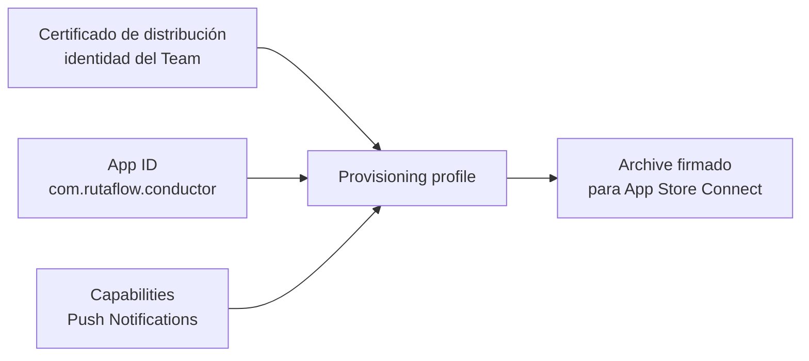
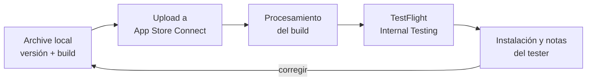
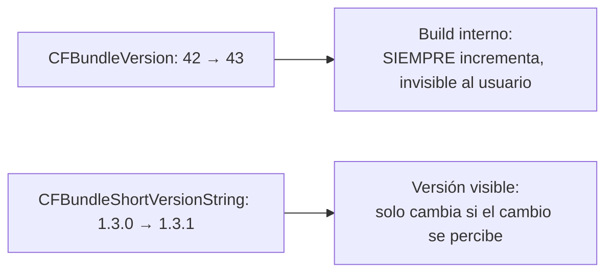

# Módulo 11: Publicación en App Store


**Proyecto del módulo:** para cada práctica, parte de una carpeta vacía y crea en Xcode (File ▸ New ▸ Project ▸ App, interfaz SwiftUI) un proyecto llamado `RutaFlowApp`; escribe manualmente todos los archivos indicados y compila, sin usar proyectos ya preparados.

## Aprende construyendo


### Tema 1: Certificados y provisioning profiles · Intermedio · 45 min

<details open>
<summary><strong>Capa 1 — Lectura</strong></summary>

#### ► DE QUÉ TRATA
Al finalizar vas a configurar firma automática para la app de RutaFlow (com.rutaflow.conductor) y a generar un Archive válido con un certificado de distribución. Prerrequisitos: cuenta de Apple Developer, Módulo 10 completo.

#### ► LA IDEA EN UNA FRASE
**Al finalizar vas a configurar firma automática para la app de RutaFlow (com.rutaflow.conductor) y a generar un Archive válido con un certificado de distribución.**

#### ► POR QUÉ EXISTE ESTO
Resuelve un problema real de diseño o implementación y evita decisiones a ciegas.

#### ► LA ANALOGÍA
Piensa en certificados y provisioning profiles como una herramienta de taller: útil cuando conoces su propósito y sus límites.
**Dónde se rompe la analogía:** en software, los efectos dependen del contexto, la escala y los trade-offs.

#### ► CÓMO FUNCIONA


#### ► LO QUE PUEDE SALIR MAL
| Síntoma | Causa probable | Arreglo |
|---|---|---|
| Certificados y provisioning profiles se aplica pero el resultado no mejora | Se usó sin medir el problema real | Mide antes y compara contra la alternativa simple |
| Aparece complejidad inesperada | Se adoptó la técnica sin comprender sus trade-offs | Vuelve a la sección de trade-offs y reduce el alcance |
| Falla en un caso límite | Se asumió un contexto que no se cumple | Prueba el caso límite y documenta cuándo NO usarlo |

#### ► TRADE-OFFS
| Opción | Cuándo usarla | Cuándo NO usarla |
|---|---|---|
| Usar Certificados y provisioning profiles | Cuando el problema coincide con su propósito y el beneficio es observable | Cuando agrega complejidad sin resolver un problema real |
| Alternativa más simple | Cuando el contexto es pequeño, estable o fácil de razonar | Cuando ya demostró no escalar o no cumplir el requisito |
| Postergar la decisión | Cuando falta evidencia del problema | Cuando el costo de esperar es mayor que el costo de probar |

#### ► CUÁNDO NO USAR ESTO
No uses certificados y provisioning profiles por defecto. Aplícalo cuando el problema lo justifique y puedas verificar el beneficio; si una alternativa más simple resuelve igual, prefiérela.

#### ► DE VUELTA A LA ANALOGÍA
Volviendo a la analogía: certificados y provisioning profiles funciona como el modelo inicial, pero recuerda dónde se rompe: en producción importan la evidencia, la escala y el costo de equivocarte.

#### ► LO QUE DEBES RECORDAR
- Certificados y provisioning profiles existe para resolver un problema específico.
- Mide antes de adoptar complejidad.
- Conoce el caso donde NO usarlo.
- Verifica con evidencia observable.

#### ► PREGUNTAS PARA PENSAR
1. ¿Qué problema concreto resuelve certificados y provisioning profiles en tu contexto?
2. ¿Cómo sabrías que certificados y provisioning profiles no está funcionando bien?
3. ¿Qué alternativa más simple considerarías antes de usar certificados y provisioning profiles?

</details>

<details>
<summary><strong>Capa 2 — Construcción</strong></summary>

#### Código y verificación


```
Certificado de desarrollo   → builds para dispositivos registrados manualmente durante desarrollo
Certificado de distribución → builds para TestFlight y App Store
Provisioning profile        → vincula certificado + App ID + dispositivos autorizados
```

```text
1. En Xcode, Signing & Capabilities -> activá "Automatically manage signing"
2. Bundle Identifier: com.rutaflow.conductor
3. Elegí tu Team (cuenta de Apple Developer)
4. Product > Archive
```

```bash
xcodebuild -scheme RutaFlowApp -destination 'generic/platform=iOS Simulator' build
```

</details>

### Tema 2: Archivar, subir y TestFlight · Intermedio · 40 min

<details open>
<summary><strong>Capa 1 — Lectura</strong></summary>

#### ► DE QUÉ TRATA
Al finalizar vas a subir el Archive de RutaFlow a App Store Connect y a agregarte como tester interno en TestFlight. Prerrequisitos: Tema 1 de este módulo.

#### ► LA IDEA EN UNA FRASE
**Al finalizar vas a subir el Archive de RutaFlow a App Store Connect y a agregarte como tester interno en TestFlight.**

#### ► POR QUÉ EXISTE ESTO
Resuelve un problema real de diseño o implementación y evita decisiones a ciegas.

#### ► LA ANALOGÍA
Piensa en archivar, subir y testflight como una herramienta de taller: útil cuando conoces su propósito y sus límites.
**Dónde se rompe la analogía:** en software, los efectos dependen del contexto, la escala y los trade-offs.

#### ► CÓMO FUNCIONA


#### ► LO QUE PUEDE SALIR MAL
| Síntoma | Causa probable | Arreglo |
|---|---|---|
| Archivar, subir y TestFlight se aplica pero el resultado no mejora | Se usó sin medir el problema real | Mide antes y compara contra la alternativa simple |
| Aparece complejidad inesperada | Se adoptó la técnica sin comprender sus trade-offs | Vuelve a la sección de trade-offs y reduce el alcance |
| Falla en un caso límite | Se asumió un contexto que no se cumple | Prueba el caso límite y documenta cuándo NO usarlo |

#### ► TRADE-OFFS
| Opción | Cuándo usarla | Cuándo NO usarla |
|---|---|---|
| Usar Archivar, subir y TestFlight | Cuando el problema coincide con su propósito y el beneficio es observable | Cuando agrega complejidad sin resolver un problema real |
| Alternativa más simple | Cuando el contexto es pequeño, estable o fácil de razonar | Cuando ya demostró no escalar o no cumplir el requisito |
| Postergar la decisión | Cuando falta evidencia del problema | Cuando el costo de esperar es mayor que el costo de probar |

#### ► CUÁNDO NO USAR ESTO
No uses archivar, subir y testflight por defecto. Aplícalo cuando el problema lo justifique y puedas verificar el beneficio; si una alternativa más simple resuelve igual, prefiérela.

#### ► DE VUELTA A LA ANALOGÍA
Volviendo a la analogía: archivar, subir y testflight funciona como el modelo inicial, pero recuerda dónde se rompe: en producción importan la evidencia, la escala y el costo de equivocarte.

#### ► LO QUE DEBES RECORDAR
- Archivar, subir y TestFlight existe para resolver un problema específico.
- Mide antes de adoptar complejidad.
- Conoce el caso donde NO usarlo.
- Verifica con evidencia observable.

#### ► PREGUNTAS PARA PENSAR
1. ¿Qué problema concreto resuelve archivar, subir y testflight en tu contexto?
2. ¿Cómo sabrías que archivar, subir y testflight no está funcionando bien?
3. ¿Qué alternativa más simple considerarías antes de usar archivar, subir y testflight?

</details>

<details>
<summary><strong>Capa 2 — Construcción</strong></summary>

#### Código y verificación


```
Product → Archive → Distribute App → App Store Connect
```

```
Xcode Archive → App Store Connect → TestFlight (testers internos/externos) → revisión de Apple → App Store pública
```

```text
1. Window > Organizer -> seleccioná el Archive que acabas de crear
2. Distribute App > App Store Connect > Upload
3. En App Store Connect, esperá a que el build termine de procesarse
4. TestFlight > Internal Testing -> agregate como tester
```

```bash
xcodebuild -scheme RutaFlowApp -destination 'generic/platform=iOS Simulator' build
```

</details>

### Tema 3: Metadata y versionado · Intermedio · 45 min

<details open>
<summary><strong>Capa 1 — Lectura</strong></summary>

#### ► DE QUÉ TRATA
Al finalizar vas a completar la metadata obligatoria de RutaFlow en App Store Connect (descripción, capturas, política de privacidad) e incrementar correctamente su versionado. Prerrequisitos: Tema 2 de este módulo.

#### ► LA IDEA EN UNA FRASE
**Al finalizar vas a completar la metadata obligatoria de RutaFlow en App Store Connect (descripción, capturas, política de privacidad) e incrementar correctamente su versionado.**

#### ► POR QUÉ EXISTE ESTO
Resuelve un problema real de diseño o implementación y evita decisiones a ciegas.

#### ► LA ANALOGÍA
`CFBundleShortVersionString` es la versión visible al usuario (semver); `CFBundleVersion` es el número de build interno, que debe incrementarse estrictamente en cada subida — un nombre comercial visible frente a un número de serie interno.
**Conceptos clave:** información obligatoria para la revisión, dos identificadores con propósitos distintos.

App Store Connect requiere completar metadata específica antes de que Apple revise la app: descripción y palabras clave (relevantes para el descubrimiento en la búsqueda de la App Store), capturas de pantalla por cada tamaño de dispositivo soportado, una política de privacidad (obligatoria sin excepción para cualquier app publicada), y la clasificación de edad junto con las respuestas del cuestionario de privacidad que declara explícitamente qué datos recolecta la app y con qué propósito, información que Apple usa para mostrar la etiqueta de privacidad visible a los usuarios antes de descargar la app.

```
CFBundleShortVersionString: 1.3.0   ← versión visible (semver)
CFBundleVersion: 42                  ← número de build, debe incrementar en cada subida
```

`CFBundleShortVersionString` (la versión visible al usuario, típicamente semver) y `CFBundleVersion` (el número de build interno, que debe incrementarse estrictamente en cada subida a App Store Connect) cumplen roles análogos a `versionName` y `versionCode` en Android (Módulo 11 de ese track): uno comunica de forma legible la magnitud del cambio al usuario, el otro es el mecanismo técnico interno que la plataforma usa para ordenar builds inequívocamente y rechazar subidas no incrementales.

**Analogía:** la metadata de App Store Connect es como el expediente completo requerido antes de una inspección oficial: sin cada documento obligatorio (política de privacidad, declaración de qué se recolecta), la inspección ni siquiera puede comenzar formalmente; `CFBundleVersion` es como el número de serie interno incremental de cada lote de producción, mientras `CFBundleShortVersionString` es el nombre comercial visible al consumidor final.

**¿Por qué es importante?** La metadata obligatoria (especialmente la política de privacidad y el cuestionario de privacidad) es un requisito no negociable antes de la revisión; el versionado dual (build interno incremental, versión visible semver) cumple roles distintos y complementarios, igual que en Android.

**Diagrama: dos identificadores, dos propósitos**



En tu propio proyecto RutaFlow, selecciona el proyecto en el navegador de Xcode, abre el target `RutaFlowApp` y configura **Version** (`CFBundleShortVersionString`) y **Build** (`CFBundleVersion`) en la pestaña **General**. El punto de entrada `RutaFlowApp.swift` sigue siendo el archivo Swift que creaste con el proyecto; los valores de versión se editan en el target, no dentro de ese archivo. Antes de archivar, verificá la toolchain con:

```bash
swift --version
```

Práctica: incrementá ambos identificadores para un cambio visible real en tu proyecto propio y confirmá en App Store Connect que el build nuevo aparece disponible para enviar a revisión.

**Diagrama:**

```
CFBundleShortVersionString: "1.3.0"   → visible al usuario, semver
CFBundleVersion: "42"                  → SIEMPRE incremental, uso interno de Apple
```

---

**Dónde se rompe la analogía:** el modelo simplifica la realidad; en producción influyen escala, fallos, costo y contexto.

#### ► CÓMO FUNCIONA


#### ► LO QUE PUEDE SALIR MAL
| Síntoma | Causa probable | Arreglo |
|---|---|---|
| Metadata y versionado se aplica pero el resultado no mejora | Se usó sin medir el problema real | Mide antes y compara contra la alternativa simple |
| Aparece complejidad inesperada | Se adoptó la técnica sin comprender sus trade-offs | Vuelve a la sección de trade-offs y reduce el alcance |
| Falla en un caso límite | Se asumió un contexto que no se cumple | Prueba el caso límite y documenta cuándo NO usarlo |

#### ► TRADE-OFFS
| Opción | Cuándo usarla | Cuándo NO usarla |
|---|---|---|
| Usar Metadata y versionado | Cuando el problema coincide con su propósito y el beneficio es observable | Cuando agrega complejidad sin resolver un problema real |
| Alternativa más simple | Cuando el contexto es pequeño, estable o fácil de razonar | Cuando ya demostró no escalar o no cumplir el requisito |
| Postergar la decisión | Cuando falta evidencia del problema | Cuando el costo de esperar es mayor que el costo de probar |

#### ► CUÁNDO NO USAR ESTO
No uses metadata y versionado por defecto. Aplícalo cuando el problema lo justifique y puedas verificar el beneficio; si una alternativa más simple resuelve igual, prefiérela.

#### ► DE VUELTA A LA ANALOGÍA
Volviendo a la analogía: metadata y versionado funciona como el modelo inicial, pero recuerda dónde se rompe: en producción importan la evidencia, la escala y el costo de equivocarte.

#### ► LO QUE DEBES RECORDAR
- Metadata y versionado existe para resolver un problema específico.
- Mide antes de adoptar complejidad.
- Conoce el caso donde NO usarlo.
- Verifica con evidencia observable.

#### ► PREGUNTAS PARA PENSAR
1. ¿Qué problema concreto resuelve metadata y versionado en tu contexto?
2. ¿Cómo sabrías que metadata y versionado no está funcionando bien?
3. ¿Qué alternativa más simple considerarías antes de usar metadata y versionado?

</details>

<details>
<summary><strong>Capa 2 — Construcción</strong></summary>

#### Código y verificación
```
CFBundleShortVersionString: 1.3.0   ← versión visible (semver)
CFBundleVersion: 42                  ← número de build, debe incrementar en cada subida
```


```bash
swift --version
```

```
CFBundleShortVersionString: "1.3.0"   → visible al usuario, semver
CFBundleVersion: "42"                  → SIEMPRE incremental, uso interno de Apple
```

```text
CFBundleShortVersionString: 1.3.0   ← versión visible (semver), cambia por release
CFBundleVersion: 42                  ← número de build, SIEMPRE incremental
```

```bash
xcodebuild -scheme RutaFlowApp -destination 'generic/platform=iOS Simulator' build
```

</details>
