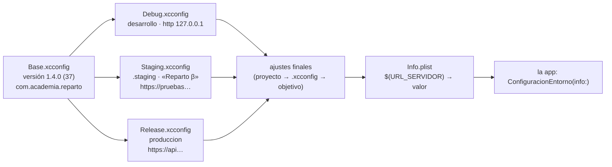
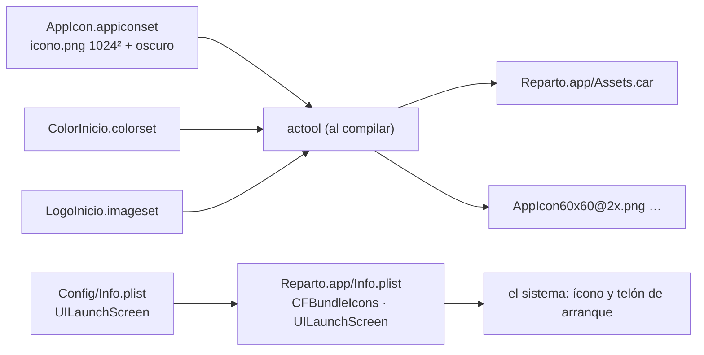
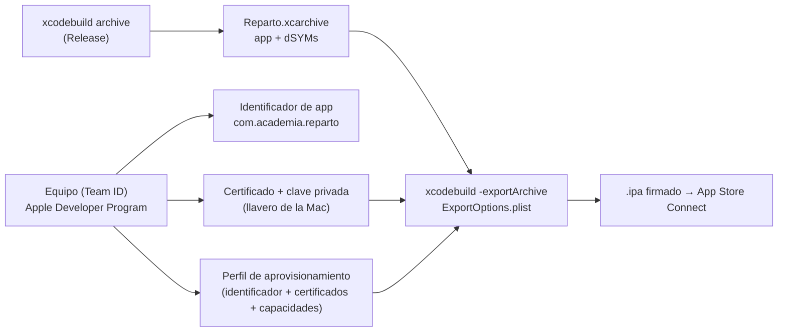
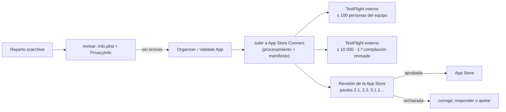

# Módulo 11: Publicación en App Store

**Entorno comprobado para esta edición (2026-11-25):** las reglas que se pueden comprobar sin Xcode (formato de
versión y de número de compilación, configuración del entorno y una revisión del `Info.plist` y del manifiesto de
privacidad antes de subir) se escribieron en un paquete Swift y se probaron con Swift 6.4.3 en Linux x86_64, en
`/home/estudiante/labs/ios/ios11` (tu `~/labs/ios/ios11`). Todo lo que necesita Xcode (archivos `.xcconfig`,
catálogo de recursos, pantalla de inicio, archivar, firmar y exportar) se ejecuta en una Mac con Xcode 27.2 (27B52),
Swift 6.4.2 y el simulador iPhone 17 con iOS 27.2, con el script `mac.sh` del laboratorio. Límites honestos: el
laboratorio **no tiene cuenta del Apple Developer Program**, así que no se sube nada a App Store Connect ni a
TestFlight; esas partes se explican con la documentación oficial de Apple (enlazada en cada tema), y lo que sí se
ejecuta es todo lo anterior a subir, incluidos los errores reales que da Xcode al pedir firma sin cuenta.

Una app que funciona en el simulador todavía no es una app publicada. Hay que darle una versión que App Store
Connect acepte, separar el servidor de pruebas del de producción sin cambiar código, ponerle ícono y pantalla de
inicio, firmarla con la identidad del equipo, declarar qué datos usa y pasar por TestFlight y la revisión de Apple.
Este módulo recorre ese camino con la app de reparto.

**Al terminar este módulo podrás:**
- versionar la app (versión y número de compilación) y separar entornos con archivos `.xcconfig`;
- configurar el ícono y la pantalla de inicio sin storyboard, y comprobar qué quedó en la compilación;
- explicar certificados, perfiles y equipos, archivar la app y leer los errores de firma;
- escribir el manifiesto de privacidad, revisar una compilación antes de subirla y saber qué pasa en TestFlight y
  en la revisión.

**Esquema del módulo:** Tema 1 (versiones y entornos con `.xcconfig`) → Tema 2 (ícono y pantalla de inicio) → Tema 3
(firma, perfiles y archivo) → Tema 4 (manifiesto de privacidad, TestFlight y revisión) → Proyecto 48.

**Qué necesitas saber antes:** del Módulo 1, **la estructura de una app SwiftUI**; del Módulo 10, **las pautas de
interfaz de Apple (HIG)**; del Módulo 9, **las pruebas alojadas en la app**; del Módulo 6, **`UserDefaults`**; del
Módulo 0, **`Comparable` y `struct`**.

**Qué no se repite:** las capas de la app (Módulo 12) y la seguridad en tránsito y el registro (Módulo 13). Aquí la
app es mínima a propósito: una pantalla «Acerca de» que muestra con qué versión, entorno y servidor se compiló.

**Prepara el proyecto:**

```text
$ mkdir -p ~/labs/ios/ios11 && cd ~/labs/ios/ios11
$ mkdir -p nucleo/Sources/{Publicacion,revisar} nucleo/Tests/PublicacionTests ejemplos
```

En la Mac, el laboratorio trae el proyecto de Xcode `Reparto` en `app/`, con tres configuraciones (Debug, Staging y
Release), cada una con su archivo en `app/Config/`. En un proyecto tuyo, la configuración Staging se crea en el
editor del proyecto › Info › Configurations › «+» › Duplicate "Release" Configuration, y cada `.xcconfig` se asigna
en esa misma tabla.

```text
ios11/
├── nucleo/            Publicacion (VersionApp, ConfiguracionEntorno, Revisor) y el programa `revisar`
├── ejemplos/          Info.plist y manifiestos buenos y malos, para el revisor
├── app/Config/        Base, Debug, Staging, Release y Roto .xcconfig · Info.plist
├── app/App/           RepartoApp, Compilacion, PantallaAcerca, Assets.xcassets, PrivacyInfo.xcprivacy
├── app/Pruebas/       CompilacionTests (+ las pruebas del núcleo, copiadas por mac.sh)
├── app/ExportOptions.plist
└── mac.sh
```


## Aprende construyendo


### Tema 1: Versiones, número de compilación y entornos con `.xcconfig` · Intermedio · 45 min

<details open>
<summary><strong>Capa 1 — Lectura</strong></summary>

#### Objetivos
Al terminar este tema podrás:
- distinguir la versión (`CFBundleShortVersionString`) del número de compilación (`CFBundleVersion`) y validar sus
  formatos;
- decidir si una pareja versión/compilación se puede subir después de la última;
- mover los ajustes de cada entorno a archivos `.xcconfig` y leerlos en la app desde el `Info.plist`;
- evitar las dos trampas de los `.xcconfig`: el comentario `//` y la precedencia del objetivo.

**Conceptos clave:** versión, número de compilación, configuración de compilación, archivo `.xcconfig`, sustitución en `Info.plist`

#### El problema
El equipo cambia a mano la URL del servidor antes de cada entrega a pruebas, y una vez se le olvidó volver a
cambiarla: la versión publicada apuntaba al servidor de pruebas. Otra vez subieron «1.4» con el mismo número de
compilación de la anterior y App Store Connect la rechazó. Y la compilación de pruebas no se puede instalar junto a
la de producción en el mismo teléfono, porque tienen el mismo identificador.

Este tema usa **`Comparable` y `struct`** (Módulo 0) y **las pruebas alojadas en la app** (Módulo 9).

#### Glosario del tema

**versión (`CFBundleShortVersionString`)**
- **Definición técnica:** según la [documentación de Apple](https://developer.apple.com/documentation/bundleresources/information-property-list/cfbundleshortversionstring), texto visible para la persona con formato obligatorio de tres enteros separados por puntos (mayor.menor.parche), solo dígitos y puntos; en Xcode es el ajuste `MARKETING_VERSION`.
- **En palabras sencillas:** el número que sale en la App Store: «1.4.0».
- **Dónde se rompe la comparación:** aunque parezca texto, se compara como números: 1.10.0 es mayor que 1.9.0.
- **Ejemplo:** `MARKETING_VERSION = 1.4.0` en `Base.xcconfig`.
- **Error típico:** «1.4», «v1.4.0» o «1.4.0-beta».

**número de compilación (`CFBundleVersion`)**
- **Definición técnica:** según la [documentación de Apple](https://developer.apple.com/documentation/bundleresources/information-property-list/cfbundleversion), texto de uno a tres enteros separados por puntos (los que faltan valen cero) que identifica una compilación concreta; lo exige la App Store. En Xcode es `CURRENT_PROJECT_VERSION`.
- **En palabras sencillas:** el número de la tanda: la 1.4.0 puede tener las tandas 37, 38, 39…
- **Dónde se rompe la comparación:** no lo ve la persona usuaria, pero sí App Store Connect: cada subida de la misma versión necesita uno mayor.
- **Ejemplo:** `CURRENT_PROJECT_VERSION = 37`.
- **Error típico:** subir dos veces la 37 de la 1.4.0 (App Store Connect la rechaza como subida repetida, el error que los foros de Apple reportan como «ITMS-4238: Redundant Binary Upload»).

**configuración de compilación**
- **Definición técnica:** conjunto de ajustes con nombre (Debug, Release y las que agregues, como Staging) con el que Xcode compila; `xcodebuild -configuration Staging` elige una.
- **En palabras sencillas:** la receta del mismo plato en versión «para probar» y «para servir».
- **Dónde se rompe la comparación:** no cambia el código fuente, solo los ajustes; si necesitas otro código, usa `#if` con una condición de compilación.
- **Ejemplo:** Staging tiene otro identificador (`com.academia.reparto.staging`) y otro nombre («Reparto β»).
- **Error típico:** un `if entorno == "pruebas"` en el código con el valor escrito a mano.

**archivo `.xcconfig`**
- **Definición técnica:** archivo de texto con líneas `AJUSTE = valor` que se asigna a una configuración; admite `#include`, `$(OTRO_AJUSTE)` y comentarios con `//` ([documentación de Xcode](https://developer.apple.com/documentation/xcode/adding-a-build-configuration-file-to-your-project)).
- **En palabras sencillas:** la receta escrita en un papel que se revisa como el código.
- **Dónde se rompe la comparación:** según esa documentación, Xcode aplica primero los ajustes del proyecto, después el `.xcconfig` y **al final los del objetivo**: un valor puesto en la pestaña Build Settings del objetivo gana sobre el archivo.
- **Ejemplo:** `Staging.xcconfig` incluye `Base.xcconfig` y cambia solo cuatro líneas.
- **Error típico:** escribir `https://` en un `.xcconfig`: `//` empieza un comentario y la URL queda en `https:`.

**sustitución en `Info.plist`**
- **Definición técnica:** al compilar, Xcode reemplaza `$(AJUSTE)` en el `Info.plist` por el valor del ajuste, y la app lo lee con `Bundle.main.object(forInfoDictionaryKey:)` o `infoDictionary`.
- **En palabras sencillas:** el `.xcconfig` llena los espacios en blanco del formulario.
- **Dónde se rompe la comparación:** los valores quedan en texto plano dentro de la app: nada de secretos ahí.
- **Ejemplo:** `<string>$(URL_SERVIDOR)</string>` → `https://api.reparto.example` en Release.
- **Error típico:** leer el valor en cada pantalla en lugar de validarlo una vez al arrancar (`ConfiguracionEntorno`).

#### ► CÓMO FUNCIONA

##### 1. La idea en lenguaje sencillo

Piensa en un libro que se reimprime. La portada dice «segunda edición»: eso es lo que ve el lector. En la
imprenta, cada tirada lleva además un número interno, porque de la segunda edición puede haber cinco tiradas con
correcciones. Y la editorial imprime pruebas en papel barato antes de la tirada final, sin reescribir el libro.

Una app tiene las mismas tres ideas. La **versión** es la edición que ve la persona en la App Store. El **número
de compilación** identifica cada tirada que subes. Y los **entornos** (desarrollo, pruebas, producción) son la
misma app compilada con otra receta: otro servidor, otro nombre, otro identificador.

El problema del tema nace de mezclar las tres. El equipo cambiaba la URL a mano y un día publicó la app apuntando
al servidor de pruebas. Aquí aprendes a sacar esos valores del código y a ponerlos en archivos de configuración
revisables.

##### 2. Definición formal y vocabulario

La **versión** es la clave `CFBundleShortVersionString` del `Info.plist`. Según Apple, son exactamente tres
enteros separados por puntos: mayor, menor y parche. En Xcode la produce el ajuste `MARKETING_VERSION`.

El **número de compilación** es la clave `CFBundleVersion`: de uno a tres enteros separados por puntos, y los que
faltan valen cero. En Xcode la produce `CURRENT_PROJECT_VERSION`. App Store Connect exige que cada subida de una
misma versión traiga uno mayor.

Una **configuración de compilación** es un conjunto de ajustes con nombre: Debug, Release y las que agregues, como
Staging. `xcodebuild -configuration Staging` elige cuál usar. No cambia el código fuente; cambia los ajustes con
que se compila.

Un **archivo `.xcconfig`** guarda ajustes como líneas `AJUSTE = valor`, en texto plano. Lo asignas a una
configuración y Xcode lo combina con el resto de ajustes. Admite `#include`, referencias `$(OTRO)` y comentarios
que empiezan con `//`.

La **sustitución en `Info.plist`** ocurre al compilar: cada `$(AJUSTE)` del `Info.plist` se reemplaza por su valor
final. La app lee el resultado en tiempo de ejecución con `Bundle.main`.

##### 3. Cómo funciona por dentro, paso a paso

El valor viaja del archivo de texto a la app instalada:



1. **Xcode elige la configuración.** El esquema dice cuál: Debug al ejecutar, Release al archivar. Con
   `xcodebuild` la eliges con `-configuration`.
2. **Lee el `.xcconfig` asignado.** Primero resuelve los `#include`, en orden. Si un ajuste aparece dos veces, gana
   la última línea. Así `Staging.xcconfig` incluye `Base.xcconfig` y redefine solo cuatro ajustes:

```text
#include "Base.xcconfig"
PRODUCT_BUNDLE_IDENTIFIER = com.academia.reparto.staging
NOMBRE_ENTORNO = pruebas
URL_SERVIDOR = https:/$()/pruebas.reparto.example
```

3. **Apila los niveles.** Con un `.xcconfig` en el objetivo, Xcode aplica primero los ajustes del proyecto.
   Después aplica los del archivo y al final los de la pestaña Build Settings del objetivo. El último nivel que
   define un ajuste gana, según la documentación de Xcode.
4. **Resuelve las referencias.** Cada `$(NOMBRE)` se reemplaza por el valor final de ese ajuste. `$()` es una
   referencia a un ajuste vacío: no aporta nada, pero separa las dos barras para que `//` no abra un comentario.
5. **Genera el `Info.plist`.** Mezcla tu archivo con las claves que produce a partir de ajustes como
   `INFOPLIST_KEY_CFBundleDisplayName`, y sustituye los `$(…)`. El resultado queda dentro del paquete `.app`.
6. **La app lo lee y lo valida una vez.** El tipo del núcleo convierte el diccionario en un valor con tipos.

```swift
let entorno = try ConfiguracionEntorno(info: Bundle.main.infoDictionary ?? [:])
print(entorno.nombre, entorno.servidor)
```

   Si la URL llega como `https:`, el inicializador lanza `urlCortada` al arrancar, no en la primera petición. Usa
   `throws(Problema)`, los errores con tipo del Módulo 5, Tema 1.

##### 4. Reglas, variantes y casos límite

**Formatos exactos.** «1.4», «v1.4.0» y «1.4.0-beta» no son versiones válidas: Apple pide tres enteros, solo
dígitos y puntos. Para el número de compilación, «37» equivale a «37.0.0». La comparación es numérica, parte por
parte: 1.10.0 es mayor que 1.9.0, aunque como texto ocurra lo contrario.

**Qué se puede subir.** Una versión mayor puede volver a empezar la numeración de compilaciones. La misma versión
necesita una compilación mayor que la última aceptada. Repetir la pareja es una subida redundante y se rechaza.

**El comentario `//`.** Según la documentación de Xcode, todo lo que sigue a `//` es comentario hasta el
final de la línea. Por eso `https://api…` queda en `https:` sin ningún aviso. La salida
real con `Roto.xcconfig` lo muestra.

**La pestaña del objetivo gana.** Si `MARKETING_VERSION` sigue escrito en Build Settings del objetivo, tu
`.xcconfig` no tiene efecto. Al migrar, borra esos valores del objetivo; `xcodebuild -showBuildSettings` te dice el
valor final.

**Ajustes condicionales.** Un ajuste admite condiciones entre corchetes, como `[config=Debug]`, `[sdk=iphoneos*]`
o `[arch=arm64]`. Úsalas con moderación: un archivo por configuración se lee mejor.

**Código distinto por entorno.** Si de verdad necesitas otro código, usa `#if DEBUG` o una condición propia en
`SWIFT_ACTIVE_COMPILATION_CONDITIONS`. No compares textos como `entorno == "pruebas"` escritos a mano.

**Nada secreto.** Todo lo que llega al `Info.plist` viaja en texto plano dentro de la app. Una clave de API ahí la
lee cualquiera que descargue la app. Los secretos van al llavero, como verás en el Módulo 13, Tema 1.

**Identificadores distintos.** Staging usa `com.academia.reparto.staging`. Por eso las dos apps conviven en el
mismo teléfono: para iOS son apps diferentes, con datos separados.

##### 5. Relación con lo que ya sabes y lo que viene

`VersionApp` y `NumeroCompilacion` aplican `Comparable` del Módulo 0. Implementas `<` con
`lexicographicallyPrecedes` y obtienes gratis `>`, `<=` y la ordenación. La prueba que lee `Bundle.main` es una
prueba alojada del Módulo 9: en el simulador, el paquete principal es la app anfitriona compilada.

No confundas un `.xcconfig` con `UserDefaults`, del Módulo 6. El `.xcconfig` fija valores al compilar y no cambian
en el teléfono; `UserDefaults` guarda preferencias que la app cambia mientras corre.

Lo que sigue usa estos ajustes. El Tema 2 agrega `ASSETCATALOG_COMPILER_APPICON_NAME` y la pantalla de inicio al
mismo `Info.plist`. El Tema 3 archiva con la configuración Release, y el Tema 4 revisa ese `Info.plist` antes de
subirlo. En el Módulo 12, Tema 2, `ClienteAPI(base:)` recibe una URL base, el valor que aquí sale de la configuración.

#### Problema resuelto 1.1
Escribe las reglas de versión y entorno en el paquete, pruébalas en Linux y configura la app con tres entornos en
archivos `.xcconfig`. En la Mac, comprueba el valor final de cada ajuste en cada configuración, provoca la URL
cortada y mira qué quedó dentro de la app compilada en Debug y en Staging.

**Razonamiento:**
1. `VersionApp` exige exactamente tres enteros y `NumeroCompilacion` de uno a tres (rellenando con ceros), como dice
   la documentación de Apple; los dos se comparan como listas de números.
2. `Subida.evaluar` aplica la regla práctica: versión mayor, o misma versión con compilación mayor.
3. `ConfiguracionEntorno` valida al leer: si la URL termina en `:` es casi seguro el comentario `//` del
   `.xcconfig`, y fuera de «desarrollo» exige `https`.
4. En los `.xcconfig`, la URL se escribe `https:/$()/…`: `$()` es un ajuste vacío que separa las dos barras.
5. El objetivo de la app ya no tiene `PRODUCT_BUNDLE_IDENTIFIER`, `MARKETING_VERSION` ni
   `CURRENT_PROJECT_VERSION`: si los tuviera, ganarían sobre los archivos.

```swift
// swift-tools-version: 6.0
// Reglas de publicación que se pueden comprobar sin Xcode: versiones, entorno e Info.plist/privacidad.
import PackageDescription

let package = Package(
    name: "Publicacion",
    platforms: [.macOS(.v15), .iOS(.v18)],
    targets: [
        .target(name: "Publicacion"),
        .executableTarget(name: "revisar", dependencies: ["Publicacion"]),
        .testTarget(name: "PublicacionTests", dependencies: ["Publicacion"]),
    ]
)
```

```swift
// Version.swift — CFBundleShortVersionString (la versión que ve la gente) y CFBundleVersion (la compilación).

/// «1.4.0»: según Apple, exactamente tres enteros separados por puntos, solo dígitos y puntos.
public struct VersionApp: Comparable, Sendable, CustomStringConvertible {
    public let partes: [Int]

    public init?(_ texto: String) {
        guard let partes = enteros(texto, minimo: 3, maximo: 3) else { return nil }
        self.partes = partes
    }

    public var description: String { partes.map(String.init).joined(separator: ".") }
    public static func < (a: VersionApp, b: VersionApp) -> Bool { a.partes.lexicographicallyPrecedes(b.partes) }
}

/// «37» o «37.1»: de uno a tres enteros; los que faltan cuentan como cero (37 = 37.0.0).
public struct NumeroCompilacion: Comparable, Sendable, CustomStringConvertible {
    public let partes: [Int]

    public init?(_ texto: String) {
        guard let leidas = enteros(texto, minimo: 1, maximo: 3) else { return nil }
        partes = leidas + Array(repeating: 0, count: 3 - leidas.count)
    }

    public var description: String { partes.map(String.init).joined(separator: ".") }
    public static func < (a: NumeroCompilacion, b: NumeroCompilacion) -> Bool {
        a.partes.lexicographicallyPrecedes(b.partes)
    }
}

/// ¿Se puede subir esta pareja después de la última que aceptó App Store Connect?
public enum Subida: Equatable, Sendable {
    case nuevaVersion  // versión mayor: la compilación puede volver a empezar
    case nuevaCompilacion  // misma versión, compilación mayor (otra prueba en TestFlight)
    case rechazada(String)

    public static func evaluar(
        _ version: VersionApp, _ compilacion: NumeroCompilacion,
        despuesDe ultima: (VersionApp, NumeroCompilacion)
    ) -> Subida {
        if version > ultima.0 { return .nuevaVersion }
        if version < ultima.0 { return .rechazada("la versión \(version) es menor que la publicada \(ultima.0)") }
        if compilacion > ultima.1 { return .nuevaCompilacion }
        return .rechazada("la compilación \(compilacion) ya se usó o es menor que \(ultima.1) para la \(version)")
    }
}

private func enteros(_ texto: String, minimo: Int, maximo: Int) -> [Int]? {
    let trozos = texto.split(separator: ".", omittingEmptySubsequences: false)
    guard (minimo...maximo).contains(trozos.count) else { return nil }
    var resultado: [Int] = []
    for t in trozos {
        guard !t.isEmpty, t.allSatisfy({ $0.isASCII && $0.isNumber }), let n = Int(t) else { return nil }
        resultado.append(n)
    }
    return resultado
}
```

```swift
// Entorno.swift — lo que la app lee de su Info.plist para saber en qué entorno corre.
import Foundation

public struct ConfiguracionEntorno: Equatable, Sendable {
    public let nombre: String  // «desarrollo», «pruebas», «produccion»
    public let servidor: URL

    public enum Problema: Error, Equatable {
        case falta(String)
        case urlInvalida(String)
        case urlCortada(String)  // «https:»: el resto se lo comió un // en un .xcconfig
        case sinHTTPS(String)
    }

    /// `info` es `Bundle.main.infoDictionary` en la app, o un plist leído del disco en las pruebas.
    public init(info: [String: Any]) throws(Problema) {
        guard let nombre = info["NombreEntorno"] as? String, !nombre.isEmpty else { throw .falta("NombreEntorno") }
        guard let texto = info["URLServidor"] as? String, !texto.isEmpty else { throw .falta("URLServidor") }
        if texto.hasSuffix(":") { throw .urlCortada(texto) }
        guard let url = URL(string: texto), let esquema = url.scheme, url.host != nil else {
            throw .urlInvalida(texto)
        }
        if nombre != "desarrollo" && esquema != "https" { throw .sinHTTPS(texto) }
        self.nombre = nombre
        servidor = url
    }
}
```

```swift
// VersionTests.swift — formatos de versión y compilación, y qué se puede subir después de qué.
import Testing

@testable import Publicacion

@Test(arguments: ["1.4.0", "10.14.1", "0.0.1"])
func versionesValidas(_ texto: String) {
    #expect(VersionApp(texto)?.description == texto)
}

@Test(arguments: ["1.4", "1.4.0.2", "1.4.0-beta", "v1.4.0", "1..0", "1.4.0 ", "١.٤.٠"])
func versionesInvalidas(_ texto: String) {
    #expect(VersionApp(texto) == nil)
}

@Test func compilacionCompletaConCeros() {
    #expect(NumeroCompilacion("37")?.description == "37.0.0")
    #expect(NumeroCompilacion("37.1")! > NumeroCompilacion("37")!)
    #expect(NumeroCompilacion("37b") == nil)
}

@Test func laComparacionEsNumericaNoDeTexto() {
    #expect(VersionApp("1.10.0")! > VersionApp("1.9.0")!)  // como texto, "1.10.0" < "1.9.0"
    #expect(NumeroCompilacion("100")! > NumeroCompilacion("99")!)
}

@Test func reglasDeSubida() {
    let ultima = (VersionApp("1.4.0")!, NumeroCompilacion("37")!)
    #expect(Subida.evaluar(VersionApp("1.4.0")!, NumeroCompilacion("38")!, despuesDe: ultima) == .nuevaCompilacion)
    #expect(Subida.evaluar(VersionApp("1.5.0")!, NumeroCompilacion("1")!, despuesDe: ultima) == .nuevaVersion)
    #expect(
        Subida.evaluar(VersionApp("1.4.0")!, NumeroCompilacion("37")!, despuesDe: ultima)
            == .rechazada("la compilación 37.0.0 ya se usó o es menor que 37.0.0 para la 1.4.0"))
}
```

Las pruebas del paquete en Linux (las de este tema son las de versión, compilación, subida y entorno; las del
revisor son del Tema 4):

```text
$ swift test 2>&1 | grep -E '✔ Test|✘|error:'
✔ Test motivoQueNoEsDeUserDefaults() passed after 0.001 seconds.
✔ Test entornoDeProduccion() passed after 0.002 seconds.
✔ Test sinManifiestoEsError() passed after 0.001 seconds.
✔ Test httpSoloEnDesarrollo() passed after 0.002 seconds.
✔ Test compilacionCompletaConCeros() passed after 0.001 seconds.
✔ Test versionesInvalidas(_:) with 7 test cases passed after 0.001 seconds.
✔ Test laComparacionEsNumericaNoDeTexto() passed after 0.001 seconds.
✔ Test reglasDeSubida() passed after 0.001 seconds.
✔ Test compilacionBuenaSinHallazgos() passed after 0.001 seconds.
✔ Test versionesValidas(_:) with 3 test cases passed after 0.001 seconds.
✔ Test urlCortadaPorElComentario() passed after 0.001 seconds.
✔ Test run with 11 tests in 0 suites passed after 0.002 seconds.
```

Los archivos de configuración y el `Info.plist`:

```text
// Base.xcconfig — lo común a todos los entornos. Debug, Staging y Release lo incluyen y cambian solo lo suyo.

// Versión que ve la gente (tres enteros) y número de compilación (sube en cada subida).
MARKETING_VERSION = 1.4.0
CURRENT_PROJECT_VERSION = 37

PRODUCT_BUNDLE_IDENTIFIER = com.academia.reparto
INFOPLIST_KEY_CFBundleDisplayName = Reparto
INFOPLIST_FILE = Config/Info.plist
ASSETCATALOG_COMPILER_APPICON_NAME = AppIcon

// Ajustes propios: Info.plist los lee como $(NOMBRE_ENTORNO) y $(URL_SERVIDOR).
NOMBRE_ENTORNO = desarrollo
// En un .xcconfig, // abre un comentario: la URL se parte con $() para que las dos barras sobrevivan.
URL_SERVIDOR = http:/$()/127.0.0.1:8242
```

```text
// Staging.xcconfig — la compilación de pruebas: otro identificador y otro nombre, para instalarla junto a la real.
#include "Base.xcconfig"

PRODUCT_BUNDLE_IDENTIFIER = com.academia.reparto.staging
INFOPLIST_KEY_CFBundleDisplayName = Reparto β
NOMBRE_ENTORNO = pruebas
URL_SERVIDOR = https:/$()/pruebas.reparto.example
```

```text
// Release.xcconfig — la que se archiva y se sube a App Store Connect.
#include "Base.xcconfig"

NOMBRE_ENTORNO = produccion
URL_SERVIDOR = https:/$()/api.reparto.example
```

```text
// Roto.xcconfig — ERROR A PROPÓSITO: la URL escrita como en cualquier otro archivo.
#include "Release.xcconfig"

URL_SERVIDOR = https://api.reparto.example
```

```text
<?xml version="1.0" encoding="UTF-8"?>
<!DOCTYPE plist PUBLIC "-//Apple//DTD PLIST 1.0//EN" "http://www.apple.com/DTDs/PropertyList-1.0.dtd">
<plist version="1.0">
<dict>
	<!-- Xcode mezcla este archivo con las claves que genera (INFOPLIST_KEY_…) y reemplaza los $(…). -->
	<key>NombreEntorno</key>
	<string>$(NOMBRE_ENTORNO)</string>
	<key>URLServidor</key>
	<string>$(URL_SERVIDOR)</string>
	<!-- Pantalla de inicio sin storyboard: un color y una imagen del catálogo de recursos. -->
	<key>UILaunchScreen</key>
	<dict>
		<key>UIColorName</key>
		<string>ColorInicio</string>
		<key>UIImageName</key>
		<string>LogoInicio</string>
	</dict>
</dict>
</plist>
```

La app lee su propia compilación:

```swift
// Compilacion.swift — lo que la app sabe de sí misma, leído de su propio paquete.
import Foundation

struct Compilacion {
    let info: [String: Any]
    let privacidad: [String: Any]?

    /// La compilación que está corriendo: su Info.plist y su PrivacyInfo.xcprivacy.
    static var actual: Compilacion {
        let url = Bundle.main.url(forResource: "PrivacyInfo", withExtension: "xcprivacy")
        let privacidad = url.flatMap { try? Data(contentsOf: $0) }
            .flatMap { try? PropertyListSerialization.propertyList(from: $0, format: nil) as? [String: Any] }
        return Compilacion(info: Bundle.main.infoDictionary ?? [:], privacidad: privacidad)
    }

    func texto(_ clave: String) -> String { info[clave] as? String ?? "—" }
    var version: String { "\(texto("CFBundleShortVersionString")) (\(texto("CFBundleVersion")))" }
    var entorno: Result<ConfiguracionEntorno, ConfiguracionEntorno.Problema> {
        Result { () throws(ConfiguracionEntorno.Problema) in try ConfiguracionEntorno(info: info) }
    }
    var hallazgos: [Hallazgo] { Revisor.revisar(info: info, privacidad: privacidad) }
}
```

```swift
// PantallaAcerca.swift — «Acerca de»: versión, entorno, servidor y la revisión de publicación de esta compilación.
import SwiftUI

struct PantallaAcerca: View {
    let compilacion: Compilacion

    var body: some View {
        NavigationStack {
            List {
                Section("Esta compilación") {
                    LabeledContent("Versión", value: compilacion.version)
                    LabeledContent("Nombre", value: compilacion.texto("CFBundleDisplayName"))
                    LabeledContent("Identificador", value: compilacion.texto("CFBundleIdentifier"))
                }
                Section("Entorno") {
                    switch compilacion.entorno {
                    case .success(let entorno):
                        LabeledContent("Entorno", value: entorno.nombre)
                        LabeledContent("Servidor", value: entorno.servidor.absoluteString)
                    case .failure(let problema):
                        Label("Configuración inválida: \(String(describing: problema))", systemImage: "xmark.octagon")
                            .foregroundStyle(.red)
                    }
                }
                Section("Revisión antes de subir") {
                    LabeledContent(
                        "Manifiesto de privacidad", value: compilacion.privacidad == nil ? "falta" : "incluido")
                    if compilacion.hallazgos.isEmpty {
                        Label("Sin hallazgos", systemImage: "checkmark.seal").foregroundStyle(.green)
                    }
                    ForEach(compilacion.hallazgos, id: \.description) { h in
                        Label(
                            h.description, systemImage: h.nivel == .error ? "xmark.octagon" : "exclamationmark.triangle"
                        )
                        .foregroundStyle(h.nivel == .error ? Color.red : Color.orange)
                    }
                }
            }
            .navigationTitle("Acerca de Reparto")
        }
    }
}
```

```swift
// CompilacionTests.swift — en el simulador, Bundle.main es la app anfitriona: sus valores son los compilados.
import Foundation
import Testing

@testable import Reparto

@Test func laCompilacionDeDebugTraeSusValores() throws {
    let c = Compilacion.actual
    var lineas = ["Bundle.main de la app anfitriona (configuración de las pruebas):"]
    for clave in [
        "CFBundleShortVersionString", "CFBundleVersion", "CFBundleIdentifier", "CFBundleDisplayName",
        "NombreEntorno", "URLServidor",
    ] {
        lineas.append("  \(clave) = \(c.texto(clave))")
    }
    lineas.append("  PrivacyInfo.xcprivacy: \(c.privacidad == nil ? "no está" : "está en el paquete")")
    lineas.append(
        "  revisión: "
            + (c.hallazgos.isEmpty ? "sin hallazgos" : c.hallazgos.map(\.description).joined(separator: " | ")))
    let salida = ProcessInfo.processInfo.environment["SALIDA"] ?? NSTemporaryDirectory()
    try (lineas.joined(separator: "\n") + "\n").write(
        toFile: salida + "/compilacion-debug.txt", atomically: true,
        encoding: .utf8)

    #expect(c.texto("CFBundleShortVersionString") == "1.4.0")
    #expect(c.texto("CFBundleVersion") == "37")
    #expect(c.texto("URLServidor") == "http://127.0.0.1:8242")
    #expect(c.privacidad != nil)
}

@MainActor
@Test func capturaAcerca() throws {
    try capturar(PantallaAcerca(compilacion: .actual), "ios11-acerca-debug")
}
```

En el simulador pasaron las 13 pruebas: las 11 del paquete (copiadas por `mac.sh`) y las dos de la app; esta es la
parte de Swift Testing del registro completo de `xcodebuild test`, que terminó en `** TEST SUCCEEDED **`:

```text
$ grep -E '✔ Test|✘|Test run with' _test.log
✔ Test urlCortadaPorElComentario() passed after 0.007 seconds.
✔ Test httpSoloEnDesarrollo() passed after 0.007 seconds.
✔ Test motivoQueNoEsDeUserDefaults() passed after 0.007 seconds.
✔ Test reglasDeSubida() passed after 0.007 seconds.
✔ Test compilacionCompletaConCeros() passed after 0.007 seconds.
✔ Test laComparacionEsNumericaNoDeTexto() passed after 0.007 seconds.
✔ Test compilacionBuenaSinHallazgos() passed after 0.007 seconds.
✔ Test sinManifiestoEsError() passed after 0.007 seconds.
✔ Test entornoDeProduccion() passed after 0.007 seconds.
✔ Test versionesInvalidas(_:) with 7 test cases passed after 0.007 seconds.
✔ Test versionesValidas(_:) with 3 test cases passed after 0.014 seconds.
✔ Test laCompilacionDeDebugTraeSusValores() passed after 0.014 seconds.
✔ Test capturaAcerca() passed after 0.957 seconds.
✔ Test run with 13 tests in 0 suites passed after 0.959 seconds.
```

En la Mac, el valor final de cada ajuste en cada configuración (`xcodebuild -showBuildSettings`):

```text
$ (cd app && xcodebuild -showBuildSettings -scheme Reparto -configuration Debug 2>/dev/null | grep -E ' (MARKETING_VERSION|CURRENT_PROJECT_VERSION|PRODUCT_BUNDLE_IDENTIFIER|INFOPLIST_KEY_CFBundleDisplayName|NOMBRE_ENTORNO|URL_SERVIDOR) = ')
    CURRENT_PROJECT_VERSION = 37
    INFOPLIST_KEY_CFBundleDisplayName = Reparto
    MARKETING_VERSION = 1.4.0
    NOMBRE_ENTORNO = desarrollo
    PRODUCT_BUNDLE_IDENTIFIER = com.academia.reparto
    URL_SERVIDOR = http://127.0.0.1:8242
```

```text
$ (cd app && xcodebuild -showBuildSettings -scheme Reparto -configuration Staging 2>/dev/null | grep -E ' (MARKETING_VERSION|CURRENT_PROJECT_VERSION|PRODUCT_BUNDLE_IDENTIFIER|INFOPLIST_KEY_CFBundleDisplayName|NOMBRE_ENTORNO|URL_SERVIDOR) = ')
    CURRENT_PROJECT_VERSION = 37
    INFOPLIST_KEY_CFBundleDisplayName = Reparto β
    MARKETING_VERSION = 1.4.0
    NOMBRE_ENTORNO = pruebas
    PRODUCT_BUNDLE_IDENTIFIER = com.academia.reparto.staging
    URL_SERVIDOR = https://pruebas.reparto.example
```

```text
$ (cd app && xcodebuild -showBuildSettings -scheme Reparto -configuration Release 2>/dev/null | grep -E ' (MARKETING_VERSION|CURRENT_PROJECT_VERSION|PRODUCT_BUNDLE_IDENTIFIER|INFOPLIST_KEY_CFBundleDisplayName|NOMBRE_ENTORNO|URL_SERVIDOR) = ')
    CURRENT_PROJECT_VERSION = 37
    INFOPLIST_KEY_CFBundleDisplayName = Reparto
    MARKETING_VERSION = 1.4.0
    NOMBRE_ENTORNO = produccion
    PRODUCT_BUNDLE_IDENTIFIER = com.academia.reparto
    URL_SERVIDOR = https://api.reparto.example
```

Con la URL escrita como en cualquier otro archivo (`Roto.xcconfig`):

```text
$ (cd app && xcodebuild -showBuildSettings -scheme Reparto -configuration Release -xcconfig Config/Roto.xcconfig 2>/dev/null | grep -E ' (MARKETING_VERSION|CURRENT_PROJECT_VERSION|PRODUCT_BUNDLE_IDENTIFIER|INFOPLIST_KEY_CFBundleDisplayName|NOMBRE_ENTORNO|URL_SERVIDOR) = ')
    CURRENT_PROJECT_VERSION = 37
    INFOPLIST_KEY_CFBundleDisplayName = Reparto
    MARKETING_VERSION = 1.4.0
    NOMBRE_ENTORNO = produccion
    PRODUCT_BUNDLE_IDENTIFIER = com.academia.reparto
    URL_SERVIDOR = https:
    CURRENT_PROJECT_VERSION = 37
    INFOPLIST_KEY_CFBundleDisplayName = Reparto
    MARKETING_VERSION = 1.4.0
    NOMBRE_ENTORNO = produccion
    PRODUCT_BUNDLE_IDENTIFIER = com.academia.reparto
    URL_SERVIDOR = https:
```

Lo que quedó dentro de la app compilada para las pruebas, y dentro de la de Staging:

```text
Bundle.main de la app anfitriona (configuración de las pruebas):
  CFBundleShortVersionString = 1.4.0
  CFBundleVersion = 37
  CFBundleIdentifier = com.academia.reparto
  CFBundleDisplayName = Reparto
  NombreEntorno = desarrollo
  URLServidor = http://127.0.0.1:8242
  PrivacyInfo.xcprivacy: está en el paquete
  revisión: AVISO NombreEntorno: es «desarrollo»: no es una compilación para subir
```

```text
$ plutil -p "$STG/Info.plist" | grep -E "CFBundle(ShortVersionString|Version|Identifier|DisplayName)|NombreEntorno|URLServidor"
  "CFBundleDisplayName" => "Reparto β"
  "CFBundleIdentifier" => "com.academia.reparto.staging"
  "CFBundleShortVersionString" => "1.4.0"
  "CFBundleVersion" => "37"
  "NombreEntorno" => "pruebas"
  "URLServidor" => "https://pruebas.reparto.example"
```


Y lo que pasa con una constante global de tipo `[String: Any]` en modo Swift 6 (al escribir las pruebas del
revisor apareció este error; la variante está en `errores/global-no-sendable`):

```swift
// Una constante global de tipo [String: Any]: Any puede ser una clase mutable, así que no es Sendable.
let infoBuena: [String: Any] = ["CFBundleShortVersionString": "1.4.0", "CFBundleVersion": "37"]
```

```text
$ swift build 2>&1 | grep -E '^/.*error:' | sed 's#.*/Sources/#Sources/#'
Sources/P/Datos.swift:2:5: error: let 'infoBuena' is not concurrency-safe because non-'Sendable' type '[String : Any]' may have shared mutable state [#MutableGlobalVariable]
```

**Explicación por partes.**
- **Linux:** `versionesInvalidas` rechaza los 7 casos, incluido «١.٤.٠» (dígitos arábigos, que `isNumber` acepta
  pero no son ASCII); `laComparacionEsNumericaNoDeTexto` confirma que 1.10.0 > 1.9.0; `reglasDeSubida` rechaza volver
  a subir la 37 de la 1.4.0.
- **`-showBuildSettings`:** las tres configuraciones comparten `MARKETING_VERSION = 1.4.0` y
  `CURRENT_PROJECT_VERSION = 37` (vienen de `Base.xcconfig`); Staging cambia el identificador a
  `com.academia.reparto.staging`, el nombre a «Reparto β», el entorno a `pruebas` y la URL a
  `https://pruebas.reparto.example`; Release queda en `produccion` con `https://api.reparto.example`. Las dos barras
  sobrevivieron gracias a `$()`.
- **La URL cortada:** con `Roto.xcconfig`, `URL_SERVIDOR = https:`. Xcode no da ningún aviso: el resto de la línea era
  un comentario. (El bloque sale dos veces porque `-showBuildSettings` lista también el objetivo de pruebas, al que la
  opción `-xcconfig` de la orden se aplica igual.)
- **Dentro de la app:** `compilacion-debug.txt` muestra que el `$(URL_SERVIDOR)` del `Info.plist` llegó sustituido
  (`http://127.0.0.1:8242`), que `PrivacyInfo.xcprivacy` está en el paquete y que la revisión da un solo aviso:
  «es «desarrollo»: no es una compilación para subir». En Staging (`info-staging.txt`) el identificador, el nombre, el
  entorno y la URL son los de pruebas, con la misma versión 1.4.0 (37). `simulador-apps.txt` confirma que las dos
  apps están instaladas a la vez (el nombre aparece escapado como `Reparto \U03b2`, que es la β).
- **Las capturas:** la app instalada (Debug) muestra 1.4.0 (37), `com.academia.reparto`, entorno `desarrollo` y el
  aviso naranja; la de Staging, «Reparto β», `com.academia.reparto.staging`, `pruebas` y «Sin hallazgos» en verde.
- **El error de Swift 6:** `Any` puede contener una clase mutable, así que un `[String: Any]` no es `Sendable` y
  una constante global de ese tipo podría leerse desde dos hilos. En las pruebas del revisor, esos diccionarios son
  variables calculadas (`var infoBuena: [String: Any] { … }`), que se crean de nuevo en cada uso.

> **Error común.** Escribir una URL tal cual en un `.xcconfig`. Todo lo que sigue a `//` es comentario, la URL queda
> en `https:` y la app compila sin quejarse. Escríbela `https:/$()/api.reparto.example`, y valida la URL al arrancar
> (`ConfiguracionEntorno` da `urlCortada`).

> **Error común.** Dejar `MARKETING_VERSION` o `PRODUCT_BUNDLE_IDENTIFIER` en la pestaña Build Settings del objetivo
> después de crear los `.xcconfig`. Los ajustes del objetivo se aplican al final y ganan: cambias el archivo y la
> compilación no se entera. Borra el valor del objetivo (tecla Suprimir sobre el ajuste) para que herede del archivo.

> **Buena práctica.** Dale a cada entorno su identificador y su nombre visible («Reparto β»). Se pueden instalar las
> dos en el mismo teléfono, y nadie confunde la de pruebas con la real.

> **Prevenir errores.** Revisa los ajustes finales con `xcodebuild -showBuildSettings -configuration Release` antes
> de archivar, y haz que la app valide su configuración al arrancar en una prueba como `CompilacionTests`.

#### Checkpoint 1.1
La última subida fue la 1.4.0 (37). ¿Se puede subir la 1.4.0 (37.1)? ¿Y la 1.3.9 (40)?

Respuesta: la 1.4.0 (37.1) sí: misma versión y 37.1.0 > 37.0.0. La 1.3.9 (40) no: la versión es menor que la
publicada, sin importar el número de compilación.

</details>

<details>
<summary><strong>Capa 2 — Construcción</strong></summary>

#### Paso 1 · Las reglas
Crea el paquete, `Version.swift`, `Entorno.swift` y `VersionTests.swift`, y ejecuta `swift test`.

#### Paso 2 · Los archivos
Crea `Base`, `Debug`, `Staging` y `Release.xcconfig` y el `Info.plist`; en Xcode, duplica la configuración Release
como Staging y asigna cada archivo a su configuración del objetivo de la app.

#### Paso 3 · Comprueba los valores finales
Ejecuta `xcodebuild -showBuildSettings -scheme Reparto -configuration Staging | grep URL_SERVIDOR` en `app/`.

#### Paso 4 · La URL cortada
Usa `Roto.xcconfig` con `-xcconfig Config/Roto.xcconfig` en la orden anterior y compara.

#### Paso 5 · Las dos apps juntas
Compila e instala Debug y Staging en el simulador (`xcodebuild build -configuration Staging …` y
`xcrun simctl install`). ¿Cuántas apps «Reparto» aparecen?

#### Resumen
- La **versión** son tres enteros; el **número de compilación**, de uno a tres, y sube en cada subida.
- Cada **configuración de compilación** tiene su **archivo `.xcconfig`**, que incluye una base común.
- La **sustitución en `Info.plist`** lleva los valores a la app, que los valida al arrancar.
- `//` es comentario en un `.xcconfig`, y los ajustes del objetivo ganan sobre el archivo.

#### Ejercicio verificable 1
Básico. ¿Es válida «1.4» como `CFBundleShortVersionString`? ¿Y como `CFBundleVersion`?

Respuesta esperada: como versión, no (son dos enteros y se exigen tres); como número de compilación, sí (equivale a
1.4.0).

#### Ejercicio verificable 2
Intermedio. ¿Qué devuelve `Subida.evaluar(1.4.0, 37, despuesDe: (1.4.0, 37))`?

Respuesta esperada: `.rechazada("la compilación 37.0.0 ya se usó o es menor que 37.0.0 para la 1.4.0")`.

#### Ejercicio verificable 3
Reto. ¿Qué error da `ConfiguracionEntorno` con `NombreEntorno = "pruebas"` y `URLServidor =
"http://127.0.0.1:8242"`?

Respuesta esperada: `.sinHTTPS("http://127.0.0.1:8242")`: fuera de «desarrollo» se exige https (prueba
`httpSoloEnDesarrollo`, que usa «produccion»; con «pruebas» la regla es la misma).

#### En el trabajo
Los equipos guardan los `.xcconfig` en el repositorio y los revisan como código; el número de compilación lo pone
la integración continua (por ejemplo, el número de la ejecución) para que nunca se repita, y la versión la decide
quien publica.

</details>

### Tema 2: Ícono y pantalla de inicio · Básico · 30 min

<details open>
<summary><strong>Capa 1 — Lectura</strong></summary>

#### Objetivos
Al terminar este tema podrás:
- crear el ícono de la app en un catálogo de recursos con una sola imagen de 1024 × 1024, y sus variantes oscura y
  tintada;
- configurar la pantalla de inicio con `UILaunchScreen` (color e imagen), sin storyboard;
- comprobar qué generó Xcode dentro de la app compilada;
- explicar por qué la pantalla de inicio no es una pantalla de presentación.

**Conceptos clave:** catálogo de recursos, ícono de una sola imagen, variantes de apariencia, `UILaunchScreen`, arranque

#### El problema
La app de pruebas tiene el ícono en blanco de Xcode, y alguien propone «una pantalla de bienvenida de 3 segundos con
el logo» para que se vea profesional. La primera versión del ícono tiene transparencia, y en la pantalla de inicio
del iPhone se ve con un fondo negro inesperado.

Este tema usa **las pautas de interfaz (HIG)** (Módulo 10) y **los `.xcconfig`** (Tema 1).

#### Glosario del tema

**catálogo de recursos**
- **Definición técnica:** carpeta `.xcassets` con subcarpetas por recurso (`.appiconset`, `.colorset`, `.imageset`), cada una con un `Contents.json` que describe sus variantes; Xcode la compila a `Assets.car`.
- **En palabras sencillas:** el cajón organizado de imágenes y colores de la app.
- **Dónde se rompe la comparación:** no es una carpeta que la app lee: se compila a un formato propio, y algunos recursos (el ícono) salen también como archivos sueltos.
- **Ejemplo:** `App/Assets.xcassets` con `AppIcon`, `ColorInicio` y `LogoInicio`.
- **Error típico:** poner las imágenes sueltas en el paquete y cargarlas por ruta.

**ícono de una sola imagen**
- **Definición técnica:** según la [documentación de Xcode](https://developer.apple.com/documentation/xcode/configuring-your-app-icon), iOS puede generar todas las variantes del ícono a partir de una imagen de 1024 × 1024; el ajuste `ASSETCATALOG_COMPILER_APPICON_NAME` dice cuál usar. Xcode también ofrece Icon Composer para íconos con capas.
- **En palabras sencillas:** una foto grande y Xcode saca todos los tamaños.
- **Dónde se rompe la comparación:** a tamaños pequeños los detalles finos se pierden; si hace falta, se puede dar una imagen por tamaño.
- **Ejemplo:** `icono.png`, 1024 × 1024, RGB sin canal alfa.
- **Error típico:** un ícono con transparencia o con las esquinas ya redondeadas (el sistema aplica su propia máscara).

**variantes de apariencia**
- **Definición técnica:** en iOS y iPadOS, el ícono admite estilos claro, oscuro y tintado; la documentación pide la variante oscura con fondo transparente (el sistema pone el fondo) y la tintada en escala de grises.
- **En palabras sencillas:** la misma camiseta en tres colores según la luz.
- **Dónde se rompe la comparación:** si no das las variantes, el sistema genera un tratamiento automático.
- **Ejemplo:** `icono-oscuro.png` con `"appearance": "luminosity", "value": "dark"`.
- **Error típico:** usar la misma imagen opaca para la variante oscura.

**`UILaunchScreen`**
- **Definición técnica:** clave del `Info.plist` (iOS 14+) que define la pantalla de inicio sin storyboard: `UIColorName` (un color del catálogo), `UIImageName` (una imagen) y barras opcionales ([documentación](https://developer.apple.com/documentation/bundleresources/information-property-list/uilaunchscreen)).
- **En palabras sencillas:** el telón que el sistema muestra mientras la app abre.
- **Dónde se rompe la comparación:** no ejecuta código ni puede animarse: es estática y la dibuja el sistema ([cómo especificarla](https://developer.apple.com/documentation/xcode/specifying-your-apps-launch-screen)).
- **Ejemplo:** fondo `ColorInicio` (azul, con variante oscura) y la caja blanca `LogoInicio`.
- **Error típico:** `INFOPLIST_KEY_UILaunchScreen_Generation = YES` y además una clave `UILaunchScreen` propia: hay que elegir una.

**arranque**
- **Definición técnica:** el tiempo desde que la persona toca el ícono hasta el primer cuadro de la app; mientras tanto se ve la pantalla de inicio.
- **En palabras sencillas:** lo que tarda en abrir la puerta.
- **Dónde se rompe la comparación:** la pantalla de inicio no debe alargarlo: si la app tarda, el problema es el arranque, no el telón.
- **Ejemplo:** la escena `arranque-lento` duerme 4 s en `init` para poder fotografiar el telón.
- **Error típico:** trabajo pesado y síncrono en el `init` de la app: la persona mira el telón mientras tanto.

#### ► CÓMO FUNCIONA

##### 1. La idea en lenguaje sencillo

Piensa en el letrero de una tienda y en la cortina metálica que sube por la mañana. El letrero tiene que leerse
desde lejos y desde cerca, de día y de noche. La cortina no es parte de la tienda. Solo cubre la entrada mientras
alguien abre por dentro, y nadie quiere que se quede abajo más de la cuenta.

En una app, el **ícono** es el letrero. Aparece en la pantalla de inicio, en Ajustes, en la búsqueda y en la App
Store, cada vez con otro tamaño. La **pantalla de inicio** es la cortina. El sistema la muestra en cuanto tocas el
ícono y la retira cuando la app dibuja su primer cuadro.

El problema del tema reúne los dos malentendidos típicos. Un ícono con transparencia que el sistema rellena de
negro, y una «pantalla de bienvenida» de tres segundos que solo retrasa el trabajo. Aquí ves qué hace el sistema
con cada recurso y por qué la cortina no se decora.

##### 2. Definición formal y vocabulario

Un **catálogo de recursos** es una carpeta `.xcassets`. Cada recurso es una subcarpeta (`.appiconset`, `.colorset`,
`.imageset`) con un `Contents.json` que describe sus variantes. Al compilar, Xcode la convierte en un archivo
binario, `Assets.car`.

El **ícono de una sola imagen** es la forma actual de declarar el ícono en iOS. Entregas una imagen de
1024 × 1024 y el sistema genera los demás tamaños. El ajuste `ASSETCATALOG_COMPILER_APPICON_NAME` dice qué conjunto del catálogo es
el ícono.

Las **variantes de apariencia** son versiones del ícono para el estilo claro, el oscuro y el tintado. Se declaran
en el mismo `Contents.json`, con la clave `appearances`.

**`UILaunchScreen`** es una clave del `Info.plist` que describe la pantalla de inicio sin storyboard. Sus
subclaves nombran un color del catálogo (`UIColorName`), una imagen (`UIImageName`) y barras opcionales.

El **arranque** es el intervalo entre el toque en el ícono y el primer cuadro de la app. La pantalla de inicio
cubre exactamente ese intervalo, ni más ni menos.

##### 3. Cómo funciona por dentro, paso a paso

El catálogo pasa por el compilador de recursos y termina en dos lugares del paquete:



1. **`actool` lee el catálogo.** Es el compilador de catálogos de recursos de Xcode. Recorre cada `Contents.json` y
   valida que las imágenes existan y tengan el tamaño declarado.
2. **Genera el ícono en varios tamaños.** Escala la imagen de 1024 × 1024 y escribe archivos sueltos como
   `AppIcon60x60@2x.png`, de 120 × 120 píxeles. Los deja sueltos porque el sistema los lee sin abrir la app.
3. **Compila el resto en `Assets.car`.** Colores, imágenes y variantes quedan en un solo archivo indexado. En
   SwiftUI los pides por nombre:

```swift
Color("ColorInicio")
Image("LogoInicio")
```

   El nombre es el de la carpeta sin extensión. Si te equivocas, no hay error al compilar: la vista queda vacía.
4. **Escribe las claves en el `Info.plist`.** Agrega `CFBundleIcons` con `CFBundleIconName = AppIcon` y copia tu
   `UILaunchScreen`. La salida de `plutil -p` del tema muestra las dos.
5. **El sistema instala la app.** SpringBoard es el proceso que dibuja la pantalla de inicio de iOS. Toma el ícono
   y prepara una imagen del telón a partir de `UILaunchScreen`.
6. **Tocas el ícono.** El sistema muestra el telón al instante, lanza el proceso y ejecuta el `init` de tu `App`.
   Cuando SwiftUI entrega el primer cuadro, el telón se retira:

```swift
init() {
    if UserDefaults.standard.string(forKey: "escena") == "arranque-lento" {
        Thread.sleep(forTimeInterval: 4)
    }
}
```

   El argumento `-escena` llega a `UserDefaults`. Con `arranque-lento`, este `init` bloquea el hilo principal
   4 segundos. Durante ese tiempo no hay primer cuadro, así que el telón sigue visible. Por eso la foto tomada al
   segundo lo muestra.

##### 4. Reglas, variantes y casos límite

**Sin transparencia.** El ícono principal debe ser opaco: exporta el PNG en RGB, sin canal alfa. El sistema aplica
su propia máscara de esquinas redondeadas, así que tampoco las dibujes. La única excepción es la variante oscura,
que la documentación pide con fondo transparente.

**Variantes opcionales.** Si no das la variante oscura o la tintada, el sistema genera un tratamiento automático.
La tintada se entrega en escala de grises, porque el sistema la colorea con el tono que elige la persona.

**Cambios entre versiones.** Xcode 14 permitió el ícono de una sola imagen; antes había que entregar cada tamaño.
Las variantes oscura y tintada llegaron con iOS 18. Xcode también ofrece Icon Composer para íconos con capas. Si
apuntas a versiones antiguas, revisa qué tamaños pide el catálogo.

**Una sola fuente para el telón.** `UILaunchScreen` existe desde iOS 14. La alternativa es un storyboard de
arranque. Si el objetivo genera la pantalla automáticamente (`INFOPLIST_KEY_UILaunchScreen_Generation = YES`) y
además escribes tu clave, tienes dos fuentes: elige una.

**El telón es estático.** No ejecuta código, no se anima y no muestra texto traducido de forma fiable. La
documentación de Xcode pide que se parezca a la primera pantalla de la app, para que el cambio no se note.

**El arranque lo alarga el código.** Trabajo síncrono en el `init` de la app o de la primera vista retrasa el
primer cuadro. Si un arranque se demora demasiado, iOS puede terminar la app. Carga los datos después, con
`.task`, como en el Módulo 4.

**Caché del sistema.** iOS guarda la imagen del telón. Si cambias el color y no lo ves, borra la app del simulador
y vuelve a instalarla.

##### 5. Relación con lo que ya sabes y lo que viene

Este tema continúa el Tema 1: `ASSETCATALOG_COMPILER_APPICON_NAME` vive en `Base.xcconfig`, y `UILaunchScreen` está
en el mismo `Config/Info.plist` que recibe `$(URL_SERVIDOR)`. Los dos archivos se revisan como código.

Los colores del catálogo funcionan como los colores dinámicos del Módulo 10, Tema 4. Un `.colorset` con variante
oscura es la versión declarativa de `UIColor(dynamicProvider:)`, y el contraste de cada versión se mide igual.

El arranque conecta con la medición del Módulo 10, Tema 1. Si el telón dura mucho, mide el `init` con un signpost
antes de culpar a los recursos.

Lo que sigue usa el paquete compilado. El Tema 3 lo firma y lo archiva, y el Tema 4 revisa su `Info.plist` antes
de subirlo. La App Store compara el ícono de la app con el de la ficha de la tienda.

#### Problema resuelto 2.1
Crea el ícono (con variante oscura), el color y la imagen de la pantalla de inicio, y configúralos. Compila, mira
qué archivos generó Xcode, extrae el ícono compilado y fotografía la pantalla de inicio de verdad.

**Razonamiento:**
1. El ícono se dibujó como PNG de 1024 × 1024 **sin canal alfa** (RGB); la variante oscura, con fondo transparente.
2. `Base.xcconfig` fija `ASSETCATALOG_COMPILER_APPICON_NAME = AppIcon`.
3. `Config/Info.plist` declara `UILaunchScreen` con `ColorInicio` y `LogoInicio`; por eso el objetivo ya no genera
   una pantalla de inicio vacía.
4. Para fotografiar el telón, la escena `arranque-lento` duerme 4 s en el `init` de la app y la foto se toma al
   segundo.
5. `mac.sh` lista el paquete `.app`, filtra su `Info.plist` con `plutil -p` y copia el ícono generado.

```json
{
  "images" : [
    { "filename" : "icono.png", "idiom" : "universal", "platform" : "ios", "size" : "1024x1024" },
    {
      "appearances" : [ { "appearance" : "luminosity", "value" : "dark" } ],
      "filename" : "icono-oscuro.png", "idiom" : "universal", "platform" : "ios", "size" : "1024x1024"
    }
  ],
  "info" : { "author" : "xcode", "version" : 1 }
}
```

```json
{
  "colors" : [
    {
      "color" : { "color-space" : "srgb", "components" : { "alpha" : "1.000", "red" : "0.043", "green" : "0.239", "blue" : "0.569" } },
      "idiom" : "universal"
    },
    {
      "appearances" : [ { "appearance" : "luminosity", "value" : "dark" } ],
      "color" : { "color-space" : "srgb", "components" : { "alpha" : "1.000", "red" : "0.020", "green" : "0.090", "blue" : "0.220" } },
      "idiom" : "universal"
    }
  ],
  "info" : { "author" : "xcode", "version" : 1 }
}
```

```swift
// RepartoApp.swift — la app del módulo: muestra con qué versión, entorno y servidor se compiló.
import SwiftUI

@main
struct RepartoApp: App {
    init() {
        // `-escena arranque-lento` simula un arranque pesado para poder fotografiar la pantalla de inicio.
        if UserDefaults.standard.string(forKey: "escena") == "arranque-lento" {
            Thread.sleep(forTimeInterval: 4)
        }
    }

    var body: some Scene {
        WindowGroup {
            PantallaAcerca(compilacion: .actual)
        }
    }
}
```


Lo que generó Xcode dentro de `Reparto.app` (Debug) y su `Info.plist`:

```text
$ ls "$APP"
__preview.dylib
AppIcon60x60@2x.png
AppIcon76x76@2x~ipad.png
Assets.car
Info.plist
PkgInfo
PrivacyInfo.xcprivacy
Reparto
Reparto.debug.dylib
```

```text
$ plutil -p "$APP/Info.plist" | grep -E "CFBundle(ShortVersionString|Version|Identifier|DisplayName|Icons)|NombreEntorno|URLServidor|UILaunchScreen|UIColorName|UIImageName|CFBundleIconName"
  "CFBundleDisplayName" => "Reparto"
  "CFBundleIcons" => {
      "CFBundleIconName" => "AppIcon"
  "CFBundleIcons~ipad" => {
      "CFBundleIconName" => "AppIcon"
  "CFBundleIdentifier" => "com.academia.reparto"
  "CFBundleShortVersionString" => "1.4.0"
  "CFBundleVersion" => "37"
  "NombreEntorno" => "desarrollo"
  "UILaunchScreen" => {
    "UIColorName" => "ColorInicio"
    "UIImageName" => "LogoInicio"
  "URLServidor" => "http://127.0.0.1:8242"
```


**Explicación por partes.**
- **El paquete:** a partir de la única imagen de 1024 × 1024, Xcode generó `AppIcon60x60@2x.png` (el del iPhone,
  120 × 120 píxeles) y `AppIcon76x76@2x~ipad.png` (el app es universal), más `Assets.car` con el resto del catálogo.
  `PrivacyInfo.xcprivacy` también quedó dentro.
- **El `Info.plist` final:** trae `CFBundleIcons` (y `CFBundleIcons~ipad`) con `CFBundleIconName = AppIcon`, y
  `UILaunchScreen` con `UIColorName = ColorInicio` y `UIImageName = LogoInicio`.
- **La pantalla de inicio:** al segundo se ve el telón (el `init` sigue dormido); a los 7 s ya está la primera
  pantalla. El sistema dibujó el telón solo con las dos claves: no hay storyboard ni código.

> **Error común.** Un ícono con transparencia. Exporta el PNG sin canal alfa (en el ícono fuente de este tema,
> `RGB`, no `RGBA`). La variante oscura es la excepción: ahí la documentación pide fondo transparente.

> **Error común.** Convertir la pantalla de inicio en una presentación con el logo «unos segundos». La documentación
> de Xcode la describe como algo que aparece al instante y se reemplaza rápido por la primera pantalla, y pide que
> se parezca a esa primera pantalla. Un `sleep` en el arranque, como el de la escena de este tema, solo sirve para
> fotografiarla.

> **Buena práctica.** Usa para la pantalla de inicio el mismo color de fondo que la primera pantalla, con variante
> oscura en el catálogo, para que el paso del telón a la app no se note.

> **Prevenir errores.** Después de cambiar el ícono o la pantalla de inicio, revisa el `Info.plist` de la app
> compilada con `plutil -p`, como `mac.sh`. Si falta `CFBundleIcons`, el ajuste del nombre del ícono no coincide con
> el catálogo.

#### Checkpoint 2.1
La app muestra la pantalla de inicio durante 4 segundos en la escena `arranque-lento`. ¿Qué la está alargando: el
catálogo, la clave `UILaunchScreen` o el código?

Respuesta: el código: `Thread.sleep(forTimeInterval: 4)` en el `init` de `RepartoApp`. El telón se ve hasta el
primer cuadro, y el primer cuadro no llega hasta que `init` termina.

</details>

<details>
<summary><strong>Capa 2 — Construcción</strong></summary>

#### Paso 1 · El catálogo
Crea `Assets.xcassets` con `AppIcon` (una imagen de 1024 × 1024 y su variante oscura), `ColorInicio` y
`LogoInicio`.

#### Paso 2 · La pantalla de inicio
Agrega `UILaunchScreen` a `Config/Info.plist` y quita la generación automática del objetivo.

#### Paso 3 · Lo que generó Xcode
Compila y ejecuta `ls` sobre la app y `plutil -p` sobre su `Info.plist`.

#### Paso 4 · Fotografía el telón
Instala la app y ejecuta `xcrun simctl launch booted com.academia.reparto -escena arranque-lento`, seguido de
`sleep 1` y `xcrun simctl io booted screenshot inicio.png`.

#### Paso 5 · Modo oscuro
Pon el simulador en modo oscuro (`xcrun simctl ui booted appearance dark`) y repite el Paso 4. ¿Qué cambia?

#### Resumen
- El **catálogo de recursos** guarda el ícono, los colores y las imágenes con sus variantes.
- Un **ícono de una sola imagen** de 1024 × 1024 basta; las **variantes de apariencia** son opcionales.
- **`UILaunchScreen`** define el telón con un color y una imagen, sin storyboard.
- El **arranque** lo alarga el código, nunca la pantalla de inicio.

#### Ejercicio verificable 1
Básico. ¿Qué ajuste dice cuál conjunto del catálogo es el ícono?

Respuesta esperada: `ASSETCATALOG_COMPILER_APPICON_NAME` (aquí `AppIcon`, en `Base.xcconfig`).

#### Ejercicio verificable 2
Intermedio. ¿Qué dos claves dentro de `UILaunchScreen` usa la app y a qué apuntan?

Respuesta esperada: `UIColorName` → el color `ColorInicio` y `UIImageName` → la imagen `LogoInicio`, los dos del
catálogo.

#### Ejercicio verificable 3
Reto. ¿Qué modo de color tiene el ícono fuente y por qué importa?

Respuesta esperada: `RGB` (1024 × 1024), sin canal alfa: el ícono de la app no debe tener transparencia; solo la
variante oscura la usa, a propósito.

#### En el trabajo
El ícono lo entrega diseño en el tamaño grande y con sus variantes, y la revisión de la ficha de la App Store
compara el ícono de la app con el de la tienda. La pantalla de inicio se revisa en claro y oscuro y en los tamaños
de iPhone y iPad.

</details>
### Tema 3: Firma, perfiles y archivo · Intermedio · 45 min

<details open>
<summary><strong>Capa 1 — Lectura</strong></summary>

#### Objetivos
Al terminar este tema podrás:
- explicar qué son el equipo, el certificado, el identificador de la app y el perfil de aprovisionamiento, y cómo
  se relacionan;
- saber qué permite una cuenta gratuita y qué exige el Apple Developer Program;
- archivar la app para un iPhone real y revisar qué contiene el archivo;
- leer los errores que da Xcode al pedir firma sin equipo y al exportar sin certificado.

**Conceptos clave:** equipo, identidad de firma (certificado + clave privada), perfil de aprovisionamiento, archivo (`.xcarchive`), exportación

#### El problema
La app funciona en el simulador, pero el simulador no necesita firma. Al intentar instalarla en un iPhone o subirla,
Xcode muestra errores que mencionan equipos, certificados y perfiles, y la persona que publicaba antes dejó la
empresa con «el certificado» en su Mac. Nadie sabe qué hay que pagar, qué se puede hacer gratis ni qué pasa si ese
certificado se pierde.

Este tema usa **las configuraciones de compilación** (Tema 1) y **la línea de órdenes de Xcode** (`xcodebuild`,
Módulo 9).

#### Glosario del tema

**equipo**
- **Definición técnica:** la cuenta (persona u organización) a la que pertenecen los certificados, los identificadores y los perfiles; se identifica con un *Team ID* de diez caracteres (`DEVELOPMENT_TEAM`). Con un Apple Account sin membresía, Xcode lo muestra como «Personal Team».
- **En palabras sencillas:** la empresa a cuyo nombre se firma.
- **Dónde se rompe la comparación:** según [Apple](https://developer.apple.com/support/compare-memberships), el equipo personal gratuito sí instala en tus dispositivos, pero con límites (hasta 10 identificadores de app y 3 dispositivos, que vencen a los 7 días) y sin TestFlight ni App Store.
- **Ejemplo:** el error «Signing for "Reparto" requires a development team» de este tema.
- **Error típico:** publicar con el equipo personal de alguien que luego se va.

**identidad de firma (certificado + clave privada)**
- **Definición técnica:** un certificado emitido por Apple (de desarrollo o de distribución) junto con su clave privada en el llavero de la Mac; `codesign` la usa para firmar el binario.
- **En palabras sencillas:** el sello y la mano que lo pone: el certificado sin la clave privada no sirve.
- **Dónde se rompe la comparación:** hoy Xcode puede usar certificados administrados en la nube y no siempre hace falta exportar nada; si se exporta, es un `.p12` con contraseña que hay que cuidar como una llave maestra ([Apple](https://developer.apple.com/documentation/xcode/sharing-your-teams-signing-certificates)).
- **Ejemplo:** `security find-identity -v -p codesigning` cuenta las identidades de la Mac.
- **Error típico:** enviar el `.p12` y su contraseña en el mismo correo.

**perfil de aprovisionamiento**
- **Definición técnica:** archivo firmado por Apple que une un identificador de app, un equipo, certificados, capacidades (*entitlements*) y, en desarrollo o *ad hoc*, una lista de dispositivos; va dentro del `.app` como `embedded.mobileprovision`.
- **En palabras sencillas:** el permiso que dice «esta app, de este equipo, puede correr en estos teléfonos con estos poderes».
- **Dónde se rompe la comparación:** el de App Store no lista dispositivos: la tienda reemplaza la firma de distribución por la suya.
- **Ejemplo:** con firma automática, Xcode lo crea y lo renueva solo.
- **Error típico:** agregar una capacidad (notificaciones, iCloud) sin regenerar el perfil.

**archivo (`.xcarchive`)**
- **Definición técnica:** según [Apple](https://developer.apple.com/documentation/xcode/distributing-your-app-for-beta-testing-and-releases), una compilación de la app con su información de depuración, guardada en un paquete; de él salen todas las formas de distribución. Se crea con Product › Archive o `xcodebuild archive`, en la configuración Release.
- **En palabras sencillas:** la caja sellada con la app y sus planos.
- **Dónde se rompe la comparación:** archivar no es firmar para la tienda: la firma de distribución se aplica al exportar o subir.
- **Ejemplo:** `Reparto.xcarchive` con `Products/Applications/Reparto.app` y los `dSYMs`.
- **Error típico:** borrar los archivos viejos: sin sus símbolos no se leen los informes de fallos de esa versión.

**exportación**
- **Definición técnica:** `xcodebuild -exportArchive` (o «Distribute App» en el Organizer) toma el archivo, lo firma con la identidad y el perfil del método elegido (`app-store-connect`, `release-testing`, `debugging`, `enterprise`…) y produce un `.ipa` o lo sube.
- **En palabras sencillas:** sacar la app de la caja, ponerle el sello de destino y empacarla para el viaje.
- **Dónde se rompe la comparación:** el método decide la firma: la misma compilación sale distinta para TestFlight que para un dispositivo registrado.
- **Ejemplo:** `ExportOptions.plist` con `method = app-store-connect` y `destination = export`.
- **Error típico:** copiar un `ExportOptions.plist` viejo con métodos que cambiaron de nombre.

#### ► CÓMO FUNCIONA

##### 1. La idea en lenguaje sencillo

Piensa en un medicamento. La farmacia no vende un frasco sin etiqueta: necesita saber qué laboratorio lo fabricó y
que nadie lo abrió por el camino. El sello de seguridad del frasco y el registro sanitario cumplen esa función.
Sin ellos, el producto puede ser bueno, pero no llega al estante.

iOS aplica la misma regla a cada app que se instala en un iPhone. Solo ejecuta código **firmado**: un sello
criptográfico que dice quién lo produjo y garantiza que nadie cambió un byte desde entonces. Y solo lo ejecuta si
un permiso emitido por Apple autoriza esa firma para esa app y ese destino.

El simulador no exige nada de esto, por eso la app funcionó sin problemas hasta ahora. El problema del tema aparece
al salir del simulador: errores que hablan de equipos, certificados y perfiles. Aquí aprendes qué es cada pieza y
qué se rompe cuando falta.

##### 2. Definición formal y vocabulario

El **equipo** es la cuenta, persona u organización, dueña de todo lo demás. Se identifica con un *Team ID* de diez
caracteres, que en Xcode es el ajuste `DEVELOPMENT_TEAM`. Un Apple Account sin membresía tiene un «Personal Team»
con límites.

La **identidad de firma** es un certificado emitido por Apple junto con su clave privada. El certificado contiene
la clave pública y el nombre del equipo; la clave privada vive en el llavero de la Mac. Sin la clave privada, el
certificado no firma nada.

El **perfil de aprovisionamiento** es un archivo firmado por Apple. Une un identificador de app, un equipo, los
certificados permitidos y las capacidades (*entitlements*). En desarrollo también lista los dispositivos
autorizados.

El **archivo** (`.xcarchive`) es la compilación Release de la app junto con sus símbolos de depuración (`dSYM`). Es
el punto de partida de toda distribución.

La **exportación** toma el archivo y lo firma con la identidad y el perfil del método elegido. Después produce
un `.ipa` o lo sube a App Store Connect.

##### 3. Cómo funciona por dentro, paso a paso

El equipo es dueño de todo; el archivo y la exportación son los dos momentos de la cadena:



1. **Generas la identidad.** La Mac crea un par de claves. La pública viaja a Apple en una solicitud y vuelve
   dentro de un certificado firmado por la autoridad de Apple. La privada nunca sale del llavero.
2. **Apple emite el perfil.** Con firma automática, Xcode lo pide y lo renueva solo. El perfil dice: esta app, de
   este equipo, firmada con estos certificados, puede usar estas capacidades.
3. **Archivas.** `xcodebuild archive` compila en Release para `generic/platform=iOS`, es decir, para cualquier
   iPhone real, en `arm64`. Guarda la app y sus `dSYM` en el paquete `.xcarchive`.
4. **`codesign` sella el binario.** Calcula un resumen criptográfico (*hash*) de cada parte del código y de los
   recursos. Firma esa lista con la clave privada y copia el perfil dentro del `.app` como
   `embedded.mobileprovision`.
5. **Exportas para un destino.** `ExportOptions.plist` dice el método. Para `app-store-connect`, la exportación
   firma con una identidad de distribución y un perfil de App Store.

```text
<key>method</key>
<string>app-store-connect</string>
<key>destination</key>
<string>export</string>
```

   Con `destination` en `export`, deja el `.ipa` en una carpeta; con `upload`, lo sube directamente.
6. **El dispositivo verifica.** Al instalar y al abrir, iOS comprueba la cadena del certificado hasta Apple.
   También comprueba que los resúmenes coincidan y que el perfil autorice ese identificador y esas
   capacidades. Un solo byte cambiado invalida la firma.

En el laboratorio, la cadena se rompe en dos puntos, y la salida real lo muestra. El archivo sin firma funciona,
pero `codesign -dv` responde «code object is not signed at all». Al pedir firma sin equipo, Xcode falla con
«requires a development team». Al exportar, falla con «No Team Found in Archive».

##### 4. Reglas, variantes y casos límite

**Cuenta gratuita frente a programa.** Según la comparación de membresías de Apple, el equipo personal instala en
tus propios dispositivos. Tiene límites: pocos identificadores y dispositivos, y perfiles que vencen a los 7 días. No
da acceso a TestFlight ni a la App Store; para eso necesitas el Apple Developer Program.

**Tipos de certificado.** El de desarrollo («Apple Development») firma para instalar en dispositivos registrados.
El de distribución («Apple Distribution») firma para TestFlight, la App Store y la distribución *ad hoc*. Un
certificado de desarrollo no exporta para la tienda.

**Métodos de exportación.** La clave `method` decide la firma: `app-store-connect` firma para TestFlight y la App
Store, y otros métodos firman para dispositivos registrados. Antes de reutilizar un `ExportOptions.plist` heredado,
revisa con `xcodebuild -help` los valores que acepta tu versión de Xcode.

**La App Store vuelve a firmar.** El perfil de App Store no lista dispositivos. Cuando Apple distribuye la app,
reemplaza tu firma de distribución por la suya; por eso cualquier iPhone la acepta.

**Capacidades y perfil.** Si agregas una capacidad, como notificaciones o iCloud, el perfil debe incluirla. Con
firma manual hay que regenerarlo; si no, la instalación falla por *entitlements* que el perfil no autoriza.

**Archivar sin firma.** `CODE_SIGNING_ALLOWED = NO` permite archivar en la integración continua sin cuenta, como
hace el laboratorio. Sirve para detectar errores propios de Release, pero ese archivo no se puede instalar en un
teléfono.

**Guarda los archivos.** Los `dSYM` traducen las direcciones de memoria de un informe de fallo a nombres de función
y líneas. Si borras el archivo de una versión publicada, sus fallos quedan ilegibles.

**La clave privada es el activo.** Si se pierde, el certificado no sirve. Con certificados administrados en la
nube, Xcode crea otro; con firma manual hay que revocar, regenerar y actualizar los perfiles.

##### 5. Relación con lo que ya sabes y lo que viene

Este tema usa las configuraciones del Tema 1: archivar elige Release, y el identificador `com.academia.reparto`
sale de `Base.xcconfig`. Staging, con `.staging`, necesitaría su propio identificador y su propio perfil. Usa
también `xcodebuild` del Módulo 9, ahora con las acciones `archive` y `-exportArchive` en lugar de `test`.

No confundas este llavero con el del Módulo 13, Tema 1. Aquí el llavero de la Mac guarda la clave privada del
equipo. Allá el llavero del iPhone guarda los secretos de la persona usuaria dentro de tu app.

La firma tampoco es cifrado. Garantiza autoría e integridad, no oculta el código: el `Info.plist` del archivo se lee
con `plutil -p`, como hizo el problema resuelto.

El Tema 4 sigue la cadena. Revisa el `Info.plist` y el manifiesto de privacidad del archivo, y explica qué pasa
cuando el `.ipa` llega a TestFlight y a la revisión de Apple.

#### Problema resuelto 3.1
Sin cuenta de desarrollador, archiva la app para un iPhone real sin firma y revisa el archivo; después pide la firma
y la exportación para App Store Connect y lee los errores reales; cuenta las identidades de firma de la Mac.

**Razonamiento:**
1. El proyecto del laboratorio tiene `CODE_SIGNING_ALLOWED = NO`: así `xcodebuild archive` para
   `generic/platform=iOS` compila Release sin pedir equipo.
2. El contenido del archivo se lista con `find`, y su `Info.plist` con `plutil -p`.
3. `codesign -dv` sobre la app archivada dice si está firmada.
4. Para ver el error de firma se repite el archivo pasando en la orden `CODE_SIGNING_ALLOWED=YES`,
   `CODE_SIGN_STYLE=Automatic` y `CODE_SIGN_IDENTITY="Apple Development"` (los ajustes de la orden ganan sobre
   todo).
5. La exportación usa `ExportOptions.plist` con el método `app-store-connect`.

```text
<?xml version="1.0" encoding="UTF-8"?>
<!DOCTYPE plist PUBLIC "-//Apple//DTD PLIST 1.0//EN" "http://www.apple.com/DTDs/PropertyList-1.0.dtd">
<plist version="1.0">
<dict>
	<!-- Exportar para App Store Connect (TestFlight y App Store), sin subir: deja el .ipa en una carpeta. -->
	<key>method</key>
	<string>app-store-connect</string>
	<key>destination</key>
	<string>export</string>
	<key>signingStyle</key>
	<string>automatic</string>
	<key>manageAppVersionAndBuildNumber</key>
	<false/>
</dict>
</plist>
```

```bash
#!/bin/bash
# mac.sh — Módulo 11 en la Mac. Lo llama ejecutar.sh desde labs/ios11 con SIM, DESTINO, SALIDA y LAB.
# Invocaciones de xcodebuild: 4 -showBuildSettings (rápidas), test, build Debug (instalar), build Staging,
# archive sin firma, archive con firma (falla al empezar) y -exportArchive (falla al empezar).

# 0. El código compartido entra a la app; sus pruebas, al objetivo de pruebas.
rm -rf app/App/Publicacion app/Pruebas/Publicacion && mkdir -p app/App/Publicacion app/Pruebas/Publicacion
cp -R nucleo/Sources/Publicacion/. app/App/Publicacion/
for f in nucleo/Tests/PublicacionTests/*.swift; do
  sed 's/^@testable import Publicacion$/@testable import Reparto/' "$f" > "app/Pruebas/Publicacion/$(basename "$f")"
done
AJUSTES=' (MARKETING_VERSION|CURRENT_PROJECT_VERSION|PRODUCT_BUNDLE_IDENTIFIER|INFOPLIST_KEY_CFBundleDisplayName|NOMBRE_ENTORNO|URL_SERVIDOR) = '

# 1. Qué valor final tiene cada ajuste en cada configuración (los .xcconfig ya aplicados).
for conf in Debug Staging Release; do
  capmac "ajustes-$conf.txt" "(cd app && xcodebuild -showBuildSettings -scheme Reparto -configuration $conf 2>/dev/null | grep -E '$AJUSTES')"
done
# Error a propósito: la URL con // en un .xcconfig.
capmac ajustes-roto.txt "(cd app && xcodebuild -showBuildSettings -scheme Reparto -configuration Release -xcconfig Config/Roto.xcconfig 2>/dev/null | grep -E '$AJUSTES')"

# 2. Pruebas en el simulador (Debug): reglas compartidas, Bundle.main real y captura de «Acerca de».
capmac pruebas.txt '(cd app && TEST_RUNNER_SALIDA="$SALIDA" xcodebuild test -scheme Reparto -destination "$DESTINO" -derivedDataPath "$LAB/dd/Reparto" 2>&1 | tee "$SALIDA/_test.log" | grep -E "✔ Test|✘|Test run with|error:|\*\* TEST"; exit ${PIPESTATUS[0]})'

# 3. La app instalada: «Acerca de», la pantalla de inicio (arranque lento a propósito) y el ícono compilado.
if instalar app Reparto; then
  ESPERA=4 escena com.academia.reparto ios11-app-debug
  ESPERA=1 escena com.academia.reparto ios11-pantalla-inicio -escena arranque-lento
  ESPERA=7 escena com.academia.reparto ios11-pantalla-inicio-despues -escena arranque-lento
  capmac paquete-debug.txt 'ls "$APP"'
  capmac info-debug.txt 'plutil -p "$APP/Info.plist" | grep -E "CFBundle(ShortVersionString|Version|Identifier|DisplayName|Icons)|NombreEntorno|URLServidor|UILaunchScreen|UIColorName|UIImageName|CFBundleIconName"'
  for f in "$APP"/AppIcon60x60@2x.png "$APP"/AppIcon*.png; do [ -f "$f" ] && cp "$f" "$SALIDA/ios11-icono-compilado.png" && break; done
fi

# 4. Staging: otro identificador y otro nombre, instalada junto a la de Debug.
capmac build-staging.txt '(cd app && xcodebuild build -scheme Reparto -configuration Staging -destination "$DESTINO" -derivedDataPath "$LAB/dd/RepartoStaging" -quiet 2>&1 | grep -E "error|warning: .*xcconfig"; exit ${PIPESTATUS[0]})'
STG=$(find "$LAB/dd/RepartoStaging/Build/Products" -maxdepth 2 -name Reparto.app -path '*iphonesimulator*' | head -1)
if [ -n "$STG" ]; then
  xcrun simctl install "$SIM" "$STG"
  ESPERA=4 escena com.academia.reparto.staging ios11-app-staging
  capmac info-staging.txt 'plutil -p "$STG/Info.plist" | grep -E "CFBundle(ShortVersionString|Version|Identifier|DisplayName)|NombreEntorno|URLServidor"'
  capmac simulador-apps.txt 'xcrun simctl listapps "$SIM" | grep -E "CFBundleIdentifier = \"com.academia.reparto|CFBundleDisplayName = \"Reparto"'
  xcrun simctl terminate "$SIM" com.academia.reparto.staging 2>/dev/null; sleep 2
  xcrun simctl io "$SIM" screenshot "$SALIDA/ios11-inicio-simulador.png" > /dev/null 2>&1
fi

# 5. Archivar (Release) para un iPhone real, sin firma: funciona, pero el .app no está firmado.
ARCH="$LAB/dd/Reparto.xcarchive"
capmac archive-sin-firma.txt '(cd app && xcodebuild archive -scheme Reparto -destination "generic/platform=iOS" -archivePath "$ARCH" 2>&1 | grep -E "error:|warning:|\*\* ARCHIVE"; exit ${PIPESTATUS[0]})'
capmac archivo-contenido.txt '(cd "$ARCH" && find . -maxdepth 4 | sort && plutil -p Info.plist)'
capmac codesign.txt 'codesign -dv "$ARCH/Products/Applications/Reparto.app"'
capmac revisar-release.txt '(cd nucleo && swift run -q revisar "$ARCH/Products/Applications/Reparto.app/Info.plist" "$ARCH/Products/Applications/Reparto.app/PrivacyInfo.xcprivacy")'
capmac privacidad-lint.txt 'plutil -lint app/App/PrivacyInfo.xcprivacy "$ARCH/Products/Applications/Reparto.app/PrivacyInfo.xcprivacy"'

# 6. Lo que pasa al pedir firma sin cuenta de desarrollador (errores reales, esperados).
capmac archive-con-firma.txt '(cd app && xcodebuild archive -scheme Reparto -destination "generic/platform=iOS" -archivePath "$LAB/dd/RepartoFirmado.xcarchive" CODE_SIGNING_ALLOWED=YES CODE_SIGN_STYLE=Automatic CODE_SIGN_IDENTITY="Apple Development" 2>&1 | grep -E "error:|\*\* ARCHIVE"; exit ${PIPESTATUS[0]})'
capmac export.txt '(cd app && xcodebuild -exportArchive -archivePath "$ARCH" -exportOptionsPlist ExportOptions.plist -exportPath "$LAB/dd/exportado" 2>&1 | grep -vE "^\s*$" | grep -vE "^[0-9-]+ [0-9:.]+ xcodebuild\[" | tail -15; exit ${PIPESTATUS[0]})'
capmac identidades.txt 'security find-identity -v -p codesigning | tail -1'
```

Archivar sin firma:

```text
$ (cd app && xcodebuild archive -scheme Reparto -destination "generic/platform=iOS" -archivePath "$ARCH" 2>&1 | grep -E "error:|warning:|\*\* ARCHIVE"; exit ${PIPESTATUS[0]})
2026-11-25 05:41:36.137 appintentsmetadataprocessor[82469:2475774] warning: Metadata extraction skipped, no AppIntents.framework dependency found
warning: All interface orientations must be supported unless the app requires full screen. (in target 'Reparto' from project 'Reparto')
** ARCHIVE SUCCEEDED **
```

```text
$ (cd "$ARCH" && find . -maxdepth 4 | sort && plutil -p Info.plist)
.
./dSYMs
./dSYMs/Reparto.app.dSYM
./dSYMs/Reparto.app.dSYM/Contents
./dSYMs/Reparto.app.dSYM/Contents/Info.plist
./dSYMs/Reparto.app.dSYM/Contents/Resources
./Info.plist
./Products
./Products/Applications
./Products/Applications/Reparto.app
./Products/Applications/Reparto.app/AppIcon60x60@2x.png
./Products/Applications/Reparto.app/AppIcon76x76@2x~ipad.png
./Products/Applications/Reparto.app/Assets.car
./Products/Applications/Reparto.app/Info.plist
./Products/Applications/Reparto.app/PkgInfo
./Products/Applications/Reparto.app/PrivacyInfo.xcprivacy
./Products/Applications/Reparto.app/Reparto
{
  "ApplicationProperties" => {
    "ApplicationPath" => "Applications/Reparto.app"
    "Architectures" => [
      0 => "arm64"
    ]
    "CFBundleIdentifier" => "com.academia.reparto"
    "CFBundleShortVersionString" => "1.4.0"
    "CFBundleVersion" => "37"
    "SigningIdentity" => ""
    "Team" => ""
  }
  "ArchiveVersion" => 2
  "CreationDate" => 2026-11-25 10:41:36 +0000
  "Name" => "Reparto"
  "SchemeName" => "Reparto"
}
```

```text
$ codesign -dv "$ARCH/Products/Applications/Reparto.app"
~/Downloads/lab-ios/dd/Reparto.xcarchive/Products/Applications/Reparto.app: code object is not signed at all
[código de salida: 1]
```

Pedir la firma sin equipo, y exportar sin certificado de distribución:

```text
$ (cd app && xcodebuild archive -scheme Reparto -destination "generic/platform=iOS" -archivePath "$LAB/dd/RepartoFirmado.xcarchive" CODE_SIGNING_ALLOWED=YES CODE_SIGN_STYLE=Automatic CODE_SIGN_IDENTITY="Apple Development" 2>&1 | grep -E "error:|\*\* ARCHIVE"; exit ${PIPESTATUS[0]})
~/Downloads/lab-ios/labs/ios11/app/Reparto.xcodeproj: error: Signing for "Reparto" requires a development team. Select a development team in the Signing & Capabilities editor. (in target 'Reparto' from project 'Reparto')
** ARCHIVE FAILED **
[código de salida: 65]
```

```text
$ (cd app && xcodebuild -exportArchive -archivePath "$ARCH" -exportOptionsPlist ExportOptions.plist -exportPath "$LAB/dd/exportado" 2>&1 | grep -vE "^\s*$" | grep -vE "^[0-9-]+ [0-9:.]+ xcodebuild\[" | tail -15; exit ${PIPESTATUS[0]})
error: exportArchive No Team Found in Archive
  Use the Signing & Capabilities editor to assign a team to the targets and build a new archive.
** EXPORT FAILED **
[código de salida: 70]
```

```text
$ security find-identity -v -p codesigning | tail -1
     1 valid identities found
```

**Explicación por partes.**
- **El archivo sin firma:** `** ARCHIVE SUCCEEDED **`, con dos avisos que no impiden archivar (no hay App Intents y
  faltan orientaciones de iPad). Contiene `Products/Applications/Reparto.app` (con los íconos, `Assets.car` y el
  manifiesto) y `dSYMs/Reparto.app.dSYM`; su `Info.plist` dice versión 1.4.0, compilación 37, arquitectura `arm64`,
  y `SigningIdentity` y `Team` vacíos.
- **`codesign`:** «code object is not signed at all», con código de salida 1.
- **Firma sin equipo:** `error: Signing for "Reparto" requires a development team. Select a development team in the
  Signing & Capabilities editor.` y `** ARCHIVE FAILED **` (código 65). En Xcode, el mismo error aparece en Signing &
  Capabilities, y se resuelve eligiendo un equipo: el personal (gratis, solo para tus dispositivos) o el del
  programa.
- **Exportar:** `error: exportArchive No Team Found in Archive` y `** EXPORT FAILED **` (código 70). La exportación
  no puede firmar para App Store Connect un archivo que no tiene equipo; hay que asignarlo y archivar de nuevo.
- **Identidades:** la Mac del laboratorio tiene 1 identidad de firma válida (de desarrollo), y aun así el archivo
  falla: una identidad no basta sin un equipo asignado al objetivo.

> **Error común.** Firmar con una cuenta personal «para avanzar» y publicar después desde la cuenta de la empresa:
> cambian el equipo y, si cambia el identificador, App Store Connect lo ve como otra app. Decide el equipo antes de
> la primera subida.

> **Error común.** Perder la clave privada del certificado de distribución (una Mac formateada, una persona que se
> fue). El certificado sin su clave no firma. Con firma automática y certificados administrados en la nube, Xcode
> crea uno nuevo; con firma manual hay que revocar y regenerar, y actualizar los perfiles.

> **Buena práctica.** Usa firma automática salvo que tu integración continua necesite firma manual, y en ese caso
> guarda el `.p12` y su contraseña en el gestor de secretos del CI, nunca en el repositorio.

> **Prevenir errores.** Archiva en la integración continua con la configuración Release desde el primer día, aunque
> sea sin firma, como aquí: los errores de compilación propios de Release (optimización, `#if DEBUG`) aparecen antes
> del día de publicar.

#### Checkpoint 3.1
Con una cuenta gratuita, ¿puedes instalar la app en tu iPhone? ¿Y enviarla a 20 personas por TestFlight?

Respuesta: en tu iPhone, sí, con el equipo personal (el perfil vence a los 7 días y hay que reinstalar). Por
TestFlight, no: TestFlight y la App Store requieren el Apple Developer Program.

</details>

<details>
<summary><strong>Capa 2 — Construcción</strong></summary>

#### Paso 1 · Archiva
Ejecuta en `app/` `xcodebuild archive -scheme Reparto -destination "generic/platform=iOS" -archivePath
/tmp/Reparto.xcarchive` y revisa el archivo con `find`.

#### Paso 2 · ¿Está firmado?
Ejecuta `codesign -dv` sobre `Products/Applications/Reparto.app` del archivo.

#### Paso 3 · El error de firma
Repite el Paso 1 con `CODE_SIGNING_ALLOWED=YES CODE_SIGN_STYLE=Automatic` y lee el error.

#### Paso 4 · Con tu cuenta
Si tienes un Apple Account, agrégalo en Xcode › Settings › Accounts, elige tu equipo personal en Signing &
Capabilities y repite el Paso 3. ¿Qué cambia?

#### Paso 5 · El Organizer
Abre Window › Organizer › Archives con el archivo del Paso 1 y mira las opciones de Distribute App.

#### Resumen
- El **equipo** es dueño de certificados, identificadores y perfiles.
- La **identidad de firma** es un certificado con su clave privada; el **perfil** autoriza la firma.
- El **archivo** es la compilación Release con sus símbolos; la **exportación** la firma para un destino.
- Sin equipo, Xcode archiva sin firma pero no exporta para la tienda.

#### Ejercicio verificable 1
Básico. Según Apple, ¿cuántos dispositivos y cuántos identificadores de app permite el equipo personal gratuito, y
cuánto duran?

Respuesta esperada: hasta 3 dispositivos y 10 identificadores de app, que vencen a los 7 días.

#### Ejercicio verificable 2
Intermedio. ¿Qué método de `ExportOptions.plist` usa el laboratorio y para qué sirve?

Respuesta esperada: `app-store-connect`, para distribuir por TestFlight y la App Store (con `destination = export`
deja el `.ipa` en una carpeta en lugar de subirlo).

#### Ejercicio verificable 3
Reto. ¿Por qué los ajustes `CODE_SIGNING_ALLOWED=YES …` de la orden del Paso 3 ganan sobre el proyecto, si el
objetivo tiene `CODE_SIGNING_ALLOWED = NO`?

Respuesta esperada: porque los ajustes pasados en la línea de órdenes de `xcodebuild` tienen la precedencia más
alta, por encima del objetivo y de los `.xcconfig`.

#### En el trabajo
En los equipos, una o dos personas administran la cuenta del programa y los roles en App Store Connect; la firma de
distribución vive en la integración continua (Xcode Cloud u otra), que archiva, exporta y sube cada compilación
etiquetada. Nadie publica desde su portátil.

</details>

### Tema 4: Manifiesto de privacidad, TestFlight y revisión · Intermedio · 45 min

<details open>
<summary><strong>Capa 1 — Lectura</strong></summary>

#### Objetivos
Al terminar este tema podrás:
- escribir el manifiesto de privacidad de la app (`PrivacyInfo.xcprivacy`) con rastreo, datos recogidos y API con
  motivo obligatorio;
- revisar una compilación antes de subirla con un programa propio y con `plutil`;
- explicar qué pasa en TestFlight con probadores internos y externos;
- preparar la revisión de la App Store y saber qué hacer si la rechazan.

**Conceptos clave:** manifiesto de privacidad, API con motivo obligatorio, TestFlight, revisión de la App Store, revisión previa a la subida

#### El problema
App Store Connect devuelve un correo: la app usa `UserDefaults` y no declara el motivo. La primera compilación para
probadores externos queda «esperando revisión» y el equipo no sabe por qué los internos sí la ven. Y la primera
revisión de la App Store la rechaza porque la app pide iniciar sesión y nadie dejó una cuenta de prueba.

Este tema usa **`UserDefaults`** (Módulo 6), **el `Info.plist` y la versión** (Tema 1) y **el archivo** (Tema 3).

#### Glosario del tema

**manifiesto de privacidad**
- **Definición técnica:** archivo `PrivacyInfo.xcprivacy` (un *plist*) dentro del paquete de la app o del SDK con `NSPrivacyTracking`, `NSPrivacyTrackingDomains`, `NSPrivacyCollectedDataTypes` y `NSPrivacyAccessedAPITypes` ([documentación](https://developer.apple.com/documentation/bundleresources/privacy-manifest-files)).
- **En palabras sencillas:** la etiqueta nutricional de la app, escrita por quien la hace.
- **Dónde se rompe la comparación:** cada SDK de terceros trae el suyo; el de la app no cubre lo que hace un SDK.
- **Ejemplo:** `NSPrivacyTracking = false` y la ubicación precisa recogida para la funcionalidad de la app.
- **Error típico:** declarar `NSPrivacyTracking = true` sin dominios, o no declarar los datos que se envían al servidor.

**API con motivo obligatorio**
- **Definición técnica:** categorías de API que podrían usarse para identificar el dispositivo (UserDefaults, marcas de tiempo de archivos, tiempo desde el arranque, espacio en disco, teclados activos); cada una se declara con al menos un motivo aprobado. [Según Apple](https://developer.apple.com/documentation/bundleresources/describing-use-of-required-reason-api), desde el 1 de mayo de 2024 App Store Connect no acepta apps que las usen sin declararlas.
- **En palabras sencillas:** «sí, abro este cajón, y lo abro para esto».
- **Dónde se rompe la comparación:** el motivo limita el uso: no puedes declarar uno y usar los datos para otra cosa.
- **Ejemplo:** `NSPrivacyAccessedAPICategoryUserDefaults` con `CA92.1`, para datos de la misma app (la app lee el argumento `-escena` con `UserDefaults`).
- **Error típico:** un motivo de otra categoría (`35F9.1` es de tiempo de arranque, no de `UserDefaults`).

**TestFlight**
- **Definición técnica:** el servicio de Apple para distribuir versiones de prueba: hasta 100 probadores internos (usuarios de App Store Connect del equipo) y hasta 10 000 externos; cada compilación se puede probar hasta 90 días; la primera compilación que se agrega a un grupo externo pasa por revisión ([visión general de TestFlight](https://developer.apple.com/help/app-store-connect/test-a-beta-version/overview-of-testflight)).
- **En palabras sencillas:** el ensayo general con público invitado.
- **Dónde se rompe la comparación:** los internos no esperan revisión; los externos, la primera vez sí (y después puede no hacer falta una completa).
- **Ejemplo:** la 1.4.0 (37) a los repartidores de Bogotá, la (38) con la corrección, la (39) para la tienda.
- **Error típico:** esperar a TestFlight para la primera prueba en un iPhone real.

**revisión de la App Store**
- **Definición técnica:** la evaluación de cada versión según las [App Review Guidelines](https://developer.apple.com/app-store/review/guidelines/); [según Apple](https://developer.apple.com/distribute/app-review/), suele revisar al menos la mitad de los envíos en menos de 24 horas y el 90 % en menos de 48, y se puede pedir una revisión acelerada o apelar un rechazo.
- **En palabras sencillas:** el control de calidad de la tienda.
- **Dónde se rompe la comparación:** no prueba todo tu negocio: revisa lo que puede ver con la información que le das.
- **Ejemplo:** la pauta 2.1 pide versiones finales, probadas en un dispositivo, y la cuenta de prueba (con el servidor encendido) si la app pide iniciar sesión.
- **Error típico:** enviar sin cuenta de prueba ni notas para el revisor.

**revisión previa a la subida**
- **Definición técnica:** comprobación automática propia del `Info.plist` y del manifiesto de la compilación que se va a subir: formatos, entorno, permisos, ATS y privacidad (`Revisor` y el programa `revisar`).
- **En palabras sencillas:** la lista de chequeo antes de despegar.
- **Dónde se rompe la comparación:** no reemplaza la validación de Xcode (Organizer › Validate App) ni la revisión de Apple: atrapa lo que es tuyo y barato de atrapar.
- **Ejemplo:** `revisar` sobre `Info-mala.plist` encuentra 7 errores y 1 aviso.
- **Error típico:** descubrir en el correo de App Store Connect lo que una prueba habría visto en un segundo.

#### ► CÓMO FUNCIONA

##### 1. La idea en lenguaje sencillo

Piensa en un producto que llega al supermercado. Antes del estante pasa por tres filtros. El fabricante revisa su
propia etiqueta, un grupo de clientes lo prueba en una degustación y el supermercado comprueba que cumpla sus
normas. Cada filtro atrapa errores distintos, y el más barato es el primero.

Publicar una app sigue el mismo orden. Tú revisas la compilación antes de subirla. **TestFlight** la reparte a
personas que la prueban en sus teléfonos. Y la **revisión de la App Store** decide si cumple las pautas de Apple.
Además, la app lleva su propia etiqueta: el **manifiesto de privacidad**, que declara qué datos usa y para qué.

El problema del tema recorre los tres filtros con sus fallos típicos. Un motivo de privacidad sin declarar, una
compilación externa «esperando revisión» y un rechazo por falta de cuenta de prueba. Aquí entiendes qué pide cada
uno y cómo adelantarte.

##### 2. Definición formal y vocabulario

El **manifiesto de privacidad** es el archivo `PrivacyInfo.xcprivacy`, un *plist* dentro del paquete de la app o
de un SDK. Tiene cuatro claves de primer nivel: `NSPrivacyTracking`, `NSPrivacyTrackingDomains`,
`NSPrivacyCollectedDataTypes` y `NSPrivacyAccessedAPITypes`.

Las **API con motivo obligatorio** son cinco categorías que podrían servir para identificar un dispositivo. Son las marcas
de tiempo de archivos, tiempo desde el arranque, espacio en disco, teclados activos y `UserDefaults`. Cada una se
declara con al menos un motivo aprobado, un código como `CA92.1`.

**TestFlight** es el servicio de Apple para distribuir versiones de prueba. Admite hasta 100 probadores internos,
que son usuarios de App Store Connect del equipo, y hasta 10 000 externos. Cada compilación se puede probar durante
90 días.

La **revisión de la App Store** evalúa cada versión según las *App Review Guidelines*. Es una revisión humana con
apoyo automático, y su resultado es aprobar o rechazar citando una pauta.

La **revisión previa a la subida** es tuya. Es un programa que comprueba el `Info.plist` y el manifiesto de la
compilación antes de que salga de tu Mac. En este tema son `Revisor` y el ejecutable `revisar`.

##### 3. Cómo funciona por dentro, paso a paso

La compilación atraviesa los filtros en este orden:



1. **Revisas en tu Mac.** `revisar` lee los dos *plists*, en XML o binarios, y devuelve hallazgos con nivel. Sale
   con código 1 si hay errores, así que la integración continua puede detenerse ahí.

```swift
let hallazgos = Revisor.revisar(info: info, privacidad: privacidad)
let errores = hallazgos.filter { $0.nivel == .error }.count
exit(errores == 0 ? 0 : 1)
```

   `revisar` no se detiene en el primer problema. Acumula todos y los imprime. Por eso la salida sobre `Info-mala.plist`
   muestra los siete errores a la vez.
2. **Validas con Xcode.** *Validate App*, en el Organizer, aplica las comprobaciones de Apple sin publicar nada.
   Detecta problemas de firma, de formato y de recursos.
3. **Subes.** App Store Connect procesa la compilación: comprueba que la pareja versión y compilación sea nueva,
   analiza el binario y lee el manifiesto. Si usas una API con motivo obligatorio sin declararla, recibes un correo
   con el problema.
4. **TestFlight interno.** En cuanto termina el procesamiento, las personas del equipo pueden instalarla. No hay
   revisión de Apple en este paso.
5. **TestFlight externo.** La primera compilación que agregas a un grupo externo pasa por una revisión beta. Las
   siguientes de la misma versión pueden no necesitar una completa.
6. **Revisión de la App Store.** Envías una compilación con su ficha, capturas y notas para el revisor. Si la app
   pide iniciar sesión, la pauta 2.1 exige una cuenta de prueba y un servidor encendido.
7. **Resultado.** Si aprueban, publicas cuando quieras. Si rechazan, respondes al mensaje de la revisión en App
   Store Connect, corriges y vuelves a enviar, o apelas.

##### 4. Reglas, variantes y casos límite

**Fechas.** Apple presentó los manifiestos de privacidad en 2023, con Xcode 15. Según Apple, desde el 1 de mayo de
2024 App Store Connect no acepta apps que usen una API con motivo obligatorio sin declararla.

**El motivo limita el uso.** `CA92.1` permite leer y escribir `UserDefaults` solo con datos de la misma app. Un
motivo de otra categoría no vale: `35F9.1` es de tiempo de arranque. El revisor del tema lo comprueba con la prueba
`motivoQueNoEsDeUserDefaults`.

**Cada SDK declara lo suyo.** El manifiesto de la app no cubre lo que hace una biblioteca de terceros. Los SDK
distribuidos como paquete traen su propio `PrivacyInfo.xcprivacy`, y Xcode los combina en el informe de privacidad
del archivo.

**Rastreo.** Si `NSPrivacyTracking` es `true`, debes listar los dominios de rastreo y pedir permiso con App Tracking
Transparency. Sin ese permiso, iOS bloquea las conexiones a los dominios listados.

**Datos recogidos.** Cada tipo de dato que envías a tu servidor se declara con su propósito. También
declaras si está ligado a la persona y si se usa para rastrear. La app del tema declara la ubicación precisa, ligada a la persona, para la
funcionalidad de la ruta.

**Plazos de revisión.** Según Apple, suele revisar la mitad de los envíos en menos de 24 horas y el 90 % en menos de
48. Puedes pedir una revisión acelerada ante un fallo grave, pero no es un derecho.

**Pautas frecuentes.** La 2.1 pide versiones completas y probadas, con cuenta de prueba. La 2.3 exige metadatos
exactos. La 5.1.1 cubre la recogida de datos y los permisos.

**Lo que no ve ningún filtro.** La revisión prueba lo que puede alcanzar con la información que le das. No sustituye
tus pruebas ni las de TestFlight.

##### 5. Relación con lo que ya sabes y lo que viene

Este tema cierra el módulo. Usa la versión y el entorno del Tema 1: `revisar` reutiliza `VersionApp` y
`ConfiguracionEntorno`. Se ejecuta sobre la app del archivo Release del Tema 3, y el manifiesto viaja dentro del
mismo paquete que el ícono del Tema 2.

La declaración de `UserDefaults` conecta con el Módulo 6. Allí guardabas preferencias; aquí declaras ese uso. La
app lo usa también para leer el argumento `-escena`.

No confundas el manifiesto con el texto de los permisos del `Info.plist`, como `NSCameraUsageDescription`. Ese
texto se muestra a la persona al pedir acceso; el manifiesto lo lee Apple y alimenta la etiqueta de privacidad de
la ficha.

El revisor también avisa de `NSAllowsArbitraryLoads`, que desactiva App Transport Security. El Módulo 13, Tema 2,
explica qué protege ATS y cómo fijar certificados.

#### Problema resuelto 4.1
Escribe el manifiesto de privacidad de la app y un revisor que compruebe el `Info.plist` y el manifiesto de
cualquier compilación. Pruébalo en Linux con ejemplos buenos y malos, y en la Mac sobre la app archivada en Release.

**Razonamiento:**
1. El manifiesto declara que no hay rastreo, que se recoge la ubicación precisa (ligada a la persona, para la
   funcionalidad) y que se usa `UserDefaults` con el motivo `CA92.1`.
2. `Revisor.revisar` devuelve hallazgos con nivel (error o aviso) en lugar de lanzar: así se ven todos a la vez.
3. Los motivos de `UserDefaults` que acepta son los cuatro que documenta Apple (`CA92.1`, `1C8F.1`, `C56D.1`,
   `AC6B.1`); para las otras categorías solo exige que haya al menos uno.
4. El programa `revisar` lee *plists* en XML o binarios (el `Info.plist` compilado es binario) y sale con código 1
   si hay errores, para poder usarlo en la integración continua.
5. En la Mac, `mac.sh` lo ejecuta sobre la app del archivo Release, y `plutil -lint` valida la sintaxis del
   manifiesto.

```text
<?xml version="1.0" encoding="UTF-8"?>
<!DOCTYPE plist PUBLIC "-//Apple//DTD PLIST 1.0//EN" "http://www.apple.com/DTDs/PropertyList-1.0.dtd">
<plist version="1.0">
<dict>
	<!-- La app no rastrea a nadie entre apps o sitios de otras empresas. -->
	<key>NSPrivacyTracking</key>
	<false/>
	<key>NSPrivacyTrackingDomains</key>
	<array/>
	<!-- Datos que la app recoge y envía a su servidor: la ubicación precisa del repartidor, para la ruta. -->
	<key>NSPrivacyCollectedDataTypes</key>
	<array>
		<dict>
			<key>NSPrivacyCollectedDataType</key>
			<string>NSPrivacyCollectedDataTypePreciseLocation</string>
			<key>NSPrivacyCollectedDataTypeLinked</key>
			<true/>
			<key>NSPrivacyCollectedDataTypeTracking</key>
			<false/>
			<key>NSPrivacyCollectedDataTypePurposes</key>
			<array>
				<string>NSPrivacyCollectedDataTypePurposeAppFunctionality</string>
			</array>
		</dict>
	</array>
	<!-- API con motivo obligatorio: UserDefaults, solo para datos de esta misma app (CA92.1). -->
	<key>NSPrivacyAccessedAPITypes</key>
	<array>
		<dict>
			<key>NSPrivacyAccessedAPIType</key>
			<string>NSPrivacyAccessedAPICategoryUserDefaults</string>
			<key>NSPrivacyAccessedAPITypeReasons</key>
			<array>
				<string>CA92.1</string>
			</array>
		</dict>
	</array>
</dict>
</plist>
```

```swift
// Revisor.swift — revisa el Info.plist y el manifiesto de privacidad de una compilación antes de subirla.
import Foundation

public struct Hallazgo: Equatable, Sendable, CustomStringConvertible {
    public enum Nivel: String, Sendable {
        case error = "ERROR"
        case aviso = "AVISO"
    }
    public let nivel: Nivel
    public let clave: String
    public let mensaje: String

    public var description: String { "\(nivel.rawValue) \(clave): \(mensaje)" }
}

public enum Revisor {
    /// Categorías de «API con motivo obligatorio» y los motivos de UserDefaults (documentación de Apple).
    static let categorias: Set<String> = [
        "NSPrivacyAccessedAPICategoryUserDefaults", "NSPrivacyAccessedAPICategoryFileTimestamp",
        "NSPrivacyAccessedAPICategorySystemBootTime", "NSPrivacyAccessedAPICategoryDiskSpace",
        "NSPrivacyAccessedAPICategoryActiveKeyboards",
    ]
    static let motivosUserDefaults: Set<String> = ["CA92.1", "1C8F.1", "C56D.1", "AC6B.1"]

    public static func revisar(info: [String: Any], privacidad: [String: Any]?) -> [Hallazgo] {
        var h: [Hallazgo] = []
        func error(_ clave: String, _ m: String) { h.append(Hallazgo(nivel: .error, clave: clave, mensaje: m)) }
        func aviso(_ clave: String, _ m: String) { h.append(Hallazgo(nivel: .aviso, clave: clave, mensaje: m)) }

        // 1. Versión y compilación
        let version = info["CFBundleShortVersionString"] as? String ?? ""
        if VersionApp(version) == nil {
            error("CFBundleShortVersionString", "«\(version)» no son tres enteros (1.4.0)")
        }
        let compilacion = info["CFBundleVersion"] as? String ?? ""
        if NumeroCompilacion(compilacion) == nil {
            error("CFBundleVersion", "«\(compilacion)» no son de uno a tres enteros (37)")
        }
        // 2. Identificador: letras, dígitos, guiones y puntos, en estilo DNS inverso
        let id = info["CFBundleIdentifier"] as? String ?? ""
        let permitidos = id.unicodeScalars.allSatisfy {
            ("a"..."z").contains($0) || ("A"..."Z").contains($0) || ("0"..."9").contains($0) || $0 == "-" || $0 == "."
        }
        if !permitidos || id.split(separator: ".").count < 2 {
            error("CFBundleIdentifier", "«\(id)» debe ser estilo com.empresa.app, sin espacios ni guiones bajos")
        }
        // 3. Entorno
        do {
            let entorno = try ConfiguracionEntorno(info: info)
            if entorno.nombre == "desarrollo" {
                aviso("NombreEntorno", "es «desarrollo»: no es una compilación para subir")
            }
        } catch let problema {
            switch problema {
            case .falta(let k): error(k, "falta")
            case .urlInvalida(let u): error("URLServidor", "«\(u)» no es una URL")
            case .urlCortada(let u):
                error("URLServidor", "«\(u)» está cortada: en un .xcconfig, // empieza un comentario")
            case .sinHTTPS(let u): error("URLServidor", "«\(u)» no usa https fuera de desarrollo")
            }
        }
        // 4. Textos de permisos: si la clave existe, no puede estar vacía
        for (clave, valor) in info where clave.hasPrefix("NS") && clave.hasSuffix("UsageDescription") {
            if (valor as? String ?? "").trimmingCharacters(in: .whitespaces).isEmpty {
                error(clave, "el texto del permiso está vacío")
            }
        }
        // 5. ATS desactivado por completo
        if let ats = info["NSAppTransportSecurity"] as? [String: Any], ats["NSAllowsArbitraryLoads"] as? Bool == true {
            aviso("NSAppTransportSecurity", "NSAllowsArbitraryLoads desactiva ATS: exige justificación al publicar")
        }
        // 6. Manifiesto de privacidad
        guard let privacidad else {
            error("PrivacyInfo.xcprivacy", "no está en el paquete de la app")
            return h
        }
        if !(privacidad["NSPrivacyTracking"] is Bool) { error("NSPrivacyTracking", "falta (true o false)") }
        if privacidad["NSPrivacyTracking"] as? Bool == true,
            (privacidad["NSPrivacyTrackingDomains"] as? [String] ?? []).isEmpty
        {
            error("NSPrivacyTrackingDomains", "rastrea pero no declara dominios")
        }
        for (i, uso) in (privacidad["NSPrivacyAccessedAPITypes"] as? [[String: Any]] ?? []).enumerated() {
            let categoria = uso["NSPrivacyAccessedAPIType"] as? String ?? ""
            let motivos = uso["NSPrivacyAccessedAPITypeReasons"] as? [String] ?? []
            let clave = "NSPrivacyAccessedAPITypes[\(i)]"
            if !categorias.contains(categoria) { error(clave, "categoría desconocida «\(categoria)»") }
            if motivos.isEmpty { error(clave, "\(categoria) sin motivos: App Store Connect no la acepta") }
            if categoria.hasSuffix("UserDefaults") {
                for m in motivos where !motivosUserDefaults.contains(m) {
                    error(clave, "«\(m)» no es un motivo de UserDefaults")
                }
            }
        }
        return h
    }
}
```

```swift
// revisar — revisa el Info.plist (XML o binario) y el PrivacyInfo.xcprivacy de una compilación.
// Uso: revisar <Info.plist> [PrivacyInfo.xcprivacy]   · Sale con código 1 si hay errores.
import Foundation
import Publicacion

func leerPlist(_ ruta: String) -> [String: Any]? {
    guard let datos = FileManager.default.contents(atPath: ruta) else { return nil }
    return (try? PropertyListSerialization.propertyList(from: datos, format: nil)) as? [String: Any]
}

let argumentos = CommandLine.arguments
guard argumentos.count >= 2, let info = leerPlist(argumentos[1]) else {
    print("uso: revisar <Info.plist> [PrivacyInfo.xcprivacy]")
    exit(2)
}
let privacidad = argumentos.count > 2 ? leerPlist(argumentos[2]) : nil
print(
    "versión \(info["CFBundleShortVersionString"] ?? "—") (\(info["CFBundleVersion"] ?? "—")) · "
        + "\(info["CFBundleIdentifier"] ?? "—") · entorno \(info["NombreEntorno"] ?? "—")")
let hallazgos = Revisor.revisar(info: info, privacidad: privacidad)
hallazgos.forEach { print("  \($0)") }
let errores = hallazgos.filter { $0.nivel == .error }.count
func contar(_ n: Int, _ palabra: String) -> String {
    "\(n) \(palabra)\(n == 1 ? "" : (palabra.hasSuffix("r") ? "es" : "s"))"
}
print(errores == 0 ? "lista para subir (\(contar(hallazgos.count, "aviso")))" : "NO subir: \(contar(errores, "error"))")
exit(errores == 0 ? 0 : 1)
```

```swift
// RevisorTests.swift — el entorno y la revisión del Info.plist y del manifiesto de privacidad.
import Testing

@testable import Publicacion

/// Calculadas (var) y no constantes globales: [String: Any] no es Sendable (ver «Error común» del Tema 1).
var infoBuena: [String: Any] {
    [
        "CFBundleShortVersionString": "1.4.0", "CFBundleVersion": "37", "CFBundleIdentifier": "com.academia.reparto",
        "NombreEntorno": "produccion", "URLServidor": "https://api.reparto.example",
    ]
}

var privacidadBuena: [String: Any] {
    [
        "NSPrivacyTracking": false,
        "NSPrivacyAccessedAPITypes": [
            [
                "NSPrivacyAccessedAPIType": "NSPrivacyAccessedAPICategoryUserDefaults",
                "NSPrivacyAccessedAPITypeReasons": ["CA92.1"],
            ]
        ],
    ]
}

@Test func entornoDeProduccion() throws {
    let e = try ConfiguracionEntorno(info: infoBuena)
    #expect(e.nombre == "produccion")
    #expect(e.servidor.host == "api.reparto.example")
}

@Test func urlCortadaPorElComentario() {
    var info = infoBuena
    info["URLServidor"] = "https:"
    #expect(throws: ConfiguracionEntorno.Problema.urlCortada("https:")) { try ConfiguracionEntorno(info: info) }
}

@Test func httpSoloEnDesarrollo() throws {
    var info = infoBuena
    info["URLServidor"] = "http://127.0.0.1:8242"
    #expect(throws: ConfiguracionEntorno.Problema.sinHTTPS("http://127.0.0.1:8242")) {
        try ConfiguracionEntorno(info: info)
    }
    info["NombreEntorno"] = "desarrollo"
    #expect(try ConfiguracionEntorno(info: info).servidor.port == 8242)
}

@Test func compilacionBuenaSinHallazgos() {
    #expect(Revisor.revisar(info: infoBuena, privacidad: privacidadBuena).isEmpty)
}

@Test func sinManifiestoEsError() {
    #expect(Revisor.revisar(info: infoBuena, privacidad: nil).map(\.clave) == ["PrivacyInfo.xcprivacy"])
}

@Test func motivoQueNoEsDeUserDefaults() {
    let mala: [String: Any] = [
        "NSPrivacyTracking": false,
        "NSPrivacyAccessedAPITypes": [
            [
                "NSPrivacyAccessedAPIType": "NSPrivacyAccessedAPICategoryUserDefaults",
                "NSPrivacyAccessedAPITypeReasons": ["35F9.1"],
            ]
        ],
    ]
    #expect(
        Revisor.revisar(info: infoBuena, privacidad: mala).map(\.mensaje) == [
            "«35F9.1» no es un motivo de UserDefaults"
        ])
}
```

En Linux, sobre los ejemplos (las pruebas del revisor están en la salida del Tema 1):

```text
$ swift run -q revisar ../ejemplos/Info-mala.plist ../ejemplos/PrivacyInfo-mala.xcprivacy
versión 1.4 (37b) · com.academia.reparto_app · entorno produccion
  ERROR CFBundleShortVersionString: «1.4» no son tres enteros (1.4.0)
  ERROR CFBundleVersion: «37b» no son de uno a tres enteros (37)
  ERROR CFBundleIdentifier: «com.academia.reparto_app» debe ser estilo com.empresa.app, sin espacios ni guiones bajos
  ERROR URLServidor: «https:» está cortada: en un .xcconfig, // empieza un comentario
  ERROR NSCameraUsageDescription: el texto del permiso está vacío
  AVISO NSAppTransportSecurity: NSAllowsArbitraryLoads desactiva ATS: exige justificación al publicar
  ERROR NSPrivacyTracking: falta (true o false)
  ERROR NSPrivacyAccessedAPITypes[0]: NSPrivacyAccessedAPICategoryUserDefaults sin motivos: App Store Connect no la acepta
NO subir: 7 errores
[código de salida: 1]
```

```text
$ swift run -q revisar ../ejemplos/Info-buena.plist ../app/App/PrivacyInfo.xcprivacy
versión 1.4.0 (37) · com.academia.reparto · entorno produccion
lista para subir (0 avisos)
```

```text
$ swift run -q revisar ../ejemplos/Info-buena.plist
versión 1.4.0 (37) · com.academia.reparto · entorno produccion
  ERROR PrivacyInfo.xcprivacy: no está en el paquete de la app
NO subir: 1 error
[código de salida: 1]
```

En la Mac, sobre la app archivada en Release y su manifiesto:

```text
$ (cd nucleo && swift run -q revisar "$ARCH/Products/Applications/Reparto.app/Info.plist" "$ARCH/Products/Applications/Reparto.app/PrivacyInfo.xcprivacy")
versión 1.4.0 (37) · com.academia.reparto · entorno produccion
lista para subir (0 avisos)
```

```text
$ plutil -lint app/App/PrivacyInfo.xcprivacy "$ARCH/Products/Applications/Reparto.app/PrivacyInfo.xcprivacy"
app/App/PrivacyInfo.xcprivacy: OK
~/Downloads/lab-ios/dd/Reparto.xcarchive/Products/Applications/Reparto.app/PrivacyInfo.xcprivacy: OK
```

**Explicación por partes.**
- **`Info-mala.plist`:** 7 errores y 1 aviso, uno por cada trampa: versión de dos enteros, compilación con letra,
  guion bajo en el identificador, URL cortada por el `//`, texto de permiso vacío, ATS desactivado (aviso: exige
  justificación al publicar), `NSPrivacyTracking` ausente y `UserDefaults` sin motivos. El programa sale con código 1.
- **`Info-buena.plist` con el manifiesto de la app:** «lista para subir (0 avisos)», código 0.
- **Sin manifiesto:** el mismo `Info.plist` bueno ya no se puede subir: «NO subir: 1 error».
- **La app Release real:** sobre el `Info.plist` binario del archivo, `revisar` dice «versión 1.4.0 (37) ·
  com.academia.reparto · entorno produccion» y «lista para subir (0 avisos)». `plutil -lint` da `OK` para el
  manifiesto de la carpeta y para la copia que quedó dentro de la app.

> **Error común.** Creer que el manifiesto de la app cubre a los SDK. Cada SDK que use una API con motivo
> obligatorio necesita su propio `PrivacyInfo.xcprivacy` en su paquete; al actualizar un SDK, revisa que lo traiga.

> **Error común.** Enviar a revisión una app con inicio de sesión sin dejar una cuenta de prueba en App Store
> Connect (App Review Information), o con el servidor de pruebas apagado. La pauta 2.1 lo pide expresamente, y
> según Apple más del 40 % de los problemas sin resolver en la revisión son de esa pauta (completitud: fallos,
> contenido provisional, información incompleta).

> **Buena práctica.** Agrega el revisor a la integración continua sobre la app archivada en Release, y pasa por
> TestFlight interno cada compilación antes de enviar a probadores externos o a la tienda.

> **Prevenir errores.** Antes de enviar a revisión: cuenta de prueba y notas para el revisor, enlace a la política
> de privacidad en App Store Connect y dentro de la app (pauta 5.1.1), capturas y descripción que correspondan a la
> app real (pauta 2.3), y la etiqueta de privacidad de App Store Connect coherente con el manifiesto.

#### Checkpoint 4.1
La compilación 1.4.0 (38) ya está en TestFlight con probadores internos. La agregas a un grupo externo por primera
vez. ¿La ven de inmediato? ¿Cuánto tiempo podrán probarla?

Respuesta: no de inmediato: al ser la primera compilación agregada a un grupo externo, pasa por revisión y la
prueba empieza cuando se aprueba. La podrán probar hasta 90 días desde que se subió.

</details>

<details>
<summary><strong>Capa 2 — Construcción</strong></summary>

#### Paso 1 · El manifiesto
Crea `App/PrivacyInfo.xcprivacy` (en Xcode: File › New › File › App Privacy) y valida su sintaxis con `plutil -lint`.

#### Paso 2 · El revisor
Crea `Revisor.swift`, `revisar/main.swift` y `RevisorTests.swift`, y ejecuta las pruebas.

#### Paso 3 · Ejemplos
Ejecuta `swift run revisar` sobre los tres casos de `ejemplos/` y compara con las salidas de arriba.

#### Paso 4 · Sobre el archivo
Ejecuta `revisar` sobre el `Info.plist` y el manifiesto de la app dentro del archivo del Tema 3.

#### Paso 5 · Un permiso sin texto
Agrega a una copia de `Info-buena.plist` la clave `NSCameraUsageDescription` con un texto vacío y ejecuta
`swift run revisar <la copia> ../app/App/PrivacyInfo.xcprivacy`. ¿Qué hallazgo aparece y con qué código sale?

#### Resumen
- El **manifiesto de privacidad** declara rastreo, datos recogidos y **API con motivo obligatorio**.
- Una **revisión previa a la subida** propia atrapa los errores baratos antes que App Store Connect.
- **TestFlight**: hasta 100 internos y 10 000 externos, 90 días por compilación, revisión para la primera externa.
- La **revisión de la App Store** sigue las pautas; la 2.1 (completitud) es la causa más común de rechazo.

#### Ejercicio verificable 1
Básico. ¿Qué motivo declara la app para `UserDefaults` y qué significa?

Respuesta esperada: `CA92.1`: acceder a los valores predeterminados de la propia app.

#### Ejercicio verificable 2
Intermedio. ¿Cuántos errores encuentra `revisar` en `Info-mala.plist` con `PrivacyInfo-mala.xcprivacy`, y cuál es el
único aviso?

Respuesta esperada: 7 errores; el aviso es `NSAllowsArbitraryLoads`, que desactiva ATS y exige justificación al
publicar.

#### Ejercicio verificable 3
Reto. En el Paso 5, ¿qué hallazgo aparece y con qué código sale el programa?

Respuesta esperada: un solo hallazgo, `ERROR NSCameraUsageDescription: el texto del permiso está vacío`, y «NO
subir: 1 error»; sale con código 1.

#### En el trabajo
La publicación tiene su propia lista de chequeo en el equipo: versión y compilación, notas de la versión, capturas,
etiqueta de privacidad, cuenta de prueba, y quién responde si llega un rechazo. La revisión acelerada se reserva
para correcciones críticas, explicando cómo reproducir el fallo.

</details>


### Proyecto 48: La app de reparto, lista para la App Store

<details open>
<summary><strong>Capa 1 — Lectura</strong></summary>

Vas a dejar la app de reparto en condiciones de publicarse: con versiones correctas, entornos separados, ícono y
pantalla de inicio, un archivo Release revisado y todo lo necesario para TestFlight y la revisión.

**Qué debe cumplir:**
- Versión de tres enteros y número de compilación creciente, con una prueba de las reglas; Debug, Staging y Release
  en archivos `.xcconfig`, con identificador y nombre propios para Staging, y la configuración validada al arrancar
  (Tema 1).
- Ícono de 1024 × 1024 sin transparencia con variante oscura, y pantalla de inicio con `UILaunchScreen` (Tema 2).
- Un archivo Release generado con `xcodebuild archive`, y la explicación de qué falta (equipo, certificado, perfil)
  para exportarlo a App Store Connect (Tema 3).
- Manifiesto de privacidad completo, un revisor propio en verde sobre la app archivada, y la lista de lo que pide la
  revisión (Tema 4).

</details>

<details>
<summary><strong>Capa 2 — Construcción</strong></summary>

**Pruebas que debes ejecutar y su evidencia esperada:**

| Prueba | Cómo | Evidencia esperada |
|---|---|---|
| Reglas | `swift test` en `nucleo/` | 11 pruebas en verde |
| Entornos | `xcodebuild -showBuildSettings` por configuración | valores distintos por entorno; `https:` con el `.xcconfig` roto |
| Compilación | `CompilacionTests` en el simulador | `compilacion-debug.txt` con versión, entorno y servidor sustituidos |
| Ícono e inicio | `mac.sh` | ícono compilado y foto de la pantalla de inicio |
| Archivo | `xcodebuild archive` + `codesign -dv` | archivo Release; firma ausente explicada |
| Privacidad | `revisar` sobre el archivo + `plutil -lint` | «lista para subir»; manifiesto válido |

**Entregables:** el paquete y el proyecto; las salidas de Linux y de `mac.sh`; las capturas de «Acerca de» en Debug
y Staging, del ícono y de la pantalla de inicio; y un `PUBLICACION.md` con la lista de chequeo de la versión (número,
notas, capturas, cuenta de prueba, etiqueta de privacidad) y qué cuenta y qué roles hacen falta para subir.

</details>
