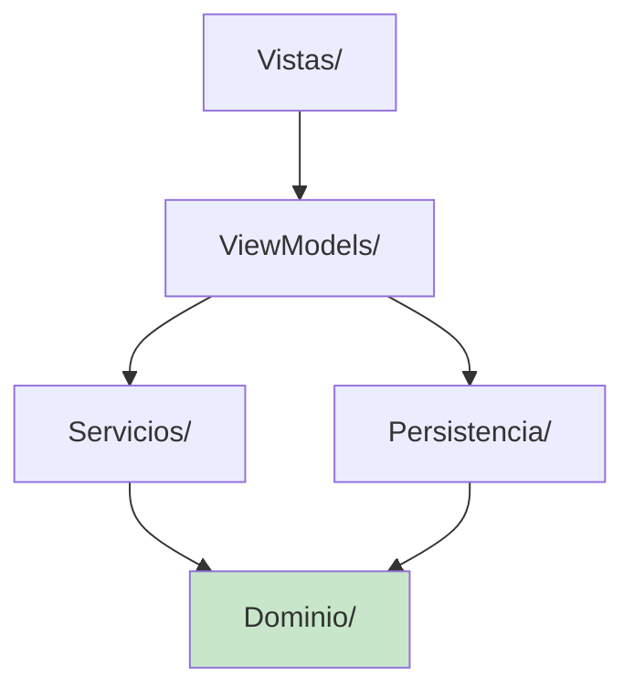
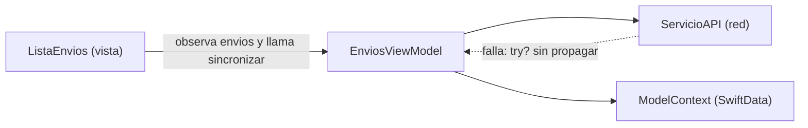
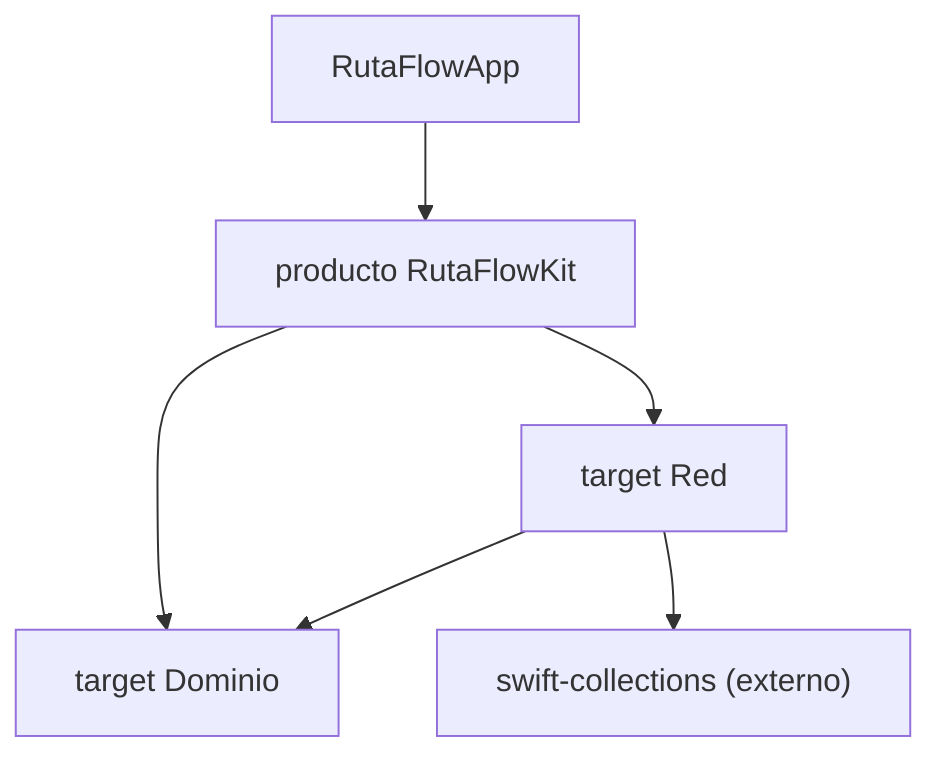
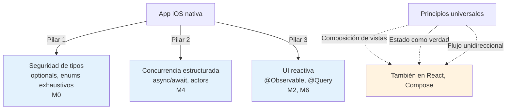

# Módulo 12: Proyecto integrador: app SwiftUI completa


**Proyecto del módulo:** para cada práctica, parte de una carpeta vacía y crea en Xcode (File ▸ New ▸ Project ▸ App, interfaz SwiftUI) un proyecto llamado `RutaFlowApp`; escribe manualmente todos los archivos indicados y compila, sin usar proyectos ya preparados.

## Aprende construyendo


### Tema 1: Arquitectura del proyecto integrador · Avanzado · 45 min

<details open>
<summary><strong>Capa 1 — Lectura</strong></summary>

#### ► DE QUÉ TRATA
Al finalizar vas a trazar en un diagrama de capas cómo se conectan EnviosViewModel, ServicioAPI y SwiftData en RutaFlow, confirmando que ninguna vista accede directamente a ninguna de las dos fuentes de datos. Prerrequisitos: módulos 0-11 completos.

#### ► CÓMO FUNCIONA


</details>

<details>
<summary><strong>Capa 2 — Construcción</strong></summary>

#### Código y verificación
```
Vistas/         ← SwiftUI puro
ViewModels/      ← @Observable, orquesta servicios (módulo 8)
Servicios/        ← URLSession + async/await (módulo 5)
Persistencia/      ← SwiftData (módulo 6)
Dominio/            ← structs/enums puros (módulo 0)
Tests/                ← Swift Testing sobre la capa de dominio (módulo 9)
```

```
Vistas/         ← SwiftUI puro
ViewModels/      ← @Observable, orquesta servicios
Servicios/        ← URLSession + async/await
Persistencia/      ← SwiftData
Dominio/            ← structs/enums puros
Tests/                ← Swift Testing
```


```text
Vistas/         ← SwiftUI puro (Módulos 1-3)
ViewModels/      ← @Observable, orquesta servicios (Módulo 8)
Servicios/        ← URLSession + async/await (Módulo 5)
Persistencia/      ← SwiftData (Módulo 6)
Dominio/            ← structs/enums puros (Módulo 0)
Tests/                ← Swift Testing sobre dominio (Módulo 9)
```

```bash
xcodebuild -scheme RutaFlowApp -destination 'generic/platform=iOS Simulator' build
```

</details>

### Tema 2: Sincronización entre red y persistencia local · Avanzado · 45 min

<details open>
<summary><strong>Capa 1 — Lectura</strong></summary>

#### ► DE QUÉ TRATA
Al finalizar vas a hacer que EnviosViewModel orqueste tanto ServicioAPI (red) como SwiftData (persistencia local) para que ListaEnvios siga mostrando datos aunque la red falle. Prerrequisitos: Tema 1 de este módulo.

#### ► CÓMO FUNCIONA


</details>

<details>
<summary><strong>Capa 2 — Construcción</strong></summary>

#### Código y verificación
```swift
@Observable
class EnviosViewModel {
    func sincronizar() async {
        guard let remotos = try? await servicio.obtenerEnvios() else { return }
        remotos.forEach { context.insert($0) }
        try? context.save()
    }
}
```


```swift
import SwiftData

@Model
final class EnvioLocal {
    @Attribute(.unique) var id: String
    var guia: String

    init(id: String, guia: String) {
        self.id = id
        self.guia = guia
    }
}

struct EnvioRemoto: Sendable {
    let id: String
    let guia: String
}
```

```swift
import Foundation

@MainActor
final class ServicioAPI {
    func obtenerEnvios() async throws -> [EnvioRemoto] {
        [EnvioRemoto(id: "RF-4471", guia: "RF-4471")]
    }
}
```

```swift
import Foundation
import Observation
import SwiftData

@MainActor
@Observable
final class EnviosViewModel {
    var envios: [EnvioLocal] = []
    private let servicio: ServicioAPI
    private let context: ModelContext

    init(servicio: ServicioAPI, context: ModelContext) {
        self.servicio = servicio
        self.context = context
    }

    func cargarLocales() {
        envios = (try? context.fetch(FetchDescriptor<EnvioLocal>())) ?? []
    }

    func sincronizar() async {
        guard let remotos = try? await servicio.obtenerEnvios() else { return }

        for remoto in remotos {
            let id = remoto.id
            let consulta = FetchDescriptor<EnvioLocal>(
                predicate: #Predicate { $0.id == id }
            )
            if let existente = (try? context.fetch(consulta))?.first {
                existente.guia = remoto.guia
            } else {
                context.insert(EnvioLocal(id: remoto.id, guia: remoto.guia))
            }
        }

        try? context.save()
        cargarLocales()
    }
}
```

```swift
import SwiftUI

struct ListaEnvios: View {
    let vm: EnviosViewModel

    var body: some View {
        List(vm.envios, id: \.id) { envio in
            Text(envio.guia)
        }
        .task {
            vm.cargarLocales()
            await vm.sincronizar()
        }
    }
}
```

</details>

### Tema 3: Swift Package Manager: separar la app en paquetes locales y declarar dependencias · Avanzado · 45 min

<details open>
<summary><strong>Capa 1 — Lectura</strong></summary>

#### ► DE QUÉ TRATA
Usa Xcode 26 (Swift 6.2) o posterior. Dentro de academia-ios, crea el paquete con mkdir -p Paquetes/RutaFlowKit && cd Paquetes/RutaFlowKit && swift package init --type library --name RutaFlowKit.

#### ► CÓMO FUNCIONA


</details>

<details>
<summary><strong>Capa 2 — Construcción</strong></summary>

#### Código y verificación


```swift
// swift-tools-version: 6.0
import PackageDescription

let package = Package(
    name: "RutaFlowKit",
    platforms: [.iOS(.v17), .macOS(.v14)],
    products: [
        .library(name: "RutaFlowKit", targets: ["Dominio", "Red"]),
    ],
    dependencies: [
        .package(url: "https://github.com/apple/swift-collections", from: "1.1.0"),
    ],
    targets: [
        .target(name: "Dominio"),
        .target(name: "Red", dependencies: [
            "Dominio",
            .product(name: "Collections", package: "swift-collections"),
        ]),
        .testTarget(name: "DominioTests", dependencies: ["Dominio"]),
    ]
)
```

```swift
public struct Tarifa: Sendable {
    public init() {}
    public func centavos(kilos: Int) -> Int { 1_000 + kilos * 120 }
}
```

```swift
import Collections
import Dominio

public struct ColaDeTarifas: Sendable {
    private var pendientes = Deque<Int>()
    public init() {}
    public mutating func encolar(kilos: Int) { pendientes.append(Tarifa().centavos(kilos: kilos)) }
    public var total: Int { pendientes.reduce(0, +) }
}
```

```swift
import Testing
@testable import Dominio

@Test func tarifaDeDosKilos() {
    #expect(Tarifa().centavos(kilos: 2) == 1_240)
}
```

```bash
cd academia-ios/Paquetes/RutaFlowKit
swift build
swift test
```

</details>

### Tema 4: Cierre del track · Experto · 40 min

<details open>
<summary><strong>Capa 1 — Lectura</strong></summary>

#### ► DE QUÉ TRATA
Al finalizar vas a escribir una retrospectiva comparando una decisión de arquitectura de RutaFlow en iOS (@Observable en EnviosViewModel) contra la misma decisión en otro track de la Academia (Compose en Android, o React en la web). Prerrequisitos: Temas 1-2 de este módulo. Si no…

#### ► CÓMO FUNCIONA


</details>

<details>
<summary><strong>Capa 2 — Construcción</strong></summary>

#### Código y verificación


```text
Decisión: EnviosViewModel usa @Observable (Módulo 2) para que ListaEnvios
se redibuje solo cuando lee la propiedad que cambió.

Específico de Swift/SwiftUI: la integración de @Observable con el sistema
de tipos del compilador (rastrea qué propiedad leíste, no qué objeto).

Principio universal: "state hoisting" — un componente hijo recibe el
valor y una forma de notificar cambios, sin poseer el estado él mismo
(igual en Compose/Android y en hooks de React).
```

```bash
xcodebuild -scheme RutaFlowApp -destination 'generic/platform=iOS Simulator' build
```

</details>
