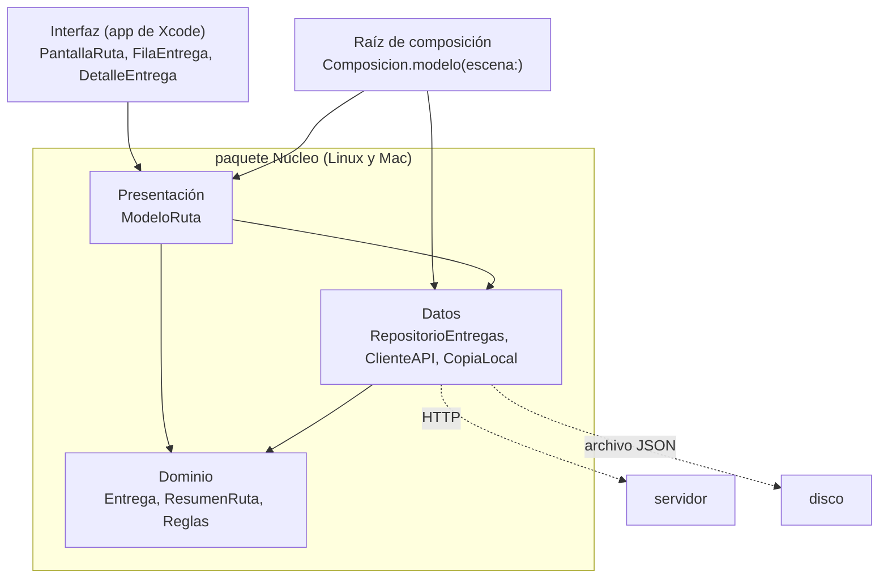
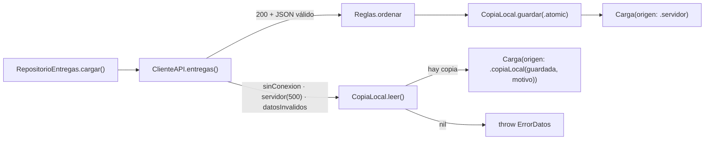
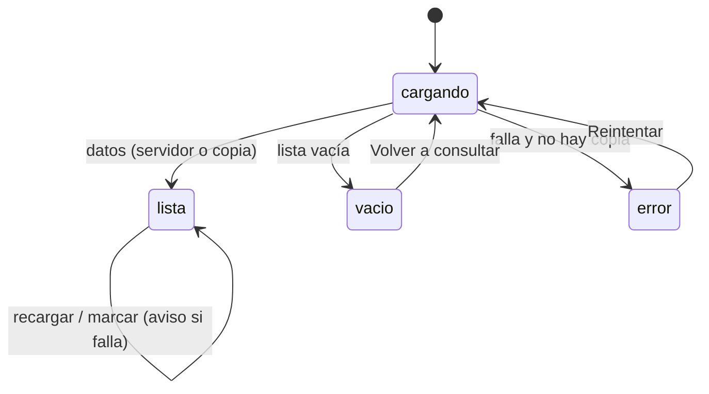
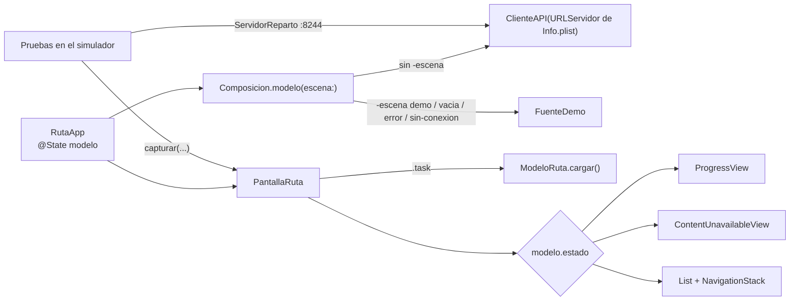

# Módulo 12: Proyecto integrador: app SwiftUI completa

**Entorno comprobado para esta edición (2026-11-25):** las capas puras (dominio, datos y presentación) se
compilaron y se probaron con Swift 6.4.3 en Linux x86_64 (`swift build`, `swift test` con Swift Testing y
`FoundationNetworking`), en `/home/estudiante/labs/ios/ios12` (tu `~/labs/ios/ios12`): 21 pruebas, un servidor HTTP
de desarrollo real en `127.0.0.1:8242` y archivos reales. La interfaz SwiftUI y las pruebas en el simulador se
ejecutan en una Mac con Xcode 27.2 (27B52), Swift 6.4.2 y el simulador iPhone 17 con iOS 27.2, con el script
`mac.sh` del laboratorio. Límites honestos: en Linux no hay SwiftUI, así que todo lo que se ve en pantalla sale de la
Mac; y en la Mac no hay un servidor aparte, así que las pruebas del simulador arrancan el mismo servidor **dentro de
la prueba** (es el mismo código Swift, que compila con Glibc y con Darwin).

Los módulos anteriores enseñaron cada pieza por separado: vistas (Módulo 1), estado con `@Observable` (Módulo 2),
navegación (Módulo 3), concurrencia (Módulo 4), red (Módulo 5), archivos (Módulo 6), MVVM (Módulo 8) y pruebas
(Módulo 9). Este módulo las une en una app de reparto pequeña pero completa: una lista de guías de Bogotá que se
carga de un servidor, se guarda para trabajar sin señal y permite marcar entregas. Lo importante no es cada pieza,
sino **dónde va** cada una para que se pueda cambiar y probar sin tocar las demás.

**Al terminar este módulo podrás:**
- separar una app en dominio, datos, presentación e interfaz, con las tres primeras en un paquete Swift que compila
  y se prueba sin simulador;
- escribir una capa de datos que prefiere el servidor, guarda una copia local y la usa cuando la red falla;
- modelar todos los estados de una pantalla en un `@Observable` con `@MainActor` y probarlos sin pantalla;
- dibujar cada estado en SwiftUI y comprobarlo con capturas reales del simulador.

**Esquema del módulo:** Tema 1 (capas y dominio en un paquete) → Tema 2 (datos: cliente HTTP, copia local y
repositorio) → Tema 3 (presentación: el modelo de la pantalla) → Tema 4 (interfaz: cada estado en el simulador) →
Proyecto 49.

**Qué necesitas saber antes:** del Módulo 2, **`@Observable`**; del Módulo 3, **`NavigationStack` con valores**; del
Módulo 4, **actores, `@MainActor` y `Sendable`**; del Módulo 5, **`URLSession` con `async`/`await` y errores
tipados**; del Módulo 6, **dónde guardar archivos en el contenedor de la app**; del Módulo 8, **MVVM e inyección por
inicializador**; del Módulo 9, **Swift Testing**.

**Qué no se repite:** cómo funciona cada API (eso ya está en su módulo), SwiftData (Módulo 6: aquí la copia local es
un archivo JSON, para poder probarla en Linux), la firma y la publicación (Módulo 11), ni el llavero, la fijación de
certificados y la cola de envíos sin conexión (Módulo 13, que continúa esta misma app).

**Prepara el proyecto:**

```text
$ mkdir -p ~/labs/ios/ios12 && cd ~/labs/ios/ios12
$ mkdir -p nucleo/Sources/Nucleo/{Dominio,Datos,Presentacion} nucleo/Sources/{ServidorLocal,servidor-reparto,demo-ruta}
$ mkdir -p nucleo/Tests/NucleoTests
```

En la Mac, crea con Xcode un proyecto **iOS App** llamado `Ruta` (interfaz SwiftUI, pruebas con Swift Testing,
identificador `com.academia.ruta`, iOS 18 como mínimo) dentro de `~/labs/ios/ios12/app`, con el código en
`app/App` y las pruebas en `app/Pruebas`. El laboratorio ya trae ese proyecto generado, y su `mac.sh` copia el
paquete del núcleo a la app antes de compilar.

La estructura final:

```text
ios12/
├── nucleo/                         paquete Swift: se prueba en Linux y en la Mac
│   ├── Sources/Nucleo/Dominio/     Entrega, ResumenRuta, Reglas
│   ├── Sources/Nucleo/Datos/       ClienteAPI, CopiaLocal, RepositorioEntregas
│   ├── Sources/Nucleo/Presentacion/ ModeloRuta (@Observable, @MainActor)
│   ├── Sources/ServidorLocal/      servidor HTTP mínimo (solo desarrollo y pruebas)
│   ├── Sources/servidor-reparto/   el servidor de desarrollo como programa
│   ├── Sources/demo-ruta/          la app «sin interfaz», en la terminal
│   └── Tests/NucleoTests/          21 pruebas
├── app/                            proyecto de Xcode «Ruta»
│   ├── App/                        RutaApp, Composicion, UI/, Demo/ (+ Nucleo/ copiado por mac.sh)
│   ├── Pruebas/                    capturas e integración (+ las pruebas del núcleo, copiadas)
│   └── Config/Info.plist
├── demo_ruta.sh
└── mac.sh
```


## Aprende construyendo


### Tema 1: Arquitectura por capas: el dominio en un paquete Swift · Avanzado · 45 min

<details open>
<summary><strong>Capa 1 — Lectura</strong></summary>

#### Objetivos
Al terminar este tema podrás:
- nombrar las cuatro capas de la app y qué puede importar cada una;
- poner el dominio (modelos y reglas) en un paquete Swift sin dependencias de interfaz;
- escribir las reglas del negocio como funciones puras y probarlas en milisegundos;
- explicar por qué el paquete es la frontera que hace cumplir la regla de dependencia.

**Conceptos clave:** capa, dominio, regla de dependencia, paquete local de Swift, raíz de composición

#### El problema
La primera versión de la app de reparto cabe en un archivo: una vista que, en `.onAppear`, llama a `URLSession`,
decodifica el JSON, ordena las guías, calcula el peso y lo formatea con el idioma del teléfono. Funciona hasta el día
en que alguien pregunta «¿por qué la guía pesada sale de última?» y nadie puede responder sin abrir el simulador,
esperar a la red y tocar la pantalla. Probar la regla de orden exige levantar toda la app; cambiar el servidor
exige tocar la vista; y en un teléfono en inglés el peso sale «20.6 kg» en vez de «20,6 kg».

Este tema usa **MVVM e inyección por inicializador** (Módulo 8), **`struct`, `enum` y protocolos** (Módulo 0) y
**Swift Testing con argumentos** (Módulo 9).

#### Glosario del tema

**capa**
- **Definición técnica:** grupo de tipos con una sola responsabilidad (dominio, datos, presentación, interfaz) que solo depende de las capas más internas.
- **En palabras sencillas:** un piso del edificio: cada piso se apoya en el de abajo, nunca en el de arriba.
- **Dónde se rompe la comparación:** las capas no son carpetas: dos archivos en carpetas distintas pueden estar igual de acoplados. La frontera real es lo que cada archivo **importa**.
- **Ejemplo:** `ModeloRuta` (presentación) usa `RepositorioEntregas` (datos) y `Entrega` (dominio); `Entrega` no sabe que existen los otros.
- **Error típico:** un modelo de dominio con `import SwiftUI` «solo para un `Color`».

**dominio**
- **Definición técnica:** los tipos y las reglas del negocio expresados en Swift puro: `Entrega`, `ResumenRuta`, `Reglas.ordenar`, `Reglas.kilos`.
- **En palabras sencillas:** lo que el negocio diría igual aunque no existiera la app.
- **Dónde se rompe la comparación:** el dominio también decide cosas que parecen de la interfaz, como el formato «20,6 kg», cuando es una regla del negocio y no una preferencia visual.
- **Ejemplo:** «más de 10 kg necesita carretilla» es `Entrega.esPesada`.
- **Error típico:** repetir la regla en la vista (`if entrega.pesoGramos > 10000`) y en el servidor, con umbrales distintos.

**regla de dependencia**
- **Definición técnica:** las dependencias del código apuntan hacia adentro: interfaz → presentación → datos → dominio; ninguna capa interna conoce a una externa.
- **En palabras sencillas:** el que sabe menos no depende del que sabe más.
- **Dónde se rompe la comparación:** la capa de datos depende del dominio (usa `Entrega`), pero no al revés; los protocolos (`FuenteRemota`) permiten que una capa interna pida algo sin conocer quién lo da.
- **Ejemplo:** el paquete `Nucleo` no puede importar `SwiftUI`: en Linux ni siquiera existe, y el compilador lo haría fallar.
- **Error típico:** «solo esta vez» llamar a `URLSession` desde la vista para un dato pequeño.

**paquete local de Swift**
- **Definición técnica:** carpeta con un `Package.swift` que declara módulos (*targets*) y sus dependencias; se compila con `swift build`, se prueba con `swift test` y Xcode lo puede agregar a un proyecto como dependencia local.
- **En palabras sencillas:** una caja con su propia lista de lo que necesita.
- **Dónde se rompe la comparación:** dentro de un mismo módulo todo se ve; entre módulos, solo lo `public`. Por eso los tipos del núcleo son `public`.
- **Ejemplo:** `nucleo/` tiene los módulos `Nucleo`, `ServidorLocal`, dos ejecutables y las pruebas.
- **Error típico:** olvidar `public` en el inicializador de un `struct`: el inicializador automático es `internal` y la app no puede crear el valor.

**raíz de composición**
- **Definición técnica:** el único lugar de la app que elige las implementaciones concretas (`ClienteAPI` o una fuente de demostración, qué archivo de copia) y las conecta.
- **En palabras sencillas:** el tablero donde se enchufan los cables.
- **Dónde se rompe la comparación:** no es un «contenedor de dependencias» mágico: aquí es un `enum` con una función.
- **Ejemplo:** `Composicion.modelo(escena:)` en el Tema 4.
- **Error típico:** crear `ClienteAPI(...)` dentro de una vista: ya no se puede probar esa vista sin red.

#### ► CÓMO FUNCIONA
Cada capa vive en su carpeta, y el paquete `Nucleo` agrupa las tres que no dependen de Apple. La interfaz (SwiftUI)
queda en la app de Xcode. Las flechas son importaciones: nadie apunta hacia afuera.



#### Problema resuelto 1.1
Crea el paquete del núcleo y escribe el dominio de la ruta: la entrega, el resumen (pendientes, entregadas y peso
por entregar) y dos reglas, el orden de trabajo y el formato del peso. Pruébalo sin simulador.

**Razonamiento:**
1. `Package.swift` declara un módulo por responsabilidad; las pruebas dependen del núcleo y del servidor local.
2. `Entrega` es un `struct` `Codable`, `Sendable` e `Identifiable`: viaja entre actores, se guarda en JSON y SwiftUI
   la puede listar.
3. Las reglas son funciones `static` sin estado: la misma entrada da la misma salida, y se prueban sin preparar nada.
4. `kilos` no usa el idioma del equipo: redondea a décimas con enteros y pone la coma, porque así lo pide el negocio.
5. Una prueba con argumentos cubre los bordes del redondeo (0, 49, 50, 1 250 y 20 600 gramos) en una sola función.

```swift
// swift-tools-version: 6.0
// Paquete con las capas puras de la app de reparto: se prueba en Linux y en la Mac,
// y sus fuentes se copian a la app de Xcode (ver mac.sh).
import PackageDescription

let package = Package(
    name: "Nucleo",
    platforms: [.macOS(.v15), .iOS(.v18)],
    products: [.library(name: "Nucleo", targets: ["Nucleo"])],
    targets: [
        // Dominio, Datos y Presentación: todo lo que no depende de SwiftUI.
        .target(name: "Nucleo"),
        // Servidor HTTP mínimo para desarrollo y pruebas (nunca entra a la app).
        .target(name: "ServidorLocal"),
        .executableTarget(name: "servidor-reparto", dependencies: ["ServidorLocal"]),
        .executableTarget(name: "demo-ruta", dependencies: ["Nucleo"]),
        .testTarget(name: "NucleoTests", dependencies: ["Nucleo", "ServidorLocal"]),
    ]
)
```

```swift
// Dominio/Entrega.swift — el modelo y las reglas del negocio. No importa nada de red, disco ni interfaz.
import Foundation

public enum EstadoEntrega: String, Codable, Sendable, CaseIterable {
    case pendiente
    case entregada
}

public struct Entrega: Codable, Sendable, Hashable, Identifiable {
    public let id: String  // la guía: «EN-4471»
    public var destinatario: String
    public var direccion: String
    public var barrio: String
    public var pesoGramos: Int
    public var estado: EstadoEntrega
    public var ventana: String  // «08:00–10:00»

    public init(
        id: String, destinatario: String, direccion: String, barrio: String, pesoGramos: Int,
        estado: EstadoEntrega, ventana: String
    ) {
        self.id = id
        self.destinatario = destinatario
        self.direccion = direccion
        self.barrio = barrio
        self.pesoGramos = pesoGramos
        self.estado = estado
        self.ventana = ventana
    }

    /// Más de 10 kg necesita carretilla: la regla la decide el negocio, no la vista.
    public var esPesada: Bool { pesoGramos > 10_000 }
    public var pesoTexto: String { Reglas.kilos(pesoGramos) }
}

/// Las cuentas de la ruta. Es un valor: se calcula de nuevo cada vez que cambia la lista.
public struct ResumenRuta: Sendable, Equatable {
    public let total: Int
    public let pendientes: Int
    public let entregadas: Int
    public let pesoPendienteGramos: Int

    public init(_ entregas: [Entrega]) {
        total = entregas.count
        pendientes = entregas.filter { $0.estado == .pendiente }.count
        entregadas = total - pendientes
        pesoPendienteGramos = entregas.filter { $0.estado == .pendiente }.reduce(0) { $0 + $1.pesoGramos }
    }

    public var pesoPendienteTexto: String { Reglas.kilos(pesoPendienteGramos) }
}

public enum Reglas {
    /// «12,4 kg» — con coma decimal, como se lee en Colombia, sin depender del idioma del equipo.
    public static func kilos(_ gramos: Int) -> String {
        let decimas = (gramos + 50) / 100
        return "\(decimas / 10),\(decimas % 10) kg"
    }

    /// Orden de trabajo: primero las pendientes, por ventana horaria y luego por guía; al final las entregadas.
    public static func ordenar(_ entregas: [Entrega]) -> [Entrega] {
        entregas.sorted {
            if $0.estado != $1.estado { return $0.estado == .pendiente }
            if $0.ventana != $1.ventana { return $0.ventana < $1.ventana }
            return $0.id < $1.id
        }
    }
}
```

```swift
// DominioTests.swift — las reglas del negocio, sin red ni disco.
import Testing

@testable import Nucleo

let muestra: [Entrega] = [
    Entrega(
        id: "EN-4475", destinatario: "Sofía León", direccion: "Cra. 15 # 93-60", barrio: "Chicó",
        pesoGramos: 450, estado: .entregada, ventana: "08:00–10:00"),
    Entrega(
        id: "EN-4474", destinatario: "Jorge Peña", direccion: "Cl. 140 # 9-30", barrio: "Usaquén",
        pesoGramos: 15200, estado: .pendiente, ventana: "10:00–12:00"),
    Entrega(
        id: "EN-4472", destinatario: "Luis Pardo", direccion: "Cl. 26 # 68C-61", barrio: "Salitre",
        pesoGramos: 3400, estado: .pendiente, ventana: "08:00–10:00"),
    Entrega(
        id: "EN-4471", destinatario: "Ana Ruiz", direccion: "Cra. 7 # 72-41", barrio: "Chapinero",
        pesoGramos: 1200, estado: .pendiente, ventana: "08:00–10:00"),
]

@Test func ordenaPendientesPorVentanaYGuia() {
    #expect(Reglas.ordenar(muestra).map(\.id) == ["EN-4471", "EN-4472", "EN-4474", "EN-4475"])
}

@Test func resumenCuentaSoloLoPendiente() {
    let r = ResumenRuta(muestra)
    #expect(r == ResumenRuta(muestra))
    #expect((r.total, r.pendientes, r.entregadas, r.pesoPendienteGramos) == (4, 3, 1, 19_800))
    #expect(r.pesoPendienteTexto == "19,8 kg")
}

@Test(arguments: [(0, "0,0 kg"), (49, "0,0 kg"), (50, "0,1 kg"), (1_250, "1,3 kg"), (20_600, "20,6 kg")])
func pesoRedondeaALaDecima(gramos: Int, texto: String) {
    let una = Entrega(
        id: "EN-1", destinatario: "", direccion: "", barrio: "", pesoGramos: gramos,
        estado: .pendiente, ventana: "")
    #expect(ResumenRuta([una]).pesoPendienteTexto == texto)
}

@Test func masDeDiezKilosEsPesada() {
    #expect(muestra.filter(\.esPesada).map(\.id) == ["EN-4474"])
}
```

Todas las pruebas del paquete (las de este tema son las cuatro primeras de la lista: `ordena…`, `resumen…`,
`pesoRedondea…` y `masDeDiez…`; las demás son de los Temas 2 y 3):

```text
$ swift test 2>&1 | grep -E '✔ Test|✘|error:'
✔ Test masDeDiezKilosEsPesada() passed after 0.004 seconds.
✔ Test resumenCuentaSoloLoPendiente() passed after 0.004 seconds.
✔ Test ordenaPendientesPorVentanaYGuia() passed after 0.004 seconds.
✔ Test pesoRedondeaALaDecima(gramos:texto:) with 5 test cases passed after 0.005 seconds.
✔ Test sinConexionYSinCopiaFalla() passed after 0.005 seconds.
✔ Test conServidorGuardaLaCopiaOrdenada() passed after 0.005 seconds.
✔ Test unaCopiaDanadaSeIgnora() passed after 0.005 seconds.
✔ Test sinConexionUsaLaCopiaYDiceElMotivo() passed after 0.005 seconds.
✔ Test sinEntregasEsVacio() passed after 0.008 seconds.
✔ Test errorSinCopiaMuestraElMensaje() passed after 0.008 seconds.
✔ Test empiezaCargandoYTerminaEnLista() passed after 0.008 seconds.
✔ Test marcarEntregadaMueveLaGuia() passed after 0.009 seconds.
✔ Test unaHoraQueTerminaEnPuntoNoLlevaOtro() passed after 0.009 seconds.
✔ Test conCopiaMuestraListaYAviso() passed after 0.009 seconds.
✔ Test normalDecodificaLasCincoEntregas() passed after 0.058 seconds.
✔ Test vacioEsUnaListaVacia() passed after 0.053 seconds.
✔ Test dosToquesSeguidosEnvianUnaSolaVez() passed after 0.119 seconds.
✔ Test error500SeTraduce() passed after 0.051 seconds.
✔ Test jsonRotoEsDatosInvalidos() passed after 0.051 seconds.
✔ Test servidorApagadoEsSinConexion() passed after 0.001 seconds.
✔ Test marcarUnaGuiaQueNoExisteEs404() passed after 0.052 seconds.
✔ Test run with 21 tests in 2 suites passed after 0.275 seconds.
```

**Explicación por partes.**
- **Velocidad:** las 21 pruebas terminan en 0,275 s en Linux, sin simulador, sin Xcode y sin red externa. Las del
  dominio tardan entre 0,004 y 0,005 s: son funciones puras.
- **`pesoRedondeaALaDecima` con 5 casos:** 49 g da «0,0 kg» y 50 g da «0,1 kg», así que el redondeo es «la mitad
  hacia arriba»; 20 600 g da «20,6 kg», con coma, sin importar el idioma del equipo que ejecuta la prueba.
- **`ordenaPendientesPorVentanaYGuia`:** de `EN-4475, EN-4474, EN-4472, EN-4471` sale
  `EN-4471, EN-4472, EN-4474, EN-4475`: las dos pendientes de 08:00–10:00 primero (por guía), luego la de 10:00–12:00
  y al final la entregada.
- **`resumenCuentaSoloLoPendiente`:** 4 guías, 3 pendientes, 1 entregada y 19 800 g por entregar: los 450 g de la
  entregada no cuentan.
- La salida también muestra el orden en que Swift Testing termina las pruebas: corren **en paralelo**, por eso el
  orden de la lista no es el del archivo.

> **Error común.** Formatear el peso con `formatted()` o `NumberFormatter` sin fijar el idioma «porque en mi
> simulador se ve bien». En un teléfono en inglés la misma app muestra «20.6 kg», y una prueba escrita en tu Mac
> pasa o falla según el idioma de la máquina que la ejecuta. Si el formato es una regla del negocio, va en el dominio
> con el idioma fijo; si es preferencia de la persona, va en la interfaz con su idioma (Módulo 10).

> **Error común.** Poner en el modelo de dominio cosas de la interfaz, como `var color: Color` o `var icono: Image`.
> El paquete deja de compilar en Linux y en cualquier objetivo sin SwiftUI, y la regla («pesada») queda escondida
> dentro de un detalle visual («rojo»).

> **Buena práctica.** Haz `Sendable` los tipos del dominio desde el principio. Con Swift 6 todo lo que cruza entre
> actores debe serlo, y un `struct` con propiedades `Sendable` lo es sin esfuerzo.

> **Prevenir errores.** Compila el paquete en un entorno sin SwiftUI (Linux, o `swift build` para macOS) en la
> integración continua. Si alguien agrega `import SwiftUI` al núcleo, la compilación falla en ese mismo momento.

#### Checkpoint 1.1
Una nueva regla dice que las guías con ventana `07:00–08:00` van antes que todas. ¿En qué archivo cambias algo y
qué prueba agregas?

Respuesta: en ninguno: `Reglas.ordenar` ya compara la ventana como texto, y `"07:00–08:00" < "08:00–10:00"`. Basta
una prueba nueva en `DominioTests.swift` con una pendiente de esa ventana que espere verla primera. Si la regla
cambiara a algo que el texto no ordena bien (por ejemplo, «urgente» primero), el cambio sería solo en `Reglas`.

</details>

<details>
<summary><strong>Capa 2 — Construcción</strong></summary>

#### Paso 1 · Crea el paquete
Crea `nucleo/Package.swift` y las carpetas. Ejecuta `swift build` en `nucleo/`: debe compilar aunque los módulos
estén casi vacíos (crea un archivo por módulo para que no falle por falta de fuentes).

#### Paso 2 · Escribe el dominio
Crea `Entrega.swift` y `DominioTests.swift`. Ejecuta `swift test --filter Dominio`.

#### Paso 3 · Rompe el redondeo
Cambia `(gramos + 50) / 100` por `gramos / 100` y ejecuta las pruebas. ¿Qué casos fallan? Vuelve a dejarlo.

#### Paso 4 · Intenta importar SwiftUI
Agrega `import SwiftUI` al principio de `Entrega.swift` y ejecuta `swift build` en Linux. Lee el error y quítalo.

#### Paso 5 · Una regla nueva
Agrega `Reglas.puedeIrEnMoto(_:)` (verdadero si el peso es de 5 kg o menos) con su prueba de bordes: 5 000 y 5 001
gramos.

#### Resumen
- La app tiene cuatro **capas**; las tres puras viven en un **paquete local de Swift**.
- El **dominio** son tipos y reglas en Swift puro, `Sendable`, sin red ni disco ni interfaz.
- La **regla de dependencia** la hace cumplir el compilador: el paquete no puede importar lo que no conoce.
- La **raíz de composición** (Tema 4) es el único lugar que elige implementaciones.

#### Ejercicio verificable 1
Básico. ¿Qué devuelve `Reglas.kilos(1_250)`?

Respuesta esperada: `"1,3 kg"` (es uno de los casos de `pesoRedondeaALaDecima`).

#### Ejercicio verificable 2
Intermedio. En el Paso 3, ¿qué casos fallan?

Respuesta esperada: los de 50 g (da «0,0 kg» en vez de «0,1 kg») y 1 250 g (da «1,2 kg» en vez de «1,3 kg»); 0, 49
y 20 600 siguen pasando porque no dependen del redondeo.

#### Ejercicio verificable 3
Reto. Una entrega de exactamente 10 000 g, ¿es pesada? ¿Qué texto muestra `pesoTexto`?

Respuesta esperada: no es pesada (la regla es `> 10_000`) y muestra `"10,0 kg"`.

#### En el trabajo
Los equipos de iOS separan el núcleo en paquetes locales para compilar y probar sin simulador en la integración
continua (que suele correr en máquinas Linux más baratas), para compartir el dominio con una extensión o un widget y
para que dos personas trabajen en capas distintas sin pisarse. La revisión de código empieza por los `import`.

</details>

### Tema 2: Datos: cliente HTTP, copia local y repositorio · Avanzado · 50 min

<details open>
<summary><strong>Capa 1 — Lectura</strong></summary>

#### Objetivos
Al terminar este tema podrás:
- escribir un cliente HTTP que traduce cada fallo de red, de servidor y de formato a un error tipado propio;
- guardar la última lista buena en un archivo JSON escrito de forma atómica, dentro de un actor;
- decidir en un repositorio de dónde salen los datos: servidor primero, copia local si falla;
- probar la capa de datos contra un servidor de desarrollo real, en cada modo de fallo.

**Conceptos clave:** fuente remota, error de datos (`throws(ErrorDatos)`), copia local, repositorio, servidor de
desarrollo

#### El problema
El repartidor entra a un parqueadero subterráneo en Usaquén, abre la app y ve una pantalla en blanco: la petición
falló y no había nada guardado. Peor: cuando el servidor respondió con un error 500, la app intentó decodificar el
HTML de error como JSON y mostró «The data couldn't be read because it isn't in the correct format». El equipo
necesita que la app muestre la última ruta conocida cuando no hay red, que diga **por qué** está mostrando datos
viejos y que cada tipo de fallo se pueda provocar a voluntad para probarlo.

Este tema usa **`URLSession` con `async`/`await`** y **errores tipados** (Módulo 5), **actores** (Módulo 4) y
**las carpetas de la app y la escritura atómica** (Módulo 6).

#### Glosario del tema

**fuente remota**
- **Definición técnica:** protocolo `FuenteRemota: Sendable` con lo que la app necesita del servidor (`entregas()` y `marcarEntregada(id:)`); `ClienteAPI` lo implementa con HTTP.
- **En palabras sencillas:** el enchufe; el cable puede ser el servidor real, uno de pruebas o uno de mentira.
- **Dónde se rompe la comparación:** el protocolo también fija el **tipo de error** (`throws(ErrorDatos)`): quien lo implemente no puede lanzar otra cosa.
- **Ejemplo:** `FuenteFalsa` en las pruebas y `FuenteDemo` en la app (Tema 4) cumplen el mismo protocolo.
- **Error típico:** un protocolo que devuelve `Data` o `HTTPURLResponse`: la capa de arriba termina sabiendo de HTTP.

**error de datos**
- **Definición técnica:** `enum ErrorDatos: Error` con tres casos (`sinConexion`, `servidor(codigo:)`, `datosInvalidos`), usado con *typed throws* de Swift 6 (`throws(ErrorDatos)`).
- **En palabras sencillas:** tres cajones para todos los problemas posibles.
- **Dónde se rompe la comparación:** no dice qué texto mostrar: eso lo decide la presentación (Tema 3).
- **Ejemplo:** un 500 llega como `.servidor(codigo: 500)`; un JSON con `"destinatario": 12` como `.datosInvalidos`.
- **Error típico:** dejar pasar `URLError` o `DecodingError` hasta la vista.

**copia local**
- **Definición técnica:** actor `CopiaLocal` que guarda una `Instantanea` (entregas + fecha) en un archivo JSON con `write(to:options: .atomic)` y la lee devolviendo `nil` si falta o está dañada.
- **En palabras sencillas:** la foto de la última lista buena, con la hora en que se tomó.
- **Dónde se rompe la comparación:** no es una base de datos: no se consulta ni se filtra; se reemplaza entera. Para eso está SwiftData (Módulo 6).
- **Ejemplo:** `Application Support/ruta.json` en la app; un archivo temporal en las pruebas.
- **Error típico:** guardarla en `Caches`: el sistema la puede borrar justo cuando hace falta.

**repositorio**
- **Definición técnica:** actor `RepositorioEntregas` que decide de dónde salen los datos y lo informa en el resultado (`Carga` con `OrigenDatos.servidor` o `.copiaLocal(guardada:motivo:)`).
- **En palabras sencillas:** el bodeguero: sabe si el paquete viene del camión o del estante, y te lo dice.
- **Dónde se rompe la comparación:** no muestra nada ni decide textos; solo entrega datos y su origen.
- **Ejemplo:** con el servidor en 500 y una copia de las 04:52, `cargar()` devuelve la copia con `motivo: .servidor(codigo: 500)`.
- **Error típico:** esconder el origen: la persona cree que ve datos frescos.

**servidor de desarrollo**
- **Definición técnica:** un servidor HTTP mínimo (`ServidorHTTP`, con sockets POSIX) y sus rutas (`ServidorReparto`), con modos `normal`, `vacio`, `error`, `roto` y `lento` que se cambian con `POST /_modo/<modo>`.
- **En palabras sencillas:** un servidor de juguete que falla cuando tú se lo pides.
- **Dónde se rompe la comparación:** atiende una conexión a la vez y no es seguro: nunca entra a la app ni a producción.
- **Ejemplo:** `servidor-reparto 8242 normal` en Linux; dentro de una prueba en el simulador (Tema 4).
- **Error típico:** probar la capa de datos solo con el servidor real del equipo, que nunca falla cuando uno quiere.

#### ► CÓMO FUNCIONA
`cargar()` pide al servidor; si responde, ordena, guarda la copia y devuelve `origen: .servidor`. Si falla por
cualquier motivo y hay copia, devuelve la copia con la fecha y el motivo. Solo si no hay copia el error sube.



#### Problema resuelto 2.1
Escribe el cliente, la copia y el repositorio. Pruébalos contra el servidor de desarrollo en sus cinco modos y con
una fuente falsa, y ejecuta la «app sin interfaz» en los cuatro casos de la red: servidor normal, servidor con
error 500, servidor apagado con copia y sin copia.

**Razonamiento:**
1. `ClienteAPI.pedir` tiene tres `do`/`catch`, uno por cajón: la petición (`sinConexion`), el código HTTP
   (`servidor`) y la decodificación (`datosInvalidos`).
2. La sesión es `ephemeral` (sin caché ni cookies en disco) con un tiempo límite propio; la demostración usa 2 s.
3. `CopiaLocal` es un actor: dos guardados simultáneos no pueden mezclar sus bytes, y `.atomic` evita un archivo a
   medio escribir si la app muere en ese instante.
4. El repositorio guarda la copia con `try?`: si el disco falla, los datos frescos igual sirven.
5. El servidor de desarrollo usa el mismo `ServidorHTTP` en Linux y en el simulador; las pruebas que lo comparten
   van en una `@Suite(.serialized)` porque usan el mismo puerto (8243).

```swift
// Datos/ClienteAPI.swift — la fuente remota: HTTP + JSON, y la traducción de fallos a ErrorDatos.
import Foundation

#if canImport(FoundationNetworking)
    import FoundationNetworking
#endif

/// Los fallos que la capa de datos entrega hacia arriba. La presentación decide qué texto mostrar.
public enum ErrorDatos: Error, Equatable, Sendable {
    case sinConexion  // no se pudo hablar con el servidor
    case servidor(codigo: Int)  // respondió, pero con un error HTTP
    case datosInvalidos  // respondió 200 con algo que no cumple el contrato
}

/// Lo que la app necesita del servidor. Las pruebas y las demostraciones usan otras implementaciones.
public protocol FuenteRemota: Sendable {
    func entregas() async throws(ErrorDatos) -> [Entrega]
    func marcarEntregada(id: String) async throws(ErrorDatos) -> Entrega
}

public struct ClienteAPI: FuenteRemota {
    let base: URL
    let sesion: URLSession

    public init(base: URL, tiempoLimite: TimeInterval = 5) {
        self.base = base
        let configuracion = URLSessionConfiguration.ephemeral
        configuracion.timeoutIntervalForRequest = tiempoLimite
        sesion = URLSession(configuration: configuracion)
    }

    public func entregas() async throws(ErrorDatos) -> [Entrega] {
        try await pedir(URLRequest(url: base.appendingPathComponent("entregas")))
    }

    public func marcarEntregada(id: String) async throws(ErrorDatos) -> Entrega {
        var peticion = URLRequest(url: base.appendingPathComponent("entregas/\(id)/entregar"))
        peticion.httpMethod = "POST"
        return try await pedir(peticion)
    }

    private func pedir<T: Decodable>(_ peticion: URLRequest) async throws(ErrorDatos) -> T {
        let datos: Data
        let respuesta: URLResponse
        do {
            (datos, respuesta) = try await sesion.data(for: peticion)
        } catch {
            throw .sinConexion  // URLError: conexión rechazada, sin red, tiempo agotado…
        }
        let codigo = (respuesta as? HTTPURLResponse)?.statusCode ?? 0
        guard (200..<300).contains(codigo) else { throw .servidor(codigo: codigo) }
        do {
            return try JSONDecoder().decode(T.self, from: datos)
        } catch {
            throw .datosInvalidos
        }
    }
}
```

```swift
// Datos/CopiaLocal.swift — la última lista buena, en un archivo JSON, para trabajar sin señal.
import Foundation

public struct Instantanea: Codable, Sendable, Equatable {
    public let entregas: [Entrega]
    public let guardada: Date
}

/// Un actor: dos tareas que guardan a la vez no pueden mezclar sus escrituras.
public actor CopiaLocal {
    private let archivo: URL

    public init(archivo: URL) {
        self.archivo = archivo
    }

    /// En la app: Application Support/ruta.json (no se borra como Caches y entra en las copias de seguridad).
    public static func enSoporteDeApp() throws -> CopiaLocal {
        let carpeta = try FileManager.default.url(
            for: .applicationSupportDirectory, in: .userDomainMask,
            appropriateFor: nil, create: true)
        return CopiaLocal(archivo: carpeta.appendingPathComponent("ruta.json"))
    }

    public func guardar(_ entregas: [Entrega], en fecha: Date) throws {
        let codificador = JSONEncoder()
        codificador.dateEncodingStrategy = .iso8601
        let datos = try codificador.encode(Instantanea(entregas: entregas, guardada: fecha))
        try datos.write(to: archivo, options: .atomic)  // atómico: o el archivo viejo o el nuevo, nunca medio
    }

    /// `nil` si no hay copia o si el archivo está dañado: una copia ilegible no debe tumbar la app.
    public func leer() -> Instantanea? {
        guard let datos = try? Data(contentsOf: archivo) else { return nil }
        let decodificador = JSONDecoder()
        decodificador.dateDecodingStrategy = .iso8601
        return try? decodificador.decode(Instantanea.self, from: datos)
    }

    public func borrar() {
        try? FileManager.default.removeItem(at: archivo)
    }
}
```

```swift
// Datos/RepositorioEntregas.swift — decide de dónde salen los datos: primero el servidor, si falla la copia local.
import Foundation

public enum OrigenDatos: Sendable, Equatable {
    case servidor
    case copiaLocal(guardada: Date, motivo: ErrorDatos)
}

public struct Carga: Sendable, Equatable {
    public let entregas: [Entrega]
    public let origen: OrigenDatos
}

public actor RepositorioEntregas {
    private let remota: any FuenteRemota
    private let copia: CopiaLocal
    private let ahora: @Sendable () -> Date

    public init(remota: any FuenteRemota, copia: CopiaLocal, ahora: @escaping @Sendable () -> Date = { Date() }) {
        self.remota = remota
        self.copia = copia
        self.ahora = ahora
    }

    /// Servidor → guarda la copia y la devuelve ordenada. Si falla y hay copia, la copia con el motivo.
    public func cargar() async throws(ErrorDatos) -> Carga {
        do {
            let entregas = Reglas.ordenar(try await remota.entregas())
            try? await copia.guardar(entregas, en: ahora())  // si el disco falla, los datos frescos igual sirven
            return Carga(entregas: entregas, origen: .servidor)
        } catch {
            guard let instantanea = await copia.leer() else { throw error }
            return Carga(
                entregas: instantanea.entregas, origen: .copiaLocal(guardada: instantanea.guardada, motivo: error))
        }
    }

    /// Marca en el servidor y actualiza la copia. Sin conexión, falla: la cola de envíos llega en el Módulo 13.
    public func marcarEntregada(id: String, en lista: [Entrega]) async throws(ErrorDatos) -> [Entrega] {
        let actualizada = try await remota.marcarEntregada(id: id)
        let nueva = Reglas.ordenar(lista.map { $0.id == id ? actualizada : $0 })
        try? await copia.guardar(nueva, en: ahora())
        return nueva
    }
}
```

El servidor de desarrollo: el núcleo HTTP con sockets y las rutas de la ruta de reparto.

```swift
// ServidorHTTP.swift — servidor HTTP/1.1 mínimo con sockets POSIX, solo para desarrollo y pruebas.
// Compila igual en Linux (Glibc) y en iOS/macOS (Darwin): así la misma prueba corre en los dos lados.
import Foundation
import Synchronization

#if canImport(Glibc)
    import Glibc
#elseif canImport(Darwin)
    import Darwin
#endif

public struct Peticion: Sendable {
    public let metodo: String
    public let ruta: String  // sin la parte de consulta (?a=b)
    public let consulta: [String: String]
    public let cabeceras: [String: String]  // nombres en minúsculas
    public let cuerpo: Data
}

public struct Respuesta: Sendable {
    public var codigo: Int
    public var cuerpo: Data
    public var cabeceras: [String: String]

    public init(codigo: Int, cuerpo: Data = Data(), cabeceras: [String: String] = [:]) {
        self.codigo = codigo
        self.cuerpo = cuerpo
        self.cabeceras = cabeceras
    }

    public static func json(_ texto: String, codigo: Int = 200) -> Respuesta {
        Respuesta(codigo: codigo, cuerpo: Data(texto.utf8), cabeceras: ["Content-Type": "application/json"])
    }
}

public enum ErrorServidor: Error, CustomStringConvertible {
    case socket(String, Int32)
    public var description: String {
        if case .socket(let paso, let codigo) = self { return "\(paso) falló: \(String(cString: strerror(codigo)))" }
        return ""
    }
}

/// Atiende una conexión a la vez en un hilo propio. `detener()` cierra el socket y espera a que el hilo termine.
public final class ServidorHTTP: Sendable {
    public let puerto: UInt16
    private let manejador: @Sendable (Peticion) -> Respuesta
    private let estado = Mutex<(descriptor: Int32, activo: Bool)>((-1, false))
    private let terminado = DispatchSemaphore(value: 0)

    public init(puerto: UInt16, manejador: @escaping @Sendable (Peticion) -> Respuesta) {
        self.puerto = puerto
        self.manejador = manejador
    }

    public func iniciar() throws {
        #if canImport(Glibc)
            let fd = socket(AF_INET, Int32(SOCK_STREAM.rawValue), 0)
        #else
            let fd = socket(AF_INET, SOCK_STREAM, 0)
        #endif
        guard fd >= 0 else { throw ErrorServidor.socket("socket", errno) }
        var si: Int32 = 1
        setsockopt(fd, SOL_SOCKET, SO_REUSEADDR, &si, socklen_t(MemoryLayout<Int32>.size))
        var direccion = sockaddr_in()
        #if canImport(Darwin)
            direccion.sin_len = UInt8(MemoryLayout<sockaddr_in>.size)
        #endif
        direccion.sin_family = sa_family_t(AF_INET)
        direccion.sin_port = puerto.bigEndian
        direccion.sin_addr.s_addr = inet_addr("127.0.0.1")
        let enlazado = withUnsafePointer(to: &direccion) {
            $0.withMemoryRebound(to: sockaddr.self, capacity: 1) {
                bind(fd, $0, socklen_t(MemoryLayout<sockaddr_in>.size))
            }
        }
        guard enlazado == 0 else {
            let codigo = errno
            close(fd)
            throw ErrorServidor.socket("bind 127.0.0.1:\(puerto)", codigo)
        }
        guard listen(fd, 16) == 0 else { throw ErrorServidor.socket("listen", errno) }
        estado.withLock { $0 = (fd, true) }
        let hilo = Thread { [self] in
            atender(fd)
            terminado.signal()
        }
        hilo.name = "ServidorHTTP:\(puerto)"
        hilo.start()
    }

    public func detener() {
        let fd = estado.withLock { e -> Int32 in
            let fd = e.activo ? e.descriptor : -1
            e.activo = false
            return fd
        }
        guard fd >= 0 else { return }
        terminado.wait()  // el hilo revisa `activo` cada 50 ms
        close(fd)
    }

    private func atender(_ fd: Int32) {
        while estado.withLock({ $0.activo }) {
            var espera = pollfd(fd: fd, events: Int16(POLLIN), revents: 0)
            guard poll(&espera, 1, 50) > 0 else { continue }
            let cliente = accept(fd, nil, nil)
            guard cliente >= 0 else { continue }
            #if canImport(Darwin)
                var uno: Int32 = 1  // en Darwin, escribir a un cliente que ya cerró no debe matar el proceso
                setsockopt(cliente, SOL_SOCKET, SO_NOSIGPIPE, &uno, socklen_t(MemoryLayout<Int32>.size))
            #endif
            if let peticion = leerPeticion(cliente) {
                escribir(manejador(peticion), en: cliente)
            }
            close(cliente)
        }
    }

    private func leerPeticion(_ cliente: Int32) -> Peticion? {
        var datos = Data()
        var bufer = [UInt8](repeating: 0, count: 4096)
        let separador = Data("\r\n\r\n".utf8)
        // 1. Lee hasta el final de las cabeceras.
        while datos.range(of: separador) == nil {
            let n = recv(cliente, &bufer, bufer.count, 0)
            guard n > 0 else { return nil }
            datos.append(contentsOf: bufer[0..<n])
        }
        let fin = datos.range(of: separador)!
        let lineas = String(decoding: datos[..<fin.lowerBound], as: UTF8.self).components(separatedBy: "\r\n")
        let partes = lineas[0].split(separator: " ")
        guard partes.count >= 2 else { return nil }
        var cabeceras: [String: String] = [:]
        for linea in lineas.dropFirst() {
            guard let dosPuntos = linea.firstIndex(of: ":") else { continue }
            let nombre = linea[..<dosPuntos].lowercased()
            cabeceras[nombre] = linea[linea.index(after: dosPuntos)...].trimmingCharacters(in: .whitespaces)
        }
        // 2. Lee el cuerpo según Content-Length.
        var cuerpo = Data(datos[fin.upperBound...])
        let largo = Int(cabeceras["content-length"] ?? "0") ?? 0
        while cuerpo.count < largo {
            let n = recv(cliente, &bufer, bufer.count, 0)
            guard n > 0 else { break }
            cuerpo.append(contentsOf: bufer[0..<n])
        }
        let objetivo = String(partes[1])
        let ruta = String(objetivo.split(separator: "?", maxSplits: 1).first ?? "")
        var consulta: [String: String] = [:]
        if let q = objetivo.split(separator: "?", maxSplits: 1).dropFirst().first {
            for par in q.split(separator: "&") {
                let kv = par.split(separator: "=", maxSplits: 1).map(String.init)
                consulta[kv[0]] = kv.count > 1 ? kv[1] : ""
            }
        }
        return Peticion(metodo: String(partes[0]), ruta: ruta, consulta: consulta, cabeceras: cabeceras, cuerpo: cuerpo)
    }

    private func escribir(_ r: Respuesta, en cliente: Int32) {
        var texto = "HTTP/1.1 \(r.codigo) \(r.codigo < 400 ? "OK" : "Error")\r\n"
        for (k, v) in r.cabeceras { texto += "\(k): \(v)\r\n" }
        texto += "Content-Length: \(r.cuerpo.count)\r\nConnection: close\r\n\r\n"
        var todo = Data(texto.utf8)
        todo.append(r.cuerpo)
        #if canImport(Glibc)
            let banderas = Int32(MSG_NOSIGNAL)
        #else
            let banderas: Int32 = 0
        #endif
        todo.withUnsafeBytes { p in
            var enviados = 0
            while enviados < p.count {
                let n = send(cliente, p.baseAddress! + enviados, p.count - enviados, banderas)
                guard n > 0 else { return }
                enviados += n
            }
        }
    }
}
```

```swift
// ServidorReparto.swift — la API de desarrollo de la ruta de reparto, con modos para provocar fallos.
import Foundation
import Synchronization

/// Cómo responde `GET /entregas`. Se cambia en caliente con `POST /_modo/<modo>`.
public enum ModoServidor: String, Sendable, CaseIterable {
    case normal  // la lista de entregas
    case vacio  // []
    case error  // 500
    case roto  // JSON que no cumple el contrato
    case lento  // la lista, tras 3 s
}

/// La entrega tal como la guarda el servidor (el contrato JSON; la app tiene su propio modelo).
struct EntregaServidor: Codable, Sendable {
    var id: String
    var destinatario: String
    var direccion: String
    var barrio: String
    var pesoGramos: Int
    var estado: String
    var ventana: String
}

public final class ServidorReparto: Sendable {
    private let rutas: Rutas
    public let http: ServidorHTTP

    public init(puerto: UInt16, modo: ModoServidor = .normal, registrar: (@Sendable (String) -> Void)? = nil) {
        let rutas = Rutas(modo: modo, registrar: registrar)
        self.rutas = rutas
        http = ServidorHTTP(puerto: puerto) { rutas.responder($0) }
    }

    public func iniciar() throws { try http.iniciar() }
    public func detener() { http.detener() }
    public func cambiarModo(_ modo: ModoServidor) { rutas.datos.withLock { $0.modo = modo } }
}

/// El estado del servidor (protegido por un `Mutex`) y lo que responde cada ruta.
final class Rutas: Sendable {
    let datos: Mutex<(entregas: [EntregaServidor], modo: ModoServidor)>
    private let registrar: (@Sendable (String) -> Void)?

    init(modo: ModoServidor, registrar: (@Sendable (String) -> Void)?) {
        datos = Mutex((Rutas.semilla, modo))
        self.registrar = registrar
    }

    func responder(_ p: Peticion) -> Respuesta {
        let r = rutear(p)
        registrar?("\(p.metodo) \(p.ruta) → \(r.codigo)")
        return r
    }

    private func rutear(_ p: Peticion) -> Respuesta {
        let partes = p.ruta.split(separator: "/").map(String.init)
        switch (p.metodo, partes.count, partes.first) {
        case ("GET", 1, "entregas"):
            let (entregas, modo) = datos.withLock { ($0.entregas, $0.modo) }
            switch modo {
            case .normal: return .json(Self.json(entregas))
            case .vacio: return .json("[]")
            case .error: return .json(#"{"error":"base de datos no disponible"}"#, codigo: 500)
            case .roto: return .json(#"[{"id":"EN-4471","destinatario":12}]"#)
            case .lento:
                Thread.sleep(forTimeInterval: 3)
                return .json(Self.json(entregas))
            }
        case ("POST", 3, "entregas") where partes[2] == "entregar":
            let entrega = datos.withLock { d -> EntregaServidor? in
                guard let i = d.entregas.firstIndex(where: { $0.id == partes[1] }) else { return nil }
                d.entregas[i].estado = "entregada"
                return d.entregas[i]
            }
            guard let entrega else { return .json(#"{"error":"no existe la guía \#(partes[1])"}"#, codigo: 404) }
            return .json(Self.json(entrega))
        case ("POST", 2, "_modo"):
            guard let modo = ModoServidor(rawValue: partes[1]) else { return .json(#"{"error":"modo"}"#, codigo: 400) }
            datos.withLock { $0.modo = modo }
            return .json(#"{"modo":"\#(modo.rawValue)"}"#)
        default:
            return .json(#"{"error":"no encontrado"}"#, codigo: 404)
        }
    }

    private static func json<T: Encodable>(_ valor: T) -> String {
        let codificador = JSONEncoder()
        codificador.outputFormatting = [.sortedKeys]
        return String(decoding: try! codificador.encode(valor), as: UTF8.self)
    }

    static let semilla: [EntregaServidor] = [
        .init(
            id: "EN-4471", destinatario: "Ana Ruiz", direccion: "Cra. 7 # 72-41", barrio: "Chapinero",
            pesoGramos: 1200, estado: "pendiente", ventana: "08:00–10:00"),
        .init(
            id: "EN-4472", destinatario: "Luis Pardo", direccion: "Cl. 26 # 68C-61", barrio: "Salitre",
            pesoGramos: 3400, estado: "pendiente", ventana: "08:00–10:00"),
        .init(
            id: "EN-4473", destinatario: "Marta Gil", direccion: "Av. Suba # 115-58", barrio: "Suba",
            pesoGramos: 800, estado: "pendiente", ventana: "10:00–12:00"),
        .init(
            id: "EN-4474", destinatario: "Jorge Peña", direccion: "Cl. 140 # 9-30", barrio: "Usaquén",
            pesoGramos: 15200, estado: "pendiente", ventana: "10:00–12:00"),
        .init(
            id: "EN-4475", destinatario: "Sofía León", direccion: "Cra. 15 # 93-60", barrio: "Chicó",
            pesoGramos: 450, estado: "entregada", ventana: "08:00–10:00"),
    ]
}
```

```swift
// servidor-reparto — la API de desarrollo en 127.0.0.1. Uso: servidor-reparto [puerto] [modo]
import Foundation
import ServidorLocal

let argumentos = CommandLine.arguments
let puerto = argumentos.count > 1 ? UInt16(argumentos[1]) ?? 8242 : 8242
let modo = argumentos.count > 2 ? ModoServidor(rawValue: argumentos[2]) ?? .normal : .normal

func escribir(_ linea: String) {  // sin búfer: el registro se ve al instante aunque vaya a un archivo
    FileHandle.standardOutput.write(Data((linea + "\n").utf8))
}

let servidor = ServidorReparto(puerto: puerto, modo: modo) { escribir("  servidor: \($0)") }
do {
    try servidor.iniciar()
} catch {
    escribir("no arrancó: \(error)")
    exit(1)
}
escribir("Servidor de desarrollo en http://127.0.0.1:\(puerto) (modo \(modo.rawValue))")
while true { sleep(60) }  // hasta que lo detengan (Ctrl+C o kill)
```

Las pruebas de la capa de datos:

```swift
// ClienteAPITests.swift — el cliente real contra el servidor de desarrollo, en cada modo de fallo.
import Foundation
import ServidorLocal
import Testing

@testable import Nucleo

@Suite(.serialized)  // comparten el puerto 8243: una prueba a la vez
struct ClienteAPITests {
    let cliente = ClienteAPI(base: URL(string: "http://127.0.0.1:8243")!, tiempoLimite: 2)

    func conServidor(_ modo: ModoServidor, _ cuerpo: () async throws -> Void) async throws {
        let servidor = ServidorReparto(puerto: 8243, modo: modo)
        try servidor.iniciar()
        defer { servidor.detener() }
        try await cuerpo()
    }

    @Test func normalDecodificaLasCincoEntregas() async throws {
        try await conServidor(.normal) {
            let entregas = try await cliente.entregas()
            #expect(entregas.count == 5)
            #expect(entregas.first?.destinatario == "Ana Ruiz")
        }
    }

    @Test func vacioEsUnaListaVacia() async throws {
        try await conServidor(.vacio) {
            let entregas = try await cliente.entregas()
            #expect(entregas.isEmpty)
        }
    }

    @Test func error500SeTraduce() async throws {
        try await conServidor(.error) {
            await #expect(throws: ErrorDatos.servidor(codigo: 500)) { try await cliente.entregas() }
        }
    }

    @Test func jsonRotoEsDatosInvalidos() async throws {
        try await conServidor(.roto) {
            await #expect(throws: ErrorDatos.datosInvalidos) { try await cliente.entregas() }
        }
    }

    @Test func servidorApagadoEsSinConexion() async {
        await #expect(throws: ErrorDatos.sinConexion) { try await cliente.entregas() }
    }

    @Test func marcarUnaGuiaQueNoExisteEs404() async throws {
        try await conServidor(.normal) {
            await #expect(throws: ErrorDatos.servidor(codigo: 404)) { try await cliente.marcarEntregada(id: "EN-9999") }
            let marcada = try await cliente.marcarEntregada(id: "EN-4471")
            #expect(marcada.estado == .entregada)
        }
    }
}
```

```swift
// RepositorioTests.swift — la política «servidor primero, copia si falla», con una fuente falsa.
import Foundation
import Testing

@testable import Nucleo

/// Fuente remota programable: devuelve lo que se le diga y cuenta las llamadas.
actor FuenteFalsa: FuenteRemota {
    var resultado: Result<[Entrega], ErrorDatos>
    var demora: Duration = .zero
    private(set) var marcadas = 0

    init(_ resultado: Result<[Entrega], ErrorDatos>) { self.resultado = resultado }
    func cambiar(_ nuevo: Result<[Entrega], ErrorDatos>) { resultado = nuevo }
    func demorar(_ d: Duration) { demora = d }

    func entregas() async throws(ErrorDatos) -> [Entrega] { try resultado.get() }

    func marcarEntregada(id: String) async throws(ErrorDatos) -> Entrega {
        marcadas += 1
        try? await Task.sleep(for: demora)
        guard var e = try resultado.get().first(where: { $0.id == id }) else { throw .servidor(codigo: 404) }
        e.estado = .entregada
        return e
    }
}

func archivoTemporal() -> URL {
    FileManager.default.temporaryDirectory.appendingPathComponent("copia-\(UUID().uuidString).json")
}

let las742 = Date(timeIntervalSince1970: 1_795_005_720)  // 2026-11-18, 07:42 en Bogotá, sin fracciones

@Test func conServidorGuardaLaCopiaOrdenada() async throws {
    let copia = CopiaLocal(archivo: archivoTemporal())
    let repo = RepositorioEntregas(remota: FuenteFalsa(.success(muestra)), copia: copia, ahora: { las742 })
    let carga = try await repo.cargar()
    #expect(carga.origen == .servidor)
    #expect(carga.entregas.map(\.id) == ["EN-4471", "EN-4472", "EN-4474", "EN-4475"])
    #expect(await copia.leer() == Instantanea(entregas: carga.entregas, guardada: las742))
}

@Test func sinConexionUsaLaCopiaYDiceElMotivo() async throws {
    let copia = CopiaLocal(archivo: archivoTemporal())
    let fuente = FuenteFalsa(.success(muestra))
    let repo = RepositorioEntregas(remota: fuente, copia: copia, ahora: { las742 })
    _ = try await repo.cargar()
    await fuente.cambiar(.failure(.sinConexion))
    let carga = try await repo.cargar()
    #expect(carga.origen == .copiaLocal(guardada: las742, motivo: .sinConexion))
    #expect(carga.entregas.count == 4)
}

@Test func sinConexionYSinCopiaFalla() async {
    let repo = RepositorioEntregas(
        remota: FuenteFalsa(.failure(.sinConexion)), copia: CopiaLocal(archivo: archivoTemporal()))
    await #expect(throws: ErrorDatos.sinConexion) { try await repo.cargar() }
}

@Test func unaCopiaDanadaSeIgnora() async throws {
    let archivo = archivoTemporal()
    try Data("{ medio archivo".utf8).write(to: archivo)
    #expect(await CopiaLocal(archivo: archivo).leer() == nil)
}
```

Sus resultados están en la salida de `swift test` del Tema 1 (`ClienteAPITests` y las cuatro de `RepositorioTests`).
La demostración de los cuatro casos, con la «app sin interfaz» del Tema 3:

```bash
#!/bin/bash
# demo_ruta.sh — la app sin interfaz contra el servidor de desarrollo, en los cuatro casos de la red.
cd "$(dirname "$0")/nucleo" && swift build -q || exit 1
COPIA=$(mktemp -d)/ruta.json
.build/debug/servidor-reparto 8242 normal > servidor.log & SERVIDOR=$!
sleep 1

echo "== 1. servidor normal: carga, guarda la copia y marca EN-4472"
.build/debug/demo-ruta http://127.0.0.1:8242 "$COPIA" EN-4472
echo "== 2. el servidor responde 500: se muestra la copia"
curl -s -X POST http://127.0.0.1:8242/_modo/error > /dev/null
.build/debug/demo-ruta http://127.0.0.1:8242 "$COPIA"
echo "== 3. servidor apagado: también la copia"
kill $SERVIDOR; wait $SERVIDOR 2> /dev/null
.build/debug/demo-ruta http://127.0.0.1:8242 "$COPIA"
echo "== 4. servidor apagado y sin copia: error"
rm "$COPIA"
.build/debug/demo-ruta http://127.0.0.1:8242 "$COPIA"
echo "== registro del servidor"
cat servidor.log && rm servidor.log
```

```text
$ cd ~/labs/ios/ios12 && ./demo_ruta.sh
== 1. servidor normal: carga, guarda la copia y marca EN-4472
estado: lista
resumen: 4 pendientes, 1 entregadas, 20,6 kg por entregar
  EN-4471 · pendiente · 08:00–10:00 · Ana Ruiz, Chapinero
  EN-4472 · pendiente · 08:00–10:00 · Luis Pardo, Salitre
  EN-4473 · pendiente · 10:00–12:00 · Marta Gil, Suba
  EN-4474 · pendiente · 10:00–12:00 · Jorge Peña, Usaquén · PESADA
  EN-4475 · entregada · 08:00–10:00 · Sofía León, Chicó
— marcar EN-4472 como entregada —
estado: lista
resumen: 3 pendientes, 2 entregadas, 17,2 kg por entregar
  EN-4471 · pendiente · 08:00–10:00 · Ana Ruiz, Chapinero
  EN-4473 · pendiente · 10:00–12:00 · Marta Gil, Suba
  EN-4474 · pendiente · 10:00–12:00 · Jorge Peña, Usaquén · PESADA
  EN-4472 · entregada · 08:00–10:00 · Luis Pardo, Salitre
  EN-4475 · entregada · 08:00–10:00 · Sofía León, Chicó
== 2. el servidor responde 500: se muestra la copia
estado: lista
aviso: El servidor respondió con un error (500). Mostrando la copia de las 04:52.
resumen: 3 pendientes, 2 entregadas, 17,2 kg por entregar
  EN-4471 · pendiente · 08:00–10:00 · Ana Ruiz, Chapinero
  EN-4473 · pendiente · 10:00–12:00 · Marta Gil, Suba
  EN-4474 · pendiente · 10:00–12:00 · Jorge Peña, Usaquén · PESADA
  EN-4472 · entregada · 08:00–10:00 · Luis Pardo, Salitre
  EN-4475 · entregada · 08:00–10:00 · Sofía León, Chicó
== 3. servidor apagado: también la copia
estado: lista
aviso: Sin conexión con el servidor. Mostrando la copia de las 04:52.
resumen: 3 pendientes, 2 entregadas, 17,2 kg por entregar
  EN-4471 · pendiente · 08:00–10:00 · Ana Ruiz, Chapinero
  EN-4473 · pendiente · 10:00–12:00 · Marta Gil, Suba
  EN-4474 · pendiente · 10:00–12:00 · Jorge Peña, Usaquén · PESADA
  EN-4472 · entregada · 08:00–10:00 · Luis Pardo, Salitre
  EN-4475 · entregada · 08:00–10:00 · Sofía León, Chicó
== 4. servidor apagado y sin copia: error
estado: error("Sin conexión con el servidor.")
== registro del servidor
Servidor de desarrollo en http://127.0.0.1:8242 (modo normal)
  servidor: GET /entregas → 200
  servidor: POST /entregas/EN-4472/entregar → 200
  servidor: POST /_modo/error → 200
  servidor: GET /entregas → 500
```

**Explicación por partes.**
- **Caso 1:** el servidor responde; el resumen dice 4 pendientes y 20,6 kg; tras marcar `EN-4472` quedan 3
  pendientes y 17,2 kg (20,6 − 3,4), y la guía pasa al grupo de entregadas. El registro del servidor confirma
  `GET /entregas → 200` y `POST /entregas/EN-4472/entregar → 200`.
- **Caso 2:** el servidor responde 500 (`GET /entregas → 500` en su registro) y la app muestra la copia guardada a
  las 04:52, **con la entrega ya marcada** del caso 1: la copia se actualizó al marcar, no solo al cargar.
- **Caso 3:** con el servidor apagado, el motivo cambia a «Sin conexión con el servidor.»; los datos son los mismos.
  No hay línea en el registro del servidor: no llegó ninguna petición.
- **Caso 4:** sin servidor y sin copia, el error sube hasta la pantalla: `estado: error("Sin conexión con el
  servidor.")`.
- En `swift test`, `servidorApagadoEsSinConexion` tardó 0,001 s (conexión rechazada al instante) y las que
  levantan el servidor unos 0,052 s cada una, porque el hilo del servidor revisa si debe seguir cada 50 ms al
  detenerse.

> **Error común.** Decodificar el cuerpo sin mirar antes el código HTTP. Un 500 con una página de error termina como
> `DecodingError`, y la persona lee «los datos no tienen el formato correcto» cuando el problema es el servidor. Por
> eso `pedir` revisa `200..<300` antes de decodificar, y el caso `roto` (200 con JSON inválido) es el único que llega a
> `datosInvalidos`.

> **Error común.** Usar la copia local solo cuando «no hay internet» (`URLError.notConnectedToInternet`). Un servidor
> caído, un 503 o un JSON roto dejan a la persona igual de bloqueada; el repositorio usa la copia ante cualquier
> `ErrorDatos`, y dice cuál fue.

> **Buena práctica.** Haz que el resultado diga de dónde vienen los datos (`OrigenDatos`). Así la interfaz puede
> avisar «mostrando la copia de las 04:52» y nadie confunde datos viejos con datos frescos.

> **Prevenir errores.** Ten un modo del servidor de desarrollo por cada fallo que te importa (vacío, 500, JSON roto,
> lento) y una prueba por modo. Es la forma más barata de saber que la app sigue en pie cuando el servidor real
> falla.

#### Checkpoint 2.1
Con el servidor en modo `roto` y sin copia guardada, ¿qué estado ve la persona? ¿Y si hay copia?

Respuesta: sin copia, el error `datosInvalidos` sube y el estado es `error("La respuesta del servidor no se pudo
leer.")`. Con copia, ve la lista de la copia y el aviso «La respuesta del servidor no se pudo leer. Mostrando la copia
de las …».

</details>

<details>
<summary><strong>Capa 2 — Construcción</strong></summary>

#### Paso 1 · El servidor de desarrollo
Crea `ServidorHTTP.swift`, `ServidorReparto.swift` y `servidor-reparto/main.swift`. Arráncalo con
`swift run servidor-reparto 8242` y, en otra terminal, `curl -s 127.0.0.1:8242/entregas`.

#### Paso 2 · Cambia de modo
Con el servidor encendido, ejecuta `curl -s -X POST 127.0.0.1:8242/_modo/roto` y vuelve a pedir `/entregas`. ¿Qué
devuelve? Regresa al modo `normal`.

#### Paso 3 · Cliente, copia y repositorio
Crea los tres archivos de `Datos/` y sus pruebas, y ejecuta `swift test --filter "ClienteAPI|Repositorio"`.

#### Paso 4 · La demostración
Crea `demo_ruta.sh` y ejecútalo. Compara las horas del aviso con la hora de tu equipo en Bogotá.

#### Paso 5 · Modo lento
Arranca el servidor en modo `lento` (3 s) y ejecuta `demo-ruta` (tiempo límite de 2 s) con una copia guardada.
¿Qué aviso aparece?

#### Resumen
- La **fuente remota** es un protocolo; `ClienteAPI` lo implementa con HTTP y traduce todo a **`ErrorDatos`**.
- La **copia local** es un actor que escribe un JSON de forma atómica y no falla si el archivo está dañado.
- El **repositorio** prefiere el servidor, guarda la copia y, si falla, devuelve la copia con su origen.
- El **servidor de desarrollo** permite provocar cada fallo a voluntad.

#### Ejercicio verificable 1
Básico. En la demostración, ¿cuántos kilos quedan por entregar después de marcar `EN-4472`?

Respuesta esperada: 17,2 kg.

#### Ejercicio verificable 2
Intermedio. En el Paso 2, ¿qué devuelve `/entregas` en modo `roto`, y qué error produce en el cliente?

Respuesta esperada: `[{"id":"EN-4471","destinatario":12}]` con código 200; el cliente lanza
`ErrorDatos.datosInvalidos` (la prueba `jsonRotoEsDatosInvalidos`).

#### Ejercicio verificable 3
Reto. En el Paso 5, ¿qué aviso aparece y por qué no es «El servidor respondió con un error»?

Respuesta esperada: «Sin conexión con el servidor. Mostrando la copia de las …». El servidor tarda 3 s y el cliente
se rinde a los 2 s con un `URLError` de tiempo agotado, que `pedir` traduce a `.sinConexion`: nunca llegó una
respuesta HTTP.

#### En el trabajo
La capa de datos es donde más fallos de producción se originan, por eso se prueba contra servidores falsos con
modos de error (en equipos grandes, con herramientas como WireMock o un servidor propio como este). Los repositorios
que avisan del origen de los datos son la base de las apps que funcionan en bodegas, sótanos y zonas rurales.

</details>
### Tema 3: Presentación: el modelo de la pantalla con `@Observable` y `@MainActor` · Avanzado · 40 min

<details open>
<summary><strong>Capa 1 — Lectura</strong></summary>

#### Objetivos
Al terminar este tema podrás:
- modelar todos los estados de una pantalla (cargando, vacía, error, lista) con un `enum`;
- escribir el modelo como `@Observable` aislado al actor principal, sin importar SwiftUI;
- traducir los errores de datos a textos para la persona en un solo lugar;
- evitar envíos dobles y probar todo el comportamiento de la pantalla sin pantalla.

**Conceptos clave:** estado de pantalla, `@Observable`, `@MainActor`, traducción de errores, acción en curso

#### El problema
La vista de la primera versión tenía cinco `@State`: `cargando`, `error`, `entregas`, `mostrarAviso` y
`textoAviso`. Una combinación imposible (`cargando = true` y `error != nil` a la vez) dejaba un indicador girando
sobre un mensaje de error. Y un repartidor apurado tocó dos veces «Marcar como entregada»: el servidor recibió dos
peticiones. Ninguna de las dos cosas se podía probar sin abrir el simulador y tocar la pantalla en el momento justo.

Este tema usa **`@Observable`** (Módulo 2), **`@MainActor` y `Task`** (Módulo 4) y **MVVM** (Módulo 8).

#### Glosario del tema

**estado de pantalla**
- **Definición técnica:** `enum Estado { case cargando, vacio, error(String), lista }`: un solo valor dice qué dibujar, y los estados imposibles no se pueden escribir.
- **En palabras sencillas:** el letrero de la puerta: «abierto», «cerrado» o «vuelvo en 5 minutos», nunca dos a la vez.
- **Dónde se rompe la comparación:** algunos datos acompañan a varios estados (el `aviso` sobre la lista); esos van aparte, no dentro del `enum`.
- **Ejemplo:** con copia local, `estado == .lista` y `aviso == "Sin conexión… Mostrando la copia de las 07:42."`.
- **Error típico:** `var cargando: Bool` + `var error: String?` + `var vacia: Bool`.

**`@Observable`**
- **Definición técnica:** macro del módulo `Observation` que hace que SwiftUI (o `withObservationTracking`) se entere de qué propiedades se leyeron y vuelva a dibujar cuando cambian.
- **En palabras sencillas:** el modelo avisa solo; la vista no tiene que preguntar.
- **Dónde se rompe la comparación:** `Observation` es parte de Swift, no de SwiftUI: el modelo se compila y se prueba en Linux.
- **Ejemplo:** `ModeloRuta` no importa SwiftUI.
- **Error típico:** seguir usando `ObservableObject` y `@Published` en código nuevo para iOS 17 o posterior.

**`@MainActor`**
- **Definición técnica:** atributo que aísla un tipo al actor principal: sus propiedades solo se leen y escriben desde él, y el compilador lo comprueba.
- **En palabras sencillas:** solo una persona escribe en el tablero, y es la misma que lo muestra.
- **Dónde se rompe la comparación:** las esperas (`await repositorio.cargar()`) no bloquean el actor principal: el trabajo pesado ocurre en el actor del repositorio.
- **Ejemplo:** leer `modelo.entregas` desde una función normal de un programa de terminal da error de compilación (abajo).
- **Error típico:** quitar `@MainActor` para «arreglar» un error y cambiarlo por una condición de carrera.

**traducción de errores**
- **Definición técnica:** función `texto(_ error: ErrorDatos) -> String` en la presentación: el único lugar donde un error técnico se vuelve una frase.
- **En palabras sencillas:** el intérprete entre el sistema y la persona.
- **Dónde se rompe la comparación:** no inventa soluciones: dice qué pasó; la acción (reintentar) la da la interfaz.
- **Ejemplo:** `.servidor(codigo: 503)` → «El servidor respondió con un error (503).».
- **Error típico:** `error.localizedDescription` directo en la pantalla.

**acción en curso**
- **Definición técnica:** conjunto `enviando: Set<String>` con las guías que se están enviando; una segunda llamada para la misma guía vuelve sin hacer nada.
- **En palabras sencillas:** el botón «ocupado» mientras el ascensor ya viene.
- **Dónde se rompe la comparación:** protege al cliente, no al servidor: dos teléfonos pueden enviar igual. Para eso está la idempotencia del Módulo 13.
- **Ejemplo:** dos `Task` que marcan `EN-4471` a la vez: el servidor recibe una sola petición.
- **Error típico:** desactivar el botón en la vista pero dejar que el modelo acepte la segunda llamada.

#### ► CÓMO FUNCIONA
La vista solo llama a `cargar()` y `marcarEntregada(_:)` y lee `estado`, `entregas`, `aviso` y `enviando`. El modelo
pide al repositorio (otro actor) y, de vuelta en el actor principal, cambia el estado. `@Observable` avisa a la vista.



#### Problema resuelto 3.1
Escribe `ModeloRuta` con sus cuatro estados, el aviso de copia local, la traducción de errores y la protección
contra el doble toque. Pruébalo con la fuente falsa del Tema 2 y úsalo desde un programa de terminal: la «app sin
interfaz» de la demostración.

**Razonamiento:**
1. `estado` empieza en `.cargando`; `cargar()` solo vuelve a `.cargando` si no hay datos en pantalla, para no
   borrar la lista al recargar.
2. El aviso se arma con la hora que da una función inyectada (`hora`): en la app, la hora de Bogotá; en las
   pruebas, siempre «07:42».
3. `marcarEntregada` inserta la guía en `enviando` y la quita con `defer`, pase lo que pase.
4. La prueba del doble toque lanza dos `Task` y usa una fuente que tarda 100 ms en responder, para que la segunda
   llegue mientras la primera sigue en curso.
5. El programa de terminal llama a `cargar()` en el código de nivel superior (que es del actor principal), y la
   función que imprime lleva `@MainActor`.

```swift
// Presentacion/ModeloRuta.swift — el estado de la pantalla de la ruta. No sabe de SwiftUI: se prueba en Linux.
import Foundation
import Observation

@MainActor
@Observable
public final class ModeloRuta {
    public enum Estado: Equatable {
        case cargando
        case vacio
        case error(String)
        case lista
    }

    public private(set) var estado: Estado = .cargando
    public private(set) var entregas: [Entrega] = []
    /// Aviso encima de la lista cuando se muestra la copia local, o cuando falló una acción.
    public private(set) var aviso: String?
    /// Guías que se están enviando ahora: su botón se desactiva para no enviar dos veces.
    public private(set) var enviando: Set<String> = []

    private let repositorio: RepositorioEntregas
    private let hora: @Sendable (Date) -> String

    public init(
        repositorio: RepositorioEntregas,
        hora: @escaping @Sendable (Date) -> String = { $0.formatted(date: .omitted, time: .shortened) }
    ) {
        self.repositorio = repositorio
        self.hora = hora
    }

    public var resumen: ResumenRuta { ResumenRuta(entregas) }
    public var pendientes: [Entrega] { entregas.filter { $0.estado == .pendiente } }
    public var entregadas: [Entrega] { entregas.filter { $0.estado == .entregada } }

    public func cargar() async {
        if entregas.isEmpty { estado = .cargando }  // con datos en pantalla, se recarga sin borrarlos
        do {
            let carga = try await repositorio.cargar()
            entregas = carga.entregas
            switch carga.origen {
            case .servidor: aviso = nil
            case .copiaLocal(let guardada, let motivo):
                aviso = "\(Self.texto(motivo)) Mostrando la copia de las \(Self.cerrar(hora(guardada)))"
            }
            estado = entregas.isEmpty ? .vacio : .lista
        } catch {
            entregas = []
            aviso = nil
            estado = .error(Self.texto(error))
        }
    }

    public func marcarEntregada(_ id: String) async {
        guard !enviando.contains(id) else { return }
        enviando.insert(id)
        defer { enviando.remove(id) }
        do {
            entregas = try await repositorio.marcarEntregada(id: id, en: entregas)
            aviso = nil
        } catch {
            aviso = "No se pudo marcar \(id). \(Self.texto(error))"
        }
    }

    /// Una sola traducción de errores a textos para la persona usuaria, en un solo lugar.
    /// «7:42 a. m.» ya termina en punto: no se le agrega otro (en el simulador salía «a.m..»).
    static func cerrar(_ frase: String) -> String { frase.hasSuffix(".") ? frase : frase + "." }

    static func texto(_ error: ErrorDatos) -> String {
        switch error {
        case .sinConexion: "Sin conexión con el servidor."
        case .servidor(let codigo): "El servidor respondió con un error (\(codigo))."
        case .datosInvalidos: "La respuesta del servidor no se pudo leer."
        }
    }
}
```

```swift
// ModeloRutaTests.swift — los estados de la pantalla, sin pantalla.
import Foundation
import Testing

@testable import Nucleo

@MainActor
struct ModeloRutaTests {
    func modelo(_ fuente: FuenteFalsa, copia: CopiaLocal = CopiaLocal(archivo: archivoTemporal())) -> ModeloRuta {
        ModeloRuta(
            repositorio: RepositorioEntregas(remota: fuente, copia: copia, ahora: { las742 }), hora: { _ in "07:42" })
    }

    @Test func empiezaCargandoYTerminaEnLista() async {
        let m = modelo(FuenteFalsa(.success(muestra)))
        #expect(m.estado == .cargando)
        await m.cargar()
        #expect(m.estado == .lista)
        #expect(m.aviso == nil)
        #expect((m.pendientes.count, m.entregadas.count) == (3, 1))
    }

    @Test func sinEntregasEsVacio() async {
        let m = modelo(FuenteFalsa(.success([])))
        await m.cargar()
        #expect(m.estado == .vacio)
    }

    @Test func errorSinCopiaMuestraElMensaje() async {
        let m = modelo(FuenteFalsa(.failure(.servidor(codigo: 503))))
        await m.cargar()
        #expect(m.estado == .error("El servidor respondió con un error (503)."))
    }

    @Test func conCopiaMuestraListaYAviso() async {
        let fuente = FuenteFalsa(.success(muestra))
        let m = modelo(fuente)
        await m.cargar()
        await fuente.cambiar(.failure(.sinConexion))
        await m.cargar()
        #expect(m.estado == .lista)
        #expect(m.aviso == "Sin conexión con el servidor. Mostrando la copia de las 07:42.")
    }

    @Test func unaHoraQueTerminaEnPuntoNoLlevaOtro() async {
        let fuente = FuenteFalsa(.success(muestra))
        let copia = CopiaLocal(archivo: archivoTemporal())
        let m = ModeloRuta(
            repositorio: RepositorioEntregas(remota: fuente, copia: copia, ahora: { las742 }), hora: { _ in "7:42 a.m." })
        await m.cargar()
        await fuente.cambiar(.failure(.sinConexion))
        await m.cargar()
        #expect(m.aviso == "Sin conexión con el servidor. Mostrando la copia de las 7:42 a.m.")
    }

    @Test func marcarEntregadaMueveLaGuia() async {
        let m = modelo(FuenteFalsa(.success(muestra)))
        await m.cargar()
        await m.marcarEntregada("EN-4472")
        #expect(m.pendientes.map(\.id) == ["EN-4471", "EN-4474"])
        #expect(m.resumen.entregadas == 2)
    }

    @Test func dosToquesSeguidosEnvianUnaSolaVez() async {
        let fuente = FuenteFalsa(.success(muestra))
        await fuente.demorar(.milliseconds(100))
        let m = modelo(fuente)
        await m.cargar()
        let primero = Task { await m.marcarEntregada("EN-4471") }
        let segundo = Task { await m.marcarEntregada("EN-4471") }
        _ = await (primero.value, segundo.value)
        #expect(await fuente.marcadas == 1)
        #expect(m.enviando.isEmpty)
    }
}
```

```swift
// demo-ruta — la app sin interfaz: el mismo ModeloRuta que usa SwiftUI, contra el servidor de desarrollo.
// Uso: demo-ruta <url-base> <archivo-de-copia> [guía-a-marcar]
import Foundation
import Nucleo

let argumentos = CommandLine.arguments
let base = URL(string: argumentos[1])!
let copia = CopiaLocal(archivo: URL(fileURLWithPath: argumentos[2]))
let repositorio = RepositorioEntregas(remota: ClienteAPI(base: base, tiempoLimite: 2), copia: copia)
let modelo = ModeloRuta(repositorio: repositorio) { fecha in
    let formato = DateFormatter()
    formato.dateFormat = "HH:mm"
    formato.timeZone = TimeZone(identifier: "America/Bogota")
    return formato.string(from: fecha)
}

@MainActor func mostrar() {
    print("estado: \(modelo.estado)")
    if let aviso = modelo.aviso { print("aviso: \(aviso)") }
    guard modelo.estado == .lista else { return }
    let r = modelo.resumen
    print("resumen: \(r.pendientes) pendientes, \(r.entregadas) entregadas, \(r.pesoPendienteTexto) por entregar")
    for e in modelo.entregas {
        print(
            "  \(e.id) · \(e.estado.rawValue.padding(toLength: 9, withPad: " ", startingAt: 0)) · \(e.ventana) · "
                + "\(e.destinatario), \(e.barrio)\(e.esPesada ? " · PESADA" : "")")
    }
}

await modelo.cargar()
mostrar()
if argumentos.count > 3 {
    print("— marcar \(argumentos[3]) como entregada —")
    await modelo.marcarEntregada(argumentos[3])
    mostrar()
}
```

Los resultados de `ModeloRutaTests` están en la salida del Tema 1 (las siete pruebas, entre ellas
`dosToquesSeguidosEnvianUnaSolaVez`, que tarda 0,119 s por la espera de 100 ms), y la «app sin interfaz» es la que
produjo la demostración del Tema 2.

Si se quita `@MainActor` de `mostrar()` (la variante está en `errores/sin-mainactor`):

```text
$ swift build 2>&1 | grep -E '^/.*error:' | sed 's#.*/Sources/#Sources/#'
Sources/demo/main.swift:18:29: error: main actor-isolated property 'estado' can not be referenced from a nonisolated context
Sources/demo/main.swift:19:27: error: main actor-isolated property 'aviso' can not be referenced from a nonisolated context
Sources/demo/main.swift:20:18: error: main actor-isolated property 'estado' can not be referenced from a nonisolated context
Sources/demo/main.swift:21:20: error: main actor-isolated property 'resumen' can not be referenced from a nonisolated context
Sources/demo/main.swift:23:21: error: main actor-isolated property 'entregas' can not be referenced from a nonisolated context
```

**Explicación por partes.**
- **El modelo no importa SwiftUI**, solo `Foundation` y `Observation`; por eso las siete pruebas y la demostración
  corren en Linux.
- **`conCopiaMuestraListaYAviso`:** con la fuente cambiada a `.sinConexion` después de una carga buena, el estado
  sigue en `.lista` y el aviso es exactamente «Sin conexión con el servidor. Mostrando la copia de las 07:42.».
- **`dosToquesSeguidosEnvianUnaSolaVez`:** la fuente cuenta `marcadas == 1` y, al final, `enviando` está vacío: el
  `defer` limpió aunque la segunda llamada volvió de inmediato.
- **El error de compilación:** cinco errores, uno por cada lectura (`estado` dos veces, `aviso`, `resumen`,
  `entregas`) dentro de una función que no está aislada al actor principal. Swift 6 no deja leer estado del
  `@MainActor` desde fuera: es una carrera de datos posible, detectada antes de ejecutar.

> **Error común.** Resolver ese error quitando `@MainActor` del modelo. El código compila, pero ahora una tarea en
> segundo plano puede escribir `entregas` mientras SwiftUI la lee para dibujar. La solución es aislar también a
> quien lee (`@MainActor func mostrar()`), o leer con `await` desde otro contexto.

> **Error común.** Poner `estado = .cargando` siempre al empezar `cargar()`. Al tirar para recargar, la lista
> desaparece y aparece un indicador en el centro: la pantalla «parpadea». Con datos en pantalla, se recarga encima.

> **Buena práctica.** Inyecta lo que depende del mundo exterior (la hora, el idioma, el reloj) como funciones. Las
> pruebas fijan el valor y comparan textos exactos.

> **Prevenir errores.** Escribe primero las pruebas de los estados (una por fila del diagrama) y después la vista.
> Si una transición no tiene prueba, la vista terminará decidiendo por su cuenta.

#### Checkpoint 3.1
Con una lista en pantalla, `marcarEntregada("EN-4471")` falla por falta de red. ¿Qué cambia en `estado`, `entregas`
y `aviso`?

Respuesta: `estado` sigue en `.lista` y `entregas` no cambia (la guía sigue pendiente); `aviso` pasa a «No se pudo
marcar EN-4471. Sin conexión con el servidor.». Es lo que fotografía la prueba `falloAlMarcar` del Tema 4.

</details>

<details>
<summary><strong>Capa 2 — Construcción</strong></summary>

#### Paso 1 · El modelo
Crea `ModeloRuta.swift` y `ModeloRutaTests.swift`, y ejecuta `swift test --filter ModeloRuta`.

#### Paso 2 · La app sin interfaz
Crea `demo-ruta/main.swift` y ejecútalo contra el servidor de desarrollo: `swift run demo-ruta
http://127.0.0.1:8242 /tmp/ruta.json EN-4471`.

#### Paso 3 · Provoca el error de aislamiento
Quita `@MainActor` de `mostrar()` y ejecuta `swift build`. Cuenta los errores y vuelve a ponerlo.

#### Paso 4 · Sin protección
Comenta la línea `guard !enviando.contains(id) else { return }` y ejecuta las pruebas. ¿Qué dice la prueba del doble
toque?

#### Paso 5 · Un estado nuevo
Agrega al modelo `var guiaSeleccionada: String?` y una prueba que compruebe que al marcar esa guía como entregada
la selección se limpia.

#### Resumen
- Un **estado de pantalla** en un `enum` impide combinaciones imposibles.
- **`@Observable`** es de Swift, no de SwiftUI: el modelo se prueba sin interfaz.
- **`@MainActor`** protege el estado; el compilador obliga a leerlo desde el mismo actor.
- La **traducción de errores** vive en un solo lugar, y la **acción en curso** evita envíos dobles.

#### Ejercicio verificable 1
Básico. ¿Qué texto muestra el modelo para `ErrorDatos.servidor(codigo: 503)` sin copia?

Respuesta esperada: «El servidor respondió con un error (503).» (prueba `errorSinCopiaMuestraElMensaje`).

#### Ejercicio verificable 2
Intermedio. En el Paso 3, ¿cuántos errores da el compilador y sobre qué propiedades?

Respuesta esperada: cinco: `estado` (dos veces), `aviso`, `resumen` y `entregas`.

#### Ejercicio verificable 3
Reto. En el Paso 4, ¿cuántas veces llama el modelo a la fuente y por qué?

Respuesta esperada: la prueba falla en `#expect(await fuente.marcadas == 1)`: la fuente recibió las dos llamadas.
Las dos tareas entran a `marcarEntregada` antes de que la primera termine su `await`, y sin el `guard` ninguna se
detiene (insertar dos veces la misma guía en un `Set` no cambia nada).

#### En el trabajo
En los equipos que usan MVVM con SwiftUI, el modelo de cada pantalla tiene su archivo de pruebas con un caso por
estado y por transición, y la revisión de una pantalla nueva empieza por ese archivo. Las pruebas de estado corren
en segundos en la integración continua; las capturas, solo en la Mac.

</details>

### Tema 4: Interfaz: cada estado en SwiftUI, comprobado en el simulador · Avanzado · 50 min

<details open>
<summary><strong>Capa 1 — Lectura</strong></summary>

#### Objetivos
Al terminar este tema podrás:
- dibujar cada estado del modelo con `ContentUnavailableView`, `List` y `NavigationStack`;
- conectar las capas en una raíz de composición con escenas de demostración para cada estado;
- fotografiar cada estado desde pruebas alojadas en la app, incluidos el modo oscuro y el texto grande;
- ejecutar todas las capas reales en el simulador contra un servidor embebido en la prueba.

**Conceptos clave:** vista sin lógica, raíz de composición con escenas, `ContentUnavailableView`, captura desde una
prueba, servidor embebido

#### El problema
El modelo ya está probado, pero nadie ha visto la pantalla de error, la de «sin entregas» ni el aviso de la copia
local: en el simulador, con el servidor funcionando, siempre aparece la lista. Las pantallas que casi nunca se ven
son las que llegan rotas a producción: un texto cortado con letra grande, un botón «Reintentar» que no aparece, un
aviso naranja ilegible en modo oscuro.

Este tema usa **`NavigationStack` con valores** (Módulo 3), **`ContentUnavailableView` y Dynamic Type** (Módulos 1
y 10) y **las pruebas alojadas en la app** (Módulo 9).

#### Glosario del tema

**vista sin lógica**
- **Definición técnica:** vista que solo lee el estado del modelo y le avisa de los toques; no llama a la red, no decide textos de error ni calcula reglas.
- **En palabras sencillas:** la vitrina: muestra lo que hay y toma el pedido.
- **Dónde se rompe la comparación:** sí decide cosas visuales (íconos, colores, disposición) y de accesibilidad.
- **Ejemplo:** `PantallaRuta` tiene un `switch modelo.estado` y nada más que decidir.
- **Error típico:** `if entregas.isEmpty && !cargando && error == nil` dentro de la vista.

**raíz de composición con escenas**
- **Definición técnica:** `Composicion.modelo(escena:)` arma el modelo con la fuente real (`ClienteAPI` con la URL de `Info.plist`) o con una `FuenteDemo` según el argumento de arranque `-escena`.
- **En palabras sencillas:** un selector que decide si la app habla con el servidor o con datos de ensayo.
- **Dónde se rompe la comparación:** las escenas son para desarrollo y capturas; en la app publicada no se pasa ningún argumento.
- **Ejemplo:** `-escena sin-conexion` siembra una copia de las 07:42 y usa una fuente que siempre falla.
- **Error típico:** `#if DEBUG` repartidos por las vistas para mostrar datos falsos.

**`ContentUnavailableView`**
- **Definición técnica:** vista de SwiftUI (iOS 17+) para estados sin contenido: título con ícono, descripción y acciones.
- **En palabras sencillas:** la pantalla de «aquí no hay nada, y esto es lo que puedes hacer».
- **Dónde se rompe la comparación:** no sabe por qué no hay contenido; el texto lo da el modelo.
- **Ejemplo:** «No se pudo cargar la ruta» con el botón «Reintentar».
- **Error típico:** una pantalla en blanco con un `Text` pequeño en una esquina.

**captura desde una prueba**
- **Definición técnica:** prueba alojada en la app que pone la vista en una `UIWindow` de la escena de la app y la dibuja con `drawHierarchy` (función `capturar` de `Captura.swift`).
- **En palabras sencillas:** una foto de la pantalla real, tomada sin tocar nada.
- **Dónde se rompe la comparación:** no reemplaza ver la app instalada: el arranque, la barra de estado y la navegación real solo se ven con `simctl`.
- **Ejemplo:** `try capturar(PantallaRuta(modelo: m), "ios12-vacia")`.
- **Error típico:** usar `ImageRenderer`, que dibuja `List` y `NavigationStack` como un símbolo de «prohibido».

**servidor embebido**
- **Definición técnica:** el mismo `ServidorReparto` del Tema 2, arrancado dentro del proceso de pruebas del simulador en `127.0.0.1:8244`.
- **En palabras sencillas:** llevar el servidor de juguete dentro de la maleta de pruebas.
- **Dónde se rompe la comparación:** la app declara `NSAllowsLocalNetworking` porque, según Apple, desde iOS 17 ATS no deja pasar HTTP a una IP sin excepción (en el simulador pasó igual; Módulo 13, Tema 2); y un iPhone real no ve el `127.0.0.1` de tu Mac.
- **Ejemplo:** `pantallaContraElServidorEmbebido` carga, marca, fotografía, apaga el servidor y vuelve a cargar.
- **Error típico:** probar la integración solo con fuentes falsas y descubrir en producción que el JSON real no coincide.

#### ► CÓMO FUNCIONA
`RutaApp` crea el modelo una vez (`@State`) con la raíz de composición. `PantallaRuta` lo lee y lo dibuja; su
`.task` dispara la primera carga. Las pruebas en el simulador crean modelos con fuentes de demostración y fotografían
la misma vista; la de integración usa las capas reales contra el servidor embebido.



#### Problema resuelto 4.1
Construye la interfaz de la ruta con sus cuatro estados, el detalle de una guía y el aviso de copia local; arma la
raíz de composición con escenas; fotografía cada estado desde pruebas y ejecuta todas las capas reales en el
simulador.

**Razonamiento:**
1. `PantallaRuta` solo tiene un `switch` sobre el estado; la navegación usa la guía (`String`) como valor, y el
   destino busca la entrega en el modelo para mostrar siempre la versión actual.
2. `.task` carga solo si el estado es `.cargando`; después, «tirar para recargar» (`.refreshable`).
3. `FilaEntrega` combina sus textos para VoiceOver (`.accessibilityElement(children: .combine)`).
4. `Composicion` fija la hora en español de Colombia y en la zona de Bogotá, sin depender del idioma del simulador.
5. `mac.sh` copia el núcleo a la app y sus pruebas al objetivo de pruebas (cambiando `@testable import Nucleo` por
   `Ruta`), corre `xcodebuild test` una vez para todo y fotografía la app instalada en cinco escenas.

```swift
// RutaApp.swift — el punto de entrada. Arma las dependencias una vez y se las pasa a la interfaz.
import SwiftUI

@main
struct RutaApp: App {
    /// `-escena demo|vacia|error|sin-conexion` usa datos locales; sin argumento, el servidor de Info.plist.
    @State private var modelo = Composicion.modelo(escena: UserDefaults.standard.string(forKey: "escena"))
    /// `-guia EN-4474` abre directamente el detalle de esa guía (para fotografiarlo).
    private let guia = UserDefaults.standard.string(forKey: "guia")

    var body: some Scene {
        WindowGroup {
            PantallaRuta(modelo: modelo, rutaInicial: guia.map { [$0] } ?? [])
        }
    }
}
```

```swift
// Composicion.swift — la raíz de composición: el único lugar que sabe qué implementación va en cada capa.
import Foundation

@MainActor
enum Composicion {
    static func modelo(escena: String?) -> ModeloRuta {
        let carpeta = FileManager.default.temporaryDirectory.appendingPathComponent("escena-\(escena ?? "real")")
        try? FileManager.default.createDirectory(at: carpeta, withIntermediateDirectories: true)
        let archivo = carpeta.appendingPathComponent("ruta.json")
        try? FileManager.default.removeItem(at: archivo)  // cada escena arranca sin copia, salvo que la pida

        let remota: any FuenteRemota
        switch escena {
        case "demo": remota = FuenteDemo(.success(Entrega.ejemplos))
        case "vacia": remota = FuenteDemo(.success([]))
        case "error": remota = FuenteDemo(.failure(.servidor(codigo: 503)))
        case "sin-conexion":
            remota = FuenteDemo(.failure(.sinConexion))
            sembrarCopia(en: archivo, Entrega.ejemplos, guardada: Entrega.las742)
        default:
            let texto = Bundle.main.object(forInfoDictionaryKey: "URLServidor") as? String ?? "http://127.0.0.1:8242"
            remota = ClienteAPI(base: URL(string: texto)!)
        }
        let copia =
            escena == nil
            ? ((try? CopiaLocal.enSoporteDeApp()) ?? CopiaLocal(archivo: archivo))
            : CopiaLocal(archivo: archivo)
        return ModeloRuta(repositorio: RepositorioEntregas(remota: remota, copia: copia), hora: horaBogota)
    }

    /// «7:42 a. m.» en español de Colombia y hora de Bogotá, sin depender del idioma del simulador.
    static let horaBogota: @Sendable (Date) -> String = { fecha in
        var estilo = Date.FormatStyle(date: .omitted, time: .shortened)
        estilo.locale = Locale(identifier: "es_CO")
        estilo.timeZone = TimeZone(identifier: "America/Bogota")!
        return fecha.formatted(estilo)
    }

    static func sembrarCopia(en archivo: URL, _ entregas: [Entrega], guardada: Date) {
        let codificador = JSONEncoder()
        codificador.dateEncodingStrategy = .iso8601
        let instantanea = Instantanea(entregas: Reglas.ordenar(entregas), guardada: guardada)
        try? codificador.encode(instantanea).write(to: archivo)
    }
}
```

```swift
// Demo/FuenteDemo.swift — una fuente remota en memoria para mostrar cada estado sin servidor.
import Foundation

actor FuenteDemo: FuenteRemota {
    private var resultado: Result<[Entrega], ErrorDatos>
    private let demora: Duration
    private let falloAlMarcar: ErrorDatos?

    init(
        _ resultado: Result<[Entrega], ErrorDatos>, demora: Duration = .milliseconds(300),
        falloAlMarcar: ErrorDatos? = nil
    ) {
        self.resultado = resultado
        self.demora = demora
        self.falloAlMarcar = falloAlMarcar
    }

    func entregas() async throws(ErrorDatos) -> [Entrega] {
        try? await Task.sleep(for: demora)
        return try resultado.get()
    }

    func marcarEntregada(id: String) async throws(ErrorDatos) -> Entrega {
        try? await Task.sleep(for: demora)
        if let falloAlMarcar { throw falloAlMarcar }
        var lista = try resultado.get()
        guard let i = lista.firstIndex(where: { $0.id == id }) else { throw .servidor(codigo: 404) }
        lista[i].estado = .entregada
        resultado = .success(lista)
        return lista[i]
    }
}

extension Entrega {
    static let las742 = Date(timeIntervalSince1970: 1_795_005_720)  // 2026-11-18, 07:42 en Bogotá

    static let ejemplos: [Entrega] = [
        Entrega(
            id: "EN-4471", destinatario: "Ana Ruiz", direccion: "Cra. 7 # 72-41", barrio: "Chapinero",
            pesoGramos: 1200, estado: .pendiente, ventana: "08:00–10:00"),
        Entrega(
            id: "EN-4472", destinatario: "Luis Pardo", direccion: "Cl. 26 # 68C-61", barrio: "Salitre",
            pesoGramos: 3400, estado: .pendiente, ventana: "08:00–10:00"),
        Entrega(
            id: "EN-4473", destinatario: "Marta Gil", direccion: "Av. Suba # 115-58", barrio: "Suba",
            pesoGramos: 800, estado: .pendiente, ventana: "10:00–12:00"),
        Entrega(
            id: "EN-4474", destinatario: "Jorge Peña", direccion: "Cl. 140 # 9-30", barrio: "Usaquén",
            pesoGramos: 15200, estado: .pendiente, ventana: "10:00–12:00"),
        Entrega(
            id: "EN-4475", destinatario: "Sofía León", direccion: "Cra. 15 # 93-60", barrio: "Chicó",
            pesoGramos: 450, estado: .entregada, ventana: "08:00–10:00"),
    ]
}
```

```swift
// UI/PantallaRuta.swift — dibuja cada estado de ModeloRuta. No decide nada: solo muestra y avisa de los toques.
import SwiftUI

struct PantallaRuta: View {
    let modelo: ModeloRuta
    @State private var ruta: [String]

    init(modelo: ModeloRuta, rutaInicial: [String] = []) {
        self.modelo = modelo
        _ruta = State(initialValue: rutaInicial)
    }

    var body: some View {
        NavigationStack(path: $ruta) {
            contenido
                .navigationTitle("Ruta de hoy")
                .navigationDestination(for: String.self) { id in
                    if let entrega = modelo.entregas.first(where: { $0.id == id }) {
                        DetalleEntrega(entrega: entrega, enviando: modelo.enviando.contains(id)) {
                            Task { await modelo.marcarEntregada(id) }
                        }
                    } else {
                        ContentUnavailableView(
                            "La guía \(id) ya no está en la ruta", systemImage: "questionmark.folder")
                    }
                }
        }
        .task {
            if modelo.estado == .cargando { await modelo.cargar() }  // la primera vez; después, «tirar para recargar»
        }
    }

    @ViewBuilder private var contenido: some View {
        switch modelo.estado {
        case .cargando:
            ProgressView("Cargando la ruta…")
        case .vacio:
            ContentUnavailableView {
                Label("Sin entregas hoy", systemImage: "shippingbox")
            } description: {
                Text("Cuando te asignen guías, aparecerán aquí.")
            } actions: {
                Button("Volver a consultar") { Task { await modelo.cargar() } }
            }
        case .error(let mensaje):
            ContentUnavailableView {
                Label("No se pudo cargar la ruta", systemImage: "exclamationmark.icloud")
            } description: {
                Text(mensaje)
            } actions: {
                Button("Reintentar") { Task { await modelo.cargar() } }
                    .buttonStyle(.borderedProminent)
            }
        case .lista:
            lista
        }
    }

    private var lista: some View {
        List {
            if let aviso = modelo.aviso {
                Section {
                    Label(aviso, systemImage: "icloud.slash")
                        .foregroundStyle(.orange)
                }
            }
            Section {
                TarjetaResumen(resumen: modelo.resumen)
            }
            if !modelo.pendientes.isEmpty {
                Section("Pendientes") {
                    ForEach(modelo.pendientes) { e in
                        NavigationLink(value: e.id) { FilaEntrega(entrega: e) }
                    }
                }
            }
            if !modelo.entregadas.isEmpty {
                Section("Entregadas") {
                    ForEach(modelo.entregadas) { e in
                        NavigationLink(value: e.id) { FilaEntrega(entrega: e) }
                    }
                }
            }
        }
        .refreshable { await modelo.cargar() }
    }
}
```

```swift
// UI/FilaEntrega.swift — una guía en la lista, y el resumen de la ruta.
import SwiftUI

struct FilaEntrega: View {
    let entrega: Entrega

    var body: some View {
        HStack(alignment: .firstTextBaseline, spacing: 12) {
            Image(systemName: entrega.estado == .entregada ? "checkmark.circle.fill" : "shippingbox")
                .foregroundStyle(entrega.estado == .entregada ? Color.green : Color.accentColor)
                .accessibilityHidden(true)
            VStack(alignment: .leading, spacing: 2) {
                Text(entrega.destinatario).font(.headline)
                Text("\(entrega.direccion) · \(entrega.barrio)")
                    .font(.subheadline)
                    .foregroundStyle(.secondary)
                HStack(spacing: 6) {
                    Text(entrega.id).monospaced()
                    Text(entrega.ventana)
                    if entrega.esPesada {
                        Text("Pesada").bold().foregroundStyle(.red)
                    }
                }
                .font(.caption)
            }
        }
        .accessibilityElement(children: .combine)  // VoiceOver lee la fila como una sola cosa
    }
}

struct TarjetaResumen: View {
    let resumen: ResumenRuta
    @Environment(\.dynamicTypeSize) private var tamanoTexto

    var body: some View {
        // Con los tamaños de accesibilidad, tres columnas no caben: «pen-dien-tes» se partía en sílabas.
        let disposicion = tamanoTexto.isAccessibilitySize
            ? AnyLayout(VStackLayout(alignment: .leading, spacing: 12)) : AnyLayout(HStackLayout())
        disposicion {
            dato("\(resumen.pendientes)", "pendientes")
            if !tamanoTexto.isAccessibilitySize { Divider() }
            dato("\(resumen.entregadas)", "entregadas")
            if !tamanoTexto.isAccessibilitySize { Divider() }
            dato(resumen.pesoPendienteTexto, "por entregar")
        }
        .frame(maxWidth: .infinity)
    }

    private func dato(_ valor: String, _ nombre: String) -> some View {
        VStack {
            Text(valor).font(.title2.bold()).monospacedDigit()
            Text(nombre).font(.caption).foregroundStyle(.secondary)
        }
        .frame(maxWidth: .infinity)
        .accessibilityElement(children: .combine)
    }
}
```

```swift
// UI/DetalleEntrega.swift — el detalle de una guía y la acción principal.
import SwiftUI

struct DetalleEntrega: View {
    let entrega: Entrega
    let enviando: Bool
    let marcar: () -> Void

    var body: some View {
        Form {
            Section("Destinatario") {
                LabeledContent("Nombre", value: entrega.destinatario)
                LabeledContent("Dirección", value: entrega.direccion)
                LabeledContent("Barrio", value: entrega.barrio)
            }
            Section("Paquete") {
                LabeledContent("Guía", value: entrega.id)
                LabeledContent("Ventana", value: entrega.ventana)
                LabeledContent("Peso", value: entrega.pesoTexto)
                if entrega.esPesada {
                    Label("Más de 10 kg: lleva la carretilla", systemImage: "exclamationmark.triangle")
                        .foregroundStyle(.red)
                }
            }
            Section {
                if entrega.estado == .entregada {
                    Label("Entregada", systemImage: "checkmark.circle.fill").foregroundStyle(.green)
                } else {
                    Button(action: marcar) {
                        HStack {
                            Text("Marcar como entregada")
                            if enviando {
                                Spacer()
                                ProgressView()
                            }
                        }
                    }
                    .disabled(enviando)
                }
            }
        }
        .navigationTitle(entrega.id)
        .navigationBarTitleDisplayMode(.inline)
    }
}
```

`Config/Info.plist`, que Xcode mezcla con las claves que genera:

```text
<?xml version="1.0" encoding="UTF-8"?>
<!DOCTYPE plist PUBLIC "-//Apple//DTD PLIST 1.0//EN" "http://www.apple.com/DTDs/PropertyList-1.0.dtd">
<plist version="1.0">
<dict>
	<!-- Xcode mezcla este archivo con las claves INFOPLIST_KEY_… que genera. -->
	<key>URLServidor</key>
	<string>http://127.0.0.1:8242</string>
	<!-- Permite http a 127.0.0.1 y a nombres .local: solo para el servidor de desarrollo (Módulo 13, Tema 2). -->
	<key>NSAppTransportSecurity</key>
	<dict>
		<key>NSAllowsLocalNetworking</key>
		<true/>
	</dict>
</dict>
</plist>
```

Las pruebas que fotografían y la de integración:

```swift
// CapturasTests.swift — fotografía cada estado de la pantalla con datos locales (sin servidor).
import SwiftUI
import Testing

@testable import Ruta

@MainActor
@Suite(.serialized)
struct CapturasTests {
    func modelo(
        _ resultado: Result<[Entrega], ErrorDatos>, conCopia: Bool = false, demora: Duration = .zero,
        falloAlMarcar: ErrorDatos? = nil
    ) -> ModeloRuta {
        let archivo = FileManager.default.temporaryDirectory.appendingPathComponent("captura-\(UUID().uuidString).json")
        if conCopia { Composicion.sembrarCopia(en: archivo, Entrega.ejemplos, guardada: Entrega.las742) }
        let fuente = FuenteDemo(resultado, demora: demora, falloAlMarcar: falloAlMarcar)
        return ModeloRuta(
            repositorio: RepositorioEntregas(remota: fuente, copia: CopiaLocal(archivo: archivo)),
            hora: Composicion.horaBogota)
    }

    @Test func cargando() throws {
        // La fuente tarda 10 s: a los 0,8 s de la foto, la pantalla sigue cargando.
        try capturar(PantallaRuta(modelo: modelo(.success(Entrega.ejemplos), demora: .seconds(10))), "ios12-cargando")
    }

    @Test func lista() async throws {
        let m = modelo(.success(Entrega.ejemplos))
        await m.cargar()
        try capturar(PantallaRuta(modelo: m), "ios12-lista")
        try capturar(PantallaRuta(modelo: m), "ios12-lista-oscuro", estilo: .dark)
        try capturar(PantallaRuta(modelo: m), "ios12-lista-texto-grande", tamanoTexto: .accessibilityExtraExtraLarge)
    }

    @Test func vacia() async throws {
        let m = modelo(.success([]))
        await m.cargar()
        #expect(m.estado == .vacio)
        try capturar(PantallaRuta(modelo: m), "ios12-vacia")
    }

    @Test func error() async throws {
        let m = modelo(.failure(.servidor(codigo: 503)))
        await m.cargar()
        try capturar(PantallaRuta(modelo: m), "ios12-error")
    }

    @Test func sinConexionConCopia() async throws {
        let m = modelo(.failure(.sinConexion), conCopia: true)
        await m.cargar()
        #expect(m.estado == .lista)
        try capturar(PantallaRuta(modelo: m), "ios12-sin-conexion")
    }

    @Test func falloAlMarcar() async throws {
        let m = modelo(.success(Entrega.ejemplos), falloAlMarcar: .sinConexion)
        await m.cargar()
        await m.marcarEntregada("EN-4471")
        #expect(m.aviso == "No se pudo marcar EN-4471. Sin conexión con el servidor.")
        try capturar(PantallaRuta(modelo: m), "ios12-fallo-al-marcar")
    }

    @Test func detalle() throws {
        let pesada = Entrega.ejemplos[3]
        try capturar(NavigationStack { DetalleEntrega(entrega: pesada, enviando: false) {} }, "ios12-detalle")
        try capturar(NavigationStack { DetalleEntrega(entrega: pesada, enviando: true) {} }, "ios12-detalle-enviando")
    }
}
```

```swift
// IntegracionTests.swift — todas las capas reales en el simulador, contra el servidor embebido en la prueba.
import Foundation
import Synchronization
import Testing

@testable import Ruta

/// Junta líneas desde el hilo del servidor y desde la prueba (por eso el Mutex).
final class Bitacora: Sendable {
    private let lineas = Mutex<[String]>([])
    func anotar(_ linea: String) { lineas.withLock { $0.append(linea) } }
    func guardar(_ nombre: String) throws {
        let salida = ProcessInfo.processInfo.environment["SALIDA"] ?? NSTemporaryDirectory()
        let texto = lineas.withLock { $0.joined(separator: "\n") } + "\n"
        try texto.write(toFile: salida + "/" + nombre, atomically: true, encoding: .utf8)
    }
}

@MainActor
@Test func pantallaContraElServidorEmbebido() async throws {
    let bitacora = Bitacora()
    let servidor = ServidorReparto(puerto: 8244) { bitacora.anotar("  servidor: \($0)") }
    try servidor.iniciar()
    let archivo = FileManager.default.temporaryDirectory.appendingPathComponent("integracion.json")
    try? FileManager.default.removeItem(at: archivo)
    let modelo = ModeloRuta(
        repositorio: RepositorioEntregas(
            remota: ClienteAPI(base: URL(string: "http://127.0.0.1:8244")!),
            copia: CopiaLocal(archivo: archivo)),
        hora: Composicion.horaBogota)

    await modelo.cargar()
    bitacora.anotar("1. cargar: \(modelo.estado), \(modelo.entregas.count) guías, aviso: \(modelo.aviso ?? "ninguno")")
    await modelo.marcarEntregada("EN-4471")
    bitacora.anotar("2. marcar EN-4471: pendientes \(modelo.pendientes.map(\.id))")
    try capturar(PantallaRuta(modelo: modelo), "ios12-servidor-embebido")

    servidor.detener()
    await modelo.cargar()
    bitacora.anotar("3. servidor apagado: \(modelo.estado), aviso: \(modelo.aviso ?? "ninguno")")
    try capturar(PantallaRuta(modelo: modelo), "ios12-servidor-apagado")
    try bitacora.guardar("integracion.txt")

    #expect(modelo.estado == .lista)
    #expect(modelo.aviso?.hasPrefix("Sin conexión con el servidor. Mostrando la copia de las") == true)
}
```

```bash
#!/bin/bash
# mac.sh — Módulo 12 en la Mac. Lo llama ejecutar.sh desde labs/ios12 con SIM, DESTINO, SALIDA y LAB.
# 1) copia el núcleo a la app, 2) corre todas las pruebas en el simulador (con capturas de cada estado),
# 3) instala la app y fotografía escenas reales, 4) provoca un error de compilación típico.
# Invocaciones de xcodebuild: 2 (test + build de instalar).

# 1. El núcleo entra a la app; el servidor local y las pruebas del núcleo, solo al objetivo de pruebas.
rm -rf app/App/Nucleo app/Pruebas/ServidorLocal app/Pruebas/Nucleo
mkdir -p app/App/Nucleo app/Pruebas/ServidorLocal app/Pruebas/Nucleo
cp -R nucleo/Sources/Nucleo/. app/App/Nucleo/
cp -R nucleo/Sources/ServidorLocal/. app/Pruebas/ServidorLocal/
for f in nucleo/Tests/NucleoTests/*.swift; do
  sed -e 's/^@testable import Nucleo$/@testable import Ruta/' -e '/^import ServidorLocal$/d' "$f" \
    > "app/Pruebas/Nucleo/$(basename "$f")"
done
find app/App app/Pruebas -name '*.swift' | sort > "$SALIDA/_archivos.txt"

# 2. Todas las pruebas en el simulador: núcleo, integración con el servidor embebido y capturas.
capmac pruebas.txt '(cd app && TEST_RUNNER_SALIDA="$SALIDA" xcodebuild test -scheme Ruta -destination "$DESTINO" -derivedDataPath "$LAB/dd/Ruta" 2>&1 | tee "$SALIDA/_test.log" | grep -E "✔ Test|✘|Test run with|error:|\*\* TEST"; exit ${PIPESTATUS[0]})'

# Para repetir solo las pruebas (por ejemplo, tras corregir una vista), crea el archivo vacío .solo-pruebas.
[ -f .solo-pruebas ] && exit 0

# 3. La app real en el simulador, una escena por estado (datos locales) y una sin argumentos (servidor real).
if instalar app Ruta; then
  echo "app: $APP" > "$SALIDA/_instalar.txt"
  ESPERA=4 escena com.academia.ruta ios12-app-demo -escena demo
  ESPERA=4 escena com.academia.ruta ios12-app-detalle -escena demo -guia EN-4474
  ESPERA=4 escena com.academia.ruta ios12-app-sin-conexion -escena sin-conexion
  ESPERA=4 escena com.academia.ruta ios12-app-vacia -escena vacia
  ESPERA=6 escena com.academia.ruta ios12-app-sin-servidor   # sin -escena: busca 127.0.0.1:8242, que no existe
  capmac info-plist.txt 'plutil -p "$APP/Info.plist" | grep -E "URLServidor|NSAppTransportSecurity|NSAllowsLocalNetworking|CFBundleIdentifier|MinimumOSVersion"'
else
  echo "instalar falló" > "$SALIDA/_instalar.txt"
fi

# 4. Error a propósito: una función async llamada desde onAppear (solo verificación de tipos, sin xcodebuild).
capmac error-onappear.txt 'xcrun --sdk iphonesimulator swiftc -typecheck -swift-version 6 -parse-as-library -module-name Ruta -target "$(uname -m)-apple-ios18.0-simulator" $(find app/App -name "*.swift") errores/mac/PantallaSinTask.swift'
```

Resultado de las pruebas en el simulador, después de las dos correcciones que se explican abajo (las 21 del núcleo,
7 de capturas y la de integración):

```text
$ (cd app && TEST_RUNNER_SALIDA="$SALIDA" xcodebuild test -scheme Ruta -destination "$DESTINO" -derivedDataPath "$LAB/dd/Ruta" 2>&1 | tee "$SALIDA/_test.log" | grep -E "✔ Test|✘|Test run with|error:|\*\* TEST"; exit ${PIPESTATUS[0]})
✔ Test resumenCuentaSoloLoPendiente() passed after 0.018 seconds.
✔ Test ordenaPendientesPorVentanaYGuia() passed after 0.018 seconds.
✔ Test sinConexionYSinCopiaFalla() passed after 0.018 seconds.
✔ Test sinConexionUsaLaCopiaYDiceElMotivo() passed after 0.018 seconds.
✔ Test masDeDiezKilosEsPesada() passed after 0.018 seconds.
✔ Test conServidorGuardaLaCopiaOrdenada() passed after 0.018 seconds.
✔ Test pesoRedondeaALaDecima(gramos:texto:) with 5 test cases passed after 0.018 seconds.
✔ Test unaCopiaDanadaSeIgnora() passed after 0.018 seconds.
✔ Test normalDecodificaLasCincoEntregas() passed after 0.076 seconds.
✔ Test vacioEsUnaListaVacia() passed after 0.052 seconds.
✔ Test error500SeTraduce() passed after 0.052 seconds.
✔ Test jsonRotoEsDatosInvalidos() passed after 0.052 seconds.
✔ Test servidorApagadoEsSinConexion() passed after 0.003 seconds.
✔ Test marcarUnaGuiaQueNoExisteEs404() passed after 0.055 seconds.
✔ Test errorSinCopiaMuestraElMensaje() passed after 0.954 seconds.
✔ Test sinEntregasEsVacio() passed after 0.954 seconds.
✔ Test empiezaCargandoYTerminaEnLista() passed after 0.955 seconds.
✔ Test cargando() passed after 0.957 seconds.
✔ Test marcarEntregadaMueveLaGuia() passed after 0.957 seconds.
✔ Test conCopiaMuestraListaYAviso() passed after 0.957 seconds.
✔ Test unaHoraQueTerminaEnPuntoNoLlevaOtro() passed after 0.957 seconds.
✔ Test lista() passed after 2.700 seconds.
✔ Test pantallaContraElServidorEmbebido() passed after 5.588 seconds.
✔ Test vacia() passed after 2.817 seconds.
✔ Test dosToquesSeguidosEnvianUnaSolaVez() passed after 6.487 seconds.
✔ Test error() passed after 0.908 seconds.
✔ Test sinConexionConCopia() passed after 0.906 seconds.
✔ Test falloAlMarcar() passed after 0.909 seconds.
✔ Test detalle() passed after 1.817 seconds.
✔ Test run with 29 tests in 3 suites passed after 11.038 seconds.
** TEST SUCCEEDED **
```

Lo que anotó la prueba de integración:

```text
  servidor: GET /entregas → 200
1. cargar: lista, 5 guías, aviso: ninguno
  servidor: POST /entregas/EN-4471/entregar → 200
2. marcar EN-4471: pendientes ["EN-4472", "EN-4473", "EN-4474"]
3. servidor apagado: lista, aviso: Sin conexión con el servidor. Mostrando la copia de las 6:11 a.m.
```


La variante con un error típico (en `errores/mac/PantallaSinTask.swift`), verificada con `swiftc -typecheck` contra
el SDK del simulador:

```swift
// errores/mac/PantallaSinTask.swift — ERROR A PROPÓSITO: llamar a una función async desde onAppear.
import SwiftUI

struct PantallaSinTask: View {
    let modelo: ModeloRuta

    var body: some View {
        Text("Ruta de hoy")
            .onAppear {
                modelo.cargar()  // falta `Task { await … }` o usar .task { await modelo.cargar() }
            }
    }
}
```

```text
$ xcrun --sdk iphonesimulator swiftc -typecheck -swift-version 6 -parse-as-library -module-name Ruta -target "$(uname -m)-apple-ios18.0-simulator" $(find app/App -name "*.swift") errores/mac/PantallaSinTask.swift
errores/mac/PantallaSinTask.swift:10:17: error: 'async' call in a function that does not support concurrency
 8 |         Text("Ruta de hoy")
 9 |             .onAppear {
10 |                 modelo.cargar()  // falta `Task { await … }` o usar .task { await modelo.cargar() }
   |                 `- error: 'async' call in a function that does not support concurrency
11 |             }
12 |     }
[código de salida: 1]
```

**Explicación por partes.**
- **Pruebas:** las 29 pasaron en 11,04 s (`** TEST SUCCEEDED **`). Las del núcleo que no tocan el actor principal
  tardan lo mismo que en Linux (milésimas); las de `ModeloRutaTests` marcan cerca de 0,95 s porque comparten el actor
  principal con las capturas, y cada `capturar` dibuja durante 0,8 s; `lista()` hace tres capturas (2,7 s). La
  prueba nueva, `unaHoraQueTerminaEnPuntoNoLlevaOtro`, también pasó en el simulador.
- **Estados:** cada captura sale de la misma `PantallaRuta` con un modelo distinto; ninguna vista tiene un `if`
  propio para «modo demostración». El botón «Reintentar» del error es azul relleno (`.borderedProminent`) y el de
  «Volver a consultar», un enlace: la acción principal se distingue.
- **Integración:** con `NSAllowsLocalNetworking` en el `Info.plist` (lo confirma `info-plist.txt`), el cliente real
  llegó al servidor embebido en `127.0.0.1:8244`: `GET /entregas → 200`, 5 guías; `POST /entregas/EN-4471/entregar →
  200`, y quedaron pendientes `EN-4472`, `EN-4473` y `EN-4474` (19,4 kg). Con el servidor apagado, la pantalla siguió
  en lista con el aviso de copia local.
- **El error de `onAppear`:** `'async' call in a function that does not support concurrency`, en la línea 10, la
  llamada a `modelo.cargar()`. Los cierres de `.onAppear` y de la acción de un `Button` no son asíncronos: usa
  `.task { await … }`, que además se cancela solo cuando la vista desaparece, o `Task { await … }` en el botón.
- **Dos defectos que solo se vieron en las capturas:** los dos «Error común» de abajo. Ninguna prueba de lógica los
  detectó, porque las de Linux usan una hora fija «07:42» y no dibujan nada.

> **Error común.** Armar una frase con una hora formateada y ponerle punto final. En español de Colombia, iOS escribe
> la hora como «7:42 a.m.», que ya termina en punto: el aviso salió «…de las 7:42 a.m..» (primera captura de
> abajo), y en la prueba de integración de esa ronda, «5:41a.m..». Las pruebas de Linux no lo vieron porque su hora fija no termina
> en punto. La corrección está en `ModeloRuta.cerrar(_:)`, con su prueba `unaHoraQueTerminaEnPuntoNoLlevaOtro`.


> **Error común.** Revisar la pantalla solo con el texto normal. Con el tamaño de accesibilidad más grande, la
> tarjeta de resumen de tres columnas no cabe y SwiftUI parte las palabras en sílabas: «pen-dien-tes», «en-tre-ga-das»
> y el peso en tres renglones («20,» «6» «kg») (captura de abajo). La corrección cambia la disposición a vertical
> con los tamaños de accesibilidad (`dynamicTypeSize.isAccessibilitySize` y `AnyLayout`). En modo oscuro, en cambio,
> no hubo nada que corregir: los colores del sistema se adaptaron solos.


Después de la corrección (segunda ronda en la Mac). En la tarjeta ya no se parte ninguna palabra; la dirección de cada fila sigue ocupando varias líneas, que es lo esperado con ese tamaño de letra:


> **Buena práctica.** Ten una escena de arranque (`-escena`) por cada estado y una prueba de captura por cada una.
> Cuando cambies el diseño, vuelves a generar todas las capturas y las comparas antes de publicar.

> **Prevenir errores.** Mantén al menos una prueba de integración con todas las capas reales y un servidor de
> verdad, aunque sea embebido. Las fuentes falsas prueban la lógica; la integración prueba el contrato JSON, ATS y
> la decodificación con datos reales.

#### Checkpoint 4.1
¿Por qué `PantallaRuta` busca la entrega en `modelo.entregas` dentro de `navigationDestination`, en lugar de
recibir la `Entrega` como valor de navegación?

Respuesta: porque el valor de navegación es una copia tomada al tocar la fila. Si después se marca como entregada,
el detalle seguiría mostrando la copia vieja (pendiente). Buscando por guía en el modelo, el detalle siempre muestra
el estado actual.

</details>

<details>
<summary><strong>Capa 2 — Construcción</strong></summary>

#### Paso 1 · La interfaz
Crea `RutaApp.swift`, `Composicion.swift`, `Demo/FuenteDemo.swift` y los tres archivos de `UI/`. Copia el núcleo
a `app/App/Nucleo/` (o ejecuta la primera parte de `mac.sh`) y compila en Xcode.

#### Paso 2 · Las escenas
En el esquema de Xcode (Product › Scheme › Edit Scheme › Run › Arguments), agrega `-escena vacia` y ejecuta. Prueba
también `error`, `sin-conexion` y `demo -guia EN-4474`.

#### Paso 3 · Las capturas
Copia `Captura.swift` a `app/Pruebas/`, crea `CapturasTests.swift` y ejecuta `xcodebuild test` con
`TEST_RUNNER_SALIDA` apuntando a una carpeta. Revisa las imágenes.

#### Paso 4 · Integración
Crea `IntegracionTests.swift`. Quita `NSAllowsLocalNetworking` de `Config/Info.plist`, ejecuta solo esa prueba y lee
el error; vuelve a ponerlo.

#### Paso 5 · Un estado roto a propósito
Cambia en `PantallaRuta` el caso `.vacio` para que muestre `EmptyView()`. Ejecuta las capturas: ¿qué se ve en
`ios12-vacia`? Vuelve a dejarlo.

#### Resumen
- Una **vista sin lógica** dibuja el `switch` del estado; la **raíz de composición** elige las implementaciones.
- **`ContentUnavailableView`** da a los estados vacío y de error un título, una explicación y una acción.
- La **captura desde una prueba** fotografía cada estado, con modo oscuro y texto grande.
- El **servidor embebido** permite probar todas las capas reales en el simulador.

#### Ejercicio verificable 1
Básico. ¿Qué argumento de arranque abre la app directamente en el detalle de `EN-4474` con datos de demostración?

Respuesta esperada: `-escena demo -guia EN-4474`.

#### Ejercicio verificable 2
Intermedio. ¿Qué texto tiene el botón del estado de error y qué hace?

Respuesta esperada: «Reintentar»; llama a `modelo.cargar()` dentro de un `Task`.

#### Ejercicio verificable 3
Reto. Si la escena `sin-conexion` no sembrara la copia de las 07:42, ¿qué vería la persona?

Respuesta esperada: el estado de error a pantalla completa con «Sin conexión con el servidor.» y el botón
«Reintentar»: la fuente siempre falla con `.sinConexion` y, sin copia, el repositorio deja subir el error (como en
la prueba `sinConexionYSinCopiaFalla` y en el caso 4 de `demo_ruta.sh`).

#### En el trabajo
Los equipos guardan las capturas de cada estado como referencia (*snapshot testing*) y las comparan en cada cambio
de diseño; las escenas de arranque son también lo que usa el equipo de calidad y lo que se fotografía para la ficha
de la App Store (Módulo 11).

</details>


### Proyecto 49: La app de reparto completa, por capas

<details open>
<summary><strong>Capa 1 — Lectura</strong></summary>

Vas a entregar la app de reparto completa: un núcleo probado en Linux y una interfaz SwiftUI comprobada en el
simulador, con todos sus estados a la vista.

**Qué debe cumplir:**
- Un paquete local con dominio, datos y presentación, sin `import SwiftUI`, que compila y pasa sus pruebas con
  `swift test` fuera de Xcode (Tema 1).
- Reglas del negocio en el dominio (orden, peso, «pesada»), con pruebas de bordes (Tema 1).
- Una capa de datos que prefiere el servidor, guarda una copia atómica y la usa ante cualquier `ErrorDatos`,
  diciendo el origen; un servidor de desarrollo con modos de fallo y una prueba por modo (Tema 2).
- Un modelo de pantalla `@Observable` y `@MainActor` con estados en un `enum`, traducción de errores en un solo
  lugar y protección contra el doble envío, probado sin interfaz (Tema 3).
- Una interfaz sin lógica, una raíz de composición con escenas, una captura por estado (incluidos oscuro y texto
  grande) y una prueba de integración con todas las capas reales en el simulador (Tema 4).

</details>

<details>
<summary><strong>Capa 2 — Construcción</strong></summary>

**Pruebas que debes ejecutar y su evidencia esperada:**

| Prueba | Cómo | Evidencia esperada |
|---|---|---|
| Núcleo | `swift test` en `nucleo/` (Linux o Mac) | 21 pruebas en verde en menos de un segundo |
| Casos de red | `./demo_ruta.sh` | servidor, 500 con copia, apagado con copia, apagado sin copia |
| Estados | `xcodebuild test` con `TEST_RUNNER_SALIDA` | una captura por estado, más oscuro y texto grande |
| Integración | `pantallaContraElServidorEmbebido` | `integracion.txt` con las peticiones y el aviso final |
| App instalada | `mac.sh` (escenas `demo`, `sin-conexion`, `vacia` y sin argumentos) | pantallazos 1206 × 2622 |

**Entregables:** el paquete `nucleo/` y el proyecto `app/`; la salida de `swift test` y de `demo_ruta.sh`; la
carpeta de capturas del simulador; y un `ARQUITECTURA.md` con el diagrama de capas, qué importa cada una y qué
cambiarías para pasar la copia local a SwiftData.

</details>
