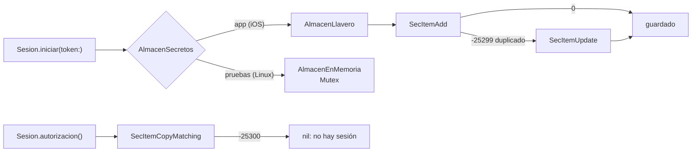
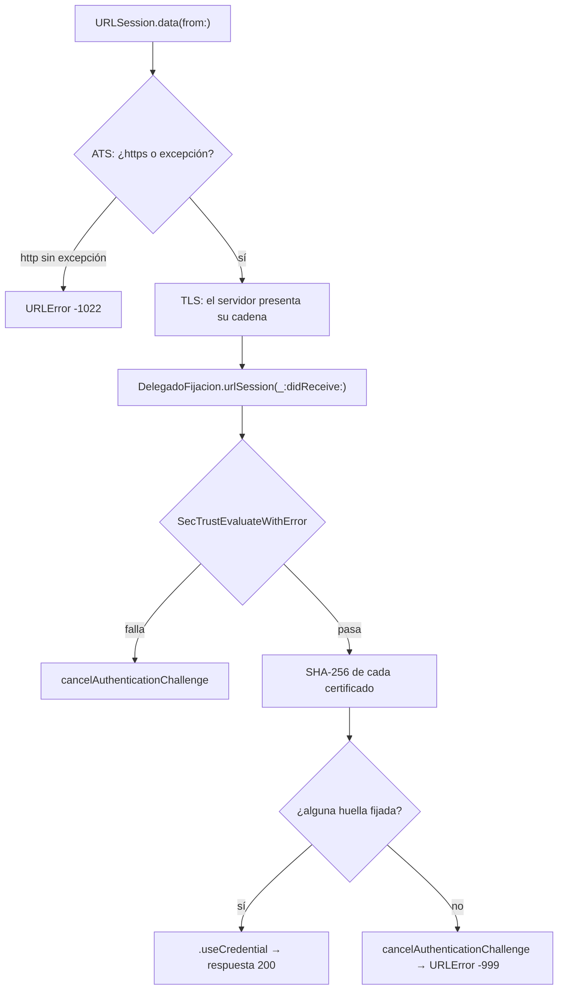
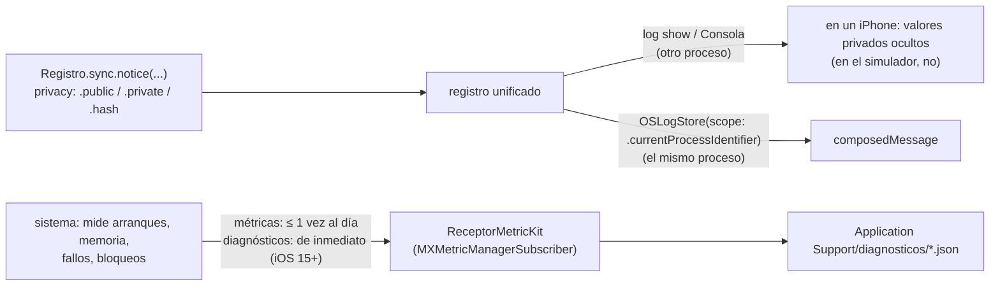
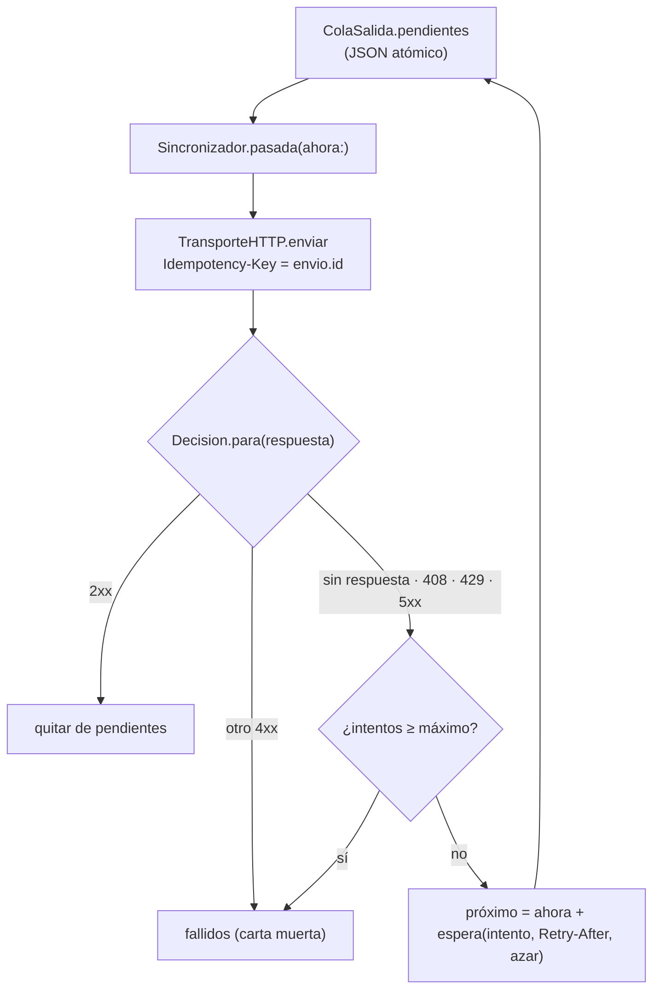

# Módulo 13: iOS en producción: seguridad, sincronización y operación

**Entorno comprobado para esta edición (2026-11-25):** lo que es Swift puro (el contrato del almacén de secretos,
la política de fijación, la cola de envíos con reintentos y su servidor de desarrollo) se compiló y se probó con
Swift 6.4.3 en Linux x86_64, en `/home/estudiante/labs/ios/ios13` (tu `~/labs/ios/ios13`): 10 pruebas, un servidor
HTTP real en `127.0.0.1:8246` y `8247`, y un servidor HTTPS con OpenSSL en `8245`. Lo que solo existe en las
plataformas de Apple (el llavero, `URLSessionDelegate` con `SecTrust` y CryptoKit, App Transport Security,
`os.Logger` y MetricKit) se ejecuta en una Mac con Xcode 27.2 (27B52), Swift 6.4.2 y el simulador iPhone 17 con
iOS 27.2, con el script `mac.sh` del laboratorio; la fijación se prueba contra `https://www.apple.com`, así que esa
prueba necesita internet. Límites honestos: MetricKit no entrega informes en el simulador (solo se comprueba que el
receptor se registra y compila, y se explica con la documentación de Apple), y el llavero del simulador no tiene
Secure Enclave ni código de desbloqueo.

El Módulo 12 dejó una app que funciona. Este módulo la prepara para la calle: el token de sesión no puede quedar en
un archivo, la app solo debe hablar con su servidor, el equipo necesita enterarse de qué pasa en teléfonos ajenos
sin leer datos personales, y una entrega marcada en un sótano sin señal no se puede perder ni enviarse dos veces.

**Al terminar este módulo podrás:**
- guardar secretos en el llavero con la accesibilidad correcta y manejar sus códigos de error;
- explicar qué exige App Transport Security y fijar certificados con el delegado de `URLSession`;
- registrar con `os.Logger` sin filtrar datos personales y recibir informes de MetricKit;
- enviar acciones hechas sin conexión con una cola persistente, reintentos con retroceso e idempotencia.

**Esquema del módulo:** Tema 1 (secretos en el llavero) → Tema 2 (seguridad en tránsito: ATS y fijación) → Tema 3
(operación: registro y diagnósticos) → Tema 4 (sincronización con reintentos) → Proyecto 50.

**Qué necesitas saber antes:** del Módulo 12, **la app por capas y su servidor de desarrollo**; del Módulo 11, **el
manifiesto de privacidad y `Info.plist`**; del Módulo 5, **`URLSession` y `URLError`**; del Módulo 4, **actores,
`Sendable` y `Task.sleep`**; del Módulo 9, **Swift Testing y las pruebas alojadas en la app**.

**Qué no se repite:** el servidor HTTP mínimo (Módulo 12, Tema 2), las capas y la copia local (Módulo 12), el
manifiesto de privacidad (Módulo 11). Tampoco se tratan aquí los permisos de cámara y ubicación, Face ID, las
notificaciones push ni Core Location: cada uno tiene su propia API y no cambia lo que se aprende en este módulo.

**Prepara el proyecto:**

```text
$ mkdir -p ~/labs/ios/ios13 && cd ~/labs/ios/ios13
$ mkdir -p nucleo/Sources/Produccion/{Seguridad,Sincronizacion} nucleo/Sources/{ServidorLocal,servidor-entregas,demo-sync,probar-tls}
$ mkdir -p nucleo/Tests/ProduccionTests
$ cp ../ios12/nucleo/Sources/ServidorLocal/ServidorHTTP.swift nucleo/Sources/ServidorLocal/
```

En la Mac, el laboratorio trae el proyecto de Xcode `Despacho` (identificador `com.academia.despacho`) en `app/`.
A diferencia del Módulo 12, este proyecto se firma «para ejecutar localmente» (`CODE_SIGN_IDENTITY = "-"`), sin
cuenta de desarrollador: el llavero del simulador necesita una app firmada, aunque sea así.

```text
ios13/
├── nucleo/Sources/Produccion/Seguridad/       AlmacenSecretos, Sesion, PoliticaFijacion
├── nucleo/Sources/Produccion/Sincronizacion/  EnvioPendiente, ColaSalida, Reintentos, Sincronizador, TransporteHTTP
├── nucleo/Sources/ServidorLocal/              ServidorHTTP (del Módulo 12) y ServidorEntregas
├── app/App/                                   AlmacenLlavero, DelegadoFijacion, Registro, ReceptorMetricKit, UI/
├── app/Pruebas/                               llavero, red, registro, MetricKit y capturas
├── tls_local.sh · demo_sync.sh · mac.sh
```


## Aprende construyendo


### Tema 1: Secretos en el llavero (Keychain) · Intermedio · 40 min

<details open>
<summary><strong>Capa 1 — Lectura</strong></summary>

#### Objetivos
Al terminar este tema podrás:
- separar el contrato «guardar un secreto» de su implementación con un protocolo `Sendable`;
- guardar, leer, reemplazar y borrar un token con `SecItemAdd`, `SecItemCopyMatching`, `SecItemUpdate` y
  `SecItemDelete`;
- elegir la accesibilidad del elemento (`kSecAttrAccessibleAfterFirstUnlockThisDeviceOnly`) y explicar por qué;
- interpretar los códigos `OSStatus` del llavero, en especial el duplicado y el «no encontrado».

**Conceptos clave:** llavero, elemento de contraseña genérica, accesibilidad, `OSStatus`, almacén en memoria

#### El problema
Una revisión de seguridad encuentra el token de la sesión del repartidor en `UserDefaults`, es decir, en un `.plist`
de texto dentro del contenedor de la app, que se copia tal cual en los respaldos del computador. Con ese token,
cualquiera puede marcar entregas a nombre de otra persona. Al moverlo al llavero, la primera versión falla la
segunda vez que alguien inicia sesión: `SecItemAdd` devuelve `-25299` y nadie sabe qué significa.

Este tema usa **protocolos y `Sendable`** (Módulos 0 y 4) y **los errores tipados** (Módulo 5).

#### Glosario del tema

**llavero (Keychain)**
- **Definición técnica:** base de datos cifrada del sistema para secretos pequeños (contraseñas, tokens, claves), a la que se accede con las funciones `SecItem…` de Security.
- **En palabras sencillas:** la caja fuerte del teléfono, con una gaveta por app.
- **Dónde se rompe la comparación:** sobrevive a desinstalar la app en algunos casos y se puede compartir entre apps del mismo equipo; no es «borrar la app y empezar de cero».
- **Ejemplo:** el token `tok_9f8e7d` del repartidor.
- **Error típico:** guardar el token en `UserDefaults`, en un archivo o en el código.

**elemento de contraseña genérica**
- **Definición técnica:** elemento de clase `kSecClassGenericPassword` identificado por servicio (`kSecAttrService`) y cuenta (`kSecAttrAccount`), con los bytes en `kSecValueData`.
- **En palabras sencillas:** una ficha con dos etiquetas («de qué app» y «qué secreto») y el secreto adentro.
- **Dónde se rompe la comparación:** servicio y cuenta forman la clave única: agregar otra ficha con las mismas etiquetas es un error, no un reemplazo.
- **Ejemplo:** servicio `com.academia.despacho`, cuenta `token-sesion`.
- **Error típico:** incluir `kSecValueData` en la consulta de búsqueda o de borrado.

**accesibilidad**
- **Definición técnica:** atributo `kSecAttrAccessible` que dice cuándo se puede leer el elemento; `…AfterFirstUnlockThisDeviceOnly` permite leerlo desde el primer desbloqueo tras encender (también en segundo plano) y nunca se migra a otro dispositivo.
- **En palabras sencillas:** a qué horas abre la caja fuerte y si viaja en la mudanza.
- **Dónde se rompe la comparación:** «más restrictivo» no siempre es mejor: con `WhenUnlocked`, una sincronización en segundo plano con la pantalla bloqueada no puede leer el token.
- **Ejemplo:** el token se usa en segundo plano para enviar la cola (Tema 4), así que no puede ser `WhenUnlocked`.
- **Error típico:** no poner el atributo y quedarse con el valor por defecto sin saber cuál es.

**`OSStatus`**
- **Definición técnica:** entero que devuelven las funciones de Security: `errSecSuccess` (0), `errSecDuplicateItem` (−25299), `errSecItemNotFound` (−25300), entre otros; `SecCopyErrorMessageString` da su descripción.
- **En palabras sencillas:** el código del cajero cuando algo sale mal.
- **Dónde se rompe la comparación:** «no encontrado» al leer o al borrar no es un error para la app: es «no hay sesión».
- **Ejemplo:** la salida de `llavero.txt` en la Mac.
- **Error típico:** `guard estado == errSecSuccess else { fatalError() }`.

**almacén en memoria**
- **Definición técnica:** `AlmacenEnMemoria`, otra implementación de `AlmacenSecretos` con un diccionario protegido por `Mutex`, para pruebas y para Linux.
- **En palabras sencillas:** una caja de cartón con la misma forma que la caja fuerte, para ensayar.
- **Dónde se rompe la comparación:** no cifra ni persiste: jamás se usa en la app publicada.
- **Ejemplo:** `Sesion(almacen: AlmacenEnMemoria())` en `SeguridadTests`.
- **Error típico:** declararlo `Sendable` con un `var` sin protección (error de compilación de abajo).

#### ► CÓMO FUNCIONA

##### 1. La idea en lenguaje sencillo

Piensa en la llave de la bodega de la empresa. No la dejas pegada con cinta en la puerta ni en una nota del
escritorio. La guardas en una caja fuerte que solo abre quien conoce la combinación. Y si la cambias por una nueva,
reemplazas la vieja en la misma gaveta, no agregas una segunda.

El **token de sesión** es esa llave en la app de reparto. Quien lo tiene puede marcar entregas a nombre del
repartidor. El problema del tema lo encontró en `UserDefaults`, un archivo de texto que se copia tal cual en los
respaldos del computador. Cualquiera con acceso a un respaldo podía leerlo.

iOS ofrece la caja fuerte: el **llavero**. Este tema mueve el token allí, detrás de un protocolo que permite
probar la lógica en Linux. También explica el código `-25299` que hizo fallar el segundo inicio de sesión.

##### 2. Definición formal y vocabulario

El **llavero** (Keychain) es una base de datos cifrada del sistema para secretos pequeños: contraseñas, tokens y
claves. Se accede con las funciones `SecItem…` del framework Security, y cada app ve solo sus propios elementos.

Un **elemento de contraseña genérica** es un registro de clase `kSecClassGenericPassword`. Se identifica por dos
atributos, el servicio (`kSecAttrService`) y la cuenta (`kSecAttrAccount`), y guarda los bytes en
`kSecValueData`.

La **accesibilidad** es el atributo `kSecAttrAccessible`. Dice desde cuándo se puede leer el elemento y si puede
salir del dispositivo. La app usa `kSecAttrAccessibleAfterFirstUnlockThisDeviceOnly`.

**`OSStatus`** es el entero que devuelve cada función de Security. `errSecSuccess` vale 0, `errSecDuplicateItem`
vale −25299 y `errSecItemNotFound` vale −25300. `SecCopyErrorMessageString` da su descripción.

El **almacén en memoria** es otra implementación del mismo protocolo, `AlmacenEnMemoria`. Guarda un diccionario
protegido por `Mutex` y sirve para probar en Linux, donde no hay llavero.

##### 3. Cómo funciona por dentro, paso a paso

La sesión solo conoce el protocolo; la implementación decide dónde vive el secreto:



1. **Declaras el contrato.** `AlmacenSecretos` es un protocolo `Sendable` con `guardar`, `leer` y `borrar`. Cada
   uno lanza solo `ErrorAlmacen`, que envuelve el `OSStatus`.
2. **Armas la consulta.** Para el llavero, un elemento es un diccionario de atributos. La consulta que lo identifica
   lleva solo tres claves: clase, servicio y cuenta.
3. **Agregas.** `SecItemAdd` recibe la consulta más los datos y la accesibilidad. El sistema cifra los bytes con una
   clave de la clase de protección elegida. Los guarda en su propia base de datos, fuera del contenedor de la app.
4. **Manejas el duplicado.** Servicio y cuenta forman la clave única. Si ya existe un elemento con esas etiquetas,
   `SecItemAdd` no reemplaza: devuelve −25299. Por eso `guardar` hace esto.

```swift
var estado = SecItemAdd(nuevo as CFDictionary, nil)
if estado == errSecDuplicateItem {
    let cambios = [kSecValueData as String: datos]
    estado = SecItemUpdate(consulta(cuenta) as CFDictionary, cambios as CFDictionary)
}
guard estado == errSecSuccess else { throw .estado(estado) }
```

   La primera llamada intenta agregar. Si el elemento existía, `SecItemUpdate` cambia solo sus datos. Cualquier
   otro código se convierte en un error tipado.
5. **Lees.** `SecItemCopyMatching` recibe la consulta más `kSecReturnData` y `kSecMatchLimitOne`. Si encuentra el
   elemento, descifra los bytes y los devuelve en un `CFTypeRef`, que conviertes a `Data`. Si no, devuelve −25300,
   y `leer` responde `nil`.
6. **Borras.** `SecItemDelete` con la misma consulta. «No encontrado» tampoco es error aquí: cerrar sesión dos
   veces debe funcionar.

La salida real del simulador muestra la secuencia cruda: 0 la primera vez, −25299 la segunda, 0 al borrar y −25300
al buscar lo borrado.

##### 4. Reglas, variantes y casos límite

**La accesibilidad por defecto.** Si no fijas `kSecAttrAccessible`, la documentación de Apple dice que el valor es
`kSecAttrAccessibleWhenUnlocked`. Con él, una tarea en segundo plano con la pantalla bloqueada no puede leer el
token. La cola del Tema 4 necesita leerlo así, por eso la app elige `AfterFirstUnlock`.

**`ThisDeviceOnly`.** Los valores con ese sufijo nunca salen del dispositivo: no viajan a otro teléfono en un
respaldo ni en el llavero de iCloud. Para un token de sesión es lo correcto: en otro teléfono, la persona inicia
sesión de nuevo.

**Valores obsoletos.** `kSecAttrAccessibleAlways` y su variante `ThisDeviceOnly` quedaron obsoletos en iOS 12. No
los uses en código nuevo.

**Qué va en cada consulta.** La búsqueda y el borrado llevan solo lo que identifica el elemento. Los datos y la
accesibilidad van solo al agregar o al actualizar; el glosario marca lo contrario como error típico.

**El llavero sobrevive a la app.** En iOS, borrar la app no garantiza borrar sus elementos del llavero. Si
necesitas empezar de cero tras reinstalar, detecta la primera ejecución y borra los elementos tú mismo.

**Compartir entre apps.** Con un grupo de acceso (`kSecAttrAccessGroup`), apps del mismo equipo comparten
elementos. Sin él, cada app ve solo los suyos.

**Llamadas que bloquean.** Las funciones `SecItem…` son síncronas y pueden tardar. Evita llamarlas en bucle desde
el hilo principal mientras se dibuja la interfaz.

**El simulador no es un iPhone.** Su llavero no tiene Secure Enclave ni código de desbloqueo, como advierte la
cabecera del módulo. Las clases de protección se comprueban de verdad solo en un dispositivo.

##### 5. Relación con lo que ya sabes y lo que viene

El protocolo con una implementación real y otra de prueba repite el patrón de `FuenteRemota` del Módulo 12, Tema
2. El `Mutex` de `AlmacenEnMemoria` aplica `Sendable` del Módulo 4, Tema 4: un `var` sin protección en una clase
`Sendable` no compila. `throws(ErrorAlmacen)` usa los errores tipados del Módulo 5.

No confundas este llavero con el de la Mac del Módulo 11, Tema 3. Aquel guarda la clave privada que firma la app;
este guarda los secretos de la persona usuaria dentro de la app. Tampoco lo confundas con `UserDefaults`, del
Módulo 6: allí van preferencias, nunca credenciales.

El token guardado aquí viaja en la cabecera `Authorization`. El Tema 2 protege ese viaje con App Transport Security
y fijación de certificados. El Tema 4 lo lee en segundo plano para enviar la cola.

#### Problema resuelto 1.1
Define el contrato del almacén de secretos y la sesión, pruébalos en Linux con el almacén en memoria y escribe la
implementación sobre el llavero. En el simulador, prueba la sesión de punta a punta y registra los códigos reales
de llamar dos veces a `SecItemAdd`.

**Razonamiento:**
1. El protocolo usa `throws(ErrorAlmacen)`: quien lo use sabe que el único error posible lleva un `OSStatus`.
2. `AlmacenEnMemoria` cumple el protocolo con métodos que no lanzan (un método que no lanza satisface un requisito
   que sí lanza).
3. `guardar` en el llavero trata `errSecDuplicateItem` como «actualizar», y `leer` trata `errSecItemNotFound` como
   `nil`.
4. Las consultas solo llevan clase, servicio y cuenta; los datos y la accesibilidad van solo al agregar.
5. Una prueba sin envoltorio llama dos veces a `SecItemAdd` para ver el código crudo, y escribe todo en
   `llavero.txt`.

```swift
// Seguridad/Secretos.swift — dónde se guarda el token de sesión. La app usa el llavero (AlmacenLlavero, en la
// Mac); las pruebas en Linux, un almacén en memoria con el mismo contrato.
import Foundation
import Synchronization

public enum ErrorAlmacen: Error, Equatable, Sendable {
    case estado(Int32)  // el OSStatus del llavero, p. ej. -25299 (errSecDuplicateItem)
}

public protocol AlmacenSecretos: Sendable {
    /// Guarda o reemplaza el secreto de esa cuenta.
    func guardar(_ datos: Data, cuenta: String) throws(ErrorAlmacen)
    /// `nil` si no existe.
    func leer(cuenta: String) throws(ErrorAlmacen) -> Data?
    /// No falla si no existía.
    func borrar(cuenta: String) throws(ErrorAlmacen)
}

public final class AlmacenEnMemoria: AlmacenSecretos {
    private let secretos = Mutex<[String: Data]>([:])

    public init() {}
    public func guardar(_ datos: Data, cuenta: String) { secretos.withLock { $0[cuenta] = datos } }
    public func leer(cuenta: String) -> Data? { secretos.withLock { $0[cuenta] } }
    public func borrar(cuenta: String) { secretos.withLock { $0[cuenta] = nil } }
}

/// La sesión del repartidor: el token vive en el almacén, nunca en UserDefaults ni en un archivo.
public struct Sesion: Sendable {
    let almacen: any AlmacenSecretos
    let cuenta = "token-sesion"

    public init(almacen: any AlmacenSecretos) { self.almacen = almacen }

    public func iniciar(token: String) throws(ErrorAlmacen) { try almacen.guardar(Data(token.utf8), cuenta: cuenta) }
    public func cerrar() throws(ErrorAlmacen) { try almacen.borrar(cuenta: cuenta) }

    /// «Bearer …» para la cabecera Authorization, o `nil` si no hay sesión.
    public func autorizacion() throws(ErrorAlmacen) -> String? {
        try almacen.leer(cuenta: cuenta).map { "Bearer " + String(decoding: $0, as: UTF8.self) }
    }
}
```

```swift
// SeguridadTests.swift — la sesión sobre un almacén de secretos y la política de fijación.
import Foundation
import Testing

@testable import Produccion

@Test func laSesionGuardaYBorraElToken() throws {
    let sesion = Sesion(almacen: AlmacenEnMemoria())
    #expect(try sesion.autorizacion() == nil)
    try sesion.iniciar(token: "tok_9f8e7d")
    #expect(try sesion.autorizacion() == "Bearer tok_9f8e7d")
    try sesion.iniciar(token: "tok_nuevo")  // guardar dos veces reemplaza
    #expect(try sesion.autorizacion() == "Bearer tok_nuevo")
    try sesion.cerrar()
    #expect(try sesion.autorizacion() == nil)
}

let hoja = "Y2VydGlmaWNhZG8taG9qYS1kZS1wcnVlYmEtMDAwMDA="
let intermedio = "aW50ZXJtZWRpby1kZS1wcnVlYmEtMDAwMDAwMDAwMDA="
let respaldo = "cmVzcGFsZG8tZGUtcHJ1ZWJhLTAwMDAwMDAwMDAwMDA="

@Test func aceptaSiAlgunCertificadoDeLaCadenaEstaFijado() {
    let politica = PoliticaFijacion(pines: [intermedio, respaldo])
    #expect(politica.acepta(cadena: [hoja, intermedio]))
    #expect(!politica.acepta(cadena: [hoja]))
    #expect(!politica.acepta(cadena: []))
    #expect(politica.problemas.isEmpty)
}

@Test func unSoloPinEsUnProblema() {
    #expect(
        PoliticaFijacion(pines: [hoja]).problemas == ["solo 1 pin: agrega uno de respaldo (la clave o CA siguiente)"])
    #expect(PoliticaFijacion(pines: [hoja, "abc"]).problemas.count == 1)
}
```

Las pruebas del paquete en Linux (las de este tema son `laSesionGuardaYBorraElToken` y las dos de fijación, que se
usan en el Tema 2):

```text
$ swift test 2>&1 | grep -E '✔ Test|✘|error:|primer envío'
✔ Test laColaSobreviveAUnReinicio() passed after 0.011 seconds.
✔ Test laSesionGuardaYBorraElToken() passed after 0.011 seconds.
✔ Test trasElMaximoVaALosFallidos() passed after 0.011 seconds.
✔ Test unSoloPinEsUnProblema() passed after 0.011 seconds.
✔ Test sinRedNoInsisteConLosDemasEnLaMismaPasada() passed after 0.011 seconds.
✔ Test aceptaSiAlgunCertificadoDeLaCadenaEstaFijado() passed after 0.011 seconds.
✔ Test retrocesoExponencialConTopeYRetryAfter() passed after 0.011 seconds.
✔ Test decisionPorCodigo(codigo:esperada:) with 8 test cases passed after 0.011 seconds.
✔ Test reintentaConLaMismaClaveHastaLograrlo() passed after 0.012 seconds.
primer envío: RespuestaEnvio(codigo: nil, reintentarEn: nil) tras 1004 ms
✔ Test unaRespuestaPerdidaNoDuplicaLaEntrega() passed after 2.069 seconds.
✔ Test run with 10 tests in 0 suites passed after 2.069 seconds.
```

La implementación sobre el llavero y sus pruebas en el simulador:

```swift
// Seguridad/AlmacenLlavero.swift — el almacén de secretos sobre el llavero (Keychain) de iOS.
import Foundation
import Security

struct AlmacenLlavero: AlmacenSecretos {
    let servicio: String

    /// Lo que identifica el elemento: una contraseña genérica de este servicio y esta cuenta.
    private func consulta(_ cuenta: String) -> [String: Any] {
        [
            kSecClass as String: kSecClassGenericPassword,
            kSecAttrService as String: servicio,
            kSecAttrAccount as String: cuenta,
        ]
    }

    func guardar(_ datos: Data, cuenta: String) throws(ErrorAlmacen) {
        var nuevo = consulta(cuenta)
        nuevo[kSecValueData as String] = datos
        // Legible tras el primer desbloqueo (sirve en segundo plano) y nunca sale de este dispositivo.
        nuevo[kSecAttrAccessible as String] = kSecAttrAccessibleAfterFirstUnlockThisDeviceOnly
        var estado = SecItemAdd(nuevo as CFDictionary, nil)
        if estado == errSecDuplicateItem {  // ya existía: se actualiza en lugar de agregar
            let cambios = [kSecValueData as String: datos]
            estado = SecItemUpdate(consulta(cuenta) as CFDictionary, cambios as CFDictionary)
        }
        guard estado == errSecSuccess else { throw .estado(estado) }
    }

    func leer(cuenta: String) throws(ErrorAlmacen) -> Data? {
        var q = consulta(cuenta)
        q[kSecReturnData as String] = true
        q[kSecMatchLimit as String] = kSecMatchLimitOne
        var resultado: CFTypeRef?
        let estado = SecItemCopyMatching(q as CFDictionary, &resultado)
        if estado == errSecItemNotFound { return nil }
        guard estado == errSecSuccess else { throw .estado(estado) }
        return resultado as? Data
    }

    func borrar(cuenta: String) throws(ErrorAlmacen) {
        let estado = SecItemDelete(consulta(cuenta) as CFDictionary)
        guard estado == errSecSuccess || estado == errSecItemNotFound else { throw .estado(estado) }
    }
}
```

```swift
// LlaveroTests.swift — el llavero real del simulador: guardar, leer, reemplazar, borrar y sus códigos.
import Foundation
import Security
import Testing

@testable import Despacho

@Suite(.serialized)
struct LlaveroTests {
    let almacen = AlmacenLlavero(servicio: "com.academia.despacho.pruebas")

    func mensaje(_ estado: OSStatus) -> String {
        "\(estado) (\(SecCopyErrorMessageString(estado, nil) as String? ?? "sin descripción"))"
    }

    @Test func sesionEnElLlavero() throws {
        let sesion = Sesion(almacen: almacen)
        try sesion.cerrar()
        #expect(try sesion.autorizacion() == nil)
        try sesion.iniciar(token: "tok_9f8e7d")
        try sesion.iniciar(token: "tok_nuevo")  // la segunda vez entra por SecItemUpdate
        #expect(try sesion.autorizacion() == "Bearer tok_nuevo")
        try sesion.cerrar()
        #expect(try sesion.autorizacion() == nil)
    }

    @Test func codigosDelLlaveroSinEnvoltorio() throws {
        // Lo que pasa si se llama a SecItemAdd dos veces sin manejar el duplicado.
        let elemento: [String: Any] = [
            kSecClass as String: kSecClassGenericPassword,
            kSecAttrService as String: "com.academia.despacho.crudo",
            kSecAttrAccount as String: "token-sesion",
            kSecValueData as String: Data("tok_1".utf8),
        ]
        _ = SecItemDelete(elemento as CFDictionary)  // por si quedó de una ejecución anterior
        let primero = SecItemAdd(elemento as CFDictionary, nil)
        let segundo = SecItemAdd(elemento as CFDictionary, nil)
        let borrado = SecItemDelete(elemento as CFDictionary)
        var nada: CFTypeRef?
        var buscar = elemento
        buscar.removeValue(forKey: kSecValueData as String)
        buscar[kSecReturnData as String] = true
        let leerBorrado = SecItemCopyMatching(buscar as CFDictionary, &nada)
        try escribirSalida(
            "llavero.txt",
            [
                "SecItemAdd (primera vez):   \(mensaje(primero))",
                "SecItemAdd (segunda vez):   \(mensaje(segundo))",
                "SecItemDelete:              \(mensaje(borrado))",
                "SecItemCopyMatching (borrado): \(mensaje(leerBorrado))",
            ])
        #expect(primero == errSecSuccess)
        #expect(segundo == errSecDuplicateItem)
        #expect(leerBorrado == errSecItemNotFound)
    }
}
```

```text
SecItemAdd (primera vez):   0 (Ningún error.)
SecItemAdd (segunda vez):   -25299 (El ítem especificado ya existe en este llavero.)
SecItemDelete:              0 (Ningún error.)
SecItemCopyMatching (borrado): -25300 (No se ha podido encontrar el ítem especificado en el llavero.)
```

Todas las pruebas del módulo en el simulador (la parte de Swift Testing del registro de `xcodebuild test`, que
terminó en `** TEST SUCCEEDED **`); las de los Temas 2 a 4 se comentan en su tema:

```text
$ grep -E '✔ Test|✘|Test run with' _test.log
✔ Test reintentaConLaMismaClaveHastaLograrlo() passed after 0.011 seconds.
✔ Test retrocesoExponencialConTopeYRetryAfter() passed after 0.010 seconds.
✔ Test metricKitEnElSimulador() passed after 0.010 seconds.
✔ Test unSoloPinEsUnProblema() passed after 0.011 seconds.
✔ Test laSesionGuardaYBorraElToken() passed after 0.016 seconds.
✔ Test aceptaSiAlgunCertificadoDeLaCadenaEstaFijado() passed after 0.016 seconds.
✔ Test trasElMaximoVaALosFallidos() passed after 0.016 seconds.
✔ Test decisionPorCodigo(codigo:esperada:) with 8 test cases passed after 0.016 seconds.
✔ Test laColaSobreviveAUnReinicio() passed after 0.016 seconds.
✔ Test sinRedNoInsisteConLosDemasEnLaMismaPasada() passed after 0.016 seconds.
✔ Test sesionEnElLlavero() passed after 0.102 seconds.
✔ Test codigosDelLlaveroSinEnvoltorio() passed after 0.007 seconds.
✔ Test atsBloqueaHTTPSinExcepciones() passed after 0.639 seconds.
✔ Test fijacionContraUnServidorReal() passed after 0.169 seconds.
✔ Test conPendientesYFallidos() passed after 0.970 seconds.
✔ Test mensajesConPrivacidad() passed after 1.265 seconds.
✔ Test todoEnviado() passed after 0.897 seconds.
✔ Test sinSesionOscuro() passed after 0.879 seconds.
✔ Test run with 18 tests in 3 suites passed after 2.760 seconds.
```

Y lo que pasa si el almacén en memoria se escribe con un `var` sin protección (primer error de
`errores/sendable`):

```swift
import Foundation
import Synchronization

// 1. Un almacén de secretos «Sendable» con un diccionario mutable sin protección.
final class AlmacenConVar: Sendable {
    var secretos: [String: Data] = [:]
}

// 2. Pasar un Mutex como parámetro, como si fuera un valor cualquiera.
struct Estado { var aplicadas: [String: Int] = [:] }

func contar(_ estado: Mutex<Estado>) -> Int {
    estado.withLock { $0.aplicadas.count }
}
```

```text
$ swift build 2>&1 | grep -E '^/.*error:' | sed 's#.*/Sources/#Sources/#'
Sources/E/Errores.swift:6:9: error: stored property 'secretos' of 'Sendable'-conforming class 'AlmacenConVar' is mutable
Sources/E/Errores.swift:12:23: error: parameter of noncopyable type 'Mutex<Estado>' must specify ownership
```

**Explicación por partes.**
- **En Linux**, `laSesionGuardaYBorraElToken` pasa: guardar dos veces reemplaza («Bearer tok_nuevo») y cerrar sesión
  deja `nil`. Es el mismo contrato que cumple el llavero.
- **En el simulador** pasaron `sesionEnElLlavero` (0,102 s) y `codigosDelLlaveroSinEnvoltorio`. Los códigos crudos
  son los esperados: 0 («Ningún error.») la primera vez, −25299 («El ítem especificado ya existe en este llavero.»)
  la segunda, 0 al borrar y −25300 («No se ha podido encontrar el ítem especificado en el llavero.») al buscar lo
  borrado. Las descripciones salen en español porque `SecCopyErrorMessageString` usa el idioma del sistema.
- **La firma «para ejecutar localmente» bastó:** `codesign -dv` sobre la app instalada dice `Signature=adhoc` y
  `TeamIdentifier=not set`, y no apareció el −34018 (falta de permiso del llavero).
- **El error de compilación** (línea 6): una clase `Sendable` no puede tener un `var` desprotegido, porque dos hilos
  podrían escribir el diccionario a la vez. `AlmacenEnMemoria` lo resuelve con `Mutex<[String: Data]>`; el segundo
  error de ese archivo es del Tema 4.

> **Error común.** Llamar a `SecItemAdd` sin manejar el duplicado. La primera vez funciona, la segunda devuelve
> −25299 y el token nuevo no se guarda: la app sigue enviando el viejo, que el servidor ya invalidó.

> **Error común.** Tratar «no encontrado» como un fallo. Al leer sin sesión o al cerrar una sesión que ya no
> existe, −25300 significa «no había nada», y la app debe seguir (ir a la pantalla de ingreso), no mostrar un error.

> **Buena práctica.** Guarda en el llavero solo el secreto (el token), nunca datos que la app necesite mostrar.
> Y borra el token al cerrar sesión: el llavero puede conservarlo después de desinstalar la app.

> **Prevenir errores.** Prueba el contrato con el almacén en memoria en Linux y la implementación real en el
> simulador, con las mismas expectativas. Si la implementación del llavero cambia, las dos pruebas deben seguir
> diciendo lo mismo.

#### Checkpoint 1.1
La sincronización del Tema 4 corre en segundo plano con el teléfono bloqueado. ¿Qué pasaría si el token tuviera
`kSecAttrAccessibleWhenUnlocked`?

Respuesta: con el teléfono bloqueado, `SecItemCopyMatching` no podría leerlo; `Sesion.autorizacion()` lanzaría con
un `OSStatus` de error y los envíos saldrían sin token, o no saldrían. `AfterFirstUnlock` permite leerlo después del
primer desbloqueo desde que se encendió el teléfono.

</details>

<details>
<summary><strong>Capa 2 — Construcción</strong></summary>

#### Paso 1 · El contrato
Crea `Secretos.swift` y `SeguridadTests.swift` y ejecuta `swift test --filter laSesion`.

#### Paso 2 · Provoca el error de `Sendable`
Crea `errores/sendable` con la clase `AlmacenConVar` y ejecuta `swift build`. Lee el error y compáralo con
`AlmacenEnMemoria`.

#### Paso 3 · El llavero
En la Mac, crea `AlmacenLlavero.swift` y `LlaveroTests.swift`, y ejecuta las pruebas en el simulador.

#### Paso 4 · Sin manejar el duplicado
Quita el `if estado == errSecDuplicateItem { … }` de `guardar` y ejecuta `sesionEnElLlavero`. ¿Qué expectativa
falla?

#### Paso 5 · Varias cuentas
Agrega a `Sesion` un segundo secreto (`"clave-firma"`) y una prueba que compruebe que cerrar sesión borra los dos.

#### Resumen
- El **llavero** guarda secretos cifrados; cada **elemento de contraseña genérica** se identifica por servicio y
  cuenta.
- La **accesibilidad** decide cuándo se puede leer; para trabajo en segundo plano, `AfterFirstUnlockThisDeviceOnly`.
- Los **`OSStatus`** −25299 (duplicado) y −25300 (no encontrado) son parte del flujo normal.
- Un **almacén en memoria** con el mismo contrato permite probar la sesión en Linux.

#### Ejercicio verificable 1
Básico. ¿Qué devuelve `autorizacion()` después de `iniciar(token: "tok_nuevo")`?

Respuesta esperada: `"Bearer tok_nuevo"`.

#### Ejercicio verificable 2
Intermedio. En el Paso 2, ¿qué dice el error?

Respuesta esperada: `stored property 'secretos' of 'Sendable'-conforming class 'AlmacenConVar' is mutable`.

#### Ejercicio verificable 3
Reto. En el Paso 4, ¿qué pasa y por qué?

Respuesta esperada: la segunda llamada a `iniciar` lanza `ErrorAlmacen.estado(-25299)`: el elemento ya existe y
`SecItemAdd` no reemplaza. La prueba termina con ese error en la línea de `try sesion.iniciar(token: "tok_nuevo")`.

#### En el trabajo
Las auditorías de seguridad de apps (por ejemplo, con la guía MASVS de OWASP) revisan dónde se guardan los tokens y
con qué accesibilidad. En los equipos, el acceso al llavero se encapsula en un tipo como `AlmacenLlavero` y nadie
más llama a `SecItem…` directamente.

</details>

### Tema 2: Seguridad en tránsito: App Transport Security y fijación de certificados · Avanzado · 45 min

<details open>
<summary><strong>Capa 1 — Lectura</strong></summary>

#### Objetivos
Al terminar este tema podrás:
- decir qué exige App Transport Security (ATS) y qué pasa con una URL `http://`;
- explicar por qué un certificado propio falla y cómo se calcula su huella;
- fijar certificados en el delegado de `URLSession`, después de la evaluación normal del sistema;
- probar que la fijación acepta la cadena correcta y rechaza cualquier otra.

**Conceptos clave:** App Transport Security, evaluación de confianza, huella de certificado, fijación, pin de respaldo

#### El problema
Un repartidor usa el wifi de un centro comercial que intercepta el tráfico con un certificado instalado por el
administrador de la red. Para el sistema, ese certificado es de confianza; para la app, es un intermediario leyendo
tokens y entregas. Además, alguien dejó una URL `http://` para «pruebas» y no entiende por qué falla en el
simulador.

Este tema usa **`URLSession` y `URLError`** (Módulo 5), **`Info.plist`** (Módulo 11) y **el almacén de secretos**
(Tema 1).

#### Glosario del tema

**App Transport Security (ATS)**
- **Definición técnica:** política del sistema que exige que las conexiones de `URLSession` usen TLS 1.2 o superior, con certificados confiables y cifrados fuertes; las excepciones se declaran en `NSAppTransportSecurity` del `Info.plist`.
- **En palabras sencillas:** el guardia que no deja salir a la app sin cinturón.
- **Dónde se rompe la comparación:** según la documentación de Apple, no aplica a las API de red de bajo nivel (Network, CFNetwork); y la documentación dice que desde iOS 17 tampoco deja pasar direcciones IP sin excepción, aunque en el simulador de iOS 27.2 `http://127.0.0.1` pasó (ver la explicación de abajo).
- **Ejemplo:** `http://example.com/` falla con `URLError` −1022.
- **Error típico:** `NSAllowsArbitraryLoads = YES` para «que funcione», que además exige justificación al publicar.

**evaluación de confianza**
- **Definición técnica:** `SecTrustEvaluateWithError` comprueba la cadena hasta una autoridad de confianza, las fechas y que el nombre coincida con el servidor.
- **En palabras sencillas:** revisar que la cédula sea auténtica, esté vigente y sea de quien dice ser.
- **Dónde se rompe la comparación:** confía en **todas** las autoridades instaladas en el teléfono, también las que instaló una empresa o un administrador.
- **Ejemplo:** el certificado propio de `tls_local.sh` falla con `curl: (60) … self-signed certificate`.
- **Error típico:** saltarse esta evaluación y confiar solo en el pin.

**huella de certificado**
- **Definición técnica:** SHA-256 de la representación DER del certificado, en base64; en la app se calcula con CryptoKit y en la terminal con `openssl x509 -outform der | openssl dgst -sha256 -binary | base64`.
- **En palabras sencillas:** la huella digital del certificado: cambia si cambia cualquier byte.
- **Dónde se rompe la comparación:** cambia cada vez que el certificado se renueva, aunque la clave sea la misma. Fijar la clave pública dura más, pero exige extraerla en el formato correcto.
- **Ejemplo:** `GXeXLlf6D+UwKtXRxbg1MYGrQxBmwKd+Pa70PL/lRWU=` (44 caracteres).
- **Error típico:** fijar el SHA-1 que muestra el navegador, o la huella en hexadecimal.

**fijación de certificados**
- **Definición técnica:** en `urlSession(_:didReceive:)`, después de la evaluación normal, aceptar solo si alguna huella de la cadena está en la lista; si no, `.cancelAuthenticationChallenge` y la tarea falla con `URLError.cancelled` (−999).
- **En palabras sencillas:** además de que la cédula sea válida, debe ser una de las que tú conoces.
- **Dónde se rompe la comparación:** la documentación de Apple lo describe como «apretar» la evaluación: con ATS activo se puede endurecer, no aflojar.
- **Ejemplo:** `PoliticaFijacion(pines: [intermedio, respaldo])`.
- **Error típico:** `.useCredential` sin evaluar, que acepta cualquier certificado, incluso vencido.

**pin de respaldo**
- **Definición técnica:** una segunda huella que todavía no está en uso (la del próximo certificado, o la de otra autoridad), para que la renovación no deje a la app sin conexión.
- **En palabras sencillas:** la llave de repuesto escondida antes de cambiar la cerradura.
- **Dónde se rompe la comparación:** debe ser real: un respaldo inventado solo silencia la advertencia.
- **Ejemplo:** `PoliticaFijacion.problemas` avisa «solo 1 pin: agrega uno de respaldo».
- **Error típico:** fijar solo la hoja, que se renueva cada pocos meses.

#### ► CÓMO FUNCIONA

##### 1. La idea en lenguaje sencillo

Piensa en un mensajero que debe entregar un sobre en una oficina. Primero exige ir por una calle iluminada, no por
un callejón. Al llegar, pide la cédula a quien recibe y revisa que sea auténtica, que esté vigente y que el nombre
coincida. Y si la empresa le dio una lista de personas autorizadas, también comprueba que esté en ella.

Una conexión de red tiene los mismos tres controles. **App Transport Security** (ATS) exige la calle iluminada:
HTTPS en lugar de HTTP. La **evaluación de confianza** revisa la cédula del servidor, su certificado. La **fijación
de certificados** agrega la lista propia: el certificado no solo debe ser válido, debe ser uno de los que tu app
conoce.

El problema del tema muestra por qué el tercer control existe. En un wifi que intercepta el tráfico con un
certificado instalado por el administrador, la evaluación normal aprueba al intermediario. Solo la fijación lo
detecta.

##### 2. Definición formal y vocabulario

**App Transport Security** es la política del sistema que exige TLS 1.2 o superior, certificados confiables y
cifrados fuertes en las conexiones de `URLSession`. Las excepciones se declaran en la clave
`NSAppTransportSecurity` del `Info.plist`.

La **evaluación de confianza** es `SecTrustEvaluateWithError`. Comprueba que la cadena llegue a una autoridad de
confianza, que las fechas sean válidas y que el nombre coincida con el servidor. Confía en todas las autoridades
instaladas en el teléfono.

La **huella de certificado** es el SHA-256 de su representación DER, codificado en base64. Tiene 44 caracteres y
cambia si cambia un solo byte del certificado.

La **fijación** (*pinning*) consiste en aceptar la conexión solo si alguna huella de la cadena está en una lista
fija. Se hace en el delegado de `URLSession`, después de la evaluación normal.

El **pin de respaldo** es una segunda huella que todavía no está en uso. Evita que la renovación del certificado
deje a todas las versiones publicadas sin conexión.

##### 3. Cómo funciona por dentro, paso a paso

ATS decide antes de conectar; la fijación decide después de la evaluación del sistema:



1. **ATS revisa la URL.** Si es `http://` y no hay excepción, la petición falla antes de salir con `URLError`
   −1022. La salida real del simulador lo muestra con `http://example.com/`.
2. **El servidor presenta su cadena.** Durante el saludo TLS envía su certificado (la hoja) y los intermedios. La
   raíz ya está en el almacén del sistema.
3. **`URLSession` lanza un desafío.** Llama al delegado con un `URLAuthenticationChallenge` de tipo
   `NSURLAuthenticationMethodServerTrust`, que trae un `SecTrust` con la cadena.
4. **El delegado evalúa primero.** La fijación nunca reemplaza la evaluación del sistema; la endurece.

```swift
var error: CFError?
guard SecTrustEvaluateWithError(confianza, &error) else {
    return (.cancelAuthenticationChallenge, nil)
}
let cadena = (SecTrustCopyCertificateChain(confianza) as? [SecCertificate]) ?? []
```

   Si la cadena está vencida o es de otro dominio, se cancela aquí. Si pasa, `SecTrustCopyCertificateChain`
   devuelve los certificados en orden: hoja, intermedio y raíz.
5. **Calcula las huellas.** Para cada certificado obtiene sus bytes DER con `SecCertificateCopyData` y les aplica
   SHA-256 con CryptoKit. El resultado en base64 es lo mismo que calcula `openssl` en la terminal.
6. **Compara con la política.** `PoliticaFijacion.acepta(cadena:)` es una función pura que responde si alguna
   huella está en `pines`. Si acepta, el delegado devuelve `.useCredential`; si no, `.cancelAuthenticationChallenge`,
   y la tarea falla con `URLError` −999.

En la salida real, con el intermedio de `www.apple.com` fijado, la respuesta es 200. Con dos pines ajenos, la misma
petición termina en −999, «Operación cancelada».

##### 4. Reglas, variantes y casos límite

**Desde cuándo.** ATS existe desde iOS 9. `SecTrustEvaluateWithError` llegó en iOS 12, y
`SecTrustCopyCertificateChain` y la versión `async` del delegado, en iOS 15.

**Qué cubre ATS.** Según Apple, se aplica a `URLSession` y a las API que la usan, no a las de red de bajo nivel
como Network. La documentación dice que desde iOS 17 tampoco exime direcciones IP. En el simulador de iOS 27.2,
`http://127.0.0.1` pasó igual; no confíes en eso y declara `NSAllowsLocalNetworking`.

**Excepciones con costo.** `NSAllowsArbitraryLoads` desactiva ATS para todo, y la revisión de la App Store exige
justificarlo. Prefiere excepciones por dominio en `NSExceptionDomains`.

**Qué nivel fijar.** La hoja se renueva cada pocos meses. El intermedio cambia menos, y la raíz todavía menos, pero
fijar la raíz confía en todo lo que esa autoridad firme. El laboratorio fija el intermedio más un respaldo.

**Huella del certificado o de la clave.** La huella del certificado cambia en cada renovación, aunque la clave sea
la misma. Fijar la clave pública dura más, pero exige extraerla en el formato correcto.

**Fijación declarativa.** Desde iOS 14, la clave `NSPinnedDomains` del `Info.plist` permite fijar sin código. Fija
la clave pública de la autoridad o de la hoja. El delegado del tema es la variante programática, que además
registra lo que rechaza.

**Nunca `.useCredential` sin evaluar.** Esa respuesta acepta cualquier certificado, incluso vencido. Si desarrollo
necesita un certificado propio, la excepción debe depender del entorno del Módulo 11.

**Linux no es iOS.** En Linux, `FoundationNetworking` usa libcurl y devuelve −1 en lugar de −1202 ante un
certificado propio. Por eso la fijación con `SecTrust` solo se prueba en la Mac.

##### 5. Relación con lo que ya sabes y lo que viene

Este tema continúa `URLSession` y `URLError` del Módulo 5. Allí los errores venían de la red o del servidor; aquí
vienen de decisiones de seguridad: −1022 de ATS y −999 de tu propio delegado.

ATS ya apareció en el Módulo 12, Tema 4, cuando la app declaró `NSAllowsLocalNetworking` para el servidor embebido.
El revisor del Módulo 11, Tema 4, avisaba de `NSAllowsArbitraryLoads`; aquí entiendes qué desactiva.

No confundas cifrar con autenticar. TLS cifra el canal con cualquier certificado; la evaluación y la fijación
deciden con quién hablas. Lo que protegen es el token del Tema 1.

El delegado registra cada rechazo con un `fault` de `Registro.seguridad`. El Tema 3 explica ese registro y qué
datos no deben aparecer en él.

#### Problema resuelto 2.1
En Linux, levanta un servidor HTTPS con un certificado propio, comprueba quién lo acepta y calcula su huella.
Escribe la política de fijación (pura) y, en la Mac, el delegado que la aplica. En el simulador, comprueba qué
bloquea ATS y fija la cadena real de `www.apple.com`: primero solo observando, después con el intermedio fijado y
por último con pines ajenos.

**Razonamiento:**
1. `tls_local.sh` crea un certificado EC P-256 de 30 días para `localhost` y lo sirve con `openssl s_server` en el
   puerto 8245.
2. La política es pura (compara textos) y vive en el núcleo; calcular la huella necesita CryptoKit y Security, así
   que eso vive en la app.
3. El delegado primero llama a `SecTrustEvaluateWithError`; la fijación solo se mira si el sistema aprobó.
4. Se fija el intermedio (índice 1 de la cadena), que cambia menos que la hoja, más un pin de respaldo.
5. Para ATS se usa un servidor HTTP local de verdad en el simulador (puerto 8248): así se distingue «ATS lo
   bloqueó» de «no había nadie escuchando».

```bash
#!/bin/bash
# tls_local.sh — un servidor HTTPS con un certificado propio (no firmado por una CA): quién lo acepta y cómo
# se calcula su huella para fijarla.
cd "$(dirname "$0")" && mkdir -p certs && cd certs
openssl req -x509 -newkey ec -pkeyopt ec_paramgen_curve:prime256v1 -nodes -days 30 -subj "/CN=localhost" \
  -addext "subjectAltName=DNS:localhost" -keyout servidor.key -out servidor.crt 2> /dev/null
openssl s_server -accept 8245 -cert servidor.crt -key servidor.key -www -quiet > /dev/null 2>&1 & SERVIDOR=$!
sleep 1
echo "== 1. curl, confiando en las CA del sistema"
curl -sS https://localhost:8245/ -o /dev/null; echo "   código de salida de curl: $?"
echo "== 2. URLSession (FoundationNetworking), confiando en las CA del sistema"
../nucleo/.build/debug/probar-tls https://localhost:8245/
echo "== 3. curl, confiando SOLO en este certificado (lo que hace la fijación, a mano)"
curl -sS --cacert servidor.crt https://localhost:8245/ -o /dev/null -w "   respuesta %{http_code}\n"
echo "== 4. la huella para fijarlo: SHA-256 del certificado en DER, en base64"
openssl x509 -in servidor.crt -outform der | openssl dgst -sha256 -binary | base64
kill $SERVIDOR
```

```text
$ cd ~/labs/ios/ios13 && ./tls_local.sh
== 1. curl, confiando en las CA del sistema
curl: (60) SSL certificate problem: self-signed certificate
More details here: https://curl.se/docs/sslcerts.html

curl failed to verify the legitimacy of the server and therefore could not
establish a secure connection to it. To learn more about this situation and
how to fix it, please visit the web page mentioned above.
   código de salida de curl: 60
== 2. URLSession (FoundationNetworking), confiando en las CA del sistema
URLError -1: SSL certificate problem: self-signed certificate
== 3. curl, confiando SOLO en este certificado (lo que hace la fijación, a mano)
   respuesta 200
== 4. la huella para fijarlo: SHA-256 del certificado en DER, en base64
GXeXLlf6D+UwKtXRxbg1MYGrQxBmwKd+Pa70PL/lRWU=
```

```swift
// probar-tls — una petición HTTPS con URLSession, para ver qué pasa con un certificado que no es de confianza.
import Foundation

#if canImport(FoundationNetworking)
    import FoundationNetworking
#endif

let url = URL(string: CommandLine.arguments[1])!
do {
    let (datos, respuesta) = try await URLSession.shared.data(from: url)
    print("respuesta \((respuesta as? HTTPURLResponse)?.statusCode ?? 0): \(String(decoding: datos, as: UTF8.self))")
} catch let error as URLError {
    print("URLError \(error.code.rawValue): \(error.localizedDescription)")
}
```

```swift
// Seguridad/Fijacion.swift — la decisión de la fijación de certificados, separada de cómo se calculan las huellas.
// Una huella es el SHA-256 del certificado en DER, en base64 (como `openssl x509 -outform der | openssl dgst`).

public struct PoliticaFijacion: Sendable, Equatable {
    public let pines: Set<String>

    public init(pines: Set<String>) { self.pines = pines }

    /// Acepta si ALGÚN certificado de la cadena (hoja, intermedio o raíz) tiene una huella fijada.
    /// Se llama solo DESPUÉS de que la evaluación normal del sistema (fecha, nombre, cadena) aprobó.
    public func acepta(cadena huellas: [String]) -> Bool {
        huellas.contains { pines.contains($0) }
    }

    /// Una sola huella es una bomba de tiempo: cuando el certificado se renueve, la app deja de conectar.
    public var problemas: [String] {
        var p: [String] = []
        if pines.count < 2 { p.append("solo \(pines.count) pin: agrega uno de respaldo (la clave o CA siguiente)") }
        for pin in pines where pin.count != 44 || !pin.hasSuffix("=") {
            p.append("«\(pin.prefix(12))…» no parece un SHA-256 en base64 (44 caracteres)")
        }
        return p
    }
}
```

```swift
// Seguridad/DelegadoFijacion.swift — fijación de certificados con el delegado de URLSession.
import CryptoKit
import Foundation
import Security
import Synchronization

struct CertificadoVisto: Sendable, Equatable {
    let nombre: String
    let huella: String  // SHA-256 del DER en base64: lo mismo que calcula openssl en el Tema 2
}

final class DelegadoFijacion: NSObject, URLSessionDelegate, Sendable {
    /// `nil`: solo observa la cadena (para conocer las huellas); con política: fija.
    let politica: PoliticaFijacion?
    let vistos = Mutex<[CertificadoVisto]>([])

    init(politica: PoliticaFijacion?) {
        self.politica = politica
    }

    func urlSession(_ session: URLSession, didReceive challenge: URLAuthenticationChallenge) async
        -> (URLSession.AuthChallengeDisposition, URLCredential?)
    {
        guard challenge.protectionSpace.authenticationMethod == NSURLAuthenticationMethodServerTrust,
            let confianza = challenge.protectionSpace.serverTrust
        else { return (.performDefaultHandling, nil) }  // otros desafíos (usuario y clave…): lo normal

        // 1. Primero, la evaluación del sistema: cadena hasta una CA de confianza, fechas y nombre.
        var error: CFError?
        guard SecTrustEvaluateWithError(confianza, &error) else {
            let motivo = error.map { "\($0)" } ?? "?"
            Registro.seguridad.error("cadena no válida: \(motivo, privacy: .public)")
            return (.cancelAuthenticationChallenge, nil)
        }
        // 2. Después, la fijación: alguna huella de la cadena debe estar en la lista.
        let cadena = (SecTrustCopyCertificateChain(confianza) as? [SecCertificate]) ?? []
        let vistos = cadena.map {
            CertificadoVisto(
                nombre: SecCertificateCopySubjectSummary($0) as String? ?? "?",
                huella: Data(SHA256.hash(data: SecCertificateCopyData($0) as Data)).base64EncodedString())
        }
        self.vistos.withLock { $0 = vistos }
        guard let politica else { return (.useCredential, URLCredential(trust: confianza)) }
        if politica.acepta(cadena: vistos.map(\.huella)) {
            return (.useCredential, URLCredential(trust: confianza))
        }
        let servidor = challenge.protectionSpace.host
        Registro.seguridad.fault("fijación rechazada para \(servidor, privacy: .public)")
        return (.cancelAuthenticationChallenge, nil)
    }
}
```

```swift
// RedTests.swift — ATS y fijación de certificados con la pila de red real del simulador.
import Foundation
import Testing

@testable import Despacho

@Suite(.serialized)
struct RedTests {
    func probar(_ texto: String, sesion: URLSession = .shared) async -> String {
        do {
            let (_, respuesta) = try await sesion.data(from: URL(string: texto)!)
            return "\(texto) → respuesta \((respuesta as? HTTPURLResponse)?.statusCode ?? 0)"
        } catch let error as URLError {
            return "\(texto) → URLError \(error.code.rawValue): \(error.localizedDescription)"
        } catch {
            return "\(texto) → \(error)"
        }
    }

    @Test func atsBloqueaHTTPSinExcepciones() async throws {
        // Un servidor HTTP local de verdad, para separar «ATS lo bloqueó» de «no había nadie escuchando».
        let servidor = ServidorHTTP(puerto: 8248) { _ in .json(#"{"ok":true}"#) }
        try servidor.iniciar()
        defer { servidor.detener() }
        let lineas = [
            await probar("http://example.com/"),
            await probar("http://127.0.0.1:8248/"),
            await probar("http://localhost:8248/"),
            await probar("https://example.com/"),
        ]
        try escribirSalida("ats.txt", lineas)
        #expect(lineas[0].contains("URLError -1022"))
    }

    @Test func fijacionContraUnServidorReal() async throws {
        let url = "https://www.apple.com/"
        var lineas: [String] = []
        // 1. Observar: qué cadena presenta el servidor y sus huellas.
        let observador = DelegadoFijacion(politica: nil)
        let s1 = URLSession(configuration: .ephemeral, delegate: observador, delegateQueue: nil)
        lineas.append("1. sin fijar: " + (await probar(url, sesion: s1)))
        let cadena = observador.vistos.withLock { $0 }
        for (i, c) in cadena.enumerated() { lineas.append("   [\(i)] \(c.nombre): \(c.huella)") }
        s1.finishTasksAndInvalidate()
        try #require(cadena.count >= 2, "hace falta red para esta prueba")

        // 2. Fijar el intermedio (cambia menos que la hoja) y un respaldo.
        let respaldo = "UkVTUEFMRE8tREUtUFJVRUJBLTAwMDAwMDAwMDAwMDA="
        let bueno = DelegadoFijacion(politica: PoliticaFijacion(pines: [cadena[1].huella, respaldo]))
        let s2 = URLSession(configuration: .ephemeral, delegate: bueno, delegateQueue: nil)
        let conPin = await probar(url, sesion: s2)
        lineas.append("2. fijando el intermedio [1]: " + conPin)
        s2.finishTasksAndInvalidate()

        // 3. Pines que no son de esta cadena: como si un intermediario presentara otro certificado válido.
        let malo = DelegadoFijacion(
            politica: PoliticaFijacion(pines: [respaldo, "T1RSTy1QSU4tUVVFLU5PLUVTLURFLUVTVEEtQ0FERU5B"]))
        let s3 = URLSession(configuration: .ephemeral, delegate: malo, delegateQueue: nil)
        let sinPin = await probar(url, sesion: s3)
        lineas.append("3. con pines ajenos: " + sinPin)
        s3.finishTasksAndInvalidate()

        try escribirSalida("fijacion.txt", lineas)
        #expect(conPin.contains("respuesta 200"))
        #expect(sinPin.contains("URLError -999"))
    }
}
```

ATS en el simulador (la app no declara ninguna excepción):

```text
http://example.com/ → URLError -1022: The resource could not be loaded because the App Transport Security policy requires the use of a secure connection.
http://127.0.0.1:8248/ → respuesta 200
http://localhost:8248/ → respuesta 200
https://example.com/ → respuesta 200
```

La fijación contra `www.apple.com`:

```text
1. sin fijar: https://www.apple.com/ → respuesta 200
   [0] www.apple.com: NWZOxupb24Sh/4IGxSiPwEtCBxIZXFUjIME5WTJm/sI=
   [1] Apple Public EV Server RSA CA 1 - G1: NAylukAtFAtlosl2566BKKFQXCnRkODgNPWcyuepK8I=
   [2] DigiCert Global Root G2: yzzLt2Ax5eATj43TmiP53kf/w15DwRRM6ifUalqxy18=
2. fijando el intermedio [1]: https://www.apple.com/ → respuesta 200
3. con pines ajenos: https://www.apple.com/ → URLError -999: Operación cancelada
```

**Explicación por partes.**
- **`curl` (caso 1)** rechaza el certificado propio con el código 60 («self-signed certificate»): no lo firmó
  ninguna autoridad de su lista.
- **`URLSession` en Linux (caso 2)** también lo rechaza, pero con `URLError -1`, «unknown», y el mensaje de libcurl:
  `FoundationNetworking` usa libcurl por dentro y no traduce este fallo al −1202 (`serverCertificateUntrusted`) que
  da en iOS. Por eso las pruebas de fijación con `SecTrust` solo tienen sentido en la Mac.
- **`curl --cacert` (caso 3)** responde 200: confiar **solo** en ese certificado es, a mano, lo que hace la
  fijación.
- **La huella (caso 4)** tiene 44 caracteres y termina en `=`, como exige `PoliticaFijacion.problemas`. Cambia en
  cada ejecución porque el script crea un certificado nuevo.
- **ATS en el simulador:** `http://example.com/` falló con `URLError -1022` y el mensaje de ATS («…requires the use
  of a secure connection»), y `https://example.com/` respondió 200. **El hallazgo:** `http://127.0.0.1:8248/` y
  `http://localhost:8248/` respondieron 200 **sin ninguna excepción** en el `Info.plist`, aunque la documentación de
  `NSAllowsLocalNetworking` dice que desde iOS 17 ATS ya no permite las direcciones IP por defecto. En el simulador
  de iOS 27.2 no se cumplió; no apuestes a eso en un iPhone real: si tu app habla con una IP o con un nombre `.local`,
  declara `NSAllowsLocalNetworking`, como hace la app del Módulo 12.
- **Fijación:** `www.apple.com` presentó una cadena de tres certificados: la hoja (`www.apple.com`), el intermedio
  `Apple Public EV Server RSA CA 1 - G1` y la raíz `DigiCert Global Root G2`, cada uno con su huella. Fijando el
  intermedio (más un respaldo), respuesta 200; con dos pines ajenos, `URLError -999` («Operación cancelada»), y el
  registro anotó un `fault` «fijación rechazada para www.apple.com» (Tema 3). Las huellas cambiarán cuando Apple
  renueve esos certificados: por eso la prueba las observa primero en vez de tenerlas escritas.

> **Error común.** Devolver `.useCredential` con la confianza del desafío sin evaluarla «para que funcione con el
> servidor de pruebas». La app acepta entonces cualquier certificado, incluso uno vencido o de otro dominio. Si
> necesitas un certificado propio en desarrollo, que la excepción dependa del entorno (Módulo 11) y que la
> compilación de producción no la tenga.

> **Error común.** Fijar solo la huella de la hoja. El certificado del servidor se renueva cada pocos meses, y ese
> día todas las versiones publicadas dejan de conectar hasta que la gente actualice. Fija también un respaldo, o un
> nivel de la cadena que cambie menos.

> **Buena práctica.** Combina la fijación con lo demás de este módulo: el token en el llavero (Tema 1), nada
> sensible en el registro (Tema 3) y la rotación del certificado planeada con meses de anticipación, publicando
> antes una versión que ya confíe en el nuevo.

> **Prevenir errores.** Ten una prueba que use pines ajenos y exija el −999. Si alguien cambia el delegado y la
> fijación deja de aplicarse, esa prueba falla.

#### Checkpoint 2.1
El administrador del wifi instaló en el teléfono su propia autoridad y presenta un certificado válido para
`www.apple.com` firmado por ella. ¿Qué hace `SecTrustEvaluateWithError`? ¿Y la fijación?

Respuesta: la evaluación **pasa**, porque esa autoridad está instalada y es de confianza para el sistema. La
fijación **rechaza**: ninguna huella de esa cadena (la hoja falsa, la autoridad del administrador) está en la
lista, así que la tarea termina en `URLError.cancelled` (−999).

</details>

<details>
<summary><strong>Capa 2 — Construcción</strong></summary>

#### Paso 1 · El servidor con certificado propio
Crea `tls_local.sh` y `probar-tls`, y ejecuta el script. Guarda la huella que imprime.

#### Paso 2 · La política
Crea `Fijacion.swift` y las pruebas de fijación de `SeguridadTests.swift`. Ejecuta `swift test --filter Fijado`.

#### Paso 3 · El delegado
En la Mac, crea `DelegadoFijacion.swift` y `RedTests.swift` y ejecuta las pruebas de red en el simulador (con
internet).

#### Paso 4 · Sin evaluar
Cambia el delegado para que, si `politica` es `nil`, devuelva `.useCredential` **antes** de
`SecTrustEvaluateWithError`. ¿Alguna prueba lo detecta? Vuelve a dejarlo.

#### Paso 5 · Una excepción de ATS acotada
Agrega a un `Info.plist` una excepción solo para `localhost` (`NSExceptionDomains` › `localhost` ›
`NSExceptionAllowsInsecureHTTPLoads`) y vuelve a ejecutar la prueba de ATS. Compara las cuatro líneas.

#### Resumen
- **ATS** exige HTTPS moderno y bloquea `http://` sin excepción (−1022).
- La **evaluación de confianza** del sistema va siempre primero.
- La **fijación** compara la **huella** de algún certificado de la cadena con una lista, con un **pin de respaldo**.
- Rechazar el desafío termina la tarea con `URLError.cancelled` (−999).

#### Ejercicio verificable 1
Básico. ¿Con qué código termina `curl` ante el certificado propio, y qué dice?

Respuesta esperada: código 60, «SSL certificate problem: self-signed certificate».

#### Ejercicio verificable 2
Intermedio. ¿Qué `URLError` da `URLSession` en Linux ante el mismo certificado?

Respuesta esperada: `URLError -1` (desconocido) con el mensaje de libcurl «SSL certificate problem: self-signed
certificate».

#### Ejercicio verificable 3
Reto. ¿Qué devuelve `PoliticaFijacion(pines: [hoja, "abc"]).problemas.count` y por qué no es 2?

Respuesta esperada: 1. Hay dos pines, así que no aparece el aviso de «solo 1 pin»; el único problema es que `"abc"`
no parece un SHA-256 en base64 (prueba `unSoloPinEsUnProblema`).

#### En el trabajo
Las apps de banca, salud y logística fijan certificados o claves y lo revisan las auditorías (OWASP MASVS). La
rotación es un proyecto: se publica primero una versión con el pin nuevo como respaldo, se espera a que la mayoría
actualice y solo entonces se cambia el certificado del servidor.

</details>
### Tema 3: Operación: registro con `os.Logger` e informes de MetricKit · Avanzado · 45 min

<details open>
<summary><strong>Capa 1 — Lectura</strong></summary>

#### Objetivos
Al terminar este tema podrás:
- organizar el registro de la app por subsistema y categoría con `Logger`;
- elegir el nivel de cada mensaje y saber cuáles quedan guardados;
- marcar la privacidad de cada valor interpolado (público, privado, con *hash*);
- leer el registro del simulador y explicar qué entrega MetricKit, cuándo y dónde.

**Conceptos clave:** registro unificado, subsistema y categoría, nivel de registro, privacidad de los valores, MetricKit

#### El problema
Un repartidor reporta que «a veces la entrega no se envía». En el teléfono de pruebas nunca pasa. El código tiene
`print` por todas partes, que en un teléfono ajeno no ve nadie; y cuando alguien cambia `print` por un registro
real, escribe `"enviando \(guia) para \(cliente)"` y el nombre del cliente queda en el registro del sistema, que se
puede extraer del teléfono con un cable. Además, el equipo no sabe si la app se cierra sola en algunos modelos.

Este tema usa **la app y la cola del Tema 4** (lo que se registra), **las pruebas alojadas en la app** (Módulo 9) y
**el manifiesto de privacidad** (Módulo 11).

#### Glosario del tema

**registro unificado**
- **Definición técnica:** el sistema de registro de las plataformas de Apple; en Swift se escribe con `Logger` (módulo `os`) y se lee con la app Consola, con `log show`/`log stream` o, desde el propio proceso, con `OSLogStore`.
- **En palabras sencillas:** la bitácora del teléfono, compartida por todas las apps y el sistema.
- **Dónde se rompe la comparación:** no es un archivo tuyo: el sistema decide cuánto guarda y lo borra cuando hace falta espacio.
- **Ejemplo:** `xcrun simctl spawn <simulador> log show --predicate 'subsystem == "com.academia.despacho"'`.
- **Error típico:** `print` en código de producción: no tiene nivel, ni categoría, ni privacidad.

**subsistema y categoría**
- **Definición técnica:** dos textos que identifican el origen del mensaje: el subsistema (por convención, el identificador de la app) y la categoría (el área: `sync`, `seguridad`, `metricas`).
- **En palabras sencillas:** la dirección del remitente: ciudad y barrio.
- **Dónde se rompe la comparación:** no filtran nada por sí solos; sirven para buscar después.
- **Ejemplo:** `Logger(subsystem: "com.academia.despacho", category: "sync")`.
- **Error típico:** un `Logger()` sin subsistema: tus mensajes se mezclan con los del sistema.

**nivel de registro**
- **Definición técnica:** `debug`, `info`, `notice` (por defecto), `error` y `fault`, de menor a mayor gravedad; según Apple, `debug` no se guarda en disco, `info` solo cuando se recoge con la herramienta `log`, y desde `notice` se guardan hasta un límite.
- **En palabras sencillas:** qué tan fuerte gritas: lo que susurras no queda grabado.
- **Dónde se rompe la comparación:** que un mensaje no se guarde no significa que no se haya escrito: mientras está en memoria, se puede ver en vivo.
- **Ejemplo:** «intento 3 de 6» es `notice`; «token rechazado» es `error`.
- **Error típico:** todo en `error`, que hace imposible encontrar los errores de verdad.

**privacidad de los valores**
- **Definición técnica:** cada interpolación lleva `privacy:` `.public`, `.private` o `.private(mask: .hash)`; según Apple, por defecto los números y booleanos son públicos y los textos dinámicos y objetos se ocultan.
- **En palabras sencillas:** qué palabras del mensaje se tachan antes de archivarlo.
- **Dónde se rompe la comparación:** `.hash` oculta el valor pero permite ver que dos mensajes hablan del mismo dato; no lo hace anónimo para quien conozca el valor.
- **Ejemplo:** `"enviando \(guia, privacy: .public) para \(cliente)"`: la guía se ve, el cliente no.
- **Error típico:** marcar `.public` todo «para depurar» y olvidarlo.

**MetricKit**
- **Definición técnica:** marco que entrega a la app informes del sistema: métricas diarias (arranque, memoria, batería, bloqueos) y diagnósticos (fallos, bloqueos, CPU y disco excesivos), a través de `MXMetricManager` y un suscriptor `MXMetricManagerSubscriber` (o, desde iOS 27, de `MetricManager` con secuencias asíncronas).
- **En palabras sencillas:** el informe médico que el teléfono escribe sobre tu app y te entrega al día siguiente.
- **Dónde se rompe la comparación:** según Apple, las métricas llegan **como mucho una vez al día** y los diagnósticos **de inmediato desde iOS 15**; en el simulador no llega nada, así que se prueba en un iPhone real.
- **Ejemplo:** `ReceptorMetricKit` guarda cada informe en `Application Support/diagnosticos/` para enviarlo después.
- **Error típico:** registrar el suscriptor tarde, en una pantalla interna, y perder los informes de las sesiones que no llegaron ahí.

#### ► CÓMO FUNCIONA

##### 1. La idea en lenguaje sencillo

Piensa en la caja negra de un avión. Graba lo necesario para entender un incidente después, sin que nadie tenga que
estar mirando en vivo. No graba las conversaciones privadas de los pasajeros, y cada dato tiene su prioridad: una
alarma vale más que un cambio de altitud rutinario.

Una app en el teléfono de otra persona necesita esa caja negra. Cuando un repartidor dice «a veces la entrega no se
envía», tú no estás ahí para mirar la pantalla. El **registro unificado** guarda mensajes con nivel y categoría
para leerlos después. **MetricKit** agrega el informe del propio sistema: fallos, bloqueos, memoria y batería.

El problema del tema reúne los dos errores típicos. `print` por todas partes, que en un teléfono ajeno no ve nadie.
Y un registro «arreglado» que escribe el nombre del cliente en un lugar que se puede extraer con un cable.

##### 2. Definición formal y vocabulario

El **registro unificado** es el sistema de registro de las plataformas de Apple. En Swift escribes con `Logger`,
del módulo `os`, y lees con la app Consola, con `log show` o desde el mismo proceso con `OSLogStore`.

El **subsistema y la categoría** son dos textos que identifican el origen de cada mensaje. El subsistema es, por
convención, el identificador de la app; la categoría es el área, como `sync` o `seguridad`.

El **nivel de registro** indica la gravedad: `debug`, `info`, `notice` (el predeterminado), `error` y `fault`. El
nivel decide también si el mensaje se guarda en disco y por cuánto tiempo.

La **privacidad de los valores** se declara en cada interpolación con `privacy:`: `.public`, `.private` o
`.private(mask: .hash)`. Al leer fuera del proceso en un dispositivo, lo privado aparece oculto.

**MetricKit** es el marco que entrega a la app informes medidos por el sistema. Hay métricas agregadas, como
tiempo de arranque o memoria, y diagnósticos de fallos, bloqueos y uso excesivo de CPU o disco.

##### 3. Cómo funciona por dentro, paso a paso

El registro y MetricKit son dos caminos independientes hacia el mismo objetivo:



1. **El compilador convierte la interpolación.** `Logger` no recibe un `String`, sino un `OSLogMessage`. El
   compilador separa el texto fijo de los valores y anota la privacidad de cada uno.

```swift
let guia = "EN-4471"
let cliente = "Ana Ruiz"
Registro.sync.info("enviando \(guia, privacy: .public) para \(cliente)")
```

   El texto fijo queda en el binario como formato. En tiempo de ejecución solo viajan los dos valores,
   cada uno con su marca. Por eso pasar un `String` ya armado no compila, como muestra la salida real.
2. **El sistema recibe el mensaje.** Lo envía a un proceso del sistema que mantiene búferes en memoria. Escribir es
   barato porque no se formatea el texto en ese momento.
3. **El nivel decide si se guarda.** Según Apple, `debug` se queda en memoria y se descarta. `info` solo se guarda
   cuando una herramienta lo está recogiendo, y desde `notice` se guarda en disco hasta un límite. En la salida
   real, el mensaje de `debug` no apareció en ninguna lectura.
4. **Lees desde fuera.** `log show` o la app Consola leen el almacén del sistema. En un iPhone, los valores
   privados aparecen como `<private>`, o como un *hash* si pediste `.hash`.
5. **Lees desde dentro.** `OSLogStore(scope: .currentProcessIdentifier)` devuelve las entradas del mismo proceso,
   con el mensaje ya compuesto. La prueba `mensajesConPrivacidad` lo usa para comprobar que los mensajes existen.
6. **MetricKit entrega informes.** La app registra un suscriptor al arrancar con `MXMetricManager.shared.add(_:)`.
   El sistema mide la app en segundo plano y llama a `didReceive(_:)` con métricas o diagnósticos.
7. **El receptor guarda y sigue.** `ReceptorMetricKit` escribe cada informe como JSON en `Application Support` y no
   guarda estado. El sistema puede llamarlo desde cualquier hilo, y por eso es `Sendable`.

##### 4. Reglas, variantes y casos límite

**Privacidad por defecto.** Según Apple, los números y booleanos interpolados son públicos, y los textos dinámicos
y los objetos son privados. El número de intento sale visible sin marcarlo; el nombre del cliente, no.

**El simulador no oculta.** En la salida real, «Ana Ruiz» y el token aparecen legibles en las dos lecturas. La
redacción de lo privado solo se comprueba en un iPhone.

**`.hash` no es anonimizar.** Oculta el valor pero da el mismo *hash* para el mismo dato. Sirve para ver que dos
mensajes hablan del mismo token; quien conozca el valor puede comprobarlo.

**Nada de `.public` «para depurar».** Un dato personal marcado público queda legible en cualquier teléfono. Usa
`.public` para identificadores internos, como la guía o un código HTTP.

**Elegir el nivel.** `notice` para hitos normales, como un reintento. `error` para fallos que la app maneja.
`fault` para algo que no debería pasar nunca, como una fijación rechazada. Todo en `error` hace imposible buscar.

**Versiones.** `Logger` existe desde iOS 14; antes se usaba la función `os_log`. `OSLogStore` con alcance del
proceso está disponible en iOS desde la versión 15. MetricKit llegó en iOS 13, los diagnósticos en iOS 14, y desde
iOS 15 los diagnósticos llegan de inmediato.

**Ritmo de MetricKit.** Las métricas llegan como mucho una vez al día. En el simulador no llega nada: la salida
real muestra 0 informes de cada tipo. Para probar en un iPhone, Xcode permite simular informes desde el menú Debug.

**La API de iOS 27.** El tema verifica que `MetricManager`, con informes como secuencias asíncronas, compila con el
SDK de iOS 27.2. Mientras la app apoye versiones anteriores, el suscriptor clásico sigue siendo necesario.

**Registra temprano.** El suscriptor va en el `init` de la app. Si lo registras en una pantalla interna, pierdes
los informes de las sesiones que no llegaron ahí.

##### 5. Relación con lo que ya sabes y lo que viene

El `Logger` con subsistema ya apareció en el Módulo 10, Tema 1, junto a los signposts. Allí medía tiempos; aquí
registra lo que pasa en teléfonos ajenos, con privacidad. MetricKit completa la medición del Módulo 10: allí medías
en tu Mac, aquí recibes lo que miden los teléfonos de las personas.

La privacidad conecta con el manifiesto del Módulo 11, Tema 4. Los informes guardados son datos que la app
recoge, y deben ser coherentes con lo que declara.

No confundas registrar con mostrar. `print` escribe en la salida estándar, que en un teléfono no ve nadie. El
registro unificado se guarda con nivel y se consulta después.

El `fault` de la fijación viene del Tema 2. El Tema 4 construye la cola de envíos. Sus reintentos son
el tipo de evento que conviene registrar con `notice`, como «intento 3 de 6».

#### Problema resuelto 3.1
Define los registradores de la app, escribe cuatro mensajes con distintas privacidades (uno de ellos mal hecho a
propósito) y léelos de dos formas: desde el mismo proceso con `OSLogStore` y desde fuera con `log show`. Registra un
receptor de MetricKit al arrancar, comprueba qué hay en el simulador y verifica que la API nueva de iOS 27 compila.

**Razonamiento:**
1. `Registro` tiene un subsistema y tres categorías; nadie crea `Logger` por su cuenta.
2. El cliente va sin `privacy:` (privado por defecto); el número de intento va sin marcar (público por defecto); el
   token con `.private(mask: .hash)`; y el mensaje de `debug` marca el cliente como `.public`, que es lo que **no**
   se debe hacer.
3. `mac.sh` anota la hora antes de las pruebas y después lee el registro del simulador desde esa hora.
4. El receptor de MetricKit es `Sendable` y no guarda estado: el sistema puede llamarlo desde cualquier hilo.
5. La API de iOS 27 (`MetricManager`) va en un archivo aparte que solo se verifica con `swiftc -typecheck`, para
   que un fallo ahí no impida compilar la app.

```swift
// Registro.swift — los registradores de la app. Un subsistema (la app) y una categoría por área.
import OSLog

enum Registro {
    static let subsistema = "com.academia.despacho"
    static let sync = Logger(subsystem: subsistema, category: "sync")
    static let seguridad = Logger(subsystem: subsistema, category: "seguridad")
    static let metricas = Logger(subsystem: subsistema, category: "metricas")
}
```

```swift
// RegistroTests.swift — mensajes con privacidad en os.Logger, y lo que el propio proceso puede leer de ellos.
import Foundation
import OSLog
import Testing

@testable import Despacho

@Test func mensajesConPrivacidad() throws {
    let guia = "EN-4471"
    let cliente = "Ana Ruiz"
    let token = "tok_9f8e7d"
    let intento = 3
    Registro.sync.info("enviando \(guia, privacy: .public) para \(cliente)")  // cliente: privado por defecto
    Registro.sync.notice("intento \(intento) de 6 para \(guia, privacy: .public)")  // un Int es público por defecto
    Registro.seguridad.error("token rechazado: \(token, privacy: .private(mask: .hash))")
    Registro.sync.debug("cliente \(cliente, privacy: .public)")  // ← lo que NO se hace: un dato personal público

    let almacen = try OSLogStore(scope: .currentProcessIdentifier)
    let desde = almacen.position(date: Date().addingTimeInterval(-120))
    let entradas = try almacen.getEntries(
        at: desde, matching: NSPredicate(format: "subsystem == %@", Registro.subsistema))
    let lineas = entradas.compactMap { $0 as? OSLogEntryLog }.map { e in
        "[\(e.category)] \(nivel(e.level)): \(e.composedMessage)"
    }
    try escribirSalida("registro-oslogstore.txt", lineas)
    #expect(lineas.contains { $0.contains("intento 3 de 6 para EN-4471") })
}

func nivel(_ n: OSLogEntryLog.Level) -> String {
    switch n {
    case .debug: "debug"
    case .info: "info"
    case .notice: "notice"
    case .error: "error"
    case .fault: "fault"
    default: "otro"
    }
}
```

```swift
// Diagnostico/ReceptorMetricKit.swift — recibe los informes de MetricKit y los guarda para enviarlos después.
import Foundation
import MetricKit
import OSLog

final class ReceptorMetricKit: NSObject, MXMetricManagerSubscriber, Sendable {
    /// Métricas del día anterior: como mucho una vez al día, y solo en un dispositivo real.
    func didReceive(_ payloads: [MXMetricPayload]) {
        for informe in payloads {
            let (desde, hasta) = (informe.timeStampBegin.formatted(.iso8601), informe.timeStampEnd.formatted(.iso8601))
            Registro.metricas.notice("métricas de \(desde, privacy: .public) a \(hasta, privacy: .public)")
            guardar(informe.jsonRepresentation(), prefijo: "metricas")
        }
    }

    /// Diagnósticos (fallos, bloqueos, CPU y disco excesivos): desde iOS 15 llegan de inmediato, no una vez al día.
    func didReceive(_ payloads: [MXDiagnosticPayload]) {
        for informe in payloads {
            let fallos = informe.crashDiagnostics?.count ?? 0
            let bloqueos = informe.hangDiagnostics?.count ?? 0
            Registro.metricas.error("diagnóstico: \(fallos) fallos, \(bloqueos) bloqueos")
            guardar(informe.jsonRepresentation(), prefijo: "diagnostico")
        }
    }

    private func guardar(_ json: Data, prefijo: String) {
        guard
            let carpeta = try? FileManager.default.url(
                for: .applicationSupportDirectory, in: .userDomainMask,
                appropriateFor: nil, create: true
            )
            .appendingPathComponent("diagnosticos", isDirectory: true)
        else { return }
        try? FileManager.default.createDirectory(at: carpeta, withIntermediateDirectories: true)
        let nombre = "\(prefijo)-\(Int(Date().timeIntervalSince1970)).json"
        try? json.write(to: carpeta.appendingPathComponent(nombre), options: .atomic)  // se sube en la próxima sincronización
    }
}
```

```swift
// DespachoApp.swift — la app del módulo: arranca el receptor de MetricKit y muestra el estado de la operación.
import MetricKit
import SwiftUI

@main
struct DespachoApp: App {
    private let receptor = ReceptorMetricKit()
    private let escena = UserDefaults.standard.string(forKey: "escena")

    init() {
        MXMetricManager.shared.add(receptor)  // lo antes posible: los informes se acumulan desde aquí
        let nombre = UserDefaults.standard.string(forKey: "escena") ?? "real"
        Registro.sync.notice("arranque, escena \(nombre, privacy: .public)")
    }

    var body: some Scene {
        WindowGroup {
            RaizDespacho(escena: escena)
        }
    }
}

struct RaizDespacho: View {
    let escena: String?
    @State private var cola = ColaSalida.Contenido()
    @State private var haySesion = false

    var body: some View {
        PantallaOperacion(haySesion: haySesion, cola: cola, ahora: Date())
            .task {
                let sesion = Sesion(almacen: AlmacenLlavero(servicio: Registro.subsistema))
                if escena == "cola" {
                    try? sesion.iniciar(token: "tok_demo")
                    cola = .ejemplo(Date())
                } else {
                    let archivo = URL.applicationSupportDirectory.appendingPathComponent("cola.json")
                    cola = await ColaSalida(archivo: archivo).contenido
                }
                haySesion = (try? sesion.autorizacion()) != nil
            }
    }
}
```

```swift
// MetricKitTests.swift — qué tiene MetricKit en el simulador (spoiler: nada que leer).
import Foundation
import MetricKit
import Testing

@testable import Despacho

@Test func metricKitEnElSimulador() throws {
    let gestor = MXMetricManager.shared
    let receptor = ReceptorMetricKit()
    gestor.add(receptor)
    defer { gestor.remove(receptor) }
    try escribirSalida(
        "metrickit.txt",
        [
            "informes de métricas anteriores: \(gestor.pastPayloads.count)",
            "informes de diagnóstico anteriores: \(gestor.pastDiagnosticPayloads.count)",
        ])
}
```

```swift
// comprobaciones/MetricManager27.swift — la API nueva de MetricKit en iOS 27 (solo se verifica que compila).
import Foundation
import MetricKit

@available(iOS 27.0, *)
enum ReceptorMetricas27 {
    /// En iOS 27, MetricManager entrega los informes como secuencias asíncronas, sin delegado.
    static func escuchar(_ gestor: MetricManager) -> Task<Void, Never> {
        Task.detached {
            for await informe in gestor.diagnosticReports {
                let json = (try? JSONEncoder().encode(informe)) ?? Data()
                Registro.metricas.error("diagnóstico (iOS 27): \(json.count) bytes")
            }
        }
    }
}
```

Lo que el propio proceso lee con `OSLogStore`:

```text
[sync] notice: arranque, escena real
[sync] info: enviando EN-4471 para Ana Ruiz
[sync] notice: intento 3 de 6 para EN-4471
[seguridad] error: token rechazado: tok_9f8e7d
[seguridad] fault: fijación rechazada para www.apple.com
```

Lo que ve cualquiera con acceso al dispositivo (`log show` sobre el simulador):

```text
$ xcrun simctl spawn "$SIM" log show --start "$INICIO" --info --debug --style compact --predicate "subsystem == \"com.academia.despacho\""
getpwuid_r did not find a match for uid 501
Timestamp               Ty Process[PID:TID]
2026-11-25 05:43:02.475 Df Despacho[86413:25f6dd] [com.academia.despacho:sync] arranque, escena real
2026-11-25 05:43:03.721 I  Despacho[86413:25f73f] [com.academia.despacho:sync] enviando EN-4471 para Ana Ruiz
2026-11-25 05:43:03.721 Df Despacho[86413:25f73f] [com.academia.despacho:sync] intento 3 de 6 para EN-4471
2026-11-25 05:43:03.727 E  Despacho[86413:25f73f] [com.academia.despacho:seguridad] token rechazado: tok_9f8e7d
2026-11-25 05:43:04.529 F  Despacho[86413:25f73c] [com.academia.despacho:seguridad] fijación rechazada para www.apple.com
```

MetricKit en el simulador y la API de iOS 27:

```text
informes de métricas anteriores: 0
informes de diagnóstico anteriores: 0
```

```text
$ xcrun --sdk iphonesimulator swiftc -typecheck -swift-version 6 -parse-as-library -module-name Despacho -target "$OBJETIVO" $(find app/App -name "*.swift") comprobaciones/MetricManager27.swift && echo "compila con el SDK de iOS $(xcrun --sdk iphonesimulator --show-sdk-version)"
compila con el SDK de iOS 27.2
```

Y un error típico al pasar a `Logger` (en `errores/mac/LoggerConTexto.swift`):

```swift
// errores/mac/LoggerConTexto.swift — ERROR A PROPÓSITO: armar el mensaje antes y pasárselo a Logger.
import OSLog

func registrarMal(_ guia: String) {
    let mensaje = "enviando \(guia)"
    Registro.sync.info(mensaje)
}
```

```text
$ xcrun --sdk iphonesimulator swiftc -typecheck -swift-version 6 -parse-as-library -module-name Despacho -target "$OBJETIVO" $(find app/App -name "*.swift") errores/mac/LoggerConTexto.swift
errores/mac/LoggerConTexto.swift:6:24: error: cannot convert value of type 'String' to expected argument type 'OSLogMessage'
4 | func registrarMal(_ guia: String) {
5 |     let mensaje = "enviando \(guia)"
6 |     Registro.sync.info(mensaje)
  |                        `- error: cannot convert value of type 'String' to expected argument type 'OSLogMessage'
7 | }
8 | 
[código de salida: 1]
```

**Explicación por partes.**
- **El hallazgo, en el simulador:** ni `OSLogStore` ni `log show` ocultaron nada. «Ana Ruiz» (sin `privacy:`, privado
  por defecto) y «tok_9f8e7d» (`.private(mask: .hash)`) salen legibles en las dos lecturas. En el simulador no se
  puede comprobar la redacción de datos privados: hay que mirarla en un iPhone real, con la app Consola de la Mac o
  `log collect`, antes de confiar en ella. Lo que sí se comprueba es lo que el código **pide**: nombre y token
  privados, guía e intento públicos.
- **El mensaje de `debug` no apareció en ninguna de las dos lecturas**, aunque `log show` se ejecutó con `--debug`:
  como dice la tabla de Apple, ese nivel no se guarda, y cuando se leyó el registro ya no estaba. Los demás niveles
  sí: `log show` marca cada línea con su tipo (`Df` para el `notice` por defecto, `I` info, `E` error, `F` fault),
  con proceso, hilo, subsistema y categoría. La primera línea («getpwuid_r did not find a match for uid 501») es un
  aviso del propio `log` dentro del simulador, no de la app.
- **Otras entradas:** «arranque, escena real» es de la app anfitriona al arrancar, y «fijación rechazada para
  www.apple.com» la escribió el delegado del Tema 2 durante su prueba.
- **MetricKit:** 0 informes de métricas y 0 de diagnóstico en el simulador, como se esperaba; el receptor se
  registró y se quitó sin errores. La API de iOS 27 (`MetricManager` con `diagnosticReports`) compiló: «compila con
  el SDK de iOS 27.2».
- **El error de `Logger`:** `cannot convert value of type 'String' to expected argument type 'OSLogMessage'`, en la
  línea 6. `Logger` no recibe un `String` ya armado: recibe una interpolación que el compilador convierte
  en un formato con marcas de privacidad. Por eso hay que escribir la interpolación dentro de la llamada.

> **Error común.** Armar el mensaje antes (`let mensaje = "enviando \(guia)"`) y pasarlo a `Logger`. No compila; y
> la «solución» `logger.info("\(mensaje)")` compila pero oculta todo el mensaje (es un texto dinámico, privado por
> defecto), o lo publica entero si se marca `.public`. Escribe la interpolación en la llamada y marca cada valor.

> **Error común.** Dar por hecho que lo privado se oculta porque así se ve en el simulador, o al revés, marcar
> `.public` un dato personal «solo mientras depuro». En el simulador de este tema nada se ocultó; la protección real
> solo se comprueba en un dispositivo, y un `.public` olvidado sí queda legible en todos.

> **Buena práctica.** Registra identificadores internos (la guía, un número de intento, un código HTTP) como
> públicos, y los datos de personas como privados o con `.hash`. Así el registro sirve para investigar sin exponer a
> nadie, como pide la revisión de privacidad del Módulo 11.

> **Prevenir errores.** Registra el suscriptor de MetricKit en el inicializador de la app, y prueba en un iPhone real
> que los informes llegan sin esperar un día: con la app enlazada a MetricKit y ejecutándose desde Xcode en el
> dispositivo, el menú Debug › MetricKit › Simulate MetricKit Payloads los genera. En Xcode 27 el menú cambió de
> lugar (antes era Debug › Simulate MetricKit Payloads), según respondió un ingeniero de Apple en los foros de
> desarrolladores.

#### Checkpoint 3.1
¿Por qué `ReceptorMetricKit` puede declararse `Sendable` sin `Mutex`?

Respuesta: porque no tiene propiedades mutables: sus métodos solo leen el informe que reciben, escriben en el
registro (`Logger` es `Sendable`) y guardan un archivo con un nombre nuevo. No hay estado compartido que proteger,
aunque el sistema lo llame desde otro hilo.

</details>

<details>
<summary><strong>Capa 2 — Construcción</strong></summary>

#### Paso 1 · Los registradores
Crea `Registro.swift` y reemplaza en tu app cada `print` por un `Logger` con categoría y nivel.

#### Paso 2 · Las privacidades
Crea `RegistroTests.swift`, ejecútalo en el simulador y lee el registro con `xcrun simctl spawn booted log show
--last 5m --info --debug --predicate 'subsystem == "com.academia.despacho"'`.

#### Paso 3 · En vivo
Ejecuta `xcrun simctl spawn booted log stream --level debug --predicate 'subsystem == "com.academia.despacho"'`
en una terminal y abre la app. ¿Qué mensaje aparece al arrancar?

#### Paso 4 · El error de `Logger`
Copia `LoggerConTexto.swift` a la app, compila, lee el error y bórralo.

#### Paso 5 · MetricKit en un iPhone
Si tienes un iPhone y una cuenta (aunque sea gratuita), ejecuta la app en él desde Xcode, usa Debug › MetricKit ›
Simulate MetricKit Payloads y busca los archivos en `Application Support/diagnosticos/` (Window › Devices and
Simulators › la app › Download Container).

#### Resumen
- El **registro unificado** se escribe con `Logger`, organizado por **subsistema y categoría**.
- El **nivel** decide qué se guarda; `debug` e `info` no llegan al disco por defecto.
- La **privacidad** se marca en cada valor; los textos son privados por defecto.
- **MetricKit** entrega métricas diarias y diagnósticos inmediatos a un suscriptor registrado al arrancar.

#### Ejercicio verificable 1
Básico. ¿Qué mensaje registra la app al arrancar y con qué nivel?

Respuesta esperada: «arranque, escena real» (o el nombre de la escena) con nivel `notice`, en la categoría `sync`.

#### Ejercicio verificable 2
Intermedio. Según la documentación de Apple, ¿se guardan en disco los mensajes `debug`? ¿Y los `info`?

Respuesta esperada: los `debug`, no; los `info`, solo cuando se recogen con la herramienta `log`.

#### Ejercicio verificable 3
Reto. ¿Con qué frecuencia llegan las métricas de MetricKit y con qué frecuencia los diagnósticos, desde iOS 15?

Respuesta esperada: las métricas, como mucho una vez al día (pueden llegar varias cargas si vienen de fuentes
distintas); los diagnósticos, de inmediato.

#### En el trabajo
Los equipos definen una política de registro (qué categorías, qué nivel para qué, qué es público) y la revisan en
cada cambio. Los informes de MetricKit se suben al servidor propio o a un servicio de reportes junto con la versión
de la app, y alimentan el tablero de estabilidad que se revisa después de cada publicación.

</details>

### Tema 4: Sincronización con reintentos: cola de salida, retroceso e idempotencia · Avanzado · 50 min

<details open>
<summary><strong>Capa 1 — Lectura</strong></summary>

#### Objetivos
Al terminar este tema podrás:
- guardar en una cola persistente las acciones hechas sin conexión;
- decidir por código de respuesta si reintentar, dar por enviado o descartar;
- calcular la espera con retroceso exponencial, tope, azar y `Retry-After`;
- usar una clave de idempotencia para que un reintento nunca aplique dos veces la misma entrega.

**Conceptos clave:** cola de salida, error transitorio, retroceso exponencial con azar, clave de idempotencia, carta muerta

#### El problema
En el Módulo 12, marcar una entrega sin señal fallaba con un aviso y la persona tenía que acordarse de volver a
intentarlo. Ahora la app guarda la acción y la envía sola cuando hay red. Pero aparecen tres problemas nuevos: si la
app reintenta cada segundo, mil teléfonos que recuperan la señal a la vez tumban el servidor; si la respuesta del
servidor se pierde por el camino, el reintento registra la entrega dos veces; y una entrega que el servidor rechaza
para siempre (un 400) se reintentaría eternamente.

Este tema usa **actores y `Task.sleep`** (Módulo 4), **`URLSession`** (Módulo 5), **la copia local del Módulo 12**
(misma idea: JSON atómico) y **el registro del Tema 3**.

#### Glosario del tema

**cola de salida**
- **Definición técnica:** actor `ColaSalida` que guarda en un JSON atómico los `EnvioPendiente` (guía, clave, intentos, próximo intento, último resultado) y los fallidos.
- **En palabras sencillas:** la bandeja de «por enviar» del correo.
- **Dónde se rompe la comparación:** el orden importa y se conserva; un correo se puede enviar en cualquier orden, una entrega quizá no.
- **Ejemplo:** `laColaSobreviveAUnReinicio`: otra `ColaSalida` con el mismo archivo ve la guía pendiente.
- **Error típico:** guardar la cola solo en memoria: si el sistema cierra la app, la entrega se pierde.

**error transitorio**
- **Definición técnica:** fallo que puede desaparecer solo: sin respuesta, 408, 429 y 5xx; los demás 4xx son definitivos (`Decision.para`).
- **En palabras sencillas:** «ahora no» frente a «nunca».
- **Dónde se rompe la comparación:** un 401 (token vencido) es definitivo para ese envío, pero se arregla renovando la sesión; merece su propio manejo.
- **Ejemplo:** 503 → reintentar; 400 → descartar.
- **Error típico:** reintentar cualquier error, también los 400.

**retroceso exponencial con azar**
- **Definición técnica:** espera `base·2^(intento−1)` con un tope, de la que la mitad es fija y la otra mitad aleatoria («equal jitter»); si el servidor manda `Retry-After`, se espera al menos eso.
- **En palabras sencillas:** cada vez esperas el doble, y no todos a la vez.
- **Dónde se rompe la comparación:** el azar no hace la espera más corta en promedio; la reparte en el tiempo.
- **Ejemplo:** con base 1 y tope 10, sin azar las esperas máximas son 1, 2, 4, 8, 10, 10 s.
- **Error típico:** reintentar en un bucle sin espera, o con la misma espera fija para todos.

**clave de idempotencia**
- **Definición técnica:** identificador único de la acción (`EnvioPendiente.id`), enviado en la cabecera `Idempotency-Key` en **todos** sus reintentos; el servidor recuerda las claves y no aplica dos veces la misma.
- **En palabras sencillas:** el número de radicado: si lo traes dos veces, es el mismo trámite.
- **Dónde se rompe la comparación:** solo funciona si el servidor la respeta; la app sola no puede garantizarlo.
- **Ejemplo:** `EN-4472` se envió dos veces con `clave-EN-4472` y el servidor la aplicó una sola vez.
- **Error típico:** generar la clave en cada intento (`UUID()` dentro de `enviar`).

**carta muerta**
- **Definición técnica:** lista `fallidos` de la cola, a donde van los envíos descartados o que agotaron los intentos, con el motivo; ya no se reintentan solos.
- **En palabras sencillas:** la bandeja de «devueltos», para que una persona decida.
- **Dónde se rompe la comparación:** no es un error silencioso: la interfaz los muestra (captura de abajo).
- **Ejemplo:** `EN-4471 (el servidor rechazó el envío (400))`.
- **Error típico:** borrar los fallidos sin avisar a nadie.

#### ► CÓMO FUNCIONA

##### 1. La idea en lenguaje sencillo

Piensa en una carta certificada que no pudo entregarse porque no había nadie en casa. El cartero no la bota ni
vuelve cada cinco minutos: deja un aviso, vuelve mañana y, si tampoco, pasado mañana. Si la dirección no existe, la
devuelve al remitente con el motivo. Y el número de radicado impide que la misma carta se registre dos veces.

La app de reparto necesita ese mismo comportamiento cuando marcas una entrega en un sótano sin señal. En el Módulo
12 la acción simplemente fallaba. Ahora se guarda en una **cola de salida** y se envía sola cuando hay red.

El problema del tema muestra que guardar y reintentar no basta. Si mil teléfonos reintentan cada segundo, tumban
el servidor. Si la respuesta se pierde, el reintento duplica la entrega. Y un rechazo definitivo se reintentaría
para siempre. Cada problema tiene su pieza: **retroceso** con azar, **clave de idempotencia** y **carta muerta**.

##### 2. Definición formal y vocabulario

La **cola de salida** es el actor `ColaSalida`. Guarda en un JSON atómico los `EnvioPendiente`, con guía, clave,
intentos, próximo intento y último resultado, más la lista de fallidos.

Un **error transitorio** es un fallo que puede desaparecer solo: sin respuesta, 408, 429 y cualquier 5xx. Los
demás 4xx son definitivos: repetir la misma petición no cambiará la respuesta. `Decision.para` aplica esa regla.

El **retroceso exponencial con azar** calcula la espera como `base·2^(intento−1)`, con un tope. La mitad de esa
espera es fija y la otra mitad aleatoria, la variante llamada *equal jitter*. Si el servidor envía `Retry-After`, se
espera al menos eso.

La **clave de idempotencia** es el identificador único de la acción, `EnvioPendiente.id`. Viaja en la cabecera
`Idempotency-Key` en todos los reintentos, y el servidor la usa para no aplicar dos veces lo mismo.

La **carta muerta** es la lista `fallidos`. Allí van los envíos descartados o que agotaron los intentos, con su
motivo, para que una persona decida.

##### 3. Cómo funciona por dentro, paso a paso

El sincronizador recorre la cola y decide envío por envío:



1. **La acción entra a la cola.** `agregar` crea un `EnvioPendiente` con un `id` nuevo y guarda el archivo de
   inmediato. Si el sistema cierra la app un segundo después, la entrega sigue ahí al volver.
2. **Una pasada recorre lo que toca.** Toma, en orden, los envíos cuyo `proximoIntento` ya llegó. El orden se
   conserva porque una entrega puede depender de otra.
3. **El transporte envía con la clave.** `TransporteHTTP` arma un `POST` y agrega `Idempotency-Key` con el `id` del
   envío y el token del Tema 1 en `Authorization`. Si no hay respuesta, devuelve `codigo: nil`.
4. **La decisión es pura.** Este es el núcleo de la regla:

```swift
guard let codigo = r.codigo else { return .reintentar }
switch codigo {
case 200..<300: return .listo
case 408, 429, 500..<600: return .reintentar
default: return .descartar("el servidor rechazó el envío (\(codigo))")
}
```

   Sin código significa que no hubo respuesta, así que se reintenta. Un 400 o un 404 van directo a la carta
   muerta, porque repetirlos no los arregla.
5. **La espera crece y se dispersa.** `espera` calcula el retroceso, aplica el tope y mezcla la parte fija con la
   aleatoria. Con base 1 y tope 10, los máximos sin azar son 1, 2, 4, 8, 10 y 10 segundos.
6. **Sin red, la pasada se detiene.** Si un envío no obtuvo respuesta, los siguientes también fallarían. La pasada
   corta ahí y devuelve la fecha del próximo intento; `vaciar()` duerme hasta entonces con `Task.sleep`.
7. **El servidor reconoce la clave.** En la demostración, el primer envío de EN-4472 se aplicó pero su respuesta
   llegó tarde. El reintento llevó la misma clave, y el servidor respondió 200 sin aplicarlo otra vez.

##### 4. Reglas, variantes y casos límite

**Qué es idempotente.** Según la especificación de HTTP (RFC 9110), GET, PUT y DELETE son idempotentes y POST no.
Marcar una entrega es un POST, así que la idempotencia la aporta la clave, no el método.

**La clave nace con la acción.** Si generas un `UUID()` dentro de `enviar`, cada reintento parece una acción
nueva. La clave se crea una vez, al agregar a la cola, y se guarda con el envío.

**El servidor debe respetarla.** La cabecera `Idempotency-Key` es una propuesta del IETF en curso, no un estándar
cerrado. La app sola no garantiza nada: el servidor debe recordar las claves durante un tiempo razonable.

**`Retry-After`.** Puede venir en segundos o como fecha HTTP. Acompaña a 429 (demasiadas peticiones) y a 503. La
política toma el mayor entre su propio cálculo y lo que pide el servidor: en la demostración, 1,00 s en vez de
0,6 s.

**Por qué el azar.** Si todos esperan exactamente lo mismo, los que perdieron la señal juntos vuelven juntos. El
azar no acorta la espera promedio: la reparte en el tiempo.

**El 401 es especial.** Un token vencido es definitivo para ese envío, pero se arregla renovando la sesión. Merece
su propio manejo antes de llegar a la carta muerta.

**Tope de intentos.** Tras `maximoIntentos`, un error transitorio también va a fallidos. Sin tope, un servidor
caído durante días llenaría la cola de reintentos inútiles.

**Cuándo lanzar una pasada.** El tema la ejecuta con `vaciar()`. En una app real se dispara al volver al primer
plano, al recuperar la red o en una tarea de segundo plano. Esa parte depende de las API del sistema.

##### 5. Relación con lo que ya sabes y lo que viene

Este tema completa la app del Módulo 12. Allí `RepositorioEntregas.marcarEntregada` fallaba sin conexión; aquí la
acción espera en la cola. La cola usa el mismo JSON atómico que la copia local del Módulo 12, Tema 2.

Los actores y `Task.sleep` vienen del Módulo 4. Los reintentos con tiempo de espera del Módulo 5, Tema 3, eran
para una sola petición en curso. Aquí sobreviven a que la app se cierre y se coordinan para muchos teléfonos.

No confundas `enviando` del Módulo 12, Tema 3, con la clave de idempotencia. `enviando` evita el doble toque en un
teléfono; la clave evita la doble aplicación en el servidor, venga de donde venga.

Las piezas del módulo se encuentran aquí. El token sale del llavero del Tema 1, en segundo plano gracias a
`AfterFirstUnlock`. El transporte puede usar la sesión con fijación del Tema 2. El Proyecto 50 integra todo.

#### Problema resuelto 4.1
Escribe la cola, la política de reintentos y el sincronizador. Pruébalos con un transporte de guion y con el
servidor de desarrollo, y ejecuta una demostración con tres guías contra un servidor que responde, en orden, 503,
429 con `Retry-After: 1`, una respuesta que llega tarde y 400.

**Razonamiento:**
1. La cola es un actor que guarda en cada cambio; al crearla lee el archivo si existe.
2. `Decision.para` es pura y se prueba con una tabla de códigos.
3. `PoliticaReintentos.espera` recibe el azar como parámetro: las pruebas lo fijan en 0 o 1 y la demostración en
   0,5, para que la salida se pueda comparar.
4. El sincronizador no sabe de HTTP: usa un `Transporte`. Las pruebas usan uno de guion que anota las claves.
5. El servidor de desarrollo sigue un «plan» de respuestas y recuerda las claves; el paso `lento` aplica la entrega
   pero tarda 1,5 s en responder, y el cliente se rinde al segundo: la respuesta se pierde, como en un túnel.

```swift
// Sincronizacion/EnvioPendiente.swift — una acción hecha sin señal que espera llegar al servidor.
import Foundation

public struct EnvioPendiente: Codable, Sendable, Equatable, Identifiable {
    /// También es la clave de idempotencia: la misma en todos los reintentos de esta acción.
    public let id: String
    public let guia: String
    public let creado: Date
    public var intentos: Int = 0
    public var proximoIntento: Date
    public var ultimoResultado: String?

    public init(id: String = UUID().uuidString, guia: String, creado: Date) {
        self.id = id
        self.guia = guia
        self.creado = creado
        proximoIntento = creado
    }
}

/// Cola persistente: lo pendiente sobrevive a que la app se cierre (o el sistema la mate) antes de enviar.
public actor ColaSalida {
    public struct Contenido: Codable, Sendable, Equatable {
        public var pendientes: [EnvioPendiente] = []
        public var fallidos: [EnvioPendiente] = []  // la «carta muerta»: ya no se reintentan solos
    }

    private let archivo: URL
    public private(set) var contenido: Contenido

    public init(archivo: URL) {
        self.archivo = archivo
        let decodificador = JSONDecoder()
        decodificador.dateDecodingStrategy = .iso8601
        contenido =
            (try? Data(contentsOf: archivo)).flatMap { try? decodificador.decode(Contenido.self, from: $0) }
            ?? Contenido()
    }

    public func agregar(_ envio: EnvioPendiente) throws {
        contenido.pendientes.append(envio)
        try guardar()
    }

    func actualizar(_ cambio: (inout Contenido) -> Void) throws {
        cambio(&contenido)
        try guardar()
    }

    private func guardar() throws {
        let codificador = JSONEncoder()
        codificador.dateEncodingStrategy = .iso8601
        try codificador.encode(contenido).write(to: archivo, options: .atomic)
    }
}
```

```swift
// Sincronizacion/Reintentos.swift — cuándo reintentar, cuánto esperar y cuándo rendirse.
import Foundation

/// Lo que respondió el servidor a un envío. `codigo == nil`: no hubo respuesta (sin red, tiempo agotado).
public struct RespuestaEnvio: Sendable, Equatable {
    public let codigo: Int?
    public let reintentarEn: TimeInterval?  // la cabecera Retry-After, en segundos

    public init(codigo: Int?, reintentarEn: TimeInterval? = nil) {
        self.codigo = codigo
        self.reintentarEn = reintentarEn
    }
}

public enum Decision: Equatable, Sendable {
    case listo
    case reintentar
    case descartar(String)

    /// 2xx: listo. Sin respuesta, 408, 429 y 5xx: transitorio, se reintenta. Otro 4xx: no mejorará repitiendo.
    public static func para(_ r: RespuestaEnvio) -> Decision {
        guard let codigo = r.codigo else { return .reintentar }
        switch codigo {
        case 200..<300: return .listo
        case 408, 429, 500..<600: return .reintentar
        default: return .descartar("el servidor rechazó el envío (\(codigo))")
        }
    }
}

/// Retroceso exponencial con «jitter»: base·2^(intento-1), con tope, y una parte al azar para que mil teléfonos
/// que perdieron la señal a la vez no vuelvan todos en el mismo segundo.
public struct PoliticaReintentos: Sendable {
    public var base: TimeInterval = 1
    public var tope: TimeInterval = 60
    public var maximoIntentos = 6

    public init(base: TimeInterval = 1, tope: TimeInterval = 60, maximoIntentos: Int = 6) {
        self.base = base
        self.tope = tope
        self.maximoIntentos = maximoIntentos
    }

    /// `azar` entre 0 y 1. Espera = mitad fija + mitad al azar del retroceso («equal jitter»).
    /// Si el servidor dijo Retry-After, se espera al menos eso.
    public func espera(intento: Int, reintentarEn: TimeInterval?, azar: Double) -> TimeInterval {
        let retroceso = min(tope, base * pow(2, Double(intento - 1)))
        let conAzar = retroceso / 2 + retroceso / 2 * azar
        return max(conAzar, reintentarEn ?? 0)
    }
}
```

```swift
// Sincronizacion/Sincronizador.swift — vacía la cola respetando la política. No sabe de HTTP: usa un Transporte.
import Foundation

public protocol Transporte: Sendable {
    func enviar(_ envio: EnvioPendiente) async -> RespuestaEnvio
}

public actor Sincronizador {
    private let cola: ColaSalida
    private let transporte: any Transporte
    private let politica: PoliticaReintentos
    private let azar: @Sendable () -> Double
    private let registrar: @Sendable (String) -> Void

    public init(
        cola: ColaSalida, transporte: any Transporte, politica: PoliticaReintentos = .init(),
        azar: @escaping @Sendable () -> Double = { Double.random(in: 0...1) },
        registrar: @escaping @Sendable (String) -> Void = { _ in }
    ) {
        self.cola = cola
        self.transporte = transporte
        self.politica = politica
        self.azar = azar
        self.registrar = registrar
    }

    /// Una pasada: envía, en orden, lo que ya tocaba. Devuelve cuándo conviene la próxima pasada (o nil si no
    /// queda nada pendiente). Si no hay red, no sigue intentando los demás en esta pasada.
    @discardableResult
    public func pasada(ahora: Date) async throws -> Date? {
        recorrido: for envio in await cola.contenido.pendientes where envio.proximoIntento <= ahora {
            let respuesta = await transporte.enviar(envio)
            let intento = envio.intentos + 1
            let texto = respuesta.codigo.map(String.init) ?? "sin respuesta"
            switch Decision.para(respuesta) {
            case .listo:
                registrar("\(envio.guia) intento \(intento) → \(texto): enviado")
                try await cola.actualizar { $0.pendientes.removeAll { $0.id == envio.id } }
            case .descartar(let motivo):
                registrar("\(envio.guia) intento \(intento) → \(texto): descartado, \(motivo)")
                try await mover(envio, intento: intento, resultado: motivo)
            case .reintentar where intento >= politica.maximoIntentos:
                registrar("\(envio.guia) intento \(intento) → \(texto): sin más intentos")
                try await mover(envio, intento: intento, resultado: "\(intento) intentos sin éxito (\(texto))")
            case .reintentar:
                let espera = politica.espera(intento: intento, reintentarEn: respuesta.reintentarEn, azar: azar())
                registrar(
                    "\(envio.guia) intento \(intento) → \(texto): reintento en "
                        + String(format: "%.2f", espera) + " s")
                try await cola.actualizar { c in
                    guard let i = c.pendientes.firstIndex(where: { $0.id == envio.id }) else { return }
                    c.pendientes[i].intentos = intento
                    c.pendientes[i].proximoIntento = ahora.addingTimeInterval(espera)
                    c.pendientes[i].ultimoResultado = texto
                }
                if respuesta.codigo == nil { break recorrido }  // sin red: los demás también fallarían
            }
        }
        return await cola.contenido.pendientes.map(\.proximoIntento).min()
    }

    private func mover(_ envio: EnvioPendiente, intento: Int, resultado: String) async throws {
        try await cola.actualizar { c in
            c.pendientes.removeAll { $0.id == envio.id }
            var fallido = envio
            fallido.intentos = intento
            fallido.ultimoResultado = resultado
            c.fallidos.append(fallido)
        }
    }

    /// Repite pasadas, durmiendo hasta la siguiente, hasta vaciar la cola (para la demostración y las pruebas).
    public func vaciar() async throws {
        while let siguiente = try await pasada(ahora: Date()) {
            let espera = siguiente.timeIntervalSinceNow
            if espera > 0 { try await Task.sleep(for: .milliseconds(Int(espera * 1000))) }
        }
    }
}
```

```swift
// Sincronizacion/TransporteHTTP.swift — el envío real: POST con clave de idempotencia y token de sesión.
import Foundation

#if canImport(FoundationNetworking)
    import FoundationNetworking
#endif

public struct TransporteHTTP: Transporte {
    let base: URL
    let sesion: URLSession
    let autorizacion: @Sendable () -> String?

    public init(base: URL, sesion: URLSession, autorizacion: @escaping @Sendable () -> String? = { nil }) {
        self.base = base
        self.sesion = sesion
        self.autorizacion = autorizacion
    }

    public func enviar(_ envio: EnvioPendiente) async -> RespuestaEnvio {
        var peticion = URLRequest(url: base.appendingPathComponent("entregas/\(envio.guia)/entregar"))
        peticion.httpMethod = "POST"
        // La misma clave en cada reintento: si el servidor ya aplicó la entrega, la reconoce y no la repite.
        peticion.setValue(envio.id, forHTTPHeaderField: "Idempotency-Key")
        if let token = autorizacion() { peticion.setValue(token, forHTTPHeaderField: "Authorization") }
        do {
            let (_, respuesta) = try await sesion.data(for: peticion)
            let http = respuesta as? HTTPURLResponse
            let reintentar = http?.value(forHTTPHeaderField: "Retry-After").flatMap(TimeInterval.init)
            return RespuestaEnvio(codigo: http?.statusCode, reintentarEn: reintentar)
        } catch {
            return RespuestaEnvio(codigo: nil)  // sin red, tiempo agotado, conexión cortada…
        }
    }
}
```

```swift
// ServidorEntregas.swift — recibe las entregas marcadas. Sigue un «plan» de fallos para cada petición nueva
// y recuerda las claves de idempotencia: una clave repetida no aplica la entrega dos veces.
import Foundation
import Synchronization

public final class ServidorEntregas: Sendable {
    struct Estado {
        var plan: [String]
        var siguiente = 0
        var claves: [String: String] = [:]  // clave de idempotencia → guía
        var aplicadas: [String: Int] = [:]  // guía → cuántas veces se aplicó
    }

    /// Mutex no se puede copiar: vive dentro de una clase que el servidor y el manejador comparten.
    final class Libro: Sendable {
        let estado: Mutex<Estado>
        init(plan: [String]) { estado = Mutex(Estado(plan: plan)) }
    }

    private let libro: Libro
    public let http: ServidorHTTP

    /// `plan`: una respuesta por cada petición con clave nueva: "503", "429:2" (con Retry-After: 2), "400",
    /// "lento" (aplica, pero tarda 1,5 s en responder) u "ok". Cuando se acaba, todo es "ok".
    public init(puerto: UInt16, plan: [String], registrar: (@Sendable (String) -> Void)? = nil) {
        let libro = Libro(plan: plan)
        self.libro = libro
        http = ServidorHTTP(puerto: puerto) { p in
            let r = ServidorEntregas.responder(p, libro)
            let repetida = String(decoding: r.cuerpo, as: UTF8.self).contains(#""repetida":true"#)
            registrar?(
                "\(p.metodo) \(p.ruta) [\(p.cabeceras["idempotency-key"] ?? "sin clave")] → \(r.codigo)"
                    + (repetida ? " (clave repetida: no se aplica otra vez)" : ""))
            return r
        }
    }

    public func iniciar() throws { try http.iniciar() }
    public func detener() { http.detener() }
    public var aplicadas: [String: Int] { libro.estado.withLock { $0.aplicadas } }

    static func responder(_ p: Peticion, _ libro: Libro) -> Respuesta {
        let partes = p.ruta.split(separator: "/").map(String.init)
        if p.metodo == "GET" && p.ruta == "/_aplicadas" {
            let aplicadas = libro.estado.withLock { $0.aplicadas }.sorted { $0.key < $1.key }
            return .json("{" + aplicadas.map { "\"\($0.key)\":\($0.value)" }.joined(separator: ",") + "}")
        }
        guard p.metodo == "POST", partes.count == 3, partes[0] == "entregas", partes[2] == "entregar" else {
            return .json(#"{"error":"no encontrado"}"#, codigo: 404)
        }
        let guia = partes[1]
        guard let clave = p.cabeceras["idempotency-key"] else {
            return .json(#"{"error":"falta Idempotency-Key"}"#, codigo: 400)
        }
        let paso: String? = libro.estado.withLock { e in
            if e.claves[clave] != nil { return nil }  // ya se aplicó con esta clave
            let paso = e.siguiente < e.plan.count ? e.plan[e.siguiente] : "ok"
            e.siguiente += 1
            if paso == "ok" || paso == "lento" {
                e.claves[clave] = guia
                e.aplicadas[guia, default: 0] += 1
            }
            return paso
        }
        switch paso {
        case nil: return .json(#"{"guia":"\#(guia)","repetida":true}"#)
        case "lento":
            Thread.sleep(forTimeInterval: 1.5)  // ya quedó aplicada, pero el cliente se cansa antes
            return .json(#"{"guia":"\#(guia)","repetida":false}"#)
        case "ok": return .json(#"{"guia":"\#(guia)","repetida":false}"#)
        case let p? where p.hasPrefix("429"):
            let segundos = p.split(separator: ":").dropFirst().first.map(String.init) ?? "1"
            var r = Respuesta.json(#"{"error":"demasiadas peticiones"}"#, codigo: 429)
            r.cabeceras["Retry-After"] = segundos
            return r
        case let p?: return .json(#"{"error":"plan"}"#, codigo: Int(p) ?? 500)
        }
    }
}
```

```swift
// SincronizacionTests.swift — reintentos, carta muerta, idempotencia y persistencia de la cola.
import Foundation
import Synchronization
import Testing

@testable import Produccion

@Test func retrocesoExponencialConTopeYRetryAfter() {
    let p = PoliticaReintentos(base: 1, tope: 10)
    #expect((1...6).map { p.espera(intento: $0, reintentarEn: nil, azar: 1) } == [1, 2, 4, 8, 10, 10])
    #expect((1...4).map { p.espera(intento: $0, reintentarEn: nil, azar: 0) } == [0.5, 1, 2, 4])
    #expect(p.espera(intento: 1, reintentarEn: 30, azar: 0) == 30)  // el servidor manda
}

@Test(arguments: [
    (200, Decision.listo), (201, .listo), (408, .reintentar), (429, .reintentar), (500, .reintentar),
    (503, .reintentar), (400, .descartar("el servidor rechazó el envío (400)")),
    (404, .descartar("el servidor rechazó el envío (404)")),
])
func decisionPorCodigo(codigo: Int, esperada: Decision) {
    #expect(Decision.para(RespuestaEnvio(codigo: codigo)) == esperada)
}

/// Transporte falso: responde según un guion y anota las claves que recibió.
final class TransporteGuion: Transporte {
    private let guion: Mutex<[RespuestaEnvio]>
    let claves = Mutex<[String]>([])
    init(_ respuestas: [RespuestaEnvio]) { guion = Mutex(respuestas) }
    func enviar(_ envio: EnvioPendiente) async -> RespuestaEnvio {
        claves.withLock { $0.append(envio.id) }
        return guion.withLock { $0.isEmpty ? RespuestaEnvio(codigo: 200) : $0.removeFirst() }
    }
}

func colaTemporal() -> URL {
    FileManager.default.temporaryDirectory.appendingPathComponent("cola-\(UUID().uuidString).json")
}

let t0 = Date(timeIntervalSince1970: 1_795_005_720)

@Test func reintentaConLaMismaClaveHastaLograrlo() async throws {
    let cola = ColaSalida(archivo: colaTemporal())
    try await cola.agregar(EnvioPendiente(id: "k1", guia: "EN-4471", creado: t0))
    let transporte = TransporteGuion([RespuestaEnvio(codigo: 503), RespuestaEnvio(codigo: nil)])
    let s = Sincronizador(cola: cola, transporte: transporte, politica: .init(base: 1), azar: { 1 })

    #expect(try await s.pasada(ahora: t0) == t0.addingTimeInterval(1))
    #expect(try await s.pasada(ahora: t0.addingTimeInterval(0.5)) == t0.addingTimeInterval(1))  // aún no toca
    #expect(try await s.pasada(ahora: t0.addingTimeInterval(1)) == t0.addingTimeInterval(3))
    #expect(try await s.pasada(ahora: t0.addingTimeInterval(3)) == nil)
    #expect(transporte.claves.withLock { $0 } == ["k1", "k1", "k1"])
}

@Test func trasElMaximoVaALosFallidos() async throws {
    let cola = ColaSalida(archivo: colaTemporal())
    try await cola.agregar(EnvioPendiente(id: "k1", guia: "EN-4471", creado: t0))
    let s = Sincronizador(
        cola: cola, transporte: TransporteGuion(Array(repeating: RespuestaEnvio(codigo: 500), count: 3)),
        politica: .init(maximoIntentos: 3), azar: { 0 })
    var ahora = t0
    while let siguiente = try await s.pasada(ahora: ahora) { ahora = siguiente }
    let c = await cola.contenido
    #expect(c.pendientes.isEmpty)
    #expect(c.fallidos.map(\.intentos) == [3])
    #expect(c.fallidos.first?.ultimoResultado == "3 intentos sin éxito (500)")
}

@Test func sinRedNoInsisteConLosDemasEnLaMismaPasada() async throws {
    let cola = ColaSalida(archivo: colaTemporal())
    for g in ["EN-4471", "EN-4472", "EN-4473"] { try await cola.agregar(EnvioPendiente(id: g, guia: g, creado: t0)) }
    let transporte = TransporteGuion([RespuestaEnvio(codigo: nil)])
    try await Sincronizador(cola: cola, transporte: transporte).pasada(ahora: t0)
    #expect(transporte.claves.withLock { $0 } == ["EN-4471"])
}

@Test func laColaSobreviveAUnReinicio() async throws {
    let archivo = colaTemporal()
    try await ColaSalida(archivo: archivo).agregar(EnvioPendiente(id: "k1", guia: "EN-4472", creado: t0))
    let otraVez = ColaSalida(archivo: archivo)  // como si la app hubiera vuelto a abrir
    #expect(await otraVez.contenido.pendientes.map(\.guia) == ["EN-4472"])
}
```

```swift
// ServidorTests.swift — contra el servidor de desarrollo: una respuesta perdida no duplica la entrega.
import Foundation
import ServidorLocal
import Testing

@testable import Produccion

#if canImport(FoundationNetworking)
    import FoundationNetworking
#endif

@Test func unaRespuestaPerdidaNoDuplicaLaEntrega() async throws {
    let servidor = ServidorEntregas(puerto: 8247, plan: ["lento"])
    try servidor.iniciar()
    defer { servidor.detener() }
    let configuracion = URLSessionConfiguration.ephemeral
    configuracion.timeoutIntervalForRequest = 1  // en Linux, menos de 1 s falla al instante (Paso 4)
    let transporte = TransporteHTTP(
        base: URL(string: "http://127.0.0.1:8247")!, sesion: URLSession(configuration: configuracion))
    let envio = EnvioPendiente(id: "k-lenta", guia: "EN-4474", creado: t0)

    let reloj = ContinuousClock.now
    let primera = await transporte.enviar(envio)
    print("primer envío: \(primera) tras \(Int((ContinuousClock.now - reloj) / .milliseconds(1))) ms")
    #expect(primera == RespuestaEnvio(codigo: nil))  // el servidor aplicó, pero no respondió a tiempo
    try await Task.sleep(for: .seconds(1))
    #expect(await transporte.enviar(envio) == RespuestaEnvio(codigo: 200))  // reintento con la misma clave
    #expect(servidor.aplicadas == ["EN-4474": 1])
}
```

Las pruebas están en la salida de `swift test` del Tema 1 (las de reintentos, la cola y
`unaRespuestaPerdidaNoDuplicaLaEntrega`). La demostración:

```swift
// demo-sync — marca tres guías sin señal y luego vacía la cola contra el servidor de desarrollo.
// Uso: demo-sync <url-base> <archivo-cola>
import Foundation
import Produccion

#if canImport(FoundationNetworking)
    import FoundationNetworking
#endif

let argumentos = CommandLine.arguments
let cola = ColaSalida(archivo: URL(fileURLWithPath: argumentos[2]))
let configuracion = URLSessionConfiguration.ephemeral
configuracion.timeoutIntervalForRequest = 1  // corto a propósito: el paso «lento» del servidor lo supera
let transporte = TransporteHTTP(base: URL(string: argumentos[1])!, sesion: URLSession(configuration: configuracion))

let inicio = Date()
func escribir(_ linea: String) {
    print(String(format: "[app %5.2f s] ", Date().timeIntervalSince(inicio)) + linea)
}

// En la app, esto pasa al tocar «Entregada» sin señal: se guarda en la cola y la interfaz sigue.
if await cola.contenido.pendientes.isEmpty {
    for (i, guia) in ["EN-4471", "EN-4472", "EN-4473"].enumerated() {
        try await cola.agregar(
            EnvioPendiente(id: "clave-\(guia)", guia: guia, creado: inicio.addingTimeInterval(Double(i))))
    }
    escribir("en cola: \(await cola.contenido.pendientes.map(\.guia).joined(separator: ", "))")
}
// Azar fijo (0,5) para que la salida se pueda comparar; en la app es aleatorio.
let sincronizador = Sincronizador(
    cola: cola, transporte: transporte, politica: PoliticaReintentos(base: 0.4, tope: 5),
    azar: { 0.5 }, registrar: escribir)
try await sincronizador.vaciar()
let final = await cola.contenido
escribir(
    "pendientes: \(final.pendientes.count) · fallidos: \(final.fallidos.map { "\($0.guia) (\($0.ultimoResultado ?? ""))" })"
)
```

```bash
#!/bin/bash
# demo_sync.sh — la cola de salida contra un servidor que falla de varias formas antes de aceptar.
cd "$(dirname "$0")/nucleo" && swift build -q || exit 1
COLA=$(mktemp -d)/cola.json
# Las cuatro primeras peticiones nuevas: 503, 429 con Retry-After: 1, «lento» (aplica pero no responde a
# tiempo) y 400. Después, todo «ok».
.build/debug/servidor-entregas 8246 503,429:1,lento,400 > servidor.log & SERVIDOR=$!
sleep 1
.build/debug/demo-sync http://127.0.0.1:8246 "$COLA"
echo "== veces que el servidor aplicó cada guía: $(curl -s http://127.0.0.1:8246/_aplicadas)"
kill $SERVIDOR; wait $SERVIDOR 2> /dev/null
echo "== registro del servidor"
cat servidor.log && rm servidor.log
```

```text
$ cd ~/labs/ios/ios13 && ./demo_sync.sh
[app  0.01 s] en cola: EN-4471, EN-4472, EN-4473
[app  0.01 s] EN-4471 intento 1 → 503: reintento en 0.30 s
[app  0.31 s] EN-4471 intento 2 → 429: reintento en 1.00 s
[app  2.00 s] EN-4472 intento 1 → sin respuesta: reintento en 0.30 s
[app  2.50 s] EN-4471 intento 3 → 400: descartado, el servidor rechazó el envío (400)
[app  2.51 s] EN-4472 intento 2 → 200: enviado
[app  2.51 s] EN-4473 intento 1 → 200: enviado
[app  2.52 s] pendientes: 0 · fallidos: ["EN-4471 (el servidor rechazó el envío (400))"]
== veces que el servidor aplicó cada guía: {"EN-4472":1,"EN-4473":1}
== registro del servidor
Servidor de entregas en http://127.0.0.1:8246, plan: 503, 429:1, lento, 400
  [servidor  1.03 s] POST /entregas/EN-4471/entregar [clave-EN-4471] → 503
  [servidor  1.33 s] POST /entregas/EN-4471/entregar [clave-EN-4471] → 429
  [servidor  3.52 s] POST /entregas/EN-4472/entregar [clave-EN-4472] → 200
  [servidor  3.52 s] POST /entregas/EN-4471/entregar [clave-EN-4471] → 400
  [servidor  3.53 s] POST /entregas/EN-4472/entregar [clave-EN-4472] → 200 (clave repetida: no se aplica otra vez)
  [servidor  3.53 s] POST /entregas/EN-4473/entregar [clave-EN-4473] → 200
  [servidor  3.55 s] GET /_aplicadas [sin clave] → 200
```

En el simulador, la cola con pendientes y fallidos (datos de ejemplo de `PantallaOperacion`):

```swift
// UI/PantallaOperacion.swift — lo que la persona ve de la operación: sesión y envíos pendientes o fallidos.
import SwiftUI

struct PantallaOperacion: View {
    let haySesion: Bool
    let cola: ColaSalida.Contenido
    let ahora: Date

    var body: some View {
        NavigationStack {
            List {
                Section("Sesión") {
                    LabeledContent("Token en el llavero", value: haySesion ? "guardado" : "no hay sesión")
                }
                Section("Por enviar (\(cola.pendientes.count))") {
                    if cola.pendientes.isEmpty {
                        Label("Todo enviado", systemImage: "checkmark.icloud").foregroundStyle(.green)
                    }
                    ForEach(cola.pendientes) { envio in
                        VStack(alignment: .leading, spacing: 2) {
                            Text(envio.guia).font(.headline)
                            Text(detalle(envio)).font(.caption).foregroundStyle(.secondary)
                        }
                    }
                }
                if !cola.fallidos.isEmpty {
                    Section("No se pudieron enviar (\(cola.fallidos.count))") {
                        ForEach(cola.fallidos) { envio in
                            Label {
                                VStack(alignment: .leading, spacing: 2) {
                                    Text(envio.guia).font(.headline)
                                    Text(envio.ultimoResultado ?? "").font(.caption).foregroundStyle(.secondary)
                                }
                            } icon: {
                                Image(systemName: "exclamationmark.triangle.fill").foregroundStyle(.red)
                            }
                        }
                    }
                }
            }
            .navigationTitle("Operación")
        }
    }

    private func detalle(_ envio: EnvioPendiente) -> String {
        guard envio.intentos > 0 else { return "esperando señal" }
        let segundos = max(0, Int(envio.proximoIntento.timeIntervalSince(ahora)))
        return "intento \(envio.intentos) · \(envio.ultimoResultado ?? "?") · próximo en \(segundos) s"
    }
}

extension ColaSalida.Contenido {
    /// Datos de ejemplo para las capturas y la escena `-escena cola`.
    static func ejemplo(_ ahora: Date) -> Self {
        var a = EnvioPendiente(id: "k1", guia: "EN-4471", creado: ahora)
        a.intentos = 2
        a.ultimoResultado = "503"
        a.proximoIntento = ahora.addingTimeInterval(4)
        let b = EnvioPendiente(id: "k2", guia: "EN-4472", creado: ahora)
        var c = EnvioPendiente(id: "k3", guia: "EN-4473", creado: ahora)
        c.intentos = 3
        c.ultimoResultado = "el servidor rechazó el envío (400)"
        return Self(pendientes: [a, b], fallidos: [c])
    }
}
```


**Explicación por partes.**
- **EN-4471:** 503 a los 0,01 s → espera 0,30 s (base 0,4 con azar 0,5: 0,2 + 0,1); 429 a los 0,31 s → la política
  daría 0,6 s, pero el servidor pidió `Retry-After: 1` y se esperó 1,00 s; a los 2,50 s, 400 → descartado a la carta
  muerta. Total: tres intentos, ninguno aplicado.
- **EN-4472:** se envió al segundo de creada; el servidor la **aplicó** (paso `lento`) pero tardó 1,5 s y el cliente
  se rindió a 1 s («sin respuesta» a los 2,00 s). El reintento llevó la misma clave `clave-EN-4472`, y el servidor
  respondió 200 «clave repetida: no se aplica otra vez». La línea final del servidor lo confirma:
  `{"EN-4472":1,"EN-4473":1}`.
- **El orden del registro del servidor** muestra que atiende una conexión a la vez (y anota cada petición al
  responderla): la de `EN-4471`, enviada a los 2,00 s, esperó a que terminara la petición lenta; por eso la app ve su
  400 a los 2,50 s, y el reintento de `EN-4472` y el primer envío de `EN-4473` justo después.
- **Las pruebas con reloj fijo** (`reintentaConLaMismaClaveHastaLograrlo`) comprueban sin dormir que los próximos
  intentos son t0+1 s y t0+3 s, que una pasada a t0+0,5 s no envía nada y que las tres llamadas llevaron la clave
  `k1`.

Un hallazgo en Linux: con un tiempo límite menor de un segundo (`timeoutIntervalForRequest = 0.5` en
`ServidorTests.swift`), la petición falla **al instante**:

```text
$ swift test --filter unaRespuesta 2>&1 | grep -E 'primer envío|✘|✔'
primer envío: RespuestaEnvio(codigo: nil, reintentarEn: nil) tras 3 ms
✘ Test unaRespuestaPerdidaNoDuplicaLaEntrega() recorded an issue at ServidorTests.swift:27:5: Expectation failed: await transporte.enviar(envio) == RespuestaEnvio(codigo: 200)
✘ Test unaRespuestaPerdidaNoDuplicaLaEntrega() failed after 1.507 seconds with 1 issue.
✘ Test run with 1 test in 0 suites failed after 1.507 seconds with 1 issue.
```

`FoundationNetworking` (que usa libcurl) falla en 3 ms en lugar de esperar medio segundo; con 1 s se comporta como
se espera (1 004 ms en la salida del Tema 1). En iOS el tiempo límite de medio segundo funciona; en Linux, usa 1 s o
más. Y el segundo error de `errores/sendable` (la línea 12 de `Errores.swift`, en la salida del Tema 1) es otro
tropiezo del servidor:
un `Mutex` no se copia, así que no puede pasarse como parámetro sin decir su propiedad (`borrowing`); por eso
`ServidorEntregas` lo guarda dentro de una clase.

Lo que dice la prueba `sinRedNoInsisteConLosDemasEnLaMismaPasada` si se cambia `break recorrido` por `break`:

```text
$ swift test --filter sinRedNoInsiste 2>&1 | grep -E '✘ Test sinRed|→'
✘ Test sinRedNoInsisteConLosDemasEnLaMismaPasada() recorded an issue at SincronizacionTests.swift:73:5: Expectation failed: transporte.claves.withLock { $0 } == ["EN-4471"]
↳ transporte.claves.withLock { $0 } == ["EN-4471"] → false
↳   transporte.claves.withLock { $0 } → ["EN-4471", "EN-4472", "EN-4473"]
✘ Test sinRedNoInsisteConLosDemasEnLaMismaPasada() failed after 0.006 seconds with 1 issue.
```

> **Error común.** Crear la clave de idempotencia en el transporte (`UUID()` en cada `enviar`). Cada reintento
> parece una entrega nueva y el servidor no puede reconocer la repetición: `EN-4472` habría quedado aplicada dos
> veces.

> **Error común.** `break` dentro de un `switch` que está dentro de un `for`, para «dejar de recorrer». En Swift,
> ese `break` sale del `switch`, no del `for`. El sincronizador usa una etiqueta (`recorrido:` y
> `break recorrido`); con el `break` sin etiqueta, la prueba de abajo encuentra las tres claves en vez de una.

> **Buena práctica.** Muestra en la interfaz lo pendiente y lo fallido (captura de arriba). La persona sabe que su
> entrega no se perdió y qué hacer con las que el servidor rechazó.

> **Prevenir errores.** Prueba la sincronización con un servidor que falla de todas las formas (503, 429, respuesta
> perdida, 400) y con un reloj fijo. Son los casos que en producción solo aparecen en un sótano o un día de
> mantenimiento.

#### Checkpoint 4.1
Con `PoliticaReintentos(base: 1, tope: 10)` y azar 0, ¿cuánto se espera tras el intento 3? ¿Y si el servidor
respondió `Retry-After: 30`?

Respuesta: el retroceso es 1·2² = 4 s, y con azar 0 se espera la mitad fija: 2 s (prueba
`retrocesoExponencialConTopeYRetryAfter`). Con `Retry-After: 30`, se esperan 30 s: el servidor manda.

</details>

<details>
<summary><strong>Capa 2 — Construcción</strong></summary>

#### Paso 1 · Cola y política
Crea `EnvioPendiente.swift` y `Reintentos.swift`, y las pruebas de `SincronizacionTests.swift` que no usan el
sincronizador. Ejecuta `swift test --filter "retroceso|decision|laCola"`.

#### Paso 2 · El sincronizador
Crea `Sincronizador.swift` y `TransporteHTTP.swift`, y el resto de las pruebas.

#### Paso 3 · La demostración
Crea `ServidorEntregas.swift`, `servidor-entregas`, `demo-sync` y `demo_sync.sh`, y ejecuta el script.

#### Paso 4 · Menos de un segundo
Cambia `timeoutIntervalForRequest = 1` por `0.5` en `ServidorTests.swift` y ejecuta
`swift test --filter unaRespuesta`. Compara el tiempo del primer envío.

#### Paso 5 · Clave nueva en cada intento
En `TransporteHTTP.enviar`, usa `UUID().uuidString` como `Idempotency-Key` y ejecuta la demostración. ¿Cuántas veces
aplica el servidor `EN-4472`?

#### Resumen
- La **cola de salida** guarda las acciones en un JSON atómico y sobrevive a un reinicio.
- Solo los **errores transitorios** se reintentan; los demás van a la **carta muerta**.
- El **retroceso exponencial con azar** reparte los reintentos y respeta `Retry-After`.
- La **clave de idempotencia** hace seguro reintentar aunque la respuesta se haya perdido.

#### Ejercicio verificable 1
Básico. En la demostración, ¿qué guía terminó en fallidos y por qué?

Respuesta esperada: `EN-4471`, porque su tercer intento recibió 400, que no es transitorio.

#### Ejercicio verificable 2
Intermedio. ¿Cuánto esperó la app después del 429 y de dónde salió ese número?

Respuesta esperada: 1,00 s, de la cabecera `Retry-After: 1`; la política sola habría esperado 0,60 s
(0,8/2 + 0,8/2 × 0,5).

#### Ejercicio verificable 3
Reto. En el Paso 5, ¿qué muestra la línea final de la demostración?

Respuesta esperada: `{"EN-4472":2,"EN-4473":1}`: el reintento de `EN-4472` llegó con una clave distinta, el servidor
no lo reconoció y aplicó la entrega otra vez.

#### En el trabajo
Las API de pagos y de logística piden una clave de idempotencia en cada operación que cambia algo (Stripe, por
ejemplo, documenta la cabecera `Idempotency-Key`). En las apps, la cola de salida y su política de reintentos se
comparten entre funciones (entregas, fotos, firmas) y se vigilan con el registro y con un contador de fallidos.

</details>


### Proyecto 50: La app de reparto, lista para la calle

<details open>
<summary><strong>Capa 1 — Lectura</strong></summary>

Vas a preparar la app del Módulo 12 para trabajar en la calle: secretos protegidos, conexiones solo con tu servidor,
un registro que sirve sin exponer a nadie y entregas que nunca se pierden ni se duplican.

**Qué debe cumplir:**
- El token de sesión en el llavero con `AfterFirstUnlockThisDeviceOnly`, el duplicado manejado como actualización y
  «no encontrado» como «sin sesión»; el contrato probado también con un almacén en memoria (Tema 1).
- Ninguna excepción amplia de ATS; fijación en el delegado de `URLSession`, después de la evaluación del sistema,
  con al menos dos pines, y una prueba con pines ajenos que exige el −999 (Tema 2).
- Un `Logger` por área con niveles coherentes, cada valor con su privacidad, y el suscriptor de MetricKit
  registrado al arrancar, guardando los informes para enviarlos (Tema 3).
- Una cola de salida persistente con retroceso exponencial con azar, `Retry-After`, máximo de intentos, carta
  muerta visible en la interfaz y clave de idempotencia estable (Tema 4).

</details>

<details>
<summary><strong>Capa 2 — Construcción</strong></summary>

**Pruebas que debes ejecutar y su evidencia esperada:**

| Prueba | Cómo | Evidencia esperada |
|---|---|---|
| Núcleo | `swift test` en `nucleo/` | 10 pruebas en verde, incluida la respuesta perdida |
| Llavero | `LlaveroTests` en el simulador | `llavero.txt`: 0, −25299, 0, −25300 |
| ATS y fijación | `RedTests` (con internet) | −1022 para `http://`; 200 con el intermedio fijado; −999 con pines ajenos |
| Registro | `RegistroTests` + `log show` en un iPhone real | valores privados ocultos fuera del proceso (en el simulador no se ocultan) |
| Sincronización | `./demo_sync.sh` | un descartado, ninguna entrega aplicada dos veces |
| Interfaz | `CapturasTests` y `-escena cola` | pendientes y fallidos visibles |

**Entregables:** el paquete y el proyecto; las salidas de `swift test`, `tls_local.sh` y `demo_sync.sh`; las de
`mac.sh` (`llavero.txt`, `ats.txt`, `fijacion.txt`, `log-show.txt`); las capturas; y un `OPERACION.md` con la
política de registro (categorías, niveles, qué es público), el plan de rotación del certificado y qué hace el
equipo con los envíos fallidos.

</details>
