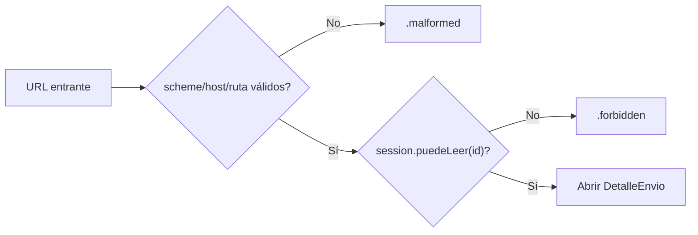
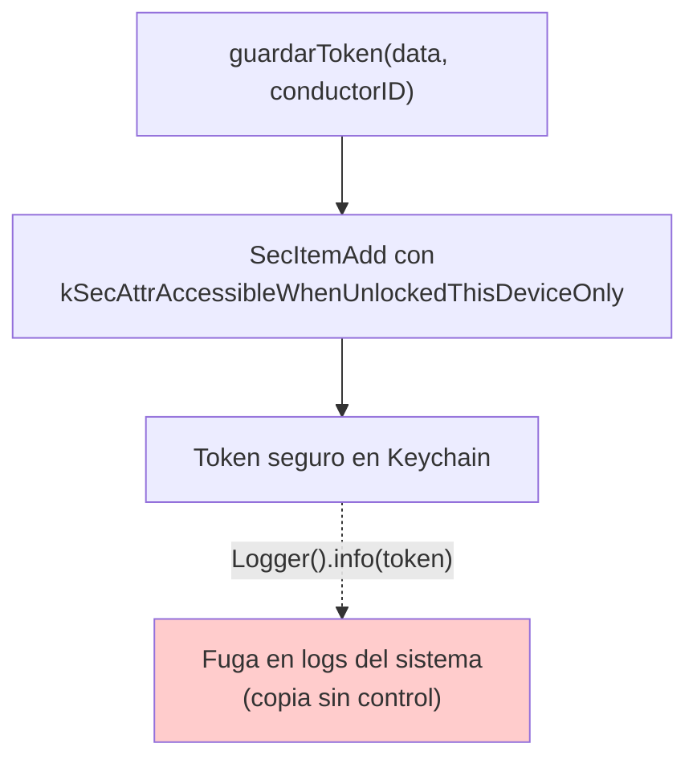
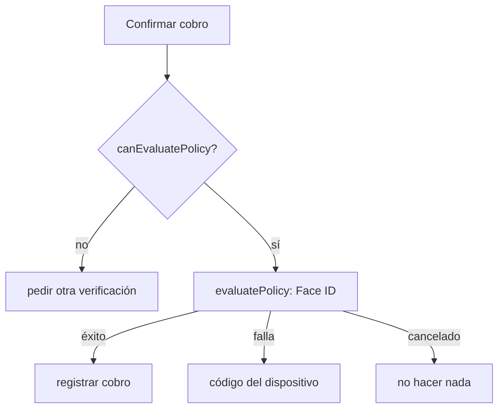
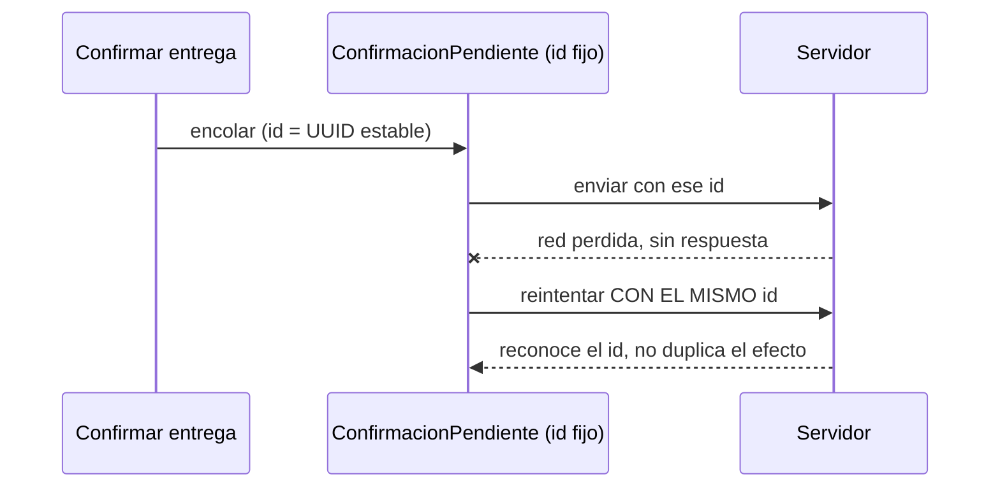
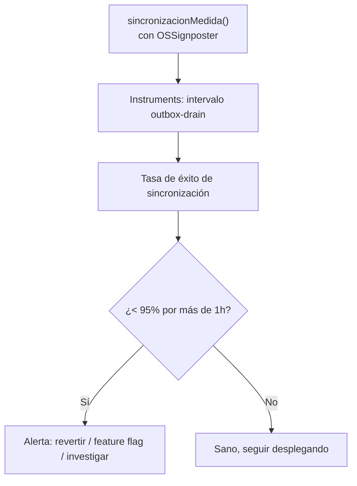
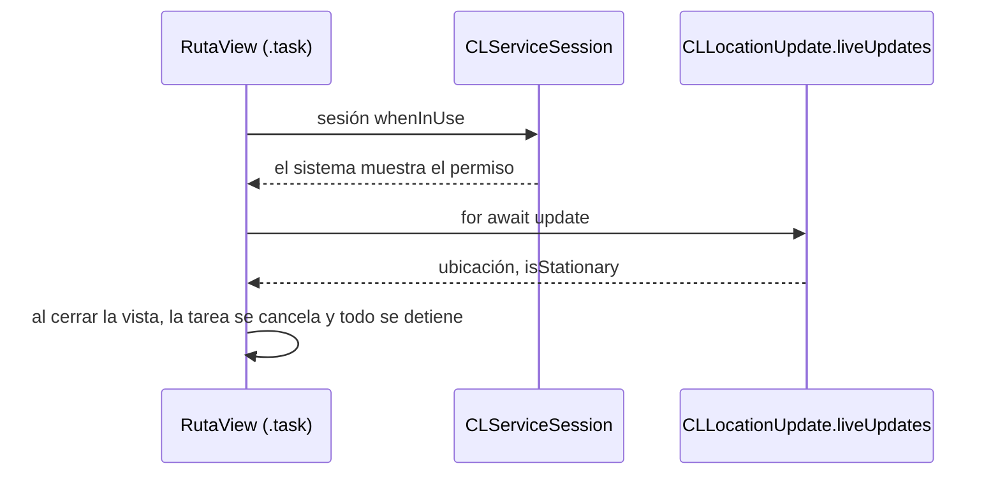
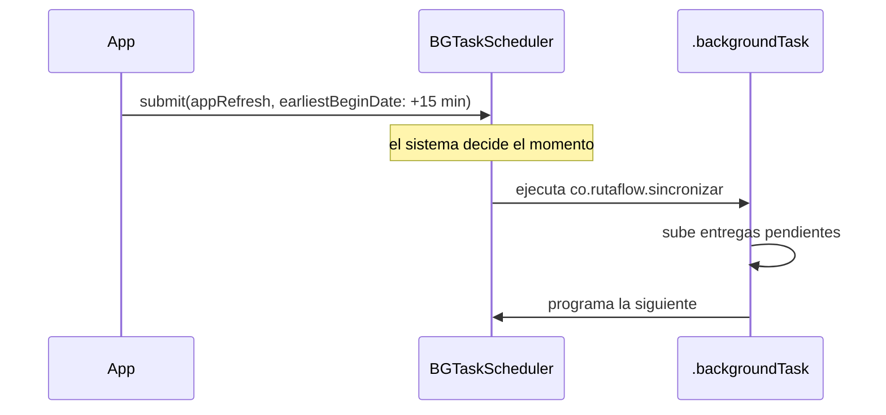

# Módulo 13: iOS en producción — seguridad, sincronización y operación

Una app no termina cuando compila ni cuando pasa revisión. En producción recibe enlaces manipulados, pierde conectividad a mitad de una escritura, conserva versiones antiguas y maneja datos en dispositivos que pueden extraviarse. Este módulo convierte el proyecto final en un sistema operable: explicita amenazas, protege datos, sincroniza sin duplicar efectos y aprende de fallos reales.


**Proyecto del módulo:** para cada práctica, parte de una carpeta vacía y crea en Xcode (File ▸ New ▸ Project ▸ App, interfaz SwiftUI) un proyecto llamado `RutaFlowApp`; escribe manualmente todos los archivos indicados y compila, sin usar proyectos ya preparados.

## Aprende construyendo


### Tema 1: El sandbox reduce superficie, pero no valida intenciones · Intermedio · 45 min

<details open>
<summary><strong>Capa 1 — Lectura</strong></summary>

#### ► DE QUÉ TRATA
Al finalizar vas a validar un Universal Link entrante de RutaFlow (https://rutaflow.app/envios/<id>) verificando esquema, host, estructura y autorización antes de abrir el envío correspondiente. Prerrequisitos: Módulo 5 completo.

#### ► LA IDEA EN UNA FRASE
**Al finalizar vas a validar un Universal Link entrante de RutaFlow (https://rutaflow.app/envios/<id>) verificando esquema, host, estructura y autorización antes de abrir el envío correspondiente.**

#### ► POR QUÉ EXISTE ESTO
Resuelve un problema real de diseño o implementación y evita decisiones a ciegas.

#### ► LA ANALOGÍA
Piensa en el sandbox reduce superficie, pero no valida intenciones como una herramienta de taller: útil cuando conoces su propósito y sus límites.
**Dónde se rompe la analogía:** en software, los efectos dependen del contexto, la escala y los trade-offs.

#### ► CÓMO FUNCIONA


#### ► LO QUE PUEDE SALIR MAL
| Síntoma | Causa probable | Arreglo |
|---|---|---|
| El sandbox reduce superficie, pero no valida intenciones se aplica pero el resultado no mejora | Se usó sin medir el problema real | Mide antes y compara contra la alternativa simple |
| Aparece complejidad inesperada | Se adoptó la técnica sin comprender sus trade-offs | Vuelve a la sección de trade-offs y reduce el alcance |
| Falla en un caso límite | Se asumió un contexto que no se cumple | Prueba el caso límite y documenta cuándo NO usarlo |

#### ► TRADE-OFFS
| Opción | Cuándo usarla | Cuándo NO usarla |
|---|---|---|
| Usar El sandbox reduce superficie, pero no valida intenciones | Cuando el problema coincide con su propósito y el beneficio es observable | Cuando agrega complejidad sin resolver un problema real |
| Alternativa más simple | Cuando el contexto es pequeño, estable o fácil de razonar | Cuando ya demostró no escalar o no cumplir el requisito |
| Postergar la decisión | Cuando falta evidencia del problema | Cuando el costo de esperar es mayor que el costo de probar |

#### ► CUÁNDO NO USAR ESTO
No uses el sandbox reduce superficie, pero no valida intenciones por defecto. Aplícalo cuando el problema lo justifique y puedas verificar el beneficio; si una alternativa más simple resuelve igual, prefiérela.

#### ► DE VUELTA A LA ANALOGÍA
Volviendo a la analogía: el sandbox reduce superficie, pero no valida intenciones funciona como el modelo inicial, pero recuerda dónde se rompe: en producción importan la evidencia, la escala y el costo de equivocarte.

#### ► LO QUE DEBES RECORDAR
- El sandbox reduce superficie, pero no valida intenciones existe para resolver un problema específico.
- Mide antes de adoptar complejidad.
- Conoce el caso donde NO usarlo.
- Verifica con evidencia observable.

#### ► PREGUNTAS PARA PENSAR
1. ¿Qué problema concreto resuelve el sandbox reduce superficie, pero no valida intenciones en tu contexto?
2. ¿Cómo sabrías que el sandbox reduce superficie, pero no valida intenciones no está funcionando bien?
3. ¿Qué alternativa más simple considerarías antes de usar el sandbox reduce superficie, pero no valida intenciones?

</details>

<details>
<summary><strong>Capa 2 — Construcción</strong></summary>

#### Código y verificación
```swift
enum LinkError: Error { case malformed, forbidden }

func taskID(from url: URL, session: Session) throws -> TaskID {
    guard url.scheme == "https",
          url.host == "tasks.example.com",
          url.pathComponents.count == 3,
          url.pathComponents[1] == "tasks",
          let id = TaskID(rawValue: url.pathComponents[2])
    else { throw LinkError.malformed }
    guard session.canRead(id) else { throw LinkError.forbidden }
    return id
}
```

```text
web/notificación/widget -> frontera iOS -> validar estructura
                                      -> autenticar sesión
                                      -> autorizar recurso
                                      -> confirmar efecto
                                      -> dominio
```


```swift
import Foundation

struct EnvioID: RawRepresentable, Hashable {
    let rawValue: String
    init?(rawValue: String) {
        guard rawValue.hasPrefix("RF-") else { return nil } // formato de guía válido
        self.rawValue = rawValue
    }
}

struct Session {
    let enviosAsignados: Set<EnvioID>
    func puedeLeer(_ id: EnvioID) -> Bool { enviosAsignados.contains(id) }
}

enum LinkError: Error { case malformed, forbidden }

func envioID(from url: URL, session: Session) throws -> EnvioID {
    guard url.scheme == "https",
          url.host == "rutaflow.app",
          url.pathComponents.count == 3,
          url.pathComponents[1] == "envios",
          let id = EnvioID(rawValue: url.pathComponents[2])
    else { throw LinkError.malformed }
    guard session.puedeLeer(id) else { throw LinkError.forbidden }
    return id
}
```

```bash
xcodebuild -scheme RutaFlowApp -destination 'generic/platform=iOS Simulator' build
```

</details>

### Tema 2: Proteger datos es controlar todas sus copias · Intermedio · 45 min

<details open>
<summary><strong>Capa 1 — Lectura</strong></summary>

#### ► DE QUÉ TRATA
Al finalizar vas a guardar el token de sesión de un conductor en Keychain (no en UserDefaults), y a confirmar que ese token no queda expuesto en logs. Prerrequisitos: Módulo 5 completo.

#### ► LA IDEA EN UNA FRASE
**Al finalizar vas a guardar el token de sesión de un conductor en Keychain (no en UserDefaults), y a confirmar que ese token no queda expuesto en logs.**

#### ► POR QUÉ EXISTE ESTO
Resuelve un problema real de diseño o implementación y evita decisiones a ciegas.

#### ► LA ANALOGÍA
Keychain protege secretos pequeños con una clase de accesibilidad explícita; redactar logs es tan necesario como elegir bien el almacén — guardar una joya en una caja fuerte no ayuda si su fotografía queda sobre la mesa.
**Conceptos clave:** clasificación, minimización, Keychain, access class, Data Protection, Secure Enclave, backup, log redaction, screenshot, pasteboard, notification preview, privacy manifest, token y logout.

Clasifica antes de almacenar: público, interno, sensible y credencial. Define retención y borrado. Los tokens no pertenecen a `UserDefaults`; usa Keychain con una accesibilidad coherente con la función. `kSecAttrAccessibleWhenUnlockedThisDeviceOnly` evita migración a otro dispositivo y acceso mientras está bloqueado, aunque puede ser demasiado restrictivo para tareas de fondo. La decisión es de producto y amenaza, no una receta universal.

```swift
func saveToken(_ data: Data, account: String) throws {
    let query: [CFString: Any] = [
        kSecClass: kSecClassGenericPassword,
        kSecAttrService: "com.example.tasks.session",
        kSecAttrAccount: account,
        kSecValueData: data,
        kSecAttrAccessible: kSecAttrAccessibleWhenUnlockedThisDeviceOnly
    ]
    SecItemDelete(query as CFDictionary)
    guard SecItemAdd(query as CFDictionary, nil) == errSecSuccess else {
        throw SessionError.keychainWrite
    }
}
```

Keychain protege secretos pequeños; no es una base de datos. Para archivos y bases locales usa Data Protection apropiada y evita inventar criptografía. Secure Enclave puede proteger operaciones con claves, pero no vuelve seguro un flujo que filtra el resultado en logs o UI. Redacta identificadores, nunca registres tokens y usa `Logger` con privacidad explícita.

Revisa copias involuntarias: backups, cachés, miniaturas, portapapeles, notificaciones, capturas y archivos compartidos. En logout elimina credenciales, memoria derivada y datos por cuenta, cancela tareas y revoca el token en servidor cuando corresponda. Documenta las APIs y SDK que recolectan datos, su finalidad y las declaraciones de privacidad requeridas; la privacidad efectiva debe coincidir con lo comunicado en App Store Connect.

**Analogía:** guardar una joya en una caja fuerte no ayuda si su fotografía, combinación y recibo quedan sobre la mesa.

**¿Por qué es importante?** porque las filtraciones suelen surgir de copias secundarias y telemetría, no del almacén principal.

**Casos de uso reales:** token en preferencias, base incluida en backup, email visible en log, código de acceso en notificación y datos de la cuenta anterior tras cambiar usuario.

**Diagrama:**

```text
dato -> clasificar -> ¿necesario? --no--> no guardar
                    --sí--> Keychain / archivo protegido / base
                              -> retención -> borrado verificable
                              -> logs y UI redactados
```

**Diagrama: Keychain vs la fuga por otra copia**



En tu propio proyecto RutaFlow, crea `SesionVault.swift` con **File ▸ New ▸ File ▸ Swift File**, selecciona el target de la app y escribe allí este contenido completo. Límite de la decisión: Keychain no conviene para datos grandes o que necesitan consultas (una lista completa de envíos, por ejemplo) — está pensado para secretos pequeños como tokens; para esos datos usá SwiftData (Módulo 6) con la protección de archivo apropiada, no Keychain como base de datos general.

**Dónde se rompe la analogía:** el modelo simplifica la realidad; en producción influyen escala, fallos, costo y contexto.

#### ► CÓMO FUNCIONA


#### ► LO QUE PUEDE SALIR MAL
| Síntoma | Causa probable | Arreglo |
|---|---|---|
| Proteger datos es controlar todas sus copias se aplica pero el resultado no mejora | Se usó sin medir el problema real | Mide antes y compara contra la alternativa simple |
| Aparece complejidad inesperada | Se adoptó la técnica sin comprender sus trade-offs | Vuelve a la sección de trade-offs y reduce el alcance |
| Falla en un caso límite | Se asumió un contexto que no se cumple | Prueba el caso límite y documenta cuándo NO usarlo |

#### ► TRADE-OFFS
| Opción | Cuándo usarla | Cuándo NO usarla |
|---|---|---|
| Usar Proteger datos es controlar todas sus copias | Cuando el problema coincide con su propósito y el beneficio es observable | Cuando agrega complejidad sin resolver un problema real |
| Alternativa más simple | Cuando el contexto es pequeño, estable o fácil de razonar | Cuando ya demostró no escalar o no cumplir el requisito |
| Postergar la decisión | Cuando falta evidencia del problema | Cuando el costo de esperar es mayor que el costo de probar |

#### ► CUÁNDO NO USAR ESTO
No uses proteger datos es controlar todas sus copias por defecto. Aplícalo cuando el problema lo justifique y puedas verificar el beneficio; si una alternativa más simple resuelve igual, prefiérela.

#### ► DE VUELTA A LA ANALOGÍA
Volviendo a la analogía: proteger datos es controlar todas sus copias funciona como el modelo inicial, pero recuerda dónde se rompe: en producción importan la evidencia, la escala y el costo de equivocarte.

#### ► LO QUE DEBES RECORDAR
- Proteger datos es controlar todas sus copias existe para resolver un problema específico.
- Mide antes de adoptar complejidad.
- Conoce el caso donde NO usarlo.
- Verifica con evidencia observable.

#### ► PREGUNTAS PARA PENSAR
1. ¿Qué problema concreto resuelve proteger datos es controlar todas sus copias en tu contexto?
2. ¿Cómo sabrías que proteger datos es controlar todas sus copias no está funcionando bien?
3. ¿Qué alternativa más simple considerarías antes de usar proteger datos es controlar todas sus copias?

</details>

<details>
<summary><strong>Capa 2 — Construcción</strong></summary>

#### Código y verificación
```swift
func saveToken(_ data: Data, account: String) throws {
    let query: [CFString: Any] = [
        kSecClass: kSecClassGenericPassword,
        kSecAttrService: "com.example.tasks.session",
        kSecAttrAccount: account,
        kSecValueData: data,
        kSecAttrAccessible: kSecAttrAccessibleWhenUnlockedThisDeviceOnly
    ]
    SecItemDelete(query as CFDictionary)
    guard SecItemAdd(query as CFDictionary, nil) == errSecSuccess else {
        throw SessionError.keychainWrite
    }
}
```

```text
dato -> clasificar -> ¿necesario? --no--> no guardar
                    --sí--> Keychain / archivo protegido / base
                              -> retención -> borrado verificable
                              -> logs y UI redactados
```


```swift
import Foundation
import Security

enum SesionError: Error { case keychainWrite }

func guardarToken(_ data: Data, conductorID: String) throws {
    let query: [CFString: Any] = [
        kSecClass: kSecClassGenericPassword,
        kSecAttrService: "com.rutaflow.conductor.session",
        kSecAttrAccount: conductorID,
        kSecValueData: data,
        kSecAttrAccessible: kSecAttrAccessibleWhenUnlockedThisDeviceOnly
    ]
    SecItemDelete(query as CFDictionary)
    guard SecItemAdd(query as CFDictionary, nil) == errSecSuccess else {
        throw SesionError.keychainWrite
    }
}
```

```bash
xcodebuild -scheme RutaFlowApp -destination 'generic/platform=iOS Simulator' build
```

</details>

### Tema 3: Keychain — guardar secretos de forma segura · Intermedio · 35 min

<details open>
<summary><strong>Capa 1 — Lectura</strong></summary>

#### ► DE QUÉ TRATA
Al finalizar podrás guardar y leer un token de sesión en el Keychain de iOS, y explicar por qué nunca se guarda un secreto en UserDefaults. Prerrequisitos: Temas 1-2 de este módulo (seguridad y copias de datos).

#### ► LA IDEA EN UNA FRASE
**Al finalizar podrás guardar y leer un token de sesión en el Keychain de iOS, y explicar por qué nunca se guarda un secreto en UserDefaults.**

#### ► POR QUÉ EXISTE ESTO
Resuelve un problema real de diseño o implementación y evita decisiones a ciegas.

#### ► LA ANALOGÍA
`UserDefaults` es para preferencias no sensibles (tema claro/oscuro, última pestaña). El **Keychain** es el almacén cifrado del sistema para secretos (tokens, contraseñas, claves), con control de acceso por biometría y atributos de accesibilidad (`kSecAttrAccessibleWhenUnlocked`).

**Analogía:** `UserDefaults` es la libreta de notas en tu escritorio (cualquiera que entre la lee); el Keychain es la caja fuerte empotrada del edificio, cifrada y con control de quién la abre y cuándo.

**Conceptos clave:** Keychain vs UserDefaults, `SecItemAdd`/`SecItemCopyMatching`, atributos de accesibilidad, cifrado del sistema.
**Cuándo no usarlo:** no uses Keychain para datos no sensibles o grandes (preferencias de UI, cachés): es más lento y limitado; resérvalo para secretos.

**Transferencia al proyecto integrador «RutaFlow»:** guarda el JWT de sesión en el Keychain tras el login y bórralo al cerrar sesión; confirma que no queda rastro en UserDefaults.
Como **siguiente** paso, lleva lo aprendido al próximo tema y conéctalo con el proyecto integrador del track.
**Errores comunes:** llamar a `SecItemAdd` directamente para "actualizar" un token sin borrar antes el item existente con `SecItemDelete` para la misma cuenta — si ya hay un item guardado con ese `kSecAttrAccount`, `SecItemAdd` devuelve `errSecDuplicateItem` y el token viejo se queda guardado en el Keychain en vez de reemplazarse.
**Fuente oficial:** [documentación de iOS](https://developer.apple.com/documentation/).

**Dónde se rompe la analogía:** el modelo simplifica la realidad; en producción influyen escala, fallos, costo y contexto.

#### ► CÓMO FUNCIONA
1. Identifica el problema que keychain — guardar secretos de forma segura resuelve.
2. Observa sus componentes y relaciones.
3. Aplica la opción más simple que funcione.
4. Verifica el resultado y los límites.

#### ► LO QUE PUEDE SALIR MAL
| Síntoma | Causa probable | Arreglo |
|---|---|---|
| Keychain — guardar secretos de forma segura se aplica pero el resultado no mejora | Se usó sin medir el problema real | Mide antes y compara contra la alternativa simple |
| Aparece complejidad inesperada | Se adoptó la técnica sin comprender sus trade-offs | Vuelve a la sección de trade-offs y reduce el alcance |
| Falla en un caso límite | Se asumió un contexto que no se cumple | Prueba el caso límite y documenta cuándo NO usarlo |

#### ► TRADE-OFFS
| Opción | Cuándo usarla | Cuándo NO usarla |
|---|---|---|
| Usar Keychain — guardar secretos de forma segura | Cuando el problema coincide con su propósito y el beneficio es observable | Cuando agrega complejidad sin resolver un problema real |
| Alternativa más simple | Cuando el contexto es pequeño, estable o fácil de razonar | Cuando ya demostró no escalar o no cumplir el requisito |
| Postergar la decisión | Cuando falta evidencia del problema | Cuando el costo de esperar es mayor que el costo de probar |

#### ► CUÁNDO NO USAR ESTO
No uses keychain — guardar secretos de forma segura por defecto. Aplícalo cuando el problema lo justifique y puedas verificar el beneficio; si una alternativa más simple resuelve igual, prefiérela.

#### ► DE VUELTA A LA ANALOGÍA
Volviendo a la analogía: keychain — guardar secretos de forma segura funciona como el modelo inicial, pero recuerda dónde se rompe: en producción importan la evidencia, la escala y el costo de equivocarte.

#### ► LO QUE DEBES RECORDAR
- Keychain — guardar secretos de forma segura existe para resolver un problema específico.
- Mide antes de adoptar complejidad.
- Conoce el caso donde NO usarlo.
- Verifica con evidencia observable.

#### ► PREGUNTAS PARA PENSAR
1. ¿Qué problema concreto resuelve keychain — guardar secretos de forma segura en tu contexto?
2. ¿Cómo sabrías que keychain — guardar secretos de forma segura no está funcionando bien?
3. ¿Qué alternativa más simple considerarías antes de usar keychain — guardar secretos de forma segura?

</details>

<details>
<summary><strong>Capa 2 — Construcción</strong></summary>

#### Código y verificación
```swift
import Foundation
import Security

enum Llavero {
    static func guardar(_ token: String, cuenta: String) {
        let dato = Data(token.utf8)
        let query: [String: Any] = [
            kSecClass as String: kSecClassGenericPassword,
            kSecAttrAccount as String: cuenta,
            kSecValueData as String: dato,
            kSecAttrAccessible as String: kSecAttrAccessibleWhenUnlocked,
        ]
        SecItemDelete(query as CFDictionary)        // borra el anterior si existe
        SecItemAdd(query as CFDictionary, nil)       // guarda cifrado por el sistema
    }

    static func leer(cuenta: String) -> String? {
        let query: [String: Any] = [
            kSecClass as String: kSecClassGenericPassword,
            kSecAttrAccount as String: cuenta,
            kSecReturnData as String: true,
            kSecMatchLimit as String: kSecMatchLimitOne,
        ]
        var resultado: AnyObject?
        guard SecItemCopyMatching(query as CFDictionary, &resultado) == errSecSuccess,
              let dato = resultado as? Data else { return nil }
        return String(decoding: dato, as: UTF8.self)
    }
}
```

```bash
xcodebuild -scheme RutaFlowApp -destination 'generic/platform=iOS Simulator' build
```

</details>

### Tema 4: Permisos y privacidad — pedir acceso con criterio · Intermedio · 35 min

<details open>
<summary><strong>Capa 1 — Lectura</strong></summary>

#### ► DE QUÉ TRATA
Al finalizar podrás solicitar un permiso del sistema (ubicación) declarándolo en Info.plist y pidiéndolo en el momento correcto, y manejar el caso en que el usuario lo deniega. Prerrequisitos: Temas 1-2 de este módulo.

#### ► LA IDEA EN UNA FRASE
**Al finalizar podrás solicitar un permiso del sistema (ubicación) declarándolo en Info.plist y pidiéndolo en el momento correcto, y manejar el caso en que el usuario lo deniega.**

#### ► POR QUÉ EXISTE ESTO
Resuelve un problema real de diseño o implementación y evita decisiones a ciegas.

#### ► LA ANALOGÍA
Cada dato sensible (ubicación, cámara, contactos, notificaciones) requiere: (1) una clave de uso en `Info.plist` con una explicación en lenguaje humano, y (2) una solicitud en runtime en el momento con contexto. El usuario puede conceder, denegar o conceder "solo esta vez".

**Analogía:** pedir un permiso es como pedir una llave: si no explicas para qué (Info.plist) el portero (iOS) no te deja ni preguntar; y si pides todas las llaves nada más entrar, desconfían y dicen que no. Pides la llave concreta cuando vas a usar esa puerta.

**Conceptos clave:** clave de uso en Info.plist, solicitud en runtime, estados de autorización, denegación irreversible.
**Cuándo no usarlo:** no pidas un permiso que no vas a usar de inmediato ni "por si acaso": cada permiso extra reduce la confianza y puede costar la aprobación en la App Store.

**Transferencia al proyecto integrador «RutaFlow»:** pide la ubicación del repartidor en el momento en que acepta su primera entrega, con un motivo claro, y maneja el caso de denegación sin romper el flujo.
Como **siguiente** paso, lleva lo aprendido al próximo tema y conéctalo con el proyecto integrador del track.
**Errores comunes:** pedir `requestWhenInUseAuthorization()` antes de declarar la clave `NSLocationWhenInUseUsageDescription` en `Info.plist` — la app no muestra un diálogo vacío, crashea de inmediato, y el mensaje de la consola rara vez deja claro a primera vista que el problema es una clave faltante en `Info.plist`, no un bug en el código Swift.
**Fuente oficial:** [documentación de iOS](https://developer.apple.com/documentation/).

**Dónde se rompe la analogía:** el modelo simplifica la realidad; en producción influyen escala, fallos, costo y contexto.

#### ► CÓMO FUNCIONA
1. Identifica el problema que permisos y privacidad — pedir acceso con criterio resuelve.
2. Observa sus componentes y relaciones.
3. Aplica la opción más simple que funcione.
4. Verifica el resultado y los límites.

#### ► LO QUE PUEDE SALIR MAL
| Síntoma | Causa probable | Arreglo |
|---|---|---|
| Permisos y privacidad — pedir acceso con criterio se aplica pero el resultado no mejora | Se usó sin medir el problema real | Mide antes y compara contra la alternativa simple |
| Aparece complejidad inesperada | Se adoptó la técnica sin comprender sus trade-offs | Vuelve a la sección de trade-offs y reduce el alcance |
| Falla en un caso límite | Se asumió un contexto que no se cumple | Prueba el caso límite y documenta cuándo NO usarlo |

#### ► TRADE-OFFS
| Opción | Cuándo usarla | Cuándo NO usarla |
|---|---|---|
| Usar Permisos y privacidad — pedir acceso con criterio | Cuando el problema coincide con su propósito y el beneficio es observable | Cuando agrega complejidad sin resolver un problema real |
| Alternativa más simple | Cuando el contexto es pequeño, estable o fácil de razonar | Cuando ya demostró no escalar o no cumplir el requisito |
| Postergar la decisión | Cuando falta evidencia del problema | Cuando el costo de esperar es mayor que el costo de probar |

#### ► CUÁNDO NO USAR ESTO
No uses permisos y privacidad — pedir acceso con criterio por defecto. Aplícalo cuando el problema lo justifique y puedas verificar el beneficio; si una alternativa más simple resuelve igual, prefiérela.

#### ► DE VUELTA A LA ANALOGÍA
Volviendo a la analogía: permisos y privacidad — pedir acceso con criterio funciona como el modelo inicial, pero recuerda dónde se rompe: en producción importan la evidencia, la escala y el costo de equivocarte.

#### ► LO QUE DEBES RECORDAR
- Permisos y privacidad — pedir acceso con criterio existe para resolver un problema específico.
- Mide antes de adoptar complejidad.
- Conoce el caso donde NO usarlo.
- Verifica con evidencia observable.

#### ► PREGUNTAS PARA PENSAR
1. ¿Qué problema concreto resuelve permisos y privacidad — pedir acceso con criterio en tu contexto?
2. ¿Cómo sabrías que permisos y privacidad — pedir acceso con criterio no está funcionando bien?
3. ¿Qué alternativa más simple considerarías antes de usar permisos y privacidad — pedir acceso con criterio?

</details>

<details>
<summary><strong>Capa 2 — Construcción</strong></summary>

#### Código y verificación
```swift
import CoreLocation

@Observable
class GestorUbicacion: NSObject, CLLocationManagerDelegate {
    private let manager = CLLocationManager()
    var estado: CLAuthorizationStatus = .notDetermined

    override init() {
        super.init()
        manager.delegate = self
    }

    func pedirPermiso() {
        manager.requestWhenInUseAuthorization()   // muestra el diálogo del sistema
    }

    func locationManagerDidChangeAuthorization(_ manager: CLLocationManager) {
        estado = manager.authorizationStatus
    }
}
```

```bash
xcodebuild -scheme RutaFlowApp -destination 'generic/platform=iOS Simulator' build
```

</details>

### Tema 5: Face ID y Touch ID con LocalAuthentication: confirmar acciones sensibles · Intermedio · 35 min

<details open>
<summary><strong>Capa 1 — Lectura</strong></summary>

#### ► DE QUÉ TRATA
Agrega a Info.plist la clave NSFaceIDUsageDescription con el motivo. En el simulador, activa Features > Face ID > Enrolled y usa Matching Face o Non-matching Face para probar.

#### ► LA IDEA EN UNA FRASE
**Agrega a Info.plist la clave NSFaceIDUsageDescription con el motivo.**

#### ► POR QUÉ EXISTE ESTO
Resuelve un problema real de diseño o implementación y evita decisiones a ciegas.

#### ► LA ANALOGÍA
**Conceptos clave:** `LAContext`, política `.deviceOwnerAuthentication`, `.deviceOwnerAuthenticationWithBiometrics`, `canEvaluatePolicy`, `LAError`, texto de motivo.

`LAContext` pregunta al sistema si el dueño del dispositivo está presente. Hay dos políticas:

| Política | Acepta |
|---|---|
| `.deviceOwnerAuthenticationWithBiometrics` | solo Face ID o Touch ID |
| `.deviceOwnerAuthentication` | biometría o, como respaldo, el código del dispositivo |

Primero consulta `canEvaluatePolicy` para saber si está disponible. Luego `evaluatePolicy(_:localizedReason:)` muestra la interfaz del sistema. Los errores más comunes son `userCancel`, `biometryNotEnrolled` y `biometryLockout`.

La biometría prueba que **el dueño está presente**, no quién es para tu servidor. Para proteger un secreto (un token), guárdalo en el Keychain con control de acceso biométrico en lugar de comprobar solo un `true`.

**Analogía:** Face ID es el portero que reconoce al dueño del edificio; no sabe nada de la cuenta bancaria del dueño. La analogía falla en que el portero también acepta la llave de repuesto (el código) si se lo permites.

**Límite de uso:** no uses la biometría como único factor ante tu servidor: un `true` local se puede falsificar en un dispositivo comprometido. Para secretos, usa `SecAccessControl` con `.biometryCurrentSet` en el Keychain.



**Dónde se rompe la analogía:** el modelo simplifica la realidad; en producción influyen escala, fallos, costo y contexto.

#### ► CÓMO FUNCIONA


#### ► LO QUE PUEDE SALIR MAL
| Síntoma | Causa probable | Arreglo |
|---|---|---|
| Face ID y Touch ID con LocalAuthentication: confirmar acciones sensibles se aplica pero el resultado no mejora | Se usó sin medir el problema real | Mide antes y compara contra la alternativa simple |
| Aparece complejidad inesperada | Se adoptó la técnica sin comprender sus trade-offs | Vuelve a la sección de trade-offs y reduce el alcance |
| Falla en un caso límite | Se asumió un contexto que no se cumple | Prueba el caso límite y documenta cuándo NO usarlo |

#### ► TRADE-OFFS
| Opción | Cuándo usarla | Cuándo NO usarla |
|---|---|---|
| Usar Face ID y Touch ID con LocalAuthentication: confirmar acciones sensibles | Cuando el problema coincide con su propósito y el beneficio es observable | Cuando agrega complejidad sin resolver un problema real |
| Alternativa más simple | Cuando el contexto es pequeño, estable o fácil de razonar | Cuando ya demostró no escalar o no cumplir el requisito |
| Postergar la decisión | Cuando falta evidencia del problema | Cuando el costo de esperar es mayor que el costo de probar |

#### ► CUÁNDO NO USAR ESTO
No uses face id y touch id con localauthentication: confirmar acciones sensibles por defecto. Aplícalo cuando el problema lo justifique y puedas verificar el beneficio; si una alternativa más simple resuelve igual, prefiérela.

#### ► DE VUELTA A LA ANALOGÍA
Volviendo a la analogía: face id y touch id con localauthentication: confirmar acciones sensibles funciona como el modelo inicial, pero recuerda dónde se rompe: en producción importan la evidencia, la escala y el costo de equivocarte.

#### ► LO QUE DEBES RECORDAR
- Face ID y Touch ID con LocalAuthentication: confirmar acciones sensibles existe para resolver un problema específico.
- Mide antes de adoptar complejidad.
- Conoce el caso donde NO usarlo.
- Verifica con evidencia observable.

#### ► PREGUNTAS PARA PENSAR
1. ¿Qué problema concreto resuelve face id y touch id con localauthentication: confirmar acciones sensibles en tu contexto?
2. ¿Cómo sabrías que face id y touch id con localauthentication: confirmar acciones sensibles no está funcionando bien?
3. ¿Qué alternativa más simple considerarías antes de usar face id y touch id con localauthentication: confirmar acciones sensibles?

</details>

<details>
<summary><strong>Capa 2 — Construcción</strong></summary>

#### Objetivo observable
Agrega a `Info.plist` la clave `NSFaceIDUsageDescription` con el motivo. En el simulador, activa **Features > Face ID > Enrolled** y usa **Matching Face** o **Non-matching Face** para probar.

</details>

### Tema 6: Notificaciones push con APNs · Avanzado · 40 min

<details open>
<summary><strong>Capa 1 — Lectura</strong></summary>

#### ► DE QUÉ TRATA
Al finalizar podrás registrar la app para recibir notificaciones push vía APNs (Apple Push Notification service), obtener el device token y entender el flujo completo hasta mostrar una notificación. Prerrequisitos: Tema 4 (permisos) de este módulo.

#### ► LA IDEA EN UNA FRASE
**Al finalizar podrás registrar la app para recibir notificaciones push vía APNs (Apple Push Notification service), obtener el device token y entender el flujo completo hasta mostrar una notificación.**

#### ► POR QUÉ EXISTE ESTO
Resuelve un problema real de diseño o implementación y evita decisiones a ciegas.

#### ► LA ANALOGÍA
El flujo: (1) la app pide permiso de notificaciones; (2) se registra con APNs y recibe un **device token** único; (3) la app envía ese token a tu backend; (4) cuando hay un evento, tu backend le pide a APNs que entregue una notificación a ese token. La app no "recibe" del backend directamente: APNs es el intermediario de confianza de Apple.

**Analogía:** el device token es como la dirección postal del dispositivo, y APNs es el servicio de correos oficial de Apple: tu backend no entrega la carta en mano, se la da a correos (APNs) con la dirección (token), y correos la entrega.

**Conceptos clave:** APNs como intermediario, device token, permiso vs registro, payload de notificación.
**Cuándo no usarlo:** para comunicación en tiempo real mientras la app está abierta y en primer plano, un canal WebSocket/Socket.IO es más directo; push es para alcanzar al usuario con la app cerrada o en segundo plano.

**Transferencia al proyecto integrador «RutaFlow»:** registra el device token del repartidor y envíalo al backend; define el evento "entrega asignada" que dispara una push desde el servidor.
Como **siguiente** paso, lleva lo aprendido al próximo tema y conéctalo con el proyecto integrador del track.
**Errores comunes:** asumir que conceder el permiso de notificaciones ya registra el device token — son dos pasos independientes; sin llamar explícitamente a `registerForRemoteNotifications()` dentro del callback de `requestAuthorization`, el permiso queda concedido pero ningún token llega jamás al backend.
**Fuente oficial:** [documentación de iOS](https://developer.apple.com/documentation/).

**Dónde se rompe la analogía:** el modelo simplifica la realidad; en producción influyen escala, fallos, costo y contexto.

#### ► CÓMO FUNCIONA
1. Identifica el problema que notificaciones push con apns resuelve.
2. Observa sus componentes y relaciones.
3. Aplica la opción más simple que funcione.
4. Verifica el resultado y los límites.

#### ► LO QUE PUEDE SALIR MAL
| Síntoma | Causa probable | Arreglo |
|---|---|---|
| Notificaciones push con APNs se aplica pero el resultado no mejora | Se usó sin medir el problema real | Mide antes y compara contra la alternativa simple |
| Aparece complejidad inesperada | Se adoptó la técnica sin comprender sus trade-offs | Vuelve a la sección de trade-offs y reduce el alcance |
| Falla en un caso límite | Se asumió un contexto que no se cumple | Prueba el caso límite y documenta cuándo NO usarlo |

#### ► TRADE-OFFS
| Opción | Cuándo usarla | Cuándo NO usarla |
|---|---|---|
| Usar Notificaciones push con APNs | Cuando el problema coincide con su propósito y el beneficio es observable | Cuando agrega complejidad sin resolver un problema real |
| Alternativa más simple | Cuando el contexto es pequeño, estable o fácil de razonar | Cuando ya demostró no escalar o no cumplir el requisito |
| Postergar la decisión | Cuando falta evidencia del problema | Cuando el costo de esperar es mayor que el costo de probar |

#### ► CUÁNDO NO USAR ESTO
No uses notificaciones push con apns por defecto. Aplícalo cuando el problema lo justifique y puedas verificar el beneficio; si una alternativa más simple resuelve igual, prefiérela.

#### ► DE VUELTA A LA ANALOGÍA
Volviendo a la analogía: notificaciones push con apns funciona como el modelo inicial, pero recuerda dónde se rompe: en producción importan la evidencia, la escala y el costo de equivocarte.

#### ► LO QUE DEBES RECORDAR
- Notificaciones push con APNs existe para resolver un problema específico.
- Mide antes de adoptar complejidad.
- Conoce el caso donde NO usarlo.
- Verifica con evidencia observable.

#### ► PREGUNTAS PARA PENSAR
1. ¿Qué problema concreto resuelve notificaciones push con apns en tu contexto?
2. ¿Cómo sabrías que notificaciones push con apns no está funcionando bien?
3. ¿Qué alternativa más simple considerarías antes de usar notificaciones push con apns?

</details>

<details>
<summary><strong>Capa 2 — Construcción</strong></summary>

#### Código y verificación
```swift
import SwiftUI
import UserNotifications

class AppDelegate: NSObject, UIApplicationDelegate {
    func application(_ app: UIApplication,
                     didFinishLaunchingWithOptions opts: [UIApplication.LaunchOptionsKey: Any]? = nil) -> Bool {
        UNUserNotificationCenter.current().requestAuthorization(options: [.alert, .sound]) { concedido, _ in
            guard concedido else { return }
            DispatchQueue.main.async { app.registerForRemoteNotifications() }  // pide el device token
        }
        return true
    }

    func application(_ app: UIApplication,
                     didRegisterForRemoteNotificationsWithDeviceToken deviceToken: Data) {
        let token = deviceToken.map { String(format: "%02x", $0) }.joined()
        print("Device token APNs:", token)   // se enviaría al backend de RutaFlow
    }
}

@main
struct RutaFlowApp: App {
    @UIApplicationDelegateAdaptor(AppDelegate.self) var delegate
    var body: some Scene { WindowGroup { ContentView() } }
}
```

```bash
xcodebuild -scheme RutaFlowApp -destination 'generic/platform=iOS Simulator' build
```

</details>

### Tema 7: Offline-first es un protocolo, no una caché · Avanzado · 45 min

<details open>
<summary><strong>Capa 1 — Lectura</strong></summary>

#### ► DE QUÉ TRATA
Al finalizar vas a construir una outbox persistente para confirmarEntrega (Módulo 5), de forma que un conductor sin señal pueda confirmar una entrega y que se sincronice sola cuando vuelva la red, sin duplicarse. Prerrequisitos: Módulo 5 completo.

#### ► LA IDEA EN UNA FRASE
**Al finalizar vas a construir una outbox persistente para confirmarEntrega (Módulo 5), de forma que un conductor sin señal pueda confirmar una entrega y que se sincronice sola cuando vuelva la red, sin duplicarse.**

#### ► POR QUÉ EXISTE ESTO
Resuelve un problema real de diseño o implementación y evita decisiones a ciegas.

#### ► LA ANALOGÍA
Offline-first exige una fuente local observable y una outbox persistente donde cada operación tiene una identidad estable (clave de idempotencia) — una oficina postal con comprobantes numerados: puede reenviar el mismo sobre, pero el receptor sabe que no debe cobrar dos veces.
**Conceptos clave:** source of truth, outbox, state machine, idempotency key, retry, exponential backoff, jitter, reachability, optimistic UI, version, conflict, tombstone, background task y cancellation.

Leer una caché sin red es útil, pero offline-first exige definir qué ocurre con escrituras. Mantén una fuente local observable y una outbox persistente. Cada operación tiene identidad estable, payload, estado, intentos y próxima fecha. La interfaz confirma que el cambio está pendiente; un worker lo envía y reconcilia la respuesta.

```swift
struct PendingMutation: Codable, Identifiable {
    enum State: String, Codable { case queued, sending, failed }
    let id: UUID                 // también es clave de idempotencia
    let taskID: UUID
    let baseVersion: Int
    let operation: Operation
    var state: State
    var attempts: Int
    var nextAttemptAt: Date
}

actor SyncEngine {
    func drain() async {
        for mutation in await store.readyMutations() {
            guard !Task.isCancelled else { return }
            await sendAndReconcile(mutation)
        }
    }
}
```

Reintentar no garantiza seguridad: si el servidor aplicó el cambio pero la respuesta se perdió, un POST nuevo puede duplicarlo. Envía la misma clave de idempotencia y exige que el servidor recuerde el resultado. Usa backoff con jitter para fallos transitorios, respeta `Retry-After` y no reintentes validación o autorización. `NWPathMonitor` ayuda a decidir cuándo probar, pero “hay red” no significa “el servicio funciona”.

Los conflictos son requisito de dominio. Con versiones, el servidor puede rechazar una escritura sobre estado viejo. Elige política por campo: server-wins para autoridad, client-wins solo si es aceptable, merge para datos compatibles o resolución humana cuando perder una intención sería grave. Las eliminaciones necesitan tombstones para no resucitar registros. `BGTaskScheduler` ofrece oportunidades limitadas, no ejecución garantizada; el flujo debe progresar también al abrir la app.

**Analogía:** la outbox es una oficina postal con comprobantes numerados. Puede reenviar el mismo sobre, pero el receptor sabe que no debe cobrar dos veces.

**¿Por qué es importante?** porque conectividad móvil parcial convierte operaciones aparentemente simples en efectos duplicados, perdidos o fuera de orden.

**Casos de uso reales:** marcar tarea en metro, editar desde dos dispositivos, respuesta perdida después de crear, logout con cola pendiente y migración mientras existe trabajo offline.

**Diagrama:**

```text
UI -> base local -> outbox(queued) -> API + idempotency-key
 ^                                      |
 |            reconciliar/version <-----+
 +-- estado pendiente/error/conflicto
```

**Diagrama: outbox con idempotencia estable**



En tu propio proyecto RutaFlow, crea `MotorSincronizacion.swift` con **File ▸ New ▸ File ▸ Swift File**, asígnalo al target de la app y escribe allí la implementación EN MEMORIA de `ConfirmacionPendiente` y `MotorSincronizacion`, incluyendo el almacén y las funciones que el fragmento del Paso 4 invoca.

**Dónde se rompe la analogía:** el modelo simplifica la realidad; en producción influyen escala, fallos, costo y contexto.

#### ► CÓMO FUNCIONA


#### ► LO QUE PUEDE SALIR MAL
| Síntoma | Causa probable | Arreglo |
|---|---|---|
| Offline-first es un protocolo, no una caché se aplica pero el resultado no mejora | Se usó sin medir el problema real | Mide antes y compara contra la alternativa simple |
| Aparece complejidad inesperada | Se adoptó la técnica sin comprender sus trade-offs | Vuelve a la sección de trade-offs y reduce el alcance |
| Falla en un caso límite | Se asumió un contexto que no se cumple | Prueba el caso límite y documenta cuándo NO usarlo |

#### ► TRADE-OFFS
| Opción | Cuándo usarla | Cuándo NO usarla |
|---|---|---|
| Usar Offline-first es un protocolo, no una caché | Cuando el problema coincide con su propósito y el beneficio es observable | Cuando agrega complejidad sin resolver un problema real |
| Alternativa más simple | Cuando el contexto es pequeño, estable o fácil de razonar | Cuando ya demostró no escalar o no cumplir el requisito |
| Postergar la decisión | Cuando falta evidencia del problema | Cuando el costo de esperar es mayor que el costo de probar |

#### ► CUÁNDO NO USAR ESTO
No uses offline-first es un protocolo, no una caché por defecto. Aplícalo cuando el problema lo justifique y puedas verificar el beneficio; si una alternativa más simple resuelve igual, prefiérela.

#### ► DE VUELTA A LA ANALOGÍA
Volviendo a la analogía: offline-first es un protocolo, no una caché funciona como el modelo inicial, pero recuerda dónde se rompe: en producción importan la evidencia, la escala y el costo de equivocarte.

#### ► LO QUE DEBES RECORDAR
- Offline-first es un protocolo, no una caché existe para resolver un problema específico.
- Mide antes de adoptar complejidad.
- Conoce el caso donde NO usarlo.
- Verifica con evidencia observable.

#### ► PREGUNTAS PARA PENSAR
1. ¿Qué problema concreto resuelve offline-first es un protocolo, no una caché en tu contexto?
2. ¿Cómo sabrías que offline-first es un protocolo, no una caché no está funcionando bien?
3. ¿Qué alternativa más simple considerarías antes de usar offline-first es un protocolo, no una caché?

</details>

<details>
<summary><strong>Capa 2 — Construcción</strong></summary>

#### Código y verificación
```swift
struct PendingMutation: Codable, Identifiable {
    enum State: String, Codable { case queued, sending, failed }
    let id: UUID                 // también es clave de idempotencia
    let taskID: UUID
    let baseVersion: Int
    let operation: Operation
    var state: State
    var attempts: Int
    var nextAttemptAt: Date
}

actor SyncEngine {
    func drain() async {
        for mutation in await store.readyMutations() {
            guard !Task.isCancelled else { return }
            await sendAndReconcile(mutation)
        }
    }
}
```

```text
UI -> base local -> outbox(queued) -> API + idempotency-key
 ^                                      |
 |            reconciliar/version <-----+
 +-- estado pendiente/error/conflicto
```


```swift
struct ConfirmacionPendiente: Codable, Identifiable {
    enum Estado: String, Codable { case encolada, enviando, fallida }
    let id: UUID              // también es la clave de idempotencia
    let envioID: String
    let pin: String
    var estado: Estado
    var intentos: Int
}

actor MotorSincronizacion {
    func vaciar() async {
        for confirmacion in await almacen.pendientes() {
            guard !Task.isCancelled else { return }
            await enviarYReconciliar(confirmacion)
        }
    }
}
```

```bash
xcodebuild -scheme RutaFlowApp -destination 'generic/platform=iOS Simulator' build
```

</details>

### Tema 8: Operar significa detectar, limitar y aprender del fallo · Avanzado · 45 min

<details open>
<summary><strong>Capa 1 — Lectura</strong></summary>

#### ► DE QUÉ TRATA
Al finalizar vas a instrumentar MotorSincronizacion.vaciar() (Tema 7) con un signpost, y a definir un indicador concreto ("tasa de éxito de sincronización") para decidir si una versión de RutaFlow está sana en producción. Prerrequisitos: Tema 7 de este módulo.

#### ► LA IDEA EN UNA FRASE
**Al finalizar vas a instrumentar MotorSincronizacion.vaciar() (Tema 7) con un signpost, y a definir un indicador concreto ("tasa de éxito de sincronización") para decidir si una versión de RutaFlow está sana en producción.**

#### ► POR QUÉ EXISTE ESTO
Resuelve un problema real de diseño o implementación y evita decisiones a ciegas.

#### ► LA ANALOGÍA
MetricKit entrega diagnósticos agregados e Instruments permite investigar con signposts que delimitan operaciones del dominio sin llenar los logs de datos personales — un centro de control donde las métricas convierten señales en decisiones.
**Conceptos clave:** crash, hang, launch time, memory pressure, MetricKit, Instruments, os_signpost, structured logging, SLI, release train, TestFlight, phased release, migration, feature flag y rollback.

“No crashea en mi teléfono” no es evidencia. Define indicadores ligados a experiencia: sesiones sin crash, tasa de hangs, tiempo de arranque, éxito de sincronización y latencia percibida. MetricKit entrega diagnósticos agregados; Instruments permite investigar CPU, memoria, energía, red y bloqueos; signposts delimitan operaciones del dominio sin llenar logs de datos personales.

```swift
import OSLog

let points = OSSignposter(subsystem: "com.example.tasks", category: "sync")

func measuredSync() async throws {
    let state = points.beginInterval("outbox-drain")
    defer { points.endInterval("outbox-drain", state) }
    try await syncEngine.sync()
}
```

Evita trabajo pesado en `MainActor`; mide antes de optimizar y prueba con dispositivos/perfiles realistas. Un hang puede ser peor que un crash porque el usuario no recibe salida clara. Trata memoria y energía como presupuestos: imágenes dimensionadas, paginación, cancelación de tareas y trabajo de fondo limitado.

Cada release necesita migración ensayada con datos de versiones anteriores, compatibilidad de API y plan de contención. TestFlight valida con grupos pequeños; un despliegue gradual reduce exposición, pero no reemplaza observabilidad. Feature flags deben tener propietario y fecha de retiro. Si la base migra de forma irreversible, “volver al binario anterior” puede no funcionar: diseña migraciones expand/contract o restauración explícita.

**Analogía:** operar una app es pilotar con instrumentos. La vista por la ventana ayuda, pero las alarmas, métricas y listas de comprobación permiten reaccionar antes del accidente.

**¿Por qué es importante?** porque todo software real falla; la calidad profesional depende del radio de impacto, detección y recuperación.

**Casos de uso reales:** hang en arranque, fuga de imágenes, migración que falla con datos antiguos, API incompatible y release que aumenta errores de sincronización.

**Diagrama:**

```text
TestFlight -> cohorte pequeña -> métricas sanas? -> despliegue gradual
                                      no -> contener/flag/corregir
producción -> MetricKit/signposts -> reproducir en Instruments -> aprendizaje
```

**Diagrama: ciclo de medición con umbral y acción**



Parte de otra carpeta vacía y crea en Xcode un proyecto SwiftUI independiente llamado `RutaFlowApp`. En el grupo de la app crea `MotorSincronizacion.swift` con **File ▸ New ▸ File ▸ Swift File**, selecciona únicamente el target `RutaFlowApp` y escribe manualmente tanto el motor mínimo como la instrumentación del Paso 4. Esta práctica no reutiliza el archivo del Tema 7 ni necesita ningún archivo externo.

**Dónde se rompe la analogía:** el modelo simplifica la realidad; en producción influyen escala, fallos, costo y contexto.

#### ► CÓMO FUNCIONA


#### ► LO QUE PUEDE SALIR MAL
| Síntoma | Causa probable | Arreglo |
|---|---|---|
| Operar significa detectar, limitar y aprender del fallo se aplica pero el resultado no mejora | Se usó sin medir el problema real | Mide antes y compara contra la alternativa simple |
| Aparece complejidad inesperada | Se adoptó la técnica sin comprender sus trade-offs | Vuelve a la sección de trade-offs y reduce el alcance |
| Falla en un caso límite | Se asumió un contexto que no se cumple | Prueba el caso límite y documenta cuándo NO usarlo |

#### ► TRADE-OFFS
| Opción | Cuándo usarla | Cuándo NO usarla |
|---|---|---|
| Usar Operar significa detectar, limitar y aprender del fallo | Cuando el problema coincide con su propósito y el beneficio es observable | Cuando agrega complejidad sin resolver un problema real |
| Alternativa más simple | Cuando el contexto es pequeño, estable o fácil de razonar | Cuando ya demostró no escalar o no cumplir el requisito |
| Postergar la decisión | Cuando falta evidencia del problema | Cuando el costo de esperar es mayor que el costo de probar |

#### ► CUÁNDO NO USAR ESTO
No uses operar significa detectar, limitar y aprender del fallo por defecto. Aplícalo cuando el problema lo justifique y puedas verificar el beneficio; si una alternativa más simple resuelve igual, prefiérela.

#### ► DE VUELTA A LA ANALOGÍA
Volviendo a la analogía: operar significa detectar, limitar y aprender del fallo funciona como el modelo inicial, pero recuerda dónde se rompe: en producción importan la evidencia, la escala y el costo de equivocarte.

#### ► LO QUE DEBES RECORDAR
- Operar significa detectar, limitar y aprender del fallo existe para resolver un problema específico.
- Mide antes de adoptar complejidad.
- Conoce el caso donde NO usarlo.
- Verifica con evidencia observable.

#### ► PREGUNTAS PARA PENSAR
1. ¿Qué problema concreto resuelve operar significa detectar, limitar y aprender del fallo en tu contexto?
2. ¿Cómo sabrías que operar significa detectar, limitar y aprender del fallo no está funcionando bien?
3. ¿Qué alternativa más simple considerarías antes de usar operar significa detectar, limitar y aprender del fallo?

</details>

<details>
<summary><strong>Capa 2 — Construcción</strong></summary>

#### Código y verificación
```swift
import OSLog

let points = OSSignposter(subsystem: "com.example.tasks", category: "sync")

func measuredSync() async throws {
    let state = points.beginInterval("outbox-drain")
    defer { points.endInterval("outbox-drain", state) }
    try await syncEngine.sync()
}
```

```text
TestFlight -> cohorte pequeña -> métricas sanas? -> despliegue gradual
                                      no -> contener/flag/corregir
producción -> MetricKit/signposts -> reproducir en Instruments -> aprendizaje
```


```swift
import OSLog

actor MotorSincronizacion {
    func vaciar() async {
        // Envía aquí las confirmaciones pendientes de esta práctica.
    }
}

let motorSincronizacion = MotorSincronizacion()
let puntos = OSSignposter(subsystem: "com.rutaflow.conductor", category: "sync")

func sincronizacionMedida() async throws {
    let estado = puntos.beginInterval("outbox-drain")
    defer { puntos.endInterval("outbox-drain", estado) }
    await motorSincronizacion.vaciar()
}
```

```bash
# una sola vez, fuera de RutaFlowApp:
mkdir Practica && cd Practica
swift package init --type executable
rm Sources/Practica/Practica.swift   # la plantilla de Swift 6.2 trae un @main que choca con main.swift
# pega el código en Sources/Practica/main.swift
swift run
```

</details>

### Tema 9: Core Location moderno: CLLocationUpdate, permisos y precisión · Avanzado · 45 min

<details open>
<summary><strong>Capa 1 — Lectura</strong></summary>

#### ► DE QUÉ TRATA
Usa Xcode 26 o superior con destino iOS 18+: el código usa CLServiceSession y authorizationDenied, que solo existen desde iOS 18. En la pestaña Info del target (los proyectos nuevos de Xcode no traen un archivo Info.plist aparte) agrega NSLocationWhenInUseUsageDescription con un…

#### ► LA IDEA EN UNA FRASE
**Usa Xcode 26 o superior con destino iOS 18+: el código usa CLServiceSession y authorizationDenied, que solo existen desde iOS 18.**

#### ► POR QUÉ EXISTE ESTO
Resuelve un problema real de diseño o implementación y evita decisiones a ciegas.

#### ► LA ANALOGÍA
**Conceptos clave:** `CLLocationUpdate`, `liveUpdates`, `CLServiceSession`, autorización «al usar la app», precisión aproximada, `isStationary`, texto de propósito.

Desde iOS 17, `CLLocationUpdate.liveUpdates()` es una `AsyncSequence` de ubicaciones: la recorres con `for await` y se detiene al cancelar la tarea. Desde iOS 18, una **`CLServiceSession`** declara cuánto acceso necesitas mientras exista, y el sistema muestra el permiso cuando hace falta.

- **Al usar la app** (*when in use*) basta para navegación con la app abierta.
- El usuario puede elegir **ubicación aproximada**: recibes posiciones con error de varios kilómetros. Si la necesitas precisa para una tarea, pide precisión temporal con un texto propio (`NSLocationTemporaryUsageDescriptionDictionary`).
- Cada actualización indica si el dispositivo está **quieto** (`isStationary`): no proceses posiciones repetidas.

El texto del permiso debe decir el **beneficio para el usuario**, no solo que la app usa la ubicación.

**Analogía:** pedir ubicación es pedir prestado un mapa: si explicas para qué lo quieres y lo devuelves al terminar, te lo prestan. La analogía falla en que el usuario puede prestarte un mapa borroso (aproximado) y debes funcionar igual.

**Límite de uso:** la ubicación en segundo plano exige otra autorización y una justificación fuerte ante App Review; no la pidas si no la necesitas. El simulador no reproduce la precisión ni el consumo real.



**Dónde se rompe la analogía:** el modelo simplifica la realidad; en producción influyen escala, fallos, costo y contexto.

#### ► CÓMO FUNCIONA


#### ► LO QUE PUEDE SALIR MAL
| Síntoma | Causa probable | Arreglo |
|---|---|---|
| Core Location moderno: CLLocationUpdate, permisos y precisión se aplica pero el resultado no mejora | Se usó sin medir el problema real | Mide antes y compara contra la alternativa simple |
| Aparece complejidad inesperada | Se adoptó la técnica sin comprender sus trade-offs | Vuelve a la sección de trade-offs y reduce el alcance |
| Falla en un caso límite | Se asumió un contexto que no se cumple | Prueba el caso límite y documenta cuándo NO usarlo |

#### ► TRADE-OFFS
| Opción | Cuándo usarla | Cuándo NO usarla |
|---|---|---|
| Usar Core Location moderno: CLLocationUpdate, permisos y precisión | Cuando el problema coincide con su propósito y el beneficio es observable | Cuando agrega complejidad sin resolver un problema real |
| Alternativa más simple | Cuando el contexto es pequeño, estable o fácil de razonar | Cuando ya demostró no escalar o no cumplir el requisito |
| Postergar la decisión | Cuando falta evidencia del problema | Cuando el costo de esperar es mayor que el costo de probar |

#### ► CUÁNDO NO USAR ESTO
No uses core location moderno: cllocationupdate, permisos y precisión por defecto. Aplícalo cuando el problema lo justifique y puedas verificar el beneficio; si una alternativa más simple resuelve igual, prefiérela.

#### ► DE VUELTA A LA ANALOGÍA
Volviendo a la analogía: core location moderno: cllocationupdate, permisos y precisión funciona como el modelo inicial, pero recuerda dónde se rompe: en producción importan la evidencia, la escala y el costo de equivocarte.

#### ► LO QUE DEBES RECORDAR
- Core Location moderno: CLLocationUpdate, permisos y precisión existe para resolver un problema específico.
- Mide antes de adoptar complejidad.
- Conoce el caso donde NO usarlo.
- Verifica con evidencia observable.

#### ► PREGUNTAS PARA PENSAR
1. ¿Qué problema concreto resuelve core location moderno: cllocationupdate, permisos y precisión en tu contexto?
2. ¿Cómo sabrías que core location moderno: cllocationupdate, permisos y precisión no está funcionando bien?
3. ¿Qué alternativa más simple considerarías antes de usar core location moderno: cllocationupdate, permisos y precisión?

</details>

<details>
<summary><strong>Capa 2 — Construcción</strong></summary>

#### Objetivo observable
Usa Xcode 26 o superior con destino iOS 18+: el código usa `CLServiceSession` y `authorizationDenied`, que solo existen desde iOS 18. En la pestaña **Info** del target (los proyectos nuevos de Xcode no traen un archivo `Info.plist` aparte) agrega `NSLocationWhenInUseUsageDescription` con un texto que explique para qué. En el simulador usa **Features > Location > City Run**.

</details>

### Tema 10: BackgroundTasks: actualizar datos y sincronizar cuando el sistema lo permite · Avanzado · 45 min

<details open>
<summary><strong>Capa 1 — Lectura</strong></summary>

#### ► DE QUÉ TRATA
En el target, activa Background Modes > Background fetch y agrega a Info.plist la clave BGTaskSchedulerPermittedIdentifiers con co.rutaflow.sincronizar. Necesitas un iPhone físico conectado y el depurador de Xcode para forzar la tarea: Simulator no admite procesamiento en segundo…

#### ► LA IDEA EN UNA FRASE
**En el target, activa Background Modes > Background fetch y agrega a Info.plist la clave BGTaskSchedulerPermittedIdentifiers con co.rutaflow.sincronizar.**

#### ► POR QUÉ EXISTE ESTO
Resuelve un problema real de diseño o implementación y evita decisiones a ciegas.

#### ► LA ANALOGÍA
**Conceptos clave:** `BGTaskScheduler`, `BGAppRefreshTaskRequest`, `BGProcessingTaskRequest`, identificador permitido, `.backgroundTask(.appRefresh)`, `earliestBeginDate`, tiempo límite.

iOS ofrece dos tipos principales:

| Tipo | Duración | Para |
|---|---|---|
| `BGAppRefreshTaskRequest` | unos 30 segundos | refrescar datos pequeños, subir pendientes |
| `BGProcessingTaskRequest` | minutos, a menudo con el teléfono cargando | tareas largas: limpiar, reindexar |

Pasos: declarar el identificador en `Info.plist`, **programar** una solicitud con `earliestBeginDate` (el sistema decide el momento real, nunca antes) y **atenderla** con `.backgroundTask(.appRefresh("id"))` en la escena. Dentro de la tarea, vuelve a programar la siguiente.

Si se acaba el tiempo, el sistema cancela la tarea: tu código debe respetar la cancelación de Swift y dejar los datos consistentes.

**Analogía:** pedir una tarea en segundo plano es pedir un turno en una ventanilla que abre cuando quiere: dejas tu número y te llaman, pero no sabes a qué hora. La analogía falla en que, si el usuario casi no usa la app, el sistema te llama aún menos.

**Límite de uso:** no hay garantía de ejecución ni de horario. No uses estas tareas para nada que deba pasar a una hora exacta: para eso están las notificaciones del servidor (push silenciosas, con sus propios límites).



**Dónde se rompe la analogía:** el modelo simplifica la realidad; en producción influyen escala, fallos, costo y contexto.

#### ► CÓMO FUNCIONA


#### ► LO QUE PUEDE SALIR MAL
| Síntoma | Causa probable | Arreglo |
|---|---|---|
| BackgroundTasks: actualizar datos y sincronizar cuando el sistema lo permite se aplica pero el resultado no mejora | Se usó sin medir el problema real | Mide antes y compara contra la alternativa simple |
| Aparece complejidad inesperada | Se adoptó la técnica sin comprender sus trade-offs | Vuelve a la sección de trade-offs y reduce el alcance |
| Falla en un caso límite | Se asumió un contexto que no se cumple | Prueba el caso límite y documenta cuándo NO usarlo |

#### ► TRADE-OFFS
| Opción | Cuándo usarla | Cuándo NO usarla |
|---|---|---|
| Usar BackgroundTasks: actualizar datos y sincronizar cuando el sistema lo permite | Cuando el problema coincide con su propósito y el beneficio es observable | Cuando agrega complejidad sin resolver un problema real |
| Alternativa más simple | Cuando el contexto es pequeño, estable o fácil de razonar | Cuando ya demostró no escalar o no cumplir el requisito |
| Postergar la decisión | Cuando falta evidencia del problema | Cuando el costo de esperar es mayor que el costo de probar |

#### ► CUÁNDO NO USAR ESTO
No uses backgroundtasks: actualizar datos y sincronizar cuando el sistema lo permite por defecto. Aplícalo cuando el problema lo justifique y puedas verificar el beneficio; si una alternativa más simple resuelve igual, prefiérela.

#### ► DE VUELTA A LA ANALOGÍA
Volviendo a la analogía: backgroundtasks: actualizar datos y sincronizar cuando el sistema lo permite funciona como el modelo inicial, pero recuerda dónde se rompe: en producción importan la evidencia, la escala y el costo de equivocarte.

#### ► LO QUE DEBES RECORDAR
- BackgroundTasks: actualizar datos y sincronizar cuando el sistema lo permite existe para resolver un problema específico.
- Mide antes de adoptar complejidad.
- Conoce el caso donde NO usarlo.
- Verifica con evidencia observable.

#### ► PREGUNTAS PARA PENSAR
1. ¿Qué problema concreto resuelve backgroundtasks: actualizar datos y sincronizar cuando el sistema lo permite en tu contexto?
2. ¿Cómo sabrías que backgroundtasks: actualizar datos y sincronizar cuando el sistema lo permite no está funcionando bien?
3. ¿Qué alternativa más simple considerarías antes de usar backgroundtasks: actualizar datos y sincronizar cuando el sistema lo permite?

</details>

<details>
<summary><strong>Capa 2 — Construcción</strong></summary>

#### Objetivo observable
En el target, activa **Background Modes > Background fetch** y agrega a `Info.plist` la clave `BGTaskSchedulerPermittedIdentifiers` con `co.rutaflow.sincronizar`. Necesitas un iPhone físico conectado y el depurador de Xcode para forzar la tarea: Simulator no admite procesamiento en segundo plano, y allí `submit` lanza `BGTaskScheduler.Error.unavailable`.

</details>

### Swift 6.2 y actualizaciones SwiftUI de 2026

<details open>
<summary><strong>Capa 1 — Lectura</strong></summary>

#### ► DE QUÉ TRATA
Este tema te guía por swift 6.2 y actualizaciones swiftui de 2026 con foco en comprensión antes de implementación.

#### ► LA IDEA EN UNA FRASE
**Entender swift 6.2 y actualizaciones swiftui de 2026 te permite tomar mejores decisiones técnicas.**

#### ► POR QUÉ EXISTE ESTO
Resuelve un problema real de diseño o implementación y evita decisiones a ciegas.

#### ► LA ANALOGÍA
Piensa en swift 6.2 y actualizaciones swiftui de 2026 como una herramienta de taller: útil cuando conoces su propósito y sus límites.
**Dónde se rompe la analogía:** en software, los efectos dependen del contexto, la escala y los trade-offs.

#### ► CÓMO FUNCIONA
1. Identifica el problema que swift 6.2 y actualizaciones swiftui de 2026 resuelve.
2. Observa sus componentes y relaciones.
3. Aplica la opción más simple que funcione.
4. Verifica el resultado y los límites.

#### ► LO QUE PUEDE SALIR MAL
| Síntoma | Causa probable | Arreglo |
|---|---|---|
| Swift 6.2 y actualizaciones SwiftUI de 2026 se aplica pero el resultado no mejora | Se usó sin medir el problema real | Mide antes y compara contra la alternativa simple |
| Aparece complejidad inesperada | Se adoptó la técnica sin comprender sus trade-offs | Vuelve a la sección de trade-offs y reduce el alcance |
| Falla en un caso límite | Se asumió un contexto que no se cumple | Prueba el caso límite y documenta cuándo NO usarlo |

#### ► TRADE-OFFS
| Opción | Cuándo usarla | Cuándo NO usarla |
|---|---|---|
| Usar Swift 6.2 y actualizaciones SwiftUI de 2026 | Cuando el problema coincide con su propósito y el beneficio es observable | Cuando agrega complejidad sin resolver un problema real |
| Alternativa más simple | Cuando el contexto es pequeño, estable o fácil de razonar | Cuando ya demostró no escalar o no cumplir el requisito |
| Postergar la decisión | Cuando falta evidencia del problema | Cuando el costo de esperar es mayor que el costo de probar |

#### ► CUÁNDO NO USAR ESTO
No uses swift 6.2 y actualizaciones swiftui de 2026 por defecto. Aplícalo cuando el problema lo justifique y puedas verificar el beneficio; si una alternativa más simple resuelve igual, prefiérela.

#### ► DE VUELTA A LA ANALOGÍA
Volviendo a la analogía: swift 6.2 y actualizaciones swiftui de 2026 funciona como el modelo inicial, pero recuerda dónde se rompe: en producción importan la evidencia, la escala y el costo de equivocarte.

#### ► LO QUE DEBES RECORDAR
- Swift 6.2 y actualizaciones SwiftUI de 2026 existe para resolver un problema específico.
- Mide antes de adoptar complejidad.
- Conoce el caso donde NO usarlo.
- Verifica con evidencia observable.

#### ► PREGUNTAS PARA PENSAR
1. ¿Qué problema concreto resuelve swift 6.2 y actualizaciones swiftui de 2026 en tu contexto?
2. ¿Cómo sabrías que swift 6.2 y actualizaciones swiftui de 2026 no está funcionando bien?
3. ¿Qué alternativa más simple considerarías antes de usar swift 6.2 y actualizaciones swiftui de 2026?

</details>

<details>
<summary><strong>Capa 2 — Construcción</strong></summary>

#### Nota de construcción
Este tema es principalmente conceptual en esta versión. La verificación se realiza con las preguntas de comprensión y el criterio de cuándo NO usar swift 6.2 y actualizaciones swiftui de 2026.

</details>

### Método de estudio y proyecto de ampliación

<details open>
<summary><strong>Capa 1 — Lectura</strong></summary>

#### ► DE QUÉ TRATA
Este tema te guía por método de estudio y proyecto de ampliación con foco en comprensión antes de implementación.

#### ► LA IDEA EN UNA FRASE
**Entender método de estudio y proyecto de ampliación te permite tomar mejores decisiones técnicas.**

#### ► POR QUÉ EXISTE ESTO
Resuelve un problema real de diseño o implementación y evita decisiones a ciegas.

#### ► LA ANALOGÍA
Piensa en método de estudio y proyecto de ampliación como una herramienta de taller: útil cuando conoces su propósito y sus límites.
**Dónde se rompe la analogía:** en software, los efectos dependen del contexto, la escala y los trade-offs.

#### ► CÓMO FUNCIONA
1. Identifica el problema que método de estudio y proyecto de ampliación resuelve.
2. Observa sus componentes y relaciones.
3. Aplica la opción más simple que funcione.
4. Verifica el resultado y los límites.

#### ► LO QUE PUEDE SALIR MAL
| Síntoma | Causa probable | Arreglo |
|---|---|---|
| Método de estudio y proyecto de ampliación se aplica pero el resultado no mejora | Se usó sin medir el problema real | Mide antes y compara contra la alternativa simple |
| Aparece complejidad inesperada | Se adoptó la técnica sin comprender sus trade-offs | Vuelve a la sección de trade-offs y reduce el alcance |
| Falla en un caso límite | Se asumió un contexto que no se cumple | Prueba el caso límite y documenta cuándo NO usarlo |

#### ► TRADE-OFFS
| Opción | Cuándo usarla | Cuándo NO usarla |
|---|---|---|
| Usar Método de estudio y proyecto de ampliación | Cuando el problema coincide con su propósito y el beneficio es observable | Cuando agrega complejidad sin resolver un problema real |
| Alternativa más simple | Cuando el contexto es pequeño, estable o fácil de razonar | Cuando ya demostró no escalar o no cumplir el requisito |
| Postergar la decisión | Cuando falta evidencia del problema | Cuando el costo de esperar es mayor que el costo de probar |

#### ► CUÁNDO NO USAR ESTO
No uses método de estudio y proyecto de ampliación por defecto. Aplícalo cuando el problema lo justifique y puedas verificar el beneficio; si una alternativa más simple resuelve igual, prefiérela.

#### ► DE VUELTA A LA ANALOGÍA
Volviendo a la analogía: método de estudio y proyecto de ampliación funciona como el modelo inicial, pero recuerda dónde se rompe: en producción importan la evidencia, la escala y el costo de equivocarte.

#### ► LO QUE DEBES RECORDAR
- Método de estudio y proyecto de ampliación existe para resolver un problema específico.
- Mide antes de adoptar complejidad.
- Conoce el caso donde NO usarlo.
- Verifica con evidencia observable.

#### ► PREGUNTAS PARA PENSAR
1. ¿Qué problema concreto resuelve método de estudio y proyecto de ampliación en tu contexto?
2. ¿Cómo sabrías que método de estudio y proyecto de ampliación no está funcionando bien?
3. ¿Qué alternativa más simple considerarías antes de usar método de estudio y proyecto de ampliación?

</details>

<details>
<summary><strong>Capa 2 — Construcción</strong></summary>

#### Nota de construcción
Este tema es principalmente conceptual en esta versión. La verificación se realiza con las preguntas de comprensión y el criterio de cuándo NO usar método de estudio y proyecto de ampliación.

</details>
