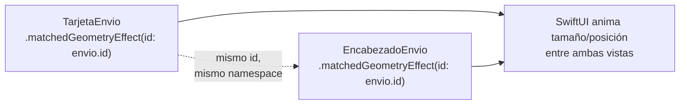
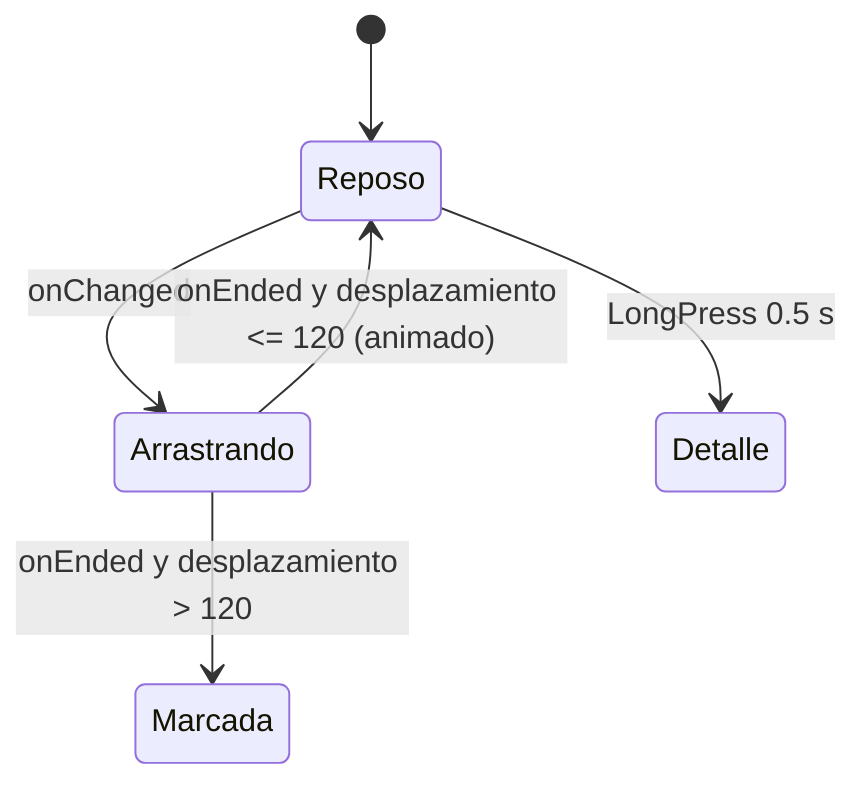
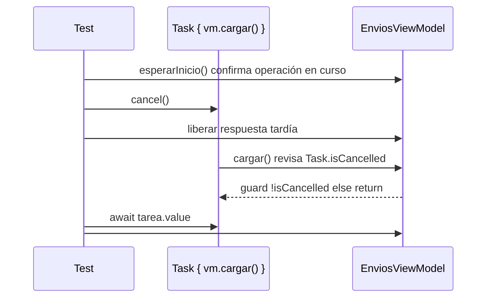
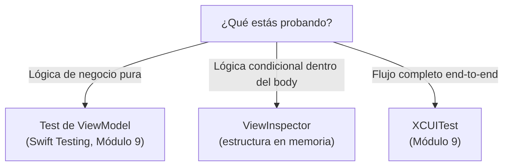
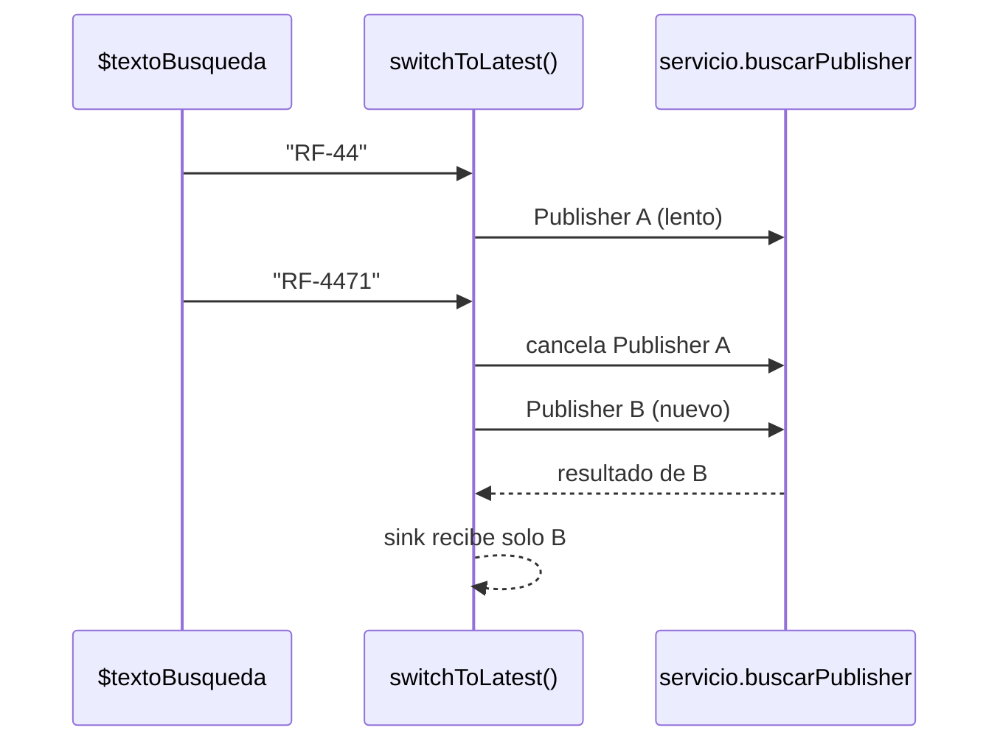
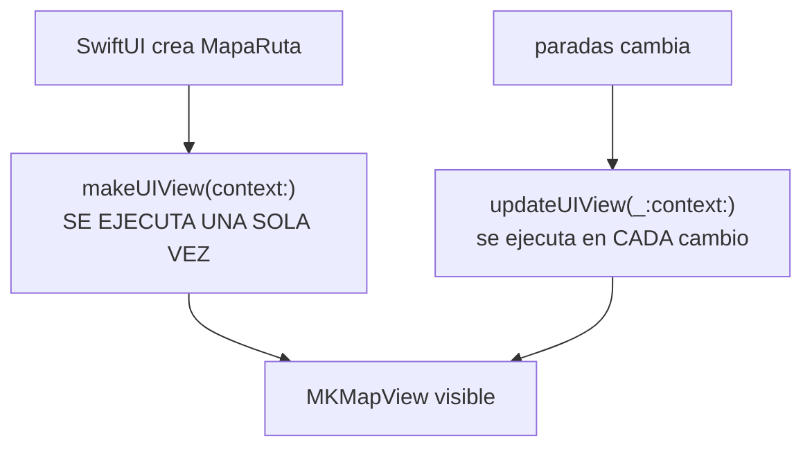
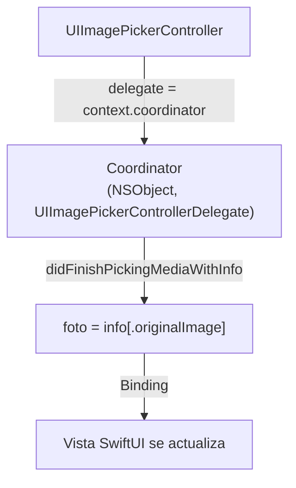
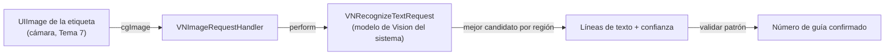
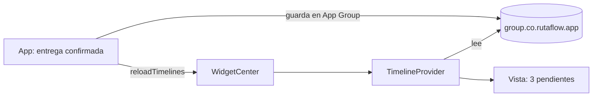

# Módulo 14: SwiftUI Master: pruebas, animación e interoperabilidad


**Proyecto del módulo:** para cada práctica, parte de una carpeta vacía y crea en Xcode (File ▸ New ▸ Project ▸ App, interfaz SwiftUI) un proyecto llamado `RutaFlowApp`; escribe manualmente todos los archivos indicados y compila, sin usar proyectos ya preparados.

## Aprende construyendo


### Tema 1: Animaciones y matchedGeometryEffect · Intermedio · 35 min

<details open>
<summary><strong>Capa 1 — Lectura</strong></summary>

#### ► DE QUÉ TRATA
Al finalizar vas a animar la transición de una TarjetaEnvio en ListaEnvios hacia DetalleEnvio, de forma que la tarjeta parezca expandirse en vez de cambiar de golpe. Prerrequisitos: Módulo 1 completo.

#### ► LA ANALOGÍA
`matchedGeometryEffect` vincula dos vistas distintas (una en cada pantalla) con un mismo `id` dentro de un mismo `namespace`, y SwiftUI anima la transición de tamaño y posición entre ambas — como si fuera literalmente la misma vista moviéndose.

**¿Por qué es importante?** Porque una transición animada que conserva continuidad visual comunica relación espacial de una forma que un corte instantáneo no puede.
**Conceptos clave:** `Namespace` compartido, `id` idéntico entre ambos lados de la transición.

**Diagrama: matchedGeometryEffect con id compartido**



En tu propio proyecto RutaFlow, crea `TransicionEnvio.swift` con **File ▸ New ▸ File ▸ Swift File** dentro del target de la app; ahí viven la lista y el detalle que comparten el namespace. Límite de la decisión: `matchedGeometryEffect` no conviene para transiciones entre vistas sin relación visual real (dos pantallas completamente distintas) — ahí una transición estándar de `NavigationStack` es más clara; reservalo específicamente cuando dos vistas distintas representan visualmente el mismo elemento de datos, como esta tarjeta que se expande.

#### ► CÓMO FUNCIONA


</details>

<details>
<summary><strong>Capa 2 — Construcción</strong></summary>

#### Código y verificación


```swift
import SwiftUI

struct EnvioResumen: Identifiable {
    let id: Int
    let guia: String
    let direccion: String
}

struct TransicionEnvio: View {
    @Namespace private var espacioAnimacion
    @State private var seleccionado: EnvioResumen?
    let envios = [EnvioResumen(id: 1, guia: "RF-4471", direccion: "Calle 10 #5-20")]

    var body: some View {
        if let envio = seleccionado {
            // En el detalle: mismo id y mismo namespace que la tarjeta de la lista.
            VStack(alignment: .leading) {
                Text(envio.guia).font(.largeTitle)
                Text(envio.direccion)
            }
            .matchedGeometryEffect(id: envio.id, in: espacioAnimacion)
            .onTapGesture { withAnimation { seleccionado = nil } }
        } else {
            // En la lista: cada tarjeta declara su geometría con el id del envío.
            VStack {
                ForEach(envios) { envio in
                    Text(envio.guia)
                        .padding()
                        .background(.blue.opacity(0.1), in: .rect(cornerRadius: 8))
                        .matchedGeometryEffect(id: envio.id, in: espacioAnimacion)
                        .onTapGesture { withAnimation { seleccionado = envio } }
                }
            }
        }
    }
}
```

```bash
xcodebuild -scheme RutaFlowApp -destination 'generic/platform=iOS Simulator' build
```

</details>

### Tema 2: Gestos en SwiftUI: arrastrar, mantener presionado y combinar gestos · Intermedio · 40 min

<details open>
<summary><strong>Capa 1 — Lectura</strong></summary>

#### ► DE QUÉ TRATA
Continúa RutaFlowApp. Crea FilaEntrega.swift en el grupo RutaFlowApp.

#### ► CÓMO FUNCIONA


</details>

<details>
<summary><strong>Capa 2 — Construcción</strong></summary>

#### Código y verificación


```swift
import SwiftUI

struct FilaEntrega: View {
    let codigo: String
    var alMarcar: () -> Void
    @State private var desplazamiento: CGFloat = 0
    @State private var mostrandoDetalle = false

    var body: some View {
        Text(codigo)
            .frame(maxWidth: .infinity, alignment: .leading)
            .padding()
            .background(.background, in: .rect(cornerRadius: 12))
            .offset(x: desplazamiento)
            .gesture(
                DragGesture(minimumDistance: 20)
                    .onChanged { valor in desplazamiento = max(0, valor.translation.width) }
                    .onEnded { valor in
                        if valor.translation.width > 120 { alMarcar() }
                        withAnimation(.spring) { desplazamiento = 0 } // vuelve a su lugar
                    }
                    .simultaneously(with: LongPressGesture(minimumDuration: 0.5)
                        .onEnded { _ in mostrandoDetalle = true })
            )
            .accessibilityAction(named: "Marcar como entregada", alMarcar) // alternativa para VoiceOver
            .sheet(isPresented: $mostrandoDetalle) { Text("Detalle de \(codigo)") }
    }
}

#Preview {
    FilaEntrega(codigo: "ENV-42") { print("ENV-42 entregada") }
        .padding()
}
```

```bash
xcodebuild -scheme RutaFlowApp -destination 'generic/platform=iOS Simulator' build
```

```text
Arrastrar ENV-42 más de 120 puntos a la derecha imprime «ENV-42 entregada» en la consola y la fila vuelve a su lugar.
Arrastrar menos de 120 puntos no marca nada.
Mantener presionado medio segundo abre la hoja con «Detalle de ENV-42».
```

</details>

### Tema 3: Swift Testing y pruebas asíncronas · Intermedio · 45 min

<details open>
<summary><strong>Capa 1 — Lectura</strong></summary>

#### ► DE QUÉ TRATA
Al finalizar vas a testear que cancelar la carga de EnviosViewModel.cargar() a mitad de camino detiene efectivamente la tarea, en vez de dejarla sobrescribir el estado más tarde. Prerrequisitos: Módulo 9 completo.

#### ► CÓMO FUNCIONA


</details>

<details>
<summary><strong>Capa 2 — Construcción</strong></summary>

#### Código y verificación


```swift
import Foundation

// nonisolated: un proyecto nuevo de Xcode 26 aísla por defecto todo en MainActor, y el
// servicio de prueba es un actor, que no puede adoptar un protocolo aislado en MainActor.
nonisolated struct Envio: Equatable, Sendable {
    let id: String
}

nonisolated protocol ServicioEnvios: Sendable {
    func obtenerEnvios() async throws -> [Envio]
}

@MainActor
final class EnviosViewModel {
    var envios: [Envio] = []
    var error: Error?
    private let servicio: any ServicioEnvios

    init(servicio: any ServicioEnvios) {
        self.servicio = servicio
    }

    func cargar() async {
        do {
            let respuesta = try await servicio.obtenerEnvios()
            guard !Task.isCancelled else { return }
            envios = respuesta
        } catch is CancellationError {
            return
        } catch {
            guard !Task.isCancelled else { return }
            self.error = error
        }
    }
}
```

```swift
import Foundation
import Testing
@testable import RutaFlowApp

// Ignora cancelación intencionadamente para simular una respuesta tardía real.
actor ServicioControlado: ServicioEnvios {
    private var response: CheckedContinuation<[Envio], Never>?
    private var started = false
    private var waitingForStart: CheckedContinuation<Void, Never>?

    func obtenerEnvios() async throws -> [Envio] {
        await withCheckedContinuation { continuation in
            response = continuation
            started = true
            waitingForStart?.resume()
            waitingForStart = nil
        }
    }

    func esperarInicio() async {
        if started { return }
        await withCheckedContinuation { waitingForStart = $0 }
    }

    func responder(_ envios: [Envio]) {
        response?.resume(returning: envios)
        response = nil
    }
}

@Test @MainActor func cancelarDuranteCargaDescartaRespuestaTardia() async {
    let servicio = ServicioControlado()
    let vm = EnviosViewModel(servicio: servicio)
    let tarea = Task { await vm.cargar() }
    await servicio.esperarInicio() // La operación YA está esperando una respuesta.
    tarea.cancel()
    await servicio.responder([Envio(id: "RF-4471")])
    await tarea.value
    #expect(vm.envios.isEmpty)
    #expect(vm.error == nil)
}

@Test @MainActor func cargaSinCancelarPublicaRespuesta() async {
    let servicio = ServicioControlado()
    let vm = EnviosViewModel(servicio: servicio)
    let tarea = Task { await vm.cargar() }
    await servicio.esperarInicio()
    await servicio.responder([Envio(id: "RF-4471")])
    await tarea.value
    #expect(vm.envios.map(\.id) == ["RF-4471"])
}
```

```bash
xcodebuild test -scheme RutaFlowApp -destination 'platform=iOS Simulator,name=iPhone 17'
```

</details>

### Tema 4: ViewInspector con criterio · Intermedio · 40 min

<details open>
<summary><strong>Capa 1 — Lectura</strong></summary>

#### ► DE QUÉ TRATA
Al finalizar vas a usar ViewInspector para confirmar que ListaEnvios muestra "Sin envíos" cuando vm.envios está vacío, decidiendo cuándo ese test vale más que uno de XCUITest. Prerrequisitos: Módulo 9 completo.

#### ► CÓMO FUNCIONA


</details>

<details>
<summary><strong>Capa 2 — Construcción</strong></summary>

#### Código y verificación


```swift
import Foundation

// nonisolated: un proyecto nuevo de Xcode 26 aísla por defecto todo en MainActor, y el
// servicio de prueba es un actor, que no puede adoptar un protocolo aislado en MainActor.
nonisolated struct Envio: Equatable, Sendable {
    let id: String
}

nonisolated protocol ServicioEnvios: Sendable {
    func obtenerEnvios() async throws -> [Envio]
}

@MainActor
final class EnviosViewModel {
    var envios: [Envio]
    private let servicio: any ServicioEnvios

    init(servicio: any ServicioEnvios, envios: [Envio] = []) {
        self.servicio = servicio
        self.envios = envios
    }
}
```

```swift
import SwiftUI

struct ListaEnvios: View {
    let vm: EnviosViewModel

    var body: some View {
        Group {
            if vm.envios.isEmpty {
                Text("Sin envíos")
            } else {
                List(vm.envios, id: \.id) { envio in Text(envio.id) }
            }
        }
    }
}
```

```swift
import Testing
import ViewInspector
@testable import RutaFlowApp

private struct ServicioVacio: ServicioEnvios {
    func obtenerEnvios() async throws -> [Envio] { [] }
}

extension ListaEnvios: Inspectable {}

@Test @MainActor func muestraMensajeCuandoNoHayEnvios() throws {
    let vm = EnviosViewModel(servicio: ServicioVacio())
    let vista = ListaEnvios(vm: vm)
    let texto = try vista.inspect().find(text: "Sin envíos")
    #expect(try texto.string() == "Sin envíos")
}
```

```bash
xcodebuild test -scheme RutaFlowApp -destination 'platform=iOS Simulator,name=iPhone 17' -only-testing:RutaFlowAppTests
```

</details>

### Tema 5: Combine avanzado · Avanzado · 35 min

<details open>
<summary><strong>Capa 1 — Lectura</strong></summary>

#### ► DE QUÉ TRATA
Al finalizar vas a corregir una condición de carrera en la búsqueda de guías de RutaFlow (Módulo 7), donde una respuesta vieja puede sobrescribir una más nueva, usando switchToLatest(). Prerrequisitos: Módulo 7 completo.

#### ► LA ANALOGÍA
`.map` seguido de `.switchToLatest()` cancela automáticamente el Publisher anterior cuando llega un nuevo valor de entrada — solo el resultado de la búsqueda más reciente puede llegar a completar.

**¿Por qué es importante?** Porque sin cancelar explícitamente búsquedas obsoletas, una respuesta de red fuera de orden puede mostrarle al usuario un resultado que no corresponde a lo que realmente escribió.
**Conceptos clave:** `.flatMap` frente a `.switchToLatest()`, cancelación automática de Publishers obsoletos.

**Diagrama: switchToLatest cancela lo anterior**



En tu propio proyecto RutaFlow, crea `BuscadorEnviosViewModel.swift` con **File ▸ New ▸ File ▸ Swift File**, selecciona el target de la app y escribe allí este ViewModel (si ya tienes uno del Módulo 7, reemplázalo):

#### ► CÓMO FUNCIONA


</details>

<details>
<summary><strong>Capa 2 — Construcción</strong></summary>

#### Código y verificación


```swift
import Combine
import Foundation

struct ServicioBusqueda {
    // Simula la red: responde 200 ms después, como una petición real.
    func buscarPublisher(_ texto: String) -> AnyPublisher<[String], Never> {
        Just(["RF-4471", "RF-5002"].filter { $0.hasPrefix(texto) })
            .delay(for: .milliseconds(200), scheduler: RunLoop.main)
            .eraseToAnyPublisher()
    }
}

class BuscadorEnviosViewModel: ObservableObject {
    @Published var textoBusqueda = ""
    @Published private(set) var resultados: [String] = []
    private let servicio = ServicioBusqueda()
    private var cancelables = Set<AnyCancellable>()

    init() {
        $textoBusqueda
            .debounce(for: .milliseconds(300), scheduler: RunLoop.main)
            .map { [servicio] texto in servicio.buscarPublisher(texto) } // cada búsqueda produce un nuevo Publisher
            .switchToLatest() // cancela el Publisher anterior si todavía no completó
            .sink { [weak self] resultados in self?.resultados = resultados }
            .store(in: &cancelables)
    }
}
```

```bash
xcodebuild -scheme RutaFlowApp -destination 'generic/platform=iOS Simulator' build
```

</details>

### Tema 6: UIViewRepresentable · Avanzado · 35 min

<details open>
<summary><strong>Capa 1 — Lectura</strong></summary>

#### ► DE QUÉ TRATA
Al finalizar vas a envolver un MKMapView (UIKit) dentro de SwiftUI con UIViewRepresentable, mostrando la ubicación de los envíos de una ruta de RutaFlow. Prerrequisitos: Módulo 10 completo.

#### ► CÓMO FUNCIONA


</details>

<details>
<summary><strong>Capa 2 — Construcción</strong></summary>

#### Código y verificación


```swift
import MapKit
import SwiftUI

struct Parada {
    let direccion: String
    let coordenada: CLLocationCoordinate2D
}

struct MapaRuta: UIViewRepresentable {
    let paradas: [Parada]

    func makeUIView(context: Context) -> MKMapView { MKMapView() }

    func updateUIView(_ mapView: MKMapView, context: Context) {
        mapView.removeAnnotations(mapView.annotations)
        let anotaciones = paradas.map { parada in
            let punto = MKPointAnnotation()
            punto.coordinate = parada.coordenada
            punto.title = parada.direccion
            return punto
        }
        mapView.addAnnotations(anotaciones)
    }
}
```

```bash
xcodebuild -scheme RutaFlowApp -destination 'generic/platform=iOS Simulator' build
```

</details>

### Tema 7: UIViewControllerRepresentable y Coordinator · Avanzado · 35 min

<details open>
<summary><strong>Capa 1 — Lectura</strong></summary>

#### ► DE QUÉ TRATA
Al finalizar vas a envolver UIImagePickerController (para fotografiar la prueba de entrega) con UIViewControllerRepresentable, usando un Coordinator para recibir la foto de vuelta en SwiftUI. Prerrequisitos: Tema 5 de este módulo.

#### ► LA ANALOGÍA
`UIViewControllerRepresentable` envuelve el controlador completo; como el delegate de UIKit necesita un objeto que lo implemente (no una closure), un `Coordinator` actúa como ese delegate y reenvía el resultado hacia una `Binding` de SwiftUI.

**¿Por qué es importante?** Porque sin un Coordinator correctamente asignado como delegate, un `UIViewControllerRepresentable` puede parecer funcionar mientras falla silenciosamente en devolver el resultado a SwiftUI.
**Conceptos clave:** Coordinator como puente de delegate entre UIKit y SwiftUI, fallos silenciosos sin error visible.

**Diagrama: Coordinator como puente de delegate**



En tu propio proyecto RutaFlow, crea `SelectorFotoEntrega.swift` con **File ▸ New ▸ File ▸ Swift File**, selecciona el target de la app y escribe allí el representable y su `Coordinator`. Límite de la decisión: `UIViewControllerRepresentable` con `Coordinator` no conviene cuando SwiftUI ya expone una API nativa equivalente (como `PhotosPicker` para seleccionar de la galería) — ahí usar la API nativa es más simple; reservá este puente específicamente para controladores de UIKit sin equivalente SwiftUI directo, como `UIImagePickerController` con cámara.

#### ► CÓMO FUNCIONA


</details>

<details>
<summary><strong>Capa 2 — Construcción</strong></summary>

#### Objetivo observable
Al finalizar vas a envolver `UIImagePickerController` (para fotografiar la prueba de entrega) con `UIViewControllerRepresentable`, usando un `Coordinator` para recibir la foto de vuelta en SwiftUI. Prerrequisitos: Tema 5 de este módulo.

</details>

### Tema 8: Core ML y Vision — inferencia en el dispositivo · Avanzado · 45 min

<details open>
<summary><strong>Capa 1 — Lectura</strong></summary>

#### ► DE QUÉ TRATA
Al finalizar vas a leer el texto de una etiqueta de envío fotografiada con la cámara del Tema 7, usando Vision para el reconocimiento de texto (OCR) que ya viene integrado en el sistema, sin enviar la imagen a ningún servidor. Prerrequisitos: Tema 7 de este módulo (ya tienes la U…

#### ► LA ANALOGÍA
La inferencia en el dispositivo ejecuta un modelo ya entrenado localmente: la foto entra, el resultado sale, y nada viaja por la red. **Core ML** es el motor que corre modelos (`.mlmodel`) sobre CPU, GPU o Neural Engine; **Vision** es la capa de alto nivel para imágenes que, para tareas comunes como detección de texto, caras o rectángulos, trae sus propios modelos del sistema y no te obliga a aportar uno. Reconocer texto con Vision es como tener un lector entrenado dentro del teléfono: le muestras la foto y te devuelve las cadenas que encontró con su nivel de confianza, sin preguntar a nadie afuera.

**Analogía:** un servicio de OCR en la nube es como mandar la etiqueta por correo a una oficina para que la transcriban y te devuelvan la respuesta; Vision en el dispositivo es tener a esa persona sentada a tu lado leyéndola al instante, aunque no haya señal.

**¿Por qué es importante?** Porque la inferencia en el dispositivo entrega resultados sin conexión y sin exponer los datos del usuario a un servidor, pero su salida sigue siendo una hipótesis que debe validarse antes de tratarla como un dato de confianza.
**Conceptos clave:** inferencia en el dispositivo, Core ML, Vision, `VNRecognizeTextRequest`, nivel de reconocimiento, confianza y validación de la salida.

**Diagrama: la foto se procesa dentro del teléfono**



En tu propio proyecto RutaFlow, crea `OCREntrega.swift` con **File ▸ New ▸ File ▸ Swift File**, selecciona el target de la app y escribe allí el enum y la función del Paso 4. Límite de la decisión: la inferencia en el dispositivo no conviene cuando la tarea requiere un modelo demasiado grande para el teléfono o que debe actualizarse a diario para todos los usuarios — ahí un servicio en servidor puede ser más práctico; reservá el procesamiento local específicamente para tareas sensibles a la privacidad, que deben funcionar sin conexión o que responden mejor en tiempo real, como leer una etiqueta recién fotografiada.

---

#### ► CÓMO FUNCIONA


</details>

<details>
<summary><strong>Capa 2 — Construcción</strong></summary>

#### Objetivo observable
Al finalizar vas a leer el texto de una etiqueta de envío fotografiada con la cámara del Tema 7, usando Vision para el reconocimiento de texto (OCR) que ya viene integrado en el sistema, sin enviar la imagen a ningún servidor. Prerrequisitos: Tema 7 de este módulo (ya tienes la `UIImage` de la foto). No necesitas descargar ningún modelo: `VNRecognizeTextRequest` usa un modelo de Vision incluido en iOS.

</details>

### Tema 9: WidgetKit: un widget con las entregas pendientes del día · Avanzado · 45 min

<details open>
<summary><strong>Capa 1 — Lectura</strong></summary>

#### ► DE QUÉ TRATA
En Xcode, File > New > Target > Widget Extension con el nombre PendientesWidget. Activa en la app y en la extensión la capacidad App Groups con group.co.rutaflow.app.

#### ► CÓMO FUNCIONA


</details>

<details>
<summary><strong>Capa 2 — Construcción</strong></summary>

#### Código y verificación


```swift
import SwiftUI
import WidgetKit

struct EntradaPendientes: TimelineEntry {
    let date: Date
    let pendientes: Int
}

struct Proveedor: TimelineProvider {
    private let datos = UserDefaults(suiteName: "group.co.rutaflow.app")

    func placeholder(in context: Context) -> EntradaPendientes { .init(date: .now, pendientes: 0) }

    func getSnapshot(in context: Context, completion: @escaping (EntradaPendientes) -> Void) {
        completion(.init(date: .now, pendientes: 3))
    }

    func getTimeline(in context: Context, completion: @escaping (Timeline<EntradaPendientes>) -> Void) {
        let entrada = EntradaPendientes(date: .now, pendientes: datos?.integer(forKey: "pendientes") ?? 0)
        // Pide la siguiente línea de tiempo en 30 minutos (el sistema puede tardar más).
        completion(Timeline(entries: [entrada], policy: .after(.now.addingTimeInterval(30 * 60))))
    }
}

struct VistaPendientes: View {
    let entrada: EntradaPendientes
    var body: some View {
        VStack(alignment: .leading) {
            Text("\(entrada.pendientes)").font(.largeTitle.bold())
            Text("entregas pendientes").font(.caption)
        }
        .containerBackground(.fill.tertiary, for: .widget)
    }
}

@main
struct PendientesWidget: Widget {
    var body: some WidgetConfiguration {
        StaticConfiguration(kind: "Pendientes", provider: Proveedor()) { VistaPendientes(entrada: $0) }
            .configurationDisplayName("Entregas pendientes")
            .supportedFamilies([.systemSmall, .accessoryCircular])
    }
}
```

```swift
import WidgetKit

func publicarPendientes(_ cantidad: Int) {
    UserDefaults(suiteName: "group.co.rutaflow.app")?.set(cantidad, forKey: "pendientes")
    WidgetCenter.shared.reloadTimelines(ofKind: "Pendientes") // pide al sistema recargar
}
```

```bash
xcodebuild -scheme RutaFlowApp -destination 'generic/platform=iOS Simulator' build
# ejecuta el esquema PendientesWidget para verlo en el simulador, o agrégalo desde la pantalla de inicio
```

```text
En la galería de widgets aparece «Entregas pendientes» con el ejemplo de 3.
Al confirmar una entrega en la app (de 3 a 2 pendientes), el widget de la pantalla de inicio cambia a 2 en pocos segundos.
```

</details>

### Tema 10: App Intents: acciones de la app en Siri, Atajos y Spotlight · Avanzado · 40 min

<details open>
<summary><strong>Capa 1 — Lectura</strong></summary>

#### ► DE QUÉ TRATA
Continúa RutaFlowApp (iOS 17+). No necesitas una extensión: los App Intents viven en el target de la app. Usa el App Group del tema del widget para leer la cantidad.

#### ► LA ANALOGÍA
**Conceptos clave:** `AppIntent`, `perform()`, `IntentResult`, diálogo, `AppShortcutsProvider`, frase con `\(.applicationName)`, Atajos, Spotlight.

Un **`AppIntent`** es una acción de tu app descrita para el sistema: un título, parámetros opcionales y un método `perform()` que devuelve un resultado (un diálogo para que Siri lo diga, un valor, o abrir la app).

Con un **`AppShortcutsProvider`**, declaras **App Shortcuts**: intents listos para usar desde el primer momento, con frases para Siri. Cada frase debe incluir el nombre de la app (`\(.applicationName)`).

El sistema descubre los intents al compilar; no hay que registrarlos en tiempo de ejecución. El mismo intent sirve en Siri, la app Atajos, Spotlight y el botón de acción.

**Analogía:** un App Intent es un botón de tu app que el sistema puede pulsar por ti cuando el usuario se lo pide con la voz. La analogía falla en que el botón no necesita la pantalla de la app: puede responder sin abrirla.

**Límite de uso:** `perform()` debe ser rápido: el sistema corta las acciones largas. No expongas acciones destructivas sin confirmación (`requestConfirmation`).

```mermaid
sequenceDiagram
    participant U as Conductor
    participant S as Siri
    participant I as EntregasPendientesIntent
    participant G as App Group
    U->>S: "¿Cuántas entregas me quedan en RutaFlow?"
    S->>I: perform()
    I->>G: lee pendientes
    I-->>S: diálogo "Te quedan 3 entregas"
    S-->>U: lo dice en voz alta
```

#### ► CÓMO FUNCIONA
```mermaid
sequenceDiagram
    participant U as Conductor
    participant S as Siri
    participant I as EntregasPendientesIntent
    participant G as App Group
    U->>S: "¿Cuántas entregas me quedan en RutaFlow?"
    S->>I: perform()
    I->>G: lee pendientes
    I-->>S: diálogo "Te quedan 3 entregas"
    S-->>U: lo dice en voz alta
```

</details>

<details>
<summary><strong>Capa 2 — Construcción</strong></summary>

#### Código y verificación
```mermaid
sequenceDiagram
    participant U as Conductor
    participant S as Siri
    participant I as EntregasPendientesIntent
    participant G as App Group
    U->>S: "¿Cuántas entregas me quedan en RutaFlow?"
    S->>I: perform()
    I->>G: lee pendientes
    I-->>S: diálogo "Te quedan 3 entregas"
    S-->>U: lo dice en voz alta
```

```swift
import AppIntents

struct EntregasPendientesIntent: AppIntent {
    static let title: LocalizedStringResource = "Entregas pendientes"
    static let description = IntentDescription("Dice cuántas entregas te quedan hoy.")

    func perform() async throws -> some IntentResult & ProvidesDialog {
        let pendientes = UserDefaults(suiteName: "group.co.rutaflow.app")?.integer(forKey: "pendientes") ?? 0
        let texto: String = switch pendientes {
        case 0: "No te quedan entregas. ¡Buen trabajo!"
        case 1: "Te queda 1 entrega."
        default: "Te quedan \(pendientes) entregas."
        }
        return .result(dialog: IntentDialog(stringLiteral: texto))
    }
}

struct AtajosRutaFlow: AppShortcutsProvider {
    static var appShortcuts: [AppShortcut] {
        AppShortcut(
            intent: EntregasPendientesIntent(),
            phrases: [
                "¿Cuántas entregas me quedan en \(.applicationName)?",
                "Entregas pendientes en \(.applicationName)",
            ],
            shortTitle: "Pendientes",
            systemImageName: "shippingbox")
    }
}
```

```bash
xcodebuild -scheme RutaFlowApp -destination 'generic/platform=iOS Simulator' build
# ejecuta la app una vez; luego abre la app Atajos > Atajos de app > RutaFlow > Pendientes
```

```text
En la app Atajos, sección de RutaFlow, aparece «Pendientes».
Al ejecutarlo con 3 pendientes guardados, se muestra «Te quedan 3 entregas.».
En un dispositivo, «Oye Siri, entregas pendientes en RutaFlow» responde lo mismo en voz alta.
```

</details>
