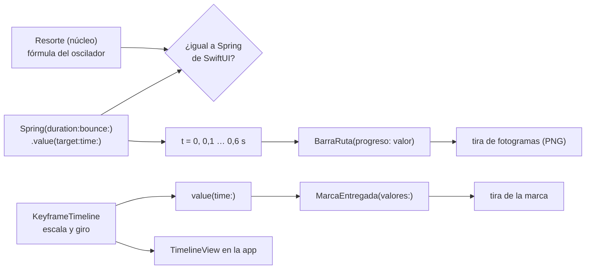
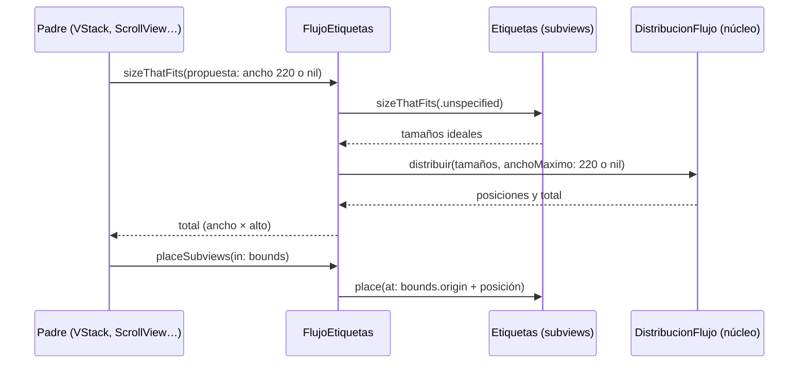
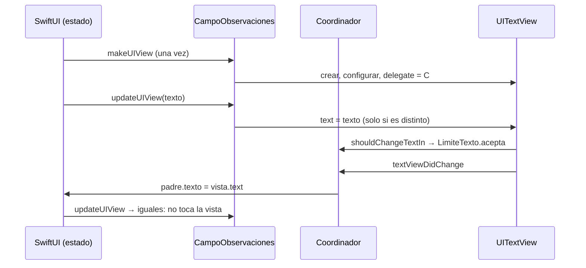

# Módulo 14: SwiftUI avanzado: animación, diseño propio con el protocolo Layout, interoperabilidad con UIKit

**Entorno comprobado para esta edición (2026-11-25):** Swift 6.4.3 en Linux x86_64 para la lógica pura: el paquete
`nucleo` (la curva de un resorte, el reparto de etiquetas en filas y el límite de caracteres), ejecutado con
`swift test` y `swift run` en `/home/estudiante/labs/ios/ios14` (tu `~/labs/ios/ios14`). Lo de Apple se compiló y
ejecutó con Xcode 27.2 (27B52), Swift 6.4.2 y el simulador iPhone 17 con iOS 27.2, con el script `mac.sh`: las
curvas de `Spring` y `KeyframeTimeline` comparadas con el núcleo, las tiras de fotogramas, el `Layout` propio con
varios anchos, los representables de UIKit probados en una ventana de la app y con XCUITest, y pantallazos de la app
real. Límites honestos: los fotogramas «en vivo» se tomaron con pantallazos del simulador cada medio segundo, así que
sus instantes son aproximados; las tiras de fotogramas, en cambio, son exactas porque evalúan la curva.

Las pantallas de los módulos anteriores usan los componentes de SwiftUI tal como vienen. En una app de verdad
aparecen tres necesidades más: animaciones que se sienten físicas y que se pueden probar, diseños que ningún stack
resuelve (etiquetas que pasan de fila) y pantallas o vistas de UIKit que ya existen y no se van a reescribir. Este
módulo cubre las tres, con pruebas.

**Al terminar este módulo podrás:**
- animar con resortes y fotogramas clave, y probar una animación evaluando su curva en instantes fijos;
- escribir un `Layout` propio con `sizeThatFits` y `placeSubviews`, con el cálculo separado y probado;
- envolver una vista de UIKit con `UIViewRepresentable` y un coordinador, sin romper el cursor ni el estado;
- usar SwiftUI dentro de UIKit con `UIHostingConfiguration` y UIKit dentro de SwiftUI con
  `UIViewControllerRepresentable`.

**Esquema del módulo:** Tema 1 (animaciones: resortes y fotogramas clave) → Tema 2 (un `Layout` propio) → Tema 3
(`UIViewRepresentable` con coordinador) → Tema 4 (UIKit y SwiftUI en las dos direcciones) → Proyecto 51.

**Qué necesitas saber antes:** del Módulo 1, **los stacks, los modificadores y cómo SwiftUI propone tamaños**; del
Módulo 2, **`@State`, `@Binding`, `@Observable` y `@Bindable`**; del Módulo 4, **`@MainActor`**; del Módulo 9,
**Swift Testing, las pruebas alojadas, las capturas con una ventana de la app y XCUITest**.

**Qué no se repite:** cómo se escriben capturas y pruebas de interfaz (Módulo 9) ni la accesibilidad de las
pantallas (Módulo 10). Aquí se usan para comprobar animaciones, diseños y vistas de UIKit.

**Prepara el proyecto:**

```text
$ mkdir -p ~/labs/ios/ios14/nucleo && cd ~/labs/ios/ios14/nucleo
$ swift package init --type library --name Nucleo
$ mkdir -p Sources/fotogramas
```

Reemplaza `Package.swift` por el del Tema 1 y copia `Entrega.swift` y `demo_error.sh` del Módulo 9. El laboratorio
trae `app/RutaAvanzada.xcodeproj` con la app `RutaAvanzada`, las pruebas alojadas `Pruebas` y las de interfaz
`PruebasUI`; `mac.sh` copia el núcleo a la app antes de compilar. La app abre una pantalla según el argumento
`-escena`: `animacion`, `etiquetas`, `observaciones` o `uikit`.


## Aprende construyendo


### Tema 1: Animaciones: resortes, fotogramas clave y cómo probarlas · Avanzado · 45 min

<details open>
<summary><strong>Capa 1 — Lectura</strong></summary>

#### Objetivos
Al terminar este tema podrás:
- animar un cambio de estado con `withAnimation` y un resorte descrito por duración y rebote;
- escribir una línea de tiempo con fotogramas clave para varias propiedades a la vez;
- calcular el valor de una curva en cualquier instante y dibujar una tira de fotogramas en una prueba;
- comprobar que tu modelo de una curva coincide con el de SwiftUI.

**Conceptos clave:** animación explícita, resorte (duración y rebote), fotograma clave, `TimelineView`, tira de
fotogramas

#### El problema
Cuando el camión llega al destino, la marca de «entregada» debe saltar con un pequeño rebote, y el camión debe
frenar con suavidad y pasarse un poco. Se ajustan los números a ojo, se ve bien en el simulador del que lo escribió,
y en la siguiente versión alguien cambia el rebote de 0,3 a 0,7 «para que se note más»: el camión se pasa un 37 % del
recorrido y vuelve. Nadie puede revisar una animación en una prueba… si se la mira en movimiento.

Este tema usa **`@State` y los cambios de estado** (Módulo 2), **`Task.sleep`** (Módulo 4) y **las capturas con una
ventana de la app** (Módulo 9).

#### Glosario del tema

**animación explícita**
- **Definición técnica:** `withAnimation(_:_:)` envuelve un cambio de estado; SwiftUI anima todas las propiedades animables de las vistas que dependen de ese estado, con la curva indicada.
- **En palabras sencillas:** «cambia esto, y que se note el camino».
- **Dónde se rompe la comparación:** solo se anima lo que cambió **dentro** del bloque; un cambio fuera salta sin animación.
- **Ejemplo:** `withAnimation(.spring(duration: 3, bounce: 0.3)) { progreso = 1 }`.
- **Error típico:** poner `.animation(.default)` sin `value:` en una vista grande: anima cambios que no querías.

**resorte (duración y rebote)**
- **Definición técnica:** `Spring(duration:bounce:)` describe un oscilador amortiguado con masa 1, rigidez (2π / duración)² y razón de amortiguamiento 1 − rebote; `value(target:time:)` da su posición en un instante.
- **En palabras sencillas:** un muelle: con rebote 0 llega sin pasarse; con rebote, se pasa y vuelve.
- **Dónde se rompe la comparación:** la duración es «perceptiva»: con rebote alto el movimiento sigue después de la duración.
- **Ejemplo:** con duración 0,5 y rebote 0,7, a 0,5 s todavía está en 0,868 y el máximo es 1,372.
- **Error típico:** usar `.spring(response:dampingFraction:)` y `.spring(duration:bounce:)` mezclados sin saber que describen lo mismo con otros números.

**fotograma clave**
- **Definición técnica:** un valor que una propiedad debe alcanzar en un momento, con la curva para llegar (`LinearKeyframe`, `CubicKeyframe`, `SpringKeyframe`); una `KeyframeTrack` agrupa los de una propiedad y una `KeyframeTimeline` reúne las pistas de un tipo de valores.
- **En palabras sencillas:** el guion de la animación: «a los 0,25 s, escala 1,3; a los 0,45 s, escala 1».
- **Dónde se rompe la comparación:** cada pista corre en paralelo con su propio tiempo; la duración total es la de la pista más larga.
- **Ejemplo:** `MarcaEntregada.lineaDeTiempo()`: escala y giro.
- **Error típico:** encadenar `DispatchQueue.main.asyncAfter` con varias animaciones en lugar de una línea de tiempo.

**`TimelineView`**
- **Definición técnica:** una vista que se vuelve a dibujar según un horario (`.animation` es cada cuadro de pantalla) y da la fecha de cada redibujo a su contenido.
- **En palabras sencillas:** un metrónomo para dibujar.
- **Dónde se rompe la comparación:** dibuja en cada cuadro aunque nada cambie; se pausa con `paused:`.
- **Ejemplo:** la marca toma `lineaDeTiempo().value(time: t)` con `t` desde que empezó.
- **Error típico:** dejarla sin pausar en una pantalla quieta: gasta batería.

**tira de fotogramas**
- **Definición técnica:** una imagen con la vista dibujada en varios instantes de la animación, calculando el valor de la curva en cada instante en lugar de esperar a que pase el tiempo.
- **En palabras sencillas:** la animación en viñetas, como un cómic.
- **Dónde se rompe la comparación:** muestra los valores, no la animación real de SwiftUI en pantalla (que depende de la frecuencia de cuadros y del sistema).
- **Ejemplo:** `ios14-tira-resorte.png`, de 0 a 0,6 s cada 0,1 s.
- **Error típico:** «probar» una animación con `sleep` y un pantallazo: el instante exacto nunca es el mismo.

#### ► CÓMO FUNCIONA
Una animación es una curva: para cada instante, un valor. SwiftUI la evalúa en cada cuadro de pantalla. Una prueba
puede evaluarla en los instantes que quiera, dibujar la vista con cada valor y juntar los dibujos. Y como la curva de
un resorte tiene fórmula, se puede escribir en el núcleo, probar en Linux y comparar con la de SwiftUI.



#### Problema resuelto 1.1
Escribe la curva del resorte en el núcleo y su tabla de valores. En la app, mueve el camión con un resorte y haz
saltar la marca con fotogramas clave. En las pruebas, compara tu curva con la de `Spring` y dibuja dos tiras de
fotogramas. Toma también pantallazos de la animación real.

**Razonamiento:**
1. Con rigidez (2π / d)² y amortiguamiento 4π (1 − b) / d, la razón de amortiguamiento es exactamente 1 − b; con
   rebote 0 es el caso crítico, con fórmula propia.
2. Estas conversiones las publicó en los foros de desarrolladores de Apple quien corrigió las del video de WWDC23; no
   son documentación oficial, así que la prueba las **compara** con `Spring.value`.
3. La marca guarda sus valores en `ValoresMarca` y se dibuja con los valores que recibe: la misma vista sirve para la
   app (con `TimelineView`) y para la tira (con valores fijos).
4. La tira de la marca usa 7 instantes repartidos en la duración de la línea de tiempo.

```swift
// swift-tools-version: 6.0
import PackageDescription

// La lógica pura del módulo (resorte, distribución en filas, límite de texto): se prueba aquí y
// la carpeta Sources/Nucleo se copia a la app de iOS.
let package = Package(
    name: "Nucleo",
    targets: [
        .target(name: "Nucleo"),
        .executableTarget(name: "fotogramas", dependencies: ["Nucleo"]),
        .testTarget(name: "NucleoTests", dependencies: ["Nucleo"]),
    ]
)
```

```swift
import Foundation

/// Un resorte descrito como en SwiftUI, con duración y rebote, resuelto con la fórmula del oscilador amortiguado.
/// Masa 1, rigidez (2π / duración)² y amortiguamiento 4π (1 − rebote) / duración, así que la razón de
/// amortiguamiento es exactamente 1 − rebote: con rebote 0 no se pasa del destino; con rebote > 0, sí.
public struct Resorte: Sendable {
    public let duracion: Double
    public let rebote: Double

    public init(duracion: Double = 0.5, rebote: Double = 0) {
        precondition(duracion > 0 && (0..<1).contains(rebote), "rebote entre 0 y 1 (sin incluir 1)")
        self.duracion = duracion
        self.rebote = rebote
    }

    public var rigidez: Double { pow(2 * .pi / duracion, 2) }
    public var amortiguamiento: Double { 4 * .pi * (1 - rebote) / duracion }

    /// Posición en el instante `t` (segundos) de una animación que va de 0 a 1 y empieza quieta.
    public func valor(en t: Double) -> Double {
        let w0 = rigidez.squareRoot()  // frecuencia natural
        let zeta = 1 - rebote  // razón de amortiguamiento
        if zeta >= 1 {  // crítico: llega sin pasarse
            return 1 - (1 + w0 * t) * exp(-w0 * t)
        }
        let wd = w0 * (1 - zeta * zeta).squareRoot()  // frecuencia con amortiguamiento
        let desplazamiento = exp(-zeta * w0 * t) * (cos(wd * t) + zeta * w0 / wd * sin(wd * t))
        return 1 - desplazamiento
    }

    /// El primer instante desde el cual la posición queda siempre a menos de `tolerancia` del destino.
    public func asentamiento(tolerancia: Double = 0.01, paso: Double = 0.001, hasta: Double = 5) -> Double {
        var ultimoFuera = 0.0
        for i in 0...Int(hasta / paso) {
            let t = Double(i) * paso
            if abs(valor(en: t) - 1) >= tolerancia { ultimoFuera = t }
        }
        return ultimoFuera + paso
    }
}
```

```swift
import Foundation
import Nucleo

// La posición de tres resortes de 0,5 s cada 0,05 s: con rebote 0 no se pasan de 1; con rebote, sí.
let resortes = [
    Resorte(duracion: 0.5, rebote: 0), Resorte(duracion: 0.5, rebote: 0.3), Resorte(duracion: 0.5, rebote: 0.7),
]
print("   t    rebote 0   rebote 0,3   rebote 0,7")
for i in stride(from: 0, through: 16, by: 1) {
    let t = Double(i) * 0.05
    let fila = resortes.map { String(format: "%9.3f", $0.valor(en: t)) }.joined(separator: "    ")
    print(String(format: "%5.2f", t) + "  " + fila)
}
for r in resortes {
    let maximo = stride(from: 0.0, through: 2, by: 0.001).map(r.valor(en:)).max()!
    print(
        String(
            format: "rebote %.1f: máximo %.3f, a menos de 1 %% del destino desde %.3f s", r.rebote, maximo,
            r.asentamiento()))
}
```

```text
$ cd nucleo && swift run fotogramas 2>&1 | grep -vE 'safeExec|^\[|Build|Compiling|Planning|Building'
   t    rebote 0   rebote 0,3   rebote 0,7
 0.00      0.000        0.000        0.000
 0.05      0.131        0.146        0.169
 0.10      0.358        0.423        0.550
 0.15      0.562        0.685        0.954
 0.20      0.715        0.874        1.246
 0.25      0.821        0.984        1.368
 0.30      0.890        1.034        1.335
 0.35      0.934        1.046        1.205
 0.40      0.960        1.039        1.051
 0.45      0.977        1.027        0.929
 0.50      0.986        1.014        0.868
 0.55      0.992        1.006        0.868
 0.60      0.995        1.001        0.910
 0.65      0.997        0.998        0.968
 0.70      0.999        0.998        1.017
 0.75      0.999        0.998        1.046
 0.80      1.000        0.999        1.051
rebote 0.0: máximo 1.000, a menos de 1 % del destino desde 0.529 s
rebote 0.3: máximo 1.046, a menos de 1 % del destino desde 0.524 s
rebote 0.7: máximo 1.372, a menos de 1 % del destino desde 1.140 s
```

```swift
import Testing

@testable import Nucleo

@Suite("Resorte")
struct ResorteTests {
    @Test("empieza en 0 y termina en 1", arguments: [0.0, 0.3, 0.7])
    func extremos(rebote: Double) {
        let resorte = Resorte(duracion: 0.5, rebote: rebote)
        #expect(abs(resorte.valor(en: 0)) < 1e-12)
        #expect(abs(resorte.valor(en: 3) - 1) < 1e-3)
    }

    @Test("sin rebote nunca se pasa del destino")
    func sinRebote() {
        let resorte = Resorte(duracion: 0.5, rebote: 0)
        #expect(stride(from: 0.0, through: 2, by: 0.01).allSatisfy { resorte.valor(en: $0) <= 1 })
    }

    @Test("con rebote 0,3 se pasa y vuelve")
    func conRebote() {
        let resorte = Resorte(duracion: 0.5, rebote: 0.3)
        let maximo = stride(from: 0.0, through: 2, by: 0.001).map(resorte.valor(en:)).max()!
        #expect(maximo > 1.04 && maximo < 1.05)
    }

    @Test("con poco rebote, la duración es casi el tiempo en quedarse quieto; con mucho, no")
    func asentamiento() {
        #expect(abs(Resorte(duracion: 0.5, rebote: 0).asentamiento() - 0.5) < 0.05)
        #expect(abs(Resorte(duracion: 0.5, rebote: 0.3).asentamiento() - 0.5) < 0.05)
        #expect(Resorte(duracion: 0.5, rebote: 0.7).asentamiento() > 1)
    }
}
```

```text
$ cd nucleo && swift test --filter Resorte 2>&1 | grep -E '✔|✘'
✔ Test "empieza en 0 y termina en 1" with 3 test cases passed after 0.001 seconds.
✔ Test "con rebote 0,3 se pasa y vuelve" passed after 0.001 seconds.
✔ Test "sin rebote nunca se pasa del destino" passed after 0.001 seconds.
✔ Test "con poco rebote, la duración es casi el tiempo en quedarse quieto; con mucho, no" passed after 0.002 seconds.
✔ Suite "Resorte" passed after 0.002 seconds.
✔ Test run with 4 tests in 1 suite passed after 0.002 seconds.
```

```swift
import SwiftUI

/// Una barra de la ruta con el camión en la posición `progreso` (0 = bodega, 1 = destino).
struct BarraRuta: View {
    let progreso: Double
    var etiqueta: String = ""

    var body: some View {
        VStack(alignment: .leading, spacing: 4) {
            if !etiqueta.isEmpty { Text(etiqueta).font(.caption.monospacedDigit()).foregroundStyle(.secondary) }
            GeometryReader { geo in
                let ancho = geo.size.width - 36
                ZStack(alignment: .leading) {
                    Capsule().fill(.quaternary).frame(height: 8)
                    Rectangle().fill(.red.opacity(0.6)).frame(width: 2, height: 24).offset(x: ancho + 17)  // el destino
                    Image(systemName: "box.truck.fill")
                        .font(.title2)
                        .foregroundStyle(.blue)
                        .offset(x: ancho * progreso)
                }
                .frame(maxHeight: .infinity)
            }
            .frame(height: 32)
        }
        .padding(.horizontal)
    }
}

/// Valores que anima la marca de «entregada»: escala y giro, cada uno con su propia pista de fotogramas clave.
struct ValoresMarca {
    var escala = 0.0
    var giro = -30.0
}

/// La marca de entrega dibujada con unos valores dados (sin animación propia: los valores vienen de afuera).
struct MarcaEntregada: View {
    let valores: ValoresMarca

    var body: some View {
        Image(systemName: "checkmark.seal.fill")
            .font(.system(size: 44))
            .foregroundStyle(.green)
            .scaleEffect(valores.escala)
            .rotationEffect(.degrees(valores.giro))
            .frame(width: 70, height: 70)
    }

    /// La línea de tiempo: crece con un resorte, se pasa un poco y vuelve; a la vez endereza el giro.
    static func lineaDeTiempo() -> KeyframeTimeline<ValoresMarca> {
        KeyframeTimeline(initialValue: ValoresMarca()) {
            KeyframeTrack(\.escala) {
                SpringKeyframe(1.3, duration: 0.25, spring: .bouncy)
                CubicKeyframe(1.0, duration: 0.2)
            }
            KeyframeTrack(\.giro) {
                LinearKeyframe(0, duration: 0.3)
                SpringKeyframe(0, duration: 0.15)
            }
        }
    }
}

/// Pantalla en vivo: al aparecer, espera 1,5 s y mueve el camión con un resorte lento; al llegar, la marca salta.
struct PantallaAnimacion: View {
    @State private var progreso = 0.0
    @State private var inicioMarca: Date?

    var body: some View {
        NavigationStack {
            VStack(spacing: 32) {
                BarraRuta(progreso: progreso, etiqueta: "EN-4471 · Chapinero")
                TimelineView(.animation(paused: inicioMarca == nil)) { contexto in
                    let t = inicioMarca.map { contexto.date.timeIntervalSince($0) } ?? 0
                    MarcaEntregada(valores: MarcaEntregada.lineaDeTiempo().value(time: t))
                }
                Spacer()
            }
            .padding(.top, 24)
            .navigationTitle("En camino")
            .task {
                try? await Task.sleep(for: .seconds(1.5))
                withAnimation(.spring(duration: 3, bounce: 0.3)) { progreso = 1 }
                try? await Task.sleep(for: .seconds(2.5))
                inicioMarca = .now
            }
        }
    }
}
```

```swift
import SwiftUI
import Testing

@testable import RutaAvanzada

/// Animaciones probadas sin esperar: se calcula el valor de la curva en cada instante y se dibuja ese fotograma.
@MainActor
@Suite("Animaciones", .serialized)
struct AnimacionTests {
    let instantes = stride(from: 0.0, through: 0.6, by: 0.1).map { $0 }

    @Test("Spring de SwiftUI y el Resorte del núcleo dan la misma curva", arguments: [0.0, 0.3, 0.7])
    func mismaCurva(rebote: Double) {
        let spring = Spring(duration: 0.5, bounce: rebote)
        let propio = Resorte(duracion: 0.5, rebote: rebote)
        let diferencias = stride(from: 0.0, through: 2.0, by: 0.01).map { t in
            abs(spring.value(target: 1.0, time: t) - propio.valor(en: t))
        }
        let maxima = diferencias.max() ?? 0
        print("rebote \(rebote): diferencia máxima \(String(format: "%.1e", maxima))")
        #expect(maxima < 0.001)
    }

    @Test("tira de fotogramas: el camión con un resorte de 0,5 s y rebote 0,3")
    func tiraResorte() throws {
        let spring = Spring(duration: 0.5, bounce: 0.3)
        let tira = VStack(spacing: 6) {
            ForEach(instantes, id: \.self) { t in
                let valor = spring.value(target: 1.0, time: t)
                BarraRuta(
                    progreso: valor,
                    etiqueta: "t = \(t.formatted(.number.precision(.fractionLength(1)))) s · posición "
                        + valor.formatted(.number.precision(.fractionLength(3))))
            }
        }
        try capturar(tira, "ios14-tira-resorte", ancho: 390, alto: 520)
    }

    @Test("tira de fotogramas: la marca de entregada con fotogramas clave")
    func tiraMarca() throws {
        let linea = MarcaEntregada.lineaDeTiempo()
        print("duración de la línea de tiempo: \(linea.duration) s")
        let tiempos = stride(from: 0.0, through: linea.duration, by: linea.duration / 6).map { $0 }
        for t in tiempos {
            let v = linea.value(time: t)
            print(
                "t = \(t.formatted(.number.precision(.fractionLength(3)))) s: escala "
                    + "\(v.escala.formatted(.number.precision(.fractionLength(2)))), giro "
                    + "\(v.giro.formatted(.number.precision(.fractionLength(1))))°")
        }
        let tira = HStack(spacing: 0) {
            ForEach(tiempos, id: \.self) { t in
                MarcaEntregada(valores: linea.value(time: t)).scaleEffect(0.6).frame(width: 55, height: 70)
            }
        }
        try capturar(tira, "ios14-tira-marca", ancho: 390, alto: 150)
        #expect(abs(linea.value(time: linea.duration).escala - 1) < 0.001)
    }
}
```

```text
$ grep -E "rebote|Spring|duración|^t = |fotogramas|Animaciones" pruebas_alojadas
rebote 0.0: diferencia máxima 0.0e+00
rebote 0.3: diferencia máxima 1.1e-16
rebote 0.7: diferencia máxima 2.2e-16
​✔ Test "Spring de SwiftUI y el Resorte del núcleo dan la misma curva" with 3 test cases passed after 0.010 seconds.
✔ Test "tira de fotogramas: el camión con un resorte de 0,5 s y rebote 0,3" passed after 0.930 seconds.
duración de la línea de tiempo: 0.45 s
t = 0,000 s: escala 0,00, giro -30,0°
t = 0,075 s: escala 0,36, giro -22,5°
t = 0,150 s: escala 0,89, giro -15,0°
t = 0,225 s: escala 1,22, giro -7,5°
t = 0,300 s: escala 1,29, giro 0,0°
t = 0,375 s: escala 1,12, giro 2,9°
t = 0,450 s: escala 1,00, giro 2,3°
✔ Test "tira de fotogramas: la marca de entregada con fotogramas clave" passed after 0.830 seconds.
✔ Suite "Animaciones" passed after 1.772 seconds.
✔ Test "sin rebote nunca se pasa del destino" passed after 0.001 seconds.
✔ Test "con rebote 0,3 se pasa y vuelve" passed after 0.002 seconds.
✔ Test "con poco rebote, la duración es casi el tiempo en quedarse quieto; con mucho, no" passed after 0.001 seconds.
```


La animación real en el simulador, con pantallazos cada medio segundo (instantes aproximados; 6 pantallazos en 5 s
después del primero), recortados a la parte de arriba y puestos uno al lado del otro:


**Explicación por partes.**
- La tabla del núcleo muestra los tres comportamientos: con rebote 0 la posición nunca pasa de 1 (llega a 1,000 a
  los 0,8 s); con 0,3 se pasa hasta 1,046 hacia los 0,35 s; con 0,7 llega a 1,372 y todavía oscila a los 0,8 s.
- **El hallazgo:** «duración» no es «tiempo hasta quedarse quieto» en todos los casos. Con rebote 0 y 0,3, el resorte
  queda a menos del 1 % del destino desde 0,529 s y 0,524 s (casi la duración, 0,5 s); con rebote 0,7, desde 1,140 s,
  más del doble.
- **El hallazgo:** la fórmula del foro es exacta. La diferencia máxima entre `Spring.value` y el `Resorte` del núcleo,
  en 201 instantes de 0 a 2 s, fue 0 con rebote 0, 1,1 × 10⁻¹⁶ con 0,3 y 2,2 × 10⁻¹⁶ con 0,7: el error de redondeo de
  un `Double`. SwiftUI usa este mismo oscilador.
- La línea de tiempo de la marca dura 0,45 s (la pista de escala: 0,25 + 0,2). La escala máxima, 1,29, llega a los
  0,300 s y no a los 0,25 del primer fotograma clave: el `SpringKeyframe` sigue moviéndose y la curva cúbica que
  viene después parte de ahí. El giro llega a 0° a los 0,3 s y su `SpringKeyframe` lo pasa hasta 2,9° antes de
  volver; a los 0,45 s, cuando termina la escala, todavía marca 2,3°.
- La primera tira de la marca salió solapada: la marca escalada no cabía en 55 puntos. Se corrigió dibujándola al
  60 % (`scaleEffect(0.6)`) y con más alto:


- La tira del resorte tiene 6 fotogramas, de 0 a 0,5 s, aunque `instantes` pide hasta 0,6: sumar 0,1 seis veces da
  0,6000000000000001, que ya pasa el límite de `stride(through:)`. Es un error de redondeo de `Double` en la prueba,
  no de la animación.
- En vivo, el camión se mueve en el segundo pantallazo, llega al destino en el tercero, en el cuarto aparece
  pasado (el rebote 0,3 de un resorte de 3 s es lento y se ve), y desde el quinto está quieto con la marca. Los
  instantes son aproximados, pero el orden coincide con la tira calculada.

> **Error común.** Cambiar el estado fuera de `withAnimation` y esperar que se anime. Solo los cambios dentro del
> bloque usan esa curva; el resto salta. Si un cambio llega de un `Task`, envuélvelo ahí mismo.

> **Error común.** Confiar en que la «duración» de un resorte es cuánto tarda en detenerse. Con rebote 0,7 y
> duración 0,5, la tabla mostró que sigue moviéndose a 1,1 s. Si otra acción espera al final de la animación, usa el
> *callback* de finalización de `withAnimation` (iOS 17) o calcula el asentamiento.

> **Buena práctica.** Separa la vista que se dibuja (`MarcaEntregada(valores:)`) de lo que la anima. Así la misma
> vista sirve para la app, para la vista previa y para una tira de fotogramas en una prueba.

> **Prevenir errores.** Ten una tira de fotogramas de cada animación importante como captura comparada (Módulo 9).
> Un cambio de rebote o de duración cambia la imagen y se revisa en el *pull request*.

#### Checkpoint 1.1
Con `Spring(duration: 0.5, bounce: 0)`, ¿en qué posición está el camión a los 0,25 s? ¿Y con rebote 0,7?

Respuesta: 0,821 y 1,368 (ya pasado del destino), según la tabla de `fotogramas`.

</details>

<details>
<summary><strong>Capa 2 — Construcción</strong></summary>

#### Paso 1 · La curva
Crea `Resorte.swift`, `fotogramas/main.swift` y `ResorteTests.swift`. Ejecuta `swift run fotogramas` y
`swift test --filter Resorte`.

#### Paso 2 · La animación en la app
Crea `Animaciones.swift` y abre la app con `-escena animacion`. Cambia el rebote a 0 y a 0,7 y compara.

#### Paso 3 · Las tiras
Crea `AnimacionTests.swift` y ejecuta las pruebas alojadas. Abre `ios14-tira-resorte.png` y ubica el fotograma
donde el camión pasa el destino.

#### Paso 4 · Rebote negativo
`Spring` acepta rebote negativo (más amortiguado que el crítico). Agrega el caso a `Resorte` con razón de
amortiguamiento 1 / (1 + rebote) y compáralo con `Spring(duration: 0.5, bounce: -0.5)` en la prueba `mismaCurva`.

#### Paso 5 · Una transición
Haz que la marca aparezca con `.transition(.scale.combined(with: .opacity))` dentro de un `if` y un `withAnimation`,
en lugar de con la línea de tiempo. ¿Qué se pierde?

#### Resumen
- Una **animación explícita** anima los cambios dentro de `withAnimation`.
- Un **resorte** con duración y rebote es un oscilador con fórmula; su duración no siempre es su asentamiento.
- Los **fotogramas clave** describen varias propiedades con su guion; **`TimelineView`** los dibuja en el tiempo.
- Una **tira de fotogramas** evalúa la curva en instantes fijos: se puede probar y comparar.

#### Ejercicio verificable 1
Básico. ¿Cuál es la posición máxima de un resorte de 0,5 s con rebote 0,3?

Respuesta esperada: 1,046.

#### Ejercicio verificable 2
Intermedio. ¿Desde qué instante queda a menos del 1 % del destino el resorte con rebote 0,7?

Respuesta esperada: desde 1,140 s.

#### Ejercicio verificable 3
Reto. En el Paso 4, ¿qué diferencia máxima da la comparación con rebote −0,5?

Respuesta esperada: el número que imprima tu prueba; si la conversión 1 / (1 + rebote) es la correcta, del orden
de 10⁻¹⁶, como con los rebotes positivos. (Este caso no se ejecutó para la lección.)

#### En el trabajo
Los equipos de diseño de producto entregan animaciones como «resorte, 0,4 s, rebote 0,2» y no como videos; el
equipo de iOS las implementa con esos números y deja una tira de fotogramas como referencia. Las animaciones
largas o con rebote alto se revisan también con *Reducir movimiento* activado.

</details>

### Tema 2: Un `Layout` propio: etiquetas que pasan de fila · Avanzado · 45 min

<details open>
<summary><strong>Capa 1 — Lectura</strong></summary>

#### Objetivos
Al terminar este tema podrás:
- explicar cómo un `Layout` recibe una propuesta de tamaño, pregunta a sus hijos y los coloca;
- escribir `sizeThatFits` y `placeSubviews` con el cálculo separado en una función pura y probada;
- manejar la propuesta sin ancho (`nil`) y los elementos más anchos que el espacio;
- reconocer en una captura los dos errores más comunes de un `Layout` propio.

**Conceptos clave:** protocolo `Layout`, propuesta de tamaño, `sizeThatFits`, `placeSubviews` y `bounds`,
`replacingUnspecifiedDimensions`

#### El problema
Cada entrega tiene etiquetas: «Frágil», «Contraentrega», «Refrigerado», «Portería», «Llamar antes», «Segundo
intento». En un `HStack` no caben y se comprimen; en un `LazyVGrid` cada una ocupa una celda del mismo ancho y
quedan huecos; en un `ScrollView` horizontal se esconden. Lo que se necesita es lo que hace el texto: ocupar la fila
y pasar a la siguiente.

Este tema usa **cómo SwiftUI propone tamaños a las vistas** (Módulo 1) y **las pruebas parametrizadas** (Módulo 9).

#### Glosario del tema

**protocolo `Layout`**
- **Definición técnica:** protocolo de SwiftUI (iOS 16+) para escribir un contenedor propio con dos métodos: `sizeThatFits(proposal:subviews:cache:)` y `placeSubviews(in:proposal:subviews:cache:)`; se usa como un stack: `FlujoEtiquetas { … }`.
- **En palabras sencillas:** tu propio `HStack`, con tus reglas.
- **Dónde se rompe la comparación:** no dibuja nada ni tiene estado; solo mide y coloca.
- **Ejemplo:** `struct FlujoEtiquetas: Layout`.
- **Error típico:** usar `GeometryReader` y `offset` para colocar vistas a mano: rompe la medición del contenedor.

**propuesta de tamaño**
- **Definición técnica:** `ProposedViewSize`: el ancho y el alto que el padre ofrece; cada uno puede ser un número, `nil` (sin especificar: «el que quieras», «tu tamaño ideal»), 0 o infinito.
- **En palabras sencillas:** «tienes este espacio», o «dime cuánto necesitas».
- **Dónde se rompe la comparación:** el padre puede preguntar varias veces con propuestas distintas antes de decidir.
- **Ejemplo:** un `ScrollView(.horizontal)` propone ancho `nil` a su contenido.
- **Error típico:** suponer que el ancho siempre es un número.

**`sizeThatFits`**
- **Definición técnica:** el método que responde cuánto mide el contenedor para una propuesta; aquí pregunta a cada hijo su tamaño ideal (`sizeThatFits(.unspecified)`) y reparte en filas.
- **En palabras sencillas:** «con este ancho, necesito esta altura».
- **Dónde se rompe la comparación:** debe ser rápido y sin efectos: se llama muchas veces.
- **Ejemplo:** con 220 pt de ancho, dos filas de etiquetas.
- **Error típico:** devolver el tamaño propuesto en lugar del que realmente se ocupa.

**`placeSubviews` y `bounds`**
- **Definición técnica:** el método que coloca cada hijo con `place(at:anchor:proposal:)` dentro de `bounds`, el rectángulo que el padre asignó; `bounds.origin` casi nunca es (0, 0).
- **En palabras sencillas:** poner cada etiqueta en su sitio, contando desde la esquina de **tu** espacio.
- **Dónde se rompe la comparación:** las coordenadas son las del padre, no las tuyas.
- **Ejemplo:** `CGPoint(x: origen.x + punto.x, y: origen.y + punto.y)`.
- **Error típico:** colocar en `punto` sin sumar `bounds.origin` (la variante `.sinOrigen`).

**`replacingUnspecifiedDimensions`**
- **Definición técnica:** método de `ProposedViewSize` que cambia cada dimensión `nil` por un valor por defecto, que es 10 si no se indica otro.
- **En palabras sencillas:** «si no me dicen el ancho, supongo 10».
- **Dónde se rompe la comparación:** para un contenedor que reparte en filas, 10 de ancho significa una etiqueta por fila.
- **Ejemplo:** la variante `.anchoPorDefecto` dentro de un `ScrollView(.horizontal)`.
- **Error típico:** usarlo «para no lidiar con opcionales».

#### ► CÓMO FUNCIONA
El padre propone un tamaño. `sizeThatFits` pregunta a cada etiqueta su tamaño ideal, le pasa los tamaños y el ancho
propuesto a `DistribucionFlujo.distribuir` (núcleo) y responde con el tamaño total. Después, `placeSubviews` recibe
el rectángulo asignado, vuelve a distribuir con su ancho y coloca cada etiqueta sumando el origen.



#### Problema resuelto 2.1
Escribe el reparto en filas como función pura y pruébalo con una tabla de anchos. Úsalo en un `Layout` propio y
captúralo con tres anchos y con texto grande. Captura también los dos errores típicos.

**Razonamiento:**
1. `DistribucionFlujo` usa sus propios `Tamano` y `Punto` (sin CoreGraphics) para probarse en Linux.
2. Un elemento pasa a la fila siguiente solo si la fila no está vacía: así uno más ancho que el espacio no deja una
   fila vacía ni un ciclo infinito.
3. Ancho `nil` significa «sin límite»: todo en una fila, que es lo que necesita un `ScrollView` horizontal.
4. El `Layout` tiene una propiedad `variante` solo para mostrar los errores en las pruebas; en la app siempre es
   `.correcta`.

```swift
/// Tamaño y punto en puntos de pantalla, sin depender de CoreGraphics (así se prueba en Linux).
public struct Tamano: Equatable, Sendable {
    public var ancho: Double
    public var alto: Double
    public init(_ ancho: Double, _ alto: Double) {
        self.ancho = ancho
        self.alto = alto
    }
}

public struct Punto: Equatable, Sendable {
    public var x: Double
    public var y: Double
    public init(_ x: Double, _ y: Double) {
        self.x = x
        self.y = y
    }
}

/// Reparte elementos de izquierda a derecha y pasa a la fila siguiente cuando el próximo no cabe.
/// Es el algoritmo de un `Layout` de etiquetas («Frágil», «Contraentrega»…), separado de SwiftUI.
public enum DistribucionFlujo {
    /// - Parameters:
    ///   - tamanos: el tamaño ideal de cada elemento, en orden.
    ///   - anchoMaximo: el ancho disponible; `nil` significa «sin límite» (todo en una fila).
    /// - Returns: la esquina superior izquierda de cada elemento y el tamaño total ocupado.
    public static func distribuir(_ tamanos: [Tamano], anchoMaximo: Double?, espacio: Double = 8)
        -> (posiciones: [Punto], total: Tamano)
    {
        let limite = anchoMaximo ?? .infinity
        var posiciones: [Punto] = []
        var x = 0.0
        var y = 0.0
        var altoFila = 0.0
        var anchoTotal = 0.0
        for tamano in tamanos {
            if x > 0 && x + tamano.ancho > limite {  // no cabe: nueva fila (salvo si la fila está vacía)
                y += altoFila + espacio
                x = 0
                altoFila = 0
            }
            posiciones.append(Punto(x, y))
            x += tamano.ancho + espacio
            altoFila = max(altoFila, tamano.alto)
            anchoTotal = max(anchoTotal, x - espacio)
        }
        return (posiciones, Tamano(anchoTotal, tamanos.isEmpty ? 0 : y + altoFila))
    }
}
```

```swift
import Testing

@testable import Nucleo

@Suite("Distribución en flujo")
struct DistribucionFlujoTests {
    /// Cuatro etiquetas de 30 de alto y anchos 80, 120, 60 y 100.
    let etiquetas = [Tamano(80, 30), Tamano(120, 30), Tamano(60, 30), Tamano(100, 30)]

    @Test("ancho de sobra: una sola fila")
    func unaFila() {
        let (posiciones, total) = DistribucionFlujo.distribuir(etiquetas, anchoMaximo: 500)
        #expect(posiciones.map(\.x) == [0, 88, 216, 284])
        #expect(posiciones.allSatisfy { $0.y == 0 })
        #expect(total == Tamano(384, 30))
    }

    @Test("ancho 220: dos filas", arguments: [220.0])
    func variasFilas(ancho: Double) {
        let (posiciones, total) = DistribucionFlujo.distribuir(etiquetas, anchoMaximo: ancho)
        #expect(posiciones == [Punto(0, 0), Punto(88, 0), Punto(0, 38), Punto(68, 38)])
        #expect(total == Tamano(208, 68))
    }

    @Test(
        "cuántas filas según el ancho",
        arguments: [(400.0, 1), (300.0, 2), (220.0, 2), (170.0, 3), (150.0, 4), (10.0, 4)])
    func filas(ancho: Double, esperadas: Int) {
        let (posiciones, _) = DistribucionFlujo.distribuir(etiquetas, anchoMaximo: ancho)
        #expect(Set(posiciones.map(\.y)).count == esperadas)
    }

    @Test("sin ancho propuesto (nil): todo en una fila, no en columna")
    func sinAncho() {
        let (_, total) = DistribucionFlujo.distribuir(etiquetas, anchoMaximo: nil)
        #expect(total.alto == 30)
    }

    @Test("una etiqueta más ancha que el espacio ocupa su propia fila y no se pierde")
    func demasiadoAncha() {
        let (posiciones, total) = DistribucionFlujo.distribuir([Tamano(300, 30), Tamano(50, 30)], anchoMaximo: 200)
        #expect(posiciones == [Punto(0, 0), Punto(0, 38)])
        #expect(total.ancho == 300)
    }

    @Test("sin elementos: tamaño cero")
    func vacio() {
        #expect(DistribucionFlujo.distribuir([], anchoMaximo: 200).total == Tamano(0, 0))
    }
}
```

```text
$ cd nucleo && swift test --filter Flujo 2>&1 | grep -E '✔|✘'
✔ Test "ancho de sobra: una sola fila" passed after 0.001 seconds.
✔ Test "ancho 220: dos filas" with 1 test case passed after 0.001 seconds.
✔ Test "una etiqueta más ancha que el espacio ocupa su propia fila y no se pierde" passed after 0.001 seconds.
✔ Test "sin ancho propuesto (nil): todo en una fila, no en columna" passed after 0.001 seconds.
✔ Test "cuántas filas según el ancho" with 6 test cases passed after 0.001 seconds.
✔ Test "sin elementos: tamaño cero" passed after 0.001 seconds.
✔ Suite "Distribución en flujo" passed after 0.001 seconds.
✔ Test run with 6 tests in 1 suite passed after 0.001 seconds.
```

```swift
import Testing

@testable import Nucleo

/// Cuenta hecha a mano sin el espacio de 8 entre etiquetas: 60 + 100 = 160 ≤ 165, «así que» caben juntas.
@Test("con 165 pt deberían ser tres filas")
func tresFilas() {
    let etiquetas = [Tamano(80, 30), Tamano(120, 30), Tamano(60, 30), Tamano(100, 30)]
    let (posiciones, _) = DistribucionFlujo.distribuir(etiquetas, anchoMaximo: 165)
    #expect(posiciones.map(\.y) == [0, 38, 76, 76])
}
```

```text
$ ./demo_error.sh espacio_olvidado tresFilas
↳ Testing Library Version: 6.4.3 (ba0861fb203553c)
↳ Target Platform: x86_64-unknown-linux-gnu
✘ Test "con 165 pt deberían ser tres filas" recorded an issue at espacio_olvidado.swift:10:5: Expectation failed: posiciones.map(\.y) == [0, 38, 76, 76]
↳ posiciones.map(\.y) == [0, 38, 76, 76] → false
↳   posiciones.map(\.y) → [0.0, 38.0, 76.0, 114.0]
↳   [0, 38, 76, 76] → [0.0, 38.0, 76.0, 76.0]
✘ Test "con 165 pt deberían ser tres filas" failed after 0.001 seconds with 1 issue.
↳ /// Cuenta hecha a mano sin el espacio de 8 entre etiquetas: 60 + 100 = 160 ≤ 165, «así que» caben juntas.
✘ Test run with 1 test in 0 suites failed after 0.001 seconds with 1 issue.
Note: Some test targets reported failures:
  - NucleoTests (Swift Testing)
```

```swift
import SwiftUI

/// Un `Layout` propio: coloca las etiquetas en filas y pasa a la siguiente cuando no caben.
/// El cálculo es `DistribucionFlujo` (núcleo, probado en Linux); aquí solo se traduce a SwiftUI.
struct FlujoEtiquetas: Layout {
    /// Dos errores típicos, para verlos en las pruebas. En la app siempre es `.correcta`.
    enum Variante { case correcta, sinOrigen, anchoPorDefecto }

    var espacio: CGFloat = 8
    var variante = Variante.correcta

    func sizeThatFits(proposal: ProposedViewSize, subviews: Subviews, cache: inout ()) -> CGSize {
        let ancho: CGFloat? =
            variante == .anchoPorDefecto ? proposal.replacingUnspecifiedDimensions().width : proposal.width
        let total = distribuir(subviews, ancho: ancho).total
        return CGSize(width: total.ancho, height: total.alto)
    }

    func placeSubviews(in bounds: CGRect, proposal: ProposedViewSize, subviews: Subviews, cache: inout ()) {
        let posiciones = distribuir(subviews, ancho: bounds.width).posiciones
        for (vista, punto) in zip(subviews, posiciones) {
            // Las posiciones son relativas: hay que sumar el origen de `bounds`, que casi nunca es (0, 0).
            let origen = variante == .sinOrigen ? CGPoint.zero : bounds.origin
            vista.place(
                at: CGPoint(x: origen.x + punto.x, y: origen.y + punto.y), anchor: .topLeading, proposal: .unspecified)
        }
    }

    private func distribuir(_ subviews: Subviews, ancho: CGFloat?) -> (posiciones: [Punto], total: Tamano) {
        let tamanos = subviews.map { vista in
            let ideal = vista.sizeThatFits(.unspecified)
            return Tamano(Double(ideal.width), Double(ideal.height))
        }
        return DistribucionFlujo.distribuir(tamanos, anchoMaximo: ancho.map { Double($0) }, espacio: Double(espacio))
    }
}

/// Las etiquetas de una entrega dentro de una tarjeta.
struct EtiquetasEntrega: View {
    let titulo: String
    let etiquetas: [String]
    var variante = FlujoEtiquetas.Variante.correcta

    var body: some View {
        VStack(alignment: .leading, spacing: 8) {
            Text(titulo).font(.headline)
            FlujoEtiquetas(variante: variante) {
                ForEach(etiquetas, id: \.self) { etiqueta in
                    Text(etiqueta)
                        .font(.subheadline)
                        .padding(.horizontal, 10)
                        .padding(.vertical, 6)
                        .background(Capsule().fill(Color.blue.opacity(0.15)))
                }
            }
        }
        .padding()
        .frame(maxWidth: .infinity, alignment: .leading)
        .background(RoundedRectangle(cornerRadius: 12).strokeBorder(.quaternary))
        .padding(.horizontal)
    }

    static let ejemplo = ["Frágil", "Contraentrega", "Refrigerado", "Portería", "Llamar antes", "Segundo intento"]
}

struct PantallaEtiquetas: View {
    var body: some View {
        NavigationStack {
            ScrollView {
                EtiquetasEntrega(titulo: "EN-4471 · Ana Ruiz", etiquetas: EtiquetasEntrega.ejemplo)
            }
            .navigationTitle("Etiquetas")
        }
    }
}
```

```swift
import SwiftUI
import Testing

@testable import RutaAvanzada

@MainActor
@Suite("Layout propio: FlujoEtiquetas", .serialized)
struct EtiquetasTests {
    let etiquetas = EtiquetasEntrega.ejemplo

    @Test("el mismo contenido con tres anchos y con texto enorme")
    func anchos() throws {
        for ancho in [390.0, 300.0, 220.0] {
            try capturar(
                EtiquetasEntrega(titulo: "EN-4471 · \(Int(ancho)) pt", etiquetas: etiquetas).frame(width: ancho),
                "ios14-etiquetas-\(Int(ancho))", ancho: ancho, alto: 480)
        }
        try capturar(
            EtiquetasEntrega(titulo: "EN-4471 · texto AX3", etiquetas: etiquetas), "ios14-etiquetas-ax3",
            ancho: 390, alto: 820, tamanoTexto: .accessibilityExtraLarge)
    }

    @Test("error: colocar sin sumar el origen de bounds")
    func sinOrigen() throws {
        try capturar(
            EtiquetasEntrega(titulo: "EN-4471 · sin origen", etiquetas: etiquetas, variante: .sinOrigen),
            "ios14-etiquetas-sin-origen", ancho: 390, alto: 220)
    }

    @Test("error: replacingUnspecifiedDimensions dentro de un ScrollView horizontal")
    func anchoPorDefecto() throws {
        let enScroll = { (variante: FlujoEtiquetas.Variante) in
            ScrollView(.horizontal) { EtiquetasEntrega(titulo: "EN-4471", etiquetas: etiquetas, variante: variante) }
        }
        try capturar(enScroll(.correcta), "ios14-scroll-correcta", ancho: 390, alto: 400)
        try capturar(enScroll(.anchoPorDefecto), "ios14-scroll-ancho-por-defecto", ancho: 390, alto: 400)
    }

    @Test("el tamaño que pide la tarjeta según el ancho que se le ofrece")
    func propuestas() {
        let vista = EtiquetasEntrega(titulo: "EN-4471", etiquetas: etiquetas)
        for ancho in [390.0, 220.0, CGFloat.infinity] {
            let tamano = UIHostingController(rootView: vista).sizeThatFits(in: CGSize(width: ancho, height: .infinity))
            print("ancho propuesto \(ancho) → \(Int(tamano.width)) × \(Int(tamano.height)) pt")
        }
    }
}
```


```text
$ grep -E "propuesto|FlujoEtiquetas|error:|anchos|tamaño que pide" pruebas_alojadas
✔ Test "sin ancho propuesto (nil): todo en una fila, no en columna" passed after 0.001 seconds.
✔ Test "el mismo contenido con tres anchos y con texto enorme" passed after 3.526 seconds.
✔ Test "error: colocar sin sumar el origen de bounds" passed after 0.884 seconds.
✔ Test "error: replacingUnspecifiedDimensions dentro de un ScrollView horizontal" passed after 1.747 seconds.
ancho propuesto 390.0 → 390 × 166 pt
ancho propuesto 220.0 → 220 × 280 pt
ancho propuesto inf → 696 × 90 pt
✔ Test "el tamaño que pide la tarjeta según el ancho que se le ofrece" passed after 0.003 seconds.
✔ Suite "Layout propio: FlujoEtiquetas" passed after 6.165 seconds.
```

**Explicación por partes.**
- La tabla de anchos fija el comportamiento: con 400 pt, una fila; con 300 y 220, dos; con 170, tres; con 150, cuatro;
  y con 10 (menos que cualquier etiqueta), cuatro filas de una sin bucle infinito.
- La cuenta a mano del error provocado olvidó el espacio de 8: 60 + 100 = 160 cabe en 165, pero 60 + 8 + 100 = 168
  no. El resultado real fue `[0.0, 38.0, 76.0, 114.0]`: cuatro filas. Las pruebas con números exactos encuentran
  estos errores de razonamiento.
- Con 390 pt, tres filas (3, 2 y 1 etiquetas); con 300, cuatro; con 220, una por fila: el contenido de la tarjeta
  tiene 64 pt menos que la ventana por los dos rellenos. La tarjeta pide 390 × 166 pt con 390 de ancho y 220 × 280 con
  220: el alto sale del reparto en filas. En la primera ronda, las capturas de 300 y 220 pt salieron cortadas abajo
  porque la ventana de 220 pt de alto era menor que lo que pedía la tarjeta; la segunda ronda las toma con 480.
- Sin sumar `bounds.origin`, las etiquetas se dibujaron en la esquina superior izquierda de la **ventana**, encima
  del borde de la tarjeta y del título, y dentro de la tarjeta quedó el hueco que el contenedor sí reservó: el
  tamaño estaba bien, la posición no.
- Con ancho infinito, la tarjeta pide 696 × 90 pt: todo en una fila, que el `ScrollView` horizontal deja
  desplazar. Con `replacingUnspecifiedDimensions`, el mismo `ScrollView` muestra una columna de seis etiquetas: el
  contenedor creyó tener 10 puntos.

> **Error común.** Colocar las vistas en las posiciones calculadas sin sumar `bounds.origin`. Si el contenedor está
> dentro de un relleno o debajo de un título, las etiquetas aparecen desplazadas, encima de otras vistas.

> **Error común.** `proposal.replacingUnspecifiedDimensions()` para «quitarse el opcional». Cuando el padre propone
> ancho `nil` (un `ScrollView` horizontal, una medición de tamaño ideal), el contenedor cree que tiene 10 puntos y
> pone una etiqueta por fila.

> **Buena práctica.** Pon el cálculo en una función pura con tipos propios y pruébala con una tabla de anchos,
> incluidos `nil`, 0, menos que un elemento y lista vacía. El `Layout` queda en diez líneas de traducción.

> **Prevenir errores.** Captura el contenedor dentro de un `VStack` con relleno, dentro de un `ScrollView`
> horizontal y con texto grande. Son las tres situaciones donde fallan los `Layout` propios.

#### Checkpoint 2.1
Con etiquetas de 80, 120, 60 y 100 pt y espacio 8, ¿cuántas filas hay con 300 pt? ¿Qué ancho total ocupa?

Respuesta: dos filas: 80 + 8 + 120 + 8 + 60 = 276 en la primera y 100 en la segunda; el ancho total es 276.

</details>

<details>
<summary><strong>Capa 2 — Construcción</strong></summary>

#### Paso 1 · El cálculo
Crea `DistribucionFlujo.swift` y sus pruebas. Ejecuta `swift test --filter Flujo`.

#### Paso 2 · El error del espacio
Crea `errores/espacio_olvidado.swift` y ejecuta `./demo_error.sh espacio_olvidado tresFilas`. Corrige la
expectativa con la cuenta bien hecha.

#### Paso 3 · El `Layout`
Crea `FlujoEtiquetas.swift` y abre la app con `-escena etiquetas`. Gira el simulador a horizontal.

#### Paso 4 · Los dos errores
Ejecuta `EtiquetasTests` y abre las capturas `sin-origen` y `scroll-ancho-por-defecto`.

#### Paso 5 · Alineación
Agrega a `DistribucionFlujo` una opción para centrar cada fila (calcula el sobrante de cada fila y súmale la mitad a
sus `x`). Pruébala en el núcleo con 220 pt y captúrala.

#### Resumen
- Un **`Layout`** mide en **`sizeThatFits`** y coloca en **`placeSubviews`**.
- La **propuesta de tamaño** puede no traer ancho: trátalo como «sin límite».
- Coloca sumando **`bounds.origin`**.
- **`replacingUnspecifiedDimensions`** supone 10: no lo uses para un contenedor que reparte en filas.

#### Ejercicio verificable 1
Básico. Con 170 pt, ¿cuántas filas hay?

Respuesta esperada: 3.

#### Ejercicio verificable 2
Intermedio. ¿Qué posiciones da `distribuir` para las cuatro etiquetas con 220 pt?

Respuesta esperada: (0, 0), (88, 0), (0, 38) y (68, 38); total 208 × 68.

#### Ejercicio verificable 3
Reto. En el Paso 5, ¿qué `x` tiene la primera etiqueta de la segunda fila con 220 pt, centrando?

Respuesta esperada: la segunda fila mide 60 + 8 + 100 = 168; sobran 52 sobre un ancho máximo de 220, así que empieza
en 26. (Si centras respecto del ancho total ocupado, 208, sobran 40 y empieza en 20: decide cuál quieres y pruébalo.)

#### En el trabajo
Las etiquetas, los filtros en forma de cápsula y las galerías que pasan de fila aparecen en casi todas las apps. Con
el protocolo `Layout` se escriben una vez, en el sistema de diseño, con su cálculo probado, en lugar de repetir
`GeometryReader` y desplazamientos en cada pantalla.

</details>

### Tema 3: `UIViewRepresentable`: un `UITextView` con coordinador · Avanzado · 45 min

<details open>
<summary><strong>Capa 1 — Lectura</strong></summary>

#### Objetivos
Al terminar este tema podrás:
- envolver una vista de UIKit en SwiftUI con `makeUIView` y `updateUIView`;
- recibir los avisos de UIKit con un coordinador que es su delegado y devolverlos a SwiftUI por un `Binding`;
- comprobar con una prueba cuándo llama SwiftUI a `updateUIView` y qué le pasa al cursor;
- dar a la vista de UIKit el tamaño que necesita con `sizeThatFits` y probarla en una ventana y con XCUITest.

**Conceptos clave:** `UIViewRepresentable`, ciclo `make`/`update`, coordinador, delegado, `sizeThatFits`

#### El problema
Las observaciones de una entrega («Portería del edificio. Llamar antes de subir…») necesitan un campo de varias
líneas que crezca con el texto, con un límite de 140 caracteres que también se aplique al pegar, y que respete la
fuente del sistema. `TextField(axis: .vertical)` cubre parte; la app ya tenía un `UITextView` configurado así en una
pantalla de UIKit, y el equipo quiere reutilizarlo. Al envolverlo por primera vez, un cambio que llega desde SwiftUI no
siempre aparece en la vista, y nadie sabe si reescribir el texto en cada actualización mueve el cursor.

Este tema usa **`@Binding` y `@Bindable`** (Módulo 2), **`@MainActor`** (Módulo 4) y **las pruebas alojadas y
XCUITest** (Módulo 9).

#### Glosario del tema

**`UIViewRepresentable`**
- **Definición técnica:** protocolo de SwiftUI para usar una `UIView` como vista de SwiftUI: `makeUIView(context:)` la crea, `updateUIView(_:context:)` la actualiza cuando cambian los datos de SwiftUI, y opcionalmente `makeCoordinator()`, `sizeThatFits(_:uiView:context:)` y `dismantleUIView`.
- **En palabras sencillas:** un adaptador de enchufe entre UIKit y SwiftUI.
- **Dónde se rompe la comparación:** SwiftUI decide cuándo crear y actualizar; tú no guardas la vista.
- **Ejemplo:** `struct CampoObservaciones: UIViewRepresentable`.
- **Error típico:** crear la `UIView` en `updateUIView` o guardarla en una propiedad del `struct`.

**ciclo `make`/`update`**
- **Definición técnica:** `makeUIView` se llama una vez por identidad de la vista; `updateUIView`, cada vez que cambia algo de lo que depende el `struct` (sus propiedades, el entorno, un `Binding` leído).
- **En palabras sencillas:** se arma una vez y se ajusta muchas.
- **Dónde se rompe la comparación:** `updateUIView` también se llama por cambios que vienen **de la propia vista** (cuando el delegado actualiza el `Binding`).
- **Ejemplo:** `if vista.text != texto { vista.text = texto }`.
- **Error típico:** escribir siempre en la vista en `updateUIView`: si el texto que vuelve de SwiftUI es distinto del que hay en la vista, lo reemplaza, con lo que la persona acababa de escribir.

**coordinador**
- **Definición técnica:** un objeto que crea `makeCoordinator()`, que vive tanto como la vista de UIKit y que llega en `context.coordinator`; se usa como delegado u objetivo de acciones.
- **En palabras sencillas:** el intérprete que traduce los avisos de UIKit a SwiftUI.
- **Dónde se rompe la comparación:** guarda una copia del `struct`; hay que actualizarla en `updateUIView` (`context.coordinator.padre = self`) para que no use un `Binding` viejo.
- **Ejemplo:** `final class Coordinador: NSObject, UITextViewDelegate`.
- **Error típico:** que el `struct` sea el delegado: es un valor, UIKit necesita un objeto que viva.

**delegado**
- **Definición técnica:** el patrón de UIKit en que una vista pregunta («¿acepto este cambio?», `shouldChangeTextIn`) y avisa («cambió», `textViewDidChange`) a otro objeto que cumple su protocolo.
- **En palabras sencillas:** la vista llama por teléfono a quien la maneja.
- **Dónde se rompe la comparación:** UIKit guarda al delegado con referencia débil: si nadie más lo retiene, desaparece y deja de recibir avisos.
- **Ejemplo:** `vista.delegate = context.coordinator`.
- **Error típico:** crear el delegado como una variable local en `makeUIView`.

**`sizeThatFits` de un representable**
- **Definición técnica:** método opcional (iOS 16+) que recibe la propuesta de SwiftUI y devuelve el tamaño de la vista de UIKit; devolver `nil` usa el comportamiento por defecto.
- **En palabras sencillas:** decirle a SwiftUI cuánto alto necesita el texto con este ancho.
- **Dónde se rompe la comparación:** la vista de UIKit tiene que poder medirse (`isScrollEnabled = false` en un `UITextView`).
- **Ejemplo:** `vista.sizeThatFits(CGSize(width: ancho, height: .greatestFiniteMagnitude))`.
- **Error típico:** fijar un alto con `.frame(height:)` y que el texto largo quede escondido.

#### ► CÓMO FUNCIONA
SwiftUI crea la vista de UIKit una vez y el coordinador queda como su delegado. Cuando la persona escribe, UIKit
pregunta al coordinador si acepta el cambio (el límite de 140) y le avisa del texto nuevo; el coordinador escribe en
el `Binding`, SwiftUI vuelve a calcular y llama a `updateUIView`, que **compara** antes de escribir en la vista.



#### Problema resuelto 3.1
Envuelve el `UITextView` con un coordinador que aplique el límite de 140 caracteres y devuelva el texto a SwiftUI.
Pruébalo en una ventana de la app (de SwiftUI a UIKit y de vuelta, el límite, el cursor con y sin comparar) y con
XCUITest escribiendo de verdad.

**Razonamiento:**
1. La regla del límite es lógica pura (`LimiteTexto`) y se prueba en Linux, con emojis y tildes.
2. El delegado pregunta con un `NSRange` (unidades UTF-16); se convierte a texto con `NSString` para contar
   caracteres de Swift.
3. Las pruebas montan la vista en una ventana, buscan el `UITextView` y llaman a su delegado como lo haría UIKit.
4. Las pruebas montan el campo dentro de `ContenedorCampo`, un padre que lee el estado como la pantalla real, y
   cuentan cuántas veces llamó SwiftUI a `updateUIView` (la primera ronda mostró por qué hace falta: ver abajo).
5. La variante `reescribirSiempre` escribe el texto en la vista en cada actualización; la prueba imprime dónde quedó
   el cursor con y sin comparación, y cuántas veces se llamó a `updateUIView`.

```swift
/// Regla del campo de observaciones de una entrega: como máximo `limite` caracteres.
public enum LimiteTexto {
    public static let observaciones = 140

    /// Decide si se acepta un cambio de texto (lo que pregunta `UITextViewDelegate.shouldChangeTextIn`).
    /// `quitados` es cuántos caracteres reemplaza el cambio y `agregado`, lo que escribe o pega.
    public static func acepta(actual: String, quitados: Int, agregado: String, limite: Int = observaciones) -> Bool {
        actual.count - quitados + agregado.count <= limite || agregado.isEmpty  // borrar siempre se puede
    }

    /// El texto del contador, por ejemplo «12/140».
    public static func contador(_ texto: String, limite: Int = observaciones) -> String {
        "\(texto.count)/\(limite)"
    }
}
```

```swift
import Testing

@testable import Nucleo

@Suite("Límite de las observaciones")
struct LimiteTextoTests {
    let casiLleno = String(repeating: "a", count: 138)

    @Test("acepta hasta llegar justo al límite")
    func justo() {
        #expect(LimiteTexto.acepta(actual: casiLleno, quitados: 0, agregado: "bc"))
        #expect(!LimiteTexto.acepta(actual: casiLleno, quitados: 0, agregado: "bcd"))
    }

    @Test("pegar un texto largo que reemplaza una selección")
    func reemplazo() {
        #expect(LimiteTexto.acepta(actual: casiLleno, quitados: 10, agregado: String(repeating: "x", count: 12)))
    }

    @Test("borrar siempre se puede, aunque ya se pasara del límite")
    func borrar() {
        #expect(LimiteTexto.acepta(actual: String(repeating: "a", count: 150), quitados: 1, agregado: ""))
    }

    @Test("los emojis y las tildes cuentan como un carácter")
    func caracteres() {
        #expect(LimiteTexto.contador("Portería 📦") == "10/140")
    }
}
```

```text
$ cd nucleo && swift test --filter Limite 2>&1 | grep -E '✔|✘'
✔ Test "borrar siempre se puede, aunque ya se pasara del límite" passed after 0.001 seconds.
✔ Test "acepta hasta llegar justo al límite" passed after 0.001 seconds.
✔ Test "los emojis y las tildes cuentan como un carácter" passed after 0.001 seconds.
✔ Test "pegar un texto largo que reemplaza una selección" passed after 0.001 seconds.
✔ Suite "Límite de las observaciones" passed after 0.001 seconds.
✔ Test run with 4 tests in 1 suite passed after 0.001 seconds.
```

```swift
import SwiftUI
import UIKit

/// Un `UITextView` dentro de SwiftUI: crece con el texto, respeta el límite de caracteres y avisa cada cambio.
struct CampoObservaciones: UIViewRepresentable {
    @Binding var texto: String
    var limite = LimiteTexto.observaciones
    /// El error común, para verlo en las pruebas: escribir el texto en la vista en cada actualización.
    var reescribirSiempre = false

    func makeUIView(context: Context) -> UITextView {
        let vista = UITextView()  // se crea UNA vez por identidad de la vista de SwiftUI
        vista.font = .preferredFont(forTextStyle: .body)
        vista.adjustsFontForContentSizeCategory = true
        vista.isScrollEnabled = false  // sin desplazamiento propio: su alto depende del texto
        vista.backgroundColor = .secondarySystemBackground
        vista.layer.cornerRadius = 8
        vista.textContainerInset = UIEdgeInsets(top: 10, left: 6, bottom: 10, right: 6)
        vista.accessibilityIdentifier = "observaciones"
        vista.delegate = context.coordinator
        return vista
    }

    func updateUIView(_ vista: UITextView, context: Context) {
        context.coordinator.padre = self  // el coordinador siempre ve la versión más reciente
        context.coordinator.actualizaciones += 1
        if reescribirSiempre || vista.text != texto {
            vista.text = texto  // solo si cambió desde SwiftUI; si no, se perdería la posición del cursor
        }
    }

    /// iOS 16+: SwiftUI pregunta el tamaño; se devuelve el alto que necesita el texto para el ancho propuesto.
    func sizeThatFits(_ propuesta: ProposedViewSize, uiView vista: UITextView, context: Context) -> CGSize? {
        guard let ancho = propuesta.width else { return nil }
        let alto = vista.sizeThatFits(CGSize(width: ancho, height: .greatestFiniteMagnitude)).height
        return CGSize(width: ancho, height: max(alto, 88))
    }

    func makeCoordinator() -> Coordinador { Coordinador(padre: self) }

    /// El delegado de UIKit. Es una clase (UIKit guarda una referencia débil) y vive mientras viva la vista.
    final class Coordinador: NSObject, UITextViewDelegate {
        var padre: CampoObservaciones
        var actualizaciones = 0  // cuántas veces llamó SwiftUI a updateUIView (para las pruebas)

        init(padre: CampoObservaciones) {
            self.padre = padre
        }

        func textView(_ vista: UITextView, shouldChangeTextIn rango: NSRange, replacementText nuevo: String) -> Bool {
            let actual = vista.text ?? ""
            let quitados = (actual as NSString).substring(with: rango).count
            return LimiteTexto.acepta(actual: actual, quitados: quitados, agregado: nuevo, limite: padre.limite)
        }

        func textViewDidChange(_ vista: UITextView) {
            padre.texto = vista.text ?? ""  // de UIKit hacia SwiftUI
        }
    }
}

struct PantallaObservaciones: View {
    @Bindable var estado: EstadoPantalla

    var body: some View {
        NavigationStack {
            Form {
                Section {
                    CampoObservaciones(texto: $estado.observaciones)
                        .listRowInsets(EdgeInsets(top: 8, leading: 12, bottom: 8, trailing: 12))
                } header: {
                    Text("Observaciones de EN-4471")
                } footer: {
                    Text(LimiteTexto.contador(estado.observaciones)).accessibilityIdentifier("contador")
                }
            }
            .navigationTitle("Entrega")
        }
    }
}
```

```swift
// Pruebas/Montaje.swift — pone una vista de SwiftUI en una ventana real de la app anfitriona y la deja ahí,
// para poder buscar dentro las vistas de UIKit y llamar a sus delegados como lo haría el sistema.
import SwiftUI
import UIKit

@MainActor
struct Montaje {
    let ventana: UIWindow
    let anfitrion: UIViewController

    init<V: View>(_ vista: V, ancho: CGFloat = 390, alto: CGFloat = 600) {
        let escena = UIApplication.shared.connectedScenes.first as? UIWindowScene
        ventana = escena.map { UIWindow(windowScene: $0) } ?? UIWindow()
        ventana.frame = CGRect(x: 0, y: 0, width: ancho, height: alto)
        anfitrion = UIHostingController(rootView: vista)
        ventana.rootViewController = anfitrion
        ventana.makeKeyAndVisible()
        esperar()
    }

    /// Deja correr el ciclo principal para que SwiftUI procese cambios y llame a `update…`.
    func esperar(_ segundos: Double = 0.4) {
        RunLoop.main.run(until: Date().addingTimeInterval(segundos))
    }

    /// La primera vista del tipo pedido dentro de la ventana.
    func buscar<T: UIView>(_ tipo: T.Type, en vista: UIView? = nil) -> T? {
        let raiz = vista ?? ventana
        if let encontrada = raiz as? T { return encontrada }
        for hija in raiz.subviews {
            if let encontrada = buscar(tipo, en: hija) { return encontrada }
        }
        return nil
    }

    /// El primer controlador del tipo pedido entre los hijos del anfitrión.
    func controlador<T: UIViewController>(_ tipo: T.Type, en padre: UIViewController? = nil) -> T? {
        let raiz = padre ?? anfitrion
        if let encontrado = raiz as? T { return encontrado }
        for hijo in raiz.children {
            if let encontrado = controlador(tipo, en: hijo) { return encontrado }
        }
        return nil
    }

    func cerrar() { ventana.isHidden = true }
}
```

```swift
import SwiftUI
import Testing
import UIKit

@testable import RutaAvanzada

/// UIKit dentro de SwiftUI: se monta la vista, se busca la vista de UIKit y se llama a su delegado como lo haría
/// el sistema al escribir o tocar.
/// Un padre que, como la pantalla real, lee el estado en su `body`: así SwiftUI lo vuelve a evaluar cuando cambia.
struct ContenedorCampo: View {
    @Bindable var estado: EstadoPantalla
    var reescribirSiempre = false

    var body: some View {
        VStack {
            CampoObservaciones(texto: $estado.observaciones, reescribirSiempre: reescribirSiempre)
            Text(LimiteTexto.contador(estado.observaciones))
        }
        .padding()
    }
}

@MainActor
@Suite("Representables", .serialized)
struct RepresentableTests {
    /// Simula escribir `insertado` en la posición `en`: pregunta al delegado, cambia el texto y avisa.
    func escribir(_ insertado: String, en posicion: Int, _ vista: UITextView) -> Bool {
        let rango = NSRange(location: posicion, length: 0)
        guard vista.delegate?.textView?(vista, shouldChangeTextIn: rango, replacementText: insertado) ?? true else {
            return false
        }
        vista.text = (vista.text as NSString? ?? "").replacingCharacters(in: rango, with: insertado)
        vista.selectedRange = NSRange(location: posicion + insertado.count, length: 0)
        vista.delegate?.textViewDidChange?(vista)
        return true
    }

    /// Cuántas veces llamó SwiftUI a `updateUIView`.
    func actualizaciones(_ vista: UITextView) -> Int {
        (vista.delegate as? CampoObservaciones.Coordinador)?.actualizaciones ?? -1
    }

    @Test("de SwiftUI a UIKit y de vuelta, dentro de un padre que lee el estado")
    func idaYVuelta() throws {
        let estado = EstadoPantalla()
        estado.observaciones = "Portería"
        let montaje = Montaje(ContenedorCampo(estado: estado))
        defer { montaje.cerrar() }
        let vista = try #require(montaje.buscar(UITextView.self))
        #expect(vista.text == "Portería")  // updateUIView copió el estado inicial

        #expect(escribir(" norte", en: 8, vista))
        #expect(estado.observaciones == "Portería norte")  // el coordinador avisó a SwiftUI

        estado.observaciones = "Dejar con el vecino"
        montaje.esperar()
        print("con padre: \(actualizaciones(vista)) actualizaciones; texto «\(vista.text ?? "")»")
        #expect(vista.text == "Dejar con el vecino")  // y SwiftUI volvió a llamar a updateUIView
    }

    @Test("el mismo cambio con el representable solo, montado con un Binding de @Bindable")
    func sinPadre() throws {
        let estado = EstadoPantalla()
        estado.observaciones = "Portería"
        @Bindable var enlace = estado
        let montaje = Montaje(CampoObservaciones(texto: $enlace.observaciones).padding())
        defer { montaje.cerrar() }
        let vista = try #require(montaje.buscar(UITextView.self))
        estado.observaciones = "Dejar con el vecino"
        montaje.esperar()
        print("sin padre: \(actualizaciones(vista)) actualizaciones; texto «\(vista.text ?? "")»")
    }

    @Test("el límite de 140 caracteres lo aplica el delegado")
    func limite() throws {
        let estado = EstadoPantalla()
        estado.observaciones = String(repeating: "a", count: 139)
        @Bindable var enlace = estado
        let montaje = Montaje(CampoObservaciones(texto: $enlace.observaciones).padding())
        defer { montaje.cerrar() }
        let vista = try #require(montaje.buscar(UITextView.self))
        #expect(escribir("b", en: 139, vista))
        #expect(!escribir("c", en: 140, vista))
        #expect(estado.observaciones.count == 140)
    }

    @Test("el cursor: comparar antes de escribir en la vista", arguments: [false, true])
    func cursor(reescribirSiempre: Bool) throws {
        let estado = EstadoPantalla()
        estado.observaciones = "Portería"
        let montaje = Montaje(ContenedorCampo(estado: estado, reescribirSiempre: reescribirSiempre))
        defer { montaje.cerrar() }
        let vista = try #require(montaje.buscar(UITextView.self))
        let antes = actualizaciones(vista)
        _ = escribir("x", en: 3, vista)  // «Porxtería», cursor después de la x
        montaje.esperar()
        let cursor = vista.selectedRange.location
        print(
            "reescribirSiempre = \(reescribirSiempre): cursor en \(cursor) de \(vista.text.count); "
                + "updateUIView llamado \(actualizaciones(vista) - antes) veces al escribir")
        if !reescribirSiempre { #expect(cursor == 4) }
    }

    @Test("la lista de UIKit avisa la selección a SwiftUI")
    func seleccion() throws {
        let estado = EstadoPantalla()
        @Bindable var enlace = estado
        let montaje = Montaje(ListaUIKit(entregas: Entrega.ejemplos, seleccionada: $enlace.seleccionada))
        defer { montaje.cerrar() }
        let lista = try #require(montaje.controlador(ListaEntregasViewController.self))
        #expect(lista.collectionView.numberOfItems(inSection: 0) == 3)
        lista.collectionView(lista.collectionView, didSelectItemAt: IndexPath(item: 1, section: 0))
        #expect(estado.seleccionada == "EN-4472")
    }

    @Test("pantallazos de las dos pantallas")
    func pantallazos() throws {
        let estado = EstadoPantalla()
        estado.observaciones = "Portería del edificio. Llamar antes de subir; el ascensor está en mantenimiento."
        estado.seleccionada = "EN-4472"
        try capturar(PantallaObservaciones(estado: estado), "ios14-observaciones", ancho: 390, alto: 520)
        try capturar(PantallaUIKit(estado: estado), "ios14-lista-uikit", ancho: 390, alto: 560)
    }
}
```

```swift
import XCTest

/// Las vistas de UIKit dentro de SwiftUI, usadas de verdad: teclado y toques en el simulador.
final class InteropUITests: XCTestCase {
    override func setUpWithError() throws {
        continueAfterFailure = false
    }

    @MainActor
    func testEscribirObservacionesConLimite() throws {
        let app = XCUIApplication()
        app.launchArguments = ["-escena", "observaciones"]
        app.launch()
        let campo = app.textViews["observaciones"]
        XCTAssertTrue(campo.waitForExistence(timeout: 10))
        campo.tap()
        campo.typeText("Portería. ")
        XCTAssertEqual(app.staticTexts["contador"].label, "10/140")
        campo.typeText(String(repeating: "x", count: 140))  // 150 en total: el delegado rechaza los últimos 10
        XCTAssertEqual(app.staticTexts["contador"].label, "140/140")
        XCTAssertEqual((campo.value as? String)?.count, 140)
    }

    @MainActor
    func testTocarCeldaDeUIKit() throws {
        let app = XCUIApplication()
        app.launchArguments = ["-escena", "uikit"]
        app.launch()
        let celda = app.descendants(matching: .any)["celda-EN-4473"].firstMatch
        XCTAssertTrue(celda.waitForExistence(timeout: 10))
        celda.tap()
        XCTAssertEqual(app.staticTexts["seleccion"].label, "Seleccionada: EN-4473")
    }
}
```

```text
$ grep -E "UIKit y de vuelta|↳|límite de 140|reescribirSiempre|cursor|lista de UIKit|pantallazos de las" pruebas_alojadas | grep -vE "◇|Testing Library|Target Platform|empieza en 0" | cut -c1-200
✘ Test "de SwiftUI a UIKit y de vuelta" recorded an issue at RepresentableTests.swift:39:9: Expectation failed: vista.text == "Dejar con el vecino"
↳ vista.text == "Dejar con el vecino" → false
↳   vista.text → "Portería norte"
↳     some → "Portería norte"
↳     some → "Dejar con el vecino"
✘ Test "de SwiftUI a UIKit y de vuelta" failed after 0.839 seconds with 1 issue.
✔ Test "el límite de 140 caracteres lo aplica el delegado" passed after 0.428 seconds.
reescribirSiempre = false: cursor en 4 de 9
reescribirSiempre = true: cursor en 4 de 9
✘ Test "el cursor: comparar antes de escribir en la vista" recorded an issue with 1 argument reescribirSiempre → true at RepresentableTests.swift:69:27: Known issue was not recorded
↳ escribir el texto en cada actualización mueve el cursor
​✘ Test "el cursor: comparar antes de escribir en la vista" with 2 test cases failed after 1.635 seconds with 1 issue.
✘ Test "la lista de UIKit avisa la selección a SwiftUI" recorded an issue: Issue recorded
↳ Attempted to dequeue a cell using a registration that was created inside -collectionView:cellForItemAtIndexPath: or inside a UICollectionViewDiffableDataSource cell provider. Creating a new regist
↳ Replace XCTest API such as 'XCTAssert' with a Swift Testing equivalent such as '#expect'.
✘ Test "pantallazos de las dos pantallas" recorded an issue: Issue recorded
↳ Attempted to dequeue a cell using a registration that was created inside -collectionView:cellForItemAtIndexPath: or inside a UICollectionViewDiffableDataSource cell provider. Creating a new regist
↳ Replace XCTest API such as 'XCTAssert' with a Swift Testing equivalent such as '#expect'.
	-[RepresentableTests cursor(reescribirSiempre:)]
```

```text
$ xcodebuild test-without-building -scheme RutaAvanzada -destination "$DESTINO" -only-testing:PruebasUI
Test Case '-[PruebasUI.InteropUITests testEscribirObservacionesConLimite]' passed (14.070 seconds).
~/labs/ios/ios14/app/PruebasUI/InteropUITests.swift:30: error: -[PruebasUI.InteropUITests testTocarCeldaDeUIKit] : XCTAssertTrue failed
Test Case '-[PruebasUI.InteropUITests testTocarCeldaDeUIKit]' failed (18.779 seconds).
	 Executed 2 tests, with 1 failure (0 unexpected) in 32.849 (32.855) seconds
	 Executed 2 tests, with 1 failure (0 unexpected) in 32.849 (32.859) seconds
	 Executed 2 tests, with 1 failure (0 unexpected) in 32.849 (32.862) seconds
** TEST EXECUTE FAILED **
[código de salida: 65]
[54 s]
```

Con las correcciones (un padre que lee el estado, el contador de llamadas a `updateUIView`), la segunda ronda:

```text
$ xcodebuild test-without-building -scheme RutaAvanzada -destination "$DESTINO" -only-testing:Pruebas
	 Executed 0 tests, with 0 failures (0 unexpected) in 0.000 (0.002) seconds
↳ Testing Library Version: 2403
↳ Target Platform: arm64-apple-ios17.0-simulator
◇ Test case passing 1 argument rebote → 0.0 to "Spring de SwiftUI y el Resorte del núcleo dan la misma curva" started.
rebote 0.0: diferencia máxima 0.0e+00
​◇ Test case passing 1 argument rebote → 0.3 to "Spring de SwiftUI y el Resorte del núcleo dan la misma curva" started.
rebote 0.3: diferencia máxima 1.1e-16
​◇ Test case passing 1 argument rebote → 0.7 to "Spring de SwiftUI y el Resorte del núcleo dan la misma curva" started.
rebote 0.7: diferencia máxima 2.2e-16
​✔ Test "Spring de SwiftUI y el Resorte del núcleo dan la misma curva" with 3 test cases passed after 0.001 seconds.
◇ Test "tira de fotogramas: el camión con un resorte de 0,5 s y rebote 0,3" started.
✔ Test "tira de fotogramas: el camión con un resorte de 0,5 s y rebote 0,3" passed after 0.970 seconds.
duración de la línea de tiempo: 0.45 s
t = 0,000 s: escala 0,00, giro -30,0°
t = 0,075 s: escala 0,36, giro -22,5°
t = 0,150 s: escala 0,89, giro -15,0°
t = 0,225 s: escala 1,22, giro -7,5°
t = 0,300 s: escala 1,29, giro 0,0°
t = 0,375 s: escala 1,12, giro 2,9°
t = 0,450 s: escala 1,00, giro 2,3°
✔ Test "tira de fotogramas: la marca de entregada con fotogramas clave" passed after 0.868 seconds.
✔ Suite "Animaciones" passed after 1.840 seconds.
✔ Test "ancho de sobra: una sola fila" passed after 0.001 seconds.
​✔ Test "ancho 220: dos filas" with 1 test case passed after 0.001 seconds.
​✔ Test "cuántas filas según el ancho" with 6 test cases passed after 0.001 seconds.
◇ Test "sin ancho propuesto (nil): todo en una fila, no en columna" started.
✔ Test "sin ancho propuesto (nil): todo en una fila, no en columna" passed after 0.001 seconds.
✔ Test "una etiqueta más ancha que el espacio ocupa su propia fila y no se pierde" passed after 0.001 seconds.
✔ Test "sin elementos: tamaño cero" passed after 0.001 seconds.
✔ Suite "Distribución en flujo" passed after 0.001 seconds.
✔ Test "el mismo contenido con tres anchos y con texto enorme" passed after 3.524 seconds.
◇ Test "error: colocar sin sumar el origen de bounds" started.
✔ Test "error: colocar sin sumar el origen de bounds" passed after 0.837 seconds.
◇ Test "error: replacingUnspecifiedDimensions dentro de un ScrollView horizontal" started.
✔ Test "error: replacingUnspecifiedDimensions dentro de un ScrollView horizontal" passed after 1.714 seconds.
ancho propuesto 390.0 → 390 × 166 pt
ancho propuesto 220.0 → 220 × 280 pt
ancho propuesto inf → 696 × 90 pt
✔ Test "el tamaño que pide la tarjeta según el ancho que se le ofrece" passed after 0.010 seconds.
✔ Suite "Layout propio: FlujoEtiquetas" passed after 6.086 seconds.
✔ Test "acepta hasta llegar justo al límite" passed after 0.001 seconds.
✔ Test "pegar un texto largo que reemplaza una selección" passed after 0.001 seconds.
✔ Test "borrar siempre se puede, aunque ya se pasara del límite" passed after 0.001 seconds.
✔ Test "los emojis y las tildes cuentan como un carácter" passed after 0.001 seconds.
✔ Suite "Límite de las observaciones" passed after 0.001 seconds.
con padre: 3 actualizaciones; texto «Dejar con el vecino»
✔ Test "de SwiftUI a UIKit y de vuelta, dentro de un padre que lee el estado" passed after 0.810 seconds.
sin padre: 2 actualizaciones; texto «Portería»
✔ Test "el mismo cambio con el representable solo, montado con un Binding de @Bindable" passed after 0.813 seconds.
✔ Test "el límite de 140 caracteres lo aplica el delegado" passed after 0.416 seconds.
◇ Test case passing 1 argument reescribirSiempre → false to "el cursor: comparar antes de escribir en la vista" started.
reescribirSiempre = false: cursor en 4 de 9; updateUIView llamado 1 veces al escribir
​◇ Test case passing 1 argument reescribirSiempre → true to "el cursor: comparar antes de escribir en la vista" started.
reescribirSiempre = true: cursor en 4 de 9; updateUIView llamado 1 veces al escribir
​✔ Test "el cursor: comparar antes de escribir en la vista" with 2 test cases passed after 1.628 seconds.
✔ Test "la lista de UIKit avisa la selección a SwiftUI" passed after 0.420 seconds.
✔ Test "pantallazos de las dos pantallas" passed after 1.765 seconds.
✔ Suite "Representables" passed after 5.855 seconds.
◇ Test case passing 1 argument rebote → 0.0 to "empieza en 0 y termina en 1" started.
​◇ Test case passing 1 argument rebote → 0.3 to "empieza en 0 y termina en 1" started.
​◇ Test case passing 1 argument rebote → 0.7 to "empieza en 0 y termina en 1" started.
​✔ Test "empieza en 0 y termina en 1" with 3 test cases passed after 0.001 seconds.
◇ Test "sin rebote nunca se pasa del destino" started.
✔ Test "sin rebote nunca se pasa del destino" passed after 0.001 seconds.
◇ Test "con rebote 0,3 se pasa y vuelve" started.
✔ Test "con rebote 0,3 se pasa y vuelve" passed after 0.001 seconds.
◇ Test "con poco rebote, la duración es casi el tiempo en quedarse quieto; con mucho, no" started.
✔ Test "con poco rebote, la duración es casi el tiempo en quedarse quieto; con mucho, no" passed after 0.001 seconds.
✔ Suite "Resorte" passed after 0.002 seconds.
✔ Test run with 27 tests in 6 suites passed after 13.788 seconds.
** TEST EXECUTE SUCCEEDED **
[19 s]
```


**Explicación por partes.**
- En Linux, el límite acepta justo hasta 140, deja reemplazar una selección si el resultado cabe, deja borrar
  siempre y cuenta «Portería 📦» como 10 caracteres.
- En la primera ronda pasó «el límite de 140…», y la mitad de «de SwiftUI a UIKit y de vuelta»: el estado inicial
  llegó a la vista y lo escrito volvió al estado («Portería norte»), pero al cambiar el estado desde afuera la vista
  siguió diciendo «Portería norte». **El hallazgo:** la prueba montaba el representable solo, con un `Binding` de un
  `@Bindable` local, y nada que dependiera del estado se volvió a evaluar, así que `updateUIView` no se llamó (o no
  a tiempo). En la app, la pantalla lee `estado.observaciones` en el contador. La segunda ronda prueba las dos formas
  y cuenta las llamadas: con un padre que lee el estado, la prueba pasó (`con padre: 3 actualizaciones; texto «Dejar
  con el vecino»`); con el representable solo, `sin padre: 2 actualizaciones; texto «Portería»`: hubo dos llamadas
  en total y ninguna llevó el texto nuevo a la vista. Lo seguro es lo que hace la app: que la vista que contiene al
  representable lea el estado.
- El cursor quedó en 4 de 9 con y sin comparar, en las dos rondas. En la primera, la prueba envolvía el caso `true`
  en `withKnownIssue` y Swift Testing informó `Known issue was not recorded`: el error esperado no ocurrió. En la
  segunda, ya con el padre, `updateUIView` se llamó 1 vez al escribir en los dos casos, y aun así el cursor siguió
  en 4: asignar a `UITextView.text` **el mismo** texto que ya tiene no movió la selección en iOS 27.2. La comparación
  sigue siendo útil (evita trabajo y no pisa lo escrito si el texto que vuelve es distinto), pero el «salto del
  cursor» con el texto idéntico no se pudo reproducir.
- XCUITest escribió de verdad con el teclado del simulador: `testEscribirObservacionesConLimite` pasó en 14 s, con el
  contador en «10/140» y en «140/140» después de intentar 150 caracteres. El delegado rechazó los 10 sobrantes.

> **Error común.** Probar un representable montado solo y concluir que «SwiftUI no actualiza la vista de UIKit».
> En la primera ronda pasó eso; con un padre que lee el estado, como la pantalla real, la actualización llegó.
> Prueba el representable dentro de la vista donde se usa.

> **Error común.** Olvidar `context.coordinator.padre = self` en `updateUIView`. El coordinador sigue usando el
> `struct` del primer `makeCoordinator`, con un `Binding` o un límite viejos.

> **Buena práctica.** Deja en el coordinador solo la traducción (pregunta y aviso) y pon las reglas en funciones
> puras (`LimiteTexto`). Así la regla se prueba sin UIKit y el coordinador queda en pocas líneas.

> **Prevenir errores.** Prueba el representable de las dos formas: en una ventana de la app llamando al delegado
> (rápido, exacto) y con XCUITest escribiendo de verdad (lento, pero usa el teclado y la selección reales).

#### Checkpoint 3.1
¿Por qué el coordinador es una clase y no el propio `struct` del representable?

Respuesta: porque UIKit guarda una referencia (débil) a su delegado y necesita un objeto con identidad que viva tanto
como la vista; el `struct` es un valor que SwiftUI copia y descarta en cada actualización.

</details>

<details>
<summary><strong>Capa 2 — Construcción</strong></summary>

#### Paso 1 · La regla
Crea `LimiteTexto.swift` y sus pruebas, y ejecuta `swift test --filter Limite`.

#### Paso 2 · El representable
Crea `CampoObservaciones.swift` y la pantalla, y abre la app con `-escena observaciones`. Escribe, pega un texto largo
y borra.

#### Paso 3 · Las pruebas en ventana
Crea `Montaje.swift` y `RepresentableTests.swift`. Ejecuta las pruebas alojadas y lee las dos líneas del cursor.

#### Paso 4 · XCUITest
Crea `InteropUITests.swift` y ejecútala. Mira cuánto tarda escribir 150 caracteres.

#### Paso 5 · `TextField` vertical
Haz una versión con `TextField("Observaciones", text: $texto, axis: .vertical)` y `.onChange(of:)` para recortar a
140. Compara: ¿qué hace al pegar 200 caracteres, frente al delegado?

#### Resumen
- **`UIViewRepresentable`** crea la vista una vez y la actualiza muchas (**ciclo `make`/`update`**).
- El **coordinador** es el **delegado**: recibe los avisos y escribe en el `Binding`.
- `updateUIView` compara antes de escribir en la vista.
- **`sizeThatFits`** da el alto que el texto necesita.

#### Ejercicio verificable 1
Básico. ¿Cuántos caracteres cuenta `LimiteTexto` en «Portería 📦»?

Respuesta esperada: 10.

#### Ejercicio verificable 2
Intermedio. En el Paso 3, ¿dónde queda el cursor con la comparación?

Respuesta esperada: en la posición 4 (justo después de la «x» insertada en «Porxtería»): la línea
`reescribirSiempre = false: cursor en 4 de 9`.

#### Ejercicio verificable 3
Reto. En el Paso 5, ¿qué diferencia hay al pegar 200 caracteres?

Respuesta esperada: con el delegado, el pegado se rechaza entero (`shouldChangeTextIn` devuelve `false`) y el texto no
cambia; con `onChange`, el texto se acepta y luego se recorta a 140, así que entra la primera parte de lo pegado.

#### En el trabajo
Casi todas las apps grandes tienen vistas de UIKit envueltas: editores de texto enriquecido, mapas con muchas
anotaciones, lectores de códigos, gráficos. El patrón es siempre el mismo: crear una vez, comparar antes de
actualizar y un coordinador como delegado, con las reglas fuera.

</details>

### Tema 4: UIKit y SwiftUI en las dos direcciones · Avanzado · 40 min

<details open>
<summary><strong>Capa 1 — Lectura</strong></summary>

#### Objetivos
Al terminar este tema podrás:
- dibujar celdas de un `UICollectionView` con vistas de SwiftUI usando `UIHostingConfiguration`;
- envolver un `UIViewController` en SwiftUI con `UIViewControllerRepresentable` y un coordinador;
- pasar la selección de UIKit a SwiftUI y los datos de SwiftUI a UIKit sin recargar de más;
- probar la integración llamando al delegado de la lista y tocando la celda con XCUITest.

**Conceptos clave:** `UIHostingConfiguration`, `UIViewControllerRepresentable`, `UIHostingController`, celda de lista
con registro, recarga de datos

#### El problema
La app tiene una lista de entregas hecha en UIKit, con `UICollectionView`, que funciona y que nadie quiere reescribir.
Las tarjetas nuevas se diseñan en SwiftUI, y la pantalla nueva que muestra la entrega seleccionada también. Hay que
poner SwiftUI **dentro** de la lista de UIKit y la lista de UIKit **dentro** de una pantalla de SwiftUI, y que la
selección viaje entre las dos.

Este tema usa **el Tema 3** (representables y coordinador) y **`@Bindable`** (Módulo 2).

#### Glosario del tema

**`UIHostingConfiguration`**
- **Definición técnica:** configuración de contenido (iOS 16+) que dibuja una vista de SwiftUI dentro de una celda de `UICollectionView` o `UITableView`: `celda.contentConfiguration = UIHostingConfiguration { … }`.
- **En palabras sencillas:** una celda de UIKit con relleno de SwiftUI.
- **Dónde se rompe la comparación:** la celda sigue siendo de UIKit (selección, accesorios, reutilización); SwiftUI solo pinta el contenido.
- **Ejemplo:** `UIHostingConfiguration { TarjetaCompacta(entrega: entrega) }`.
- **Error típico:** poner un `UIHostingController` completo en cada celda: más pesado y con problemas de tamaño.

**`UIViewControllerRepresentable`**
- **Definición técnica:** como `UIViewRepresentable`, pero para un `UIViewController`: `makeUIViewController`, `updateUIViewController` y coordinador.
- **En palabras sencillas:** una pantalla de UIKit puesta como vista de SwiftUI.
- **Dónde se rompe la comparación:** el controlador entra como hijo del controlador de SwiftUI; su ciclo de vida (`viewDidLoad`, `viewWillAppear`) lo maneja UIKit.
- **Ejemplo:** `struct ListaUIKit: UIViewControllerRepresentable`.
- **Error típico:** crear el controlador en `updateUIViewController`.

**`UIHostingController`**
- **Definición técnica:** un `UIViewController` cuyo contenido es una vista de SwiftUI; se usa para mostrar SwiftUI en una pantalla o un contenedor de UIKit.
- **En palabras sencillas:** la caja de UIKit con SwiftUI adentro.
- **Dónde se rompe la comparación:** para tamaños automáticos en un contenedor de UIKit hace falta `sizingOptions = .intrinsicContentSize` (iOS 16+).
- **Ejemplo:** `Montaje` en las pruebas y `capturar` del Módulo 9 lo usan para poner vistas en una ventana.
- **Error típico:** agregar su vista sin `addChild` y `didMove(toParent:)`.

**celda de lista con registro**
- **Definición técnica:** `UICollectionView.CellRegistration` define cómo configurar una celda para un dato; `dequeueConfiguredReusableCell(using:for:item:)` la reutiliza y la configura.
- **En palabras sencillas:** el molde de la celda, que se usa una y otra vez.
- **Dónde se rompe la comparación:** el registro debe crearse una sola vez (aquí, `lazy var`), no en cada `cellForItemAt`.
- **Ejemplo:** `registro` en `ListaEntregasViewController`.
- **Error típico:** crear el registro dentro de `cellForItemAt`, también sin querer, con un `lazy var`: UIKit lanza `NSInternalInconsistencyException` y la app se cierra.

**recarga de datos**
- **Definición técnica:** `reloadData()` (o un *diffable data source*) hace que la lista vuelva a pedir sus celdas; desde SwiftUI se llama en `updateUIViewController` solo si los datos cambiaron.
- **En palabras sencillas:** refrescar la lista solo cuando hay algo nuevo.
- **Dónde se rompe la comparación:** `updateUIViewController` se llama también cuando cambia la selección, que no es un cambio de datos.
- **Ejemplo:** `if controlador.entregas != entregas { … reloadData() }`.
- **Error típico:** recargar siempre: se pierde el desplazamiento y la animación de selección.

#### ► CÓMO FUNCIONA
La pantalla de SwiftUI contiene el representable, que crea una vez el controlador de UIKit y le pasa un *closure* que
llama al coordinador. Cada celda pinta una tarjeta de SwiftUI. Al tocar una celda, UIKit llama a
`didSelectItemAt`, el *closure* avisa al coordinador y este escribe en el `Binding`: la etiqueta de SwiftUI cambia.

```mermaid
flowchart TB
    subgraph SwiftUI
      P["PantallaUIKit<br/>@Bindable estado"] --> R["ListaUIKit<br/>(UIViewControllerRepresentable)"]
      P --> T["Text «Seleccionada: …»"]
    end
    subgraph UIKit
      VC["ListaEntregasViewController<br/>UICollectionView"] --> CE["celdas con<br/>UIHostingConfiguration"]
      CE --> TC["TarjetaCompacta (SwiftUI)"]
    end
    R -->|"makeUIViewController (una vez)"| VC
    R -->|"update: recargar si cambian las entregas"| VC
    VC -->|"didSelectItemAt → alSeleccionar"| C["Coordinador"]
    C -->|"padre.seleccionada = guía"| P
```



#### Problema resuelto 4.1
Haz una lista de UIKit cuyas celdas son tarjetas de SwiftUI, ponla en una pantalla de SwiftUI con
`UIViewControllerRepresentable` y muestra la entrega seleccionada. Pruébalo llamando al delegado en una ventana y
tocando la celda con XCUITest.

**Razonamiento:**
1. El controlador de UIKit no sabe nada de SwiftUI salvo `UIHostingConfiguration` en sus celdas, y avisa la selección
   con un *closure* opcional, como haría con cualquier otro dueño.
2. El representable conecta el *closure* con el coordinador, que es `@MainActor` porque escribe en el estado de la
   interfaz.
3. `updateUIViewController` solo recarga si las entregas cambiaron.
4. Las celdas combinan su contenido para accesibilidad y tienen identificador, para XCUITest.

```swift
import SwiftUI
import UIKit

/// Una pantalla de UIKit, como las de una app que ya existía: una lista con UICollectionView.
/// Cada celda dibuja una vista de SwiftUI con `UIHostingConfiguration` (SwiftUI dentro de UIKit).
final class ListaEntregasViewController: UICollectionViewController {
    var entregas: [Entrega] = []
    var alSeleccionar: ((Entrega) -> Void)?

    /// Se crea con el controlador, no la primera vez que se pide una celda (ver el «Error común» del Tema 4).
    private let registro = UICollectionView.CellRegistration<UICollectionViewListCell, Entrega> {
        celda, _, entrega in
        celda.contentConfiguration = UIHostingConfiguration { TarjetaCompacta(entrega: entrega) }
        celda.accessories = [.disclosureIndicator()]
    }

    init() {
        super.init(
            collectionViewLayout: UICollectionViewCompositionalLayout.list(
                using: UICollectionLayoutListConfiguration(appearance: .insetGrouped)))
    }

    required init?(coder: NSCoder) { fatalError("no se usa con storyboards") }

    override func collectionView(_ collectionView: UICollectionView, numberOfItemsInSection section: Int) -> Int {
        entregas.count
    }

    override func collectionView(_ collectionView: UICollectionView, cellForItemAt indexPath: IndexPath)
        -> UICollectionViewCell
    {
        collectionView.dequeueConfiguredReusableCell(using: registro, for: indexPath, item: entregas[indexPath.item])
    }

    override func collectionView(_ collectionView: UICollectionView, didSelectItemAt indexPath: IndexPath) {
        collectionView.deselectItem(at: indexPath, animated: true)
        alSeleccionar?(entregas[indexPath.item])
    }
}

extension Locale {
    static let colombia = Locale(identifier: "es_CO")
}

struct TarjetaCompacta: View {
    let entrega: Entrega

    var body: some View {
        HStack {
            VStack(alignment: .leading) {
                Text(entrega.guia).font(.headline.monospacedDigit())
                Text("\(entrega.destinatario) · \(entrega.barrio)").font(.subheadline).foregroundStyle(.secondary)
            }
            Spacer()
            Text("\(entrega.pesoKg, format: .number.precision(.fractionLength(1)).locale(.colombia)) kg")
        }
        .accessibilityElement(children: .combine)
        .accessibilityIdentifier("celda-\(entrega.guia)")
    }
}

/// UIKit dentro de SwiftUI: el controlador anterior envuelto con `UIViewControllerRepresentable`.
struct ListaUIKit: UIViewControllerRepresentable {
    let entregas: [Entrega]
    @Binding var seleccionada: String?

    func makeUIViewController(context: Context) -> ListaEntregasViewController {
        let controlador = ListaEntregasViewController()
        let coordinador = context.coordinator
        controlador.alSeleccionar = { entrega in coordinador.seleccionar(entrega) }
        return controlador
    }

    func updateUIViewController(_ controlador: ListaEntregasViewController, context: Context) {
        context.coordinator.padre = self
        if controlador.entregas != entregas {  // recargar solo si los datos cambiaron
            controlador.entregas = entregas
            controlador.collectionView.reloadData()
        }
    }

    func makeCoordinator() -> Coordinador { Coordinador(padre: self) }

    @MainActor
    final class Coordinador {
        var padre: ListaUIKit
        init(padre: ListaUIKit) { self.padre = padre }
        func seleccionar(_ entrega: Entrega) { padre.seleccionada = entrega.guia }  // de UIKit hacia SwiftUI
    }
}

struct PantallaUIKit: View {
    @Bindable var estado: EstadoPantalla

    var body: some View {
        NavigationStack {
            VStack(spacing: 0) {
                ListaUIKit(entregas: Entrega.ejemplos, seleccionada: $estado.seleccionada)
                Text(estado.seleccionada.map { "Seleccionada: \($0)" } ?? "Toca una entrega")
                    .font(.headline)
                    .padding()
                    .accessibilityIdentifier("seleccion")
            }
            .navigationTitle("Lista de UIKit")
        }
    }
}
```

```swift
import SwiftUI

@main
struct RutaAvanzadaApp: App {
    /// `-escena animacion | etiquetas | observaciones | uikit` (argumento de lanzamiento).
    let escena = UserDefaults.standard.string(forKey: "escena") ?? "etiquetas"
    @State private var estado = EstadoPantalla()

    var body: some Scene {
        WindowGroup {
            switch escena {
            case "animacion": PantallaAnimacion()
            case "observaciones": PantallaObservaciones(estado: estado)
            case "uikit": PantallaUIKit(estado: estado)
            default: PantallaEtiquetas()
            }
        }
    }
}

/// Estado compartido por las pantallas de este módulo (y por las pruebas).
@MainActor
@Observable
final class EstadoPantalla {
    var observaciones = ""
    var seleccionada: String?
}
```

En la primera ronda, la lista se cerró al pedir la primera celda, en la prueba y en la app:

```text
$ grep -m1 "Terminating app" registro_pruebas_alojadas.txt
RutaAvanzada[86859:2491573] *** Terminating app due to uncaught exception 'NSInternalInconsistencyException', reason: 'Attempted to dequeue a cell using a registration that was created inside -collectionView:cellForItemAtIndexPath: or inside a UICollectionViewDiffableDataSource cell provider. Creating a new registration each time a cell is requested will prevent reuse and cause created cells to remain inaccessible in memory for the lifetime of the collection view. Registrations should be created up front and reused. Registration: <UICollectionViewCellRegistration: 0x10b7dae50>'
```


Con el registro creado junto con el controlador (`private let registro`), la segunda ronda:


```text
$ xcodebuild build-for-testing -scheme RutaAvanzada -destination "$DESTINO"
** TEST BUILD SUCCEEDED **
[6 s]
```

**Explicación por partes.**
- **El hallazgo:** el registro de celdas era `lazy var`, y una propiedad perezosa se crea la primera vez que se
  usa: dentro de `cellForItemAt`. UIKit lo detecta y lanza `NSInternalInconsistencyException` («Registrations should
  be created up front and reused»): la prueba falló y la app se cerró al abrir la pantalla. La corrección es un
  `let`, que se crea con el controlador. En la segunda ronda, «la lista de UIKit avisa la selección a SwiftUI» pasó
  (3 celdas, seleccionada EN-4472) y la app abrió la lista.
- `testTocarCeldaDeUIKit` falló en la primera ronda en `XCTAssertTrue` (línea 30): esperó 10 s a `celda-EN-4473`,
  que nunca apareció porque la app se había cerrado. En la segunda ronda pasó en 8,3 s: el toque real en la celda
  llegó a SwiftUI como «Seleccionada: EN-4473».
- La compilación (6 s en esta Mac) terminó sin avisos de concurrencia: el coordinador `@MainActor`, el delegado de
  UIKit y el registro de celdas compilaron en modo Swift 6 a la primera. El error del registro no lo ve el
  compilador: aparece al ejecutar.
- En la captura, las celdas son de UIKit (agrupadas, con el indicador de flecha que pone `accessories`) y su
  contenido es SwiftUI (`TarjetaCompacta`, con el peso formateado en `es_CO`).

> **Error común.** Declarar el registro de celdas como `lazy var`. Parece lo mismo que crearlo una vez, pero se crea
> al pedir la primera celda, dentro de `cellForItemAt`, y UIKit cierra la app con `NSInternalInconsistencyException`.
> Créalo con el controlador (`let`) o en `viewDidLoad`.

> **Error común.** Llamar a `reloadData()` en cada `updateUIViewController`. Al tocar una celda, la selección cambia
> el estado, SwiftUI actualiza el representable y la lista se recarga: se pierde la animación de selección y el
> desplazamiento. Compara los datos antes de recargar.

> **Error común.** Guardar el `Binding` en el controlador de UIKit. El controlador vive más que el `struct`, y el
> `Binding` que guardó puede apuntar a un estado viejo. Que el controlador avise con un *closure* y que el
> coordinador, actualizado en cada `update`, escriba en el `Binding`.

> **Buena práctica.** Migra de UIKit a SwiftUI por dentro: primero el contenido de las celdas con
> `UIHostingConfiguration`, después pantallas enteras con `UIHostingController`. La navegación y las listas grandes
> pueden quedarse en UIKit todo lo que haga falta.

> **Prevenir errores.** Prueba la integración en los dos sentidos: los datos de SwiftUI llegan a UIKit (número de
> celdas) y la acción de UIKit llega a SwiftUI (selección en el estado). Son las dos uniones que se rompen.

#### Checkpoint 4.1
Si el estado cambia solo en `seleccionada`, ¿se llama `updateUIViewController`? ¿Se recarga la lista?

Respuesta: sí se llama, porque el representable recibe el `Binding` de la selección; no se recarga, porque las
entregas no cambiaron y la comparación lo evita.

</details>

<details>
<summary><strong>Capa 2 — Construcción</strong></summary>

#### Paso 1 · La lista de UIKit
Crea `ListaEntregasViewController` y `TarjetaCompacta`. Ábrela con `-escena uikit`.

#### Paso 2 · El representable
Crea `ListaUIKit` y `PantallaUIKit`. Toca las celdas y mira la etiqueta.

#### Paso 3 · Las pruebas
Ejecuta `seleccion` en las pruebas alojadas y `testTocarCeldaDeUIKit` en las de interfaz.

#### Paso 4 · Recarga de más
Quita la comparación de `updateUIViewController` y agrega un `print` en `reloadData`. ¿Cuántas veces se recarga al
tocar tres celdas?

#### Paso 5 · Al revés
Crea un `UIViewController` de UIKit que muestre `EtiquetasEntrega` (Tema 2) con un `UIHostingController` hijo
(`addChild`, `view.addSubview`, `didMove(toParent:)`) y `sizingOptions = .intrinsicContentSize`.

#### Resumen
- **`UIHostingConfiguration`** pinta SwiftUI en las celdas de UIKit.
- **`UIViewControllerRepresentable`** pone un controlador de UIKit en SwiftUI, con coordinador.
- **`UIHostingController`** pone SwiftUI en una pantalla o contenedor de UIKit.
- La **celda de lista con registro** se crea una vez; la **recarga de datos**, solo si cambian.

#### Ejercicio verificable 1
Básico. ¿Cuántas celdas tiene la lista con las entregas de ejemplo?

Respuesta esperada: 3 (`numberOfItems(inSection: 0) == 3`).

#### Ejercicio verificable 2
Intermedio. ¿Qué texto muestra la pantalla después de tocar la celda de EN-4473?

Respuesta esperada: «Seleccionada: EN-4473».

#### Ejercicio verificable 3
Reto. En el Paso 4, ¿cuántas recargas hay al tocar tres celdas, y cuántas con la comparación?

Respuesta esperada: sin la comparación, al menos una por toque (3), además de la inicial; con la comparación, solo
la inicial. Comprueba el número exacto con tu `print`: SwiftUI puede llamar a `update` más de una vez.

#### En el trabajo
Las apps con años de historia mezclan UIKit y SwiftUI durante mucho tiempo. Los equipos definen la frontera:
qué pantallas son de cada uno, cómo pasan los datos (estado observable de un lado, *closures* o delegados del otro)
y pruebas de la unión. `UIHostingConfiguration` es hoy la forma más común de empezar a usar SwiftUI en una app de
UIKit.

</details>


### Proyecto 51: la entrega, animada, con etiquetas y con UIKit integrado

<details open>
<summary><strong>Capa 1 — Lectura</strong></summary>

Vas a construir la pantalla de detalle de una entrega con las tres técnicas del módulo: una animación de llegada
probada, las etiquetas con un `Layout` propio, el campo de observaciones de UIKit y la lista heredada integrada.

**Qué debe cumplir:**
- La llegada del camión usa un resorte y la marca de entregada fotogramas clave; hay una tira de fotogramas de cada
  una y una prueba que compara tu modelo de la curva con el de SwiftUI (Tema 1).
- Las etiquetas usan un `Layout` propio cuyo cálculo está en una función pura probada con una tabla de anchos
  (incluidos `nil` y elementos más anchos que el espacio), y hay capturas con tres anchos y texto grande (Tema 2).
- Las observaciones usan un `UIViewRepresentable` con coordinador, límite de 140 probado en el núcleo, comparación en
  `updateUIView` y una prueba del cursor (Tema 3).
- La lista heredada de UIKit muestra tarjetas de SwiftUI y avisa la selección a SwiftUI, sin recargar de más,
  probado en ventana y con XCUITest (Tema 4).

</details>

<details>
<summary><strong>Capa 2 — Construcción</strong></summary>

**Pruebas que debes ejecutar y su evidencia esperada:**

| Prueba | Cómo | Evidencia esperada |
|---|---|---|
| Curvas | `swift test --filter Resorte` y `mismaCurva` | tu curva coincide con `Spring` (< 0,001) |
| Fotogramas | `tiraResorte` y `tiraMarca` | dos tiras PNG revisadas |
| Layout | `swift test --filter Flujo` y `EtiquetasTests` | tabla de anchos; capturas sin solapes |
| Representable | `RepresentableTests` | ida y vuelta, límite y cursor en su sitio |
| Interfaz | `InteropUITests` | 140/140 al escribir 150; selección de la celda |

**Entregables:** el paquete y el proyecto; las tiras de fotogramas y las capturas del `Layout` (incluidos los dos
errores); las salidas de las pruebas alojadas y de interfaz; y `interoperabilidad.md` con qué partes son de UIKit,
cuáles de SwiftUI y cómo viajan los datos entre ellas.

</details>
