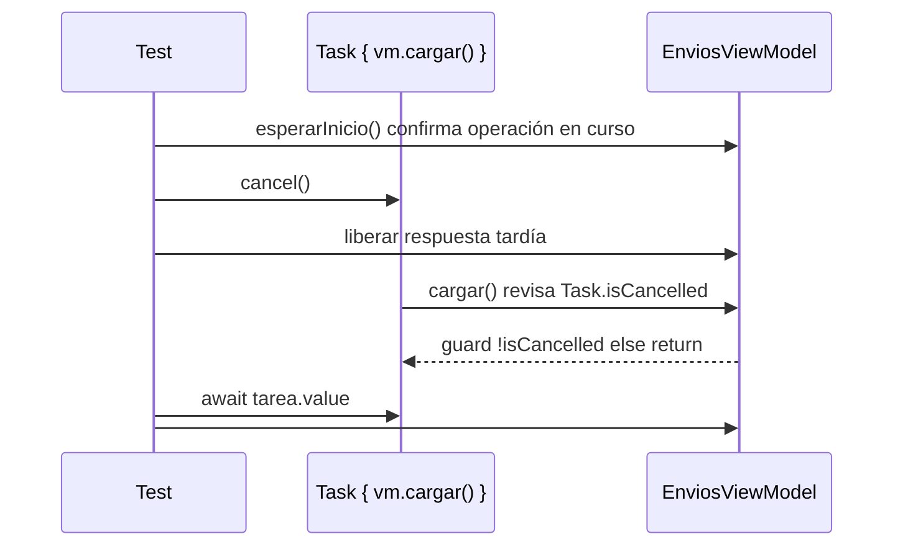
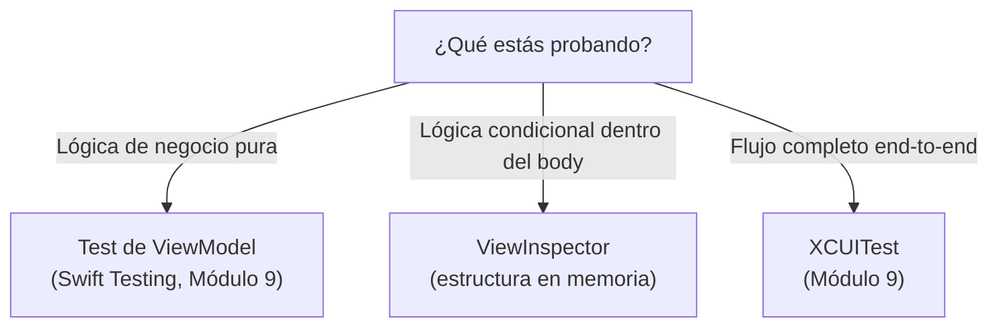
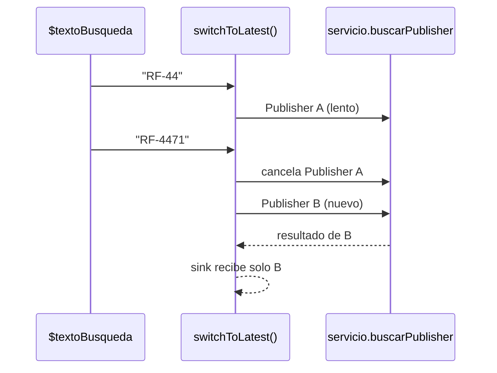
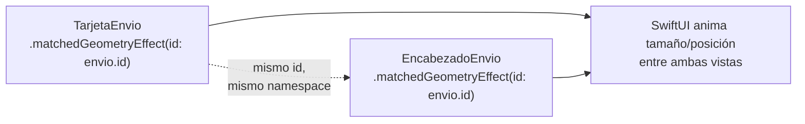
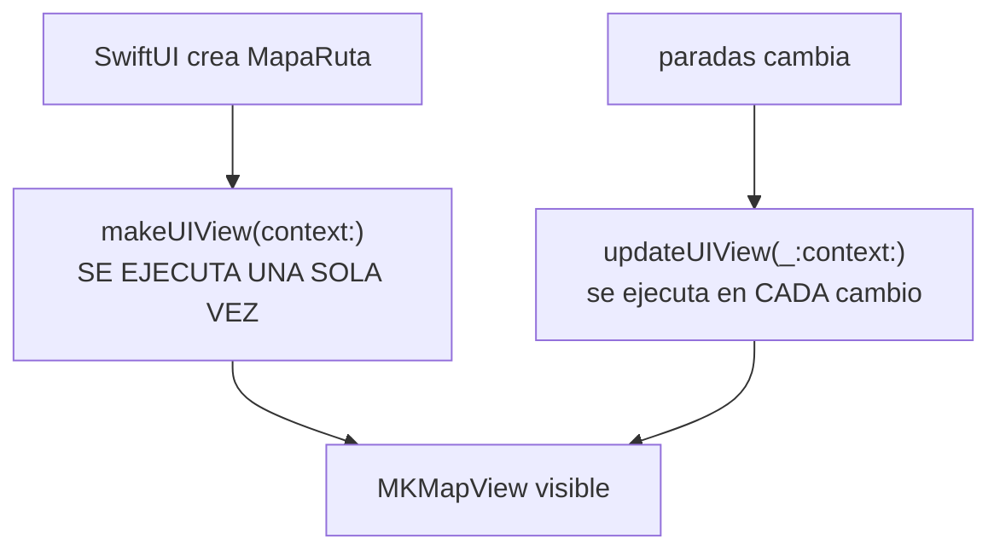
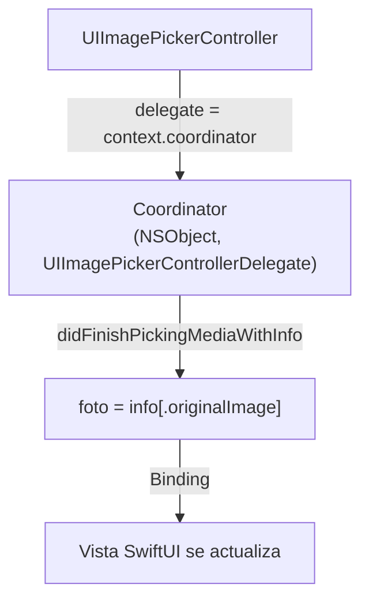
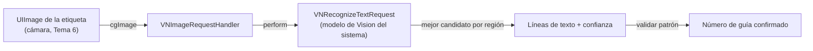

# Módulo 14: SwiftUI Master: pruebas, animación e interoperabilidad


**Proyecto del módulo:** para cada práctica, parte de una carpeta vacía y crea en Xcode (File ▸ New ▸ Project ▸ App, interfaz SwiftUI) un proyecto llamado `RutaFlowApp`; escribe manualmente todos los archivos indicados y compila, sin usar proyectos ya preparados.

## Aprende construyendo

### Tema 1: Swift Testing y pruebas asíncronas

#### Paso 1 · Objetivo y preparación
Al finalizar vas a testear que cancelar la carga de `EnviosViewModel.cargar()` a mitad de camino detiene efectivamente la tarea, en vez de dejarla sobrescribir el estado más tarde. Prerrequisitos: Módulo 9 completo.
#### Paso 2 · Contexto y caso real
Si un conductor sale de `ListaEnvios` antes de que termine de cargar, la tarea de red debería cancelarse; nadie confirmó todavía que `cargar()` respeta esa cancelación en vez de seguir corriendo en segundo plano.
#### Paso 3 · Teoría, modelo mental y analogía
Testear cancelación exige provocarla explícitamente dentro del test y confirmar que el trabajo posterior al punto de cancelación nunca se ejecuta — no alcanza con que el test "no crashee".
#### Paso 4 · Demostración guiada desde cero
Parte de una carpeta vacía. En Xcode elige **File ▸ New ▸ Project ▸ iOS ▸ App**, nombra el producto `RutaFlowApp`, usa interfaz SwiftUI y lenguaje Swift, y activa la inclusión de tests. Si el proyecto no tiene target de tests, agrégalo con **File ▸ New ▸ Target ▸ Unit Testing Bundle**.

En el grupo de la app crea **File ▸ New ▸ File ▸ Swift File**, nómbralo `EnviosViewModel.swift` y selecciona únicamente el target `RutaFlowApp`. Escribe manualmente el código de producción necesario:

```swift
import Foundation

struct Envio: Equatable, Sendable {
    let id: String
}

protocol ServicioEnvios: Sendable {
    func obtenerEnvios() async throws -> [Envio]
}

@MainActor
final class EnviosViewModel {
    var envios: [Envio] = []
    var error: Error?
    private let servicio: any ServicioEnvios

    init(servicio: any ServicioEnvios) {
        self.servicio = servicio
    }

    func cargar() async {
        do {
            let respuesta = try await servicio.obtenerEnvios()
            guard !Task.isCancelled else { return }
            envios = respuesta
        } catch is CancellationError {
            return
        } catch {
            guard !Task.isCancelled else { return }
            self.error = error
        }
    }
}
```

En el grupo `RutaFlowAppTests` crea `CancelacionTests.swift` con **File ▸ New ▸ File ▸ Swift File** y selecciona únicamente el target de tests. Escribe este contenido completo:

```swift
import Foundation
import Testing
@testable import RutaFlowApp

// Ignora cancelación intencionadamente para simular una respuesta tardía real.
actor ServicioControlado: ServicioEnvios {
    private var response: CheckedContinuation<[Envio], Never>?
    private var started = false
    private var waitingForStart: CheckedContinuation<Void, Never>?

    func obtenerEnvios() async throws -> [Envio] {
        await withCheckedContinuation { continuation in
            response = continuation
            started = true
            waitingForStart?.resume()
            waitingForStart = nil
        }
    }

    func esperarInicio() async {
        if started { return }
        await withCheckedContinuation { waitingForStart = $0 }
    }

    func responder(_ envios: [Envio]) {
        response?.resume(returning: envios)
        response = nil
    }
}

@Test @MainActor func cancelarDuranteCargaDescartaRespuestaTardia() async {
    let servicio = ServicioControlado()
    let vm = EnviosViewModel(servicio: servicio)
    let tarea = Task { await vm.cargar() }
    await servicio.esperarInicio() // La operación YA está esperando una respuesta.
    tarea.cancel()
    await servicio.responder([Envio(id: "RF-4471")])
    await tarea.value
    #expect(vm.envios.isEmpty)
    #expect(vm.error == nil)
}

@Test @MainActor func cargaSinCancelarPublicaRespuesta() async {
    let servicio = ServicioControlado()
    let vm = EnviosViewModel(servicio: servicio)
    let tarea = Task { await vm.cargar() }
    await servicio.esperarInicio()
    await servicio.responder([Envio(id: "RF-4471")])
    await tarea.value
    #expect(vm.envios.map(\.id) == ["RF-4471"])
}
```

Ejecuta ambas pruebas con **Product ▸ Test** (⌘U) o, desde la carpeta que contiene tu propio `.xcodeproj`:

```bash
xcodebuild test -scheme RutaFlowApp -destination 'platform=iOS Simulator,name=iPhone 15'
```

**Resultado esperado:** cancelar DESPUÉS de la señal de inicio y ANTES de liberar la respuesta conserva envios vacío; la prueba de control sin cancelación publica RF-4471. El fake ignora deliberadamente la cancelación para obligar al ViewModel a descartar una respuesta tardía. No se usan sleeps ni carreras dependientes de la máquina.

#### Paso 5 · Práctica guiada
Pista: quitá cualquier chequeo de cancelación dentro de `cargar()` — ese es el fallo deliberado: el test falla, porque `cargar()` asigna el resultado de todas formas aunque la tarea que lo contiene ya haya sido cancelada, pudiendo sobrescribir un estado más reciente con uno obsoleto.
#### Paso 6 · Práctica independiente
Corregí el Paso 5 agregando `guard !Task.isCancelled else { return }` antes de asignar `envios` dentro de `cargar()`, y agregá un segundo test que confirme que, sin cancelar, `cargar()` sí asigna el resultado normalmente.

**Proyecto integrador:** dentro del proyecto que iniciaste vacío en este tema, crea `BusquedaEnviosViewModel.swift` con una carga cancelable por guía y un servicio controlado propio, sin importar nada de otro tema. Añade `RutaFlowAppTests/BusquedaCancelacionTests.swift`: inicia la búsqueda de `RF-44`, cancela después de confirmar que comenzó, libera una respuesta tardía y comprueba que `resultados` permanece vacío; ejecuta el control sin cancelar y comprueba que sí publica `RF-44`. Así la aplicación demuestra en una segunda operación real que la cancelación evita estado obsoleto, no solo que el primer test pasa.

#### Paso 7 · Cierre
Entregá el test de cancelación del Paso 4, el fallo por falta de chequeo del Paso 5, y el test del camino sin cancelar del Paso 6; explicá por qué testear cancelación requiere provocarla explícitamente, no inferirla de que el test "pasó rápido". Siguiente paso: estudia ViewInspector para testear la vista misma, no solo el ViewModel. Errores comunes: no verificar `Task.isCancelled` antes de efectos secundarios, cancelar sin esperar `tarea.value` (dejando el assert corriendo antes de que la cancelación surta efecto), y asumir que cancelar una `Task` detiene instantáneamente código síncrono en ejecución. Fuentes oficiales: https://developer.apple.com/documentation/swift/task y https://developer.apple.com/documentation/testing.
**¿Por qué es importante?** Porque una tarea cancelada que sigue escribiendo estado puede sobrescribir datos más recientes con una respuesta obsoleta que ya no debería importar.
**Conceptos clave:** cancelación cooperativa de `Task`, verificación explícita en vez de inferida.

**Diagrama: test de cancelación cooperativa**



En tu propio proyecto RutaFlow, conserva `EnviosViewModel.cargar()` en el `EnviosViewModel.swift` que creaste manualmente en el Paso 4. Límite de la decisión: no conviene agregar un chequeo de cancelación a cada función `async` trivial sin efectos secundarios reales — ahí la cancelación no cambia nada observable; reservá el chequeo explícito específicamente para funciones que, como `cargar()`, escriben estado compartido que una respuesta obsoleta podría sobrescribir.

### Tema 2: ViewInspector con criterio

#### Paso 1 · Objetivo y preparación
Al finalizar vas a usar ViewInspector para confirmar que `ListaEnvios` muestra "Sin envíos" cuando `vm.envios` está vacío, decidiendo cuándo ese test vale más que uno de XCUITest. Prerrequisitos: Módulo 9 completo.
#### Paso 2 · Contexto y caso real
Un XCUITest que verifique el mensaje de lista vacía lanza la app completa solo para confirmar un `if` dentro del `body` de una vista; ViewInspector permite inspeccionar la estructura de la vista directamente, sin lanzar nada.
#### Paso 3 · Teoría, modelo mental y analogía
ViewInspector recorre el árbol de vistas SwiftUI en memoria y permite hacer asserts sobre su estructura — útil para lógica condicional de la vista misma, no un reemplazo de testear el ViewModel ni de un XCUITest end-to-end.
#### Paso 4 · Demostración guiada desde cero
Parte de otra carpeta vacía. En Xcode elige **File ▸ New ▸ Project ▸ iOS ▸ App**, nombra el producto `RutaFlowApp`, usa interfaz SwiftUI y lenguaje Swift, y activa la inclusión de tests. Si no existe el target de tests, agrégalo con **File ▸ New ▸ Target ▸ Unit Testing Bundle**. No reutilices el proyecto del Tema 1.

En el grupo de la app crea `EnviosViewModel.swift` con **File ▸ New ▸ File ▸ Swift File**, selecciona únicamente el target `RutaFlowApp` y escribe manualmente los tipos mínimos que usarán la vista y su prueba:

```swift
import Foundation

struct Envio: Equatable, Sendable {
    let id: String
}

protocol ServicioEnvios: Sendable {
    func obtenerEnvios() async throws -> [Envio]
}

@MainActor
final class EnviosViewModel {
    var envios: [Envio]
    private let servicio: any ServicioEnvios

    init(servicio: any ServicioEnvios, envios: [Envio] = []) {
        self.servicio = servicio
        self.envios = envios
    }
}
```

Agrega ViewInspector como dependencia con **File ▸ Add Package Dependencies**, usando `https://github.com/nalexn/ViewInspector.git`, y vincula el paquete al target `RutaFlowAppTests`.

Crea `ListaEnvios.swift` dentro del grupo de la app con **File ▸ New ▸ File ▸ Swift File**, selecciona el target `RutaFlowApp` y escribe:

```swift
import SwiftUI

struct ListaEnvios: View {
    let vm: EnviosViewModel

    var body: some View {
        Group {
            if vm.envios.isEmpty {
                Text("Sin envíos")
            } else {
                List(vm.envios, id: \.id) { envio in Text(envio.id) }
            }
        }
    }
}
```

En `RutaFlowAppTests`, crea `ListaEnviosTests.swift` y selecciona únicamente el target de tests. Escribe el fake mínimo, la conformidad de inspección y la prueba:

```swift
import Testing
import ViewInspector
@testable import RutaFlowApp

private struct ServicioVacio: ServicioEnvios {
    func obtenerEnvios() async throws -> [Envio] { [] }
}

extension ListaEnvios: Inspectable {}

@Test @MainActor func muestraMensajeCuandoNoHayEnvios() throws {
    let vm = EnviosViewModel(servicio: ServicioVacio())
    let vista = ListaEnvios(vm: vm)
    let texto = try vista.inspect().find(text: "Sin envíos")
    #expect(try texto.string() == "Sin envíos")
}
```

Ejecuta con **Product ▸ Test** (⌘U) o, desde la carpeta que contiene tu propio `RutaFlowApp.xcodeproj`, ejecuta exactamente tus pruebas con:

```bash
xcodebuild test -scheme RutaFlowApp -destination 'platform=iOS Simulator,name=iPhone 15' -only-testing:RutaFlowAppTests
```

Resultado esperado: el test encuentra el texto "Sin envíos" dentro del árbol de `ListaEnvios` cuando `vm.envios` está vacío, sin lanzar el simulador ni renderizar nada en pantalla — una verificación de estructura, no de píxeles.
#### Paso 5 · Práctica guiada
Pista: cambiá el texto real de la vista de "Sin envíos" a "No hay envíos" sin actualizar el test — ese es el fallo deliberado: el test de ViewInspector falla con un mensaje claro, pero si en cambio hubieras usado una captura de pantalla para "verificar visualmente", un cambio de texto así podría pasar inadvertido en una revisión apurada.
#### Paso 6 · Práctica independiente
Corregí el Paso 5 unificando el texto a una sola versión, y agregá un segundo test que confirme lo contrario: que "Sin envíos" NO aparece cuando `vm.envios` tiene al menos un elemento.

**Proyecto integrador:** en el proyecto nuevo de este tema, crea `ResumenRutaView.swift`, que muestre «Ruta sin paradas» cuando no hay envíos y «N pendientes» cuando exista al menos uno. Añade ambos casos a `RutaFlowAppTests/ResumenRutaViewTests.swift` con ViewInspector y ejecuta de nuevo `xcodebuild test -scheme RutaFlowApp -destination 'platform=iOS Simulator,name=iPhone 15' -only-testing:RutaFlowAppTests`. Verifica el texto vacío, el contador con dos envíos y la ausencia del mensaje vacío en ese segundo caso; no lances la app para afirmar algo que estas pruebas estructurales ya comprueban.

#### Paso 7 · Cierre
Entregá el test de estructura del Paso 4, el fallo detectado en el Paso 5, y el test del caso contrario del Paso 6; explicá cuándo ViewInspector vale el esfuerzo (lógica condicional dentro del `body`) frente a cuándo un test de ViewModel ya cubre lo importante sin necesidad de inspeccionar la vista. Siguiente paso: estudia Combine avanzado. Errores comunes: usar ViewInspector para probar lógica que en realidad vive en el ViewModel, acoplar tests a detalles de implementación interna que cambian seguido, y reemplazar todos los XCUITest por ViewInspector perdiendo cobertura end-to-end real. Fuentes oficiales: https://github.com/nalexn/ViewInspector y https://developer.apple.com/documentation/swiftui.
**¿Por qué es importante?** Porque ViewInspector verifica estructura de la vista sin lanzar la app completa, pero solo vale la pena para lógica condicional que realmente vive en el `body`, no como sustituto de testear el ViewModel.
**Conceptos clave:** inspección de estructura en memoria frente a XCUITest end-to-end, límite de cuándo cada uno vale su costo.

**Diagrama: ViewInspector vs XCUITest vs test de ViewModel**



En tu propio proyecto RutaFlow, conserva `ListaEnvios` en el `ListaEnvios.swift` que creaste manualmente en el target de la app y sus pruebas en `RutaFlowAppTests/ListaEnviosTests.swift`.

### Tema 3: Combine avanzado

#### Paso 1 · Objetivo y preparación
Al finalizar vas a corregir una condición de carrera en la búsqueda de guías de RutaFlow (Módulo 7), donde una respuesta vieja puede sobrescribir una más nueva, usando `switchToLatest()`. Prerrequisitos: Módulo 7 completo.
#### Paso 2 · Contexto y caso real
Si un operador escribe "RF-44" y de inmediato completa a "RF-4471", salen dos búsquedas de red casi simultáneas; si la primera (más lenta por alguna razón de red) responde después de la segunda, su resultado viejo sobrescribe el resultado correcto y más reciente.
#### Paso 3 · Teoría, modelo mental y analogía
`.map` seguido de `.switchToLatest()` cancela automáticamente el Publisher anterior cuando llega un nuevo valor de entrada — solo el resultado de la búsqueda más reciente puede llegar a completar.
#### Paso 4 · Demostración guiada
```swift
$textoBusqueda
    .debounce(for: .milliseconds(300), scheduler: RunLoop.main)
    .map { texto in servicio.buscarPublisher(texto) } // cada letra produce un nuevo Publisher
    .switchToLatest() // cancela el Publisher anterior si todavía no completó
    .sink { resultados in self.resultados = resultados }
    .store(in: &cancelables)
```

**Ejecuta el ejemplo:**

```bash
xcodebuild -scheme RutaFlowApp -destination 'platform=iOS Simulator,name=iPhone 15' build
```
Luego corre con ⌘R en el simulador, o abre el canvas de Preview con ⌥⌘↵.

Resultado esperado: al escribir "RF-44" y de inmediato "RF-4471", `switchToLatest()` cancela la suscripción a la búsqueda de "RF-44" en el instante en que llega el nuevo Publisher de "RF-4471" — solo el resultado de "RF-4471" puede llegar al `sink`, sin importar cuál respuesta de red llegue primero.
#### Paso 5 · Práctica guiada
Pista: reemplazá `.switchToLatest()` por `.flatMap { $0 }` sin límite de concurrencia — ese es el fallo deliberado: ahora ambas búsquedas siguen corriendo en paralelo sin cancelarse, y si la respuesta de "RF-44" llega después, su resultado viejo sobrescribe el de "RF-4471" en el `sink`, mostrando resultados incorrectos para lo que el operador realmente escribió.
#### Paso 6 · Práctica independiente
Corregí el Paso 5 restaurando `.switchToLatest()`, y escribí (con un fake de `ServicioAPI` que controlás manualmente) un test que confirme explícitamente que la respuesta de la primera búsqueda, si llega tarde, nunca aparece en `resultados`.

**Proyecto integrador:** en el proyecto creado desde una carpeta vacía para este tema, termina `BuscadorEnviosViewModel.swift` y crea `ServicioBusquedaControlado.swift`, con un `PassthroughSubject` independiente por guía. En `RutaFlowAppTests/BuscadorEnviosViewModelTests.swift`, emite `RF-44` y después `RF-4471`, completa primero el segundo subject con `["RF-4471"]` y luego intenta emitir `["RF-44"]` desde el primero. El resultado final debe seguir siendo `["RF-4471"]`, y el estado de cancelación del primer subject debe demostrar que `switchToLatest` lo abandonó; conecta después el ViewModel a un buscador en `BuscadorEnviosView.swift`.

#### Paso 7 · Cierre
Entregá la cadena con `switchToLatest()` del Paso 4, la condición de carrera provocada en el Paso 5, y el test del Paso 6; explicá la diferencia entre `.flatMap` (deja correr todos los Publishers internos en paralelo) y `.switchToLatest()` (cancela el anterior ante cada nuevo valor). Siguiente paso: estudia animaciones con matchedGeometryEffect. Errores comunes: usar `.flatMap` sin límite cuando en realidad se necesita cancelar resultados obsoletos, no testear explícitamente el caso de respuesta fuera de orden, y confundir `switchToLatest` con "la búsqueda más rápida gana" (en realidad cancela, no compite). Fuentes oficiales: https://developer.apple.com/documentation/combine/publisher/switchtolatest() y https://developer.apple.com/documentation/combine.
**¿Por qué es importante?** Porque sin cancelar explícitamente búsquedas obsoletas, una respuesta de red fuera de orden puede mostrarle al usuario un resultado que no corresponde a lo que realmente escribió.
**Conceptos clave:** `.flatMap` frente a `.switchToLatest()`, cancelación automática de Publishers obsoletos.

**Diagrama: switchToLatest cancela lo anterior**



En tu propio proyecto RutaFlow, crea `BuscadorEnviosViewModel.swift` con **File ▸ New ▸ File ▸ Swift File**, selecciona el target de la app y escribe allí esta cadena dentro del ViewModel, junto con `textoBusqueda`, `resultados`, `servicio` y `cancelables`.

### Tema 4: Animaciones y matchedGeometryEffect

#### Paso 1 · Objetivo y preparación
Al finalizar vas a animar la transición de una `TarjetaEnvio` en `ListaEnvios` hacia `DetalleEnvio`, de forma que la tarjeta parezca expandirse en vez de cambiar de golpe. Prerrequisitos: Módulo 1 completo.
#### Paso 2 · Contexto y caso real
Hoy, tocar una `TarjetaEnvio` navega instantáneamente a `DetalleEnvio` sin ninguna continuidad visual; el usuario pierde de vista qué tarjeta tocó exactamente.
#### Paso 3 · Teoría, modelo mental y analogía
`matchedGeometryEffect` vincula dos vistas distintas (una en cada pantalla) con un mismo `id` dentro de un mismo `namespace`, y SwiftUI anima la transición de tamaño y posición entre ambas — como si fuera literalmente la misma vista moviéndose.
#### Paso 4 · Demostración guiada
```swift
@Namespace var espacioAnimacion

// En ListaEnvios:
TarjetaEnvio(envio: envio)
    .matchedGeometryEffect(id: envio.id, in: espacioAnimacion)

// En DetalleEnvio (mismo namespace compartido):
EncabezadoEnvio(envio: envio)
    .matchedGeometryEffect(id: envio.id, in: espacioAnimacion)
```

**Ejecuta el ejemplo:**

```bash
xcodebuild -scheme RutaFlowApp -destination 'platform=iOS Simulator,name=iPhone 15' build
```
Luego corre con ⌘R en el simulador, o abre el canvas de Preview con ⌥⌘↵.

Resultado esperado: al tocar una `TarjetaEnvio`, su versión en `DetalleEnvio` se anima expandiéndose suavemente desde la posición y tamaño exactos de la tarjeta original, en vez de un corte instantáneo entre pantallas.
#### Paso 5 · Práctica guiada
Pista: usá un `id` distinto en cada lado (`envio.id` en `ListaEnvios` pero `envio.guia` en `DetalleEnvio`) — ese es el fallo deliberado: SwiftUI no reconoce ninguna relación entre ambas vistas, y la transición vuelve a ser un corte instantáneo sin ninguna animación, sin ningún error visible que explique por qué.
#### Paso 6 · Práctica independiente
Corregí el Paso 5 usando el mismo `id` (`envio.id`) en ambos lados, y agregá una segunda `matchedGeometryEffect` para animar también el ícono de estado del envío entre ambas pantallas, con su propio `id` distinto al de la tarjeta completa.

**Proyecto integrador:** en el proyecto vacío de este tema, crea `TransicionEnvioView.swift` con una lista de tres envíos, una selección `@State` y un detalle que use el mismo `Namespace` y `envio.id` para tarjeta e ícono. Añade un botón para volver y lee `accessibilityReduceMotion`: cuando esté activo, cambia de vista sin animación y sin efectos geométricos. Ejecuta la apertura y el regreso con movimiento normal y con Reducir movimiento; en ambos casos debe quedar claro qué envío está seleccionado y ningún control debe quedar bloqueado por la transición.

#### Paso 7 · Cierre
Entregá la transición animada del Paso 4, la transición rota por `id` inconsistente del Paso 5, y la segunda animación agregada del Paso 6; explicá por qué `matchedGeometryEffect` exige que el `id` sea idéntico en ambos lados y qué pasa silenciosamente (sin error) cuando no lo es. Siguiente paso: estudia cómo embeber vistas de UIKit dentro de SwiftUI. Errores comunes: usar un `namespace` distinto en cada pantalla, IDs inconsistentes entre los dos lados de la transición, y animar demasiados elementos simultáneamente sin medir el impacto en el frame rate. Fuentes oficiales: https://developer.apple.com/documentation/swiftui/view/matchedgeometryeffect(id:in:properties:anchor:issource:) y https://developer.apple.com/documentation/swiftui/animations.
**¿Por qué es importante?** Porque una transición animada que conserva continuidad visual comunica relación espacial de una forma que un corte instantáneo no puede.
**Conceptos clave:** `Namespace` compartido, `id` idéntico entre ambos lados de la transición.

**Diagrama: matchedGeometryEffect con id compartido**



En tu propio proyecto RutaFlow, escribe esta transición en `DetalleEntregaView.swift`; si aún no existe, crealo con **File ▸ New ▸ File ▸ Swift File** dentro del target de la app y declara allí las vistas que comparten el namespace. Límite de la decisión: `matchedGeometryEffect` no conviene para transiciones entre vistas sin relación visual real (dos pantallas completamente distintas) — ahí una transición estándar de `NavigationStack` es más clara; reservalo específicamente cuando dos vistas distintas representan visualmente el mismo elemento de datos, como esta tarjeta que se expande.

### Tema 5: UIViewRepresentable

#### Paso 1 · Objetivo y preparación
Al finalizar vas a envolver un `MKMapView` (UIKit) dentro de SwiftUI con `UIViewRepresentable`, mostrando la ubicación de los envíos de una ruta de RutaFlow. Prerrequisitos: Módulo 10 completo.
#### Paso 2 · Contexto y caso real
SwiftUI tiene `Map`, pero RutaFlow necesita una funcionalidad específica de `MKMapView` (anotaciones personalizadas con el estado de cada parada) que la versión SwiftUI no expone directamente.
#### Paso 3 · Teoría, modelo mental y analogía
`UIViewRepresentable` exige implementar `makeUIView` (crea la vista una sola vez) y `updateUIView` (sincroniza cambios de estado de SwiftUI hacia la vista de UIKit) — un traductor entre el mundo declarativo de SwiftUI y el mundo imperativo de UIKit.
#### Paso 4 · Demostración guiada
```swift
struct MapaRuta: UIViewRepresentable {
    let paradas: [Parada]

    func makeUIView(context: Context) -> MKMapView { MKMapView() }

    func updateUIView(_ mapView: MKMapView, context: Context) {
        mapView.removeAnnotations(mapView.annotations)
        let anotaciones = paradas.map { parada in
            let punto = MKPointAnnotation()
            punto.coordinate = parada.coordenada
            punto.title = parada.direccion
            return punto
        }
        mapView.addAnnotations(anotaciones)
    }
}
```

**Ejecuta el ejemplo:**

```bash
xcodebuild -scheme RutaFlowApp -destination 'platform=iOS Simulator,name=iPhone 15' build
```
Luego corre con ⌘R en el simulador, o abre el canvas de Preview con ⌥⌘↵.

Resultado esperado: al cambiar `paradas` desde SwiftUI (por ejemplo, al completar una entrega y quitarla de la lista), `updateUIView` se llama automáticamente y el mapa refleja las anotaciones actualizadas, sin ningún código manual de sincronización.
#### Paso 5 · Práctica guiada
Pista: movés la creación de las anotaciones a `makeUIView` en vez de `updateUIView`, "para no repetir código en cada actualización" — ese es el fallo deliberado: ahora el mapa muestra siempre las paradas de la primera vez que se creó la vista, y completar una entrega nunca actualiza lo que se ve en el mapa, porque `makeUIView` solo se ejecuta una vez.
#### Paso 6 · Práctica independiente
Corregí el Paso 5 devolviendo la lógica de anotaciones a `updateUIView`, y agregá un `Coordinator` (con `makeCoordinator()`) que implemente `MKMapViewDelegate` para personalizar el color del pin según si la parada está pendiente o entregada.

**Proyecto integrador:** en el `RutaFlowApp` iniciado desde cero en este tema, completa `MapaRuta.swift` con dos paradas propias y crea `RutaView.swift` con una lista y un botón «Marcar entregada» para cada una. Al marcar una parada, `updateUIView` debe eliminar y reconstruir las anotaciones, el mapa debe conservar solo las paradas pendientes definidas por tu regla y el `Coordinator` debe pintar las restantes según su estado. Cambia dos veces entre pendiente y entregada y verifica que no se acumulan anotaciones duplicadas ni coordenadas de la primera renderización.

#### Paso 7 · Cierre
Entregá el `UIViewRepresentable` del Paso 4, el mapa congelado del Paso 5, y el `Coordinator` con delegate del Paso 6; explicá la diferencia entre qué código corre una sola vez (`makeUIView`) y qué código debe correr en cada actualización de estado (`updateUIView`). Siguiente paso: estudia `UIViewControllerRepresentable` para envolver controladores completos. Errores comunes: poner lógica dependiente del estado en `makeUIView` en vez de `updateUIView`, olvidar limpiar anotaciones viejas antes de agregar las nuevas, y no implementar un Coordinator cuando la vista de UIKit necesita un delegate. Fuentes oficiales: https://developer.apple.com/documentation/swiftui/uiviewrepresentable y https://developer.apple.com/documentation/mapkit/mkmapview.
**¿Por qué es importante?** Porque confundir `makeUIView` con `updateUIView` produce una vista de UIKit que nunca refleja cambios posteriores de estado, un bug silencioso sin ningún error visible.
**Conceptos clave:** `makeUIView` (una sola vez) frente a `updateUIView` (cada actualización), Coordinator como delegate de UIKit.

**Diagrama: ciclo de vida de UIViewRepresentable**



En tu propio proyecto RutaFlow, crea `MapaRuta.swift` con **File ▸ New ▸ File ▸ Swift File**, selecciona el target de la app y escribe allí `MapaRuta`, sus imports de `SwiftUI` y `MapKit`, y el modelo `Parada` que usa el fragmento.

### Tema 6: UIViewControllerRepresentable y Coordinator

#### Paso 1 · Objetivo y preparación
Al finalizar vas a envolver `UIImagePickerController` (para fotografiar la prueba de entrega) con `UIViewControllerRepresentable`, usando un `Coordinator` para recibir la foto de vuelta en SwiftUI. Prerrequisitos: Tema 5 de este módulo.
#### Paso 2 · Contexto y caso real
SwiftUI no tiene un picker de cámara propio; `UIImagePickerController` es un `UIViewController` completo de UIKit con su propio delegate, que SwiftUI no puede recibir directamente sin un puente.
#### Paso 3 · Teoría, modelo mental y analogía
`UIViewControllerRepresentable` envuelve el controlador completo; como el delegate de UIKit necesita un objeto que lo implemente (no una closure), un `Coordinator` actúa como ese delegate y reenvía el resultado hacia una `Binding` de SwiftUI.
#### Paso 4 · Demostración guiada
```swift
struct SelectorFotoEntrega: UIViewControllerRepresentable {
    @Binding var foto: UIImage?

    func makeUIViewController(context: Context) -> UIImagePickerController {
        let picker = UIImagePickerController()
        picker.sourceType = .camera
        picker.delegate = context.coordinator
        return picker
    }

    func updateUIViewController(_ picker: UIImagePickerController, context: Context) {}

    func makeCoordinator() -> Coordinator { Coordinator(foto: $foto) }

    class Coordinator: NSObject, UIImagePickerControllerDelegate, UINavigationControllerDelegate {
        @Binding var foto: UIImage?
        init(foto: Binding<UIImage?>) { _foto = foto }
        func imagePickerController(_ picker: UIImagePickerController, didFinishPickingMediaWithInfo info: [UIImagePickerController.InfoKey: Any]) {
            foto = info[.originalImage] as? UIImage
        }
    }
}
```

**Ejecuta el ejemplo:**

```bash
xcodebuild -scheme RutaFlowApp -destination 'platform=iOS Simulator,name=iPhone 15' build
```
Luego corre con ⌘R en el simulador, o abre el canvas de Preview con ⌥⌘↵.

Resultado esperado: al tomar una foto, `imagePickerController(_:didFinishPickingMediaWithInfo:)` se dispara en el `Coordinator`, que asigna la imagen a `foto`; como `foto` es una `Binding` compartida con la vista que presentó el picker, esa vista se actualiza automáticamente con la nueva foto.
#### Paso 5 · Práctica guiada
Pista: quitá `picker.delegate = context.coordinator` de `makeUIViewController` — ese es el fallo deliberado: la cámara sigue abriéndose y tomando fotos con normalidad, pero `foto` nunca se actualiza, porque nadie quedó escuchando el callback del delegate; el fallo es silencioso, sin ningún error ni crash.
#### Paso 6 · Práctica independiente
Corregí el Paso 5 restaurando la asignación del delegate, y agregá el método `imagePickerControllerDidCancel` para cerrar el picker cuando el conductor cancela sin tomar foto.
#### Paso 7 · Cierre
Entregá el picker funcional del Paso 4, el fallo silencioso por delegate faltante del Paso 5, y el manejo de cancelación del Paso 6; explicá por qué un `UIViewController` con delegate de UIKit necesita específicamente un `Coordinator` (una clase), y no alcanzaría con una closure como en integraciones más simples. Siguiente paso: cerrá el módulo integrando esta pantalla al flujo de confirmación de entrega del proyecto integrador. Errores comunes: olvidar asignar el delegate al Coordinator, no manejar el caso de cancelación del picker, y actualizar estado de SwiftUI directamente desde el Coordinator sin pasar por una `Binding` o callback explícito. Fuentes oficiales: https://developer.apple.com/documentation/swiftui/uiviewcontrollerrepresentable y https://developer.apple.com/documentation/uikit/uiimagepickercontroller.
**¿Por qué es importante?** Porque sin un Coordinator correctamente asignado como delegate, un `UIViewControllerRepresentable` puede parecer funcionar mientras falla silenciosamente en devolver el resultado a SwiftUI.
**Conceptos clave:** Coordinator como puente de delegate entre UIKit y SwiftUI, fallos silenciosos sin error visible.

**Diagrama: Coordinator como puente de delegate**



En tu propio proyecto RutaFlow, crea `SelectorFotoEntrega.swift` con **File ▸ New ▸ File ▸ Swift File**, selecciona el target de la app y escribe allí el representable y su `Coordinator`. Límite de la decisión: `UIViewControllerRepresentable` con `Coordinator` no conviene cuando SwiftUI ya expone una API nativa equivalente (como `PhotosPicker` para seleccionar de la galería) — ahí usar la API nativa es más simple; reservá este puente específicamente para controladores de UIKit sin equivalente SwiftUI directo, como `UIImagePickerController` con cámara.

### Tema 7: Core ML y Vision — inferencia en el dispositivo

#### Paso 1 · Objetivo y preparación
Al finalizar vas a leer el texto de una etiqueta de envío fotografiada con la cámara del Tema 6, usando Vision para el reconocimiento de texto (OCR) que ya viene integrado en el sistema, sin enviar la imagen a ningún servidor. Prerrequisitos: Tema 6 de este módulo (ya tienes la `UIImage` de la foto). No necesitas descargar ningún modelo: `VNRecognizeTextRequest` usa un modelo de Vision incluido en iOS.

#### Paso 2 · Contexto y caso real
En RutaFlow, el conductor fotografía la etiqueta del paquete y la app debe extraer el número de guía para confirmarlo contra la entrega esperada. Enviar cada foto a un servidor de OCR gastaría datos del conductor, no funcionaría sin cobertura y expondría información del destinatario; hacer el reconocimiento en el propio teléfono resuelve los tres problemas a la vez.

#### Paso 3 · Teoría, modelo mental y analogía
La inferencia en el dispositivo ejecuta un modelo ya entrenado localmente: la foto entra, el resultado sale, y nada viaja por la red. **Core ML** es el motor que corre modelos (`.mlmodel`) sobre CPU, GPU o Neural Engine; **Vision** es la capa de alto nivel para imágenes que, para tareas comunes como detección de texto, caras o rectángulos, trae sus propios modelos del sistema y no te obliga a aportar uno. Reconocer texto con Vision es como tener un lector entrenado dentro del teléfono: le muestras la foto y te devuelve las cadenas que encontró con su nivel de confianza, sin preguntar a nadie afuera.

**Analogía:** un servicio de OCR en la nube es como mandar la etiqueta por correo a una oficina para que la transcriban y te devuelvan la respuesta; Vision en el dispositivo es tener a esa persona sentada a tu lado leyéndola al instante, aunque no haya señal.

#### Paso 4 · Demostración guiada
```swift
import Vision
import UIKit

enum OCREntrega {
    /// Extrae las líneas de texto de la foto de una etiqueta, en el dispositivo.
    static func leerEtiqueta(_ imagen: UIImage) async throws -> [String] {
        guard let cgImage = imagen.cgImage else { return [] }

        let request = VNRecognizeTextRequest()
        request.recognitionLevel = .accurate        // precisión sobre velocidad
        request.recognitionLanguages = ["es-ES", "en-US"]
        request.usesLanguageCorrection = true

        let handler = VNImageRequestHandler(cgImage: cgImage, orientation: .up)
        try handler.perform([request])

        let observaciones = request.results ?? []
        // De cada región, nos quedamos con la mejor hipótesis (topCandidates(1)).
        return observaciones.compactMap { $0.topCandidates(1).first?.string }
    }
}
```

**Ejecuta el ejemplo:** parte de otra carpeta vacía y crea el proyecto en Xcode con **File ▸ New ▸ Project ▸ App**, interfaz SwiftUI y nombre `RutaFlowApp`. Escribe el código en tu propio `OCREntrega.swift`, toma tú mismo una fotografía de una etiqueta para esta práctica y llama a `leerEtiqueta` desde una vista con esa imagen; no necesitas reutilizar la foto ni el proyecto del Tema 6. Confirma que compila con:

```bash
xcodebuild -scheme RutaFlowApp -destination 'platform=iOS Simulator,name=iPhone 15' build
```
Luego corre con ⌘R en el simulador (arrastra una imagen de una etiqueta a la ventana del simulador para simular la foto), o abre el canvas de Preview con ⌥⌘↵.

Resultado esperado: `leerEtiqueta` devuelve un arreglo con las líneas de texto detectadas en la etiqueta (por ejemplo, `["GUIA 4471-889", "Destino: Bogota"]`); todo ocurre localmente, por lo que funciona en modo avión.

#### Paso 5 · Práctica guiada
Pista: cambiá `request.recognitionLevel` a `.fast` y fotografiá una etiqueta con letra pequeña o impresa en baja calidad — ese es el fallo deliberado: Vision devuelve el resultado mucho más rápido pero con cadenas incompletas o mal transcritas (por ejemplo `"GU1A 447I-B89"`), porque el nivel `.fast` sacrifica precisión. Diagnosticá por qué el número de guía ahora no coincide con el esperado y por qué `.accurate` es el nivel correcto para texto que se usará como identificador exacto.

#### Paso 6 · Práctica independiente
Corregí el Paso 5 volviendo a `.accurate`, y agregá un filtro que, de todas las líneas devueltas, se quede solo con la que parece un número de guía (por ejemplo, la que cumple un patrón como `GUIA` seguido de dígitos). Explicá en un comentario por qué conviene tratar la salida del OCR como una hipótesis a validar, no como un dato confiable.

**Proyecto integrador:** en el proyecto creado desde una carpeta vacía para este tema, conserva `OCREntrega.swift` y extrae la validación a `ValidadorGuia.swift`, con una expresión regular para tu formato `GUIA` seguido de dígitos. Crea `RutaFlowAppTests/ValidadorGuiaTests.swift` para aceptar una línea válida y rechazar `GU1A 447I-B89`, texto ajeno y dos guías ambiguas. Después fotografía tu propia etiqueta impresa, procesa la imagen en modo avión y muestra en `LecturaEtiquetaView.swift` el texto reconocido junto a la guía validada o un mensaje de revisión manual; no confirmes una entrega cuando el validador falle.

#### Paso 7 · Cierre
Entregá el OCR funcional del Paso 4, la degradación de precisión con `.fast` del Paso 5, y el filtro de número de guía del Paso 6; explicá por qué hacer la inferencia en el dispositivo protege los datos del destinatario y funciona sin conexión, y por qué aun así el resultado del OCR debe validarse antes de usarlo como identificador. Siguiente paso: cuando una tarea no tenga un modelo de sistema en Vision (por ejemplo, clasificar el estado del paquete con un modelo propio), entrená un `.mlmodel` con Create ML e intégralo con Core ML siguiendo el mismo patrón de inferencia local. Errores comunes: usar `.fast` para texto que es un identificador exacto, asumir que el OCR nunca se equivoca y usar su salida sin validar, y bloquear el hilo principal con `handler.perform` en imágenes grandes en vez de ejecutarlo fuera de la UI. Fuentes oficiales: https://developer.apple.com/documentation/vision/recognizing-text-in-images y https://developer.apple.com/documentation/coreml.
**¿Por qué es importante?** Porque la inferencia en el dispositivo entrega resultados sin conexión y sin exponer los datos del usuario a un servidor, pero su salida sigue siendo una hipótesis que debe validarse antes de tratarla como un dato de confianza.
**Conceptos clave:** inferencia en el dispositivo, Core ML, Vision, `VNRecognizeTextRequest`, nivel de reconocimiento, confianza y validación de la salida.

**Diagrama: la foto se procesa dentro del teléfono**



En tu propio proyecto RutaFlow, crea `OCREntrega.swift` con **File ▸ New ▸ File ▸ Swift File**, selecciona el target de la app y escribe allí el enum y la función del Paso 4. Límite de la decisión: la inferencia en el dispositivo no conviene cuando la tarea requiere un modelo demasiado grande para el teléfono o que debe actualizarse a diario para todos los usuarios — ahí un servicio en servidor puede ser más práctico; reservá el procesamiento local específicamente para tareas sensibles a la privacidad, que deben funcionar sin conexión o que responden mejor en tiempo real, como leer una etiqueta recién fotografiada.

---

## Laboratorio práctico

Cierra el proyecto integrador RutaFlow probando, animando e interoperando con UIKit donde SwiftUI todavía no alcanza.

1. Escribe un test de cancelación cooperativa para `EnviosViewModel.cargar()` con Swift Testing, confirmando que una tarea cancelada no sobrescribe estado con una respuesta obsoleta.
2. Usa ViewInspector para confirmar que `ListaEnvios` muestra el texto "Sin envíos" exactamente cuando la lista está vacía, sin lanzar la app completa.
3. Compón dos búsquedas de ruta con `.switchToLatest()` y confirma que una respuesta tardía nunca sobrescribe a una más reciente.
4. Anima la transición de `TarjetaEnvio` a `DetalleEnvio` con `matchedGeometryEffect` y un `id` consistente entre ambas vistas.
5. Envuelve `MKMapView` con `UIViewRepresentable`, confirmando que `updateUIView` (no solo `makeUIView`) refleja cambios posteriores de las paradas.
6. Envuelve `UIImagePickerController` con `UIViewControllerRepresentable` y un `Coordinator`, confirmando que el delegate conectado entrega la foto capturada a la vista SwiftUI.

La entrega contiene el código de los seis Temas, los tests en verde, y la reproducción de cada fallo deliberado (cancelación ignorada, estructura rota, condición de carrera, `id` inconsistente, mapa congelado, delegate faltante) junto con su corrección.

## Trazabilidad de la auditoría original

- **Pruebas en SwiftUI**: cubierto en los Temas 1 (Swift Testing y pruebas asíncronas) y 2 (ViewInspector) de este módulo.
- **Animaciones en SwiftUI**: cubierto en el Tema 4 (matchedGeometryEffect) de este módulo.
- **Interoperabilidad con UIKit**: cubierto en los Temas 5 (UIViewRepresentable) y 6 (UIViewControllerRepresentable y Coordinator) de este módulo.
- **Combine Avanzado**: cubierto mediante fundamento, laboratorio y evidencia del capítulo.
