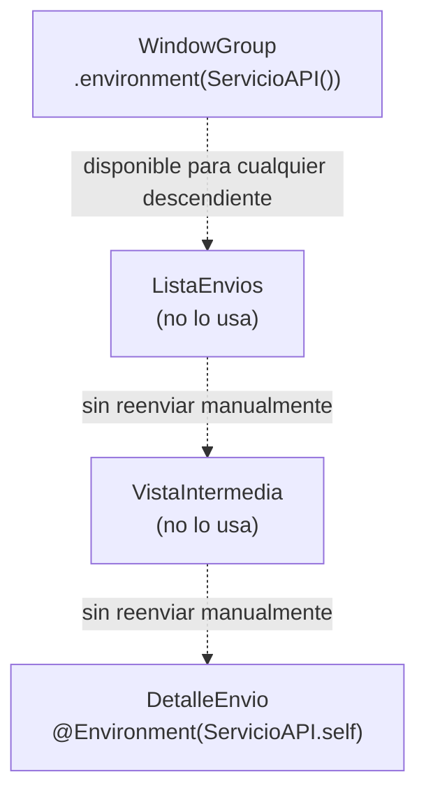

# Módulo 2: Estado y data flow


## Aprende construyendo


### Tema 1: @State y @Binding · Básico · 40 min

<details open>
<summary><strong>Capa 1 — Lectura</strong></summary>

#### ► DE QUÉ TRATA
Al finalizar vas a conectar TarjetaEnvio (Módulo 1) a un interruptor de estado "entregado/en ruta" que el padre posee y el hijo solo puede modificar, nunca copiar. Prerrequisitos: Módulo 1 completo.

#### ► LA IDEA EN UNA FRASE
**Al finalizar vas a conectar TarjetaEnvio (Módulo 1) a un interruptor de estado "entregado/en ruta" que el padre posee y el hijo solo puede modificar, nunca copiar.**

#### ► POR QUÉ EXISTE ESTO
Resuelve un problema real de diseño o implementación y evita decisiones a ciegas.

#### ► LA ANALOGÍA
Piensa en @state y @binding como una herramienta de taller: útil cuando conoces su propósito y sus límites.
**Dónde se rompe la analogía:** en software, los efectos dependen del contexto, la escala y los trade-offs.

#### ► CÓMO FUNCIONA
1. Identifica el problema que @state y @binding resuelve.
2. Observa sus componentes y relaciones.
3. Aplica la opción más simple que funcione.
4. Verifica el resultado y los límites.

#### ► LO QUE PUEDE SALIR MAL
| Síntoma | Causa probable | Arreglo |
|---|---|---|
| @State y @Binding se aplica pero el resultado no mejora | Se usó sin medir el problema real | Mide antes y compara contra la alternativa simple |
| Aparece complejidad inesperada | Se adoptó la técnica sin comprender sus trade-offs | Vuelve a la sección de trade-offs y reduce el alcance |
| Falla en un caso límite | Se asumió un contexto que no se cumple | Prueba el caso límite y documenta cuándo NO usarlo |

#### ► TRADE-OFFS
| Opción | Cuándo usarla | Cuándo NO usarla |
|---|---|---|
| Usar @State y @Binding | Cuando el problema coincide con su propósito y el beneficio es observable | Cuando agrega complejidad sin resolver un problema real |
| Alternativa más simple | Cuando el contexto es pequeño, estable o fácil de razonar | Cuando ya demostró no escalar o no cumplir el requisito |
| Postergar la decisión | Cuando falta evidencia del problema | Cuando el costo de esperar es mayor que el costo de probar |

#### ► CUÁNDO NO USAR ESTO
No uses @state y @binding por defecto. Aplícalo cuando el problema lo justifique y puedas verificar el beneficio; si una alternativa más simple resuelve igual, prefiérela.

#### ► DE VUELTA A LA ANALOGÍA
Volviendo a la analogía: @state y @binding funciona como el modelo inicial, pero recuerda dónde se rompe: en producción importan la evidencia, la escala y el costo de equivocarte.

#### ► LO QUE DEBES RECORDAR
- @State y @Binding existe para resolver un problema específico.
- Mide antes de adoptar complejidad.
- Conoce el caso donde NO usarlo.
- Verifica con evidencia observable.

#### ► PREGUNTAS PARA PENSAR
1. ¿Qué problema concreto resuelve @state y @binding en tu contexto?
2. ¿Cómo sabrías que @state y @binding no está funcionando bien?
3. ¿Qué alternativa más simple considerarías antes de usar @state y @binding?

</details>

<details>
<summary><strong>Capa 2 — Construcción</strong></summary>

#### Código y verificación
```swift
struct PantallaContador: View {
    @State private var contador = 0 // estado propio de esta vista
    var body: some View {
        BotonContador(valor: $contador) // $ crea un Binding hacia el estado del padre
    }
}

struct BotonContador: View {
    @Binding var valor: Int // referencia al estado del padre, no una copia
    var body: some View {
        Button("Sumar: \(valor)") { valor += 1 }
    }
}
```

```swift
import SwiftUI

struct DetalleEnvio: View {
    @State private var entregado = false
    var body: some View {
        VStack {
            Text(entregado ? "Estado: Entregado" : "Estado: En ruta")
            ConfirmarEntregaBoton(entregado: $entregado)
        }
    }
}

struct ConfirmarEntregaBoton: View {
    @Binding var entregado: Bool
    var body: some View {
        Button(entregado ? "Entregado" : "Confirmar entrega") { entregado = true }
    }
}

#Preview {
    DetalleEnvio()
}
```

```bash
xcodebuild -scheme EstadoDemo -destination 'generic/platform=iOS Simulator' build
```

</details>

### Tema 2: @Observable · Intermedio · 40 min

<details open>
<summary><strong>Capa 1 — Lectura</strong></summary>

#### ► DE QUÉ TRATA
Al finalizar vas a crear un EnviosViewModel con @Observable y a confirmar que solo las vistas que leen la propiedad que cambió se redibujan. Prerrequisitos: Tema 1 de este módulo.

#### ► LA IDEA EN UNA FRASE
**Al finalizar vas a crear un EnviosViewModel con @Observable y a confirmar que solo las vistas que leen la propiedad que cambió se redibujan.**

#### ► POR QUÉ EXISTE ESTO
Resuelve un problema real de diseño o implementación y evita decisiones a ciegas.

#### ► LA ANALOGÍA
Piensa en @observable como una herramienta de taller: útil cuando conoces su propósito y sus límites.
**Dónde se rompe la analogía:** en software, los efectos dependen del contexto, la escala y los trade-offs.

#### ► CÓMO FUNCIONA
1. Identifica el problema que @observable resuelve.
2. Observa sus componentes y relaciones.
3. Aplica la opción más simple que funcione.
4. Verifica el resultado y los límites.

#### ► LO QUE PUEDE SALIR MAL
| Síntoma | Causa probable | Arreglo |
|---|---|---|
| @Observable se aplica pero el resultado no mejora | Se usó sin medir el problema real | Mide antes y compara contra la alternativa simple |
| Aparece complejidad inesperada | Se adoptó la técnica sin comprender sus trade-offs | Vuelve a la sección de trade-offs y reduce el alcance |
| Falla en un caso límite | Se asumió un contexto que no se cumple | Prueba el caso límite y documenta cuándo NO usarlo |

#### ► TRADE-OFFS
| Opción | Cuándo usarla | Cuándo NO usarla |
|---|---|---|
| Usar @Observable | Cuando el problema coincide con su propósito y el beneficio es observable | Cuando agrega complejidad sin resolver un problema real |
| Alternativa más simple | Cuando el contexto es pequeño, estable o fácil de razonar | Cuando ya demostró no escalar o no cumplir el requisito |
| Postergar la decisión | Cuando falta evidencia del problema | Cuando el costo de esperar es mayor que el costo de probar |

#### ► CUÁNDO NO USAR ESTO
No uses @observable por defecto. Aplícalo cuando el problema lo justifique y puedas verificar el beneficio; si una alternativa más simple resuelve igual, prefiérela.

#### ► DE VUELTA A LA ANALOGÍA
Volviendo a la analogía: @observable funciona como el modelo inicial, pero recuerda dónde se rompe: en producción importan la evidencia, la escala y el costo de equivocarte.

#### ► LO QUE DEBES RECORDAR
- @Observable existe para resolver un problema específico.
- Mide antes de adoptar complejidad.
- Conoce el caso donde NO usarlo.
- Verifica con evidencia observable.

#### ► PREGUNTAS PARA PENSAR
1. ¿Qué problema concreto resuelve @observable en tu contexto?
2. ¿Cómo sabrías que @observable no está funcionando bien?
3. ¿Qué alternativa más simple considerarías antes de usar @observable?

</details>

<details>
<summary><strong>Capa 2 — Construcción</strong></summary>

#### Código y verificación
```swift
@Observable
class TareasViewModel {
    var tareas: [Tarea] = []
}

struct PantallaTareas: View {
    @State private var viewModel = TareasViewModel()
    var body: some View { List(viewModel.tareas) { Text($0.titulo) } }
}
```

```swift
@Observable
class TareasViewModel {
    var tareas: [Tarea] = []   // solo las vistas que LEEN `tareas` específicamente se redibujan al cambiar
}
```

```swift
import SwiftUI
import Observation

@Observable
class EnviosViewModel {
    var envios: [String] = ["RF-4471", "RF-5002"]
    var conductorActivo: String = "c-891"
}

struct ListaEnvios: View {
    @State private var vm = EnviosViewModel()
    var body: some View {
        VStack {
            List(vm.envios, id: \.self) { Text($0) }
            Button("Cambiar conductor") { vm.conductorActivo = "c-999" }
        }
    }
}

#Preview {
    ListaEnvios()
}
```

```bash
xcodebuild -scheme EstadoDemo -destination 'generic/platform=iOS Simulator' build
```

</details>

### Tema 3: @Environment y identidad vs valor · Intermedio · 45 min

<details open>
<summary><strong>Capa 1 — Lectura</strong></summary>

#### ► DE QUÉ TRATA
Al finalizar vas a inyectar un ServicioAPI de RutaFlow vía @Environment, llegando a una vista profunda sin pasarlo por cada inicializador intermedio. Prerrequisitos: Tema 2 de este módulo.

#### ► LA IDEA EN UNA FRASE
**Al finalizar vas a inyectar un ServicioAPI de RutaFlow vía @Environment, llegando a una vista profunda sin pasarlo por cada inicializador intermedio.**

#### ► POR QUÉ EXISTE ESTO
Resuelve un problema real de diseño o implementación y evita decisiones a ciegas.

#### ► LA ANALOGÍA
Piensa en @environment y identidad vs valor como una herramienta de taller: útil cuando conoces su propósito y sus límites.
**Dónde se rompe la analogía:** en software, los efectos dependen del contexto, la escala y los trade-offs.

#### ► CÓMO FUNCIONA


#### ► LO QUE PUEDE SALIR MAL
| Síntoma | Causa probable | Arreglo |
|---|---|---|
| @Environment y identidad vs valor se aplica pero el resultado no mejora | Se usó sin medir el problema real | Mide antes y compara contra la alternativa simple |
| Aparece complejidad inesperada | Se adoptó la técnica sin comprender sus trade-offs | Vuelve a la sección de trade-offs y reduce el alcance |
| Falla en un caso límite | Se asumió un contexto que no se cumple | Prueba el caso límite y documenta cuándo NO usarlo |

#### ► TRADE-OFFS
| Opción | Cuándo usarla | Cuándo NO usarla |
|---|---|---|
| Usar @Environment y identidad vs valor | Cuando el problema coincide con su propósito y el beneficio es observable | Cuando agrega complejidad sin resolver un problema real |
| Alternativa más simple | Cuando el contexto es pequeño, estable o fácil de razonar | Cuando ya demostró no escalar o no cumplir el requisito |
| Postergar la decisión | Cuando falta evidencia del problema | Cuando el costo de esperar es mayor que el costo de probar |

#### ► CUÁNDO NO USAR ESTO
No uses @environment y identidad vs valor por defecto. Aplícalo cuando el problema lo justifique y puedas verificar el beneficio; si una alternativa más simple resuelve igual, prefiérela.

#### ► DE VUELTA A LA ANALOGÍA
Volviendo a la analogía: @environment y identidad vs valor funciona como el modelo inicial, pero recuerda dónde se rompe: en producción importan la evidencia, la escala y el costo de equivocarte.

#### ► LO QUE DEBES RECORDAR
- @Environment y identidad vs valor existe para resolver un problema específico.
- Mide antes de adoptar complejidad.
- Conoce el caso donde NO usarlo.
- Verifica con evidencia observable.

#### ► PREGUNTAS PARA PENSAR
1. ¿Qué problema concreto resuelve @environment y identidad vs valor en tu contexto?
2. ¿Cómo sabrías que @environment y identidad vs valor no está funcionando bien?
3. ¿Qué alternativa más simple considerarías antes de usar @environment y identidad vs valor?

</details>

<details>
<summary><strong>Capa 2 — Construcción</strong></summary>

#### Código y verificación
```swift
struct MiApp: App {
    var body: some Scene {
        WindowGroup { ContentView().environment(ServicioAPI()) }
    }
}

struct ContentView: View {
    @Environment(ServicioAPI.self) var servicio // inyectado sin pasar por cada inicializador
}
```

```swift
WindowGroup { ContentView().environment(ServicioAPI()) }
// Cualquier vista descendiente puede leer @Environment(ServicioAPI.self) sin pasar por cada nivel intermedio
```


```swift
import SwiftUI
import Observation

@Observable
class ServicioAPI {
    var base = "https://api.rutaflow.dev"
}

@main
struct EstadoDemoApp: App {
    var body: some Scene {
        WindowGroup { ListaEnvios().environment(ServicioAPI()) }
    }
}

struct ListaEnvios: View {           // no usa ServicioAPI, solo contiene al hijo
    var body: some View { DetalleEnvio() }
}

struct DetalleEnvio: View {
    @Environment(ServicioAPI.self) var servicio
    var body: some View { Text("Conectado a: \(servicio.base)") }
}
```

```bash
xcodebuild -scheme EstadoDemo -destination 'generic/platform=iOS Simulator' build
```

</details>
