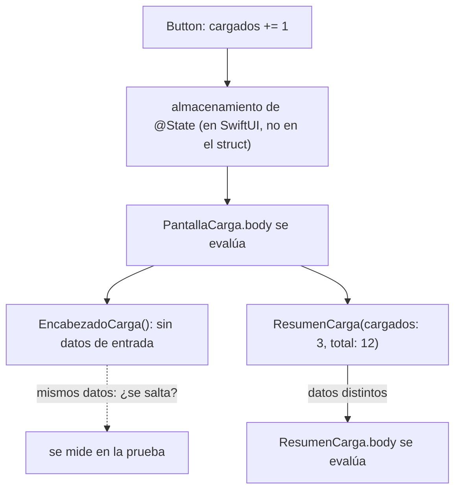
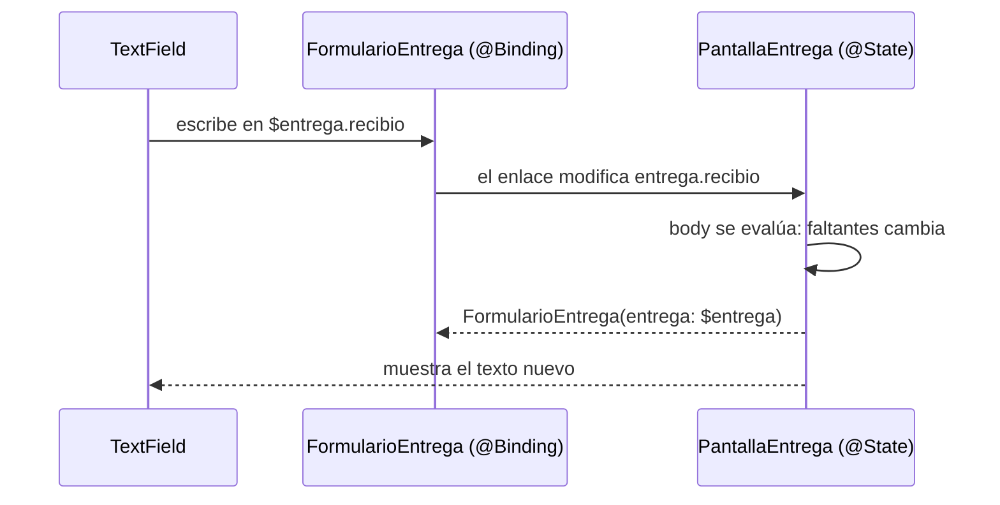
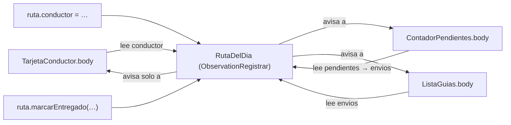
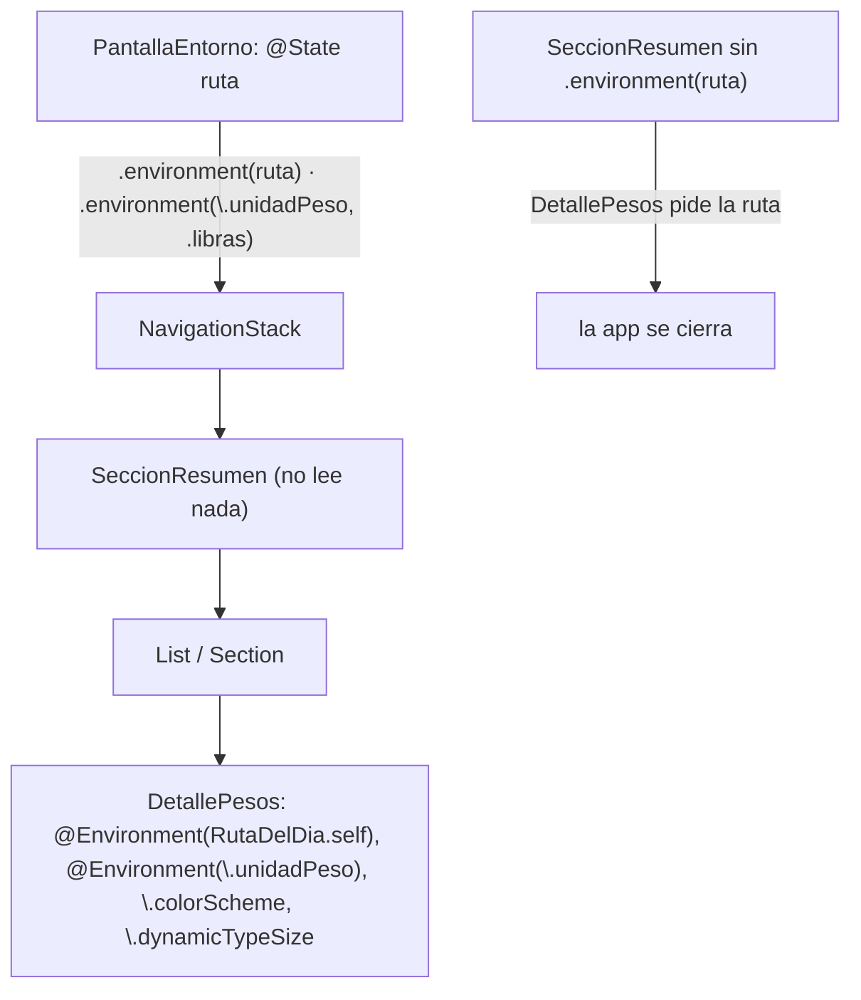

# Módulo 2: Estado y flujo de datos

**Entorno comprobado para esta edición (2026-11-25):** dos máquinas. En Linux, Swift 6.4.3 compiló y ejecutó el
núcleo de la app (el modelo `RutaDelDia`, las reglas de la entrega y las unidades de peso) con sus pruebas, y un
programa que muestra el mecanismo de `@Observable` sin SwiftUI: el módulo Observation sí viene en el Swift de Linux,
así que `withObservationTracking` y la expansión de la macro se ejecutaron ahí de verdad. En una Mac con macOS 27.2,
Xcode 27.2 (27B52) y Swift 6.4.2 se compiló la app `FlujoDatos`, se ejecutaron sus pruebas en el simulador del iPhone
17 con iOS 27.2 y se **contó** cuántas veces SwiftUI evaluó el `body` de cada vista en cada experimento; también se
capturó la consola de la app con `Self._printChanges()` y el cierre de la app cuando falta un valor en el entorno. Los
errores de compilación se provocaron a propósito (los de Swift puro en Linux, los de SwiftUI con el SDK del
simulador). Límite honesto: las pruebas ejecutan las acciones que la vista registra (lo mismo que hace su botón) en
lugar de tocar la pantalla; las capturas de la app completa sí son de la app real.

En el Módulo 1 las vistas solo dibujaban datos. Ahora cambian: un contador de paquetes, un formulario de entrega, una
ruta que comparten varias pantallas. Este módulo enseña dónde vive cada dato, quién puede cambiarlo y, sobre todo,
**qué vistas se vuelven a evaluar cuando cambia**, medido con contadores y no supuesto.

**Al terminar este módulo podrás:**
- guardar estado propio de una vista con `@State` y evitar copiarlo desde un parámetro;
- dejar que una vista hija edite el estado de su padre con `@Binding`;
- compartir un modelo con `@Observable`, editarlo con `@Bindable` y explicar por qué avisa solo a quien lo leyó;
- poner valores y modelos en el entorno con `@Environment` y `@Entry`, y diagnosticar redibujos con contadores y
  `Self._printChanges()`.

**Esquema del módulo:** Tema 1 (`@State`) → Tema 2 (`@Binding`) → Tema 3 (`@Observable` y `@Bindable`) → Tema 4
(`@Environment` y cuándo se redibuja una vista) → Proyecto 39.

**Qué necesitas saber antes:** el Módulo 1 completo (vistas, composición y el medidor del Tema 2); del Módulo 0,
**`struct` frente a `class`** (Tema 2) y **closures** (Tema 4). Aparece `@MainActor`, que se estudia a fondo en el
Módulo 4 (Tema 6); aquí basta saber que marca el código que corre en el hilo principal, donde vive la interfaz.

**Qué no se repite:** maquetación y modificadores (Módulo 1); la navegación, que también es estado, es el Módulo 3, y
la arquitectura de modelos de vista (MVVM) es el Módulo 8.

**Prepara el proyecto:**

```text
$ mkdir -p ~/labs/ios/ios2 && cd ~/labs/ios/ios2
$ mkdir nucleo && cd nucleo && swift package init --type library --name Nucleo
```

Igual que en el Módulo 1: `nucleo/` (sin SwiftUI, con un ejecutable `Rastreo`), `app/` con el proyecto de Xcode
`FlujoDatos` (código en `App/`, pruebas en `Pruebas/`, iOS 18 como mínimo) y `errores/`. Copia
`nucleo/Sources/Nucleo` a `app/App/Nucleo` y `Captura.swift` a `app/Pruebas/`.


## Aprende construyendo


### Tema 1: @State: el estado que pertenece a una vista · Básico · 45 min

<details open>
<summary><strong>Capa 1 — Lectura</strong></summary>

#### Objetivos
Al terminar este tema podrás:
- explicar por qué una vista no puede cambiar sus propiedades normales;
- guardar estado propio con `@State` y saber dónde lo guarda SwiftUI;
- medir qué vistas se vuelven a evaluar cuando cambia ese estado;
- evitar el error de copiar un parámetro en `@State` y reiniciar estado con `.id`.

**Conceptos clave:** `@State`, identidad de una vista, evaluación de `body`, `.id(_:)`, fuente de verdad

#### El problema
La pantalla de carga del camión cuenta los paquetes que suben. La primera versión guarda el número en `var cargados`
y el botón no compila. Alguien «lo arregla» con una clase global. En otra pantalla, la etiqueta de la parada actual
recibe el número de la parada y lo guarda en `@State` «para poder cambiarlo»: cuando la ruta avanza, la etiqueta se
queda en la parada 1.

Este tema usa **las vistas como `struct`** (Módulo 1, Tema 1), **`struct` y `mutating`** (Módulo 0, Tema 2) y
**el medidor** (Módulo 1, Tema 2).

#### Glosario del tema

**`@State`**
- **Definición técnica:** *property wrapper* que guarda un valor fuera del `struct` de la vista, en un almacenamiento que SwiftUI asocia a la **identidad** de esa vista; al cambiar, SwiftUI vuelve a evaluar el `body` de la vista dueña.
- **En palabras sencillas:** un cajón que SwiftUI le guarda a la vista mientras siga en pantalla.
- **Dónde se rompe la comparación:** el valor inicial solo se usa la primera vez; las siguientes veces que se crea el `struct`, SwiftUI ignora el valor inicial y devuelve el guardado.
- **Ejemplo:** `@State private var cargados = 0` en `PantallaCarga`.
- **Error típico:** declararlo público e inicializarlo desde afuera esperando que siga al padre.

**identidad de una vista**
- **Definición técnica:** lo que permite a SwiftUI saber que una vista es «la misma» entre dos evaluaciones: su posición en el árbol (identidad estructural) o un identificador explícito (`id`, `ForEach`).
- **En palabras sencillas:** el número de casillero de la vista.
- **Dónde se rompe la comparación:** el `struct` se crea de nuevo muchas veces; la identidad no cambia mientras la posición o el `id` sean los mismos.
- **Ejemplo:** las tres etiquetas de `PantallaParadas` tienen posiciones distintas, así que tres cajones distintos.
- **Error típico:** poner un `if` que cambia el tipo de la vista y perder el estado sin querer.

**evaluación de `body`**
- **Definición técnica:** cada vez que SwiftUI llama al `getter` de `body` para obtener la descripción actual; ocurre cuando cambia algo que la vista leyó o cuando su padre la crea con valores distintos.
- **En palabras sencillas:** volver a leer la receta.
- **Dónde se rompe la comparación:** evaluar no es redibujar píxeles: SwiftUI compara el resultado con el anterior y solo toca lo que cambió.
- **Ejemplo:** la prueba cuenta 1 evaluación al montar y más tras tres toques.
- **Error típico:** poner trabajo caro (formatear cientos de fechas, filtrar listas grandes) dentro de `body`.

**`.id(_:)`**
- **Definición técnica:** modificador que da a la vista una identidad explícita; si el valor cambia, SwiftUI la trata como una vista nueva: descarta su estado y crea uno desde el valor inicial.
- **En palabras sencillas:** cambiarle el número de casillero a propósito.
- **Dónde se rompe la comparación:** también reinicia animaciones, foco y posición de desplazamiento; no es gratis.
- **Ejemplo:** `EtiquetaParadaCopiada(…).id(actual)` vuelve a copiar la parada cada vez que cambia.
- **Error típico:** usar `.id(UUID())`, que crea una vista nueva en cada evaluación.

**fuente de verdad**
- **Definición técnica:** el único lugar donde vive un dato; las demás vistas reciben su valor (lectura) o un enlace (escritura), nunca una copia que evoluciona aparte.
- **En palabras sencillas:** un solo dueño por dato.
- **Dónde se rompe la comparación:** dos fuentes de verdad para lo mismo se desincronizan tarde o temprano.
- **Ejemplo:** `actual` en `PantallaParadas` es la fuente; la etiqueta que copia en `@State` crea una segunda.
- **Error típico:** «guardar una copia por si acaso» en la vista hija.

#### ► CÓMO FUNCIONA
El `struct` de la vista es desechable. `@State` guarda el valor en el grafo de SwiftUI, junto a la identidad de la
vista. Cuando el botón cambia el valor, SwiftUI marca a la vista dueña como pendiente, vuelve a evaluar su `body`, crea
de nuevo los `struct` de sus hijas y solo evalúa el `body` de las hijas cuyos datos de entrada cambiaron.



#### Problema resuelto 1.1
Construye la pantalla de carga con `@State` y mide cuántas veces se evalúa el `body` de la pantalla y de sus dos
hijas al subir tres paquetes. Después reproduce el error de copiar un parámetro en `@State` y compáralo con recibir el
valor y con reiniciar la identidad.

**Razonamiento:**
1. Primero, la causa del error de compilación: una vista es un `struct` y su `body` no es `mutating`. Pasa igual en
   Swift puro, sin SwiftUI.
2. `Medidor` lleva tres registros: evaluaciones de `body`, el último texto que mostró cada vista y las acciones que
   las vistas registran al aparecer. La prueba ejecuta la acción `subir`, que es la misma instrucción del botón.
3. `Montaje` pone la vista en una ventana real de la app anfitriona y deja correr el ciclo principal 0,3 s después
   de cada acción para que SwiftUI actualice.
4. `EncabezadoCarga` no recibe nada; `ResumenCarga` recibe dos números: la prueba muestra a cuál vuelve a evaluar
   SwiftUI.
5. En `PantallaParadas` hay tres etiquetas con la misma parada: una la recibe (`let`), otra la copia en `@State` y la
   tercera la copia pero con `.id(actual)`.

```swift
// Una vista de SwiftUI es un struct, y sus métodos y su body no pueden cambiarlo. Pasa igual sin SwiftUI:
struct ContadorPaquetes {
    var cargados = 0

    func subirPaquete() {
        cargados += 1  // como un Button { cargados += 1 } en una vista sin @State
    }
}
```

```text
$ swiftc -typecheck linux/vista-inmutable.swift
linux/vista-inmutable.swift:6:18: error: left side of mutating operator isn't mutable: 'self' is immutable
3 |     var cargados = 0
4 | 
5 |     func subirPaquete() {
  |     `- note: mark method 'mutating' to make 'self' mutable
6 |         cargados += 1  // como un Button { cargados += 1 } en una vista sin @State
  |                  `- error: left side of mutating operator isn't mutable: 'self' is immutable
7 |     }
8 | }
[código de salida: 1]
```

La misma situación en SwiftUI (`errores/t1-sin-state.swift`), compilada con el SDK del simulador:

```swift
// Error provocado: una vista guarda un número en una propiedad normal y el botón intenta cambiarlo.
import SwiftUI

struct ContadorPaquetes: View {
    var cargados = 0

    var body: some View {
        Button("Subir paquete (\(cargados))") {
            cargados += 1
        }
    }
}
```

```text
$ xcrun --sdk iphonesimulator swiftc -typecheck -swift-version 6 -target arm64-apple-ios18.0-simulator errores/t1-sin-state.swift
errores/t1-sin-state.swift:9:22: error: left side of mutating operator isn't mutable: 'self' is immutable
 7 |     var body: some View {
 8 |         Button("Subir paquete (\(cargados))") {
 9 |             cargados += 1
   |                      `- error: left side of mutating operator isn't mutable: 'self' is immutable
10 |         }
11 |     }
[código de salida: 1]
```

```swift
import SwiftUI

/// Registro de mediciones reales que leen las pruebas.
@MainActor
enum Medidor {
    /// Cuántas veces se evaluó el `body` de cada vista.
    static var cuerpos: [String: Int] = [:]
    /// El último texto que mostró cada vista (para ver si quedó desactualizada).
    static var mostrado: [String: String] = [:]
    /// Acciones que las vistas registran al aparecer; una prueba las ejecuta como si tocara el botón.
    static var acciones: [String: @MainActor () -> Void] = [:]

    static func cuerpo(_ nombre: String) { cuerpos[nombre, default: 0] += 1 }
    static func mostrar(_ nombre: String, _ texto: String) { mostrado[nombre] = texto }
    static func registrar(_ nombre: String, _ accion: @escaping @MainActor () -> Void) { acciones[nombre] = accion }
    static func tocar(_ nombre: String) { acciones[nombre]?() }

    static func reiniciar() {
        cuerpos = [:]
        mostrado = [:]
        acciones = [:]
    }
}
```

```swift
import SwiftUI
import UIKit

@testable import FlujoDatos

/// Pone una vista en una ventana real de la app anfitriona y la deja ahí para tocarla, medirla y fotografiarla.
@MainActor
final class Montaje {
    let ventana: UIWindow

    init<V: View>(_ vista: V, ancho: CGFloat = 390, alto: CGFloat = 600) {
        let escena = UIApplication.shared.connectedScenes.first as? UIWindowScene
        ventana = escena.map { UIWindow(windowScene: $0) } ?? UIWindow()
        ventana.frame = CGRect(x: 0, y: 0, width: ancho, height: alto)
        ventana.rootViewController = UIHostingController(rootView: vista)
        ventana.makeKeyAndVisible()
        esperar()
    }

    /// Deja correr el ciclo principal para que SwiftUI actualice y vuelva a dibujar.
    func esperar(_ segundos: Double = 0.5) {
        RunLoop.main.run(until: Date().addingTimeInterval(segundos))
    }

    /// Ejecuta la acción que la vista registró, como si se tocara su botón, y espera el redibujo.
    func tocar(_ accion: String, veces: Int = 1) {
        for _ in 0..<veces {
            Medidor.tocar(accion)
            esperar(0.3)
        }
    }

    /// Fotografía la ventana tal como está ahora.
    func foto(_ nombre: String) throws {
        let salida = ProcessInfo.processInfo.environment["SALIDA"] ?? NSTemporaryDirectory()
        let imagen = UIGraphicsImageRenderer(bounds: ventana.bounds).image { _ in
            _ = ventana.drawHierarchy(in: ventana.bounds, afterScreenUpdates: true)
        }
        try imagen.pngData()!.write(to: URL(fileURLWithPath: salida).appendingPathComponent("\(nombre).png"))
    }

    func desmontar() {
        ventana.isHidden = true
        ventana.rootViewController = nil
    }
}

/// Escribe líneas de texto en la carpeta de resultados (la variable SALIDA que pasa mac.sh).
func escribir(_ lineas: [String], _ nombre: String) throws {
    let salida = ProcessInfo.processInfo.environment["SALIDA"] ?? NSTemporaryDirectory()
    let ruta = URL(fileURLWithPath: salida).appendingPathComponent(nombre)
    try (lineas.joined(separator: "\n") + "\n").write(to: ruta, atomically: true, encoding: .utf8)
}

/// Una tabla «vista → conteo en cada momento», con columnas alineadas.
func tabla(_ vistas: [String], _ momentos: [(String, [String: Int])]) -> [String] {
    let ancho = (vistas.map(\.count).max() ?? 10) + 2
    func celda(_ texto: String, _ n: Int) -> String { texto.padding(toLength: n, withPad: " ", startingAt: 0) }
    var lineas = [celda("cuerpos evaluados", ancho) + momentos.map { celda($0.0, 22) }.joined()]
    for vista in vistas {
        lineas.append(celda(vista, ancho) + momentos.map { celda("\($0.1[vista] ?? 0)", 22) }.joined())
    }
    return lineas
}
```

```swift
import SwiftUI

/// Pantalla de carga del camión. El número de paquetes subidos es estado propio de esta vista.
struct PantallaCarga: View {
    @State private var cargados = 0

    var body: some View {
        let _ = Medidor.cuerpo("PantallaCarga")
        VStack(spacing: 24) {
            EncabezadoCarga()
            ResumenCarga(cargados: cargados, total: 12)
            Button("Subir paquete al camión") { cargados += 1 }
                .buttonStyle(.borderedProminent)
        }
        .padding()
        .onAppear { Medidor.registrar("subir") { cargados += 1 } }  // lo mismo que hace el botón
    }
}

/// No recibe nada: su resultado nunca cambia.
struct EncabezadoCarga: View {
    var body: some View {
        let _ = Medidor.cuerpo("EncabezadoCarga")
        Label("Camión BOG-123", systemImage: "truck.box").font(.title2.bold())
    }
}

/// Recibe valores: SwiftUI la vuelve a evaluar cuando cambian.
struct ResumenCarga: View {
    let cargados: Int
    let total: Int

    var body: some View {
        let _ = Medidor.cuerpo("ResumenCarga")
        VStack(spacing: 8) {
            Text("\(cargados) de \(total)").font(.largeTitle.monospacedDigit().bold())
            ProgressView(value: Double(cargados), total: Double(total))
        }
    }
}

/// ✓ Muestra el valor que recibe.
struct EtiquetaParada: View {
    let parada: Int

    var body: some View {
        let _ = Medidor.mostrar("valor recibido", "\(parada)")
        Text("Parada \(parada)").font(.title3.monospacedDigit())
    }
}

/// ✗ Copia el valor inicial en @State: los cambios posteriores del padre no llegan.
struct EtiquetaParadaCopiada: View {
    let nombre: String
    @State private var parada: Int

    init(nombre: String, parada: Int) {
        self.nombre = nombre
        _parada = State(initialValue: parada)
    }

    var body: some View {
        let _ = Medidor.mostrar(nombre, "\(parada)")
        Text("Parada \(parada)").font(.title3.monospacedDigit())
    }
}

struct PantallaParadas: View {
    @State private var actual = 1

    var body: some View {
        VStack(alignment: .leading, spacing: 16) {
            fila("let parada") { EtiquetaParada(parada: actual) }
            fila("@State copiado") { EtiquetaParadaCopiada(nombre: "@State copiado", parada: actual) }
            fila("@State copiado + .id") {
                EtiquetaParadaCopiada(nombre: "@State copiado + .id", parada: actual).id(actual)
            }
            Button("Siguiente parada") { actual += 1 }.buttonStyle(.borderedProminent)
        }
        .padding()
        .onAppear { Medidor.registrar("siguiente") { actual += 1 } }
    }

    private func fila<V: View>(_ titulo: String, @ViewBuilder _ contenido: () -> V) -> some View {
        HStack {
            Text(titulo).font(.caption.monospaced()).foregroundStyle(.secondary).frame(width: 170, alignment: .leading)
            contenido()
        }
    }
}

#Preview("Carga") { PantallaCarga() }
#Preview("Paradas") { PantallaParadas() }
```

```text
cuerpos evaluadosal montar             tras 3 toques         
PantallaCarga    1                     4                     
EncabezadoCarga  1                     1                     
ResumenCarga     1                     4                     
```


```text
la vista                 al montar   tras 2 toques de «Siguiente parada»
valor recibido           parada 1    parada 3
@State copiado           parada 1    parada 1
@State copiado + .id     parada 1    parada 3
```


**Explicación por partes.**
- En Linux, el compilador dice exactamente lo que pasa: `left side of mutating operator isn't mutable: 'self' is
  immutable`, y sugiere `mutating`. Con SwiftUI, en el simulador, el mensaje es **el mismo**, palabra por palabra, en
  la línea `cargados += 1` del botón: el closure del botón está dentro de `body`, que no es `mutating`. No puedes
  marcarlo así: por eso existe `@State`.
- Conteo (`t1-cuerpos.txt`): `PantallaCarga` pasó de 1 a 4, una evaluación por toque, y `ResumenCarga` también,
  porque sus dos números cambian. `EncabezadoCarga`, que no recibe nada, se quedó en **1**: el padre volvió a crear
  su `struct` tres veces, pero SwiftUI vio que era igual al anterior y no evaluó su `body`.
- Copia de estado: la etiqueta con `let` y la que tiene `.id` siguen al padre; la que copia en `@State` se queda en la
  parada con la que nació. Tras dos toques, `t1-copia.txt` dice parada 3, parada **1** y parada 3, y la captura
  muestra lo mismo.
- El `.id(actual)` lo arregla a costa de crear una vista nueva cada vez: se pierde cualquier otro estado que tuviera.

> **Error común.** Inicializar `@State` desde un parámetro (`_parada = State(initialValue: parada)`) y esperar que
> siga los cambios del padre. El valor inicial se usa una sola vez. Si la vista solo muestra el dato, recíbelo con
> `let`; si lo edita, recibe un `@Binding` (Tema 2).

> **Error común.** Sacar el estado a una variable global o a un singleton «para que se pueda cambiar». SwiftUI no se
> entera del cambio y no vuelve a evaluar nada; además, en Swift 6 una variable global mutable no compila sin
> aislamiento.

> **Buena práctica.** Declara `@State` siempre `private`: es de la vista, nadie de afuera debería poder
> inicializarlo ni leerlo. Así el compilador te avisa si alguien intenta pasárselo.

> **Prevenir errores.** Cuando una vista parezca «no actualizarse», mide antes de cambiar código: un `let _ =
> Medidor.cuerpo("Nombre")` en el `body` dice si se evaluó, y `Medidor.mostrar` dice qué mostró.

#### Checkpoint 1.1
Si `PantallaParadas` tuviera un `if actual > 2 { EtiquetaParadaCopiada(…) }`, ¿qué mostraría la etiqueta al aparecer
en la parada 3?

Respuesta: parada 3. Al aparecer por primera vez no tenía estado guardado y usó el valor inicial de ese momento. Si
después la ruta avanzara a 4, se quedaría en 3.

</details>

<details>
<summary><strong>Capa 2 — Construcción</strong></summary>

#### Paso 1 · Provoca el error en Swift puro
En `linux/`, compila `vista-inmutable.swift` con `swiftc -typecheck`. Agrega `mutating` y vuelve a compilar.

#### Paso 2 · Crea el medidor y el montaje
Crea `Medidor.swift` en la app y `Montaje.swift` en las pruebas.

#### Paso 3 · Mide la pantalla de carga
Crea `T1Estado.swift` y ejecuta `t1EstadoPropio`. Abre `t1-cuerpos.txt`.

#### Paso 4 · Reproduce la copia
Ejecuta `t1CopiaDeEstado` y abre `t1-copia.txt` y la captura. En la app, ábrela con `-escena paradas` y toca el botón.

#### Paso 5 · Pasa el encabezado a un dato
Haz que `EncabezadoCarga` reciba `placa: String` y pásale siempre `"BOG-123"`. ¿Cambia su número de evaluaciones?
Ahora pásale `"BOG-\(cargados)"`. ¿Y ahora?

#### Resumen
- Una vista es un `struct` desechable: **`@State`** guarda el valor en SwiftUI, junto a su **identidad**.
- Cambiar el estado provoca una **evaluación de `body`** de la vista dueña; las hijas, según sus datos.
- Copiar un parámetro en `@State` crea una segunda **fuente de verdad** que se queda atrás.
- **`.id(_:)`** reinicia el estado creando una vista nueva.

#### Ejercicio verificable 1
Básico. ¿Qué parada muestra la etiqueta «@State copiado» después de dos toques?

Respuesta esperada: la 1 (la inicial), como dice `t1-copia.txt`.

#### Ejercicio verificable 2
Intermedio. En el Paso 5, con `"BOG-\(cargados)"`, ¿cuántas evaluaciones tiene `EncabezadoCarga` tras tres toques?

Respuesta esperada: cuatro (una al montar y una por toque), porque su dato de entrada cambia cada vez.

#### Ejercicio verificable 3
Reto. ¿Por qué `.id(UUID())` en una fila de una lista es un error grave?

Respuesta esperada: el `UUID` cambia en cada evaluación del padre, así que la fila se destruye y se crea de nuevo cada
vez: pierde su estado, se reinician sus animaciones y SwiftUI trabaja de más.

#### En el trabajo
«La pantalla no se actualiza» y «la pantalla se reinicia sola» son dos de los errores más reportados en apps SwiftUI,
y casi siempre son una fuente de verdad duplicada o una identidad que cambia. Las revisiones de código buscan
`State(initialValue:)` con parámetros y `.id(` con valores que cambian en cada evaluación.

</details>

### Tema 2: @Binding: editar el estado de otra vista · Básico · 40 min

<details open>
<summary><strong>Capa 1 — Lectura</strong></summary>

#### Objetivos
Al terminar este tema podrás:
- pasar a una vista hija un enlace (`$valor`) para que edite el estado del padre;
- proyectar enlaces a campos de un `struct` (`$entrega.recibio`) y a elementos de un arreglo (`ForEach($envios)`);
- usar `.constant(…)` en vistas previas;
- medir qué cuesta pasar enlaces en vez de valores.

**Conceptos clave:** `@Binding`, `$` (valor proyectado), enlace a un campo, `ForEach($…)`, `.constant`

#### El problema
El formulario de entrega (quién recibe, cuántos paquetes, si firmó) se usa dentro de la pantalla de entrega, que
muestra debajo qué falta para confirmar. La primera versión del formulario tiene su propio `@State` y la pantalla
nunca se entera de lo que se escribió. La segunda pasa una función `alCambiar` por cada campo y se vuelve ilegible.

Este tema usa **`@State` y la fuente de verdad** (Tema 1) y **`struct` como valor** (Módulo 0, Tema 2).

#### Glosario del tema

**`@Binding`**
- **Definición técnica:** *property wrapper* que no guarda nada: contiene un par «leer / escribir» hacia una fuente de verdad que vive en otro lugar.
- **En palabras sencillas:** un control remoto del dato del padre.
- **Dónde se rompe la comparación:** si la fuente desaparece (la vista padre se va), el enlace queda apuntando a nada; por eso solo se pasa hacia abajo.
- **Ejemplo:** `@Binding var entrega: Entrega` en `FormularioEntrega`.
- **Error típico:** declarar `@State` en la hija «porque también la cambia».

**`$` (valor proyectado)**
- **Definición técnica:** el prefijo `$` accede al `projectedValue` del *property wrapper*: en `@State` y en `@Binding` es un `Binding<Valor>`.
- **En palabras sencillas:** pedir el control remoto en vez del dato.
- **Dónde se rompe la comparación:** `entrega` es el valor actual; `$entrega` es el enlace; confundirlos da errores de tipo.
- **Ejemplo:** `FormularioEntrega(entrega: $entrega)`.
- **Error típico:** pasar `entrega` (una copia) donde se pide un `Binding`.

**enlace a un campo**
- **Definición técnica:** `Binding` tiene búsqueda dinámica de miembros: `$entrega.recibio` es un `Binding<String>` que lee y escribe solo ese campo de la entrega.
- **En palabras sencillas:** un control remoto para un solo botón del aparato.
- **Dónde se rompe la comparación:** escribir el campo reemplaza el `struct` entero en la fuente: quien lea la entrega completa se entera.
- **Ejemplo:** `TextField("Quién recibe", text: $entrega.recibio)`.
- **Error típico:** crear `Binding(get:set:)` a mano para algo que ya da `$x.campo`.

**`ForEach($…)`**
- **Definición técnica:** variante de `ForEach` que recibe un `Binding` a una colección y entrega a cada fila un `Binding` a su elemento.
- **En palabras sencillas:** un control remoto por cada fila.
- **Dónde se rompe la comparación:** cada fila puede editar su elemento sin índices, pero ahora recibe un enlace y no un valor: SwiftUI la compara distinto (lo mide este tema).
- **Ejemplo:** `ForEach($envios) { $envio in FilaConEnlace(envio: $envio) }`.
- **Error típico:** usar índices (`ForEach(0..<envios.count)`) y que la app se caiga al borrar un elemento.

**`.constant(…)`**
- **Definición técnica:** `Binding.constant(valor)` crea un enlace que siempre devuelve ese valor e ignora las escrituras.
- **En palabras sencillas:** un control remoto de juguete.
- **Dónde se rompe la comparación:** en la vista previa puedes tocar los controles, pero nada cambia.
- **Ejemplo:** `FormularioEntrega(entrega: .constant(Entrega()))`.
- **Error típico:** usarlo fuera de vistas previas y preguntarse por qué el campo no deja escribir.

#### ► CÓMO FUNCIONA
El padre es dueño de la entrega en `@State`. Pasa `$entrega` al formulario. Cada control recibe un enlace a un campo;
al escribir, el enlace modifica la entrega del padre, SwiftUI vuelve a evaluar al padre y el resumen se actualiza.



#### Problema resuelto 2.1
Construye el formulario de entrega como vista hija sin estado propio, con la regla «más de 5 paquetes piden firma» en
el núcleo, y comprueba que el padre se entera. Después mide cuántas filas se vuelven a evaluar al cambiar un envío si
las filas reciben enlaces o valores.

**Razonamiento:**
1. `Entrega` es un `struct` del núcleo con sus reglas (`faltantes`, `esValida`), probadas en Linux.
2. El formulario recibe `@Binding var entrega` y crea enlaces a cada campo con `$entrega.campo`.
3. Para la prueba, el formulario registra la acción `llenar`, que escribe por el enlace lo mismo que escribiría la
   persona: «Portería» y 6 paquetes. Con 6 paquetes falta la firma.
4. La pantalla muestra «Falta: …» o «Lista para confirmar» a partir de la entrega del padre.
5. La lista de tres envíos se monta dos veces: con `ForEach($envios)` y filas con `@Binding`, y con `ForEach(envios)`
   y filas con `let`; se cambia un solo envío y se cuentan las evaluaciones de fila.

```swift
/// Lo que se anota al entregar: quién recibe, cuántos paquetes y si firmó. Es un valor que el formulario
/// edita a través de un `Binding`; las reglas viven aquí para poder probarlas sin interfaz.
public struct Entrega: Equatable, Sendable {
    public var recibio = ""
    public var paquetes = 1
    public var conFirma = false

    public init() {}

    /// Qué falta para poder confirmar; vacío si está completa.
    public var faltantes: [String] {
        var lista: [String] = []
        if recibio.trimmingCharacters(in: .whitespaces).isEmpty { lista.append("quién recibe") }
        if !(1...20).contains(paquetes) { lista.append("entre 1 y 20 paquetes") }
        if paquetes > 5 && !conFirma { lista.append("firma (más de 5 paquetes)") }
        return lista
    }

    public var esValida: Bool { faltantes.isEmpty }
}
```

```swift
import SwiftUI

/// El formulario no guarda nada: lee y escribe la entrega del padre a través de un enlace.
struct FormularioEntrega: View {
    @Binding var entrega: Entrega

    var body: some View {
        let _ = Medidor.cuerpo("FormularioEntrega")
        Form {
            TextField("Quién recibe", text: $entrega.recibio)
            Stepper("Paquetes: \(entrega.paquetes)", value: $entrega.paquetes, in: 1...20)
            Toggle("Firma registrada", isOn: $entrega.conFirma)
        }
        .onAppear {
            Medidor.registrar("llenar") {  // escribe por el enlace, como lo haría la persona
                entrega.recibio = "Portería"
                entrega.paquetes = 6
            }
        }
    }
}

/// El padre es el dueño de la entrega; el hijo la edita y el resumen se actualiza.
struct PantallaEntrega: View {
    @State private var entrega = Entrega()

    var body: some View {
        let _ = Medidor.cuerpo("PantallaEntrega")
        VStack(spacing: 0) {
            FormularioEntrega(entrega: $entrega)
            VStack(alignment: .leading, spacing: 6) {
                Text(entrega.esValida ? "Lista para confirmar" : "Falta: \(entrega.faltantes.joined(separator: ", "))")
                    .font(.headline)
                    .foregroundStyle(entrega.esValida ? Color.green : Color.orange)
                Button("Confirmar entrega") {}
                    .buttonStyle(.borderedProminent)
                    .disabled(!entrega.esValida)
            }
            .frame(maxWidth: .infinity, alignment: .leading)
            .padding()
        }
    }
}

/// Fila que recibe un enlace al envío.
struct FilaConEnlace: View {
    @Binding var envio: Envio

    var body: some View {
        let _ = Medidor.cuerpo("FilaConEnlace")
        HStack {
            Text(envio.guia).monospaced()
            Spacer()
            Text(envio.estado.etiqueta)
        }
    }
}

/// Fila que recibe una copia del envío.
struct FilaConValor: View {
    let envio: Envio

    var body: some View {
        let _ = Medidor.cuerpo("FilaConValor")
        HStack {
            Text(envio.guia).monospaced()
            Spacer()
            Text(envio.estado.etiqueta)
        }
    }
}

struct ListaEnvios: View {
    let conEnlaces: Bool
    @State private var envios = Muestras.envios

    var body: some View {
        VStack(spacing: 12) {
            if conEnlaces {
                ForEach($envios) { $envio in FilaConEnlace(envio: $envio) }
            } else {
                ForEach(envios) { envio in FilaConValor(envio: envio) }
            }
        }
        .padding()
        .onAppear {
            Medidor.registrar("entregar EN-4473") {
                if let i = envios.firstIndex(where: { $0.guia == "EN-4473" }) { envios[i].estado = .entregado }
            }
        }
    }
}

#Preview("Entrega") { PantallaEntrega() }
#Preview("Formulario con un enlace fijo") { FormularioEntrega(entrega: .constant(Entrega())) }
```


```text
cuerpos evaluados  al montar             tras escribir el hijo 
PantallaEntrega    1                     2                     
FormularioEntrega  1                     2                     
```

```text
Tres filas; se marca entregada EN-4473 (solo cambia una):
  FilaConEnlace: 3 al montar, 3 evaluaciones más tras el cambio
  FilaConValor: 3 al montar, 1 evaluaciones más tras el cambio
```

**Explicación por partes.**
- La segunda captura muestra que el padre se enteró: el resumen pasó de «quién recibe» a «firma (más de 5 paquetes)»
  sin que el formulario tuviera estado propio. Es la regla que prueba `masDeCincoPaquetesPidenFirma` en Linux.
- `t2-enlace.txt`: al escribir los dos campos por el enlace, `PantallaEntrega` y `FormularioEntrega` pasaron de 1
  a 2 evaluaciones: una sola más cada una, aunque se escribieron dos campos seguidos, porque SwiftUI junta los
  cambios hechos en el mismo instante y actualiza una vez. El padre se evaluó porque su estado cambió; el hijo, porque
  el padre lo volvió a crear con un enlace.
- `t2-enlaces-contra-valores.txt`: al marcar entregada solo EN-4473, con enlaces se volvieron a evaluar **las 3**
  filas; con valores, **1**, la que cambió. SwiftUI puede comparar dos `Envio` y saltarse las filas iguales, pero no
  puede saber si dos `Binding` nuevos apuntan a lo mismo con el mismo valor, así que evalúa todas.

> **Error común.** Darle a la vista hija su propio `@State` para un dato que el padre necesita. Son dos fuentes de
> verdad y el padre nunca ve los cambios. Si el padre es el dueño, la hija recibe un `@Binding`.

> **Error común.** Recorrer índices (`ForEach(0..<envios.count) { i in … $envios[i] … }`). Si se borra un elemento
> mientras la fila existe, el índice queda fuera de rango y la app se cierra. Usa `ForEach($envios)`, que identifica
> cada fila por el `id` del elemento.

> **Buena práctica.** Pasa enlaces solo a las vistas que **editan**. Las que solo muestran reciben valores (`let`):
> son más fáciles de reutilizar y, como mide este tema, SwiftUI puede saltárselas cuando su valor no cambió.

> **Prevenir errores.** Pon las reglas del formulario en el `struct` del núcleo (`faltantes`, `esValida`) y pruébalas
> sin interfaz. La vista solo muestra el resultado; así la regla no se duplica entre el botón y el mensaje.

#### Checkpoint 2.1
¿Qué tipo tiene `$entrega.paquetes` dentro de `FormularioEntrega`?

Respuesta: `Binding<Int>`: el `$entrega` es un `Binding<Entrega>` y la búsqueda dinámica de miembros da un enlace al
campo `paquetes`.

</details>

<details>
<summary><strong>Capa 2 — Construcción</strong></summary>

#### Paso 1 · Escribe la entrega
Crea `Entrega.swift` y sus pruebas en el núcleo; ejecuta `swift test`.

#### Paso 2 · Escribe el formulario y la pantalla
Crea `T2Enlaces.swift`. En la vista previa «Formulario con un enlace fijo», intenta escribir: no cambia nada.

#### Paso 3 · Comprueba que el padre se entera
Ejecuta `t2EnlaceAlPadre` y compara las dos capturas.

#### Paso 4 · Enlaces contra valores
Ejecuta `t2EnlacesContraValores`. Luego agrega a `FilaConEnlace` un `Toggle` que marque entregado con un enlace al
estado y comprueba en la app que funciona.

#### Paso 5 · Una regla nueva
Agrega a `Entrega` la regla «si no hay firma, `recibio` debe tener al menos 5 letras» con su prueba en el núcleo, y
mira cómo aparece en la pantalla sin tocar la vista.

#### Resumen
- **`@Binding`** deja que la hija edite la fuente de verdad del padre.
- El **`$`** da el **valor proyectado**: el enlace.
- **`$x.campo`** crea un **enlace a un campo**; **`ForEach($…)`** da un enlace por fila.
- **`.constant(…)`** sirve para vistas previas.

#### Ejercicio verificable 1
Básico. ¿Qué dice el resumen con «Portería» y 6 paquetes sin firma?

Respuesta esperada: «Falta: firma (más de 5 paquetes)».

#### Ejercicio verificable 2
Intermedio. Según la medida, ¿cuántas filas extra se evaluaron con valores al entregar EN-4473?

Respuesta esperada: 1 (la fila de EN-4473); con enlaces fueron 3.

#### Ejercicio verificable 3
Reto. ¿Por qué el formulario sigue funcionando si `PantallaEntrega` lo vuelve a crear en cada evaluación?

Respuesta esperada: porque el formulario no guarda nada: el enlace nuevo apunta al mismo `@State` del padre, que
SwiftUI conserva por la identidad de la pantalla.

#### En el trabajo
Los formularios de las apps reales (dirección, pago, perfil) se construyen así: un `struct` con las reglas, un dueño
con `@State` y vistas de campos reutilizables que reciben enlaces. Las reglas se prueban sin interfaz y los equipos
tienen vistas previas con `.constant` para cada estado del formulario: vacío, con errores y completo.

</details>

### Tema 3: @Observable y @Bindable: un modelo compartido que avisa con precisión · Intermedio · 55 min

<details open>
<summary><strong>Capa 1 — Lectura</strong></summary>

#### Objetivos
Al terminar este tema podrás:
- crear un modelo con `@Observable` y compartirlo entre varias vistas;
- explicar cómo Observation registra qué propiedades lee cada vista y a quién avisa al cambiar;
- comparar con medidas el comportamiento de `@Observable` y el de `ObservableObject` con `@Published`;
- obtener enlaces a un modelo con `@Bindable` y elegir dónde guardar el modelo (`@State`, `let`, `@StateObject`).

**Conceptos clave:** `@Observable`, seguimiento de accesos, `ObservableObject`/`@Published`, `@Bindable`, `@MainActor`

#### El problema
La ruta del día (conductor y envíos) la usan la tarjeta del conductor, el contador de pendientes y la lista de guías.
Con la versión anterior (`ObservableObject`), cambiar el nombre del conductor hace que la lista de 300 guías se vuelva
a evaluar. Alguien intenta editar el conductor con un `TextField` y no encuentra el `$`. Y otra persona crea el modelo
con `let ruta = RutaDelDia()` dentro de una vista hija, y los cambios desaparecen al rato.

Este tema usa **`@State` e identidad** (Tema 1), **enlaces** (Tema 2) y **clases y referencias** (Módulo 0, Tema 2).

#### Glosario del tema

**`@Observable`**
- **Definición técnica:** macro del módulo Observation que convierte cada propiedad almacenada de una clase en una propiedad calculada que registra lecturas (`access`) y avisa de escrituras (`withMutation`) a través de un `ObservationRegistrar`.
- **En palabras sencillas:** una clase que anota quién miró cada dato y les avisa solo a ellos.
- **Dónde se rompe la comparación:** solo vigila lo que se lee **durante** el seguimiento; si una vista lee un dato en una tarea aparte, no queda registrada.
- **Ejemplo:** `@MainActor @Observable public final class RutaDelDia`.
- **Error típico:** marcar una `struct` con `@Observable` (solo sirve para clases).

**seguimiento de accesos**
- **Definición técnica:** `withObservationTracking(_:onChange:)` ejecuta un closure, registra cada propiedad observable leída y llama a `onChange` **una vez** cuando cambia cualquiera de ellas; SwiftUI lo usa al evaluar cada `body`.
- **En palabras sencillas:** una lista de «a quién avisar» que se arma leyendo y se usa una sola vez.
- **Dónde se rompe la comparación:** el aviso llega antes del cambio (`willSet`) y una sola vez; para seguir enterándose hay que volver a registrarse, que es lo que hace SwiftUI al evaluar el `body` de nuevo.
- **Ejemplo:** el programa `Rastreo` en Linux.
- **Error típico:** pensar que leer una propiedad calculada no registra nada: registra todo lo que la calculada lee.

**`ObservableObject` y `@Published`**
- **Definición técnica:** el mecanismo anterior, de Combine: la clase tiene un `objectWillChange` que se dispara cuando cambia **cualquier** propiedad `@Published`; las vistas lo observan con `@ObservedObject`, `@StateObject` o `@EnvironmentObject`.
- **En palabras sencillas:** un timbre general: suena para todos, sin importar qué cambió.
- **Dónde se rompe la comparación:** sigue funcionando y lo verás en mucho código existente; Apple publica una guía para migrar de `ObservableObject` a `@Observable` (iOS 17 o posterior).
- **Ejemplo:** `RutaClasica` en este tema.
- **Error típico:** mezclar `@ObservedObject` con un modelo `@Observable` (no hace falta ningún *wrapper* para leerlo).

**`@Bindable`**
- **Definición técnica:** *property wrapper* que, sobre un objeto `@Observable`, da enlaces a sus propiedades con `$modelo.propiedad`.
- **En palabras sencillas:** sacar un control remoto de un campo del modelo compartido.
- **Dónde se rompe la comparación:** no es dueño de nada ni observa más que una referencia normal; solo sirve para crear enlaces.
- **Ejemplo:** `@Bindable var ruta: RutaDelDia` y `TextField("Conductor", text: $ruta.conductor)`.
- **Error típico:** declarar el modelo con `let` y escribir `$ruta.conductor`: no compila.

**`@MainActor`**
- **Definición técnica:** atributo que aísla un tipo o una función al actor principal: su código corre en el hilo principal y el compilador rechaza accesos desde otros contextos sin `await`.
- **En palabras sencillas:** «esto solo se toca desde el hilo de la interfaz».
- **Dónde se rompe la comparación:** no hace lento el código; solo ordena desde dónde se toca. El trabajo pesado se hace fuera y se trae el resultado (Módulo 4).
- **Ejemplo:** `RutaDelDia` es `@MainActor`, igual que las vistas.
- **Error típico:** cambiar el modelo desde `Task.detached`, que Swift 6 rechaza al compilar.

#### ► CÓMO FUNCIONA
Al evaluar el `body` de `TarjetaConductor`, SwiftUI hace un seguimiento: la vista lee `ruta.conductor` y queda
registrada solo para `conductor`. `ContadorPendientes` lee `ruta.pendientes`, que por dentro lee `envios`, y queda
registrada para `envios`. Cuando cambia `conductor`, solo la tarjeta recibe el aviso.



#### Problema resuelto 3.1
Crea el modelo de la ruta con `@Observable`. En Linux, sin SwiftUI, comprueba con `withObservationTracking` a quién
avisa cada cambio y mira el código que genera la macro. En el simulador, mide los `body` de tres vistas con
`@Observable` y con `ObservableObject` ante los mismos dos cambios, y compara dónde guardar el modelo.

**Razonamiento:**
1. `RutaDelDia` vive en el núcleo: Observation es parte de Swift y también está en Linux. Es `@MainActor` porque la
   leen las vistas.
2. `Rastreo` simula tres vistas: cada una es un closure que lee algo dentro de `withObservationTracking`. Después
   cambia el modelo y se ve a quién avisa, también cuando el valor nuevo es igual al anterior.
3. En el simulador, las mismas tres vistas se escriben dos veces: leyendo un `RutaDelDia` (sin *wrapper*) y con
   `@ObservedObject` sobre `RutaClasica`, que tiene `@Published`.
4. `EditorConductor` usa `@Bindable` para el `TextField`.
5. `PantallaDuenos` tiene tres hijas que guardan su modelo en `@State`, en `let` y en `@StateObject`; el padre se
   vuelve a evaluar tres veces y se mira qué muestra cada hija y cuántas instancias se crearon.

```swift
import Observation

/// El modelo de la ruta, compartido por varias vistas. `@Observable` registra qué propiedad lee cada vista
/// y avisa solo a las que leyeron lo que cambió. Vive en el hilo principal, como la interfaz.
@MainActor
@Observable
public final class RutaDelDia {
    /// Cuántas instancias se crearon, por conductor inicial: para ver cuándo una vista crea otra sin querer.
    public static var creadas: [String: Int] = [:]

    public var conductor: String
    public var envios: [Envio]

    public init(conductor: String = "Ana Ruiz", envios: [Envio] = Muestras.envios) {
        self.conductor = conductor
        self.envios = envios
        RutaDelDia.creadas[conductor, default: 0] += 1
    }

    /// Propiedad calculada: quien la lea queda pendiente de `envios`, que es lo que lee por dentro.
    public var pendientes: Int { envios.filter { $0.estado != .entregado }.count }

    public func marcarEntregado(_ guia: String) {
        guard let i = envios.firstIndex(where: { $0.guia == guia }) else { return }
        envios[i].estado = .entregado
    }
}
```

```swift
// swift run Rastreo: el mecanismo de @Observable, en Linux y sin SwiftUI. Cada «vista» es una función que lee
// algo del modelo dentro de withObservationTracking; onChange avisa cuando cambia algo de lo que leyó.
import Nucleo
import Observation

@MainActor
func observar(_ vista: String, lee: () -> Void) {
    withObservationTracking(lee) {
        print("    ↻ avisa a \(vista)")
    }
}

@MainActor
func cambio(_ descripcion: String, _ hacer: () -> Void) {
    print("→ \(descripcion)")
    hacer()
}

@MainActor
func demostracion() {
    let ruta = RutaDelDia()
    print("Tres «vistas» se registran leyendo cosas distintas:")
    observar("TarjetaConductor (lee conductor)") { _ = ruta.conductor }
    observar("ContadorPendientes (lee pendientes)") { _ = ruta.pendientes }
    observar("ListaGuias (lee envios)") { _ = ruta.envios.map(\.guia) }

    cambio("ruta.conductor = \"Luis Pardo\"") { ruta.conductor = "Luis Pardo" }
    cambio("ruta.conductor = \"Marta Gil\" (otra vez el conductor)") { ruta.conductor = "Marta Gil" }
    cambio("ruta.marcarEntregado(\"EN-4472\")") { ruta.marcarEntregado("EN-4472") }
    cambio("ruta.marcarEntregado(\"EN-4473\")") { ruta.marcarEntregado("EN-4473") }

    print("Se vuelven a registrar las tres (lo que hace SwiftUI al evaluar de nuevo cada body):")
    observar("TarjetaConductor (lee conductor)") { _ = ruta.conductor }
    observar("ContadorPendientes (lee pendientes)") { _ = ruta.pendientes }
    observar("ListaGuias (lee envios)") { _ = ruta.envios.map(\.guia) }
    cambio("ruta.conductor = \"Marta Gil\" (el mismo valor que ya tenía)") { ruta.conductor = "Marta Gil" }
    cambio("ruta.conductor = \"Jorge Ramírez\" (un valor distinto)") { ruta.conductor = "Jorge Ramírez" }
    cambio("ruta.marcarEntregado(\"EN-4472\") (ya estaba entregada)") { ruta.marcarEntregado("EN-4472") }
    print("Se vuelven a registrar las dos que avisaron:")
    observar("ContadorPendientes (lee pendientes)") { _ = ruta.pendientes }
    observar("ListaGuias (lee envios)") { _ = ruta.envios.map(\.guia) }
    cambio("ruta.envios.append(EN-4474)") {
        ruta.envios.append(Envio(guia: "EN-4474", destinatario: "Jorge Ramírez", pesoKg: 31, estado: .pendiente))
    }
}

MainActor.assumeIsolated { demostracion() }
```

```text
$ .build/debug/Rastreo
Tres «vistas» se registran leyendo cosas distintas:
→ ruta.conductor = "Luis Pardo"
    ↻ avisa a TarjetaConductor (lee conductor)
→ ruta.conductor = "Marta Gil" (otra vez el conductor)
→ ruta.marcarEntregado("EN-4472")
    ↻ avisa a ListaGuias (lee envios)
    ↻ avisa a ContadorPendientes (lee pendientes)
→ ruta.marcarEntregado("EN-4473")
Se vuelven a registrar las tres (lo que hace SwiftUI al evaluar de nuevo cada body):
→ ruta.conductor = "Marta Gil" (el mismo valor que ya tenía)
→ ruta.conductor = "Jorge Ramírez" (un valor distinto)
    ↻ avisa a TarjetaConductor (lee conductor)
→ ruta.marcarEntregado("EN-4472") (ya estaba entregada)
    ↻ avisa a ListaGuias (lee envios)
    ↻ avisa a ContadorPendientes (lee pendientes)
Se vuelven a registrar las dos que avisaron:
→ ruta.envios.append(EN-4474)
    ↻ avisa a ContadorPendientes (lee pendientes)
    ↻ avisa a ListaGuias (lee envios)
```

El código que genera la macro para `var conductor` (`linux/macro.swift`), en la parte del `get` y del `set`:

```text
$ swiftc -typecheck -Xfrontend -dump-macro-expansions linux/macro.swift 2>&1 | sed -n '/^    get {/,/^    }/p;/^    set {/,/^    }/p'
    get {
      access(keyPath: \.conductor)
      return _conductor
    }
    set {
      guard shouldNotifyObservers(_conductor, newValue) else {
        _conductor = newValue
        return
      }
      withMutation(keyPath: \.conductor) {
        _conductor = newValue
      }
    }
```

```swift
import SwiftUI

// MARK: - Con @Observable: cada vista depende solo de lo que lee

struct TarjetaConductor: View {
    let ruta: RutaDelDia

    var body: some View {
        let _ = Medidor.cuerpo("TarjetaConductor")
        Label(ruta.conductor, systemImage: "person.crop.circle").font(.title3)
    }
}

struct ContadorPendientes: View {
    let ruta: RutaDelDia

    var body: some View {
        let _ = Medidor.cuerpo("ContadorPendientes")
        Text("\(ruta.pendientes) por entregar").font(.headline)
    }
}

struct ListaGuias: View {
    let ruta: RutaDelDia

    var body: some View {
        let _ = Medidor.cuerpo("ListaGuias")
        VStack(alignment: .leading, spacing: 6) {
            ForEach(ruta.envios) { envio in
                Text("\(envio.guia) · \(envio.estado.etiqueta)").monospaced()
            }
        }
    }
}

/// Para escribir en el modelo hace falta un enlace: `@Bindable` lo saca de un objeto `@Observable`.
struct EditorConductor: View {
    @Bindable var ruta: RutaDelDia

    var body: some View {
        TextField("Conductor", text: $ruta.conductor).textFieldStyle(.roundedBorder)
    }
}

struct PantallaObservable: View {
    @State private var ruta = RutaDelDia()

    var body: some View {
        let _ = Medidor.cuerpo("PantallaObservable")
        VStack(alignment: .leading, spacing: 16) {
            TarjetaConductor(ruta: ruta)
            ContadorPendientes(ruta: ruta)
            ListaGuias(ruta: ruta)
            EditorConductor(ruta: ruta)
        }
        .padding()
        .onAppear {
            Medidor.registrar("cambiar conductor") { ruta.conductor = "Luis Pardo" }
            Medidor.registrar("entregar EN-4472") { ruta.marcarEntregado("EN-4472") }
        }
    }
}

// MARK: - La forma anterior (Combine): ObservableObject con @Published

@MainActor
final class RutaClasica: ObservableObject {
    static var creadas = 0

    @Published var conductor = "Ana Ruiz"
    @Published var envios = Muestras.envios

    init() { RutaClasica.creadas += 1 }

    var pendientes: Int { envios.filter { $0.estado != .entregado }.count }

    func marcarEntregado(_ guia: String) {
        guard let i = envios.firstIndex(where: { $0.guia == guia }) else { return }
        envios[i].estado = .entregado
    }
}

struct TarjetaConductorClasica: View {
    @ObservedObject var ruta: RutaClasica

    var body: some View {
        let _ = Medidor.cuerpo("TarjetaConductor (clásica)")
        Label(ruta.conductor, systemImage: "person.crop.circle").font(.title3)
    }
}

struct ContadorPendientesClasico: View {
    @ObservedObject var ruta: RutaClasica

    var body: some View {
        let _ = Medidor.cuerpo("ContadorPendientes (clásica)")
        Text("\(ruta.pendientes) por entregar").font(.headline)
    }
}

struct ListaGuiasClasica: View {
    @ObservedObject var ruta: RutaClasica

    var body: some View {
        let _ = Medidor.cuerpo("ListaGuias (clásica)")
        VStack(alignment: .leading, spacing: 6) {
            ForEach(ruta.envios) { envio in
                Text("\(envio.guia) · \(envio.estado.etiqueta)").monospaced()
            }
        }
    }
}

struct PantallaClasica: View {
    @StateObject private var ruta = RutaClasica()

    var body: some View {
        let _ = Medidor.cuerpo("PantallaClasica")
        VStack(alignment: .leading, spacing: 16) {
            TarjetaConductorClasica(ruta: ruta)
            ContadorPendientesClasico(ruta: ruta)
            ListaGuiasClasica(ruta: ruta)
        }
        .padding()
        .onAppear {
            Medidor.registrar("cambiar conductor") { ruta.conductor = "Luis Pardo" }
            Medidor.registrar("entregar EN-4472") { ruta.marcarEntregado("EN-4472") }
        }
    }
}

// MARK: - Dónde guardar el modelo: @State, una constante o @StateObject

struct HijoConState: View {
    @State private var ruta = RutaDelDia(conductor: "en @State")

    var body: some View {
        let _ = Medidor.mostrar("@State", ruta.conductor)
        Text(ruta.conductor)
            .onAppear { Medidor.registrar("renombrar @State") { ruta.conductor = "Renombrado" } }
    }
}

struct HijoConLet: View {
    let ruta = RutaDelDia(conductor: "en let")

    var body: some View {
        let _ = Medidor.mostrar("let", ruta.conductor)
        Text(ruta.conductor)
            .onAppear { Medidor.registrar("renombrar let") { ruta.conductor = "Renombrado" } }
    }
}

struct HijoConStateObject: View {
    @StateObject private var ruta = RutaClasica()

    var body: some View {
        let _ = Medidor.mostrar("@StateObject", ruta.conductor)
        Text(ruta.conductor)
            .onAppear { Medidor.registrar("renombrar @StateObject") { ruta.conductor = "Renombrado" } }
    }
}

/// El padre cambia un contador; cada cambio vuelve a crear los structs de sus hijos.
struct PantallaDuenos: View {
    @State private var tic = 0

    var body: some View {
        VStack(spacing: 12) {
            Text("tic \(tic)")
            HijoConState()
            HijoConLet()
            HijoConStateObject()
        }
        .onAppear { Medidor.registrar("tic") { tic += 1 } }
    }
}

// MARK: - Qué cambió: Self._printChanges()

/// La escena «cambios»: las mismas vistas, imprimiendo por qué se evalúan, y un guion de cambios.
struct PantallaCambios: View {
    @State private var ruta = RutaDelDia()
    @StateObject private var clasica = RutaClasica()

    var body: some View {
        VStack(alignment: .leading, spacing: 16) {
            ConductorQueImprime(ruta: ruta)
            PendientesQueImprime(ruta: ruta)
            Divider()
            ConductorClasicoQueImprime(ruta: clasica)
            PendientesClasicoQueImprime(ruta: clasica)
        }
        .padding()
        .task {
            try? await Task.sleep(for: .seconds(2))
            print("— cambio 1: conductor = \"Luis Pardo\" en las dos rutas —")
            ruta.conductor = "Luis Pardo"
            clasica.conductor = "Luis Pardo"
            try? await Task.sleep(for: .seconds(1))
            print("— cambio 2: marcarEntregado(\"EN-4472\") en las dos rutas —")
            ruta.marcarEntregado("EN-4472")
            clasica.marcarEntregado("EN-4472")
            try? await Task.sleep(for: .seconds(1))
            print("— fin del guion —")
        }
    }
}

struct ConductorQueImprime: View {
    let ruta: RutaDelDia

    var body: some View {
        let _ = Self._printChanges()
        Text("Observable: \(ruta.conductor)")
    }
}

struct PendientesQueImprime: View {
    let ruta: RutaDelDia

    var body: some View {
        let _ = Self._printChanges()
        Text("Observable: \(ruta.pendientes) por entregar")
    }
}

struct ConductorClasicoQueImprime: View {
    @ObservedObject var ruta: RutaClasica

    var body: some View {
        let _ = Self._printChanges()
        Text("Clásica: \(ruta.conductor)")
    }
}

struct PendientesClasicoQueImprime: View {
    @ObservedObject var ruta: RutaClasica

    var body: some View {
        let _ = Self._printChanges()
        Text("Clásica: \(ruta.pendientes) por entregar")
    }
}

#Preview("Observable") { PantallaObservable() }
#Preview("Clásica") { PantallaClasica() }
```

```text
@Observable:
cuerpos evaluados   al montar             + cambiar conductor   + entregar EN-4472    
PantallaObservable  1                     1                     1                     
TarjetaConductor    1                     2                     2                     
ContadorPendientes  1                     1                     2                     
ListaGuias          1                     1                     2                     

ObservableObject + @Published:
cuerpos evaluados             al montar             + cambiar conductor   + entregar EN-4472    
PantallaClasica               1                     2                     3                     
TarjetaConductor (clásica)    1                     2                     3                     
ContadorPendientes (clásica)  1                     2                     3                     
ListaGuias (clásica)          1                     2                     3                     
```


```text
dueño           al montar      tras renombrar   tras 3 tics del padre   instancias creadas
@State          en @State        Renombrado       Renombrado             1
let             en let           Renombrado       en let                 4
@StateObject    Ana Ruiz         Renombrado       Renombrado             1
```

Y lo que imprime `Self._printChanges()` en la app real (escena `cambios`) durante el guion de dos cambios:

```text
$ xcrun simctl launch --console-pty "$SIM" com.academia.flujodatos -escena cambios
ConductorQueImprime: @self changed.
PendientesQueImprime: @self changed.
ConductorClasicoQueImprime: @self, @identity, _ruta changed.
PendientesClasicoQueImprime: @self, @identity, _ruta changed.
— cambio 1: conductor = "Luis Pardo" en las dos rutas —
ConductorQueImprime: \RutaDelDia.conductor changed.
ConductorClasicoQueImprime: _ruta changed.
PendientesClasicoQueImprime: _ruta changed.
— cambio 2: marcarEntregado("EN-4472") en las dos rutas —
PendientesQueImprime: \RutaDelDia.envios changed.
ConductorClasicoQueImprime: _ruta changed.
PendientesClasicoQueImprime: _ruta changed.
— fin del guion —
com.academia.flujodatos: 77359
```

**Explicación por partes.**
- **Rastreo en Linux.** Al cambiar `conductor`, solo avisa a `TarjetaConductor`; al entregar EN-4472, solo a las dos
  que leen `envios`. La propiedad calculada `pendientes` registró `envios` porque lo lee por dentro.
- **Una sola vez.** El segundo cambio de conductor («Marta Gil») no avisa a nadie: la tarjeta ya recibió su aviso y no
  se volvió a registrar. Por eso SwiftUI vuelve a hacer el seguimiento cada vez que evalúa un `body`.
- **El hallazgo: el mismo valor no avisa.** Con las tres registradas de nuevo, asignar «Marta Gil» otra vez no avisó;
  «Jorge Ramírez», sí. La expansión de la macro lo explica: el `set` llama a `shouldNotifyObservers(_conductor,
  newValue)` y, para tipos `Equatable`, solo avisa si son distintos. **Pero** `marcarEntregado("EN-4472")` sobre una
  guía ya entregada **sí** avisó: `envios[i].estado = …` modifica el arreglo en su lugar (el acceso `_modify`), y ese
  camino avisa siempre, sin comparar.
- **En el simulador** (`t3-observable.txt`), con `@Observable`: cambiar el conductor solo volvió a evaluar
  `TarjetaConductor` (de 1 a 2); entregar EN-4472, solo `ContadorPendientes` y `ListaGuias` (de 1 a 2).
  `PantallaObservable`, que crea el modelo pero no lee ninguna propiedad en su `body`, se quedó en 1 todo el tiempo.
  Con `ObservableObject`, **las cuatro** vistas pasaron de 1 a 2 y a 3: cada cambio evaluó también la pantalla
  (que observa el objeto por `@StateObject`) y a las hijas que no leen lo que cambió. Para los mismos dos cambios: 4
  evaluaciones con `@Observable`, 8 con `ObservableObject`.
- **Dueños** (`t3-duenos.txt`): las tres hijas aceptaron «Renombrado», pero tras tres tics del padre la de `let`
  volvió a mostrar «en let»: cada tic creó un `struct` nuevo con un modelo nuevo, y se perdió el cambio. Ese `let`
  creó **4** instancias (una al montar y una por tic). `@State` y `@StateObject` conservaron «Renombrado» y crearon
  **1** sola. Para `@State` esperaba más de una, porque el valor inicial de una propiedad se evalúa cada vez que se
  crea el `struct`; la medida dice que no. En iOS 27.2, con un objeto `@Observable` en `@State`, el valor inicial se
  ejecutó una sola vez, igual que con `@StateObject` (que lo recibe como `@autoclosure`). No dependas de eso: la
  documentación de `State` sigue pidiendo que el valor inicial no haga trabajo caro ni tenga efectos secundarios.
- **`_printChanges` en la app real** (esto ya está medido). Al abrir, las cuatro vistas se evalúan por primera vez
  (`@self changed`; las clásicas, además, `@identity` y `_ruta`). Tras el cambio 1 (conductor), de las vistas con
  `@Observable` solo se evaluó `ConductorQueImprime`, y SwiftUI dice por qué: `\RutaDelDia.conductor changed`. De las
  clásicas se evaluaron **las dos**, también la de pendientes, que no muestra el conductor: `_ruta changed` es todo
  lo que sabe, porque `ObservableObject` avisa «algo cambió». Tras el cambio 2 (entregar EN-4472), solo
  `PendientesQueImprime` (`\RutaDelDia.envios changed`) y otra vez las dos clásicas. Cuatro evaluaciones de vistas
  clásicas contra dos de vistas con `@Observable` para los mismos dos cambios.

Dos errores provocados. Editar el conductor sin `@Bindable` (`errores/t3-sin-bindable.swift`):

```text
$ xcrun --sdk iphonesimulator swiftc -typecheck -swift-version 6 -target arm64-apple-ios18.0-simulator errores/t3-sin-bindable.swift
errores/t3-sin-bindable.swift:15:38: error: cannot find '$ruta' in scope
13 | 
14 |     var body: some View {
15 |         TextField("Conductor", text: $ruta.conductor)
   |                                      `- error: cannot find '$ruta' in scope
16 |     }
17 | }
[código de salida: 1]
```

Y cambiar el modelo desde una tarea suelta (`linux/hilo-equivocado.swift`), en Linux con Swift 6:

```swift
// El modelo vive en el hilo principal (@MainActor). Cambiarlo desde una tarea suelta no compila en Swift 6.
import Observation

@MainActor
@Observable
final class RutaDelDia {
    var conductor = "Ana Ruiz"
}

func alLlegarRespuestaDelServidor(_ ruta: RutaDelDia) {
    Task.detached {
        ruta.conductor = "Luis Pardo"
    }
}
```

```text
$ swiftc -typecheck -swift-version 6 linux/hilo-equivocado.swift
linux/hilo-equivocado.swift:12:14: error: main actor-isolated property 'conductor' can not be mutated from a nonisolated context
 5 | @Observable
 6 | final class RutaDelDia {
 7 |     var conductor = "Ana Ruiz"
   |         `- note: mutation of this property is only permitted within the actor
 8 | }
 9 | 
10 | func alLlegarRespuestaDelServidor(_ ruta: RutaDelDia) {
11 |     Task.detached {
12 |         ruta.conductor = "Luis Pardo"
   |              |- error: main actor-isolated property 'conductor' can not be mutated from a nonisolated context
   |              `- note: consider declaring an isolated method on 'MainActor' to perform the mutation
13 |     }
14 | }
[código de salida: 1]
```

```swift
// La corrección: la tarea salta al hilo principal para tocar el modelo.
import Observation

@MainActor
@Observable
final class RutaDelDia {
    var conductor = "Ana Ruiz"
}

func alLlegarRespuestaDelServidor(_ ruta: RutaDelDia) {
    Task { @MainActor in
        ruta.conductor = "Luis Pardo"
    }
}
```

```text
$ swiftc -typecheck -swift-version 6 linux/hilo-correcto.swift && echo sin errores
sin errores
```

Sin `@Bindable` no existe `$ruta`: `cannot find '$ruta' in scope`. El `$` lo da un *property wrapper*, y una
propiedad `let` no tiene ninguno. El de la tarea suelta es igual de claro: `main actor-isolated property 'conductor' can not be mutated from a nonisolated context`. La
corrección es saltar al actor principal (`Task { @MainActor in … }`) antes de tocar el modelo.

> **Error común.** Crear el modelo con `let modelo = RutaDelDia()` dentro de una vista que no es la raíz. Cada vez
> que el padre la crea de nuevo, nace otro modelo y se pierden los cambios. El dueño guarda el modelo en `@State` (o
> lo recibe de afuera).

> **Error común.** Cambiar el modelo desde `Task.detached` o desde el *callback* de una librería que corre en otro
> hilo. Con el modelo en `@MainActor`, Swift 6 lo rechaza al compilar, que es justo lo que quieres: salta al actor
> principal para escribir.

> **Buena práctica.** Pasa a cada vista el modelo y deja que lea solo lo que dibuja. Con `@Observable`, el seguimiento
> por propiedad hace el resto: no hace falta partir el modelo en pedazos para que la lista no se redibuje al cambiar
> el conductor.

> **Prevenir errores.** Cuando un cambio no se refleje, revisa tres cosas: que la clase tenga `@Observable`, que la
> vista lea la propiedad **en su `body`** (no en un `onAppear` que guarda una copia) y que la escritura no sea un valor
> igual al anterior, que no avisa.

#### Checkpoint 3.1
Una vista solo lee `ruta.envios.count`. ¿Se vuelve a evaluar cuando cambia el estado de un envío (sin agregar ni
quitar)?

Respuesta: sí. La vista quedó registrada para la propiedad `envios` entera; cambiar un elemento modifica el arreglo y
avisa a quien leyó `envios`, aunque `count` no cambie. Para evitarlo, la cuenta tendría que ser una propiedad
almacenada aparte.

</details>

<details>
<summary><strong>Capa 2 — Construcción</strong></summary>

#### Paso 1 · El modelo y el rastreo
Crea `RutaDelDia.swift` y `Rastreo/main.swift`; ejecuta `swift build` y `.build/debug/Rastreo`.

#### Paso 2 · Mira la macro
Ejecuta `swiftc -typecheck -Xfrontend -dump-macro-expansions linux/macro.swift` y busca `shouldNotifyObservers`.

#### Paso 3 · Mide las dos versiones
Crea `T3Observable.swift` y ejecuta `t3ObservableContraObservableObject`. Compara las dos tablas.

#### Paso 4 · Dónde guardar el modelo
Ejecuta `t3DondeGuardarElModelo`. Después cambia `HijoConState` para que reciba la ruta del padre en vez de crearla.

#### Paso 5 · Corrige los dos errores
Corrige `errores/t3-sin-bindable.swift` con `@Bindable` y `linux/hilo-equivocado.swift` con `Task { @MainActor in }`.

#### Resumen
- **`@Observable`** registra qué propiedades lee cada vista (**seguimiento de accesos**) y avisa solo a esas.
- Con **`ObservableObject` y `@Published`**, cualquier cambio avisa a todas las vistas que observan el objeto.
- **`@Bindable`** da enlaces (`$modelo.campo`) a un modelo observable.
- El modelo vive en **`@MainActor`**; el dueño lo guarda en `@State`.

#### Ejercicio verificable 1
Básico. En `Rastreo`, ¿a quién avisa `ruta.conductor = "Luis Pardo"`?

Respuesta esperada: solo a `TarjetaConductor (lee conductor)`.

#### Ejercicio verificable 2
Intermedio. ¿Por qué asignar «Marta Gil» cuando ya era «Marta Gil» no avisa, pero marcar entregada una guía ya
entregada sí?

Respuesta esperada: el `set` de la macro compara con `shouldNotifyObservers` (para `String`, que es `Equatable`, no
avisa si es igual); `envios[i].estado = …` usa el acceso `_modify`, que avisa siempre sin comparar.

#### Ejercicio verificable 3
Reto. Según `t3-duenos.txt`, ¿cuántas instancias de `RutaDelDia` creó `HijoConState` y cuántas `HijoConLet`, y
por qué?

Respuesta esperada: `HijoConState`, una sola (en iOS 27.2 SwiftUI ejecutó el valor inicial solo la primera vez);
`HijoConLet`, 4, una por cada vez que el padre la creó, y además perdió los datos.

#### En el trabajo
Las apps que pasan a iOS 17 o posterior migran sus `ObservableObject` a `@Observable` por partes; las medidas de
este tema son el argumento que suele convencer al equipo. En las revisiones se busca `let modelo = …()` en vistas que
no son la raíz y escrituras al modelo desde tareas sin `@MainActor`.

</details>

### Tema 4: @Environment y cuándo se redibuja una vista · Intermedio · 45 min

<details open>
<summary><strong>Capa 1 — Lectura</strong></summary>

#### Objetivos
Al terminar este tema podrás:
- leer valores del sistema (`colorScheme`, `dynamicTypeSize`) con `@Environment`;
- crear un valor propio del entorno con `@Entry` y cambiarlo para una rama del árbol;
- poner un modelo `@Observable` en el entorno y leerlo en una vista profunda;
- resumir, con las medidas del módulo, cuándo SwiftUI vuelve a evaluar una vista.

**Conceptos clave:** `@Environment`, `EnvironmentValues`, `@Entry`, `.environment(objeto)`, diagnóstico de redibujos

#### El problema
La pantalla de resumen tiene una lista dentro de una sección dentro de una pila de navegación. La vista que muestra
los pesos, abajo del todo, necesita la ruta y la unidad (kilogramos o libras). Pasarlas por cada inicializador obliga
a tres vistas intermedias a recibir cosas que no usan. Y cuando alguien abre esa vista desde otro lugar sin poner la
ruta en el entorno, la app se cierra al instante.

Este tema usa **`@Observable`** (Tema 3), **`@State` como dueño** (Tema 1) y **Dynamic Type** (Módulo 1, Tema 3).

#### Glosario del tema

**`@Environment`**
- **Definición técnica:** *property wrapper* que lee un valor del entorno de la vista: un `EnvironmentValues` por *key path* (`\.colorScheme`) o un objeto `@Observable` por su tipo (`RutaDelDia.self`).
- **En palabras sencillas:** preguntarle al ambiente en vez de pedírselo al padre.
- **Dónde se rompe la comparación:** el valor viene del ancestro más cercano que lo puso; distintas ramas pueden tener valores distintos.
- **Ejemplo:** `@Environment(\.unidadPeso) private var unidad`.
- **Error típico:** usarlo para todo, incluso para datos que solo necesita el hijo directo: oculta de qué depende cada vista.

**`EnvironmentValues`**
- **Definición técnica:** colección de valores que SwiftUI propaga hacia abajo por el árbol; el sistema pone muchos (`colorScheme`, `locale`, `dynamicTypeSize`, `dismiss`) y puedes agregar los tuyos.
- **En palabras sencillas:** las condiciones del ambiente: luz, idioma, tamaño de letra.
- **Dónde se rompe la comparación:** cambiar un valor del entorno vuelve a evaluar a las vistas que lo leen, no a las que no.
- **Ejemplo:** `\.colorScheme` es `.dark` en la captura oscura.
- **Error típico:** leer `\.colorScheme` para elegir colores a mano en vez de usar colores semánticos.

**`@Entry`**
- **Definición técnica:** macro que, dentro de `extension EnvironmentValues`, crea la clave y la propiedad de un valor propio con su valor por defecto.
- **En palabras sencillas:** inventar una condición nueva del ambiente en una línea.
- **Dónde se rompe la comparación:** antes había que escribir un `EnvironmentKey` a mano; el resultado es el mismo.
- **Ejemplo:** `@Entry var unidadPeso: UnidadPeso = .kilogramos`.
- **Error típico:** un valor por defecto que esconde que nadie lo configuró; elige uno que sea correcto por sí solo.

**`.environment(objeto)`**
- **Definición técnica:** modificador que pone un objeto `@Observable` en el entorno de esa rama; las vistas lo leen con `@Environment(Tipo.self)`.
- **En palabras sencillas:** dejar el modelo en la mesa para que lo tome quien lo necesite.
- **Dónde se rompe la comparación:** si una vista lo pide y nadie lo puso, no hay valor por defecto: la app se cierra.
- **Ejemplo:** `PantallaEntorno` pone `ruta` y `DetallePesos` la lee dos niveles más abajo.
- **Error típico:** abrir una vista en una vista previa o en otra pantalla sin `.environment(…)`.

**diagnóstico de redibujos**
- **Definición técnica:** medir, en vez de suponer, cuándo se evalúa un `body`: con un contador propio (`let _ = Medidor.cuerpo(…)`) o con `let _ = Self._printChanges()`, que imprime qué dependencia cambió.
- **En palabras sencillas:** poner un contador en la puerta.
- **Dónde se rompe la comparación:** `_printChanges` empieza con guion bajo: es una ayuda de depuración, no una API para producción.
- **Ejemplo:** la tabla de este tema, armada con los números del módulo.
- **Error típico:** «optimizar» vistas que nunca se volvían a evaluar.

#### ► CÓMO FUNCIONA
La raíz pone la ruta y la unidad en el entorno. `SeccionResumen` no las nombra. `DetallePesos` las pide por tipo y
por *key path*. Si un ancestro cambia la unidad, solo las vistas que la leen se vuelven a evaluar.



#### Problema resuelto 4.1
Crea una unidad de peso propia en el entorno, pon la ruta en el entorno y léelas en una vista profunda; fotografíala
en claro y en oscuro con texto grande. Después abre la vista sin la ruta y captura lo que pasa. Para cerrar, junta las
medidas del módulo en una tabla.

**Razonamiento:**
1. `UnidadPeso` y su texto («27,6 lb») van en el núcleo y se prueban en Linux.
2. `@Entry` crea `unidadPeso` con `.kilogramos` por defecto; la raíz la cambia a `.libras` para su rama.
3. `DetallePesos` lee también `colorScheme` y `dynamicTypeSize` para que la captura muestre de dónde salen.
4. La escena `sin-entorno` abre `SeccionResumen` sin `.environment(ruta)`; `mac.sh` guarda la consola de la app, el
   registro del sistema y el informe de cierre.
5. Todas las pruebas del módulo se ejecutan juntas en el simulador, incluidas las del núcleo.

```swift
import Foundation

/// Preferencia que la app pone en el entorno y leen las vistas que muestran pesos.
public enum UnidadPeso: String, CaseIterable, Sendable {
    case kilogramos, libras

    public func texto(_ kg: Double) -> String {
        let valor = self == .kilogramos ? kg : kg * 2.204_62
        let numero = valor.formatted(.number.precision(.fractionLength(1)).locale(Locale(identifier: "es_CO")))
        return numero + (self == .kilogramos ? " kg" : " lb")
    }
}
```

```swift
import Testing

@testable import Nucleo

@Suite("Modelo de la ruta")
@MainActor
struct NucleoTests {
    @Test func pendientesCambiaAlEntregar() {
        let ruta = RutaDelDia(conductor: "Prueba pendientes")
        #expect(ruta.pendientes == 2)
        ruta.marcarEntregado("EN-4472")
        #expect(ruta.pendientes == 1)
        ruta.marcarEntregado("EN-9999")  // una guía que no está: no cambia nada
        #expect(ruta.pendientes == 1)
    }

    @Test func entregaVaciaNoSePuedeConfirmar() {
        #expect(Entrega().faltantes == ["quién recibe"])
    }

    @Test func masDeCincoPaquetesPidenFirma() {
        var entrega = Entrega()
        entrega.recibio = "Portería"
        entrega.paquetes = 6
        #expect(entrega.faltantes == ["firma (más de 5 paquetes)"])
        entrega.conFirma = true
        #expect(entrega.esValida)
    }

    @Test(
        "Peso en cada unidad",
        arguments: [
            (UnidadPeso.kilogramos, 12.5, "12,5 kg"), (.libras, 12.5, "27,6 lb"), (.libras, 0.8, "1,8 lb"),
        ])
    func peso(unidad: UnidadPeso, kg: Double, esperado: String) {
        #expect(unidad.texto(kg) == esperado)
    }
}
```

```text
$ swift test --disable-xctest 2>&1 | grep -E '✔|✘|error:'
✔ Test entregaVaciaNoSePuedeConfirmar() passed after 0.006 seconds.
✔ Test pendientesCambiaAlEntregar() passed after 0.006 seconds.
✔ Test masDeCincoPaquetesPidenFirma() passed after 0.006 seconds.
✔ Test "Peso en cada unidad" with 3 test cases passed after 0.007 seconds.
✔ Suite "Modelo de la ruta" passed after 0.007 seconds.
✔ Test run with 4 tests in 1 suite passed after 0.007 seconds.
```

```swift
import SwiftUI

/// Un valor propio en el entorno: la unidad en que se muestran los pesos. `@Entry` crea la clave.
extension EnvironmentValues {
    @Entry var unidadPeso: UnidadPeso = .kilogramos
}

/// La raíz pone dos cosas en el entorno: el modelo de la ruta y la unidad de peso.
struct PantallaEntorno: View {
    @State private var ruta = RutaDelDia()

    var body: some View {
        NavigationStack {
            SeccionResumen()
                .navigationTitle("Entorno")
        }
        .environment(ruta)
        .environment(\.unidadPeso, .libras)
    }
}

/// Una vista intermedia: no usa la ruta ni la unidad, y no las recibe ni las pasa.
struct SeccionResumen: View {
    var body: some View {
        List {
            Section("Detalle de la ruta") {
                DetallePesos()
            }
        }
    }
}

/// La vista profunda: lee del entorno lo que necesita.
struct DetallePesos: View {
    @Environment(RutaDelDia.self) private var ruta
    @Environment(\.unidadPeso) private var unidad
    @Environment(\.colorScheme) private var esquema
    @Environment(\.dynamicTypeSize) private var tamanoTexto

    var body: some View {
        let _ = Medidor.cuerpo("DetallePesos")
        Text("Conductor: \(ruta.conductor)")
        ForEach(ruta.envios) { envio in
            HStack {
                Text(envio.guia).monospaced()
                Spacer()
                Text(unidad.texto(envio.pesoKg))
            }
        }
        Text("Esquema: \(esquema == .dark ? "oscuro" : "claro") · texto: \(String(describing: tamanoTexto))")
            .font(.footnote)
            .foregroundStyle(.secondary)
    }
}

#Preview("Entorno") { PantallaEntorno() }
#Preview("Detalle en kilogramos") {
    List { DetallePesos() }
        .environment(RutaDelDia())
}
```

En `FlujoDatosApp.swift`, la escena `sin-entorno` muestra `SeccionResumen()` sola, sin ningún `.environment(…)`
encima: es el caso de una vista abierta desde un lugar nuevo.


La app real, abierta en cuatro escenas del módulo (`-escena carga`, `paradas`, `entrega` y `entorno`):

![Cuatro capturas de pantalla completa del iPhone 17 lado a lado, recién abiertas. Primera: «Camión BOG-123» con un ícono de camión, «0 de 12», una barra de progreso vacía y el botón azul «Subir paquete al camión». Segunda: tres filas con etiquetas grises en letra monoespaciada, «let parada», «@State copiado» y «@State copiado + .id», todas en «Parada 1», y el botón azul «Siguiente parada». Tercera: el formulario con el campo vacío «Quién recibe», «Paquetes: 1» con botones de menos y más, el interruptor «Firma registrada» apagado y, abajo, «Falta: quién recibe» en naranja con el botón «Confirmar entrega» desactivado. Cuarta: el título grande «Entorno», la sección «Detalle de la ruta» con «Conductor: Ana Ruiz», EN-4471 5,5 lb, EN-4472 27,6 lb, EN-4473 1,8 lb y la nota gris «Esquema: claro · texto: large»](content/figures/ios/ios2-app-escenas.png)

```text
DetallePesos evaluado 3 veces en las dos capturas
```

La app abierta sin la ruta en el entorno (su consola y el registro del sistema):

```text
$ xcrun simctl launch --console-pty "$SIM" com.academia.flujodatos -escena sin-entorno
SwiftUICore/Environment+Objects.swift:34: Fatal error: No Observable object of type RutaDelDia found. A View.environmentObject(_:) for RutaDelDia may be missing as an ancestor of this view.
com.academia.flujodatos: 77399
```

```text
$ xcrun simctl spawn "$SIM" log show --last 2m --style compact --predicate 'process == "FlujoDatos" AND (eventMessage CONTAINS "Observable" OR eventMessage CONTAINS "Fatal")' | tail -20
getpwuid_r did not find a match for uid 501
Timestamp               Ty Process[PID:TID]
2026-11-25 05:32:08.308 Df FlujoDatos[77399:252b45] (libswiftCore.dylib) SwiftUICore/Environment+Objects.swift:34: Fatal error: No Observable object of type RutaDelDia found. A View.environmentObject(_:) for RutaDelDia may be missing as an ancestor of this view.
```

```swift
import SwiftUI
import Testing
import UIKit

@testable import FlujoDatos

/// Cuándo se vuelve a evaluar el `body` de cada vista: contadores reales en el simulador.
/// Van en serie porque comparten `Medidor`.
@MainActor
@Suite("Flujo de datos en el simulador", .serialized)
struct PruebasFlujo {

    @Test func t1EstadoPropio() throws {
        Medidor.reiniciar()
        let m = Montaje(PantallaCarga(), alto: 320)
        let alMontar = Medidor.cuerpos
        m.tocar("subir", veces: 3)
        try m.foto("ios2-t1-carga")
        let vistas = ["PantallaCarga", "EncabezadoCarga", "ResumenCarga"]
        try escribir(tabla(vistas, [("al montar", alMontar), ("tras 3 toques", Medidor.cuerpos)]), "t1-cuerpos.txt")
        m.desmontar()
    }

    @Test func t1CopiaDeEstado() throws {
        Medidor.reiniciar()
        let m = Montaje(PantallaParadas(), alto: 300)
        let antes = Medidor.mostrado
        m.tocar("siguiente", veces: 2)
        try m.foto("ios2-t1-paradas")
        var lineas = ["la vista                 al montar   tras 2 toques de «Siguiente parada»"]
        for nombre in ["valor recibido", "@State copiado", "@State copiado + .id"] {
            let a = antes[nombre] ?? "-"
            let b = Medidor.mostrado[nombre] ?? "-"
            lineas.append(
                nombre.padding(toLength: 25, withPad: " ", startingAt: 0) + "parada \(a)    parada \(b)")
        }
        try escribir(lineas, "t1-copia.txt")
        m.desmontar()
    }

    @Test func t2EnlaceAlPadre() throws {
        Medidor.reiniciar()
        let m = Montaje(PantallaEntrega(), alto: 420)
        try m.foto("ios2-t2-entrega-vacia")
        let alMontar = Medidor.cuerpos
        m.tocar("llenar")
        try m.foto("ios2-t2-entrega-llena")
        let vistas = ["PantallaEntrega", "FormularioEntrega"]
        try escribir(
            tabla(vistas, [("al montar", alMontar), ("tras escribir el hijo", Medidor.cuerpos)]), "t2-enlace.txt")
        m.desmontar()
    }

    @Test func t2EnlacesContraValores() throws {
        var lineas = ["Tres filas; se marca entregada EN-4473 (solo cambia una):"]
        for conEnlaces in [true, false] {
            Medidor.reiniciar()
            let m = Montaje(ListaEnvios(conEnlaces: conEnlaces), alto: 200)
            let nombre = conEnlaces ? "FilaConEnlace" : "FilaConValor"
            let antes = Medidor.cuerpos[nombre] ?? 0
            m.tocar("entregar EN-4473")
            let despues = Medidor.cuerpos[nombre] ?? 0
            lineas.append("  \(nombre): \(antes) al montar, \(despues - antes) evaluaciones más tras el cambio")
            m.desmontar()
        }
        try escribir(lineas, "t2-enlaces-contra-valores.txt")
    }

    @Test func t3ObservableContraObservableObject() throws {
        Medidor.reiniciar()
        let m = Montaje(PantallaObservable(), alto: 360)
        let alMontar = Medidor.cuerpos
        m.tocar("cambiar conductor")
        let trasConductor = Medidor.cuerpos
        m.tocar("entregar EN-4472")
        try m.foto("ios2-t3-observable")
        let nuevas = ["PantallaObservable", "TarjetaConductor", "ContadorPendientes", "ListaGuias"]
        var lineas = ["@Observable:"]
        lineas += tabla(
            nuevas,
            [("al montar", alMontar), ("+ cambiar conductor", trasConductor), ("+ entregar EN-4472", Medidor.cuerpos)])
        m.desmontar()

        Medidor.reiniciar()
        let c = Montaje(PantallaClasica(), alto: 360)
        let alMontarC = Medidor.cuerpos
        c.tocar("cambiar conductor")
        let trasConductorC = Medidor.cuerpos
        c.tocar("entregar EN-4472")
        let clasicas = [
            "PantallaClasica", "TarjetaConductor (clásica)", "ContadorPendientes (clásica)", "ListaGuias (clásica)",
        ]
        lineas += ["", "ObservableObject + @Published:"]
        lineas += tabla(
            clasicas,
            [
                ("al montar", alMontarC), ("+ cambiar conductor", trasConductorC),
                ("+ entregar EN-4472", Medidor.cuerpos),
            ]
        )
        try escribir(lineas, "t3-observable.txt")
        c.desmontar()
    }

    @Test func t3DondeGuardarElModelo() throws {
        Medidor.reiniciar()
        RutaDelDia.creadas = [:]
        RutaClasica.creadas = 0
        let m = Montaje(PantallaDuenos(), alto: 200)
        let al = Medidor.mostrado
        for accion in ["renombrar @State", "renombrar let", "renombrar @StateObject"] { m.tocar(accion) }
        let trasRenombrar = Medidor.mostrado
        m.tocar("tic", veces: 3)
        var lineas = ["dueño           al montar      tras renombrar   tras 3 tics del padre   instancias creadas"]
        let creadas = [
            "@State": RutaDelDia.creadas["en @State"] ?? 0, "let": RutaDelDia.creadas["en let"] ?? 0,
            "@StateObject": RutaClasica.creadas,
        ]
        for dueno in ["@State", "let", "@StateObject"] {
            let columnas = [al[dueno] ?? "-", trasRenombrar[dueno] ?? "-", Medidor.mostrado[dueno] ?? "-"]
            lineas.append(
                dueno.padding(toLength: 16, withPad: " ", startingAt: 0)
                    + columnas.map { $0.padding(toLength: 17, withPad: " ", startingAt: 0) }.joined()
                    + "      \(creadas[dueno] ?? 0)")
        }
        try escribir(lineas, "t3-duenos.txt")
        m.desmontar()
    }

    @Test func t4Entorno() throws {
        Medidor.reiniciar()
        try capturar(PantallaEntorno(), "ios2-t4-entorno", alto: 420)
        try capturar(
            PantallaEntorno(), "ios2-t4-entorno-oscuro", alto: 420, estilo: .dark, tamanoTexto: .extraExtraLarge)
        try escribir(
            ["DetallePesos evaluado \(Medidor.cuerpos["DetallePesos"] ?? 0) veces en las dos capturas"],
            "t4-entorno.txt")
    }
}
```

```text
$ TEST_RUNNER_SALIDA="$SALIDA" xcodebuild test -scheme FlujoDatos -destination "$DESTINO" -derivedDataPath "$LAB/dd/FlujoDatos" > "$SALIDA/pruebas-completo.txt" 2>&1; c=$?; grep -E 'Test .*(passed|failed)|error:|\*\* TEST' "$SALIDA/pruebas-completo.txt"; (exit $c)
Test Suite 'All tests' passed at 2026-11-25 05:57:24.225.
✔ Test pendientesCambiaAlEntregar() passed after 0.001 seconds.
✔ Test entregaVaciaNoSePuedeConfirmar() passed after 0.001 seconds.
✔ Test t1EstadoPropio() passed after 1.499 seconds.
✔ Test masDeCincoPaquetesPidenFirma() passed after 1.499 seconds.
​​​✔ Test "Peso en cada unidad" with 3 test cases passed after 1.504 seconds.
✔ Test t1CopiaDeEstado() passed after 1.173 seconds.
✔ Test t2EnlaceAlPadre() passed after 0.971 seconds.
✔ Test t2EnlacesContraValores() passed after 1.634 seconds.
✔ Test t3ObservableContraObservableObject() passed after 2.284 seconds.
✔ Test t3DondeGuardarElModelo() passed after 2.313 seconds.
✔ Test t4Entorno() passed after 1.710 seconds.
✔ Test run with 11 tests in 2 suites passed after 11.594 seconds.
** TEST SUCCEEDED **
```

**Explicación por partes.**
- Los pesos salen en libras porque la raíz cambió `unidadPeso` para su rama; las pruebas del núcleo confirman los
  textos (`27,6 lb` para 12,5 kg, `1,8 lb` para 0,8 kg), y la cuarta captura de la app los muestra igual, con la
  nota «Esquema: claro · texto: large» leída del entorno del sistema.
- `SeccionResumen` no recibió ni pasó nada: `DetallePesos` tomó la ruta del entorno.
- La nota de la captura oscura dice «Esquema: oscuro · texto: xxLarge»: `capturar` cambia `\.sizeCategory` y la
  vista lo leyó como `\.dynamicTypeSize`, así que los dos valores del entorno están conectados. Las
  letras de esa captura son más grandes. `DetallePesos` se evaluó 3 veces en las dos capturas (`t4-entorno.txt`).
- Sin la ruta, la app se cerró al instante con un `Fatal error` de `SwiftUICore/Environment+Objects.swift:34`: `No
  Observable object of type RutaDelDia found.` Salió por la consola de la app y quedó también en el registro del
  sistema. Ojo con la pista que da: habla de `View.environmentObject(_:)`, la API de `ObservableObject`; para un
  modelo `@Observable` lo que falta es `.environment(ruta)`.
- `pruebas.txt`: en el simulador pasaron las 7 pruebas de la app y las 4 del núcleo (11 pruebas en 2 suites).

**Cuándo se redibuja una vista: las medidas del módulo.**

| Situación | Medida | Resultado |
|---|---|---|
| Cambia un `@State` de la vista | `t1-cuerpos.txt` | la dueña se evalúa una vez por cambio (de 1 a 4 con tres toques) |
| La hija no recibe datos | `t1-cuerpos.txt` | no se evalúa (se quedó en 1) |
| La hija recibe valores que cambiaron | `t1-cuerpos.txt` | se evalúa |
| Fila con `let` y su valor no cambió | `t2-enlaces-contra-valores.txt` | no se evalúa (1 de 3 filas) |
| Fila con `@Binding` y su valor no cambió | `t2-enlaces-contra-valores.txt` | se evalúa igual (3 de 3 filas) |
| `@Observable`: cambia algo que la vista no leyó | `Rastreo` y `cambios.txt` | no se evalúa |
| `ObservableObject`: cambia cualquier `@Published` | `cambios.txt` (y `t3-observable.txt`) | se evalúan todas las que lo observan, también las que no leen lo que cambió |
| Se asigna el mismo valor a una propiedad `@Observable` | `Rastreo` | no avisa |
| Se modifica un elemento de un arreglo observable | `Rastreo` | avisa siempre |

> **Error común.** Abrir una vista que pide `@Environment(Modelo.self)` sin que ningún ancestro lo haya puesto (una
> vista previa, una hoja, una pantalla nueva). La app se cierra al evaluar el `body`. Pon el `.environment(…)` en la
> raíz de cada punto de entrada y en cada vista previa.

> **Error común.** Leer `\.colorScheme` para pintar colores a mano (`esquema == .dark ? .white : .black`). Los
> colores semánticos (`.primary`, `.secondary`, `.background`) ya se adaptan, y así respetas también el contraste
> aumentado.

> **Buena práctica.** Usa el entorno para lo que es transversal (el modelo de la sesión, preferencias, servicios) y
> parámetros para lo que es de una vista concreta. Una vista que recibe sus datos por parámetro se entiende leyendo
> su inicializador.

> **Prevenir errores.** Ten una vista previa de cada vista que use el entorno con **su** `.environment(…)`, como
> «Detalle en kilogramos»: si falta, el lienzo falla igual que la app, pero en tu máquina y no en la de la persona
> usuaria.

#### Checkpoint 4.1
Si `SeccionResumen` pusiera `.environment(\.unidadPeso, .kilogramos)` sobre su `List`, ¿en qué unidad saldrían los
pesos?

Respuesta: en kilogramos. `DetallePesos` toma el valor del ancestro más cercano que lo puso, y `SeccionResumen` está
más cerca que `PantallaEntorno`.

</details>

<details>
<summary><strong>Capa 2 — Construcción</strong></summary>

#### Paso 1 · La unidad en el núcleo
Crea `UnidadPeso.swift` y su prueba; ejecuta `swift test`.

#### Paso 2 · El entorno
Crea `T4Entorno.swift` y revisa las dos vistas previas. Borra el `.environment(RutaDelDia())` de la segunda y mira
qué hace el lienzo.

#### Paso 3 · Ciérrala a propósito
Abre la app con `-escena sin-entorno` desde Xcode y lee el mensaje en la consola.

#### Paso 4 · Diagnostica con `_printChanges`
Abre la app con `-escena cambios` y lee la consola de Xcode durante los dos cambios del guion.

#### Paso 5 · Completa la tabla
Ejecuta todas las pruebas (`mac.sh` o el rombo de la suite en Xcode) y completa la tabla «Cuándo se redibuja» con tus
números.

#### Resumen
- **`@Environment`** lee valores de **`EnvironmentValues`** o un objeto por su tipo.
- **`@Entry`** crea un valor propio del entorno con su valor por defecto.
- **`.environment(objeto)`** comparte un modelo con toda una rama; si falta, la app se cierra.
- El **diagnóstico de redibujos** se hace midiendo: contadores y `Self._printChanges()`.

#### Ejercicio verificable 1
Básico. ¿Qué texto muestra `DetallePesos` para EN-4472 con `.libras`?

Respuesta esperada: «27,6 lb».

#### Ejercicio verificable 2
Intermedio. ¿Qué vista de la cadena `PantallaEntorno` → `SeccionResumen` → `DetallePesos` no menciona la ruta en
ninguna parte de su código?

Respuesta esperada: `SeccionResumen`.

#### Ejercicio verificable 3
Reto. Según la tabla del tema, ¿qué cambiarías primero en una pantalla lenta con una lista de 300 filas que reciben
`@Binding` y un modelo `ObservableObject`?

Respuesta esperada: pasar valores (`let`) a las filas que solo muestran y migrar el modelo a `@Observable`. Según
las medidas, las filas con `@Binding` se evaluaron todas con un solo cambio (3 de 3) y `ObservableObject` evaluó a
todas las vistas que lo observan con cada cambio (8 evaluaciones frente a 4).

#### En el trabajo
El entorno es donde las apps ponen la sesión del usuario, el cliente de red y las preferencias de visualización. Los
cierres por «No Observable object of type…» son frecuentes en producción cuando una pantalla se abre desde un lugar
nuevo (una notificación, un enlace); por eso cada punto de entrada de la app pone su entorno y se prueba por separado.

</details>


### Proyecto 39: el tablero de carga con el estado bien repartido

<details open>
<summary><strong>Capa 1 — Lectura</strong></summary>

Vas a construir la parte de la app que usa el jefe de bodega para cargar el camión y registrar entregas, con cada dato
en su lugar y la evidencia de que ninguna vista se evalúa sin necesidad.

**Qué debe cumplir:**
- Un modelo `RutaDelDia` con `@Observable` y `@MainActor` en el núcleo, con pruebas que pasan en Linux (o macOS) y en
  el simulador (Tema 3).
- La pantalla de carga con estado propio `@State private`, sin copias de parámetros en `@State` (Tema 1).
- El formulario de entrega sin estado propio, con enlaces, y sus reglas en un `struct` probado (Tema 2).
- La ruta en el entorno de la raíz y una preferencia propia con `@Entry`; ninguna vista intermedia pasa datos que no
  usa (Tema 4).
- Una tabla de medidas de evaluaciones de `body` para tus pantallas, tomada con contadores en el simulador.

</details>

<details>
<summary><strong>Capa 2 — Construcción</strong></summary>

El script que reunió la evidencia de este módulo en la Mac:

```bash
#!/bin/bash
# mac.sh — Módulo 2 (Estado y flujo de datos). Lo ejecuta ejecutar.sh en la Mac desde labs/ios2.
# Recibe SIM, DESTINO, SALIDA y LAB, y las funciones capmac, instalar y escena. Dos xcodebuild en total.
# PASOS elige qué partes ejecutar; la ejecución completa es PASOS="errores pruebas app". La segunda ronda solo
# repite las pruebas, que la primera no compiló (faltaba `@testable import` en Montaje.swift).
PASOS="${PASOS:-pruebas}"
pide() { [[ " $PASOS " == *" $1 "* ]]; }
# Apaga y enciende el simulador antes de empezar: quita cualquier aviso del sistema que otro módulo dejara abierto.
xcrun simctl shutdown "$SIM" > /dev/null 2>&1
xcrun simctl boot "$SIM" > /dev/null 2>&1
xcrun simctl bootstatus "$SIM" -b > /dev/null 2>&1
BUNDLE=com.academia.flujodatos

# consola <archivo> <segundos> [argumentos…]: abre la app con su salida estándar conectada, espera y la cierra.
consola() {
    local n="$1" s="$2"
    shift 2
    xcrun simctl terminate "$SIM" $BUNDLE 2>/dev/null
    echo "\$ xcrun simctl launch --console-pty \"\$SIM\" $BUNDLE $*" > "$SALIDA/$n"
    xcrun simctl launch --console-pty "$SIM" $BUNDLE "$@" >> "$SALIDA/$n" 2>&1 &
    local p=$!
    sleep "$s"
    xcrun simctl terminate "$SIM" $BUNDLE 2>/dev/null
    sleep 1
    kill "$p" 2>/dev/null
    wait "$p" 2>/dev/null
    tr -d '\r' < "$SALIDA/$n" > "$SALIDA/$n.tmp" && mv "$SALIDA/$n.tmp" "$SALIDA/$n"
}

# 0. El núcleo (probado en Linux) y sus pruebas entran a la app.
mkdir -p app/App/Nucleo
cp -R nucleo/Sources/Nucleo/. app/App/Nucleo/
sed 's/@testable import Nucleo/@testable import FlujoDatos/' nucleo/Tests/NucleoTests/NucleoTests.swift \
    > app/Pruebas/NucleoTests.swift

# 1. Errores de compilación provocados a propósito (solo verificación de tipos con el SDK del simulador).
if pide errores; then
TC="xcrun --sdk iphonesimulator swiftc -typecheck -swift-version 6 -target $(uname -m)-apple-ios18.0-simulator"
for f in errores/*.swift; do
    capmac "$(basename "$f" .swift).txt" "$TC $f"
done
fi

# 2. Pruebas en el simulador: contadores de body, enlaces, Observation y entorno (xcodebuild 1).
cd app
pide pruebas && capmac pruebas.txt "TEST_RUNNER_SALIDA=\"\$SALIDA\" xcodebuild test -scheme FlujoDatos -destination \"\$DESTINO\" \
-derivedDataPath \"\$LAB/dd/FlujoDatos\" > \"\$SALIDA/pruebas-completo.txt\" 2>&1; c=\$?; \
grep -E 'Test .*(passed|failed)|error:|\\*\\* TEST' \"\$SALIDA/pruebas-completo.txt\"; (exit \$c)"

# 3. La app real (xcodebuild 2, incremental): pantallazos y la consola.
if pide app; then
instalar . FlujoDatos || echo "falló la compilación de la app"
escena $BUNDLE ios2-app-carga -escena carga
escena $BUNDLE ios2-app-paradas -escena paradas
escena $BUNDLE ios2-app-entrega -escena entrega
ESPERA=4 escena $BUNDLE ios2-app-entorno -escena entorno
# Self._printChanges(): por qué se evalúa cada body durante un guion de dos cambios.
consola cambios.txt 8 -escena cambios
# Sin la ruta en el entorno: la app se cierra; se guarda lo que imprime al caer.
consola sin-entorno.txt 6 -escena sin-entorno
capmac sin-entorno-registro.txt "xcrun simctl spawn \"\$SIM\" log show --last 2m --style compact \
--predicate 'process == \"FlujoDatos\" AND (eventMessage CONTAINS \"Observable\" OR eventMessage CONTAINS \"Fatal\")' \
| tail -20"
xcrun simctl terminate "$SIM" $BUNDLE 2>/dev/null
fi
ls "$SALIDA" > "$SALIDA/_archivos.txt"
```

**Pruebas que debes ejecutar y su evidencia esperada:**

| Prueba | Cómo | Evidencia esperada |
|---|---|---|
| Núcleo | `swift test` en `nucleo/` | 4 pruebas en verde, también en el simulador |
| Observation sin SwiftUI | `.build/debug/Rastreo` | avisos solo a quien leyó; el mismo valor no avisa |
| Estado propio | `t1EstadoPropio` | evaluaciones por vista al montar y tras tres toques |
| Copia de estado | `t1CopiaDeEstado` | la copia en `@State` se queda en la parada 1 |
| Enlaces | `t2EnlaceAlPadre`, `t2EnlacesContraValores` | el padre se entera; filas evaluadas con cada forma |
| Observable | `t3ObservableContraObservableObject` | tabla con las dos versiones |
| Dueños | `t3DondeGuardarElModelo` | `let` pierde los cambios; instancias creadas |
| Entorno | `t4Entorno` y escena `sin-entorno` | capturas y el mensaje del cierre |

**Entregables:** el laboratorio (`nucleo/`, `app/`, `errores/`, `linux/`, `mac.sh`); las tablas de medidas
(`t1-cuerpos.txt`, `t1-copia.txt`, `t2-*.txt`, `t3-*.txt`); la consola de `cambios` y de `sin-entorno`; y
`estado.md`, una tabla con cada dato de la app, su dueño, cómo lo recibe cada vista (valor, enlace o entorno) y por
qué.

</details>
