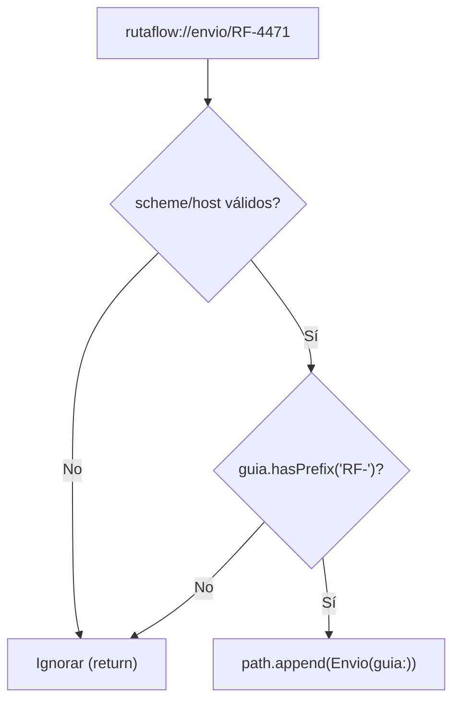

# Módulo 3: Navegación


**Proyecto del módulo:** para cada práctica, parte de una carpeta vacía y crea en Xcode (File ▸ New ▸ Project ▸ App, interfaz SwiftUI) un proyecto llamado `RutaFlowApp`; escribe manualmente todos los archivos indicados y compila, sin usar proyectos ya preparados.

## Aprende construyendo


### Tema 1: NavigationStack y NavigationPath · Básico · 35 min

<details open>
<summary><strong>Capa 1 — Lectura</strong></summary>

#### ► DE QUÉ TRATA
Al finalizar vas a navegar programáticamente de la lista de envíos al DetalleEnvio (Módulo 2) usando NavigationPath, sin depender de que el usuario toque una fila. Prerrequisitos: Módulo 2 completo.

#### ► LA ANALOGÍA
`NavigationStack` con `.navigationDestination(for:)` declara qué vista corresponde a cada tipo; `NavigationPath` deja manipular ese stack desde código, como un GPS que salta directamente a un punto de la ruta en vez de seguir letrero por letrero.

**¿Por qué es importante?** Porque `NavigationPath` permite manipular el stack de navegación completo desde código (agregar, resetear), habilitando deep links y flujos complejos que serían difíciles de expresar solo con `NavigationLink` anidados.
**Conceptos clave:** navegación declarada por tipo de dato, manipulable programáticamente.

```swift
NavigationStack(path: $path) {
    ListaTareasView()
        .navigationDestination(for: Tarea.self) { tarea in DetalleTareaView(tarea: tarea) }
}
```

`NavigationStack` gestiona un stack de navegación completo, con `.navigationDestination(for:)` declarando qué vista corresponde a cada tipo de dato que se agregue al stack (aquí, `Tarea`); esto reemplaza el modelo más antiguo de `NavigationView` con `NavigationLink` anidados directamente en cada vista, que requería estructurar la jerarquía de navegación de forma implícita a través de la composición de vistas, dificultando la navegación programática o los flujos complejos que no siguen simplemente el camino natural de taps del usuario.

```swift
path.append(tarea) // navega programáticamente, sin depender de NavigationLink anidados
```

`NavigationPath` (o un array tipado equivalente) permite manipular el stack de navegación completo desde código imperativo: agregar (`append`), quitar (`removeLast`), o resetear completamente el stack (asignando un array vacío), habilitando casos de uso que serían difíciles de expresar con `NavigationLink` puro, como responder a un deep link entrante navegando directamente varios niveles de profundidad de una sola vez, o implementar un flujo de "volver al inicio" desde cualquier punto profundo del stack.

**Analogía:** `NavigationStack` con `NavigationPath` es como un sistema de coordenadas GPS que permite saltar directamente a cualquier punto de una ruta con instrucciones programáticas explícitas, en vez de depender únicamente de seguir letrero por letrero (`NavigationLink`) el camino predefinido de una sola dirección posible.

**Código del ejemplo:**

```swift
NavigationStack(path: $path) {
    ListaTareasView()
        .navigationDestination(for: Tarea.self) { tarea in DetalleTareaView(tarea: tarea) }
}
path.append(tarea) // push programático
```

* Código: escribe la práctica en `ContentView.swift` de tu propio proyecto `RutaFlowApp`.
* Proyecto: en el proyecto integrador RutaFlow, navega del listado al detalle de envío con NavigationStack.

**Límites y decisión de uso:** La pila de navegación representa destinos, no autorización sobre sus datos. Guarda identidades estables en lugar de objetos vivos y valida una ruta restaurada: el recurso pudo eliminarse o dejar de pertenecer al usuario.

</details>

<details>
<summary><strong>Capa 2 — Construcción</strong></summary>

#### Código y verificación
```swift
NavigationStack(path: $path) {
    ListaTareasView()
        .navigationDestination(for: Tarea.self) { tarea in DetalleTareaView(tarea: tarea) }
}
```

```swift
path.append(tarea) // navega programáticamente, sin depender de NavigationLink anidados
```

```swift
NavigationStack(path: $path) {
    ListaTareasView()
        .navigationDestination(for: Tarea.self) { tarea in DetalleTareaView(tarea: tarea) }
}
path.append(tarea) // push programático
```

```swift
import SwiftUI

struct Envio: Hashable { let guia: String }

struct ListaEnvios: View {
    let guias = ["RF-4471", "RF-5002"]
    var body: some View {
        List(guias, id: \.self) { guia in
            NavigationLink(guia, value: Envio(guia: guia)) // empuja un valor, no una vista
        }
        .navigationTitle("Envíos")
    }
}

struct DetalleEnvio: View {
    let guia: String
    var body: some View { Text("Detalle de \(guia)") }
}

struct AppRutaFlow: View {
    @State private var path = NavigationPath()
    var body: some View {
        NavigationStack(path: $path) {
            ListaEnvios()
                .navigationDestination(for: Envio.self) { envio in DetalleEnvio(guia: envio.guia) }
        }
    }
}
// Simula abrir una notificación push:
// path.append(Envio(guia: "RF-4471"))
```

```bash
xcodebuild -scheme RutaFlowApp -destination 'generic/platform=iOS Simulator' build
```

</details>

### Tema 2: Sheets, full screen covers y TabView · Básico · 40 min

<details open>
<summary><strong>Capa 1 — Lectura</strong></summary>

#### ► DE QUÉ TRATA
Al finalizar vas a decidir, para dos flujos reales de RutaFlow, si necesitan un .sheet() o un .fullScreenCover(), y a darle a cada pestaña su propio historial con TabView. Prerrequisitos: Tema 1 de este módulo.

</details>

<details>
<summary><strong>Capa 2 — Construcción</strong></summary>

#### Código y verificación
```swift
.sheet(isPresented: $mostrarFormulario) { FormularioTareaView() }       // modal parcial, dismissible deslizando
.fullScreenCover(isPresented: $mostrarOnboarding) { OnboardingView() } // cubre toda la pantalla, ideal para flujos obligatorios
```

```swift
TabView {
    NavigationStack { InicioView() }.tabItem { Label("Inicio", systemImage: "house") }
    NavigationStack { TareasView() }.tabItem { Label("Tareas", systemImage: "checklist") }
}
```

```
TabView
├── Inicio  → NavigationStack propio
└── Tareas  → NavigationStack propio (independiente del de Inicio)
```

```swift
import SwiftUI

struct ContentView: View {
    @State private var mostrarConfirmarEntrega = false
    @State private var mostrarOnboarding = true
    @State private var entregado = false

    var body: some View {
        TabView {
            NavigationStack {
                ListaEnvios()
                    .toolbar { Button("Confirmar") { mostrarConfirmarEntrega = true } }
            }
            .tabItem { Label("Envíos", systemImage: "shippingbox") }
            NavigationStack { HistorialEnvios(entregado: entregado) }
                .tabItem { Label("Historial", systemImage: "clock") }
        }
        .sheet(isPresented: $mostrarConfirmarEntrega) { ConfirmarEntregaBoton(entregado: $entregado) }
        .fullScreenCover(isPresented: $mostrarOnboarding) { OnboardingConductorView(visible: $mostrarOnboarding) }
    }
}

struct ConfirmarEntregaBoton: View {
    @Binding var entregado: Bool
    @Environment(\.dismiss) private var cerrar
    var body: some View {
        Button("Confirmar entrega de RF-4471") { entregado = true; cerrar() }
    }
}

struct OnboardingConductorView: View {
    @Binding var visible: Bool
    var body: some View {
        VStack(spacing: 16) {
            Text("Bienvenido a RutaFlow")
            Button("Empezar ruta") { visible = false } // única salida: el flujo es obligatorio
        }
    }
}

struct HistorialEnvios: View {
    let entregado: Bool
    var body: some View {
        Text(entregado ? "RF-4471 entregado" : "Sin entregas hoy")
            .navigationTitle("Historial")
    }
}
```

```bash
xcodebuild -scheme RutaFlowApp -destination 'generic/platform=iOS Simulator' build
```

</details>

### Tema 3: Deep linking y controles de formulario · Intermedio · 45 min

<details open>
<summary><strong>Capa 1 — Lectura</strong></summary>

#### ► DE QUÉ TRATA
Al finalizar vas a abrir DetalleEnvio directamente desde un deep link real (rutaflow://envio/RF-4471), validando el formato antes de navegar. Prerrequisitos: Tema 1 de este módulo.

#### ► CÓMO FUNCIONA


</details>

<details>
<summary><strong>Capa 2 — Construcción</strong></summary>

#### Código y verificación
```swift
.onOpenURL { url in
    if let id = extraerID(de: url) { path.append(Tarea(id: id)) }
}
```


```swift
struct AppRutaFlow: View {
    @State private var path = NavigationPath()
    var body: some View {
        NavigationStack(path: $path) {
            ListaEnvios()
                .navigationDestination(for: Envio.self) { envio in DetalleEnvio(guia: envio.guia) }
        }
        .onOpenURL { url in
            guard url.scheme == "rutaflow", url.host == "envio",
                  let guia = url.pathComponents.last, guia.hasPrefix("RF-") else { return }
            path.append(Envio(guia: guia))
        }
    }
}
```

```bash
xcodebuild -scheme RutaFlowApp -destination 'generic/platform=iOS Simulator' build
```

</details>
