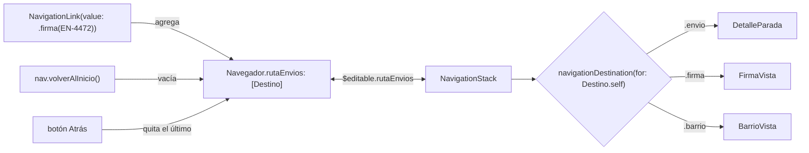
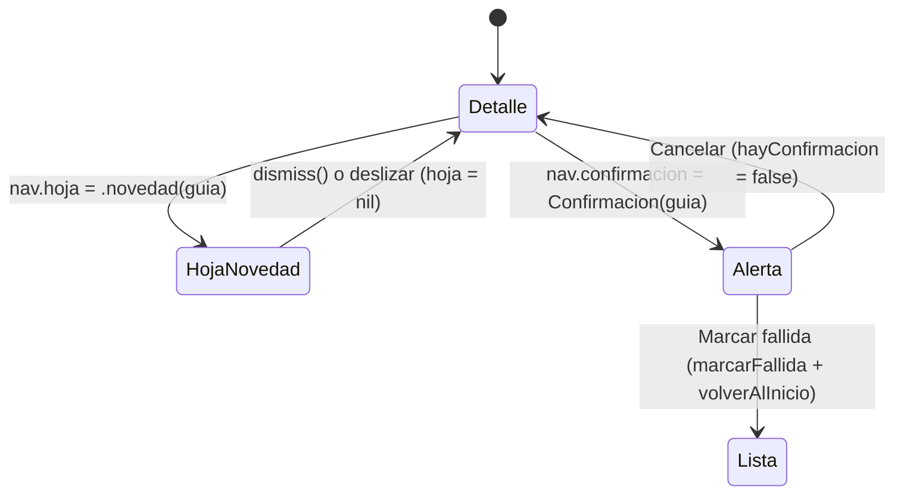
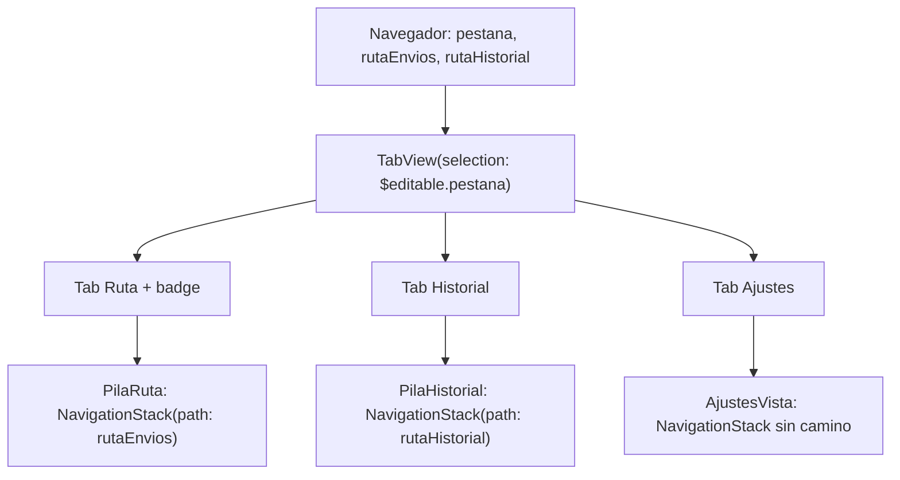
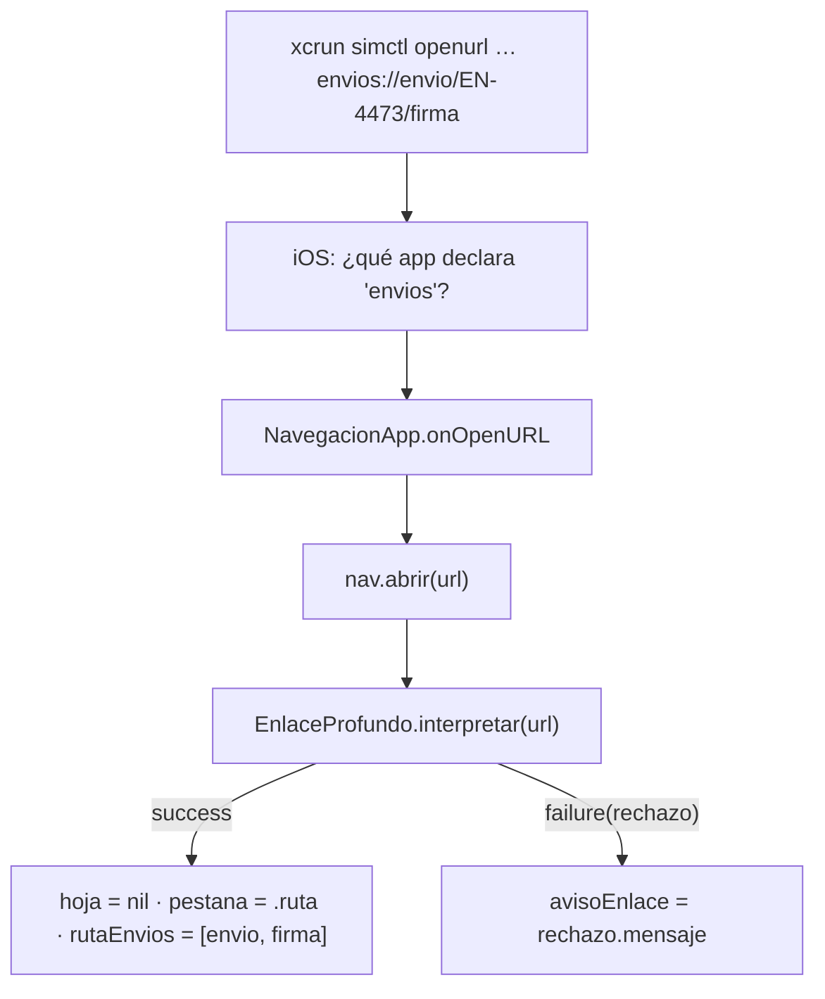

# Módulo 3: Navegación

**Entorno comprobado para esta edición (2026-11-25):** dos máquinas. En Linux, Swift 6.4.3 compiló y probó el núcleo
de la navegación: los destinos, el intérprete de enlaces profundos, la restauración de la pila en JSON y el
`Navegador` (un modelo `@Observable` con todo el estado de navegación, que en Linux funciona porque Observation es
parte de Swift). En una Mac con macOS 27.2, Xcode 27.2 (27B52) y Swift 6.4.2 se compiló la app `Navegacion`, se
ejecutaron sus pruebas en el simulador del iPhone 17 con iOS 27.2 (entre ellas, una que cambia la pila desde el
código y otra que retrocede como el botón «Atrás») y se fotografió **cada estado** de la app real: lista, detalle,
firma, hoja, alerta, pestañas y diálogo, y los enlaces abiertos con `xcrun simctl openurl` (iOS pidió
confirmación antes de abrirlos; lo verás en el Tema 4). Los errores de compilación
se provocaron con el SDK del simulador y los avisos de SwiftUI en tiempo de ejecución se capturaron de la consola de
la app. Límite honesto: los enlaces universales (`https://` con un dominio propio) necesitan un dominio y un archivo
de asociación publicados; aquí se usa un esquema propio (`envios://`), que no los necesita.

Una app de reparto tiene pantallas que se apilan (lista, detalle, firma), cosas que aparecen encima (una novedad, una
confirmación), secciones paralelas (ruta, historial, ajustes) y entradas desde fuera (una notificación o un enlace
que lleva directo a una guía). Este módulo enseña a modelar toda esa navegación como **datos**: un arreglo de
destinos, una hoja opcional, una pestaña seleccionada. Lo que es dato se puede cambiar desde el código, probar sin
pantalla, guardar y restaurar.

**Al terminar este módulo podrás:**
- navegar con `NavigationStack` y un camino tipado, decidir las vistas con `navigationDestination` y volver al inicio
  desde el código;
- presentar hojas, alertas y diálogos de confirmación a partir de estado, y armar formularios dentro de una hoja;
- organizar la app en pestañas con `TabView`, cada una con su propia pila;
- abrir la app en una pantalla concreta desde una URL, validando el enlace, y guardar y restaurar la pila.

**Esquema del módulo:** Tema 1 (`NavigationStack` con camino tipado) → Tema 2 (hojas, alertas y diálogos) → Tema 3
(`TabView`) → Tema 4 (enlaces profundos y restauración) → Proyecto 40.

**Qué necesitas saber antes:** el Módulo 2 completo, sobre todo **`@Observable` y `@Bindable`** (Tema 3) y **el
entorno** (Tema 4); del Módulo 1, **la composición** (Tema 1); del Módulo 0, **`enum` con valores asociados** y
**`Hashable`/`Codable`** (Tema 3).

**Qué no se repite:** maquetación (Módulo 1) y el reparto del estado (Módulo 2). La arquitectura completa de la app,
con un coordinador de navegación por funcionalidad, es el Módulo 8; las pruebas de interfaz que tocan la pantalla son
el Módulo 9.

**Prepara el proyecto:**

```text
$ mkdir -p ~/labs/ios/ios3 && cd ~/labs/ios/ios3
$ mkdir nucleo && cd nucleo && swift package init --type library --name Nucleo
```

Como en los módulos anteriores: `nucleo/` (sin SwiftUI, con un ejecutable `Enlaces`), `app/` con el proyecto de Xcode
`Navegacion` (código en `App/`, pruebas en `Pruebas/`, iOS 18 como mínimo) y `errores/`. Una diferencia: la app
declara el esquema de URL `envios` en `app/Info.plist` (Tema 4), fuera de la carpeta `App/` para que Xcode no lo copie
como recurso. Copia `nucleo/Sources/Nucleo` a `app/App/Nucleo` y `Captura.swift` a `app/Pruebas/`.


## Aprende construyendo


### Tema 1: NavigationStack con un camino tipado · Intermedio · 50 min

<details open>
<summary><strong>Capa 1 — Lectura</strong></summary>

#### Objetivos
Al terminar este tema podrás:
- modelar las pantallas de una pila como un `enum` `Hashable` y guardarlas en un arreglo;
- decidir en un solo lugar qué vista corresponde a cada destino con `navigationDestination(for:)`;
- empujar, retroceder y volver al inicio cambiando el arreglo, y comprobar que el botón «Atrás» también lo cambia;
- reconocer los errores de un valor sin destino y de un destino declarado en el lugar equivocado.

**Conceptos clave:** `NavigationStack`, camino (`path`), `NavigationLink(value:)`, `navigationDestination(for:)`,
`NavigationPath`

#### El problema
La lista de paradas lleva al detalle, el detalle a la firma y la firma, al guardar, debe volver a la lista. Con
`NavigationLink(destination:)` anidados, la firma no sabe cómo «volver dos pantallas»; alguien pasa una función
`alTerminar` por tres vistas. Además, cuando llega una notificación de la guía EN-4473 no hay forma de abrir su
detalle sin que la persona toque la fila.

Este tema usa **`@Observable` y `@Bindable`** (Módulo 2, Tema 3), **el entorno** (Módulo 2, Tema 4) y **`enum` con
valores asociados** (Módulo 0, Tema 3).

#### Glosario del tema

**`NavigationStack`**
- **Definición técnica:** contenedor que muestra una vista raíz y, encima, una pila de vistas; con `init(path:root:)` la pila es un `Binding` a una colección de valores `Hashable`.
- **En palabras sencillas:** una pila de hojas de papel; ves la de arriba y el botón «Atrás» quita una.
- **Dónde se rompe la comparación:** la pila no guarda vistas, guarda **valores**; la vista de cada valor se construye cuando hace falta.
- **Ejemplo:** `NavigationStack(path: $editable.rutaEnvios) { ListaParadas() … }`.
- **Error típico:** poner un `NavigationStack` dentro de otro (por ejemplo, en el detalle): aparecen dos barras.

**camino (`path`)**
- **Definición técnica:** la colección que describe qué hay apilado sobre la raíz; SwiftUI la lee para mostrar y la escribe cuando la persona retrocede.
- **En palabras sencillas:** la lista de paradas del recorrido actual.
- **Dónde se rompe la comparación:** es un estado como cualquier otro: si lo cambias, la pantalla cambia, con animación incluida.
- **Ejemplo:** `[.envio(guia: "EN-4472"), .firma(guia: "EN-4472")]` muestra la firma con el detalle debajo.
- **Error típico:** guardar en el camino objetos vivos (un modelo con conexión) en vez de identificadores.

**`NavigationLink(value:)`**
- **Definición técnica:** un control que, al tocarse, agrega su valor al camino de la pila más cercana; no sabe qué vista se mostrará.
- **En palabras sencillas:** un botón que dice «ve a la guía EN-4472», no «muestra esta pantalla».
- **Dónde se rompe la comparación:** si ninguna `navigationDestination` atiende ese tipo de valor, el enlace no lleva a ninguna parte.
- **Ejemplo:** `NavigationLink(value: Destino.firma(guia: guia)) { Label("Registrar firma", …) }`.
- **Error típico:** pasar un valor que no es `Hashable` (no compila) o uno de un tipo sin destino (no navega).

**`navigationDestination(for:)`**
- **Definición técnica:** modificador que registra, para un tipo de valor, la función que construye la vista; se pone dentro del `NavigationStack`, fuera de contenedores perezosos.
- **En palabras sencillas:** el mostrador que dice qué pantalla corresponde a cada tipo de boleto.
- **Dónde se rompe la comparación:** si lo pones dentro de una fila de `List`, puede que la pila no lo vea cuando lo necesita.
- **Ejemplo:** `.navigationDestination(for: Destino.self) { destino in VistaDestino(destino: destino) }`.
- **Error típico:** declarar un destino distinto en cada pantalla para el mismo tipo.

**`NavigationPath`**
- **Definición técnica:** colección de SwiftUI que acepta valores `Hashable` de tipos **distintos** (con borrado de tipo) y se puede codificar si todos son `Codable`.
- **En palabras sencillas:** una pila donde caben boletos de cualquier clase.
- **Dónde se rompe la comparación:** pierdes el tipo: no puedes preguntar «¿la segunda pantalla es una firma?» sin decodificar. Un arreglo de un `enum` propio lo dice directo.
- **Ejemplo:** el ejemplo de error de este tema la usa para empujar una `Parada`.
- **Error típico:** usarla por defecto cuando todas las pantallas caben en un solo `enum`.

#### ► CÓMO FUNCIONA
El `Navegador` guarda `rutaEnvios: [Destino]`. La pila lo enlaza con `$editable.rutaEnvios`. Tocar un enlace agrega
un valor; el código también puede agregar, quitar o vaciar; el botón «Atrás» quita el último. Para cada valor,
`navigationDestination` construye la vista.



#### Problema resuelto 1.1
Modela la pila de la ruta como un arreglo de `Destino` dentro de un `Navegador` observable. Navega desde el código
(detalle y firma de EN-4471), retrocede como lo haría el botón «Atrás» y vuelve al inicio, fotografiando cada paso y
anotando el arreglo. Después provoca los dos errores típicos.

**Razonamiento:**
1. `Destino` es un `enum` `Hashable` y `Codable` con la guía o el barrio como dato: identificadores, no objetos.
2. Todo el estado de navegación vive en `Navegador` (`@MainActor @Observable`), en el núcleo: se prueba en Linux.
3. Las vistas leen el navegador del entorno; para obtener enlaces (`$editable.rutaEnvios`) usan
   `@Bindable var editable = nav` dentro del `body`.
4. `VistaDestino` es el único lugar donde un destino se convierte en vista.
5. La prueba monta la app real (`Raiz`), cambia el navegador y busca el `UINavigationController` que SwiftUI usa por
   dentro para retroceder sin tocar la pantalla.

```swift
/// Cada pantalla a la que se puede ir dentro de una pila de navegación. Es un valor: se puede comparar,
/// guardar en JSON y construir desde un enlace. La vista de cada caso la decide `navigationDestination`.
public enum Destino: Hashable, Codable, Sendable {
    case envio(guia: String)
    case firma(guia: String)
    case barrio(nombre: String)
}

/// Las pestañas de la app.
public enum Pestana: String, CaseIterable, Hashable, Codable, Sendable {
    case ruta, historial, ajustes
}

/// Las hojas que se pueden presentar. `Identifiable` es lo que pide `.sheet(item:)`.
public enum Hoja: Identifiable, Hashable, Sendable {
    case novedad(guia: String)
    case filtros

    public var id: String {
        switch self {
        case .novedad(let guia): "novedad-\(guia)"
        case .filtros: "filtros"
        }
    }
}

/// Una pregunta que necesita confirmación antes de actuar.
public struct Confirmacion: Identifiable, Hashable, Sendable {
    public let guia: String
    public var id: String { guia }
}

public struct Parada: Identifiable, Hashable, Sendable {
    public let guia: String
    public let destinatario: String
    public let barrio: String
    public var fallida = false
    public var id: String { guia }
}

public enum Muestras {
    public static let paradas: [Parada] = [
        Parada(guia: "EN-4471", destinatario: "Ana Ruiz", barrio: "Chapinero"),
        Parada(guia: "EN-4472", destinatario: "Luis Pardo", barrio: "Chicó"),
        Parada(guia: "EN-4473", destinatario: "Marta Gil", barrio: "Engativá"),
    ]
}

/// Motivos de una novedad, para el selector de la hoja.
public enum MotivoNovedad: String, CaseIterable, Hashable, Sendable {
    case ausente = "Destinatario ausente"
    case direccion = "Dirección errada"
    case rechazo = "Rechazó el paquete"
}
```

```swift
import Foundation
import Observation

/// Todo el estado de navegación de la app en un solo objeto: pestaña, pila de cada pestaña, hoja y
/// confirmación. Las vistas lo leen y lo enlazan; los enlaces y las pruebas lo cambian directamente.
@MainActor
@Observable
public final class Navegador {
    public var pestana: Pestana = .ruta
    public var rutaEnvios: [Destino] = []
    public var rutaHistorial: [Destino] = []
    public var hoja: Hoja?
    public var confirmacion: Confirmacion?
    public var avisoEnlace: String?
    public var preguntandoCierre = false
    public var paradas = Muestras.paradas

    public init() {}

    /// Lo que pide `.alert(isPresented:)`: verdadero mientras haya una confirmación pendiente. Al cerrarse la
    /// alerta, SwiftUI escribe `false` y la confirmación se borra.
    public var hayConfirmacion: Bool {
        get { confirmacion != nil }
        set { if !newValue { confirmacion = nil } }
    }

    // MARK: Acciones

    public func abrir(_ destino: Destino) { rutaEnvios.append(destino) }
    public func volverAlInicio() { rutaEnvios.removeAll() }
    public func pedirConfirmacionDeFallo(_ guia: String) { confirmacion = Confirmacion(guia: guia) }

    public func marcarFallida(_ guia: String) {
        guard let i = paradas.firstIndex(where: { $0.guia == guia }) else { return }
        paradas[i].fallida = true
    }

    /// Aplica un enlace profundo: cambia de pestaña, reemplaza la pila y cierra lo que estuviera presentado.
    public func abrir(_ url: URL) {
        switch EnlaceProfundo.interpretar(url) {
        case .success(let r):
            hoja = nil
            confirmacion = nil
            avisoEnlace = nil
            pestana = r.pestana
            if r.pestana == .ruta { rutaEnvios = r.ruta } else { rutaHistorial = r.ruta }
        case .failure(let rechazo):
            avisoEnlace = rechazo.mensaje
        }
    }

    // MARK: Restauración

    /// La pila de envíos como JSON, para guardarla al salir y recuperarla al volver.
    public func pilaGuardada() throws -> Data { try JSONEncoder().encode(rutaEnvios) }

    public func restaurarPila(_ datos: Data) throws {
        rutaEnvios = try JSONDecoder().decode([Destino].self, from: datos)
    }

    // MARK: Escenas para los pantallazos

    /// Deja el estado de una escena con nombre; la app la aplica al abrir con `-escena nombre`.
    public func aplicar(escena: String) {
        switch escena {
        case "detalle": rutaEnvios = [.envio(guia: "EN-4472")]
        case "firma": rutaEnvios = [.envio(guia: "EN-4472"), .firma(guia: "EN-4472")]
        case "hoja":
            rutaEnvios = [.envio(guia: "EN-4472")]
            hoja = .novedad(guia: "EN-4472")
        case "confirmacion":
            rutaEnvios = [.envio(guia: "EN-4472")]
            confirmacion = Confirmacion(guia: "EN-4472")
        case "historial":
            marcarFallida("EN-4473")
            pestana = .historial
        case "cierre":
            pestana = .ajustes
            preguntandoCierre = true
        default: break
        }
    }
}
```

```swift
import SwiftUI

/// La pestaña Ruta: una pila cuyo camino es un arreglo de `Destino` guardado en el navegador.
struct PilaRuta: View {
    @Environment(Navegador.self) private var nav

    var body: some View {
        @Bindable var editable = nav  // da enlaces ($editable.x) a las propiedades del navegador
        NavigationStack(path: $editable.rutaEnvios) {
            ListaParadas()
                .navigationTitle("Ruta de hoy")
                .navigationDestination(for: Destino.self) { destino in
                    VistaDestino(destino: destino)
                }
        }
        .sheet(item: $editable.hoja) { hoja in
            VistaHoja(hoja: hoja)
                .presentationDetents([.medium, .large])
                .environment(nav)
        }
        .alert("¿Marcar como fallida?", isPresented: $editable.hayConfirmacion, presenting: nav.confirmacion) { c in
            Button("Marcar fallida", role: .destructive) {
                nav.marcarFallida(c.guia)
                nav.volverAlInicio()
            }
            Button("Cancelar", role: .cancel) {}
        } message: { c in
            Text("La guía \(c.guia) quedará como no entregada.")
        }
    }
}

/// Un solo lugar decide qué vista corresponde a cada destino.
struct VistaDestino: View {
    let destino: Destino

    var body: some View {
        switch destino {
        case .envio(let guia): DetalleParada(guia: guia)
        case .firma(let guia): FirmaVista(guia: guia)
        case .barrio(let nombre): BarrioVista(nombre: nombre)
        }
    }
}

struct ListaParadas: View {
    @Environment(Navegador.self) private var nav

    var body: some View {
        List(nav.paradas) { parada in
            NavigationLink(value: Destino.envio(guia: parada.guia)) {
                VStack(alignment: .leading) {
                    Text(parada.guia).font(.headline.monospaced())
                    Text("\(parada.destinatario) · \(parada.barrio)").foregroundStyle(.secondary)
                }
            }
            .disabled(parada.fallida)
        }
    }
}

struct DetalleParada: View {
    let guia: String
    @Environment(Navegador.self) private var nav

    var body: some View {
        let parada = nav.paradas.first { $0.guia == guia }
        List {
            Section("Destinatario") {
                Text(parada?.destinatario ?? "—")
                NavigationLink(value: Destino.barrio(nombre: parada?.barrio ?? "—")) {
                    Label(parada?.barrio ?? "—", systemImage: "map")
                }
            }
            Section("Acciones") {
                NavigationLink(value: Destino.firma(guia: guia)) {
                    Label("Registrar firma", systemImage: "signature")
                }
                Button {
                    nav.hoja = .novedad(guia: guia)
                } label: {
                    Label("Reportar novedad", systemImage: "exclamationmark.bubble")
                }
                Button(role: .destructive) {
                    nav.pedirConfirmacionDeFallo(guia)
                } label: {
                    Label("Marcar como fallida", systemImage: "xmark.octagon")
                }
            }
        }
        .navigationTitle(guia)
        .toolbar {
            ToolbarItem(placement: .topBarTrailing) {
                Button("Inicio") { nav.volverAlInicio() }
            }
        }
    }
}

struct FirmaVista: View {
    let guia: String
    @Environment(Navegador.self) private var nav
    @State private var nombre = ""

    var body: some View {
        Form {
            Section("Quién recibe \(guia)") {
                TextField("Nombre y apellido", text: $nombre)
            }
            Section {
                Button("Guardar y volver a la ruta") { nav.volverAlInicio() }
                    .disabled(nombre.isEmpty)
            }
        }
        .navigationTitle("Firma")
    }
}

struct BarrioVista: View {
    let nombre: String
    @Environment(Navegador.self) private var nav

    var body: some View {
        List(nav.paradas.filter { $0.barrio == nombre }) { parada in
            Text("\(parada.guia) · \(parada.destinatario)")
        }
        .navigationTitle(nombre)
    }
}
```

```swift
import SwiftUI
import UIKit

/// Pone una vista en una ventana real de la app anfitriona y la deja ahí para cambiarla y fotografiarla.
@MainActor
final class Montaje {
    let ventana: UIWindow

    init<V: View>(_ vista: V, ancho: CGFloat = 390, alto: CGFloat = 844) {
        let escena = UIApplication.shared.connectedScenes.first as? UIWindowScene
        ventana = escena.map { UIWindow(windowScene: $0) } ?? UIWindow()
        ventana.frame = CGRect(x: 0, y: 0, width: ancho, height: alto)
        ventana.rootViewController = UIHostingController(rootView: vista)
        ventana.makeKeyAndVisible()
        esperar()
    }

    /// Deja correr el ciclo principal para que SwiftUI actualice y vuelva a dibujar.
    func esperar(_ segundos: Double = 0.5) {
        RunLoop.main.run(until: Date().addingTimeInterval(segundos))
    }

    /// El `UINavigationController` que SwiftUI usa por dentro del `NavigationStack` visible, si lo hay.
    func navegacionVisible() -> UINavigationController? {
        func buscar(_ vc: UIViewController) -> UINavigationController? {
            if let nc = vc as? UINavigationController, nc.view.window != nil { return nc }
            for hijo in vc.children {
                if let nc = buscar(hijo) { return nc }
            }
            return nil
        }
        guard let raiz = ventana.rootViewController else { return nil }
        return buscar(raiz)
    }

    /// Fotografía la ventana tal como está ahora.
    func foto(_ nombre: String) throws {
        let salida = ProcessInfo.processInfo.environment["SALIDA"] ?? NSTemporaryDirectory()
        let imagen = UIGraphicsImageRenderer(bounds: ventana.bounds).image { _ in
            _ = ventana.drawHierarchy(in: ventana.bounds, afterScreenUpdates: true)
        }
        try imagen.pngData()!.write(to: URL(fileURLWithPath: salida).appendingPathComponent("\(nombre).png"))
    }

    func desmontar() {
        ventana.isHidden = true
        ventana.rootViewController = nil
    }
}

/// Escribe líneas de texto en la carpeta de resultados (la variable SALIDA que pasa mac.sh).
func escribir(_ lineas: [String], _ nombre: String) throws {
    let salida = ProcessInfo.processInfo.environment["SALIDA"] ?? NSTemporaryDirectory()
    let ruta = URL(fileURLWithPath: salida).appendingPathComponent(nombre)
    try (lineas.joined(separator: "\n") + "\n").write(to: ruta, atomically: true, encoding: .utf8)
}
```

```swift
import SwiftUI
import Testing
import UIKit

@testable import Navegacion

/// La pila de navegación manda: se cambia el arreglo y la pantalla sigue; se toca «Atrás» y el arreglo sigue.
@MainActor
@Suite("Navegación en el simulador", .serialized)
struct PruebasNavegacion {

    @Test func laPilaMandaYElBotonAtrasLaActualiza() throws {
        let nav = Navegador()
        let m = Montaje(Raiz().environment(nav))
        var lineas = ["paso                                   rutaEnvios"]
        func anotar(_ paso: String) {
            let pila = nav.rutaEnvios.map { "\($0)" }.joined(separator: ", ")
            lineas.append(paso.padding(toLength: 39, withPad: " ", startingAt: 0) + "[\(pila)]")
        }
        anotar("al montar")
        nav.abrir(.envio(guia: "EN-4471"))
        m.esperar(1)
        anotar("nav.abrir(.envio(EN-4471))")
        try m.foto("ios3-t1-pila-1")
        nav.abrir(.firma(guia: "EN-4471"))
        m.esperar(1)
        anotar("nav.abrir(.firma(EN-4471))")
        try m.foto("ios3-t1-pila-2")
        let controlador = m.navegacionVisible()
        controlador?.popViewController(animated: false)  // lo mismo que tocar «Atrás»
        m.esperar(1)
        anotar("popViewController (botón Atrás)")
        try m.foto("ios3-t1-pila-atras")
        nav.volverAlInicio()
        m.esperar(1)
        anotar("nav.volverAlInicio()")
        lineas.append("UINavigationController encontrado: \(controlador != nil)")
        try escribir(lineas, "t1-pila.txt")
        m.desmontar()
    }

    @Test func componentes() throws {
        try capturar(NavigationStack { DetalleParada(guia: "EN-4472") }.environment(Navegador()), "ios3-t1-detalle")
        try capturar(HojaNovedad(guia: "EN-4472"), "ios3-t2-hoja-oscura", alto: 520, estilo: .dark)
    }
}
```

```text
paso                                   rutaEnvios
al montar                              []
nav.abrir(.envio(EN-4471))             [envio(guia: "EN-4471")]
nav.abrir(.firma(EN-4471))             [envio(guia: "EN-4471"), firma(guia: "EN-4471")]
popViewController (botón Atrás)        [envio(guia: "EN-4471")]
nav.volverAlInicio()                   []
UINavigationController encontrado: true
```

![Tres capturas tomadas por la prueba, lado a lado, con la barra de pestañas abajo (Ruta con la insignia 3). Primera, tras nav.abrir(.envio(EN-4471)): el detalle con el título grande «EN-4471», un botón redondo con una flecha para retroceder arriba a la izquierda y «Inicio» arriba a la derecha; la sección Destinatario con «Ana Ruiz» y «Chapinero» con un ícono de mapa, y la sección Acciones con «Registrar firma», «Reportar novedad» en azul y «Marcar como fallida» en rojo. Segunda, tras nav.abrir(.firma(EN-4471)): la pantalla «Firma» con la sección «Quién recibe EN-4471», el campo vacío «Nombre y apellido» y el botón desactivado «Guardar y volver a la ruta». Tercera, tras popViewController: otra vez el detalle de EN-4471](content/figures/ios/ios3-t1-pila.png)

La app real a pantalla completa, abierta con `-escena lista`, `-escena detalle` y `-escena firma`:

![Tres capturas de pantalla completa del iPhone 17, lado a lado. Primera: el título grande «Ruta de hoy» con las paradas EN-4471 (Ana Ruiz · Chapinero), EN-4472 (Luis Pardo · Chicó) y EN-4473 (Marta Gil · Engativá), cada una con una flecha a la derecha, y la barra de pestañas flotante abajo con Ruta seleccionada y una insignia roja con el 3, Historial y Ajustes. Segunda: el detalle de EN-4472 con Luis Pardo, Chicó y las tres acciones, el botón redondo de retroceso y «Inicio». Tercera: la pantalla Firma con «Quién recibe EN-4472» y el botón de retroceso](content/figures/ios/ios3-app-pila.png)

**Explicación por partes.**
- `t1-pila.txt` cuenta la historia completa: `[]` al montar, un destino, dos destinos y, tras `popViewController`
  (lo que hace el botón «Atrás»), otra vez `[envio(guia: "EN-4471")]`. Nadie tocó el arreglo en ese paso: **SwiftUI
  lo escribió** a través del enlace `$editable.rutaEnvios`. Con `volverAlInicio()` volvió a `[]`.
- `UINavigationController encontrado: true`: en iOS 27.2, `NavigationStack` sigue usando por dentro un
  `UINavigationController` (en el registro aparece como `SwiftUI.UIKitNavigationController`). Es un detalle interno:
  la prueba lo usa para simular el toque, tu app no debe depender de él.
- Las tres capturas de la prueba muestran que cambiar el arreglo **es** navegar: ningún toque, ningún
  `NavigationLink` activado.
- `DetalleParada` no sabe nada de la firma salvo su valor; `FirmaVista` vuelve a la lista con `nav.volverAlInicio()`,
  sin funciones pasadas de vista en vista.
- Las escenas de la app aplican el mismo estado con `nav.aplicar(escena:)`, que las pruebas del núcleo también usan.

Dos errores provocados. Un enlace con un valor que no es `Hashable` (`errores/t1-no-hashable.swift`):

```swift
// Error provocado: un NavigationLink empuja un VALOR, y ese valor tiene que ser Hashable.
import SwiftUI

struct Parada {
    let guia: String
}

struct ListaParadas: View {
    let paradas = [Parada(guia: "EN-4471"), Parada(guia: "EN-4472")]

    var body: some View {
        NavigationStack {
            List(paradas, id: \.guia) { parada in
                NavigationLink(parada.guia, value: parada)
            }
        }
    }
}
```

```text
$ xcrun --sdk iphonesimulator swiftc -typecheck -swift-version 6 -target arm64-apple-ios18.0-simulator errores/t1-no-hashable.swift
errores/t1-no-hashable.swift:14:17: error: initializer 'init(_:value:)' requires that 'Parada' conform to 'Hashable'
12 |         NavigationStack {
13 |             List(paradas, id: \.guia) { parada in
14 |                 NavigationLink(parada.guia, value: parada)
   |                 `- error: initializer 'init(_:value:)' requires that 'Parada' conform to 'Hashable'
15 |             }
16 |         }

SwiftUI.NavigationLink.init:2:20: note: where 'P' = 'Parada'
1 | generic struct NavigationLink {
2 | nonisolated public init<S, P>(_ title: S, value: P?) where Label == Text, S : StringProtocol, P : Hashable}
  |                    `- note: where 'P' = 'Parada'
3 | 
[código de salida: 1]
```

Y dos en tiempo de ejecución: una pila que recibe una `Parada` sin destino para `Parada` (`EjemploSinDestino`) y un
destino declarado dentro de las filas de una `List` (`EjemploDestinoPerezoso`), con la consola de la app:

```swift
import SwiftUI

/// ✗ A propósito: la pila recibe un valor de tipo `Parada`, pero solo hay destino para `Destino`.
struct EjemploSinDestino: View {
    @State private var camino = NavigationPath()

    var body: some View {
        NavigationStack(path: $camino) {
            List(Muestras.paradas) { parada in
                NavigationLink(parada.guia, value: parada)  // Parada es Hashable, pero nadie la atiende
            }
            .navigationTitle("Sin destino")
            .navigationDestination(for: Destino.self) { _ in Text("Solo sé mostrar un Destino") }
        }
        .task {
            try? await Task.sleep(for: .seconds(1))
            print("— camino.append(Parada EN-4472) —")
            camino.append(Muestras.paradas[1])
            try? await Task.sleep(for: .seconds(1))
            print("— camino.count = \(camino.count) —")
        }
    }
}

/// ✗ A propósito: navigationDestination dentro de las filas de una List (un contenedor perezoso).
struct EjemploDestinoPerezoso: View {
    @State private var camino: [Destino] = []

    var body: some View {
        NavigationStack(path: $camino) {
            List(Muestras.paradas) { parada in
                NavigationLink(parada.guia, value: Destino.envio(guia: parada.guia))
                    .navigationDestination(for: Destino.self) { destino in Text("\(String(describing: destino))") }
            }
            .navigationTitle("Destino en la fila")
        }
        .task {
            try? await Task.sleep(for: .seconds(1))
            print("— camino.append(.envio(EN-4473)) —")
            camino.append(.envio(guia: "EN-4473"))
        }
    }
}
```

```text
$ SIMCTL_CHILD_OS_ACTIVITY_DT_MODE=enable xcrun simctl launch --console-pty "$SIM" com.academia.navegacion -escena sin-destino
— camino.append(Parada EN-4472) —
— camino.count = 1 —
```

```text
$ SIMCTL_CHILD_OS_ACTIVITY_DT_MODE=enable xcrun simctl launch --console-pty "$SIM" com.academia.navegacion -escena destino-perezoso
2026-11-25 06:13:56.949346-0500 Navegacion[1398:2640106] [Invalid Configuration] Do not put a navigation destination modifier inside a "lazy” container, like `List` or `LazyVStack`. These containers create child views only when needed to render on screen. Add the navigation destination modifier outside these containers so that the navigation stack can always see the destination. There's a misplaced `navigationDestination(for:destination:)` modifier for type `Destino`. It will be ignored.
2026-11-25 06:13:56.970237-0500 Navegacion[1398:2640106] [Invalid Configuration] Do not put a navigation destination modifier inside a "lazy” container, like `List` or `LazyVStack`. These containers create child views only when needed to render on screen. Add the navigation destination modifier outside these containers so that the navigation stack can always see the destination. There's a misplaced `navigationDestination(for:destination:)` modifier for type `Destino`. It will be ignored.
2026-11-25 06:13:56.972059-0500 Navegacion[1398:2640106] [Invalid Configuration] Do not put a navigation destination modifier inside a "lazy” container, like `List` or `LazyVStack`. These containers create child views only when needed to render on screen. Add the navigation destination modifier outside these containers so that the navigation stack can always see the destination. There's a misplaced `navigationDestination(for:destination:)` modifier for type `Destino`. It will be ignored.
— camino.append(.envio(EN-4473)) —
2026-11-25 06:13:58.074879-0500 Navegacion[1398:2640106] [Snapshotting] Snapshotting a view (0x103e9d900, _UINavigationBarLargeTitleView) that has not been rendered at least once requires afterScreenUpdates:YES.
```

```text
$ xcrun simctl spawn "$SIM" log show --last 3m --style compact --predicate 'process == "Navegacion" AND eventMessage CONTAINS[c] "navigation"' | tail -20
getpwuid_r did not find a match for uid 501
Timestamp               Ty Process[PID:TID]
2026-11-25 06:13:56.949 F  Navegacion[1398:2848ea] [com.apple.SwiftUI:Invalid Configuration] Do not put a navigation destination modifier inside a "lazy” container, like `List` or `LazyVStack`. These containers create child views only when needed to render on screen. Add the navigation destination modifier outside these containers so that the navigation stack can always see the destination. There's a misplaced `navigationDestination(for:destination:)` modifier for type `Destino`. It will be ignored.
2026-11-25 06:13:56.970 F  Navegacion[1398:2848ea] [com.apple.SwiftUI:Invalid Configuration] Do not put a navigation destination modifier inside a "lazy” container, like `List` or `LazyVStack`. These containers create child views only when needed to render on screen. Add the navigation destination modifier outside these containers so that the navigation stack can always see the destination. There's a misplaced `navigationDestination(for:destination:)` modifier for type `Destino`. It will be ignored.
2026-11-25 06:13:56.972 F  Navegacion[1398:2848ea] [com.apple.SwiftUI:Invalid Configuration] Do not put a navigation destination modifier inside a "lazy” container, like `List` or `LazyVStack`. These containers create child views only when needed to render on screen. Add the navigation destination modifier outside these containers so that the navigation stack can always see the destination. There's a misplaced `navigationDestination(for:destination:)` modifier for type `Destino`. It will be ignored.
2026-11-25 06:13:58.074 E  Navegacion[1398:2848ea] [com.apple.UIKit:Snapshotting] Snapshotting a view (0x103e9d900, _UINavigationBarLargeTitleView) that has not been rendered at least once requires afterScreenUpdates:YES.
```


Lo que dijo cada uno:
- **No `Hashable`:** `initializer 'init(_:value:)' requires that 'Parada' conform to 'Hashable'`, y una nota con la
  firma del inicializador (`P : Hashable`). El compilador lo atrapa antes de ejecutar.
- **Destino en la fila:** SwiftUI avisó tres veces, una por fila, con la categoría `[Invalid Configuration]`:
  `Do not put a navigation destination modifier inside a "lazy” container, like List or LazyVStack. […] There's a
  misplaced navigationDestination(for:destination:) modifier for type Destino. It will be ignored.` En el registro
  del sistema aparece con tipo `F` (*fault*). El destino se **ignora**: al empujar `.envio(EN-4473)`, la pila no
  tiene con qué construir la vista.
- **Valor sin destino:** el hallazgo es que **no hubo ningún aviso**. La consola solo trae las dos líneas propias
  (`camino.append(Parada EN-4472)` y `camino.count = 1`): el camino creció a 1, pero SwiftUI no dijo nada, ni en la
  consola ni en el registro filtrado. Lo único que delata el error está en la pantalla: la pila **sí empujó** una
  pantalla, pero vacía, con un triangulito amarillo en el centro, que es lo que SwiftUI dibuja cuando no tiene vista
  para un valor. Con el destino dentro de la `List` pasó lo mismo: al ignorar el destino, la pantalla empujada es el
  mismo triángulo. Una persona usuaria vería una pantalla en blanco con un botón para volver.

> **Error común.** Empujar un valor de un tipo que ninguna `navigationDestination` atiende. Compila sin problema, el
> camino crece y, en iOS 27.2, SwiftUI no avisa nada en la consola: solo aparece una pantalla vacía con un triángulo
> amarillo. Un solo `enum`
> con todos los destinos y un solo `navigationDestination` para él lo evitan.

> **Error común.** Poner `navigationDestination` dentro de las filas de una `List` o de un `LazyVStack`. La pila puede
> necesitar el destino de una fila que aún no se creó. Ponlo en la raíz del `NavigationStack`, como en `PilaRuta`.

> **Buena práctica.** Guarda en el camino solo identificadores (la guía, el nombre del barrio) y busca los datos al
> construir la vista. Así el camino se puede guardar en JSON (Tema 4) y no muestra datos viejos si el modelo cambió.

> **Prevenir errores.** Prueba la navegación como dato: en el núcleo, que cada acción deje el arreglo esperado; en el
> simulador, que el arreglo produzca la pantalla esperada. Es lo que hacen `NucleoTests` y
> `laPilaMandaYElBotonAtrasLaActualiza`.

#### Checkpoint 1.1
¿Qué muestra la app si `rutaEnvios` es `[.barrio(nombre: "Chicó"), .envio(guia: "EN-4471")]`?

Respuesta: el detalle de EN-4471; al tocar «Atrás», la lista del barrio Chicó (con EN-4472, que es de ese barrio), y
otra vez «Atrás», la lista de la ruta. El orden del arreglo es el orden de la pila aunque no tenga sentido para el
negocio (EN-4471 es de Chapinero): validar eso es trabajo tuyo.

</details>

<details>
<summary><strong>Capa 2 — Construcción</strong></summary>

#### Paso 1 · Destinos y navegador
Crea `Destino.swift` y `Navegador.swift` en el núcleo y ejecuta `swift test`.

#### Paso 2 · La pila
Crea `PilaRuta.swift`. Abre la app con `-escena detalle` y `-escena firma`.

#### Paso 3 · Navega desde el código
Ejecuta `laPilaMandaYElBotonAtrasLaActualiza` y compara las capturas con `t1-pila.txt`.

#### Paso 4 · Agrega un destino
Agrega `case mapa(guia: String)` a `Destino`, su vista en `VistaDestino` y un enlace en el detalle. Fíjate en que el
compilador te obliga a atender el caso nuevo en el `switch`.

#### Paso 5 · Provoca los errores
Compila `errores/t1-no-hashable.swift` y corrígelo con `Hashable`. Abre la app con `-escena sin-destino` y
`-escena destino-perezoso` desde Xcode y lee la consola.

#### Resumen
- **`NavigationStack`** con un **camino** tipado: la pila es un arreglo de valores.
- **`NavigationLink(value:)`** agrega un valor; **`navigationDestination(for:)`** decide la vista.
- Cambiar el arreglo es navegar; el botón «Atrás» lo actualiza.
- **`NavigationPath`** sirve cuando los valores son de tipos distintos; un `enum` propio es más claro.

#### Ejercicio verificable 1
Básico. ¿Qué arreglo deja `nav.aplicar(escena: "firma")`?

Respuesta esperada: `[.envio(guia: "EN-4472"), .firma(guia: "EN-4472")]`.

#### Ejercicio verificable 2
Intermedio. En el Paso 4, ¿qué error da el compilador si agregas `mapa` a `Destino` pero no a `VistaDestino`?

Respuesta esperada: que el `switch` no es exhaustivo (falta el caso `.mapa`).

#### Ejercicio verificable 3
Reto. Según `t1-pila.txt`, ¿qué demuestra la línea de `popViewController`?

Respuesta esperada: que SwiftUI escribe en el camino cuando se retrocede: el arreglo perdió el último destino sin que
el código lo tocara: pasó de dos destinos a `[envio(guia: "EN-4471")]`.

#### En el trabajo
Las apps grandes modelan cada flujo con un `enum` de destinos y un objeto que es dueño del camino (a menudo llamado
*router* o coordinador). Así, las notificaciones, los enlaces y los atajos de Siri usan el mismo código que los
toques, y la navegación se prueba sin interfaz.

</details>

### Tema 2: Hojas, alertas y diálogos de confirmación · Intermedio · 45 min

<details open>
<summary><strong>Capa 1 — Lectura</strong></summary>

#### Objetivos
Al terminar este tema podrás:
- presentar una hoja a partir de un valor opcional con `.sheet(item:)` y cerrarla con `dismiss`;
- armar un formulario con `Form`, `Picker`, `TextField` y `Toggle` dentro de una hoja con su propia barra;
- pedir confirmación con `.alert` y `.confirmationDialog`, con botones de rol destructivo y de cancelar;
- conectar una alerta a un estado opcional sin escribir `Binding(get:set:)`.

**Conceptos clave:** `.sheet(item:)`, `presentationDetents`, `dismiss`, `.alert(isPresented:presenting:)`,
`confirmationDialog`

#### El problema
Desde el detalle de una guía, la repartidora reporta una novedad (motivo, detalle, si se reintenta) o marca la
entrega como fallida. En la primera versión, la hoja de novedad se abría con un `Bool` y una guía guardada aparte: a
veces mostraba la guía anterior. La alerta de «marcar fallida» se cerraba sola sin borrar la guía pendiente. Y el
formulario dentro de la hoja no tenía barra ni botón para cancelar.

Este tema usa **el navegador y la pila** (Tema 1), **enlaces** (Módulo 2, Tema 2) y **el entorno** (Módulo 2, Tema
4: `dismiss` es un valor del entorno).

#### Glosario del tema

**`.sheet(item:)`**
- **Definición técnica:** presenta una hoja mientras el enlace a un opcional `Identifiable` no sea `nil`; el contenido recibe el valor desempaquetado, y al cerrarse la hoja SwiftUI escribe `nil`.
- **En palabras sencillas:** «muestra la hoja de **esto**»; sin «esto», no hay hoja.
- **Dónde se rompe la comparación:** si cambias el valor por otro con distinto `id` mientras está abierta, SwiftUI cierra la hoja y abre la nueva.
- **Ejemplo:** `.sheet(item: $editable.hoja) { hoja in VistaHoja(hoja: hoja) }`.
- **Error típico:** usar `sheet(isPresented:)` y leer la guía de otra variable que puede no estar lista.

**`presentationDetents`**
- **Definición técnica:** alturas en las que puede quedar una hoja (`.medium`, `.large`, una fracción o una altura fija); la persona cambia entre ellas arrastrando.
- **En palabras sencillas:** media hoja o hoja completa.
- **Dónde se rompe la comparación:** se aplica al **contenido** de la hoja, no a la vista que la presenta.
- **Ejemplo:** `VistaHoja(hoja: hoja).presentationDetents([.medium, .large])`.
- **Error típico:** ponerlo fuera del closure de `.sheet` y que no tenga efecto.

**`dismiss`**
- **Definición técnica:** acción del entorno (`@Environment(\.dismiss)`) que cierra la presentación actual (hoja, pantalla completa) o retrocede en la pila si la vista fue empujada.
- **En palabras sencillas:** el botón «cerrar» que trae cada presentación.
- **Dónde se rompe la comparación:** cierra la presentación de la vista que lo lee; leído en la vista que presenta, cerraría otra cosa.
- **Ejemplo:** `Button("Cancelar") { cerrar() }` en `HojaNovedad`.
- **Error típico:** pasar a la hoja un `Binding<Bool>` solo para que se cierre.

**`.alert(isPresented:presenting:)`**
- **Definición técnica:** alerta del sistema con título, mensaje y botones; con `presenting:` los closures reciben el dato que se confirma. Un botón con `role: .cancel` se ubica como cancelar; uno `.destructive` se pinta en rojo.
- **En palabras sencillas:** una pregunta que bloquea hasta que se responde.
- **Dónde se rompe la comparación:** pide un `Binding<Bool>`; si tu estado es un opcional, hace falta una propiedad que lo traduzca.
- **Ejemplo:** `isPresented: $editable.hayConfirmacion, presenting: nav.confirmacion`.
- **Error típico:** pasar un `Bool` (no compila) o un `Binding(get:set:)` que no borra el dato al cerrar.

**`confirmationDialog`**
- **Definición técnica:** lista de acciones del sistema para confirmar o elegir entre varias acciones (en iOS 27.2, en el iPhone, sale como un globo junto al botón que la abrió); con `titleVisibility: .visible` muestra el título.
- **En palabras sencillas:** un menú de «¿qué quieres hacer?».
- **Dónde se rompe la comparación:** no es para avisos sin elección: para eso, una alerta.
- **Ejemplo:** «¿Cerrar la ruta?» en Ajustes, con «Cerrar y enviar resumen».
- **Error típico:** usar una alerta con cuatro botones en vez de un diálogo.

#### ► CÓMO FUNCIONA
Las presentaciones también son estado del navegador: `hoja: Hoja?`, `confirmacion: Confirmacion?` y
`preguntandoCierre: Bool`. La vista las enlaza; cuando la persona cierra, SwiftUI escribe `nil` o `false`. La
propiedad calculada `hayConfirmacion` traduce el opcional al `Bool` que pide la alerta.



#### Problema resuelto 2.1
Desde el detalle de EN-4472, abre la hoja de novedad con su formulario y pide confirmación para marcarla fallida;
en Ajustes, pide confirmación para cerrar la ruta. Fotografía cada presentación en la app real y el formulario en
oscuro.

**Razonamiento:**
1. `Hoja` es un `enum` `Identifiable`: el `id` incluye la guía, así que una novedad de otra guía es otra hoja.
2. `HojaNovedad` tiene su propio `NavigationStack` para mostrar título y botones en la barra; se cierra con
   `dismiss` y no necesita nada del que la presentó.
3. La alerta usa `presenting:` para que los botones reciban la guía exacta que se confirma.
4. `hayConfirmacion` (en el núcleo) devuelve `confirmacion != nil` y, al escribir `false`, borra la confirmación; se
   prueba en Linux sin SwiftUI.
5. Las escenas `hoja`, `confirmacion` y `cierre` ponen ese estado 0,6 s después de abrir la app, cuando la pantalla
   ya está lista para presentar.

```swift
import SwiftUI

struct VistaHoja: View {
    let hoja: Hoja

    var body: some View {
        switch hoja {
        case .novedad(let guia): HojaNovedad(guia: guia)
        case .filtros: Text("Filtros")
        }
    }
}

/// La hoja tiene su propia pila (para tener barra con título y botones) y se cierra con `dismiss`.
struct HojaNovedad: View {
    let guia: String
    @Environment(\.dismiss) private var cerrar
    @State private var motivo = MotivoNovedad.ausente
    @State private var detalle = ""
    @State private var reintentar = true

    var body: some View {
        NavigationStack {
            Form {
                Picker("Motivo", selection: $motivo) {
                    ForEach(MotivoNovedad.allCases, id: \.self) { motivo in
                        Text(motivo.rawValue)
                    }
                }
                TextField("Detalle (opcional)", text: $detalle, axis: .vertical)
                Toggle("Reintentar mañana", isOn: $reintentar)
            }
            .navigationTitle("Novedad \(guia)")
            .navigationBarTitleDisplayMode(.inline)
            .toolbar {
                ToolbarItem(placement: .cancellationAction) {
                    Button("Cancelar") { cerrar() }
                }
                ToolbarItem(placement: .confirmationAction) {
                    Button("Guardar") { cerrar() }
                }
            }
        }
    }
}
```

```swift
import SwiftUI

@main
struct NavegacionApp: App {
    /// El estado que se pone al abrir: `xcrun simctl launch <sim> com.academia.navegacion -escena hoja`.
    let escena = UserDefaults.standard.string(forKey: "escena") ?? "lista"
    /// Para las capturas: `-enlace envios://…` entrega la URL al mismo `nav.abrir(_:)` que usa `onOpenURL`, sin el
    /// aviso «¿Abrir en…?» que iOS muestra cuando el enlace llega desde fuera (lo verás en el Tema 4).
    let enlace = UserDefaults.standard.string(forKey: "enlace").flatMap(URL.init(string:))
    @State private var nav = Navegador()

    var body: some Scene {
        WindowGroup {
            Group {
                switch escena {
                case "sin-destino": EjemploSinDestino()
                case "destino-perezoso": EjemploDestinoPerezoso()
                default: Raiz()
                }
            }
            .environment(nav)
            .onOpenURL { url in nav.abrir(url) }  // envios://… desde fuera de la app
            .task {
                try? await Task.sleep(for: .milliseconds(600))
                nav.aplicar(escena: escena)
                if let enlace { nav.abrir(enlace) }
            }
        }
    }
}
```

![Tres capturas de pantalla completa, lado a lado. Primera, escena hoja: sobre el detalle de EN-4472, oscurecido, una hoja a media altura con un asa arriba, una barra con «Cancelar» a la izquierda, el título «Novedad EN-4472» y «Guardar» a la derecha, y el formulario con «Motivo: Destinatario ausente», el campo «Detalle (opcional)» y el interruptor verde «Reintentar mañana». Segunda, escena confirmacion: sobre el detalle oscurecido, la alerta «¿Marcar como fallida?» con el mensaje «La guía EN-4472 quedará como no entregada.», el botón gris «Cancelar» a la izquierda y el botón «Marcar fallida» con texto rojo a la derecha. Tercera, escena cierre: la pestaña Ajustes con el diálogo como globo junto a la fila «Cerrar la ruta del día», arriba de la pantalla, con el título «¿Cerrar la ruta?», el mensaje «Las paradas sin entregar pasan a mañana.» y una sola acción roja «Cerrar y enviar resumen», sin botón Cancelar visible](content/figures/ios/ios3-app-presentaciones.png)


El error de pasar un `Bool` donde la alerta pide un enlace (`errores/t2-alerta-sin-enlace.swift`):

```swift
// Error provocado: .alert(isPresented:) necesita un Binding<Bool>, no un Bool.
import SwiftUI

struct DetalleParada: View {
    @State private var confirmar = false

    var body: some View {
        Button("Marcar como fallida") { confirmar = true }
            .alert("¿Marcar como fallida?", isPresented: confirmar) {
                Button("Marcar fallida", role: .destructive) {}
            }
    }
}
```

```text
$ xcrun --sdk iphonesimulator swiftc -typecheck -swift-version 6 -target arm64-apple-ios18.0-simulator errores/t2-alerta-sin-enlace.swift
errores/t2-alerta-sin-enlace.swift:9:59: error: cannot convert value of type 'Bool' to expected argument type 'Binding<Bool>'
 7 |     var body: some View {
 8 |         Button("Marcar como fallida") { confirmar = true }
 9 |             .alert("¿Marcar como fallida?", isPresented: confirmar) {
   |                                                          `- error: cannot convert value of type 'Bool' to expected argument type 'Binding<Bool>'
10 |                 Button("Marcar fallida", role: .destructive) {}
11 |             }
[código de salida: 1]
```

**Explicación por partes.**
- La hoja se abrió a media altura (`.medium`), con su asa para arrastrarla a `.large`, y su barra tiene título y dos
  botones porque `HojaNovedad` trae su propia pila. En la captura oscura de la prueba, a 390 puntos, el título no
  cabe entre los botones y se recorta («Novedad EN-4…»): en pantallas angostas, un título corto («Novedad») cabe mejor.
- La alerta muestra la guía que venía en `confirmacion`, no una variable aparte. En iOS 27.2 los dos botones van lado
  a lado: «Cancelar» a la izquierda (lo coloca el sistema por su `role: .cancel`) y «Marcar fallida» a la derecha, con
  el texto en rojo por `role: .destructive`.
- **Sorpresa del diálogo:** en iOS 27.2 el `confirmationDialog` no salió abajo como hoja de acciones, sino como un
  globo anclado al botón que lo abrió, arriba de la pantalla, y sin botón «Cancelar» visible: se cancela tocando
  fuera. Por eso conviene que el título y el mensaje expliquen la acción por sí solos.
- La regla de la alerta se probó sin pantalla: `cerrarLaAlertaBorraLaConfirmacion` pasa en Linux (Tema 4 tiene la
  salida de las pruebas del núcleo).
- El compilador: `cannot convert value of type 'Bool' to expected argument type 'Binding<Bool>'`. La alerta necesita
  poder escribir `false` al cerrarse, y un `Bool` suelto no se puede escribir: hace falta `$confirmar`.

> **Error común.** Abrir una hoja con un `Bool` y leer el dato de otra variable (`sheet(isPresented:)` más una
> `guiaSeleccionada`). Las dos cambian por separado y la hoja puede mostrarse con el dato anterior o vacío. Con
> `sheet(item:)`, el dato **es** la condición.

> **Error común.** Construir la alerta con `Binding(get: { x != nil }, set: { _ in })`, que no borra nada al
> cerrarse. El dato queda puesto aunque la alerta ya no se vea, y el resto de la app cree que hay una confirmación
> pendiente. La propiedad `hayConfirmacion` del navegador borra al recibir `false`, y una prueba del núcleo lo
> comprueba.

> **Buena práctica.** Pon las acciones destructivas detrás de una confirmación con `role: .destructive`, y deja que el
> sistema ubique «Cancelar» (`role: .cancel`): así la app se comporta como el resto de iOS.

> **Prevenir errores.** Si la hoja necesita barra, dale su propio `NavigationStack` y cierra con `dismiss`. No le pases
> enlaces ni funciones del que la presenta solo para cerrarla: la hoja debe funcionar igual se abra desde donde se
> abra.

#### Checkpoint 2.1
Con la hoja de novedad de EN-4472 abierta, un enlace profundo pide abrir EN-4471. ¿Qué hace `nav.abrir(url)` con la
hoja?

Respuesta: la cierra (`hoja = nil`) antes de cambiar la pila. Es una decisión del navegador, probada en
`abrirUnEnlaceCierraLaHojaYCambiaDePestana`: un enlace no debe quedar escondido debajo de una hoja.

</details>

<details>
<summary><strong>Capa 2 — Construcción</strong></summary>

#### Paso 1 · El formulario
Crea `Presentaciones.swift` y prueba la hoja en la app con `-escena hoja`. Arrástrala a pantalla completa.

#### Paso 2 · La alerta
Abre la app con `-escena confirmacion`. Toca «Cancelar» y después vuelve a marcar fallida desde el detalle: la
alerta debe abrir otra vez.

#### Paso 3 · Rompe la alerta a propósito
Cambia `$editable.hayConfirmacion` por un `Binding(get: { nav.confirmacion != nil }, set: { _ in })`, agrega al
detalle un `Text(nav.confirmacion?.guia ?? "sin confirmación pendiente")` y repite el Paso 2. Anota qué muestra el
texto después de «Cancelar» y qué hace la alerta.

#### Paso 4 · El diálogo
Abre la app con `-escena cierre` y agrega una tercera acción «Pasar todo a mañana».

#### Paso 5 · Provoca el error
Compila `errores/t2-alerta-sin-enlace.swift` y corrígelo con `$confirmar`.

#### Resumen
- **`.sheet(item:)`** presenta una hoja por cada valor; **`presentationDetents`** decide su altura.
- **`dismiss`** cierra la presentación desde dentro.
- **`.alert(isPresented:presenting:)`** confirma un dato concreto; **`confirmationDialog`** ofrece acciones.
- Las presentaciones son estado del navegador y se prueban sin pantalla.

#### Ejercicio verificable 1
Básico. ¿Qué `id` tiene `Hoja.novedad(guia: "EN-4472")`?

Respuesta esperada: `"novedad-EN-4472"`.

#### Ejercicio verificable 2
Intermedio. ¿Qué vale `nav.confirmacion` después de `nav.hayConfirmacion = false`, y qué prueba lo comprueba?

Respuesta esperada: `nil`; lo comprueba `cerrarLaAlertaBorraLaConfirmacion`, que pasa en Linux y en el simulador.
Con el enlace roto del Paso 3, en cambio, la guía sigue ahí después de «Cancelar».

#### Ejercicio verificable 3
Reto. ¿Por qué `HojaNovedad` lee `dismiss` del entorno en vez de recibir el navegador para poner `hoja = nil`?

Respuesta esperada: porque así no depende de quién la presentó: la misma hoja sirve desde el detalle, desde el
historial o desde una vista previa, y `dismiss` sabe cerrar la presentación en la que está.

#### En el trabajo
Las guías de interfaz de Apple piden hojas para tareas cortas con su propio «Cancelar», alertas solo para lo urgente
y diálogos de confirmación para acciones destructivas. Las revisiones de diseño suelen marcar alertas con muchos
botones y hojas sin forma de cancelar.

</details>

### Tema 3: TabView: una pila por pestaña · Básico · 35 min

<details open>
<summary><strong>Capa 1 — Lectura</strong></summary>

#### Objetivos
Al terminar este tema podrás:
- organizar la app en pestañas con `TabView` y la API `Tab` de iOS 18;
- enlazar la pestaña seleccionada a un estado para cambiarla desde el código;
- darle a cada pestaña su propia pila, independiente de las demás;
- mostrar un número en la pestaña con `badge`.

**Conceptos clave:** `TabView`, `Tab`, selección de pestaña, pila por pestaña, `badge`

#### El problema
La app tiene tres secciones: la ruta, el historial de novedades y los ajustes. En la primera versión, el historial era
un botón en la barra de la ruta que empujaba otra pantalla: al volver, la persona perdía el lugar en el que estaba. Y
cuando una novedad llega por notificación, no hay forma de llevarla al historial sin tocar nada.

Este tema usa **el navegador y la pila** (Tema 1) y **el entorno** (Módulo 2, Tema 4).

#### Glosario del tema

**`TabView`**
- **Definición técnica:** contenedor que muestra una de varias vistas hijas y una barra de pestañas para cambiar entre ellas; conserva el estado de cada pestaña mientras no se ve.
- **En palabras sencillas:** las pestañas de un archivador.
- **Dónde se rompe la comparación:** cada pestaña mantiene su pila y su desplazamiento; cambiar de pestaña no es navegar hacia atrás.
- **Ejemplo:** `TabView(selection: $editable.pestana) { Tab(…) … }` en `Raiz`.
- **Error típico:** poner un `NavigationStack` **alrededor** del `TabView`: todas las pestañas comparten una barra y una pila.

**`Tab`**
- **Definición técnica:** desde iOS 18, cada pestaña se declara con `Tab(_:systemImage:value:content:)`; `value` es el valor que identifica la pestaña en la selección.
- **En palabras sencillas:** la etiqueta de cada separador del archivador.
- **Dónde se rompe la comparación:** antes se usaba `.tabItem { Label(…) }` y `.tag(…)` sobre cada vista; los dos estilos no se mezclan en el mismo `TabView`.
- **Ejemplo:** `Tab("Historial", systemImage: "clock.arrow.circlepath", value: Pestana.historial) { PilaHistorial() }`.
- **Error típico:** un `value` de otro tipo que el de la selección: la pestaña no se puede elegir desde el código.

**selección de pestaña**
- **Definición técnica:** el enlace que recibe `TabView(selection:)`; SwiftUI lo escribe cuando la persona toca una pestaña y lo lee para saber cuál mostrar.
- **En palabras sencillas:** qué separador está abierto, guardado como dato.
- **Dónde se rompe la comparación:** como cualquier estado, cambiarlo desde el código cambia la pantalla.
- **Ejemplo:** `nav.pestana = .historial` en la escena `historial` y en los enlaces del Tema 4.
- **Error típico:** usar un `Int` como selección y que el orden de las pestañas cambie su significado.

**pila por pestaña**
- **Definición técnica:** cada pestaña tiene su propio `NavigationStack` con su propio camino (`rutaEnvios`, `rutaHistorial`).
- **En palabras sencillas:** cada separador tiene su propio montón de hojas.
- **Dónde se rompe la comparación:** volver al inicio en una pestaña no toca las otras.
- **Ejemplo:** `PilaRuta` y `PilaHistorial`, cada una con su `navigationDestination`.
- **Error típico:** compartir un solo arreglo entre dos pilas: empujar en una aparece en la otra.

**`badge`**
- **Definición técnica:** modificador que muestra un número o un texto corto sobre la pestaña.
- **En palabras sencillas:** el globito rojo con el número.
- **Dónde se rompe la comparación:** con 0 no se muestra; para «hay algo nuevo» sin número, usa un texto.
- **Ejemplo:** `.badge(nav.paradas.filter { !$0.fallida }.count)` en la pestaña Ruta.
- **Error típico:** calcular el número en otro lugar y olvidar actualizarlo; aquí se lee del modelo y se actualiza solo.

#### ► CÓMO FUNCIONA
La raíz es un `TabView` enlazado a `nav.pestana`. Cada `Tab` contiene una vista con su propio `NavigationStack`, que
enlaza su propio camino. Al cambiar de pestaña, la otra pila queda como estaba.



#### Problema resuelto 3.1
Organiza la app en tres pestañas con la API `Tab`, cada una con su pila, un número de paradas pendientes en la
pestaña Ruta y un historial que muestra las entregas fallidas. Abre la app directamente en el historial con una
entrega fallida.

**Razonamiento:**
1. `Pestana` es un `enum` `String` del núcleo: el mismo valor sirve para la selección, para los enlaces y para
   guardarlo.
2. `Raiz` enlaza `TabView(selection:)` a `nav.pestana` con `@Bindable var editable = nav`.
3. El número de la pestaña Ruta se calcula del modelo: cuando una parada se marca fallida, baja solo.
4. El historial vacío usa `ContentUnavailableView`, la vista del sistema para «no hay nada aquí».
5. La escena `historial` marca EN-4473 como fallida y cambia de pestaña, sin tocar la pila de la ruta.

```swift
import SwiftUI

/// Tres pestañas; cada una tiene su propia pila de navegación.
struct Raiz: View {
    @Environment(Navegador.self) private var nav

    var body: some View {
        @Bindable var editable = nav  // da enlaces ($editable.x) a las propiedades del navegador
        TabView(selection: $editable.pestana) {
            Tab("Ruta", systemImage: "shippingbox", value: Pestana.ruta) {
                PilaRuta()
            }
            .badge(nav.paradas.filter { !$0.fallida }.count)
            Tab("Historial", systemImage: "clock.arrow.circlepath", value: Pestana.historial) {
                PilaHistorial()
            }
            Tab("Ajustes", systemImage: "gearshape", value: Pestana.ajustes) {
                AjustesVista()
            }
        }
        .overlay(alignment: .top) {
            if let aviso = nav.avisoEnlace {
                AvisoEnlace(texto: aviso)
            }
        }
    }
}

/// Franja que explica por qué no se abrió un enlace.
struct AvisoEnlace: View {
    let texto: String
    @Environment(Navegador.self) private var nav

    var body: some View {
        HStack(alignment: .top) {
            Image(systemName: "link.badge.plus").foregroundStyle(Color.orange)
            Text(texto).font(.callout)
            Spacer()
            Button("Cerrar") { nav.avisoEnlace = nil }
        }
        .padding()
        .background(.regularMaterial, in: RoundedRectangle(cornerRadius: 12))
        .padding(.horizontal)
    }
}

/// La pestaña Historial: otra pila, independiente de la de Ruta.
struct PilaHistorial: View {
    @Environment(Navegador.self) private var nav

    var body: some View {
        @Bindable var editable = nav  // da enlaces ($editable.x) a las propiedades del navegador
        NavigationStack(path: $editable.rutaHistorial) {
            let fallidas = nav.paradas.filter(\.fallida)
            Group {
                if fallidas.isEmpty {
                    ContentUnavailableView(
                        "Sin novedades", systemImage: "checkmark.seal",
                        description: Text("Ninguna entrega fallida hoy."))
                } else {
                    List(fallidas) { parada in
                        NavigationLink(value: Destino.envio(guia: parada.guia)) {
                            Label("\(parada.guia) · \(parada.destinatario)", systemImage: "xmark.octagon")
                        }
                    }
                }
            }
            .navigationTitle("Historial")
            .navigationDestination(for: Destino.self) { destino in
                VistaDestino(destino: destino)
            }
        }
    }
}

/// La pestaña Ajustes, con un diálogo de confirmación.
struct AjustesVista: View {
    @Environment(Navegador.self) private var nav

    var body: some View {
        @Bindable var editable = nav  // da enlaces ($editable.x) a las propiedades del navegador
        NavigationStack {
            List {
                Button("Cerrar la ruta del día", role: .destructive) { nav.preguntandoCierre = true }
            }
            .navigationTitle("Ajustes")
            .confirmationDialog(
                "¿Cerrar la ruta?", isPresented: $editable.preguntandoCierre, titleVisibility: .visible
            ) {
                Button("Cerrar y enviar resumen", role: .destructive) {}
                Button("Cancelar", role: .cancel) {}
            } message: {
                Text("Las paradas sin entregar pasan a mañana.")
            }
        }
    }
}
```


**Explicación por partes.**
- La escena `historial` cambió `nav.pestana` y la app mostró esa pestaña al abrir: la selección es un dato.
- La insignia de Ruta pasó de 3 (en la captura de la lista) a 2 (en la del historial) porque EN-4473 quedó fallida:
  se calcula del modelo cada vez que `Raiz` se evalúa. Las dos capturas lo muestran.
- El historial mostró la fila con el ícono; sin fallidas habría mostrado «Sin novedades» con
  `ContentUnavailableView`.
- Las dos pilas son independientes: la ruta puede estar en una firma mientras el historial está en su raíz. Lo
  comprueba la estructura del `Navegador` (dos arreglos) y lo puedes ver en el Paso 3.

> **Error común.** Envolver el `TabView` en un `NavigationStack`. Todas las pestañas quedan bajo una sola barra y
> una sola pila, y al empujar una pantalla desaparece la barra de pestañas. Cada pestaña lleva su propio
> `NavigationStack` dentro.

> **Error común.** Identificar las pestañas con números (`.tag(0)`, `.tag(1)`). Al reordenar o agregar una pestaña,
> los números cambian de significado y los enlaces abren la pestaña equivocada. Usa un `enum`.

> **Buena práctica.** Cada pestaña es una sección de nivel superior que tiene sentido por sí sola. Las acciones (crear,
> filtrar) van en la barra o en una hoja, no en una pestaña.

> **Prevenir errores.** Prueba la navegación entre pestañas como dato en el núcleo (`abrirUnEnlaceCierraLaHoja…`
> cambia de `ajustes` a `ruta`) y revisa en el simulador que cada pestaña conserva su pila al volver a ella.

#### Checkpoint 3.1
Estás en la firma de EN-4472 (pestaña Ruta), cambias a Historial y vuelves a Ruta. ¿Qué ves?

Respuesta: la firma de EN-4472: la pila de Ruta (`rutaEnvios`) no cambió al cambiar de pestaña.

</details>

<details>
<summary><strong>Capa 2 — Construcción</strong></summary>

#### Paso 1 · Las pestañas
Crea `Raiz.swift` y abre la app sin escena: tres pestañas, insignia 3.

#### Paso 2 · El historial
Abre la app con `-escena historial`. Después marca EN-4472 como fallida desde su detalle y mira cómo cambian la
insignia y el historial.

#### Paso 3 · Pilas independientes
Abre la firma de una guía en Ruta, cambia a Historial, entra a una novedad y vuelve a Ruta. Anota qué ves en cada
pestaña.

#### Paso 4 · Volver al inicio al tocar la pestaña
Haz que tocar la pestaña Ruta cuando ya está seleccionada vacíe `rutaEnvios`. Pista: un enlace propio para la
selección cuyo `set` compare el valor nuevo con el actual.

#### Paso 5 · Un texto en la insignia
Cambia la insignia de Historial a `"!"` cuando haya fallidas.

#### Resumen
- **`TabView`** con **`Tab`** organiza las secciones; la **selección de pestaña** es un dato.
- Cada pestaña tiene su **pila por pestaña** con su propio camino.
- **`badge`** se calcula del modelo y se actualiza solo.

#### Ejercicio verificable 1
Básico. ¿Qué número muestra la insignia de Ruta en la escena `historial`?

Respuesta esperada: 2 (tres paradas menos EN-4473, fallida), como se ve en la captura.

#### Ejercicio verificable 2
Intermedio. ¿Qué dos propiedades del `Navegador` cambia la escena `historial`?

Respuesta esperada: `paradas` (marca EN-4473 como fallida) y `pestana` (pasa a `.historial`).

#### Ejercicio verificable 3
Reto. En el Paso 4, ¿por qué no basta con un `onChange(of: nav.pestana)`?

Respuesta esperada: porque tocar la pestaña que ya está seleccionada no cambia el valor, y `onChange` solo se dispara
con cambios; hace falta interceptar la escritura en el enlace.

#### En el trabajo
Casi todas las apps de iPhone con varias secciones usan pestañas. En iPad, desde iOS 18, el mismo `TabView` con
`Tab` se puede mostrar como barra lateral (`.tabViewStyle(.sidebarAdaptable)`), y los equipos aprovechan que la
selección sea un `enum` para restaurarla al volver a abrir la app.

</details>

### Tema 4: Enlaces profundos con URL y restauración de la pila · Intermedio · 50 min

<details open>
<summary><strong>Capa 1 — Lectura</strong></summary>

#### Objetivos
Al terminar este tema podrás:
- declarar un esquema de URL propio y recibir los enlaces con `onOpenURL`;
- traducir una URL a una pestaña y una pila, validándola como entrada no confiable;
- abrir enlaces en el simulador con la app abierta, cerrada y con un enlace malo;
- guardar la pila en JSON y restaurarla.

**Conceptos clave:** esquema de URL, enlace profundo, `onOpenURL`, validación de entrada, restauración

#### El problema
Soporte envía a los repartidores un mensaje con un enlace a la guía que deben revisar. Hoy el enlace abre la app en la
lista y la persona busca la guía a mano. Además, alguien probó `envios://envio/borrar-todo` y la app intentó abrir una
guía llamada «BORRAR-TODO». Y cuando el sistema cierra la app en segundo plano, al volver se pierde la pantalla en la
que estaba.

Este tema usa **el navegador** (Temas 1 a 3), **`Codable`** (Módulo 0, Tema 3) y **`Result` y errores** (Módulo 0).

#### Glosario del tema

**esquema de URL**
- **Definición técnica:** prefijo propio (`envios://`) que la app declara en `CFBundleURLTypes` de su `Info.plist`; el sistema abre la app cuando alguien abre una URL con ese esquema.
- **En palabras sencillas:** el apellido de los enlaces que son para tu app.
- **Dónde se rompe la comparación:** cualquier app puede declarar el mismo esquema; para enlaces que solo tu app puede reclamar existen los enlaces universales (`https://` con un dominio tuyo).
- **Ejemplo:** `CFBundleURLSchemes = [envios]` en `app/Info.plist`.
- **Error típico:** confiar en que un enlace con tu esquema lo creó tu sistema.

**enlace profundo**
- **Definición técnica:** URL que describe un lugar dentro de la app (pestaña, pila y, si hace falta, una presentación), no solo «abre la app».
- **En palabras sencillas:** la dirección exacta de una pantalla.
- **Dónde se rompe la comparación:** la URL dice a dónde ir; si ese lugar ya no existe (la guía se canceló), la app debe decirlo.
- **Ejemplo:** `envios://envio/EN-4473/firma` → pestaña Ruta, pila `[envio, firma]`.
- **Error típico:** armar la pantalla directamente desde la URL sin pasar por el mismo navegador que usan los toques.

**`onOpenURL`**
- **Definición técnica:** modificador que recibe las URL que el sistema entrega a la app, tanto si estaba abierta como si se abrió por el enlace.
- **En palabras sencillas:** el buzón de enlaces de la app.
- **Dónde se rompe la comparación:** solo llega lo que el sistema entrega: sin el esquema declarado, el enlace no abre la app.
- **Ejemplo:** `.onOpenURL { url in nav.abrir(url) }` en `NavegacionApp`.
- **Error típico:** ponerlo en una vista que no existe cuando llega el enlace (dentro de una pestaña no visible).

**validación de entrada**
- **Definición técnica:** comprobar esquema, destino, formato de cada parte y que no sobren partes, y devolver un rechazo con motivo en vez de adivinar.
- **En palabras sencillas:** revisar la dirección antes de salir a buscarla.
- **Dónde se rompe la comparación:** validar el formato no es autorizar: que la guía tenga forma de guía no significa que la persona pueda verla.
- **Ejemplo:** `EN-\d{4}` exacto con `wholeMatch`; `envios://envio/4472` se rechaza.
- **Error típico:** aceptar cualquier texto y fallar más adelante con un error confuso.

**restauración**
- **Definición técnica:** guardar el estado de navegación al salir (aquí, el arreglo de destinos en JSON) y aplicarlo al volver; con SwiftUI se suele guardar en `@SceneStorage` o en un archivo.
- **En palabras sencillas:** dejar un marcador en el libro.
- **Dónde se rompe la comparación:** lo restaurado puede ser viejo: la guía ya se entregó o se canceló; hay que validarlo igual que un enlace.
- **Ejemplo:** `[{"envio":{"guia":"EN-4472"}},{"firma":{"guia":"EN-4472"}}]`.
- **Error típico:** guardar objetos enteros en vez de identificadores y restaurar datos desactualizados.

#### ► CÓMO FUNCIONA
El sistema entrega la URL a `onOpenURL`; el navegador la pasa a `EnlaceProfundo.interpretar`, una función pura del
núcleo que devuelve un resultado (pestaña y pila) o un rechazo con motivo. Si es válida, el navegador cierra lo que
estuviera presentado y aplica la pestaña y la pila; si no, muestra el aviso.



#### Problema resuelto 4.1
Declara el esquema `envios`, interpreta los enlaces en el núcleo con sus rechazos, pruébalos en Linux y ábrelos en el
simulador: con la app abierta, con la app cerrada, con una guía inválida y con un esquema que no es de la app. Guarda
la pila en JSON y restáurala.

**Razonamiento:**
1. `interpretar` no toca nada: recibe una URL y devuelve `Result<Resultado, Rechazo>`. Se prueba con una tabla de
   URL.
2. La guía se normaliza a mayúsculas y se valida con `wholeMatch(of: /EN-\d{4}/)`; lo que sobra después de `firma`
   se rechaza.
3. `Navegador.abrir(_ url:)` aplica el resultado: cierra hoja y alerta, cambia de pestaña y reemplaza la pila.
4. El esquema se declara en un `Info.plist` parcial; Xcode lo une al que genera (`GENERATE_INFOPLIST_FILE` sigue
   activo). `mac.sh` imprime la parte del `Info.plist` final para comprobarlo.
5. La pila se codifica con `JSONEncoder`: `Destino` es `Codable` y un arreglo de `Destino` también.

```swift
import Foundation

/// Traduce una URL externa (`envios://envio/EN-4472/firma`) a un estado de navegación completo.
/// Toda URL se trata como entrada no confiable: se valida y, si no sirve, se dice por qué.
public enum EnlaceProfundo {
    public static let esquema = "envios"

    public struct Resultado: Equatable, Sendable {
        public let pestana: Pestana
        public let ruta: [Destino]
    }

    public enum Rechazo: Error, Equatable, Sendable {
        case esquemaAjeno(String?)
        case destinoDesconocido(String)
        case guiaInvalida(String)
        case sobranPartes([String])
    }

    public static func interpretar(_ url: URL) -> Result<Resultado, Rechazo> {
        guard url.scheme?.lowercased() == esquema else { return .failure(.esquemaAjeno(url.scheme)) }
        let host = url.host() ?? ""
        let partes = url.pathComponents.filter { $0 != "/" }
        switch host {
        case "ruta" where partes.isEmpty:
            return .success(Resultado(pestana: .ruta, ruta: []))
        case "historial" where partes.isEmpty:
            return .success(Resultado(pestana: .historial, ruta: []))
        case "envio":
            guard let guia = partes.first?.uppercased() else { return .failure(.guiaInvalida("")) }
            guard guia.wholeMatch(of: /EN-\d{4}/) != nil else { return .failure(.guiaInvalida(guia)) }
            switch Array(partes.dropFirst()) {
            case []: return .success(Resultado(pestana: .ruta, ruta: [.envio(guia: guia)]))
            case ["firma"]: return .success(Resultado(pestana: .ruta, ruta: [.envio(guia: guia), .firma(guia: guia)]))
            case let resto: return .failure(.sobranPartes(resto))
            }
        default:
            return .failure(.destinoDesconocido(host + (partes.isEmpty ? "" : "/" + partes.joined(separator: "/"))))
        }
    }
}

extension EnlaceProfundo.Rechazo {
    /// Mensaje para la persona usuaria.
    public var mensaje: String {
        switch self {
        case .esquemaAjeno(let e): "El enlace no es de esta app (\(e ?? "sin esquema"))."
        case .destinoDesconocido(let d): "No conocemos el destino «\(d)»."
        case .guiaInvalida(let g): "«\(g)» no es una guía válida (EN- y cuatro dígitos)."
        case .sobranPartes(let p): "El enlace tiene partes de más: \(p.joined(separator: "/"))."
        }
    }
}
```

```swift
// swift run Enlaces: qué hace la app con cada URL, y cómo queda la pila guardada en JSON.
import Foundation
import Nucleo

let urls = [
    "envios://ruta",
    "envios://envio/EN-4472",
    "envios://envio/en-4472/firma",
    "envios://historial",
    "envios://envio/4472",
    "envios://envio/EN-4472/borrar",
    "envios://pagos/123",
    "https://envios.example/envio/EN-4472",
]

for texto in urls {
    switch EnlaceProfundo.interpretar(URL(string: texto)!) {
    case .success(let r): print("✓ \(texto)\n    pestaña \(r.pestana.rawValue), pila \(r.ruta)")
    case .failure(let rechazo): print("✗ \(texto)\n    \(rechazo.mensaje)")
    }
}

MainActor.assumeIsolated {
    let nav = Navegador()
    nav.aplicar(escena: "firma")
    let datos = try! nav.pilaGuardada()
    print("Pila guardada (\(datos.count) bytes):")
    print("    " + String(decoding: datos, as: UTF8.self))
}
```

```text
$ .build/debug/Enlaces
✓ envios://ruta
    pestaña ruta, pila []
✓ envios://envio/EN-4472
    pestaña ruta, pila [Nucleo.Destino.envio(guia: "EN-4472")]
✓ envios://envio/en-4472/firma
    pestaña ruta, pila [Nucleo.Destino.envio(guia: "EN-4472"), Nucleo.Destino.firma(guia: "EN-4472")]
✓ envios://historial
    pestaña historial, pila []
✗ envios://envio/4472
    «4472» no es una guía válida (EN- y cuatro dígitos).
✗ envios://envio/EN-4472/borrar
    El enlace tiene partes de más: borrar.
✗ envios://pagos/123
    No conocemos el destino «pagos/123».
✗ https://envios.example/envio/EN-4472
    El enlace no es de esta app (https).
Pila guardada (59 bytes):
    [{"envio":{"guia":"EN-4472"}},{"firma":{"guia":"EN-4472"}}]
```

```swift
import Foundation
import Testing

@testable import Nucleo

@Suite("Enlaces profundos y navegador")
@MainActor
struct NucleoTests {
    @Test func enlaceAlDetalleYALaFirma() throws {
        let r = try EnlaceProfundo.interpretar(URL(string: "envios://envio/en-4472/firma")!).get()
        #expect(r.pestana == .ruta)
        #expect(r.ruta == [.envio(guia: "EN-4472"), .firma(guia: "EN-4472")])  // la guía se normaliza
    }

    @Test(
        "Enlaces que se rechazan",
        arguments: [
            ("https://envios.example/envio/EN-4472", EnlaceProfundo.Rechazo.esquemaAjeno("https")),
            ("envios://envio/4472", .guiaInvalida("4472")),
            ("envios://envio/EN-4472/borrar", .sobranPartes(["borrar"])),
            ("envios://pagos/123", .destinoDesconocido("pagos/123")),
        ])
    func rechazos(texto: String, esperado: EnlaceProfundo.Rechazo) {
        #expect(EnlaceProfundo.interpretar(URL(string: texto)!) == .failure(esperado))
    }

    @Test func abrirUnEnlaceCierraLaHojaYCambiaDePestana() {
        let nav = Navegador()
        nav.pestana = .ajustes
        nav.hoja = .filtros
        nav.abrir(URL(string: "envios://envio/EN-4471")!)
        #expect(nav.pestana == .ruta && nav.hoja == nil && nav.rutaEnvios == [.envio(guia: "EN-4471")])
    }

    @Test func unEnlaceMaloNoTocaLaPila() {
        let nav = Navegador()
        nav.rutaEnvios = [.envio(guia: "EN-4473")]
        nav.abrir(URL(string: "envios://envio/XX-1")!)
        #expect(nav.rutaEnvios == [.envio(guia: "EN-4473")])
        #expect(nav.avisoEnlace == "«XX-1» no es una guía válida (EN- y cuatro dígitos).")
    }

    @Test func laPilaSeGuardaYSeRestaura() throws {
        let nav = Navegador()
        nav.aplicar(escena: "firma")
        let datos = try nav.pilaGuardada()
        let otro = Navegador()
        try otro.restaurarPila(datos)
        #expect(otro.rutaEnvios == nav.rutaEnvios)
    }

    @Test func cerrarLaAlertaBorraLaConfirmacion() {
        let nav = Navegador()
        nav.pedirConfirmacionDeFallo("EN-4472")
        #expect(nav.hayConfirmacion)
        nav.hayConfirmacion = false  // lo que hace SwiftUI al tocar «Cancelar»
        #expect(nav.confirmacion == nil)
    }
}
```

```text
$ swift test --disable-xctest 2>&1 | grep -E '✔|✘|error:'
✔ Test unEnlaceMaloNoTocaLaPila() passed after 0.002 seconds.
✔ Test cerrarLaAlertaBorraLaConfirmacion() passed after 0.002 seconds.
✔ Test laPilaSeGuardaYSeRestaura() passed after 0.002 seconds.
✔ Test abrirUnEnlaceCierraLaHojaYCambiaDePestana() passed after 0.002 seconds.
✔ Test enlaceAlDetalleYALaFirma() passed after 0.002 seconds.
✔ Test "Enlaces que se rechazan" with 4 test cases passed after 0.002 seconds.
✔ Suite "Enlaces profundos y navegador" passed after 0.003 seconds.
✔ Test run with 6 tests in 1 suite passed after 0.003 seconds.
```

```text
<?xml version="1.0" encoding="UTF-8"?>
<!DOCTYPE plist PUBLIC "-//Apple//DTD PLIST 1.0//EN" "http://www.apple.com/DTDs/PropertyList-1.0.dtd">
<plist version="1.0">
<dict>
	<key>CFBundleURLTypes</key>
	<array>
		<dict>
			<key>CFBundleURLName</key>
			<string>com.academia.navegacion</string>
			<key>CFBundleURLSchemes</key>
			<array>
				<string>envios</string>
			</array>
		</dict>
	</array>
</dict>
</plist>
```

```text
$ plutil -p "$APP/Info.plist" | grep -A 8 CFBundleURLTypes
  "CFBundleURLTypes" => [
    0 => {
      "CFBundleURLName" => "com.academia.navegacion"
      "CFBundleURLSchemes" => [
        0 => "envios"
      ]
    }
  ]
  "CFBundleVersion" => "1"
```

```text
$ TEST_RUNNER_SALIDA="$SALIDA" xcodebuild test -scheme Navegacion -destination "$DESTINO" -derivedDataPath "$LAB/dd/Navegacion" > "$SALIDA/pruebas-completo.txt" 2>&1; c=$?; grep -E 'Test .*(passed|failed)|error:|\*\* TEST' "$SALIDA/pruebas-completo.txt"; (exit $c)
Test Suite 'All tests' passed at 2026-11-25 05:32:29.076.
✔ Test cerrarLaAlertaBorraLaConfirmacion() passed after 0.001 seconds.
✔ Test unEnlaceMaloNoTocaLaPila() passed after 4.900 seconds.
✔ Test abrirUnEnlaceCierraLaHojaYCambiaDePestana() passed after 4.900 seconds.
✔ Test enlaceAlDetalleYALaFirma() passed after 4.900 seconds.
✔ Test laPilaSeGuardaYSeRestaura() passed after 4.900 seconds.
✔ Test laPilaMandaYElBotonAtrasLaActualiza() passed after 4.901 seconds.
​​​​✔ Test "Enlaces que se rechazan" with 4 test cases passed after 4.908 seconds.
✔ Test componentes() passed after 1.843 seconds.
✔ Test run with 8 tests in 2 suites passed after 6.746 seconds.
** TEST SUCCEEDED **
```

Los enlaces en el simulador, desde fuera de la app, con `xcrun simctl openurl`. Con la app abierta en la lista y con
la app cerrada:

```text
$ xcrun simctl openurl "$SIM" 'envios://envio/EN-4473/firma'
```

```text
$ xcrun simctl openurl "$SIM" 'envios://envio/EN-4471'
```


Con un esquema que ninguna app declara:

```text
$ xcrun simctl openurl "$SIM" 'pedidos://envio/EN-4471'
An error was encountered processing the command (domain=LSApplicationWorkspaceErrorDomain, code=115):
Simulator device failed to open pedidos://envio/EN-4471.
Underlying error (domain=LSApplicationWorkspaceErrorDomain, code=115):
	The operation couldn’t be completed. (LSApplicationWorkspaceErrorDomain error 115.)
[código de salida: 115]
```

Y el resultado de cada enlace, entregado con `-enlace` al mismo `nav.abrir(_:)` que usa `onOpenURL`:

![Tres capturas de pantalla completa, lado a lado. Primera, con -enlace envios://envio/EN-4473/firma: la pantalla «Firma» con «Quién recibe EN-4473» y el botón de retroceso. Segunda, con -enlace envios://envio/EN-4471: el detalle de EN-4471 con Ana Ruiz, Chapinero y las acciones. Tercera, con -enlace envios://envio/XX-1: la lista de la ruta sin cambios y, arriba, la franja translúcida con un ícono naranja de enlace, el texto «"XX-1" no es una guía válida (EN- y cuatro dígitos).» en dos renglones y el botón azul «Cerrar»; la franja tapa la mitad de arriba del título «Ruta de hoy»](content/figures/ios/ios3-app-enlaces.png)

**Explicación por partes.**
- En Linux, cuatro enlaces válidos y cuatro rechazados, cada uno con su motivo. `en-4472` se aceptó como `EN-4472`
  (normalizado); `4472`, `borrar` y `pagos` se rechazaron sin tocar la pila (lo prueba `unEnlaceMaloNoTocaLaPila`).
- La pila de la firma se guardó en 59 bytes de JSON y la prueba `laPilaSeGuardaYSeRestaura` comprobó que se
  restaura igual. Los nombres de los casos (`envio`, `firma`) son la forma en que Swift codifica un `enum` con valores
  asociados.
- `info-plist.txt` muestra que el esquema llegó al `Info.plist` de la app compilada: `CFBundleURLSchemes => ["envios"]`
  bajo `CFBundleURLTypes`, junto a las claves que Xcode genera solo. El `Info.plist` parcial se unió al generado.
- `simctl openurl` no imprimió nada con `envios://`: el sistema aceptó el enlace. Pero **no lo entregó directo**: en
  iOS 27.2 apareció el aviso «¿Abrir en "Navegacion"?», tanto con la app abierta como cerrada. Hasta que la persona
  toca «Abrir», `onOpenURL` no recibe nada. Es una protección del sistema para enlaces que llegan de fuera, y tu app
  debe funcionar igual si la persona toca «Cancelar»: no pasa nada y no hay que mostrar ningún error.
- En la primera ronda nadie respondió el aviso y quedó encima de las capturas siguientes, que se descartaron. Por eso
  `mac.sh` reinicia el simulador después de cada `openurl`, y el resultado de cada enlace se fotografía con
  `-enlace`, que llama al mismo `nav.abrir(_:)`. Cada enlace llegó a donde debía: la firma de EN-4473 (con el detalle
  debajo en la pila, por eso hay botón de retroceso), el detalle de EN-4471 y, con XX-1, la lista sin tocar y la
  franja del aviso. Esa franja muestra un último error de maquetación real: el `overlay(alignment: .top)` la pone
  encima del título grande y lo tapa a medias. Un `safeAreaInset(edge: .top)` (Módulo 1, Tema 3) haría que la lista
  le dejara espacio.
- Con `pedidos://` el sistema ni pregunta: `LSApplicationWorkspaceErrorDomain error 115`, código de salida 115.
  Ninguna app declara ese esquema y el enlace no lleva a ninguna parte.

> **Error común.** Construir pantallas directamente con lo que trae la URL (`DetalleParada(guia: url.lastPathComponent)`).
> Cualquier texto se vuelve una guía y la navegación por enlaces queda distinta de la de los toques. Pasa la URL por
> un intérprete que valide y por el mismo navegador.

> **Error común.** Olvidar declarar el esquema: la app compila y funciona, pero el enlace no la abre (es lo que pasa
> con `pedidos://` arriba). Y con carpetas sincronizadas, deja el `Info.plist` parcial fuera de `App/`: todo lo que
> está en esa carpeta entra a la app como código o recurso, y un `Info.plist` no debe copiarse como recurso.

> **Buena práctica.** Trata los enlaces como entrada no confiable: valida el formato, rechaza lo que sobre, explica el
> rechazo a la persona y, al cargar los datos, comprueba que la persona puede ver esa guía. La validación de formato
> no es autorización.

> **Prevenir errores.** Mantén una tabla de URL de prueba (válidas y malas) en las pruebas del núcleo, como
> `rechazos`. Cada vez que agregues un destino, agrega su enlace y su rechazo.

#### Checkpoint 4.1
¿Qué hace la app con `envios://envio/EN-4472/firma/extra`?

Respuesta: la rechaza con «El enlace tiene partes de más: firma/extra.»: después de la guía solo se acepta nada o
`firma`, y `["firma", "extra"]` cae en el caso de partes sobrantes. La pila no cambia.

</details>

<details>
<summary><strong>Capa 2 — Construcción</strong></summary>

#### Paso 1 · El intérprete
Crea `EnlaceProfundo.swift`, `Enlaces/main.swift` y las pruebas; ejecuta `.build/debug/Enlaces` y `swift test`.

#### Paso 2 · Declara el esquema
Crea `app/Info.plist` con `CFBundleURLTypes`, y en el objetivo de la app pon `INFOPLIST_FILE = Info.plist` (en
Xcode: pestaña *Info* ▸ *URL Types* hace lo mismo).

#### Paso 3 · Ábrelos en el simulador
Con el simulador encendido: `xcrun simctl openurl booted 'envios://envio/EN-4473/firma'`, con la app abierta y
cerrada. iOS preguntará «¿Abrir en "Navegacion"?»: toca «Abrir» y mira a dónde llega la app; repite tocando
«Cancelar». Prueba también uno malo.

#### Paso 4 · Restaura al volver
Guarda `try nav.pilaGuardada()` en `@SceneStorage("pila")` (como `Data`) cuando cambie `rutaEnvios`, y restáurala en
`.task`. Comprueba que, si una guía restaurada ya no está en `paradas`, el detalle muestra «—».

#### Paso 5 · Un destino nuevo
Agrega `envios://historial/EN-4473` (pestaña Historial con el detalle de esa guía): primero la prueba en el núcleo,
después el código.

#### Resumen
- Un **esquema de URL** propio se declara en el `Info.plist` y abre la app.
- Un **enlace profundo** se traduce a pestaña y pila en el núcleo; **`onOpenURL`** lo recibe.
- La **validación de entrada** rechaza con motivo y no toca la pila.
- La **restauración** guarda identificadores en JSON y los valida al volver.

#### Ejercicio verificable 1
Básico. ¿Qué pila produce `envios://envio/en-4472/firma`?

Respuesta esperada: `[.envio(guia: "EN-4472"), .firma(guia: "EN-4472")]` en la pestaña Ruta.

#### Ejercicio verificable 2
Intermedio. ¿Por qué `https://envios.example/envio/EN-4472` se rechaza, y qué haría falta para aceptarlo de forma
segura?

Respuesta esperada: porque su esquema es `https`, no `envios`. Para aceptarlo haría falta un enlace universal: un
dominio propio con el archivo `apple-app-site-association` y el permiso *Associated Domains* en la app, con lo que solo
tu app puede reclamar esos enlaces.

#### Ejercicio verificable 3
Reto. ¿Cuántos bytes mide la pila guardada de la escena `firma` y qué cambiaría si `Destino` guardara la `Parada`
entera?

Respuesta esperada: 59 bytes. Con la parada entera el JSON llevaría el destinatario y el barrio: más grande, con datos
personales en el almacenamiento y desactualizado si la parada cambia.

#### En el trabajo
Los enlaces profundos llegan desde notificaciones, correos, códigos QR y otras apps. Los equipos los prueban con una
tabla de URL en las pruebas unitarias y con `xcrun simctl openurl` en la integración continua, y los tratan como
entrada no confiable en las revisiones de seguridad (la guía MASVS de OWASP tiene una sección sobre ellos).

</details>


### Proyecto 40: la navegación completa de la app de reparto

<details open>
<summary><strong>Capa 1 — Lectura</strong></summary>

Vas a construir toda la navegación de la app de reparto como datos: pestañas, pilas, hojas, confirmaciones y enlaces,
con un núcleo probado sin pantalla y la evidencia de cada estado en el simulador.

**Qué debe cumplir:**
- Un `Navegador` `@Observable` en el núcleo con la pestaña, una pila por pestaña, la hoja y la confirmación; sus
  reglas probadas en Linux (o macOS) y en el simulador (Temas 1 a 4).
- Destinos en un `enum` `Hashable` y `Codable` con identificadores, un solo `navigationDestination` por pila y un solo
  `switch` que decide las vistas (Tema 1).
- Hojas con `sheet(item:)`, su propia barra y `dismiss`; acciones destructivas con confirmación (Tema 2).
- Tres pestañas con `Tab`, cada una con su pila, y una insignia calculada del modelo (Tema 3).
- El esquema `envios` declarado, enlaces validados con rechazos explicados y la pila guardada y restaurada (Tema 4).

</details>

<details>
<summary><strong>Capa 2 — Construcción</strong></summary>

El script que reunió la evidencia de este módulo en la Mac:

```bash
#!/bin/bash
# mac.sh — Módulo 3 (Navegación). Lo ejecuta ejecutar.sh en la Mac desde labs/ios3.
# Recibe SIM, DESTINO, SALIDA y LAB, y las funciones capmac, instalar y escena. Dos xcodebuild en total.
# PASOS elige qué partes ejecutar; la ejecución completa es PASOS="errores pruebas app escenas consola enlaces".
# La segunda ronda repite solo la app (cambió NavegacionApp.swift), la consola y los enlaces: en la primera, iOS
# preguntó «¿Abrir en "Navegacion"?» y nadie respondió, así que el aviso tapó las capturas siguientes.
PASOS="${PASOS:-app consola enlaces}"
pide() { [[ " $PASOS " == *" $1 "* ]]; }
BUNDLE=com.academia.navegacion

# consola <archivo> <segundos> [argumentos…]: abre la app con su salida conectada (y los registros del sistema
# copiados a esa salida, como hace Xcode), espera y la cierra.
consola() {
    local n="$1" s="$2"
    shift 2
    xcrun simctl terminate "$SIM" $BUNDLE 2>/dev/null
    echo "\$ SIMCTL_CHILD_OS_ACTIVITY_DT_MODE=enable xcrun simctl launch --console-pty \"\$SIM\" $BUNDLE $*" \
        > "$SALIDA/$n.completo"
    SIMCTL_CHILD_OS_ACTIVITY_DT_MODE=enable xcrun simctl launch --console-pty "$SIM" $BUNDLE "$@" \
        >> "$SALIDA/$n.completo" 2>&1 &
    local p=$!
    sleep "$s"
    xcrun simctl io "$SIM" screenshot "$SALIDA/ios3-app-${n%.txt}.png" > /dev/null 2>&1
    xcrun simctl terminate "$SIM" $BUNDLE 2>/dev/null
    sleep 1
    kill "$p" 2>/dev/null
    wait "$p" 2>/dev/null
    tr -d '\r' < "$SALIDA/$n.completo" > "$SALIDA/$n.tmp" && mv "$SALIDA/$n.tmp" "$SALIDA/$n.completo"
    # lo que importa: las líneas propias (—) y las de SwiftUI sobre navegación
    grep -E '^\$|—|[Nn]avigation|lazy|Parada' "$SALIDA/$n.completo" > "$SALIDA/$n"
}

# reiniciar: apaga y enciende el simulador (quita cualquier aviso del sistema que haya quedado en pantalla).
reiniciar() {
    xcrun simctl shutdown "$SIM" > /dev/null 2>&1
    xcrun simctl boot "$SIM" > /dev/null 2>&1
    xcrun simctl bootstatus "$SIM" -b > /dev/null 2>&1
}

# 0. El núcleo (probado en Linux) y sus pruebas entran a la app.
mkdir -p app/App/Nucleo
cp -R nucleo/Sources/Nucleo/. app/App/Nucleo/
sed 's/@testable import Nucleo/@testable import Navegacion/' nucleo/Tests/NucleoTests/NucleoTests.swift \
    > app/Pruebas/NucleoTests.swift

# 1. Errores de compilación provocados a propósito (solo verificación de tipos con el SDK del simulador).
if pide errores; then
TC="xcrun --sdk iphonesimulator swiftc -typecheck -swift-version 6 -target $(uname -m)-apple-ios18.0-simulator"
for f in errores/*.swift; do
    capmac "$(basename "$f" .swift).txt" "$TC $f"
done
fi

# 2. Pruebas en el simulador: núcleo, pila programática y botón Atrás, componentes (xcodebuild 1).
cd app
pide pruebas && capmac pruebas.txt "TEST_RUNNER_SALIDA=\"\$SALIDA\" xcodebuild test -scheme Navegacion -destination \"\$DESTINO\" \
-derivedDataPath \"\$LAB/dd/Navegacion\" > \"\$SALIDA/pruebas-completo.txt\" 2>&1; c=\$?; \
grep -E 'Test .*(passed|failed)|error:|\\*\\* TEST' \"\$SALIDA/pruebas-completo.txt\"; (exit \$c)"

# 3. La app real (xcodebuild 2, incremental): cada estado de la navegación a pantalla completa.
if pide app; then
    instalar . Navegacion || echo "falló la compilación de la app"
    capmac info-plist.txt "plutil -p \"\$APP/Info.plist\" | grep -A 8 CFBundleURLTypes"
fi
if pide escenas; then
    ESPERA=4 escena $BUNDLE ios3-app-lista -escena lista
    ESPERA=4 escena $BUNDLE ios3-app-detalle -escena detalle
    ESPERA=4 escena $BUNDLE ios3-app-firma -escena firma
    ESPERA=5 escena $BUNDLE ios3-app-hoja -escena hoja
    ESPERA=5 escena $BUNDLE ios3-app-confirmacion -escena confirmacion
    ESPERA=4 escena $BUNDLE ios3-app-historial -escena historial
    ESPERA=5 escena $BUNDLE ios3-app-cierre -escena cierre
fi

# 4. Errores de navegación en tiempo de ejecución: lo que avisa SwiftUI en la consola (antes de los enlaces, para
#    que ningún aviso del sistema quede encima de las capturas).
if pide consola; then
    reiniciar  # por si quedó abierto un aviso del sistema de una ejecución anterior
    consola sin-destino.txt 5 -escena sin-destino
    consola destino-perezoso.txt 5 -escena destino-perezoso
    capmac registro-navegacion.txt "xcrun simctl spawn \"\$SIM\" log show --last 3m --style compact \
--predicate 'process == \"Navegacion\" AND eventMessage CONTAINS[c] \"navigation\"' | tail -20"
fi

# 5. Enlaces profundos. Desde fuera (simctl openurl), iOS pregunta «¿Abrir en "Navegacion"?» y el aviso queda en
#    pantalla aunque se cierre la app: se fotografía la pregunta y se reinicia el simulador para quitarlo, de modo
#    que no tape ninguna captura posterior (tampoco las de otros módulos). El resultado de cada enlace se fotografía
#    entregándolo con -enlace, que llama al mismo nav.abrir(_:) que usa onOpenURL.
if pide enlaces; then
    ESPERA=3 escena $BUNDLE ios3-app-antes-del-enlace -escena lista
    capmac enlace-abierta.txt "xcrun simctl openurl \"\$SIM\" 'envios://envio/EN-4473/firma'"
    sleep 3; xcrun simctl io "$SIM" screenshot "$SALIDA/ios3-app-enlace-abierta.png" > /dev/null 2>&1
    reiniciar
    xcrun simctl terminate "$SIM" $BUNDLE 2>/dev/null; sleep 1
    capmac enlace-cerrada.txt "xcrun simctl openurl \"\$SIM\" 'envios://envio/EN-4471'"
    sleep 4; xcrun simctl io "$SIM" screenshot "$SALIDA/ios3-app-enlace-cerrada.png" > /dev/null 2>&1
    reiniciar
    capmac enlace-ajeno.txt "xcrun simctl openurl \"\$SIM\" 'pedidos://envio/EN-4471'"
    # El resultado de cada enlace, entregado por la app al mismo nav.abrir(_:) que usa onOpenURL:
    ESPERA=4 escena $BUNDLE ios3-app-enlace-firma -enlace 'envios://envio/EN-4473/firma'
    ESPERA=4 escena $BUNDLE ios3-app-enlace-detalle -enlace 'envios://envio/EN-4471'
    ESPERA=4 escena $BUNDLE ios3-app-enlace-malo -enlace 'envios://envio/XX-1'
fi
xcrun simctl terminate "$SIM" $BUNDLE 2>/dev/null
ls "$SALIDA" > "$SALIDA/_archivos.txt"
```

**Pruebas que debes ejecutar y su evidencia esperada:**

| Prueba | Cómo | Evidencia esperada |
|---|---|---|
| Núcleo | `swift test` en `nucleo/` | 6 pruebas en verde, también en el simulador |
| Enlaces | `.build/debug/Enlaces` | 4 aceptados y 4 rechazados con motivo |
| Pila programática | `laPilaMandaYElBotonAtrasLaActualiza` | capturas de cada paso y el arreglo tras «Atrás» |
| Estados | escenas `lista` a `cierre` | una captura por estado: pila, hoja, alerta, pestaña, diálogo |
| Enlaces reales | `xcrun simctl openurl` y `-enlace` | el aviso «¿Abrir en…?» del sistema; con «Abrir», la pantalla del enlace; con XX-1, la franja del aviso |
| Errores | `errores/*.swift` y escenas `sin-destino`, `destino-perezoso` | los mensajes del compilador y de SwiftUI |

**Entregables:** el laboratorio (`nucleo/`, `app/` con `Info.plist`, `errores/`, `mac.sh`); `t1-pila.txt`; las
capturas de cada estado; la salida de `Enlaces` y de las pruebas; y `navegacion.md` con el mapa de la app (pestañas,
destinos, hojas y alertas), la tabla de enlaces aceptados y rechazados, y qué se guarda para restaurar.

</details>
