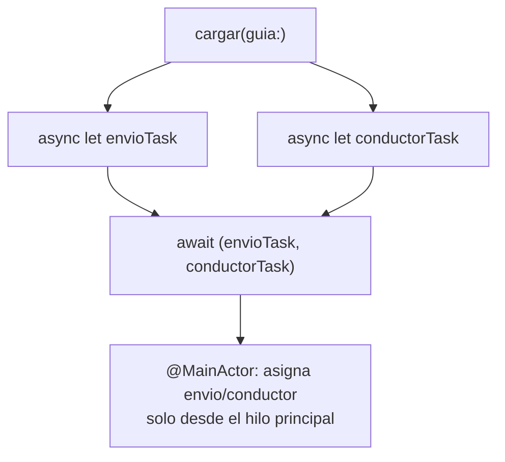
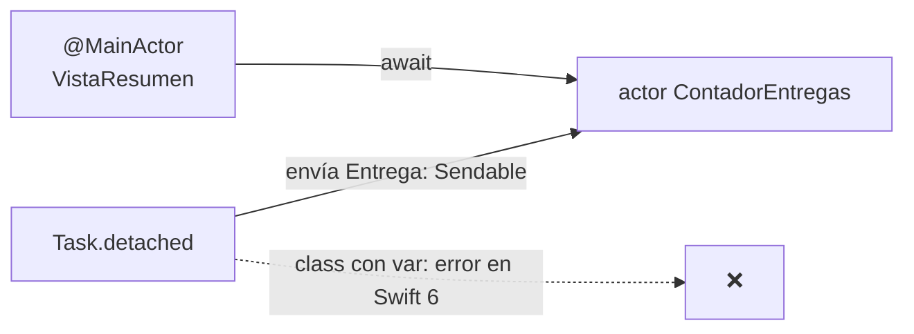
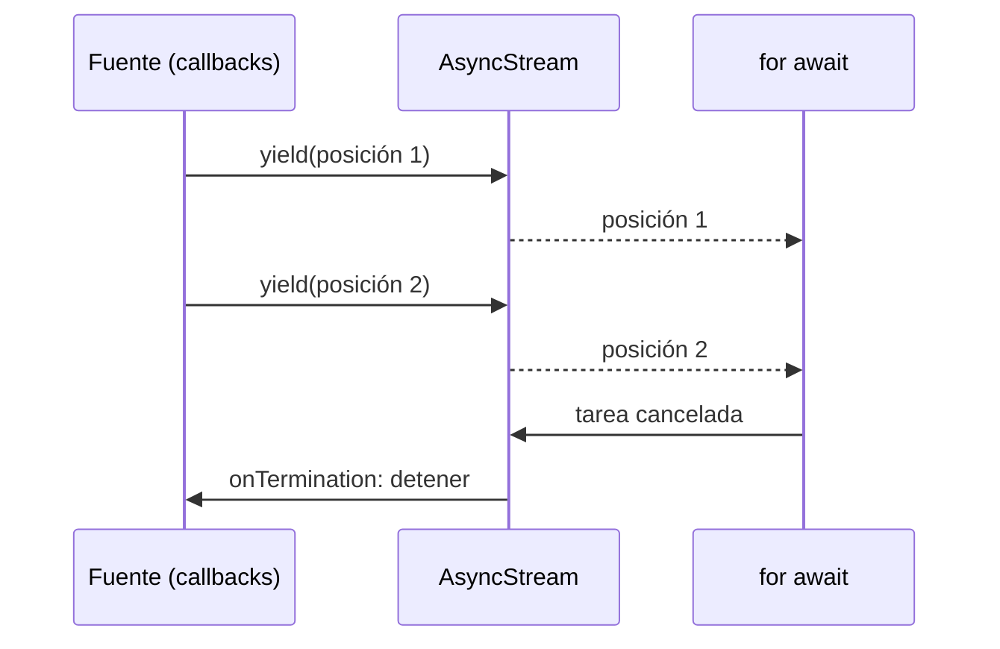

# Módulo 4: Concurrencia moderna: async/await


**Proyecto del módulo:** para cada práctica, parte de una carpeta vacía y crea en Xcode (File ▸ New ▸ Project ▸ App, interfaz SwiftUI) un proyecto llamado `RutaFlowApp`; escribe manualmente todos los archivos indicados y compila, sin usar proyectos ya preparados.

## Aprende construyendo

### Tema 1: async/await y Task

#### Paso 1 · Objetivo y preparación
Al finalizar vas a cargar el detalle de un envío de RutaFlow con `async`/`await` dentro de `.task`, y a confirmar que se cancela sola si el conductor sale de la pantalla antes de que termine. Prerrequisitos: Módulo 3 completo.
#### Paso 2 · Contexto y caso real
Si `DetalleEnvio` tarda un segundo en traer los datos de `ShipmentEvents` y el conductor vuelve atrás antes de que termine, esa carga no debería seguir corriendo ni intentar actualizar una vista que ya no existe.
#### Paso 3 · Teoría, modelo mental y analogía
`async`/`await` deja leer código asíncrono en el orden natural en que ocurre, sin callbacks anidados; `.task` vinculado al ciclo de vida cancela automáticamente si la vista desaparece, como cancelar un pedido si el cliente ya se fue del restaurante.
**Conceptos clave:** código asíncrono que se lee como si fuera síncrono, cancelación automática vinculada al ciclo de vida.

```swift
func obtenerUsuario(id: String) async throws -> Usuario {
    try await Task.sleep(for: .seconds(1)) // simula una llamada de red
    return Usuario(id: id, nombre: "Ana")
}
```

```swift
.task { // se cancela automáticamente si la vista desaparece
    do { usuario = try await obtenerUsuario(id: "1") }
    catch { mostrarError(error) }
}
```

Una función marcada `async` puede suspender su ejecución en un punto de espera (`await`) sin bloquear el hilo que la invoca, y el código que la llama se lee de forma lineal y secuencial exactamente como código síncrono normal, en vez del anidamiento de closures de callback que dominaba el manejo de asincronía en Swift previo a esta característica; este es el mismo principio de "funciones suspendibles que se leen linealmente" compartido con `suspend` en Kotlin (Módulo 2 del track de Kotlin Multiplatform) y con `async`/`await` en JavaScript (Módulo 5 del track de JavaScript), una convergencia entre lenguajes hacia el mismo modelo mental para expresar asincronía de forma legible.

El modificador `.task { }` en una vista SwiftUI lanza una `Task` vinculada automáticamente al ciclo de vida de esa vista específica: si la vista desaparece de la pantalla antes de que la tarea complete, SwiftUI cancela automáticamente esa `Task`, evitando el problema clásico de intentar actualizar el estado de una vista que ya no existe, sin que el desarrollador tenga que gestionar manualmente esa cancelación.

**Analogía:** `async`/`await` es como poder escribir instrucciones de cocina en el orden natural en que ocurren ("hierve el agua, luego agrega la pasta"), en vez de tener que estructurarlas como una cadena de notas de "cuando termines esto, avísame para hacer lo siguiente" (callbacks anidados); `.task` vinculado al ciclo de vida es como cancelar automáticamente un pedido si el cliente que lo hizo ya se retiró del restaurante.

* Proyecto: en el proyecto integrador RutaFlow, carga la lista de envíos con async/await y cancela al salir.

**Límites y decisión de uso:** Async permite suspender, pero no hace que cualquier cálculo deje de bloquear el contexto donde se ejecuta. La cancelación es cooperativa: compruébala y libera recursos en las operaciones largas, sin asumir que cancelar mata trabajo arbitrario.

**¿Por qué es importante?** Porque `.task` cancela automáticamente su trabajo cuando la vista desaparece, evitando que una carga asíncrona intente actualizar una vista que ya no existe, algo que un `Task` suelto dentro de `onAppear` no resuelve.

#### Paso 4 · Demostración guiada desde cero
Parte de otra carpeta vacía y crea en Xcode un proyecto SwiftUI independiente llamado `RutaFlowApp`. Crea `DetalleEnvio.swift` con este contenido y, en el archivo `@main` generado, usa `WindowGroup { DetalleEnvio(guia: "RF-4471") }`:

```swift
import SwiftUI

struct Envio { let guia: String }

func obtenerEnvio(guia: String) async throws -> Envio {
    try await Task.sleep(for: .seconds(1)) // simula la consulta real a ShipmentEvents
    return Envio(guia: guia)
}

struct DetalleEnvio: View {
    let guia: String
    @State private var envio: Envio?
    var body: some View {
        Group {
            if let envio { Text("Envío: \(envio.guia)") } else { ProgressView() }
        }
        .task {
            do { envio = try await obtenerEnvio(guia: guia) }
            catch { print("error: \(error)") }
        }
    }
}
```

**Ejecuta el ejemplo:**

```bash
xcodebuild -scheme RutaFlowApp -destination 'generic/platform=iOS Simulator' build
```
Luego corre con ⌘R en el simulador, o abre el canvas de Preview con ⌥⌘↵.

Resultado esperado: la vista muestra un `ProgressView` mientras espera, y el texto del envío apenas termina `obtenerEnvio` — si el conductor navega hacia atrás antes del segundo de espera, SwiftUI cancela automáticamente esa `Task` sin que `envio` llegue a asignarse sobre una vista que ya no existe.
#### Paso 5 · Práctica guiada
Pista: reemplazá `.task { ... }` por `Task { ... }` suelto (sin vincularlo al ciclo de vida de la vista) dentro de `onAppear` — ese es el fallo deliberado: si el conductor sale de `DetalleEnvio` antes de que termine `obtenerEnvio`, esa tarea sigue corriendo de fondo sin que nadie la cancele, y cuando termine va a intentar asignar `envio` sobre una vista que ya no está en pantalla.
#### Paso 6 · Práctica independiente
Corregí el Paso 5 volviendo a `.task`, y agregá un timeout real con `Task.sleep` + `race` manual (o `withTimeout` si tu versión de Swift lo soporta) para que `obtenerEnvio` falle explícitamente si tarda más de 3 segundos, en vez de esperar indefinidamente.

#### Paso 7 · Cierre
Entregá la carga cancelable del Paso 4, la tarea huérfana del Paso 5, y el timeout agregado del Paso 6; explicá por qué `.task` resuelve un problema que `Task` suelto dentro de `onAppear` no resuelve. Siguiente paso: estudia networking. Errores comunes: bloquear MainActor, ignorar cancellation, compartir clase mutable y capturar self fuerte. Fuentes oficiales: https://developer.apple.com/documentation/swift/concurrency y https://docs.swift.org/swift-book/documentation/the-swift-programming-language/concurrency/.

### Tema 2: Actors para estado mutable seguro

#### Paso 1 · Objetivo y preparación
Al finalizar vas a proteger con un `actor` el contador de "entregas confirmadas hoy" de RutaFlow contra una condición de carrera real entre tareas concurrentes. Prerrequisitos: Tema 1 de este módulo.
#### Paso 2 · Contexto y caso real
Si varias confirmaciones de entrega llegan casi al mismo tiempo (varios conductores confirmando en simultáneo), un contador compartido sin protección podría perder actualizaciones, el mismo problema de `capacidad -= 1` que ya viste en el Módulo 8 de Foundations, ahora en Swift.
#### Paso 3 · Teoría, modelo mental y analogía
Un `actor` es una caja fuerte con un único mecanismo de acceso que atiende solicitudes una a la vez, sin importar cuántas lleguen al mismo tiempo — el compilador garantiza la serialización, no la disciplina de quien llama.

**¿Por qué es importante?** Porque un `actor` serializa el acceso a su estado mutable y previene data races que una `class` normal no previene, sin que el desarrollador escriba ningún lock manual.
**Conceptos clave:** acceso serializado garantizado por el compilador, sin locks manuales.

```swift
actor CacheTareas {
    private var datos: [String: Tarea] = [:]
    func guardar(_ tarea: Tarea) { datos[tarea.id] = tarea }
}
```

Un `actor` es un tipo de referencia (similar a una `class`) cuyo estado interno mutable está protegido automáticamente por el compilador de Swift contra el acceso concurrente no seguro: dos llamadas concurrentes desde distintas partes del código nunca pueden modificar `datos` simultáneamente de forma que corrompan su estado interno, dado que el compilador serializa automáticamente el acceso al aislamiento del actor, rechazando en tiempo de compilación cualquier intento de acceso directo no seguro desde fuera del actor sin pasar por `await`.

Esta garantía elimina una categoría completa de bugs de concurrencia (data races) sin requerir locks, mutexes o primitivas de sincronización manual explícitas por parte del desarrollador, un enfoque que traslada la responsabilidad de correctitud de concurrencia desde la disciplina manual del programador hacia una verificación automática del compilador, de forma análoga (aunque con mecanismos internos distintos) a `Mutex` en Kotlin Coroutines (Módulo 3 del track de Kotlin Multiplatform), donde también se busca proteger estado mutable compartido de accesos concurrentes inseguros.

**Analogía:** un actor es como una caja fuerte con un único mecanismo de acceso que atiende solicitudes una a la vez en estricto orden de llegada, sin importar cuántas personas intenten acceder simultáneamente: el propio mecanismo (no la disciplina de quienes solicitan acceso) garantiza que nunca dos personas manipulen el contenido al mismo tiempo.

* Proyecto: en el proyecto integrador RutaFlow, protege el contador de intentos con un actor.

**Límites y decisión de uso:** Un actor protege acceso a su estado, pero una operación puede intercalarse con otra al suspenderse. Revalida las condiciones después de await; agrupa los cambios que requieren atomicidad sin depender de una suposición anterior a la suspensión.

#### Paso 4 · Demostración guiada desde cero
```swift
actor ContadorEntregas {
    private var confirmadasHoy = 0
    func confirmar() -> Int {
        confirmadasHoy += 1
        return confirmadasHoy
    }
}

let contador = ContadorEntregas()
await withTaskGroup(of: Int.self) { group in
    for _ in 1...100 {
        group.addTask { await contador.confirmar() }
    }
}
print(await contador.confirmar()) // debería ser 101 tras 100 confirmaciones concurrentes + esta
```

**Ejecuta el ejemplo:**

```bash
# una sola vez, fuera de RutaFlowApp:
mkdir Practica && cd Practica
swift package init --type executable
rm Sources/Practica/Practica.swift   # la plantilla de Swift 6.2 trae un @main que choca con main.swift
# pega el código en Sources/Practica/main.swift
swift run
```
Este ejemplo tiene instrucciones al nivel superior (`let`, `await`, `print`): corre como paquete ejecutable, no dentro de la app (ver «Crea el proyecto base RutaFlowApp» en el capítulo 0).

Resultado esperado: tras 100 confirmaciones concurrentes, el contador llega exactamente a 101 — ninguna actualización se pierde, porque el actor serializa el acceso a `confirmadasHoy` sin que escribas ningún lock manual.
#### Paso 5 · Práctica guiada
Pista: reemplazá `actor ContadorEntregas` por `class ContadorEntregas` (sin protección) y repetí las 100 confirmaciones concurrentes — ese es el fallo deliberado: el resultado final rara vez es exactamente 101; algunas actualizaciones se pisan entre sí, la misma condición de carrera del Módulo 8 de Foundations, ahora sin ningún mecanismo que la prevenga.
#### Paso 6 · Práctica independiente
Corregí el Paso 5 volviendo a `actor`, y agregá un método `reiniciar()` al actor para poner el contador en cero al empezar un nuevo día — confirmá que llamarlo desde fuera del actor también exige `await`, igual que `confirmar()`.
#### Paso 7 · Cierre
Entregá el contador correcto con `actor` del Paso 4, la condición de carrera real con `class` del Paso 5, y el método `reiniciar()` del Paso 6; explicá por qué el compilador rechaza acceder a `confirmadasHoy` sin `await` desde fuera del actor. Siguiente paso: estudia networking. Errores comunes: bloquear MainActor, ignorar cancellation, compartir clase mutable y capturar self fuerte. Fuentes oficiales: https://developer.apple.com/documentation/swift/concurrency y https://docs.swift.org/swift-book/documentation/the-swift-programming-language/concurrency/.

### Tema 3: TaskGroup y MainActor

#### Paso 1 · Objetivo y preparación
Al finalizar vas a traer en paralelo los datos de envío y de conductor con `TaskGroup`, y a confirmar que `@MainActor` protege la actualización de la UI. Prerrequisitos: Tema 2 de este módulo.
#### Paso 2 · Contexto y caso real
`DetalleEnvio` necesita tanto los datos del envío como los del conductor asignado — traerlos uno después del otro duplicaría el tiempo de espera sin necesidad, cuando podrían pedirse al mismo tiempo.
#### Paso 3 · Teoría, modelo mental y analogía
`TaskGroup` lanza tareas hijas en paralelo dentro de un ámbito bien definido, garantizando que todas completen o se cancelen antes de retornar; `@MainActor` garantiza, verificado por el compilador, que la UI solo se actualiza desde el hilo principal.
**Conceptos clave:** concurrencia estructurada con recolección de resultados en paralelo, aislamiento garantizado al hilo principal.

```swift
let (usuario, pedidos) = try await withThrowingTaskGroup(of: Any.self) { group in
    group.addTask { try await obtenerUsuario() }
    group.addTask { try await obtenerPedidos() }
    // recolecta ambos resultados en paralelo
}
```

`TaskGroup` (bajo el paraguas de "concurrencia estructurada") lanza múltiples tareas hijas en paralelo dentro de un ámbito bien definido, garantizando que todas ellas completen (o se cancelen) antes de que el bloque del `TaskGroup` retorne, evitando el problema de tareas "huérfanas" que sobreviven más allá del contexto donde fueron creadas, un problema común en modelos de concurrencia no estructurados donde una tarea lanzada podría seguir ejecutándose indefinidamente sin ninguna relación clara con el código que la originó.

```swift
@MainActor @Observable
class EnviosViewModel {
    var envios: [Envio] = [] // garantizado: solo se modifica desde el hilo principal
}
```

Marcar una clase (o una propiedad específica) con `@MainActor` garantiza, verificado por el compilador, que cualquier acceso a su estado ocurre específicamente en el hilo principal, el único hilo desde el cual es seguro actualizar la UI en UIKit/SwiftUI; esto previene un error extremadamente común en apps con concurrencia (actualizar propiedades observadas por la UI desde un hilo en segundo plano, provocando comportamiento indefinido o crashes intermitentes difíciles de reproducir) al detectarlo en tiempo de compilación en vez de descubrirlo como un bug esporádico en producción.

**Analogía:** un `TaskGroup` es como un supervisor que lanza varios equipos a trabajar en paralelo pero se asegura de que todos hayan terminado (o hayan sido detenidos) antes de dar por cerrado el proyecto completo, sin dejar ningún equipo trabajando sin supervisión después de que el proyecto oficialmente concluyó; `@MainActor` es como una regla de seguridad de fábrica que exige que cierta maquinaria delicada (la UI) solo pueda ser operada por un único operador designado, verificada automáticamente antes de permitir que cualquier otro trabajador intente tocarla.

**¿Por qué es importante?** `TaskGroup` garantiza que las tareas hijas lanzadas en paralelo completen dentro de un ámbito bien definido, evitando tareas huérfanas; `@MainActor` previene, verificado por el compilador, actualizaciones inseguras de UI desde hilos en segundo plano.

**Diagrama: TaskGroup en paralelo + @MainActor**



En tu propio proyecto RutaFlow, crea `DetalleEnvioViewModel.swift` con **File ▸ New ▸ File ▸ Swift File**, selecciona el target de la app y escribe allí la clase del Paso 4. Límite de la decisión: `TaskGroup`/`async let` no conviene cuando las tareas dependen secuencialmente una de la otra (necesitás el resultado de la primera para pedir la segunda) — ahí `await` secuencial es correcto; reservá el paralelismo específicamente para tareas verdaderamente independientes como este caso.

---

#### Paso 4 · Demostración guiada desde cero
En el proyecto del Tema 1 (que ya declara `Envio` y `obtenerEnvio`), crea `DetalleEnvioViewModel.swift`:

```swift
import Observation

struct Conductor { let nombre: String }

func obtenerConductor(guia: String) async throws -> Conductor {
    try await Task.sleep(for: .seconds(1)) // simula la consulta del conductor asignado
    return Conductor(nombre: "Ana")
}

@MainActor @Observable
class DetalleEnvioViewModel {
    var envio: Envio?
    var conductor: Conductor?

    func cargar(guia: String) async throws {
        async let envioTask = obtenerEnvio(guia: guia)
        async let conductorTask = obtenerConductor(guia: guia)
        (envio, conductor) = try await (envioTask, conductorTask)
    }
}
```

**Ejecuta el ejemplo:**

```bash
xcodebuild -scheme RutaFlowApp -destination 'generic/platform=iOS Simulator' build
```
Luego corre con ⌘R en el simulador, o abre el canvas de Preview con ⌥⌘↵.

Resultado esperado: `obtenerEnvio` y `obtenerConductor` corren en paralelo (el tiempo total es el de la más lenta de las dos, no la suma de ambas), y `envio`/`conductor` se asignan solo desde el hilo principal, porque toda la clase está marcada `@MainActor`. `@Observable` (Módulo 2) reemplaza aquí a `ObservableObject`/`@Published`: SwiftUI rastrea automáticamente qué propiedades lee cada vista, sin necesitar el wrapper `@Published` en cada una.
#### Paso 5 · Práctica guiada
Pista: quitá `@MainActor` de `DetalleEnvioViewModel` y llamá `cargar(guia:)` desde una `Task.detached` en segundo plano — ese es el fallo deliberado: sin `@MainActor`, nada impide que `envio`/`conductor` se asignen desde un hilo en segundo plano, el mismo error que provoca crashes intermitentes difíciles de reproducir al actualizar una `@Published` fuera del hilo principal.
#### Paso 6 · Práctica independiente
Corregí el Paso 5 restaurando `@MainActor`, y agregá una tercera consulta en paralelo (`obtenerHistorialRuta`) al mismo `TaskGroup`/`async let`, confirmando que las tres corren simultáneamente sin que el código se vuelva secuencial por accidente.

**Proyecto integrador:** en el `RutaFlowApp` creado desde una carpeta vacía para este tema, implementa `PanelRutaViewModel.swift` como `@MainActor` y tres funciones locales que simulen con `Task.sleep` consultas de 400, 700 y 500 ms para envío, conductor e historial. En `PanelRutaView.swift`, inicia las tres con `async let` desde una sola acción y muestra los tres resultados cuando terminen. Mide con `ContinuousClock`: la carga debe acercarse a 700 ms y no a 1600 ms; cancela antes de finalizar y comprueba con `Task.isCancelled` que no se publica un panel parcial.

#### Paso 7 · Cierre
Entregá las dos consultas paralelas del Paso 4, el crash potencial sin `@MainActor` del Paso 5, y la tercera consulta agregada del Paso 6; explicá por qué el compilador puede detectar el error de hilo del Paso 5 en tiempo de compilación, no solo en producción. Siguiente paso: estudia networking. Errores comunes: bloquear MainActor, ignorar cancellation, compartir clase mutable y capturar self fuerte. Fuentes oficiales: https://developer.apple.com/documentation/swift/concurrency y https://docs.swift.org/swift-book/documentation/the-swift-programming-language/concurrency/.
**Implicación práctica:** `TaskGroup`/`async let` ejecutan tareas independientes en paralelo reduciendo el tiempo total de espera, y `@MainActor` detecta en tiempo de compilación una actualización de UI insegura desde un hilo en segundo plano, en vez de dejarla como un crash intermitente en producción.

## Laboratorio práctico

**Objetivo del laboratorio:** construir una función `async` que combina dos llamadas de red en paralelo con `TaskGroup`.

**Requisitos previos:** Módulo 3 completado.

| Paso | Acción | Código | Explicación |
|---|---|---|---|
| 1 | Escribir una función `async` con `Task.sleep` | Ver Tema 1 | Simula una llamada de red |
| 2 | Lanzarla desde una vista con `.task { }` | Ver Tema 1 | Muestra el resultado al llegar |
| 3 | Crear un actor con estado mutable compartido | Ver Tema 2 | Verifica el acceso serializado |
| 4 | Combinar dos llamadas async con `TaskGroup` | Ver Tema 3 | En paralelo, junta ambos resultados |
| 5 | Marcar una clase con `@MainActor` | Ver Tema 3 | Explica la garantía de hilo principal |

**Verificación:** el laboratorio se considera exitoso si las dos llamadas dentro del `TaskGroup` corren efectivamente en paralelo (el tiempo total es aproximadamente el máximo de ambas, no la suma), y si el compilador rechaza cualquier intento de acceso directo no seguro al estado interno del actor desde fuera de él.

**Errores comunes y soluciones**

- **Usar una `class` normal en vez de un `actor` para estado mutable compartido entre tareas concurrentes.** Arriesga data races; usa `actor` para acceso serializado garantizado.
- **Lanzar tareas en secuencia con `await` sucesivos cuando podrían correr en paralelo.** Usa `TaskGroup` para ejecutarlas simultáneamente y reducir el tiempo total.
- **Actualizar el estado de un ViewModel observado por la UI desde un contexto no aislado al hilo principal.** Marca la clase o propiedad con `@MainActor` para prevenir esto en tiempo de compilación.

---

* Proyecto: en el proyecto integrador RutaFlow, descarga varias fotos en paralelo y actualiza la UI en MainActor.

## Laboratorio de transferencia

### Tema 4: Cancelación cooperativa: distinguir una tarea cancelada de un fallo de red

#### Paso 1 · Objetivo y preparación
Al finalizar cancelarás una tarea Swift y comprobarás que no publica un resultado obsoleto. **Prerrequisitos:** funciones async, Task y errores. macOS con Swift 6 o el toolchain de Xcode; comprueba `swift --version`. Ejemplo independiente desde carpeta vacía, sin necesitar una app previa.

#### Paso 2 · Contexto y caso real
Al abandonar el detalle de un envío, el proyecto integrador deja de necesitar su consulta. **¿Por qué es importante?** Si la tarea publica después de salir, puede actualizar una selección que ya cambió o mostrar un error falso.

#### Paso 3 · Teoría, modelo mental y analogía
La cancelación marca una tarea; el trabajo debe observarla. Las operaciones suspendidas cancelables pueden lanzar `CancellationError`. Debe tratarse por separado de un fallo de negocio. **Analogía:** retirar un turno evita que una respuesta se entregue a la persona siguiente; no borra una transacción remota ya confirmada.

Una comprobación explícita antes de publicar impide continuar con una tarea marcada. Este ejercicio usa una tarea sin UI para aislar el mecanismo; SwiftUI añade su propio ciclo de vida con `.task`.

#### Paso 4 · Demostración guiada desde cero
```bash
mkdir cancelacion-swift
cd cancelacion-swift
```
Crea `Cancelacion.swift` completo:
```swift
import Foundation

@main struct Demo {
    static func main() async {
        let consulta = Task { () throws -> String in
            try await Task.sleep(for: .seconds(5))
            try Task.checkCancellation()
            return "ENV-42 recibido"
        }
        // Marcamos la tarea antes de aceptar su resultado.
        consulta.cancel()
        do {
            let resultado = try await consulta.value
            print(resultado)
        } catch is CancellationError {
            print("Consulta cancelada; no se publica resultado")
        } catch {
            print("Fallo real: \(error)")
        }
    }
}
```
```bash
swiftc -parse-as-library Cancelacion.swift -o cancelacion
./cancelacion
```
**Resultado esperado:** `Consulta cancelada; no se publica resultado`. Explica cada bloque: se crea trabajo suspendible, se cancela y se espera su resultado mediante `value`. El catch específico evita anunciar cancelación como error de conexión.

#### Paso 5 · Práctica guiada
**Fallo deliberado:** cambia `try await Task.sleep` por `try? await Task.sleep` y quita `checkCancellation`. Al ignorar la excepción puedes terminar publicando el resultado. **Pista:** no conviertas todo error en un valor opcional sin decidir qué significa. Restaura ambas comprobaciones.

#### Paso 6 · Práctica independiente
Crea una variante sin `cancel` y con una espera de 50 ms: muestra el envío. Añade un error de dominio y demuestra que usa el catch de fallo real. Después describe cómo vincularías una consulta al identificador del detalle visible.

#### Paso 7 · Cierre
El siguiente paso es integrar el mecanismo con URLSession y `.task(id:)`. **Errores comunes:** usar `try?` para esconder cancelación, suponer que cancelar mata el hilo y reutilizar estado de un detalle antiguo. **Límites y decisión de uso:** el programa de consola valida el mecanismo, no la UI, el simulador ni el comportamiento de una red real.

**Fuentes oficiales:** [Swift concurrency](https://docs.swift.org/swift-book/documentation/the-swift-programming-language/concurrency/) y [Task.checkCancellation](https://developer.apple.com/documentation/swift/task/checkcancellation()).

### Tema 5: Swift 6: aislamiento, Sendable y data races detectadas al compilar · Experto · 50 min

**Prerrequisito:** temas «Actors para estado mutable seguro» y «TaskGroup y MainActor» de este módulo.

**Al finalizar podrás:** activar el modo de lenguaje Swift 6, leer los errores de concurrencia que aparecen y corregirlos con tipos `Sendable`, `@MainActor` y actores, en lugar de silenciarlos.

**¿Por qué es importante?** En Swift 6, el compilador rechaza el código que puede tener *data races*: dos tareas tocando el mismo estado mutable a la vez. Es más trabajo al migrar, pero elimina una clase entera de errores que antes aparecían al azar en producción.

#### Paso 1 · Objetivo y preparación

Usa Xcode 26 (Swift 6.2) o posterior. Crea aquí un paquete propio para este tema (el Módulo 12 te enseñará a organizar paquetes; no lo necesitas todavía):

```bash
mkdir -p RutaFlowKit/Sources/Dominio RutaFlowKit/Tests/DominioTests
```

Guarda `RutaFlowKit/Package.swift`. La primera línea, `// swift-tools-version: 6.0`, activa el modo Swift 6:

```swift
// swift-tools-version: 6.0
import PackageDescription

let package = Package(
    name: "RutaFlowKit",
    targets: [
        .target(name: "Dominio"),
        .testTarget(name: "DominioTests", dependencies: ["Dominio"]),
    ]
)
```

#### Paso 2 · Contexto y caso real

RutaFlow tenía un error que aparecía una vez por semana: el contador de entregas del día mostraba un número menor al real. Al activar Swift 6, el compilador señaló la línea exacta: una clase compartida modificada desde dos tareas.

#### Paso 3 · Teoría, modelo mental y analogía

**Conceptos clave:** dominio de aislamiento, `Sendable`, `@MainActor`, actor, cruce de frontera, `nonisolated`, `@unchecked Sendable`, modo de lenguaje Swift 6.

Swift divide el código en **dominios de aislamiento**: cada actor es uno, `@MainActor` es otro y el código no aislado es otro. Cuando un valor **cruza** de un dominio a otro (por ejemplo, entra a una `Task`), debe ser **`Sendable`**: seguro de compartir.

| Tipo | ¿Sendable? |
|---|---|
| `struct` o `enum` con propiedades `Sendable` | sí, automáticamente si no es público |
| `final class` con solo `let` de tipos `Sendable` | sí, si lo declaras |
| `class` con `var` | no: usa un actor o aíslala con `@MainActor` |
| actor | sí |

En modo Swift 6 estas reglas son **errores**. `@unchecked Sendable` apaga la comprobación: úsalo solo si proteges el estado tú mismo (con un lock) y lo documentas.

**Analogía:** los dominios son cuartos con una sola persona adentro; `Sendable` es la etiqueta de los objetos que se pueden pasar por debajo de la puerta sin riesgo. La analogía falla en que el compilador revisa cada objeto que pasa, no solo los que tienen etiqueta.

**Límite de uso:** no conviertas todo en actor: agrega `await` y saltos de hilo. Para estado de interfaz, `@MainActor` es la respuesta más simple. Migra módulo por módulo: el modo de lenguaje se puede activar por target.



#### Paso 4 · Demostración guiada desde cero

Archivo `RutaFlowKit/Sources/Dominio/Contador.swift`:

```swift
// ❌ Antes: clase con estado mutable compartida entre tareas.
// final class ContadorEntregas { var total = 0; func sumar() { total += 1 } }

// ✅ Valor que cruza fronteras: struct inmutable, Sendable.
public struct Entrega: Sendable {
    public let codigo: String
    public init(codigo: String) { self.codigo = codigo }
}

// ✅ Estado mutable compartido: un actor serializa el acceso.
public actor ContadorEntregas {
    private var codigos: Set<String> = []
    public init() {}
    public func registrar(_ entrega: Entrega) { codigos.insert(entrega.codigo) }
    public var total: Int { codigos.count }
}

public func registrarEnParalelo(_ entregas: [Entrega], en contador: ContadorEntregas) async -> Int {
    await withTaskGroup(of: Void.self) { grupo in
        for entrega in entregas {
            grupo.addTask { await contador.registrar(entrega) } // cruza: Entrega es Sendable
        }
    }
    return await contador.total
}
```

Archivo `RutaFlowKit/Tests/DominioTests/ContadorTests.swift`:

```swift
import Testing
@testable import Dominio

@Test func registraMilEntregasSinPerder() async {
    let entregas = (1...1000).map { Entrega(codigo: "ENV-\($0)") }
    #expect(await registrarEnParalelo(entregas, en: ContadorEntregas()) == 1000)
}
```

Ejecútalo:

```bash
cd RutaFlowKit
swift test
```

**Explicación por bloques:** La clase comentada es el código original: `total += 1` desde varias tareas es una data race y en Swift 6 no compila si la clase cruza a una `Task`. `Entrega` es un struct inmutable y por eso es `Sendable`: puede entrar a cada tarea del grupo. `ContadorEntregas` es un actor: cada `registrar` se ejecuta de a uno, y desde fuera se llama con `await`. La prueba registra mil entregas en paralelo y comprueba que no se pierde ninguna.

**Resultado esperado:**

```text
◇ Test run started.
↳ Testing Library Version: …
◇ Test registraMilEntregasSinPerder() started.
✔ Test registraMilEntregasSinPerder() passed after 0.001 seconds.
✔ Test run with 1 test in 0 suites passed after 0.001 seconds.
```

Los tiempos y la versión de la biblioteca cambian en cada máquina.

**Fallo deliberado:** reemplaza el actor por la clase comentada (con `total` y `sumar()`) y llámala dentro de `grupo.addTask`. **Error esperado:** en modo Swift 6, un error en la línea de `grupo.addTask` del tipo `passing closure as a 'sending' parameter risks causing data races between … and concurrent execution of the closure`, con una nota `closure captures 'contador' …`. `addTask` recibe su cierre como parámetro `sending`, así que el compilador comprueba que lo capturado no siga accesible desde la tarea actual; el texto exacto entre «between» y «and» depende de la versión del compilador. **Diagnóstico:** la clase tiene estado mutable y cruzaría a varias tareas. Conviértela en actor; no la marques `@unchecked Sendable` sin un lock.

#### Paso 5 · Práctica guiada

1. **Reproducción:** ejecuta la prueba en modo Swift 6.
2. **Variación:** cambia `swift-tools-version` a 5.10 y compara: el mismo error aparece como advertencia o no aparece.
3. **Diagnóstico:** reproduce el fallo deliberado y lee el mensaje completo.
4. **Integración:** marca una vista que muestra el total con `@MainActor` y lee el total con `await` desde una `.task`.
5. **Diseño:** escribe el orden en que migrarías los targets de RutaFlow a Swift 6.

**Pista:** ante un error de `Sendable`, pregunta primero si el valor necesita ser mutable; muchas veces un struct resuelve.

#### Paso 6 · Práctica independiente

Activa el modo Swift 6 en el target de la app (Build Settings > Swift Language Version) y corrige los tres primeros errores sin usar `@unchecked Sendable` ni `nonisolated(unsafe)`.

#### Paso 7 · Cierre

- [ ] Explicas qué es un dominio de aislamiento.
- [ ] La prueba registra mil entregas sin pérdidas.
- [ ] Reprodujiste el error de captura no Sendable.
- [ ] Sabes cuándo es aceptable `@unchecked Sendable`.

Si fallas dos o más, vuelve al Paso 3. **Errores comunes:** silenciar errores con `@unchecked Sendable`, convertir todo en actor y migrar toda la app de una vez. **Siguiente paso:** el tema siguiente produce valores en el tiempo con `AsyncSequence`, que también cruzan fronteras.

**Transferencia al proyecto integrador «RutaFlow»:** activa el modo Swift 6 en `RutaFlowKit`, convierte el contador de entregas en actor y deja los modelos como structs `Sendable`.

**Fuente oficial:** [Swift.org — Migrating to Swift 6](https://www.swift.org/migration/documentation/migrationguide/) y [Apple — Sendable](https://developer.apple.com/documentation/swift/sendable).

### Tema 6: AsyncSequence y AsyncStream: recibir valores en el tiempo con for await · Avanzado · 40 min

**Prerrequisito:** temas «async/await y Task» y «Cancelación cooperativa» de este módulo.

**Al finalizar podrás:** convertir una fuente de eventos con callbacks en un `AsyncStream`, consumirla con `for await` y detenerla al cancelar la tarea.

**¿Por qué es importante?** Las posiciones GPS, las notificaciones y los mensajes de un socket llegan muchas veces en el tiempo. `AsyncSequence` permite leerlos en un bucle simple, con cancelación y sin anidar callbacks.

#### Paso 1 · Objetivo y preparación

Usa Xcode 26 (Swift 6.2) o posterior. Trabaja en un paquete ejecutable para correrlo en la terminal: `mkdir Posiciones && cd Posiciones && swift package init --type executable`, y borra `Sources/Posiciones/Posiciones.swift` antes de crear `main.swift`.

#### Paso 2 · Contexto y caso real

La app de RutaFlow recibía posiciones con un delegado y las guardaba en una variable global. Al salir de la pantalla nadie detenía el flujo y seguía consumiendo batería. Con `AsyncStream` y la tarea de la vista, el flujo se detiene solo.

#### Paso 3 · Teoría, modelo mental y analogía

**Conceptos clave:** `AsyncSequence`, `AsyncStream`, continuación, `yield`, `finish`, `onTermination`, `for await`, cancelación.

Una **`AsyncSequence`** es como una secuencia normal, pero cada siguiente elemento se espera con `await`. Se recorre con `for await valor in secuencia`.

**`AsyncStream`** es la forma de crear una a partir de código con callbacks:

- en el cierre de creación recibes una **continuación**;
- `continuation.yield(valor)` entrega un elemento;
- `continuation.finish()` termina la secuencia;
- `continuation.onTermination` corre cuando termina o cuando **se cancela** quien la lee: ahí detienes la fuente.

Si la tarea que hace el `for await` se cancela (por ejemplo, al salir de la vista con `.task`), el bucle termina y se llama `onTermination`.

**Analogía:** un `AsyncStream` es una cinta transportadora: alguien pone cajas (`yield`) y tú las tomas de a una con `for await`. Cuando te vas (cancelas), la cinta se detiene (`onTermination`). La analogía falla en que, si no tomas las cajas, se acumulan: la política de búfer decide cuántas guardar.

**Límite de uso:** por defecto el búfer no tiene límite: si produces más rápido de lo que consumes, crece la memoria. Usa `bufferingPolicy: .bufferingNewest(n)` para datos donde solo importa lo último, como posiciones.



#### Paso 4 · Demostración guiada desde cero

Archivo `Posiciones/Sources/Posiciones/main.swift`:

```swift
import Foundation

// Fuente con callbacks, como un delegado de ubicación.
final class SimuladorGPS: @unchecked Sendable { // todo ocurre en la cola serial `cola`
    private let cola = DispatchQueue(label: "gps")
    private var temporizador: DispatchSourceTimer?
    private var lat = 4.60
    var alRecibir: (@Sendable (Double) -> Void)?
    func iniciar() {
        let t = DispatchSource.makeTimerSource(queue: cola)
        t.schedule(deadline: .now() + 0.1, repeating: 0.1)
        t.setEventHandler { [self] in
            lat += 0.01
            alRecibir?(lat)
        }
        temporizador = t
        t.resume()
    }
    func detener() { cola.sync { temporizador?.cancel() }; print("GPS detenido") }
}

func posiciones() -> AsyncStream<Double> {
    AsyncStream(bufferingPolicy: .bufferingNewest(1)) { continuacion in
        let gps = SimuladorGPS()
        gps.alRecibir = { continuacion.yield($0) }
        continuacion.onTermination = { _ in gps.detener() } // al cancelar o terminar
        gps.iniciar()
    }
}

let tarea = Task { @MainActor in
    for await lat in posiciones() {
        print(String(format: "posición %.2f", lat))
    }
    print("bucle terminado")
}

try await Task.sleep(nanoseconds: 350_000_000) // (for:) exigiría macOS 13 en Package.swift
tarea.cancel() // como salir de la pantalla
try await Task.sleep(nanoseconds: 100_000_000)
```

Ejecútalo:

```bash
cd Posiciones
swift run
```

**Explicación por bloques:** `SimuladorGPS` imita un delegado: llama un callback cada 100 ms desde su propia cola serial, sin depender del run loop. `posiciones()` lo envuelve en un `AsyncStream` que guarda solo la posición más nueva. Cada callback hace `yield`, y `onTermination` detiene el GPS. La tarea recorre las posiciones con `for await`. A los 350 ms se cancela: el bucle termina, el stream llama `onTermination` y el GPS se detiene. El número exacto de posiciones puede variar en uno según el tiempo.

**Resultado esperado:**

```text
posición 4.61
posición 4.62
posición 4.63
GPS detenido
bucle terminado
```

**Fallo deliberado:** quita `continuacion.onTermination = { _ in gps.detener() }`. **Error esperado:** después de cancelar no aparece «GPS detenido»: la fuente sigue produciendo aunque nadie lee. **Diagnóstico:** cancelar el consumidor no detiene la fuente por sí solo. `onTermination` es el lugar para liberarla.

#### Paso 5 · Práctica guiada

1. **Reproducción:** ejecuta el programa y cuenta las posiciones recibidas.
2. **Variación:** cambia la espera antes de cancelar a 1 segundo y vuelve a contar.
3. **Diagnóstico:** reproduce el fallo deliberado sin `onTermination`.
4. **Integración:** usa la secuencia en una vista con `.task { for await ... }` y comprueba que se detiene al cerrar la vista.
5. **Diseño:** reemplaza el simulador por `CLLocationUpdate.liveUpdates()` (iOS 17), que ya es una `AsyncSequence`.

**Pista:** todo `AsyncStream` que envuelve una fuente necesita su `onTermination`.

#### Paso 6 · Práctica independiente

Crea un `AsyncStream<String>` que envuelva `NotificationCenter` para el evento de app en segundo plano y muestra un aviso cada vez que ocurra, deteniendo la observación al cancelar.

#### Paso 7 · Cierre

- [ ] Explicas `yield`, `finish` y `onTermination`.
- [ ] El programa se detiene al cancelar la tarea.
- [ ] Reprodujiste la fuente que sigue viva sin `onTermination`.
- [ ] Eliges una política de búfer con criterio.

Si fallas dos o más, vuelve al Paso 3. **Errores comunes:** no detener la fuente al cancelar, usar búfer ilimitado para datos frecuentes y consumir la secuencia fuera de una tarea cancelable. **Siguiente paso:** el módulo 13 usa `CLLocationUpdate.liveUpdates()`, una `AsyncSequence` de ubicaciones reales.

**Transferencia al proyecto integrador «RutaFlow»:** en la app del conductor de RutaFlow, expone las posiciones como `AsyncStream` con `bufferingNewest(1)` y consúmelas con `.task` en la pantalla de ruta.

**Fuente oficial:** [Apple — AsyncStream](https://developer.apple.com/documentation/swift/asyncstream) y [Apple — AsyncSequence](https://developer.apple.com/documentation/swift/asyncsequence).

