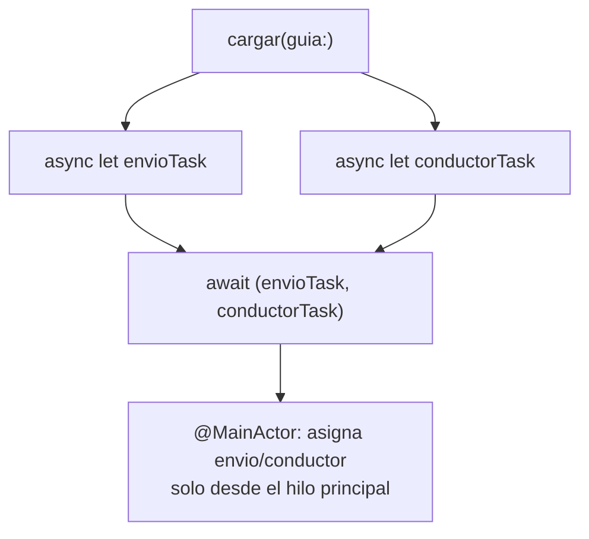
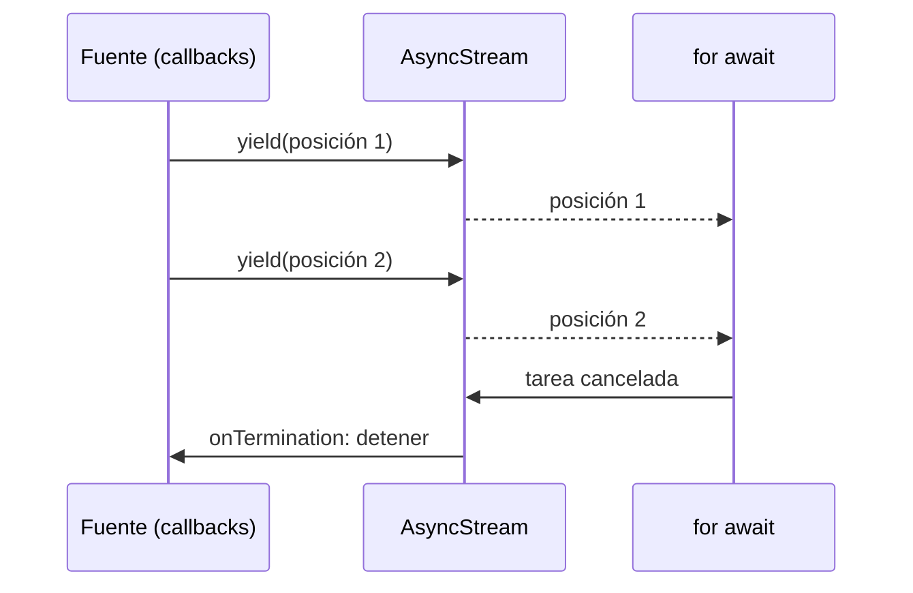
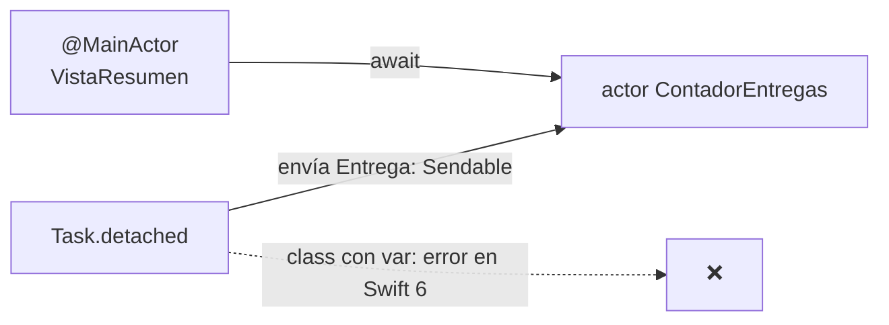

# Módulo 4: Concurrencia moderna: async/await


**Proyecto del módulo:** para cada práctica, parte de una carpeta vacía y crea en Xcode (File ▸ New ▸ Project ▸ App, interfaz SwiftUI) un proyecto llamado `RutaFlowApp`; escribe manualmente todos los archivos indicados y compila, sin usar proyectos ya preparados.

## Aprende construyendo


### Tema 1: async/await y Task · Intermedio · 40 min

<details open>
<summary><strong>Capa 1 — Lectura</strong></summary>

#### ► DE QUÉ TRATA
Al finalizar vas a cargar el detalle de un envío de RutaFlow con async/await dentro de .task, y a confirmar que se cancela sola si el conductor sale de la pantalla antes de que termine. Prerrequisitos: Módulo 3 completo.

</details>

<details>
<summary><strong>Capa 2 — Construcción</strong></summary>

#### Código y verificación
```swift
func obtenerUsuario(id: String) async throws -> Usuario {
    try await Task.sleep(for: .seconds(1)) // simula una llamada de red
    return Usuario(id: id, nombre: "Ana")
}
```

```swift
.task { // se cancela automáticamente si la vista desaparece
    do { usuario = try await obtenerUsuario(id: "1") }
    catch { mostrarError(error) }
}
```

```swift
func obtenerEnvio(guia: String) async throws -> Envio {
    try await Task.sleep(for: .seconds(1)) // simula la consulta real a ShipmentEvents
    return Envio(guia: guia)
}

struct DetalleEnvio: View {
    let guia: String
    @State private var envio: Envio?
    var body: some View {
        Group {
            if let envio { Text("Envío: \(envio.guia)") } else { ProgressView() }
        }
        .task {
            do { envio = try await obtenerEnvio(guia: guia) }
            catch { print("error: \(error)") }
        }
    }
}
```

```bash
xcodebuild -scheme RutaFlowApp -destination 'generic/platform=iOS Simulator' build
```

</details>

### Tema 2: Actors para estado mutable seguro · Avanzado · 40 min

<details open>
<summary><strong>Capa 1 — Lectura</strong></summary>

#### ► DE QUÉ TRATA
Al finalizar vas a proteger con un actor el contador de "entregas confirmadas hoy" de RutaFlow contra una condición de carrera real entre tareas concurrentes. Prerrequisitos: Tema 1 de este módulo.

</details>

<details>
<summary><strong>Capa 2 — Construcción</strong></summary>

#### Código y verificación
```swift
actor CacheTareas {
    private var datos: [String: Tarea] = [:]
    func guardar(_ tarea: Tarea) { datos[tarea.id] = tarea }
}
```

```swift
actor ContadorEntregas {
    private var confirmadasHoy = 0
    func confirmar() -> Int {
        confirmadasHoy += 1
        return confirmadasHoy
    }
}

let contador = ContadorEntregas()
await withTaskGroup(of: Int.self) { group in
    for _ in 1...100 {
        group.addTask { await contador.confirmar() }
    }
}
print(await contador.confirmar()) // debería ser 101 tras 100 confirmaciones concurrentes + esta
```

```bash
# una sola vez, fuera de RutaFlowApp:
mkdir Practica && cd Practica
swift package init --type executable
rm Sources/Practica/Practica.swift   # la plantilla de Swift 6.2 trae un @main que choca con main.swift
# pega el código en Sources/Practica/main.swift
swift run
```

</details>

### Tema 3: TaskGroup y MainActor · Avanzado · 30 min

<details open>
<summary><strong>Capa 1 — Lectura</strong></summary>

#### ► DE QUÉ TRATA
Al finalizar vas a traer en paralelo los datos de envío y de conductor con TaskGroup, y a confirmar que @MainActor protege la actualización de la UI. Prerrequisitos: Tema 2 de este módulo.

#### ► LA ANALOGÍA
`TaskGroup` lanza tareas hijas en paralelo dentro de un ámbito bien definido, garantizando que todas completen o se cancelen antes de retornar; `@MainActor` garantiza, verificado por el compilador, que la UI solo se actualiza desde el hilo principal.
**Conceptos clave:** concurrencia estructurada con recolección de resultados en paralelo, aislamiento garantizado al hilo principal.

```swift
let (usuario, pedidos) = try await withThrowingTaskGroup(of: Any.self) { group in
    group.addTask { try await obtenerUsuario() }
    group.addTask { try await obtenerPedidos() }
    // recolecta ambos resultados en paralelo
}
```

`TaskGroup` (bajo el paraguas de "concurrencia estructurada") lanza múltiples tareas hijas en paralelo dentro de un ámbito bien definido, garantizando que todas ellas completen (o se cancelen) antes de que el bloque del `TaskGroup` retorne, evitando el problema de tareas "huérfanas" que sobreviven más allá del contexto donde fueron creadas, un problema común en modelos de concurrencia no estructurados donde una tarea lanzada podría seguir ejecutándose indefinidamente sin ninguna relación clara con el código que la originó.

```swift
@MainActor @Observable
class EnviosViewModel {
    var envios: [Envio] = [] // garantizado: solo se modifica desde el hilo principal
}
```

Marcar una clase (o una propiedad específica) con `@MainActor` garantiza, verificado por el compilador, que cualquier acceso a su estado ocurre específicamente en el hilo principal, el único hilo desde el cual es seguro actualizar la UI en UIKit/SwiftUI; esto previene un error extremadamente común en apps con concurrencia (actualizar propiedades observadas por la UI desde un hilo en segundo plano, provocando comportamiento indefinido o crashes intermitentes difíciles de reproducir) al detectarlo en tiempo de compilación en vez de descubrirlo como un bug esporádico en producción.

**Analogía:** un `TaskGroup` es como un supervisor que lanza varios equipos a trabajar en paralelo pero se asegura de que todos hayan terminado (o hayan sido detenidos) antes de dar por cerrado el proyecto completo, sin dejar ningún equipo trabajando sin supervisión después de que el proyecto oficialmente concluyó; `@MainActor` es como una regla de seguridad de fábrica que exige que cierta maquinaria delicada (la UI) solo pueda ser operada por un único operador designado, verificada automáticamente antes de permitir que cualquier otro trabajador intente tocarla.

**¿Por qué es importante?** `TaskGroup` garantiza que las tareas hijas lanzadas en paralelo completen dentro de un ámbito bien definido, evitando tareas huérfanas; `@MainActor` previene, verificado por el compilador, actualizaciones inseguras de UI desde hilos en segundo plano.

**Diagrama: TaskGroup en paralelo + @MainActor**



En tu propio proyecto RutaFlow, crea `DetalleEnvioViewModel.swift` con **File ▸ New ▸ File ▸ Swift File**, selecciona el target de la app y escribe allí la clase del Paso 4. Límite de la decisión: `TaskGroup`/`async let` no conviene cuando las tareas dependen secuencialmente una de la otra (necesitás el resultado de la primera para pedir la segunda) — ahí `await` secuencial es correcto; reservá el paralelismo específicamente para tareas verdaderamente independientes como este caso.

---

#### ► CÓMO FUNCIONA


</details>

<details>
<summary><strong>Capa 2 — Construcción</strong></summary>

#### Código y verificación
```swift
let (usuario, pedidos) = try await withThrowingTaskGroup(of: Any.self) { group in
    group.addTask { try await obtenerUsuario() }
    group.addTask { try await obtenerPedidos() }
    // recolecta ambos resultados en paralelo
}
```

```swift
@MainActor @Observable
class EnviosViewModel {
    var envios: [Envio] = [] // garantizado: solo se modifica desde el hilo principal
}
```


```swift
@MainActor @Observable
class DetalleEnvioViewModel {
    var envio: Envio?
    var conductor: Conductor?

    func cargar(guia: String) async throws {
        async let envioTask = obtenerEnvio(guia: guia)
        async let conductorTask = obtenerConductor(guia: guia)
        (envio, conductor) = try await (envioTask, conductorTask)
    }
}
```

```bash
xcodebuild -scheme RutaFlowApp -destination 'generic/platform=iOS Simulator' build
```

</details>

### Tema 4: Cancelación cooperativa: distinguir una tarea cancelada de un fallo de red · Avanzado · 30 min

<details open>
<summary><strong>Capa 1 — Lectura</strong></summary>

#### ► DE QUÉ TRATA
Al finalizar cancelarás una tarea Swift y comprobarás que no publica un resultado obsoleto. Prerrequisitos: funciones async, Task y errores. macOS con Swift 6 o el toolchain de Xcode; comprueba swift --version. Ejemplo independiente desde carpeta vacía, sin necesitar una app prev…

</details>

<details>
<summary><strong>Capa 2 — Construcción</strong></summary>

#### Código y verificación
```bash
mkdir cancelacion-swift
cd cancelacion-swift
```

```swift
import Foundation

@main struct Demo {
    static func main() async {
        let consulta = Task { () throws -> String in
            try await Task.sleep(for: .seconds(5))
            try Task.checkCancellation()
            return "ENV-42 recibido"
        }
        // Marcamos la tarea antes de aceptar su resultado.
        consulta.cancel()
        do {
            let resultado = try await consulta.value
            print(resultado)
        } catch is CancellationError {
            print("Consulta cancelada; no se publica resultado")
        } catch {
            print("Fallo real: \(error)")
        }
    }
}
```

```bash
swiftc -parse-as-library Cancelacion.swift -o cancelacion
./cancelacion
```

</details>

### Tema 5: AsyncSequence y AsyncStream: recibir valores en el tiempo con for await · Avanzado · 40 min

<details open>
<summary><strong>Capa 1 — Lectura</strong></summary>

#### ► DE QUÉ TRATA
Usa Xcode 26 (Swift 6.2) o posterior. Trabaja en un paquete ejecutable para correrlo en la terminal: mkdir Posiciones && cd Posiciones && swift package init --type executable, y borra Sources/Posiciones/Posiciones.swift antes de crear main.swift.

#### ► CÓMO FUNCIONA


</details>

<details>
<summary><strong>Capa 2 — Construcción</strong></summary>

#### Código y verificación

```swift
import Foundation

// Fuente con callbacks, como un delegado de ubicación.
final class SimuladorGPS: @unchecked Sendable { // todo ocurre en la cola serial `cola`
    private let cola = DispatchQueue(label: "gps")
    private var temporizador: DispatchSourceTimer?
    private var lat = 4.60
    var alRecibir: (@Sendable (Double) -> Void)?
    func iniciar() {
        let t = DispatchSource.makeTimerSource(queue: cola)
        t.schedule(deadline: .now() + 0.1, repeating: 0.1)
        t.setEventHandler { [self] in
            lat += 0.01
            alRecibir?(lat)
        }
        temporizador = t
        t.resume()
    }
    func detener() { cola.sync { temporizador?.cancel() }; print("GPS detenido") }
}

func posiciones() -> AsyncStream<Double> {
    AsyncStream(bufferingPolicy: .bufferingNewest(1)) { continuacion in
        let gps = SimuladorGPS()
        gps.alRecibir = { continuacion.yield($0) }
        continuacion.onTermination = { _ in gps.detener() } // al cancelar o terminar
        gps.iniciar()
    }
}

let tarea = Task { @MainActor in
    for await lat in posiciones() {
        print(String(format: "posición %.2f", lat))
    }
    print("bucle terminado")
}

try await Task.sleep(for: .milliseconds(350))
tarea.cancel() // como salir de la pantalla
try await Task.sleep(for: .milliseconds(100))
```

```bash
cd Posiciones
swift run
```

```text
posición 4.61
posición 4.62
posición 4.63
GPS detenido
bucle terminado
```

</details>

### Tema 6: Swift 6: aislamiento, Sendable y data races detectadas al compilar · Avanzado · 30 min

<details open>
<summary><strong>Capa 1 — Lectura</strong></summary>

#### ► DE QUÉ TRATA
Usa Xcode 26 (Swift 6.2) o posterior. Crea aquí un paquete propio para este tema (el Módulo 12 te enseñará a organizar paquetes; no lo necesitas todavía):

#### ► CÓMO FUNCIONA


</details>

<details>
<summary><strong>Capa 2 — Construcción</strong></summary>

#### Código y verificación
```bash
mkdir -p RutaFlowKit/Sources/Dominio RutaFlowKit/Tests/DominioTests
```

```swift
// swift-tools-version: 6.0
import PackageDescription

let package = Package(
    name: "RutaFlowKit",
    targets: [
        .target(name: "Dominio"),
        .testTarget(name: "DominioTests", dependencies: ["Dominio"]),
    ]
)
```


```swift
// ❌ Antes: clase con estado mutable compartida entre tareas.
// final class ContadorEntregas { var total = 0; func sumar() { total += 1 } }

// ✅ Valor que cruza fronteras: struct inmutable, Sendable.
public struct Entrega: Sendable {
    public let codigo: String
    public init(codigo: String) { self.codigo = codigo }
}

// ✅ Estado mutable compartido: un actor serializa el acceso.
public actor ContadorEntregas {
    private var codigos: Set<String> = []
    public init() {}
    public func registrar(_ entrega: Entrega) { codigos.insert(entrega.codigo) }
    public var total: Int { codigos.count }
}

public func registrarEnParalelo(_ entregas: [Entrega], en contador: ContadorEntregas) async -> Int {
    await withTaskGroup(of: Void.self) { grupo in
        for entrega in entregas {
            grupo.addTask { await contador.registrar(entrega) } // cruza: Entrega es Sendable
        }
    }
    return await contador.total
}
```

```swift
import Testing
@testable import Dominio

@Test func registraMilEntregasSinPerder() async {
    let entregas = (1...1000).map { Entrega(codigo: "ENV-\($0)") }
    #expect(await registrarEnParalelo(entregas, en: ContadorEntregas()) == 1000)
}
```

```bash
cd RutaFlowKit
swift test
```

</details>
