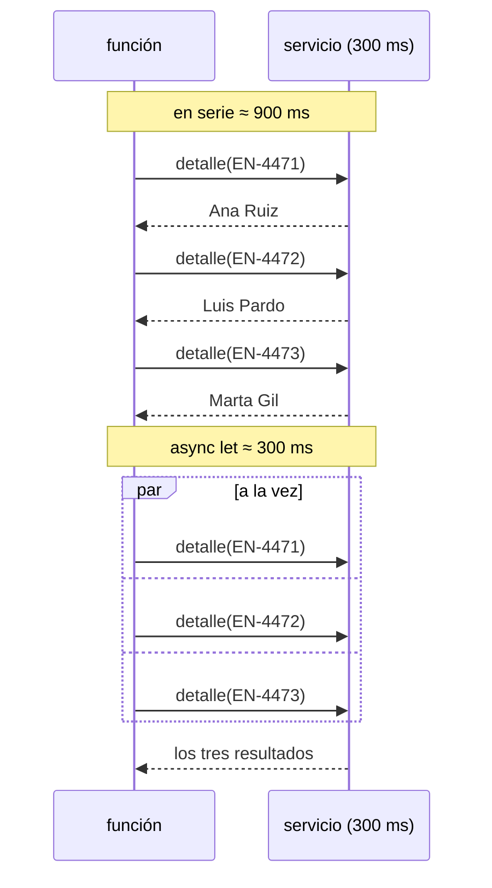
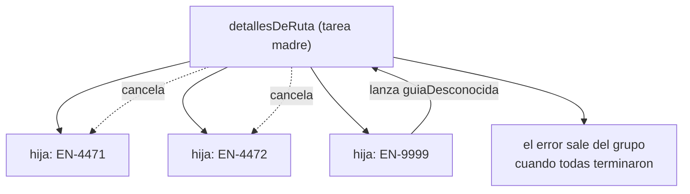
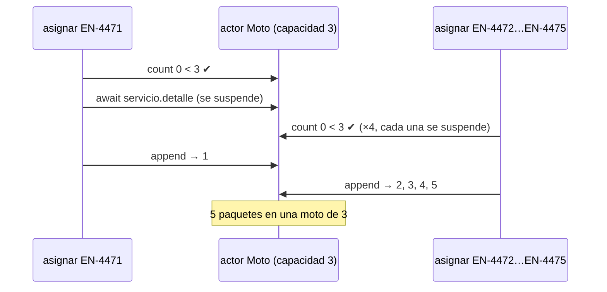
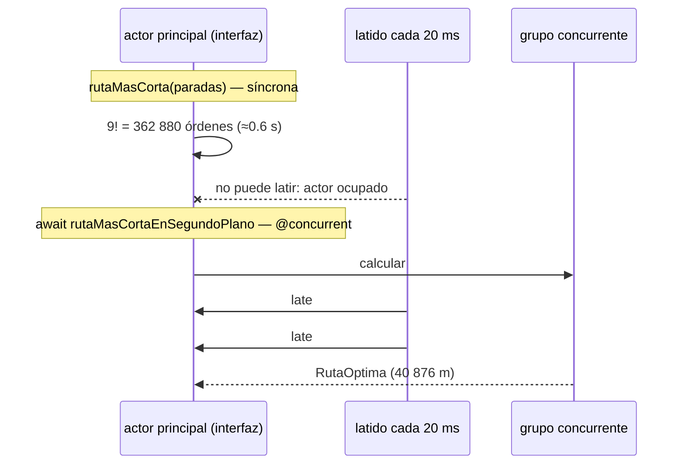
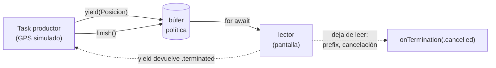

# Módulo 4: Concurrencia moderna: async/await, tareas, actores, `Sendable` y la concurrencia estricta de Swift 6

**Entorno comprobado para esta edición (2026-11-25):** Swift 6.4.3 en Linux x86_64 (Ubuntu 24.04, 2 núcleos), con
Swift Testing 6.4.3 y ThreadSanitizer, para todo el lenguaje: `async`/`await`, tareas, grupos, cancelación, actores,
`Sendable`, `@MainActor`, `@concurrent` y `AsyncStream`. Todo eso es Swift puro y se ejecutó en Linux, en
`/home/estudiante/labs/ios/ios4` (tu `~/labs/ios/ios4`). La parte de Apple (una app SwiftUI que mide si la interfaz
se congela, sus pruebas y sus pantallazos) se compiló y se ejecutó en una Mac con Xcode 27.2 (27B52), Swift 6.4.2 y el
simulador del iPhone 17 con iOS 27.2. En la Mac hubo dos rondas: la primera encontró tres problemas reales (un paquete sin `platforms`, una carrera
con `onTermination` y pruebas en paralelo sobre el actor principal), que se corrigieron y se cuentan en los Temas 4
y 5. Límites honestos: los tiempos y las carreras de datos dependen de la máquina y
cambian en cada ejecución; las salidas muestran los valores de esa ejecución, y el texto dice qué parte es estable y
cuál no.

Una app de reparto espera todo el tiempo: al servidor, al GPS, al disco. Si espera mal, la interfaz se congela o los
datos se corrompen cuando dos cosas pasan a la vez. Swift resuelve esto en el lenguaje: `async`/`await` para esperar
sin bloquear, tareas estructuradas para hacer varias cosas a la vez y cancelarlas juntas, actores para el estado
compartido, y un compilador (Swift 6) que rechaza las carreras de datos antes de que el programa corra. Este módulo
recorre esas piezas con la ruta del día y termina en la pregunta que más importa en iOS: ¿qué corre en el actor
principal, donde vive la interfaz?

**Al terminar este módulo podrás:**
- escribir funciones `async`, llamarlas en serie o en paralelo con `async let` y crear tareas desde código síncrono;
- usar grupos de tareas, cancelar de forma cooperativa y poner un tiempo límite, sin mostrar la cancelación como un
  error;
- proteger estado compartido con un actor, encontrar una carrera de datos con ThreadSanitizer y evitar el error de
  reentrancia;
- leer y corregir los errores de concurrencia estricta de Swift 6 (`Sendable`, `sending`, `@MainActor`), y sacar el
  trabajo pesado del actor principal con `@concurrent`;
- recibir valores en el tiempo con `AsyncStream` y `for await`, con su política de búfer y su terminación.

**Esquema del módulo:** Tema 1 (`async`/`await` y `Task`) → Tema 2 (concurrencia estructurada: grupos, cancelación y
tiempo límite) → Tema 3 (actores, carreras de datos y reentrancia) → Tema 4 (`Sendable`, `@MainActor` y la
concurrencia estricta de Swift 6, con la app en el simulador) → Tema 5 (`AsyncSequence` y `AsyncStream`) → Proyecto
41.

**Qué necesitas saber antes:** del Módulo 0, **`struct` frente a `class`** (Tema 2), **los closures que escapan y los
ciclos de retención** (Tema 4) y **`nonisolated(unsafe)`**, que apareció en el Tema 5 sin explicarse; del Módulo 1,
**`List`, `Section` y `NavigationStack`**; del Módulo 2, **`@State` y los modelos `@Observable`**, que se usan en la app
del Tema 4.

**Qué no se repite:** la red de verdad con `URLSession` es el Módulo 5: aquí el servicio simula la espera con
`Task.sleep`, para que los tiempos sean claros y no dependan de internet. Combine, la otra forma de recibir valores en
el tiempo, es el Módulo 7, que lo compara con el Tema 5 de este.

**Prepara el proyecto:**

```text
$ mkdir -p ~/labs/ios/ios4/nucleo && cd ~/labs/ios/ios4/nucleo
$ swift package init --type library --name Nucleo
```

Usa el `Package.swift` del Módulo 0 (biblioteca `Nucleo`, ejecutable `Demos` y pruebas) con una línea más,
`platforms: [.macOS(.v15)]`: sin ella el paquete no compila en la Mac (el Tema 4 muestra el error). Con
`swift-tools-version: 6.0`, el paquete compila en **modo de lenguaje Swift 6**: la concurrencia estricta está
activada, y es la que produce los errores de este módulo.

```swift
// swift-tools-version: 6.0
import PackageDescription

let package = Package(
    name: "Nucleo",
    platforms: [.macOS(.v15)],  // en la Mac: Duration pide macOS 13 y Mutex, macOS 15 (en Linux no cuenta)
    targets: [
        .target(name: "Nucleo"),
        .executableTarget(name: "Demos", dependencies: ["Nucleo"]),
        .testTarget(name: "NucleoTests", dependencies: ["Nucleo"]),
    ]
)
```

Para la app del Tema 4, en la Mac, se usa un proyecto de Xcode con iOS 18 como mínimo y `SWIFT_VERSION = 6.0`, con el
código en `app/App` y las pruebas en `app/Pruebas`; el núcleo se copia dentro de la app antes de compilar (lo hace
`mac.sh`).

La estructura final:

```text
ios4/
├── nucleo/
│   ├── Sources/Nucleo/        Servicio, Estructurada, Bodega, Calculo, Posiciones
│   ├── Sources/Demos/         main.swift y una demostración por tema
│   └── Tests/NucleoTests/     12 pruebas (tiempos, grupos, actores, actor principal, flujos)
├── ejemplos_que_fallan/       errores de concurrencia, a propósito (se compilan en Linux)
├── ejemplos_que_fallan_mac/   un error de aislamiento con SwiftUI (se compila contra el SDK de iOS)
├── app/                       la app SwiftUI: App/, Pruebas/, Concurrencia.xcodeproj
└── mac.sh                     lo que se ejecuta en la Mac
```


## Aprende construyendo


### Tema 1: `async`/`await` y `Task`: esperar sin bloquear · Intermedio · 40 min

<details open>
<summary><strong>Capa 1 — Lectura</strong></summary>

#### Objetivos
Al terminar este tema podrás:
- declarar y llamar funciones `async throws`, y leer los dos errores que aparecen al olvidar `await`;
- ejecutar consultas en paralelo con `async let` y medir la diferencia con un reloj;
- crear una `Task` desde código síncrono y esperar su resultado con `.value`;
- explicar qué significa «suspenderse» y por qué no bloquea el hilo.

**Conceptos clave:** función `async`, `await` y punto de suspensión, `async let`, `Task`, `ContinuousClock`

#### El problema
La pantalla de la ruta pide al servidor el detalle de cada guía: destinatario y barrio. Cada consulta tarda unos 300
ms. Con tres guías, el código las pide una detrás de otra y el repartidor espera casi un segundo. Con veinte, seis
segundos. Y como el botón «Actualizar» es una función síncrona, nadie sabe cómo llamar desde ahí a una función que
espera.

Este tema usa **los errores con `throws`** (Módulo 0, Tema 1) y **los `struct` como datos** (Módulo 0, Tema 2).

#### Glosario del tema

**función `async`**
- **Definición técnica:** función que puede suspenderse (ceder el hilo mientras espera) y reanudarse después; solo se puede llamar desde otro contexto asíncrono y con `await`.
- **En palabras sencillas:** una tarea que dice «avísame cuando llegue el paquete» en lugar de quedarse parada en la puerta.
- **Dónde se rompe la comparación:** al reanudarse puede seguir en otro hilo; lo que no cambia es la función ni sus variables locales.
- **Ejemplo:** `func detalle(_ guia: String) async throws -> Detalle`.
- **Error típico:** marcar `async` una función que no espera nada, y obligar a todos los que la llaman a usar `await`.

**`await` y punto de suspensión**
- **Definición técnica:** `await` marca cada lugar donde la función puede suspenderse; mientras está suspendida, el hilo queda libre para otro trabajo.
- **En palabras sencillas:** una señal de «aquí puedo hacer una pausa».
- **Dónde se rompe la comparación:** no garantiza que haya pausa: si el resultado ya está listo, sigue de largo.
- **Ejemplo:** `try await servicio.detalle(guia)`.
- **Error típico:** creer que entre dos `await` el resto del programa está detenido; en un actor, otras llamadas pueden entrar ahí (Tema 3).

**`async let`**
- **Definición técnica:** declara una tarea hija que empieza de inmediato y en paralelo; el valor se espera con `await` al usarlo, y si no se espera, se cancela al salir del alcance.
- **En palabras sencillas:** encargar tres paquetes a la vez y recogerlos todos al final.
- **Dónde se rompe la comparación:** el número de tareas lo fija el código (una por `async let`); para una cantidad variable hace falta un grupo (Tema 2).
- **Ejemplo:** `async let primero = servicio.detalle("EN-4471")`.
- **Error típico:** escribir `async let` y esperarlo en la línea siguiente, antes de declarar los demás: vuelve a ser en serie.

**`Task`**
- **Definición técnica:** unidad de trabajo asíncrono que empieza al crearse; `Task { … }` hereda la prioridad y el aislamiento del lugar donde se crea, y su resultado se obtiene con `await tarea.value` (o `tarea.result`).
- **En palabras sencillas:** un encargo que se deja andando mientras tú sigues con lo tuyo.
- **Dónde se rompe la comparación:** no es una tarea hija: si nadie la cancela, sigue aunque quien la creó ya no exista.
- **Ejemplo:** `let tarea = Task { try await servicio.detalle("EN-4475") }`.
- **Error típico:** usar `Task { }` dentro de una función que ya es `async`, en lugar de llamar con `await`.

**`ContinuousClock`**
- **Definición técnica:** reloj monotónico de la biblioteca estándar (no cambia si se ajusta la hora del sistema); `reloj.now - inicio` da un `Duration`.
- **En palabras sencillas:** un cronómetro.
- **Dónde se rompe la comparación:** mide tiempo real, incluidos los retrasos de una máquina ocupada; por eso las pruebas usan márgenes.
- **Ejemplo:** `segundos(reloj.now - inicio)` imprime `0.9 s`.
- **Error típico:** comparar tiempos exactos en una prueba (`== .milliseconds(300)`).

#### ► CÓMO FUNCIONA

##### 1. La idea en lenguaje sencillo
Piensa en una persona que despacha pedidos por teléfono. Si llama a un proveedor y se queda con el auricular en la
oreja hasta que le respondan, no atiende a nadie más. Si deja el encargo y pide «llámame cuando esté listo», puede
seguir trabajando. Cuando suena el teléfono, retoma el pedido donde lo dejó.

Una función síncrona que espera a la red es la primera persona: ocupa el hilo mientras espera. Una función `async`
es la segunda. Cuando llega a un `await` que debe esperar, se **suspende**: deja el hilo libre y se reanuda cuando
llega el resultado.

En la pantalla de la ruta, eso cambia dos cosas. La espera ya no congela a nadie. Y como esperar no ocupa un hilo,
puedes encargar las tres consultas a la vez con `async let`. El resultado llega en 0,3 s en lugar de 0,9 s.

##### 2. Definición formal y vocabulario
Una **función `async`** es una función que puede suspenderse en medio de su ejecución y reanudarse después. Solo se
puede llamar desde un contexto que también sea asíncrono, y la llamada lleva `await`.

**`await` y punto de suspensión** van juntos. `await` marca cada lugar donde la función puede suspenderse. Ese lugar
se llama punto de suspensión. Mientras la función está suspendida, el hilo atiende otro trabajo.

**`async let`** crea una **tarea hija**: una unidad de trabajo que empieza de inmediato y en paralelo, ligada a la
función que la creó. El valor se recoge con `await` al usarlo. Si la función termina sin esperarla, la tarea se
cancela.

Una **`Task`** es una unidad de trabajo asíncrono que empieza al crearse y no es hija de nadie. Sirve para entrar al
mundo asíncrono desde código síncrono, como la acción de un botón. **`ContinuousClock`** es un reloj monotónico, es
decir, que nunca retrocede aunque cambie la hora del sistema.

##### 3. Cómo funciona por dentro, paso a paso
Sigue una llamada a `detalle("EN-4471")` desde `detallesEnSerie`:

1. El compilador dividió `detalle` en tramos, separados por cada `await`. Las variables que deben sobrevivir a la
   espera se guardan en un marco en memoria, no en la pila del hilo.
2. La función corre su primer tramo y llega a `try await Task.sleep(for: latencia)`. El reloj registra que debe
   despertarla en 300 ms.
3. La función se suspende. El hilo vuelve al **grupo de hilos cooperativo** de Swift, un conjunto pequeño de hilos,
   del tamaño del número de núcleos. Ese hilo ejecuta otro trabajo pendiente.
4. A los 300 ms, el reloj marca la función como lista. Algún hilo del grupo, no necesariamente el mismo, retoma el
   segundo tramo con las variables del marco.
5. La función devuelve el `Detalle`, y `detallesEnSerie` se reanuda en la línea siguiente a su propio `await`. Recién
   entonces pide la segunda guía.

Con `async let` cambia el paso 2. Cada `async let` crea una tarea hija que empieza su propia espera de inmediato. Las
tres duermen al mismo tiempo, y el `await` final espera a la más lenta.



La regla de «declarar todas y esperar al final» importa. Observa este programa, que espera la primera antes de
declarar la segunda:

```swift
func consulta(_ guia: String) async throws -> String {
    try await Task.sleep(for: .milliseconds(300))
    return guia
}

let reloj = ContinuousClock()
let inicio = reloj.now
async let a = consulta("EN-4471")
let x = try await a                 // se espera antes de declarar la segunda
async let b = consulta("EN-4472")
let y = try await b
print(x, y, reloj.now - inicio)
```

```text
EN-4471 EN-4472 0.601348128 seconds
```

Tarda unos 0,6 s, como en serie. La segunda tarea empieza cuando la primera ya terminó. Los decimales cambian en cada
ejecución; lo estable es que se suman las dos esperas.

La `Task` del problema resuelto sigue otro camino. `Task { … }` agenda el trabajo y devuelve de inmediato un valor que
lo representa. Por eso se imprime «la tarea ya empezó» antes del resultado. Más tarde, `await tarea.value` suspende a
quien la espera hasta que termine.

##### 4. Reglas, variantes y casos límite
`async`/`await` llegó con Swift 5.5 (SE-0296), junto con `async let` (SE-0317) y `Task` (SE-0304). En las plataformas
de Apple, usarlo exige iOS 13 o posterior. `Duration` y `ContinuousClock` llegaron con Swift 5.7 (SE-0329).

`await` marca un punto de suspensión posible, no seguro. Si el resultado ya está listo, la función sigue sin
suspenderse. Lo que sí garantiza el lenguaje es que no hay suspensión sin `await` escrito.

`try` y `await` se combinan en ese orden: `try await`. Una función `async throws` puede fallar y suspenderse. Un
error lanzado después de una espera llega por el mismo camino que en código síncrono, como `sinConexion`.

Desde una función síncrona no puedes escribir `await`. El compilador lo rechaza con `'async' call in a function that
does not support concurrency`. La salida es crear una `Task`, que es lo que hace la acción de un botón.

`Task { … }` hereda la prioridad, los valores locales de la tarea y el aislamiento del lugar donde se crea. Si la
creas en código del actor principal, su cuerpo también corre ahí, salvo en los `await`. `Task.detached` no hereda
nada; úsala solo cuando de verdad necesites romper esa herencia.

Una `Task` no es hija. Si quien la creó desaparece, la tarea sigue corriendo hasta terminar o hasta que alguien la
cancele. Su error se pierde si nadie lee `value` o `result`. Dentro de una función que ya es `async`, llama con
`await` en lugar de crear tareas.

Nunca bloquees un hilo del grupo cooperativo con esperas síncronas, como un semáforo. El grupo es pequeño, y un hilo
bloqueado deja de atender al resto de tareas.

##### 5. Relación con lo que ya sabes y lo que viene
Del Módulo 0, Tema 1 viene `throws`: una función asíncrona falla igual que una síncrona. Del Tema 2 de ese módulo
viene `ServicioEnvios` como `struct`, un tipo valor que se puede usar desde varias tareas sin riesgo porque no cambia.

Comparado con los closures del Módulo 0, Tema 4, `async`/`await` reemplaza el estilo de «pásame una función y te
llamo cuando termine». El código se lee de arriba abajo, y los errores viajan con `throw` en lugar de un parámetro
de error en cada closure.

El Tema 2 lleva `async let` a cantidades variables con grupos de tareas, y explica la cancelación que hace lanzar a
`Task.sleep`. El Tema 3 muestra qué puede pasar en un actor durante un punto de suspensión. El Tema 4 explica el
aislamiento que hereda una `Task`, y el Módulo 5 reemplaza la espera simulada por la red real.

#### Problema resuelto 1.1
Escribe un servicio que tarda 300 ms por consulta y pide tres detalles en serie y con `async let`; mide los dos.
Provoca el error de un servicio sin conexión, crea una tarea desde código síncrono y provoca los dos errores de
compilación más comunes.

**Razonamiento:**
1. `ServicioEnvios` es un `struct` `Sendable`: se puede usar desde varias tareas sin problema, porque no cambia.
2. `Task.sleep(for:)` simula la red; lanza `CancellationError` si la tarea se cancela mientras duerme (Tema 2).
3. `detallesEnSerie` usa un `for` con `await`; `tresDetallesEnParalelo`, tres `async let`.
4. `segundos` redondea a décimas, porque los milisegundos exactos cambian en cada ejecución.
5. La `Task` se crea como lo haría la acción de un botón, y su `.value` se espera después.

```swift
// Servicio.swift — un servicio que tarda: cada consulta espera `latencia` (sin red: la red real es el Módulo 5)

public struct Detalle: Equatable, Sendable {
    public let guia: String
    public let destinatario: String
    public let barrio: String
}

public enum ErrorServicio: Error, Equatable {
    case sinConexion
    case guiaDesconocida(String)
    case tiempoAgotado
}

public struct ServicioEnvios: Sendable {
    public let latencia: Duration
    public let sinConexion: Bool

    public init(latencia: Duration = .milliseconds(300), sinConexion: Bool = false) {
        self.latencia = latencia
        self.sinConexion = sinConexion
    }

    static let datos: [String: Detalle] = [
        "EN-4471": Detalle(guia: "EN-4471", destinatario: "Ana Ruiz", barrio: "Chapinero"),
        "EN-4472": Detalle(guia: "EN-4472", destinatario: "Luis Pardo", barrio: "Teusaquillo"),
        "EN-4473": Detalle(guia: "EN-4473", destinatario: "Marta Gil", barrio: "Suba"),
        "EN-4474": Detalle(guia: "EN-4474", destinatario: "Pedro Díaz", barrio: "Kennedy"),
        "EN-4475": Detalle(guia: "EN-4475", destinatario: "Sara León", barrio: "Usaquén"),
    ]

    /// `async`: puede suspenderse (aquí, mientras «espera al servidor»). `throws`: puede fallar.
    public func detalle(_ guia: String) async throws -> Detalle {
        try await Task.sleep(for: latencia)  // lanza CancellationError si la tarea se cancela mientras espera
        if sinConexion { throw ErrorServicio.sinConexion }
        guard let detalle = Self.datos[guia] else { throw ErrorServicio.guiaDesconocida(guia) }
        return detalle
    }
}

/// Uno detrás de otro: cada `await` espera a que termine el anterior.
public func detallesEnSerie(
    _ servicio: ServicioEnvios, _ guias: [String], alRecibir: @Sendable (Detalle) -> Void = { _ in }
) async throws -> [Detalle] {
    var resultado: [Detalle] = []
    for guia in guias {
        let detalle = try await servicio.detalle(guia)
        alRecibir(detalle)
        resultado.append(detalle)
    }
    return resultado
}

/// `async let`: las tres consultas empiezan ya, y se espera al usarlas.
public func tresDetallesEnParalelo(_ servicio: ServicioEnvios) async throws -> [Detalle] {
    async let primero = servicio.detalle("EN-4471")
    async let segundo = servicio.detalle("EN-4472")
    async let tercero = servicio.detalle("EN-4473")
    return try await [primero, segundo, tercero]
}

/// Duración en segundos con un decimal, para imprimir.
public func segundos(_ duracion: Duration) -> String {
    let milisegundos = duracion.components.seconds * 1000 + duracion.components.attoseconds / 1_000_000_000_000_000
    let decimas = (milisegundos + 50) / 100
    return "\(decimas / 10).\(decimas % 10) s"
}
```

```swift
// Demo1Serie.swift — Tema 1: en serie, en paralelo con async let, y Task desde código síncrono
import Nucleo

func demoSerie() async {
    let servicio = ServicioEnvios(latencia: .milliseconds(300))
    let reloj = ContinuousClock()

    var inicio = reloj.now
    let enSerie = try? await detallesEnSerie(servicio, ["EN-4471", "EN-4472", "EN-4473"])
    print("en serie:    \(enSerie?.count ?? 0) detalles en \(segundos(reloj.now - inicio))")

    inicio = reloj.now
    let enParalelo = try? await tresDetallesEnParalelo(servicio)
    print("async let:   \(enParalelo?.count ?? 0) detalles en \(segundos(reloj.now - inicio))")
    print("mismo resultado: \(enSerie == enParalelo)")

    do {
        _ = try await ServicioEnvios(sinConexion: true).detalle("EN-4471")
    } catch {
        print("sin conexión: \(error)")
    }

    // Desde código que NO es async (por ejemplo, la acción de un botón) se crea una tarea:
    let tarea = Task { try await servicio.detalle("EN-4475") }
    print("la tarea ya empezó; el código síncrono sigue sin esperar")
    let detalle = try? await tarea.value
    print("Task.value: \(detalle?.destinatario ?? "-") en \(detalle?.barrio ?? "-")")
}
```

Desde `~/labs/ios/ios4/nucleo`:

```text
$ swift run -q Demos serie
en serie:    3 detalles en 0.9 s
async let:   3 detalles en 0.3 s
mismo resultado: true
sin conexión: sinConexion
la tarea ya empezó; el código síncrono sigue sin esperar
Task.value: Sara León en Usaquén
```

```swift
// t1_sin_await.swift — dos errores al llamar código async (no compila, a propósito)
func detalle(_ guia: String) async throws -> String {
    try await Task.sleep(for: .milliseconds(300))
    return "Ana Ruiz"
}

func mostrar() async throws {
    let nombre = try detalle("EN-4471")  // falta await
    print(nombre)
}

func alTocarElBoton() {  // función síncrona, como la acción de un botón
    let nombre = try? await detalle("EN-4471")
    print(nombre ?? "-")
}
```

```text
$ swiftc -swift-version 6 -typecheck ejemplos_que_fallan/t1_sin_await.swift
ejemplos_que_fallan/t1_sin_await.swift:8:18: error: expression is 'async' but is not marked with 'await'
 6 | 
 7 | func mostrar() async throws {
 8 |     let nombre = try detalle("EN-4471")  // falta await
   |                  |   `- note: call is 'async'
   |                  `- error: expression is 'async' but is not marked with 'await'
 9 |     print(nombre)
10 | }

ejemplos_que_fallan/t1_sin_await.swift:13:29: error: 'async' call in a function that does not support concurrency
10 | }
11 | 
12 | func alTocarElBoton() {  // función síncrona, como la acción de un botón
   |      `- note: add 'async' to function 'alTocarElBoton()' to make it asynchronous
13 |     let nombre = try? await detalle("EN-4471")
   |                             `- error: 'async' call in a function that does not support concurrency
14 |     print(nombre ?? "-")
15 | }
[código de salida: 1]
```

**Explicación por partes.**
- En serie, 0.9 s: tres esperas de 300 ms una detrás de otra. Con `async let`, 0.3 s: las tres a la vez. El
  resultado es el mismo (`true`): solo cambia cuándo se espera.
- El servicio sin conexión lanza `sinConexion` después de esperar: el error llega por el mismo camino que con
  funciones síncronas, con `try`.
- La línea «la tarea ya empezó» sale antes del resultado: crear la `Task` no detiene a quien la crea. El `await
  tarea.value` es el que espera.
- Los dos errores: sin `await`, `expression is 'async' but is not marked with 'await'`; desde una función síncrona,
  `'async' call in a function that does not support concurrency`, con la sugerencia de volverla `async`. En una
  acción de botón no se puede: ahí va una `Task`.

> **Error común.** Esperar cada `async let` en la línea siguiente. `async let a = …; let x = await a; async let b = …`
> vuelve a ser en serie: hay que declarar todos y esperarlos juntos.

> **Error común.** Envolver en `Task { }` cada llamada dentro de una función que ya es `async`. La tarea nueva no es
> hija: no hereda la cancelación de quien la crea y su error se pierde si nadie lee `.value`.

> **Buena práctica.** Usa `async let` cuando sabes cuántas consultas hay y son independientes; un grupo de tareas
> (Tema 2) cuando la cantidad depende de los datos.

> **Prevenir errores.** En las pruebas de tiempo, compara con márgenes (`>= 600 ms`, `< 450 ms`), como
> `asyncLetSuperponeLasEsperas`. Una máquina ocupada (o el CI) tarda más, y una prueba exacta falla sin motivo.

#### Checkpoint 1.1
Si `tresDetallesEnParalelo` pidiera `EN-9999` (que no existe) como segunda guía, ¿cuánto tardaría en fallar, y qué
pasaría con las otras dos consultas?

Respuesta: unos 300 ms, lo que tarda esa consulta en lanzar `guiaDesconocida`. El error sale en el `try await` del
arreglo, y las `async let` que no se esperaron se cancelan solas al salir de la función: son tareas hijas.

</details>

<details>
<summary><strong>Capa 2 — Construcción</strong></summary>

#### Paso 1 · Crea el servicio
Crea `Servicio.swift` con `Detalle`, `ErrorServicio`, `ServicioEnvios`, las dos funciones de consulta y `segundos`.

#### Paso 2 · Mide
Crea `Demo1Serie.swift` y el `main.swift` del laboratorio, y ejecuta `swift run -q Demos serie`.

```swift
// main.swift — demostraciones del Módulo 4: `swift run -q Demos <tema>`
// El código de nivel superior de main.swift corre en el actor principal (MainActor).
let tema = CommandLine.arguments.dropFirst().first ?? "serie"

switch tema {
case "serie": await demoSerie()
case "estructurada": await demoEstructurada()
case "cpu": await demoCPU()
case "carrera": await demoCarrera()
case "moto": await demoMoto()
case "congela": await demoCongela()
case "posiciones": await demoPosiciones()
default: print("temas: serie estructurada cpu carrera moto congela posiciones")
}
```

#### Paso 3 · Provoca los errores
Desde `ios4/`, compila `swiftc -swift-version 6 -typecheck ejemplos_que_fallan/t1_sin_await.swift`. Arregla el
primero con `await` y el segundo con una `Task`.

#### Paso 4 · Rompe el paralelismo
En `tresDetallesEnParalelo`, espera `primero` con `let a = try await primero` antes de declarar `segundo`. Mide otra
vez.

#### Paso 5 · Prueba
Crea `Tests/NucleoTests/ConcurrenciaTests.swift` (se usa en los Temas 1 a 3) y ejecuta `swift test`:

```swift
// ConcurrenciaTests.swift — Temas 1 a 3: tiempos, grupos, cancelación y actores
import Testing

@testable import Nucleo

let servicio = ServicioEnvios(latencia: .milliseconds(200))
let reloj = ContinuousClock()

@Test func asyncLetSuperponeLasEsperas() async throws {
    var inicio = reloj.now
    _ = try await detallesEnSerie(servicio, ["EN-4471", "EN-4472", "EN-4473"])
    let enSerie = reloj.now - inicio
    inicio = reloj.now
    _ = try await tresDetallesEnParalelo(servicio)
    let enParalelo = reloj.now - inicio
    #expect(enSerie >= .milliseconds(600))
    #expect(enParalelo < .milliseconds(450))  // ~200 ms más el margen de una máquina ocupada
}

@Test func elGrupoDevuelveElOrdenDeLaRuta() async throws {
    let guias = ["EN-4475", "EN-4471", "EN-4473"]
    #expect(try await detallesDeRuta(servicio, guias).map(\.guia) == guias)
}

@Test func unErrorEnElGrupoLoHaceFallarTodo() async {
    await #expect(throws: ErrorServicio.guiaDesconocida("EN-9999")) {
        try await detallesDeRuta(servicio, ["EN-4471", "EN-9999"])
    }
}

@Test func elLimiteCortaAlServidorLento() async throws {
    let lento = ServicioEnvios(latencia: .seconds(5))
    let inicio = reloj.now
    await #expect(throws: ErrorServicio.tiempoAgotado) {
        try await conLimite(.milliseconds(300)) { try await lento.detalle("EN-4471") }
    }
    #expect(reloj.now - inicio < .seconds(2))  // no esperó los 5 s: la tarea lenta se canceló
    let rapido = try await conLimite(.seconds(2)) { try await servicio.detalle("EN-4472") }
    #expect(rapido.destinatario == "Luis Pardo")
}

@Test func laCancelacionNoSeMuestraComoError() async {
    let tarea = Task { try await detallesEnSerie(servicio, ["EN-4471", "EN-4472", "EN-4473"]) }
    tarea.cancel()
    let resultado = await tarea.result
    #expect(throws: CancellationError.self) { try resultado.get() }
    #expect(mensaje(para: CancellationError()) == nil)
    #expect(mensaje(para: ErrorServicio.sinConexion) == "Sin conexión. Se reintentará al volver la señal.")
}

@Test func elActorNoPierdeSumas() async {
    let (_, seguro) = await contarEnParalelo(tareas: 8, veces: 5_000)
    #expect(seguro == 40_000)
}

@Test func reservarAntesDeEsperarRespetaLaCapacidad() async throws {
    let guias = ["EN-4471", "EN-4472", "EN-4473", "EN-4474", "EN-4475"]
    let bien = try await asignarAlaVez(guias, en: Moto(capacidad: 3, servicio: servicio), conError: false)
    #expect(bien.aceptadas == 3 && bien.enLaMoto.count == 3)
    let mal = try await asignarAlaVez(guias, en: Moto(capacidad: 3, servicio: servicio), conError: true)
    #expect(mal.enLaMoto.count == 5)  // documenta el error de reentrancia
}

@Test func siLaConsultaFallaSeDevuelveElCupo() async {
    let moto = Moto(capacidad: 3, servicio: servicio)
    await #expect(throws: ErrorServicio.guiaDesconocida("EN-9999")) { try await moto.asignar("EN-9999") }
    #expect(await moto.asignadas.isEmpty)
}
```

#### Resumen
- Una **función `async`** puede suspenderse sin bloquear el hilo.
- **`await`** marca cada punto de suspensión.
- **`async let`** lanza tareas hijas en paralelo; se esperan al usarlas.
- **`Task`** lleva trabajo asíncrono a un lugar síncrono.
- **`ContinuousClock`** mide, y las pruebas usan márgenes.

#### Ejercicio verificable 1
Básico. Con la latencia de 300 ms, ¿cuánto tarda `detallesEnSerie` con las cinco guías `EN-4471` a `EN-4475`?

Respuesta esperada: unos 1.5 s (5 × 300 ms); en la ejecución de comprobación imprimió `1.5 s`.

#### Ejercicio verificable 2
Intermedio. En el Paso 4, ¿cuánto tarda `async let` ahora, y por qué?

Respuesta esperada: unos 0.6 s: la primera consulta se espera sola (300 ms) y solo después empiezan las otras dos, que
se superponen entre sí (300 ms más).

#### Ejercicio verificable 3
Reto. Quita el `await` de `return try await [primero, segundo, tercero]`. ¿Qué dice el compilador?

Respuesta esperada: `expression is 'async' but is not marked with 'await'`, el mismo error que en `mostrar()`: leer
una `async let` es un punto de suspensión.

#### En el trabajo
La mayor parte del código asíncrono de una app es este: consultas que se esperan con `await` dentro de una `Task` que
crea la interfaz (en SwiftUI, el modificador `.task`, que el Tema 4 usa). Los equipos revisan en los pull requests
las consultas independientes que se hacen en serie: suelen ser la causa de pantallas lentas que nadie mide.

</details>

### Tema 2: Concurrencia estructurada: grupos, cancelación y tiempo límite · Avanzado · 45 min

<details open>
<summary><strong>Capa 1 — Lectura</strong></summary>

#### Objetivos
Al terminar este tema podrás:
- pedir una cantidad variable de consultas en paralelo con `withThrowingTaskGroup` y devolverlas en orden;
- cancelar una tarea y distinguir la cancelación de un error que hay que mostrar;
- poner un tiempo límite a cualquier operación con una carrera entre dos tareas hijas;
- escribir código de CPU que revisa la cancelación, y medir qué pasa si no lo hace.

**Conceptos clave:** concurrencia estructurada, grupo de tareas, cancelación cooperativa, `CancellationError`, tiempo límite

#### El problema
La ruta tiene entre 5 y 40 guías: no se puede escribir un `async let` por cada una. Cuando el repartidor sale de la
pantalla, las consultas siguen corriendo y gastando datos. Cuando cancela, la app le muestra «Error: CancellationError»
como si algo hubiera fallado. Y si el servidor se queda colgado, la pantalla espera para siempre.

Este tema usa **`async let` y `Task`** (Tema 1) y **los `switch` sobre errores** (Módulo 0, Tema 3).

#### Glosario del tema

**concurrencia estructurada**
- **Definición técnica:** modelo en el que las tareas hijas (de `async let` o de un grupo) viven dentro del alcance que las creó: ese alcance no termina hasta que todas terminan, y si falla o se cancela, las hijas se cancelan.
- **En palabras sencillas:** quien reparte el trabajo no se va a casa hasta que todos los ayudantes vuelven.
- **Dónde se rompe la comparación:** `Task { }` y `Task.detached { }` no son estructuradas: viven por su cuenta.
- **Ejemplo:** `detallesDeRuta` no devuelve hasta tener los cinco detalles o un error.
- **Error típico:** crear `Task { }` dentro de un ciclo «para que sea paralelo» y perder el control de cuándo terminan.

**grupo de tareas**
- **Definición técnica:** `withTaskGroup` / `withThrowingTaskGroup` crean un alcance donde se agregan tareas hijas con `addTask`; los resultados se leen con `for try await` en el orden en que **terminan**.
- **En palabras sencillas:** una bandeja donde cada ayudante deja su paquete cuando lo tiene.
- **Dónde se rompe la comparación:** el orden de llegada no es el de salida: hay que reordenar si importa.
- **Ejemplo:** cada tarea devuelve `(posicion, detalle)` para reconstruir el orden de la ruta.
- **Error típico:** agregar los resultados a un arreglo en el orden de llegada y mostrar la ruta desordenada.

**cancelación cooperativa**
- **Definición técnica:** `tarea.cancel()` solo marca la tarea (y sus hijas) como cancelada; el código decide cuándo detenerse revisando `Task.isCancelled` o llamando a `try Task.checkCancellation()`; las funciones del sistema como `Task.sleep` lo revisan solas.
- **En palabras sencillas:** avisar «ya no hace falta»; quien trabaja decide cuándo soltar la herramienta.
- **Dónde se rompe la comparación:** si el código nunca mira el aviso, termina todo el trabajo aunque nadie lo quiera.
- **Ejemplo:** `contarCombinaciones` con `revisando: false` termina todo 1.7 s después de cancelado.
- **Error típico:** ciclos largos de CPU que nunca revisan la cancelación.

**`CancellationError`**
- **Definición técnica:** error que lanzan `Task.checkCancellation()`, `Task.sleep` y otras funciones al detectar la cancelación; no indica una falla sino que alguien dejó de necesitar el resultado.
- **En palabras sencillas:** «ya no lo quieren», no «se rompió».
- **Dónde se rompe la comparación:** una función puede convertirlo en otro error por accidente (por ejemplo, un `catch` general que lo reempaqueta).
- **Ejemplo:** `mensaje(para: CancellationError())` devuelve `nil`: no se muestra nada.
- **Error típico:** mostrar una alerta de error cuando el repartidor sale de la pantalla.

**tiempo límite**
- **Definición técnica:** carrera entre la operación y una tarea que duerme el límite y lanza `tiempoAgotado`; la primera en terminar gana y el grupo cancela a la otra.
- **En palabras sencillas:** «si en medio segundo no contestan, cuelga».
- **Dónde se rompe la comparación:** solo funciona si la operación responde a la cancelación; si no, el grupo espera a que termine igual.
- **Ejemplo:** `conLimite(.milliseconds(500)) { try await lento.detalle("EN-4471") }`.
- **Error típico:** un límite con `Task.sleep` en serie después de la operación, que no corta nada.

#### ► CÓMO FUNCIONA

##### 1. La idea en lenguaje sencillo
Piensa en un jefe de bodega que reparte cuarenta encargos entre ayudantes. No se va a casa hasta que todos vuelven,
con el paquete o con una explicación. Si el cliente cancela el pedido, el jefe avisa a todos «ya no hace falta». Cada
ayudante suelta la herramienta en el siguiente momento razonable, no en mitad de un corte.

Eso es la **concurrencia estructurada**. Las tareas hijas viven dentro del trabajo que las creó, como los ayudantes
dentro de la jornada del jefe. Nada queda corriendo sin dueño. Si el trabajo se cancela o falla, la cancelación baja a
todas las hijas.

En la ruta, eso resuelve los tres problemas del tema. Un grupo pide las 40 guías sin escribir 40 `async let`. Salir
de la pantalla cancela las consultas pendientes. Y un tiempo límite corta al servidor colgado en lugar de esperar
para siempre.

##### 2. Definición formal y vocabulario
La **concurrencia estructurada** es un modelo donde cada tarea hija pertenece a un alcance. Ese alcance no termina
hasta que todas sus hijas terminan. Las hijas forman un árbol con la tarea madre en la raíz.

Un **grupo de tareas** es el alcance que crean `withTaskGroup` y `withThrowingTaskGroup`. Dentro, `addTask` agrega
hijas en número variable. Los resultados se leen con `for try await` o con `next()`, en el orden en que las hijas
**terminan**, no en el que se agregaron.

La **cancelación cooperativa** significa que cancelar solo marca la tarea. `tarea.cancel()` no detiene nada a la
fuerza. El código revisa la marca con `Task.isCancelled` o con `try Task.checkCancellation()`, y decide cuándo
parar.

**`CancellationError`** es el error que lanzan `checkCancellation`, `Task.sleep` y otras funciones al detectar la
marca. Significa «ya nadie quiere el resultado», no «algo se rompió». Un **tiempo límite** es una carrera entre la
operación y una tarea que duerme y luego lanza `tiempoAgotado`.

##### 3. Cómo funciona por dentro, paso a paso
Sigue `detallesDeRuta` con la guía inválida `EN-9999` en medio:

1. `withThrowingTaskGroup` crea el alcance. El tipo `(Int, Detalle)` dice qué devuelve cada hija.
2. El ciclo llama a `addTask` tres veces. Cada hija empieza de inmediato y queda ligada al grupo y a la tarea madre.
3. Las tres duermen 300 ms en paralelo. Al despertar, `EN-9999` lanza `guiaDesconocida`. Las otras dos devuelven su
   detalle, en cualquier orden.
4. El `for try await` recibe resultados a medida que llegan. Cuando le toca el de `EN-9999`, el `try` relanza el
   error y el cuerpo del grupo sale con él.
5. Antes de devolver, el grupo cancela a las hijas que sigan vivas y **espera** a que terminen. Ninguna hija
   sobrevive al grupo.
6. El error sale de `detallesDeRuta`. La salida real lo muestra: `guiaDesconocida("EN-9999")`.



El caso sin errores explica por qué las hijas devuelven su posición. Llegan en el orden en que terminan, que cambia en
cada ejecución. El diccionario `porPosicion` reconstruye el orden de la ruta al final.

`conLimite` usa el mismo grupo como carrera. Agrega dos hijas: la operación y un reloj. `grupo.next()` devuelve lo
primero que termine. Si es el reloj, `next()` relanza `tiempoAgotado`; si es la operación, `cancelAll()` cancela al
reloj. En los dos casos, el grupo espera a la perdedora antes de salir.

Esa espera es la razón de la advertencia del glosario. Si la operación no revisa la cancelación, el grupo la espera
igual. El límite solo corta lo que coopera.

La cancelación de la tarea en serie funciona así. `tarea.cancel()` marca la tarea a los 750 ms. La tercera consulta
estaba dentro de `Task.sleep`, que revisa la marca, se despierta y lanza `CancellationError`. `mensaje(para:)` lo
reconoce y devuelve `nil`.

Cuando el trabajo no revisa nada, puedes reaccionar al instante con `withTaskCancellationHandler`. Su segundo closure
corre en cuanto alguien cancela:

```swift
let tarea = Task {
    try await withTaskCancellationHandler {
        try await Task.sleep(for: .seconds(2))
    } onCancel: {
        print("onCancel: se avisa al instante")
    }
}
try? await Task.sleep(for: .milliseconds(100))
tarea.cancel()
print(await tarea.result)
```

```text
onCancel: se avisa al instante
failure(Swift.CancellationError())
```

`onCancel` es el lugar para cerrar una conexión o detener un temporizador. Puede correr en otro hilo, al mismo tiempo
que la operación, así que lo que toque debe ser seguro entre hilos.

##### 4. Reglas, variantes y casos límite
Los grupos llegaron con Swift 5.5 (SE-0304), junto con la cancelación. Un grupo no puede salir de su closure: no lo
guardes en una propiedad ni lo pases a otra tarea. Por eso es «estructurado».

Si el cuerpo del grupo termina sin leer todos los resultados, el grupo espera igual a las hijas pendientes. Con un
`withThrowingTaskGroup`, el error de una hija que nadie leyó se descarta. Lee los resultados si te importan sus
errores.

`addTaskUnlessCancelled` no agrega la hija si el grupo ya está cancelado. Sirve en ciclos largos que agregan muchas
tareas. `withDiscardingTaskGroup`, de Swift 5.9 (SE-0381), sirve cuando las hijas no devuelven nada y no quieres
acumular resultados.

La cancelación baja por el árbol, nunca sube. Cancelar a la madre cancela a todas las hijas. Cancelar una hija no
cancela a la madre ni a sus hermanas. `Task { }` y `Task.detached { }` no forman parte del árbol: cancelarlas es
responsabilidad tuya.

Un `catch` general que convierte todo en otro error puede disfrazar la cancelación. Revisa `is CancellationError`
antes, como hace `mensaje(para:)`. Swift no obliga a que la cancelación llegue como ese tipo: un `URLSession` cancelado
lanza su propio error, como verás en el Módulo 5.

Revisar la cancelación tiene un costo pequeño. Por eso `contarCombinaciones` mira cada 1000 vueltas. Sin revisar,
terminó todo su trabajo 1,7 s después de cancelado; revisando, se detuvo casi al instante.

##### 5. Relación con lo que ya sabes y lo que viene
El Tema 1 presentó `async let`, que también crea tareas hijas estructuradas, en número fijo. El grupo es la versión
para un número que depende de los datos. Las dos herramientas cancelan y esperan a sus hijas de la misma forma.

Del Módulo 0, Tema 3 viene el `switch` sobre errores con patrones, que `mensaje(para:)` usa para separar la
cancelación de las fallas reales. Del Tema 4 de ese módulo vienen los closures `@escaping`, como la operación que
recibe `conLimite`.

El Tema 3 muestra qué pasa cuando varias tareas tocan el mismo estado, y por qué hace falta un actor. El Tema 4
explica por qué `conLimite` exige un closure `@Sendable` y un `Valor: Sendable`. En SwiftUI, el modificador `.task`
crea una tarea que se cancela sola al desaparecer la vista. Es la herramienta natural para el problema de salir de la
pantalla.

#### Problema resuelto 2.1
Pide los cinco detalles de la ruta en paralelo, en el orden de la ruta. Cancela una consulta en serie a mitad de
camino y muestra que la cancelación no produce un mensaje. Provoca un error dentro del grupo, pon un límite de 0.5 s a
un servidor que tarda 2 s, y compara un cálculo de CPU que revisa la cancelación con uno que no.

**Razonamiento:**
1. Cada hija devuelve su posición junto al detalle; al final se ordenan por posición.
2. `conLimite` es genérica y recibe la operación como closure `@Sendable`, porque se ejecuta en otra tarea.
3. `mensaje(para:)` decide qué ve la persona usuaria; `CancellationError` da `nil`.
4. La tarea en serie se cancela a los 750 ms: con 300 ms por consulta, deben llegar dos detalles.
5. `contarCombinaciones` revisa la cancelación cada 1000 vueltas, o nunca.

```swift
// Estructurada.swift — grupos de tareas, cancelación cooperativa y tiempo límite

/// Todos los detalles en paralelo con un grupo de tareas, devueltos en el orden de la ruta.
public func detallesDeRuta(_ servicio: ServicioEnvios, _ guias: [String]) async throws -> [Detalle] {
    try await withThrowingTaskGroup(of: (Int, Detalle).self) { grupo in
        for (posicion, guia) in guias.enumerated() {
            grupo.addTask { (posicion, try await servicio.detalle(guia)) }
        }
        var porPosicion: [Int: Detalle] = [:]
        for try await (posicion, detalle) in grupo {  // llegan en el orden en que terminan
            porPosicion[posicion] = detalle
        }
        return guias.indices.compactMap { porPosicion[$0] }
    }
}

/// Ejecuta `operacion`, pero si tarda más que `limite`, la cancela y lanza `tiempoAgotado`.
public func conLimite<Valor: Sendable>(
    _ limite: Duration, _ operacion: @escaping @Sendable () async throws -> Valor
) async throws -> Valor {
    try await withThrowingTaskGroup(of: Valor.self) { grupo in
        grupo.addTask { try await operacion() }
        grupo.addTask {
            try await Task.sleep(for: limite)
            throw ErrorServicio.tiempoAgotado
        }
        // `!` seguro: el grupo tiene dos tareas, así que `next()` no puede devolver nil la primera vez.
        let primero = try await grupo.next()!
        grupo.cancelAll()  // la que perdió la carrera se cancela
        return primero
    }
}

/// Qué ve la persona usuaria según el error. La cancelación NO es un error que se muestre.
public func mensaje(para error: any Error) -> String? {
    switch error {
    case is CancellationError: nil
    case ErrorServicio.sinConexion: "Sin conexión. Se reintentará al volver la señal."
    case ErrorServicio.tiempoAgotado: "El servidor está tardando. Intenta de nuevo."
    case ErrorServicio.guiaDesconocida(let guia): "La guía \(guia) no existe."
    default: "Error inesperado: \(error)"
    }
}

/// Trabajo de CPU que tarda: cuenta combinaciones de paradas. Si `revisando`, mira la cancelación cada 1000 vueltas.
public func contarCombinaciones(_ vueltas: Int, revisando: Bool) throws -> Int {
    var cuenta = 0
    for vuelta in 0..<vueltas {
        if revisando, vuelta % 1000 == 0 { try Task.checkCancellation() }
        cuenta &+= (vuelta * 31) % 7
    }
    return cuenta
}
```

```swift
// Demo2Estructurada.swift — Tema 2: grupo de tareas, cancelación y tiempo límite
import Nucleo

func demoEstructurada() async {
    let servicio = ServicioEnvios(latencia: .milliseconds(300))
    let guias = ["EN-4471", "EN-4472", "EN-4473", "EN-4474", "EN-4475"]
    let reloj = ContinuousClock()

    var inicio = reloj.now
    let todos = try? await detallesDeRuta(servicio, guias)
    print("grupo: \(todos?.map(\.guia) ?? []) en \(segundos(reloj.now - inicio))")

    // Cancelar a mitad de camino: en serie, la tarea se cancela a los 750 ms (después de 2 detalles).
    let tarea = Task {
        try await detallesEnSerie(servicio, guias) { print("  recibido \($0.guia)") }
    }
    try? await Task.sleep(for: .milliseconds(750))
    tarea.cancel()
    switch await tarea.result {
    case .success(let detalles): print("terminó con \(detalles.count)")
    case .failure(let error): print("cancelada: \(error) → mensaje: \(String(describing: mensaje(para: error)))")
    }

    // Una guía desconocida dentro del grupo: falla todo el grupo y las demás tareas se cancelan.
    do {
        _ = try await detallesDeRuta(servicio, ["EN-4471", "EN-9999", "EN-4473"])
    } catch {
        print("grupo con error: \(error) → \(mensaje(para: error) ?? "-")")
    }

    // Tiempo límite: un servidor lento (2 s) con un límite de 0,5 s.
    let lento = ServicioEnvios(latencia: .seconds(2))
    inicio = reloj.now
    do {
        _ = try await conLimite(.milliseconds(500)) { try await lento.detalle("EN-4471") }
    } catch {
        print("límite: \(error) en \(segundos(reloj.now - inicio)) → \(mensaje(para: error) ?? "-")")
    }
}

func demoCPU() async {
    let reloj = ContinuousClock()
    for revisando in [false, true] {
        let tarea = Task { try contarCombinaciones(200_000_000, revisando: revisando) }
        try? await Task.sleep(for: .milliseconds(100))
        let inicio = reloj.now
        tarea.cancel()
        let resultado = await tarea.result
        let fin = segundos(reloj.now - inicio)
        switch resultado {
        case .success(let cuenta): print("revisando=\(revisando): terminó TODO (\(cuenta)) \(fin) después de cancelar")
        case .failure(let error): print("revisando=\(revisando): \(error) \(fin) después de cancelar")
        }
    }
}
```

```text
$ swift run -q Demos estructurada
grupo: ["EN-4471", "EN-4472", "EN-4473", "EN-4474", "EN-4475"] en 0.3 s
  recibido EN-4471
  recibido EN-4472
cancelada: CancellationError() → mensaje: nil
grupo con error: guiaDesconocida("EN-9999") → La guía EN-9999 no existe.
límite: tiempoAgotado en 0.5 s → El servidor está tardando. Intenta de nuevo.
```

```text
$ swift run -q Demos cpu
revisando=false: terminó TODO (599999999) 1.7 s después de cancelar
revisando=true: CancellationError() 0.0 s después de cancelar
```

**Explicación por partes.**
- El grupo trae las cinco guías en 0.3 s y en el orden de la ruta, aunque cada una terminó cuando quiso.
- Cancelada a los 750 ms, la tarea en serie recibió `EN-4471` y `EN-4472`; la tercera consulta estaba en
  `Task.sleep`, que lanzó `CancellationError()`. `mensaje` devuelve `nil`: no hay nada que mostrar.
- `EN-9999` hace fallar todo el grupo con `guiaDesconocida("EN-9999")`, y el mensaje sí se muestra.
- El límite corta al servidor lento en 0.5 s con `tiempoAgotado`, no en 2 s: la tarea lenta se canceló.
- El cálculo de CPU sin revisar terminó **todo** su trabajo (`599999999`) 1.7 s después de cancelado; el que revisa
  lanzó `CancellationError()` casi de inmediato (`0.0 s`). Estos tiempos son de esta máquina; la diferencia se repite
  en cualquier otra.

> **Error común.** Mostrar `CancellationError` como un fallo. El repartidor sale de la pantalla y ve «Error:
> CancellationError()»; trátala aparte, como `mensaje(para:)`.

> **Error común.** Un `catch` general que convierte cualquier error en `ErrorServicio.sinConexion`. La cancelación se
> disfraza de «sin conexión», la app reintenta y el trabajo cancelado vuelve a empezar.

> **Buena práctica.** En ciclos largos de CPU, llama a `try Task.checkCancellation()` cada cierto número de vueltas.
> Revisar en cada vuelta cuesta; cada mil es suficiente y casi gratis.

> **Prevenir errores.** Pon un tiempo límite a toda operación que dependa de otro (red, disco externo, Bluetooth).
> Sin límite, un servidor que no responde deja una pantalla en «Cargando…» para siempre.

#### Checkpoint 2.1
En `conLimite`, ¿por qué se llama a `grupo.cancelAll()` si el grupo cancela las tareas al salir de todos modos?

Respuesta: el grupo **espera** a todas sus hijas antes de salir. Sin `cancelAll()`, cuando gana la operación, el
grupo esperaría a que la tarea del límite terminara de dormir; con él, `Task.sleep` lanza `CancellationError` de
inmediato y la función devuelve ya.

</details>

<details>
<summary><strong>Capa 2 — Construcción</strong></summary>

#### Paso 1 · Escribe el grupo
Crea `Estructurada.swift` con `detallesDeRuta`.

#### Paso 2 · Agrega el límite y los mensajes
Agrega `conLimite`, `mensaje(para:)` y `contarCombinaciones`.

#### Paso 3 · Ejecuta
Crea `Demo2Estructurada.swift` y ejecuta `swift run -q Demos estructurada` y `swift run -q Demos cpu`.

#### Paso 4 · Quita `cancelAll()`
Quita `grupo.cancelAll()` de `conLimite` y mide dos casos: un servidor de 200 ms con un límite de 2 s, y uno de 5 s
con un límite de 0.3 s. Vuelve a ponerlo.

#### Paso 5 · Cambia el límite
En la demostración, cambia el límite de 0.5 s a 3 s. ¿Qué imprime?

#### Resumen
- La **concurrencia estructurada** ata la vida de las hijas a su alcance.
- Un **grupo de tareas** maneja una cantidad variable de hijas; el orden de llegada no es el de salida.
- La **cancelación cooperativa** avisa; el código decide cuándo parar.
- **`CancellationError`** no es una falla que se muestre.
- Un **tiempo límite** es una carrera entre dos hijas.

#### Ejercicio verificable 1
Básico. En la demostración, ¿cuántos detalles llegan antes de la cancelación, y por qué esa cantidad?

Respuesta esperada: dos (`EN-4471` y `EN-4472`). La cancelación llega a los 750 ms; las consultas terminan a los 300
y 600 ms, y la tercera (que terminaría a los 900) se interrumpe.

#### Ejercicio verificable 2
Intermedio. En el Paso 5, ¿qué imprime y cuánto tarda?

Respuesta esperada: ya no hay error: devuelve el detalle de `EN-4471` (Ana Ruiz) a los 2 s, lo que tarda el servidor
lento. En la comprobación imprimió `Ana Ruiz 2.0 s`.

#### Ejercicio verificable 3
Reto. En el Paso 4, ¿cuánto tarda cada caso sin `cancelAll()`, y por qué solo uno cambia?

Respuesta esperada: el servidor rápido devuelve el detalle (Luis Pardo), pero `conLimite` tarda **2.0 s** en lugar de
0.2: el cuerpo del grupo devolvió normalmente, y un grupo espera a sus hijas, también a la que duerme el límite. El
servidor lento sigue cortándose en 0.3 s: cuando el cuerpo sale **lanzando** un error, el grupo cancela a las hijas
que quedan. (Medido con ese cambio: `Luis Pardo 2.0 s` y `tiempoAgotado 0.3 s`.) Ninguna prueba del laboratorio lo
detecta; agregar una que mida el caso rápido es parte del Proyecto 41.

#### En el trabajo
En SwiftUI, `.task` cancela su tarea cuando la vista desaparece, y esa cancelación baja a todos los grupos y
`async let` de adentro: por eso es importante que el código sea estructurado y que revise la cancelación. Los equipos
registran los errores de red pero filtran `CancellationError`, que en una app real aparece miles de veces al día y no
significa nada malo.

</details>

### Tema 3: Actores: carreras de datos, ThreadSanitizer y reentrancia · Avanzado · 45 min

<details open>
<summary><strong>Capa 1 — Lectura</strong></summary>

#### Objetivos
Al terminar este tema podrás:
- provocar una carrera de datos con una clase compartida y encontrarla con ThreadSanitizer;
- proteger estado mutable con un actor y usarlo con `await` desde afuera;
- reconocer el error de reentrancia (comprobar, esperar, actuar) y corregirlo reservando antes del `await`;
- explicar por qué Swift 6 rechaza la clase compartida que Swift 5 aceptaba.

**Conceptos clave:** carrera de datos, ThreadSanitizer, actor, aislamiento, reentrancia

#### El problema
La bodega lleva la cuenta de los paquetes escaneados en una clase compartida, y varios lectores escanean a la vez. Al
cierre del día la cuenta no coincide con lo físico, por unas decenas, y no siempre. Después de pasar el contador a un
actor, aparece otro error: la moto tiene capacidad para 3 paquetes y le asignan 5, aunque el código «comprueba la
capacidad».

Este tema usa **los grupos de tareas** (Tema 2) y **las clases y su identidad** (Módulo 0, Tema 2).

#### Glosario del tema

**carrera de datos**
- **Definición técnica:** dos accesos a la misma memoria desde hilos distintos, sin sincronización, y al menos uno escribe; el resultado es indefinido.
- **En palabras sencillas:** dos personas escriben a la vez en la misma casilla de la planilla y una borra lo de la otra.
- **Dónde se rompe la comparación:** a veces no se nota: el resultado puede salir bien muchas veces seguidas.
- **Ejemplo:** `inseguro.valor += 1` desde 8 tareas: lee, suma y escribe, y otra tarea se mete en medio.
- **Error típico:** concluir que no hay carrera porque «la prueba pasó».

**ThreadSanitizer**
- **Definición técnica:** herramienta del compilador (`swift build --sanitize=thread`, o el esquema de Xcode) que instrumenta los accesos a memoria y reporta las carreras que ocurren durante la ejecución, con el archivo y la línea.
- **En palabras sencillas:** un inspector que mira cada escritura mientras el programa corre.
- **Dónde se rompe la comparación:** solo ve las carreras que ocurren en esa ejecución, y hace el programa varias veces más lento.
- **Ejemplo:** `SUMMARY: ThreadSanitizer: data race …/Bodega.swift:24:36`.
- **Error típico:** no ejecutarlo nunca, o ejecutarlo con pruebas que no usan concurrencia.

**actor**
- **Definición técnica:** tipo referencia cuyo estado mutable solo se toca desde adentro, una tarea a la vez; desde afuera, sus métodos y propiedades se usan con `await`.
- **En palabras sencillas:** una ventanilla con una sola persona atendiendo: los demás hacen fila.
- **Dónde se rompe la comparación:** mientras quien atiende espera algo (`await`), atiende al siguiente de la fila.
- **Ejemplo:** `public actor ContadorSeguro`, `public actor Moto`.
- **Error típico:** convertir en actor todo lo que tiene estado, incluso lo que solo se usa desde un hilo.

**aislamiento**
- **Definición técnica:** regla del compilador sobre desde dónde se puede tocar cada declaración: dentro del actor, sin `await`; afuera, con `await`; las constantes `Sendable` marcadas `nonisolated` se leen sin `await`.
- **En palabras sencillas:** quién puede entrar a la ventanilla sin hacer fila.
- **Dónde se rompe la comparación:** dentro del mismo módulo, una constante `let` del actor se lee sin `await`; desde otro módulo no, salvo que sea `nonisolated`.
- **Ejemplo:** `nonisolated public let capacidad: Int`.
- **Error típico:** leer desde otro módulo una constante del actor y recibir `actor-isolated property … cannot be accessed from outside of the actor`.

**reentrancia**
- **Definición técnica:** cuando un método de un actor se suspende en un `await`, el actor puede ejecutar otras llamadas antes de que el método continúe; el estado puede haber cambiado al volver.
- **En palabras sencillas:** quien atiende deja tu trámite a medias para atender al siguiente, y cuando vuelve, el cupo que te iba a dar ya no existe.
- **Dónde se rompe la comparación:** no es un error del actor: evita bloqueos mutuos. El error es suponer que nada cambió.
- **Ejemplo:** `asignarConError` comprueba la capacidad, espera al servicio y agrega sin volver a comprobar.
- **Error típico:** «comprobar, esperar, actuar» con un `await` en medio.

#### ► CÓMO FUNCIONA

##### 1. La idea en lenguaje sencillo
Piensa en una planilla de conteo pegada en la pared de la bodega. Ocho personas escanean paquetes y cada una actualiza
el total: lee el número, le suma uno y escribe el resultado. Si dos leen el mismo número al mismo tiempo, las dos
escriben el mismo resultado y se pierde un paquete. Al cierre, la cuenta no coincide, y no siempre por lo mismo.

La solución de oficina es una ventanilla con una sola persona que lleva la planilla. Los demás le dictan y hacen
fila. Un **actor** es esa ventanilla: el estado vive adentro y solo una tarea lo toca a la vez.

La ventanilla tiene una particularidad. Si quien atiende tiene que llamar a alguien y esperar, atiende al siguiente de
la fila mientras tanto. Por eso la moto recibió 5 paquetes con capacidad para 3. Cada trámite revisó el cupo y se
quedó esperando al servidor. Al volver, agregó su paquete sin revisar otra vez.

##### 2. Definición formal y vocabulario
Una **carrera de datos** ocurre cuando dos hilos acceden a la misma memoria sin sincronización y al menos uno escribe.
El resultado no está definido: puede salir bien, mal o distinto en cada ejecución. `valor += 1` son tres pasos, leer,
sumar y escribir, y otro hilo puede meterse entre ellos.

**ThreadSanitizer** es una herramienta del compilador que vigila cada acceso a memoria mientras el programa corre.
Cuando ve una carrera, la informa con el archivo y la línea. Solo ve las que ocurren en esa ejecución.

Un **actor** es un tipo referencia que protege su estado mutable. Solo una tarea a la vez ejecuta código del actor.
Desde afuera, sus métodos y propiedades se usan con `await`, porque puede haber que esperar turno.

El **aislamiento** es la regla del compilador que dice desde dónde se puede tocar cada declaración. Dentro del actor,
sin `await`; desde afuera, con `await`. La **reentrancia** es la propiedad de que, durante un `await` dentro de un
método del actor, el actor atiende otras llamadas.

##### 3. Cómo funciona por dentro, paso a paso
Cada actor tiene un **ejecutor serial**, una fila que ejecuta un trabajo a la vez. Sigue cinco llamadas a
`asignarConError` sobre una moto de capacidad 3:

1. Las cinco tareas hijas del grupo llaman a `moto.asignarConError` casi al mismo tiempo. Cada llamada es un trabajo
   que entra en la fila del actor.
2. El ejecutor toma la primera. Corre hasta el primer `await`: comprueba `asignadas.count < capacidad`, 0 menor que
   3, y llama al servicio.
3. El `await` suspende el método. El trabajo se parte en dos, y el actor queda libre. El resto del método volverá a la
   fila cuando el servicio responda.
4. El ejecutor toma la segunda llamada. Comprueba el cupo: sigue en 0, porque nadie ha agregado nada. Se suspende
   igual. Lo mismo pasa con la tercera, la cuarta y la quinta.
5. A los 100 ms, las respuestas vuelven y cada continuación agrega su guía. Ninguna revisa el cupo de nuevo. El
   resultado es la salida real: `aceptadas 5, en la moto 5 (capacidad 3)`.



`asignar` arregla el paso 2. Comprueba y agrega en el mismo trabajo, sin `await` entre las dos cosas. Ningún otro
trabajo puede meterse ahí, porque el actor solo suelta el turno en un `await`. La cuarta llamada ve el cupo lleno y
devuelve `false`.

El contador inseguro falla por otra razón. Sus ocho tareas corren en hilos distintos del grupo cooperativo, de verdad
al mismo tiempo. Nada ordena sus lecturas y escrituras, y algunas sumas se pisan. ThreadSanitizer señala la línea
exacta: `Bodega.swift:24:36`, que es `inseguro.valor += 1`.

El actor protege con el compilador, no solo al ejecutar. Leer su estado desde afuera sin `await` no compila:

```swift
actor Bodega {
    var escaneados = 0
    func escanear() { escaneados += 1 }
}

func cierre(_ bodega: Bodega) async {
    await bodega.escanear()
    print(bodega.escaneados)
}
```

```text
error: actor-isolated property 'escaneados' cannot be accessed from outside of the actor
```

La corrección es `print(await bodega.escaneados)`. El `await` reconoce que la lectura puede tener que esperar turno.

##### 4. Reglas, variantes y casos límite
Los actores llegaron con Swift 5.5 (SE-0306). Son tipos referencia, como las clases, pero sin herencia. Swift los
considera `Sendable` siempre: compartir una referencia a un actor entre tareas es seguro, porque su estado está
protegido.

La reentrancia es una decisión de diseño. Un actor que no atendiera a nadie durante un `await` podría quedar trabado
esperando a otro actor que lo espera a él. Swift prefiere la reentrancia y te pide revisar el estado después de cada
`await`.

Una constante `let` de un tipo `Sendable` es segura de leer desde cualquier lugar, porque nunca cambia. Dentro del
mismo módulo se lee sin `await`. Desde otro módulo hace falta `nonisolated`, como `capacidad` en `Moto`; si no, sale el
error que muestra el tema.

`nonisolated` también se aplica a métodos que no tocan el estado del actor. Se pueden llamar sin `await` y no esperan
turno. A la inversa, un parámetro marcado `isolated` permite que una función corra dentro del actor que recibe.

`@unchecked Sendable` desactiva la comprobación del compilador para un tipo. Es una promesa tuya, y el contador
inseguro muestra lo que pasa cuando la promesa es falsa. Úsalo solo cuando proteges el estado tú mismo, por ejemplo
con un `Mutex`.

`Mutex`, del módulo `Synchronization`, llegó con Swift 6.0 (SE-0433). En las plataformas de Apple exige macOS 15 o iOS
18, como recuerda el `Package.swift` del módulo. Es una alternativa al actor cuando la sección protegida es corta y no
espera nada.

En Swift 5 la clase compartida compila sin errores, y la carrera solo aparece al ejecutar. En modo Swift 6 el
compilador la rechaza con `passing closure as a 'sending' parameter risks causing data races`. Esa comprobación es el
aislamiento por regiones (SE-0414), parte de Swift 6.

##### 5. Relación con lo que ya sabes y lo que viene
Del Módulo 0, Tema 2 viene la diferencia entre compartir y copiar. Una clase se comparte, y por eso puede tener
carreras. Un `struct` se copia, y cada tarea tiene el suyo. El actor es la tercera opción: se comparte, pero protegido.

Del Tema 2 de este módulo viene el grupo que lanza las ocho tareas y las cinco asignaciones. Del Tema 1 viene la
suspensión: cada `await` libera el hilo, y en un actor también libera el turno.

El Tema 4 generaliza el aislamiento. `@MainActor` es un actor global que protege la interfaz, y `Sendable` es la
regla que dice qué puede cruzar de un aislamiento a otro. El error del contador sin protección vuelve allí con su
nombre completo.

#### Problema resuelto 3.1
Suma desde 8 tareas a la vez en una clase sin protección y en un actor; ejecuta tres veces y una vez con
ThreadSanitizer. Asigna 5 paquetes a la vez a una moto de 3 cupos con la versión que comprueba, espera y agrega, y
con la que reserva antes de esperar.

**Razonamiento:**
1. `ContadorInseguro` se marca `@unchecked Sendable` para que compile en Swift 6: es mentirle al compilador a
   propósito, para ver qué pasa.
2. `ContadorSeguro` es un actor: `sumar()` se llama con `await` y nunca dos a la vez.
3. ThreadSanitizer se compila en otra carpeta (`--scratch-path .build-tsan`) para no mezclar binarios.
4. `Moto.asignar` comprueba y reserva **sin** `await` de por medio; si la consulta falla, devuelve el cupo.
5. Antes del arreglo final, la clase compartida sin `@unchecked` se compila en Swift 6 y en Swift 5.

```swift
// Bodega.swift — estado compartido: una clase sin protección, un actor, y la trampa de la reentrancia

/// SIN protección. `@unchecked Sendable` le dice al compilador «confía en mí»… y aquí no hay en qué confiar.
public final class ContadorInseguro: @unchecked Sendable {
    public var valor = 0
    public init() {}
}

/// Un actor: una sola tarea a la vez dentro de él. Desde afuera, todo se usa con `await`.
public actor ContadorSeguro {
    public private(set) var valor = 0
    public init() {}
    public func sumar() { valor += 1 }
}

/// `tareas` tareas suman `veces` cada una sobre los dos contadores.
public func contarEnParalelo(tareas: Int, veces: Int) async -> (inseguro: Int, seguro: Int) {
    let inseguro = ContadorInseguro()
    let seguro = ContadorSeguro()
    await withTaskGroup(of: Void.self) { grupo in
        for _ in 0..<tareas {
            grupo.addTask {
                for _ in 0..<veces {
                    inseguro.valor += 1  // leer, sumar y escribir: tres pasos que otra tarea puede intercalar
                    await seguro.sumar()
                }
            }
        }
    }
    return (inseguro.valor, await seguro.valor)
}

/// La moto lleva como máximo `capacidad` paquetes. Asignar uno consulta el servicio (y eso suspende).
public actor Moto {
    nonisolated public let capacidad: Int  // constante y Sendable: se puede leer sin await, también desde otro módulo
    public private(set) var asignadas: [String] = []
    private let servicio: ServicioEnvios

    public init(capacidad: Int, servicio: ServicioEnvios) {
        self.capacidad = capacidad
        self.servicio = servicio
    }

    /// CON ERROR: comprueba, se suspende en el `await` y, al volver, agrega sin volver a comprobar.
    public func asignarConError(_ guia: String) async throws -> Bool {
        guard asignadas.count < capacidad else { return false }
        _ = try await servicio.detalle(guia)  // mientras espera, otras llamadas entran al actor
        asignadas.append(guia)
        return true
    }

    /// Reserva el cupo ANTES de suspenderse, y lo devuelve si la consulta falla.
    public func asignar(_ guia: String) async throws -> Bool {
        guard asignadas.count < capacidad else { return false }
        asignadas.append(guia)  // comprobar y reservar sin un `await` de por medio
        do {
            _ = try await servicio.detalle(guia)
        } catch {
            asignadas.removeAll { $0 == guia }
            throw error
        }
        return true
    }
}

/// Lanza las asignaciones a la vez y devuelve cuántas se aceptaron y lo que quedó en la moto.
public func asignarAlaVez(
    _ guias: [String], en moto: Moto, conError: Bool
) async throws -> (aceptadas: Int, enLaMoto: [String]) {
    let aceptadas = try await withThrowingTaskGroup(of: Bool.self) { grupo in
        for guia in guias {
            grupo.addTask { conError ? try await moto.asignarConError(guia) : try await moto.asignar(guia) }
        }
        return try await grupo.reduce(0) { $0 + ($1 ? 1 : 0) }
    }
    return (aceptadas, await moto.asignadas)
}
```

```swift
// Demo3Actores.swift — Tema 3: una carrera de datos, un actor, y la reentrancia
import Nucleo

func demoCarrera() async {
    for intento in 1...3 {
        let (inseguro, seguro) = await contarEnParalelo(tareas: 8, veces: 20_000)
        print("intento \(intento): inseguro \(inseguro), actor \(seguro) (esperado 160000)")
    }
}

func demoMoto() async {
    let servicio = ServicioEnvios(latencia: .milliseconds(100))
    let guias = ["EN-4471", "EN-4472", "EN-4473", "EN-4474", "EN-4475"]
    for conError in [true, false] {
        let moto = Moto(capacidad: 3, servicio: servicio)
        if let (aceptadas, enLaMoto) = try? await asignarAlaVez(guias, en: moto, conError: conError) {
            let nombre = conError ? "asignarConError" : "asignar        "
            print("\(nombre): aceptadas \(aceptadas), en la moto \(enLaMoto.count) (capacidad \(moto.capacidad))")
        }
    }
}
```

```text
$ swift run -q Demos carrera
intento 1: inseguro 159998, actor 160000 (esperado 160000)
intento 2: inseguro 159998, actor 160000 (esperado 160000)
intento 3: inseguro 159998, actor 160000 (esperado 160000)
```

La misma demostración con ThreadSanitizer (se cuentan las líneas repetidas del informe):

```text
$ swift build -q --sanitize=thread --scratch-path .build-tsan && .build-tsan/debug/Demos carrera 2>&1 | grep -E '^(intento|SUMMARY)' | sort | uniq -c
      1 SUMMARY: ThreadSanitizer: Swift access race /home/estudiante/labs/ios/ios4/nucleo/Sources/Nucleo/Bodega.swift in $s6Nucleo16contarEnParalelo6tareas5vecesSi8inseguro_Si6segurotSi_SitYaFyScGyytGzYaXEfU_yyYacfU_TY0_
      1 SUMMARY: ThreadSanitizer: Swift access race /home/estudiante/labs/ios/ios4/nucleo/Sources/Nucleo/Bodega.swift in $s6Nucleo16contarEnParalelo6tareas5vecesSi8inseguro_Si6segurotSi_SitYaFyScGyytGzYaXEfU_yyYacfU_TY2_
      1 SUMMARY: ThreadSanitizer: data race /home/estudiante/labs/ios/ios4/nucleo/Sources/Nucleo/Bodega.swift:24:36 in $s6Nucleo16contarEnParalelo6tareas5vecesSi8inseguro_Si6segurotSi_SitYaFyScGyytGzYaXEfU_yyYacfU_TY0_
      2 SUMMARY: ThreadSanitizer: data race /home/estudiante/labs/ios/ios4/nucleo/Sources/Nucleo/Bodega.swift:24:36 in $s6Nucleo16contarEnParalelo6tareas5vecesSi8inseguro_Si6segurotSi_SitYaFyScGyytGzYaXEfU_yyYacfU_TY2_
      1 intento 1: inseguro 157553, actor 160000 (esperado 160000)
      1 intento 2: inseguro 159013, actor 160000 (esperado 160000)
      1 intento 3: inseguro 158291, actor 160000 (esperado 160000)
```

```text
$ swift run -q Demos moto
asignarConError: aceptadas 5, en la moto 5 (capacidad 3)
asignar        : aceptadas 3, en la moto 3 (capacidad 3)
```

Y la clase compartida, sin `@unchecked Sendable`, en los dos modos de lenguaje:

```swift
// t3_clase_compartida.swift — una clase normal usada desde varias tareas a la vez
final class Contador {
    var valor = 0
}

func contar() async -> Int {
    let contador = Contador()
    await withTaskGroup(of: Void.self) { grupo in
        for _ in 0..<8 {
            grupo.addTask {
                for _ in 0..<20_000 { contador.valor += 1 }
            }
        }
    }
    return contador.valor
}
```

```text
$ swiftc -swift-version 6 -emit-sil -o /dev/null ejemplos_que_fallan/t3_clase_compartida.swift
ejemplos_que_fallan/t3_clase_compartida.swift:10:19: error: passing closure as a 'sending' parameter risks causing data races between code in the current isolation context and concurrent execution of the closure [#RegionIsolation::SendingClosureRisksDataRace]
 8 |     await withTaskGroup(of: Void.self) { grupo in
 9 |         for _ in 0..<8 {
10 |             grupo.addTask {
   |                   `- error: passing closure as a 'sending' parameter risks causing data races between code in the current isolation context and concurrent execution of the closure [#RegionIsolation::SendingClosureRisksDataRace]
11 |                 for _ in 0..<20_000 { contador.valor += 1 }
   |                                       `- note: closure captures 'contador' which is accessible to code in the current isolation context
12 |             }
13 |         }

[#RegionIsolation]: <https://docs.swift.org/compiler/documentation/diagnostics/region-isolation>
[#SendingClosureRisksDataRace]: <https://docs.swift.org/compiler/documentation/diagnostics/sending-closure-risks-data-race>
[código de salida: 1]
```

```text
$ swiftc -swift-version 5 -emit-sil -o /dev/null ejemplos_que_fallan/t3_clase_compartida.swift && echo 'compiló sin errores'
compiló sin errores
```

**Explicación por partes.**
- Sin ThreadSanitizer: el contador inseguro dio 159998 de 160000 en los tres intentos de esta captura; en otras
  ejecuciones dio 160000, 159997 y 159965, o 159999, 159912 y 159958. El actor, siempre 160000. Los números del
  inseguro cambian en cada ejecución, y a veces sale exacto: por eso una prueba que «pasa» no prueba nada.
- Con ThreadSanitizer, el programa es más lento y se pierden más sumas (157553 en el primer intento); el informe
  señala `data race … Bodega.swift:24:36`: la línea `inseguro.valor += 1`. El actor no aparece en el informe.
- `asignarConError`: 5 aceptadas en una moto de capacidad 3. Las cinco llamadas comprobaron `count < 3` antes de
  que la primera volviera del `await`. `asignar`: 3 aceptadas y 2 rechazadas, siempre.
- Swift 6 rechaza la clase compartida al compilar: `passing closure as a 'sending' parameter risks causing data races`,
  y la nota dice qué captura el closure (`contador`). En Swift 5 el mismo archivo compila sin errores: la carrera solo
  se ve al ejecutar, si se ve.

Por último, un detalle del aislamiento que aparece al usar el actor desde **otro módulo** (`Demos` usa `Nucleo`), si
`capacidad` se declara sin `nonisolated`:

```text
$ swift build 2>&1 | sed 's/\x1b\[[0-9;]*m//g' | grep -m1 -A5 'error: actor-isolated'
/home/estudiante/labs/ios/ios4/nucleo/Sources/Demos/Demo3Actores.swift:18:102: error: actor-isolated property 'capacidad' cannot be accessed from outside of the actor
16 |         if let (aceptadas, enLaMoto) = try? await asignarAlaVez(guias, en: moto, conError: conError) {
17 |             let nombre = conError ? "asignarConError" : "asignar        "
18 |             print("\(nombre): aceptadas \(aceptadas), en la moto \(enLaMoto.count) (capacidad \(moto.capacidad))")
   |                                                                                                      `- error: actor-isolated property 'capacidad' cannot be accessed from outside of the actor
19 |         }
```

> **Error común.** Usar `@unchecked Sendable` para callar al compilador en una clase con estado mutable sin
> protección. El error de compilación desaparece y la carrera de datos vuelve, como en este tema.

> **Error común.** Comprobar una condición, hacer `await` y actuar como si la condición siguiera siendo cierta. En un
> actor, cada `await` es una puerta abierta: vuelve a comprobar después, o reserva antes.

> **Buena práctica.** Ejecuta las pruebas con ThreadSanitizer en el CI al menos una vez al día (en Xcode: *Edit
> Scheme ▸ Test ▸ Diagnostics ▸ Thread Sanitizer*; en SwiftPM: `swift test --sanitize=thread`).

> **Prevenir errores.** En los métodos de un actor, mantén juntas, sin `await` de por medio, la comprobación y el
> cambio de estado que depende de ella. Si el `await` es inevitable, deja escrito qué puede haber cambiado al volver.

#### Checkpoint 3.1
Si `Moto` fuera una clase protegida con un candado (`Mutex`) en lugar de un actor, ¿se podría escribir
`asignarConError` igual, con el `await` dentro del candado?

Respuesta: no. Un candado no puede mantenerse cerrado durante un `await` (la función puede reanudarse en otro hilo), y
`Mutex.withLock` recibe un closure síncrono: el compilador no deja poner `await` adentro. Con un candado, la
comprobación y la reserva quedan juntas por fuerza; el actor permite el `await`, y por eso permite la reentrancia.

</details>

<details>
<summary><strong>Capa 2 — Construcción</strong></summary>

#### Paso 1 · Escribe los contadores
Crea `Bodega.swift` con `ContadorInseguro`, `ContadorSeguro` y `contarEnParalelo`, y ejecuta
`swift run -q Demos carrera` tres veces.

#### Paso 2 · Ejecuta con ThreadSanitizer
`swift build --sanitize=thread --scratch-path .build-tsan` y después `.build-tsan/debug/Demos carrera`. Busca en el
informe la línea de `Bodega.swift`.

#### Paso 3 · Escribe la moto
Agrega `Moto` y `asignarAlaVez`, y ejecuta `swift run -q Demos moto`.

#### Paso 4 · Compila la clase compartida
Desde `ios4/`, compila `t3_clase_compartida.swift` con `-swift-version 6` y con `-swift-version 5`, los dos con
`-emit-sil -o /dev/null`.

#### Paso 5 · Quita `nonisolated`
Quita `nonisolated` de `capacidad` y compila el paquete. Vuelve a ponerlo.

#### Resumen
- Una **carrera de datos** puede no notarse; **ThreadSanitizer** la encuentra.
- Un **actor** protege su estado: una tarea a la vez, `await` desde afuera.
- El **aislamiento** dice desde dónde se toca cada cosa.
- La **reentrancia**: cada `await` dentro de un actor deja pasar a otros.

#### Ejercicio verificable 1
Básico. ¿Cuántas sumas perdió el contador inseguro en los tres intentos sin ThreadSanitizer de la salida?

Respuesta esperada: 2 en cada intento (160000 − 159998). En tu máquina serán otros números, distintos en cada
ejecución, y alguna vez 0; el actor da 160000 siempre.

#### Ejercicio verificable 2
Intermedio. ¿Qué línea señala ThreadSanitizer y qué hace esa línea?

Respuesta esperada: `Bodega.swift:24:36`, `inseguro.valor += 1`: lee el valor, le suma uno y lo escribe, tres pasos
que dos tareas pueden intercalar.

#### Ejercicio verificable 3
Reto. ¿Por qué `elActorNoPierdeSumas` prueba el actor y no hay ninguna prueba que diga que el inseguro pierde sumas?

Respuesta esperada: porque la pérdida no es determinista: una prueba que espere `< 40000` fallaría las veces en que la
carrera no se nota. Las carreras se buscan con ThreadSanitizer, no con aserciones sobre el resultado.

#### En el trabajo
Antes de Swift 6, las carreras de datos eran de los errores más caros de encontrar: aparecían una vez cada mil
ejecuciones, en el teléfono de un cliente. Con el modo Swift 6, el compilador rechaza la mayoría al compilar; las que
quedan suelen venir de un `@unchecked Sendable` o de código de C y Objective-C, y ahí ThreadSanitizer sigue siendo la
herramienta.

</details>

### Tema 4: `Sendable`, `@MainActor` y la concurrencia estricta de Swift 6 · Avanzado · 50 min

<details open>
<summary><strong>Capa 1 — Lectura</strong></summary>

#### Objetivos
Al terminar este tema podrás:
- decidir qué tipos son `Sendable` y leer los errores `sending … risks causing data races`;
- aislar el estado de la interfaz en `@MainActor` y leer el error de modificarlo desde fuera;
- medir si un cálculo congela el actor principal y sacarlo de ahí con `@concurrent`;
- explicar qué cambia la función `NonisolatedNonsendingByDefault` (la «concurrencia accesible» de Swift 6.2 en
  adelante) en dónde corre una función `async`.

**Conceptos clave:** `Sendable`, región de aislamiento y `sending`, `@MainActor`, `@concurrent`, `NonisolatedNonsendingByDefault`

#### El problema
La pantalla «Ruta óptima» calcula el mejor orden para 9 paradas. En el simulador, al tocar el botón, la lista no se
mueve durante casi un segundo: ni el desplazamiento ni el indicador de carga. Alguien lo «arregla» con
`Task.detached` y `DispatchQueue.global().async`, y ahora el compilador da errores que nadie entiende. Otro compañero
pasa un borrador de guías a la bodega y lo sigue modificando después.

Este tema usa **los actores y el aislamiento** (Tema 3), **las tareas** (Tema 1) y, para la app, **`@State` y
`@Observable`** (Módulo 2).

#### Glosario del tema

**`Sendable`**
- **Definición técnica:** protocolo marcador para los tipos cuyos valores se pueden compartir entre dominios de aislamiento sin carreras: tipos valor con propiedades `Sendable`, actores, clases `final` con solo `let` `Sendable`, y las funciones `@Sendable`.
- **En palabras sencillas:** el sello de «se puede entregar a otro sin riesgo».
- **Dónde se rompe la comparación:** un `struct` no público con propiedades `Sendable` lo es sin escribirlo; uno público hay que declararlo.
- **Ejemplo:** `public struct Detalle: Equatable, Sendable`; `public final class Bitacora: Sendable` con un `Mutex` adentro.
- **Error típico:** marcar `@unchecked Sendable` una clase con `var` sin protección (Tema 3).

**región de aislamiento y `sending`**
- **Definición técnica:** desde Swift 6, el compilador sigue a qué región pertenece cada valor no `Sendable`; se puede **entregar** (`sending`) a otro dominio si quien lo entrega no lo vuelve a usar después.
- **En palabras sencillas:** puedes regalar algo que no es compartible, pero entonces ya no es tuyo.
- **Dónde se rompe la comparación:** el compilador lo comprueba al generar el código (como el verificador de propiedad del Módulo 0), así que `-typecheck` no lo ve.
- **Ejemplo:** `await bodega.recibir(borrador)` compila si después no se toca `borrador`.
- **Error típico:** seguir usando el objeto después de entregarlo: `sending 'borrador' risks causing data races`.

**`@MainActor`**
- **Definición técnica:** actor global que representa el hilo principal, donde UIKit y SwiftUI dibujan; las declaraciones marcadas `@MainActor` (y las vistas de SwiftUI) solo se usan desde él, o con `await` desde afuera.
- **En palabras sencillas:** la ventanilla de la interfaz: solo ahí se cambia lo que se ve.
- **Dónde se rompe la comparación:** es un actor serial como los del Tema 3: si un trabajo lo ocupa mucho tiempo, todo lo demás espera, y eso es la interfaz congelada.
- **Ejemplo:** `@Observable @MainActor final class ModeloCalculo`.
- **Error típico:** modificar el modelo desde `Task.detached` o `DispatchQueue.global()`: `main actor-isolated property … can not be mutated from a nonisolated context`.

**`@concurrent`**
- **Definición técnica:** atributo (Swift 6.2 en adelante) para una función `async` que debe correr siempre en el grupo de hilos concurrente, fuera del actor de quien la llama.
- **En palabras sencillas:** «este trabajo hazlo en la bodega, no en la ventanilla».
- **Dónde se rompe la comparación:** lo que recibe y devuelve cruza de dominio: debe ser `Sendable` (aquí, `[Parada]` y `RutaOptima`).
- **Ejemplo:** `@concurrent public func rutaMasCortaEnSegundoPlano(_:) async -> RutaOptima`.
- **Error típico:** marcarlo en funciones cortas que no lo necesitan, y pagar el salto de hilo en cada llamada.

**`NonisolatedNonsendingByDefault`**
- **Definición técnica:** función futura del lenguaje (activable con `enableUpcomingFeature`; parte de la «concurrencia accesible» que Xcode ofrece como ajuste) que hace que una función `async` sin aislamiento corra en el actor de **quien la llama**, en lugar de saltar al grupo concurrente.
- **En palabras sencillas:** sin ella, una función `async` normal se va a la bodega; con ella, se queda en la ventanilla de quien la pidió, salvo que diga `@concurrent`.
- **Dónde se rompe la comparación:** cambia el comportamiento sin cambiar el código: el mismo archivo congela o no la interfaz según el ajuste.
- **Ejemplo:** sin `@concurrent` y con la función activada, la medición da 0 latidos (comprobado abajo, en el Ejercicio 2).
- **Error típico:** confiar en que «es `async`, así que no bloquea» sin saber qué modo tiene el proyecto.

#### ► CÓMO FUNCIONA

##### 1. La idea en lenguaje sencillo
Piensa otra vez en la ventanilla del Tema 3, ahora en la entrada de la bodega. Es la única que atiende al público: si
la persona que atiende se pone a hacer un cálculo de una hora, la fila no avanza. Lo sensato es mandar el cálculo a la
oficina de atrás y seguir atendiendo. Cuando llega el resultado, se entrega en la ventanilla.

En una app, esa ventanilla es el **actor principal**. Es el único lugar donde se dibuja la interfaz y se responde a
los toques. Si un cálculo de 0,7 s corre ahí, la lista no se mueve y el indicador de carga se detiene. El tema lo mide
contando latidos: 0 mientras el cálculo ocupa el actor principal.

La segunda idea es qué se puede pasar entre la ventanilla y la oficina. Un dato que no cambia, como una lista de
paradas, se puede compartir sin riesgo. Un borrador que alguien sigue escribiendo no: o se entrega y se suelta, o se
protege. Swift 6 comprueba esas reglas al compilar.

##### 2. Definición formal y vocabulario
**`Sendable`** es un protocolo marcador: no exige métodos. Solo afirma que los valores del tipo se pueden compartir
entre dominios de aislamiento sin carreras de datos. Un **dominio de aislamiento** es un lugar protegido: un actor, el
actor principal o el código sin aislamiento.

Son `Sendable` los tipos valor cuyas propiedades lo son, los actores y las clases `final` con solo constantes
`Sendable`. Una función `@Sendable` solo captura valores `Sendable`.

La **región de aislamiento y `sending`** amplían la regla. El compilador agrupa los valores no `Sendable` en regiones.
Un valor se puede entregar con `sending` a otro dominio si quien lo entrega no lo vuelve a usar.

**`@MainActor`** es un **actor global**, un actor único para todo el programa, que representa el hilo principal.
**`@concurrent`** marca una función `async` que siempre corre en el grupo concurrente, fuera del actor que la llama.
**`NonisolatedNonsendingByDefault`** es una función futura del lenguaje que cambia dónde corre una función `async` sin
aislamiento.

##### 3. Cómo funciona por dentro, paso a paso
Sigue `medirCalculo(enSegundoPlano: true)`, llamada desde el actor principal:

1. `medirCalculo` es `@MainActor`, así que su cuerpo corre en el ejecutor del actor principal. Arranca el `Latido`,
   cuya `Task` hereda ese aislamiento y late en el mismo actor cada 20 ms.
2. Llega a `await rutaMasCortaEnSegundoPlano(paradas)`. Antes de llamar, el compilador comprobó que `[Parada]` es
   `Sendable`, porque cruza de dominio.
3. La función es `@concurrent`. La llamada salta al grupo de hilos concurrente, y `medirCalculo` se suspende. El actor
   principal queda libre.
4. Mientras un hilo del grupo prueba los 362 880 órdenes, el actor principal atiende los latidos. La salida real cuenta
   35 en Linux.
5. Al terminar, la función devuelve una `RutaOptima`, que también es `Sendable`. `medirCalculo` se reanuda en el actor
   principal y deja de contar.

Con `enSegundoPlano: false`, el paso 3 no existe. `rutaMasCorta` es síncrona y corre dentro del actor principal sin
soltarlo. Ningún latido entra en la fila hasta que termina: 0 latidos.



La forma mínima del patrón cabe en pocas líneas. El trabajo pesado va en una función `@concurrent`, y quien actualiza
la interfaz espera su resultado desde el actor principal:

```swift
@concurrent
func pesado(_ n: Int) async -> Int { (1...n).reduce(0, +) }

@MainActor
func boton() async -> String {
    let total = await pesado(1_000_000)
    return "total \(total)"
}
```

El `Int` que entra y el que sale son `Sendable`. Si `pesado` recibiera una clase con estado mutable, el compilador
pediría `Sendable` o una entrega con `sending`.

Esas comprobaciones ocurren al compilar. Para un tipo, el compilador revisa cada propiedad. Observa un `struct` que
promete ser `Sendable` y guarda una clase mutable:

```swift
final class Borrador {
    var guias: [String] = []
}

struct Lote: Sendable {
    let numero: Int
    let borrador: Borrador
}
```

```text
error: stored property 'borrador' of 'Sendable'-conforming struct 'Lote' has non-Sendable type 'Borrador'
note: class 'Borrador' does not conform to the 'Sendable' protocol
```

La regla del Módulo 0, Tema 2 aparece aquí con consecuencias. Copiar el `struct` copia la referencia, y dos tareas
podrían cambiar el mismo `Borrador`.

Para las regiones, el análisis se hace al generar el código, como el verificador de propiedad del Módulo 0, Tema 5. Por
eso el error de `t4_sendable.swift` necesita `-emit-sil`. El compilador sigue a `borrador` y ve que se usa después de
entregarlo a la bodega.

##### 4. Reglas, variantes y casos límite
`Sendable` viene de SE-0302, que el registro oficial marca como implementada en Swift 5.7.
Un `struct` o `enum` no público con propiedades `Sendable` lo es sin declararlo. Uno público debe declararlo, porque la conformidad forma parte de su contrato con otros módulos.

En modo de lenguaje Swift 6, las violaciones de aislamiento son errores. En modo Swift 5 son advertencias, si activas
la comprobación completa. Por eso la clase compartida del Tema 3 compila en Swift 5 y no en Swift 6.

Las regiones (SE-0414) y `sending` (SE-0430) llegaron con Swift 6.0. Antes, entregar un objeto no `Sendable` a un
actor era un error, aunque no se volviera a usar. Ahora basta con soltarlo, como comprueba el Ejercicio 3.

`@concurrent` y `nonisolated(nonsending)` llegaron con Swift 6.2 (SE-0461). En el modo por defecto, una función
`async` sin aislamiento salta al grupo concurrente. Con `NonisolatedNonsendingByDefault` activado, corre en el actor
de quien la llama, salvo que lleve `@concurrent`. El Ejercicio 2 mide los dos modos.

Swift 6.2 también permite que todo un módulo sea `@MainActor` por defecto (SE-0466). Es útil en apps donde casi todo
el código toca la interfaz, y deja `@concurrent` para lo que debe salir de ahí.

`Task.detached` no hereda el aislamiento. Desde ahí, tocar un modelo `@MainActor` es un error. El cierre de
`DispatchQueue.global().async` solo da advertencias, porque Dispatch se importa con concesiones para código antiguo. No
confíes en esas advertencias: trátalas como errores.

`MainActor.assumeIsolated` afirma que el código ya está en el actor principal, sin `await`. Si la afirmación es falsa,
el programa se detiene. Úsalo solo en puntos de entrada donde lo sabes con certeza, como el `main` de las
demostraciones.

##### 5. Relación con lo que ya sabes y lo que viene
El Tema 3 presentó los actores y el aislamiento. `@MainActor` es un actor más, con una sola instancia y una
responsabilidad: la interfaz. El Tema 1 explicó que una `Task` hereda el aislamiento, y el `Latido` lo aprovecha para
contar en el actor principal.

Del Módulo 2, Tema 3 viene el modelo `@Observable @MainActor` y el error de escribirlo desde `Task.detached`. Del Módulo
0, Tema 5 viene la idea de entregar y no volver a usar, que `sending` aplica a la concurrencia.

El Tema 5 usa estas reglas con secuencias asíncronas: los valores que produce un `AsyncStream` cruzan de dominio y
deben ser `Sendable`. El Módulo 5 aplica el patrón a la red, y el Módulo 10 mide la interfaz congelada con Instruments.

#### Problema resuelto 4.1
Mide en Linux cuántas veces late el actor principal mientras se calcula la ruta óptima dentro de él y con
`@concurrent`. Provoca los errores de Swift 6 al modificar un modelo `@MainActor` desde fuera y al seguir usando un
objeto no `Sendable` después de entregarlo. Después, lleva la medición a una app SwiftUI en el simulador.

**Razonamiento:**
1. `rutaMasCorta` es síncrona y pura: recibe paradas y devuelve la ruta. No sabe nada de hilos.
2. `Latido` es `@MainActor`: su `Task` hereda el aislamiento y cuenta en el actor principal.
3. `medirCalculo` es `@MainActor`, como lo sería la acción de un botón; mide el mismo cálculo de las dos formas.
4. `Medicion`, `RutaOptima` y `Parada` son `Sendable`: cruzan entre el actor principal y el grupo concurrente.
5. En la app, `ModeloCalculo` es `@Observable @MainActor` y solo llama a `medirCalculo`: la vista no sabe de hilos.

```swift
// Calculo.swift — trabajo pesado y el actor principal: ¿se congela la interfaz?

public struct Parada: Sendable {
    public let nombre: String
    public let x: Int  // metros al oriente de la bodega
    public let y: Int  // metros al norte de la bodega
}

public struct RutaOptima: Equatable, Sendable {
    public let orden: [String]
    public let metros: Int
}

/// Nueve paradas de la ruta del día (coordenadas aproximadas, en metros, desde la bodega).
public let paradasDelDia: [Parada] = [
    Parada(nombre: "EN-4471", x: 1200, y: 5400), Parada(nombre: "EN-4472", x: -800, y: 3100),
    Parada(nombre: "EN-4473", x: -4200, y: 9800), Parada(nombre: "EN-4474", x: -6100, y: -2300),
    Parada(nombre: "EN-4475", x: 2500, y: 11800), Parada(nombre: "EN-4476", x: 300, y: -4100),
    Parada(nombre: "EN-4477", x: 3900, y: 2200), Parada(nombre: "EN-4478", x: -2600, y: 600),
    Parada(nombre: "EN-4479", x: 1700, y: 8000),
]

/// Fuerza bruta: prueba los n! órdenes posibles (9! = 362 880) y se queda con el más corto. Es SÍNCRONA: mientras
/// corre, el hilo donde se llame no hace nada más.
public func rutaMasCorta(_ paradas: [Parada]) -> RutaOptima {
    func distancia(_ a: (Int, Int), _ b: (Int, Int)) -> Int {
        let dx = Double(a.0 - b.0)
        let dy = Double(a.1 - b.1)
        return Int((dx * dx + dy * dy).squareRoot())
    }
    var mejor = (metros: Int.max, orden: [Int]())
    var orden = Array(paradas.indices)
    func probar(_ k: Int) {
        if k == orden.count {
            var total = 0
            var actual = (0, 0)  // sale de la bodega
            for i in orden {
                total += distancia(actual, (paradas[i].x, paradas[i].y))
                actual = (paradas[i].x, paradas[i].y)
            }
            if total < mejor.metros { mejor = (total, orden) }
            return
        }
        for i in k..<orden.count {
            orden.swapAt(k, i)
            probar(k + 1)
            orden.swapAt(k, i)
        }
    }
    probar(0)
    return RutaOptima(orden: mejor.orden.map { paradas[$0].nombre }, metros: mejor.metros)
}

/// `@concurrent`: esta función asíncrona corre SIEMPRE fuera del actor que la llama (en el grupo de hilos
/// concurrente), así que el actor principal queda libre mientras calcula.
@concurrent
public func rutaMasCortaEnSegundoPlano(_ paradas: [Parada]) async -> RutaOptima {
    rutaMasCorta(paradas)
}

/// Late en el actor principal cada `intervalo`. Si el actor principal está ocupado, no late: eso es «congelarse».
@MainActor
public final class Latido {
    public private(set) var cuenta = 0
    private var tarea: Task<Void, Never>?

    public init() {}

    public func empezar(cada intervalo: Duration = .milliseconds(20)) {
        tarea = Task {  // hereda el aislamiento: corre en el actor principal
            while !Task.isCancelled {
                cuenta += 1
                try? await Task.sleep(for: intervalo)
            }
        }
    }

    public func detener() { tarea?.cancel() }
}

public struct Medicion: Sendable {
    public let ruta: RutaOptima
    public let latidos: Int
    public let duracion: Duration
}

/// Calcula la ruta desde el actor principal y cuenta cuántas veces latió mientras tanto.
@MainActor
public func medirCalculo(enSegundoPlano: Bool, paradas: [Parada] = paradasDelDia) async -> Medicion {
    let latido = Latido()
    latido.empezar()
    let inicio = ContinuousClock.now
    let ruta: RutaOptima
    if enSegundoPlano {
        ruta = await rutaMasCortaEnSegundoPlano(paradas)  // el actor principal queda libre mientras espera
    } else {
        ruta = rutaMasCorta(paradas)  // el actor principal hace el cálculo: nadie más puede usarlo
    }
    let duracion = ContinuousClock.now - inicio
    let latidos = latido.cuenta
    latido.detener()
    return Medicion(ruta: ruta, latidos: latidos, duracion: duracion)
}
```

```swift
// Demo4Congela.swift — Tema 4: el mismo cálculo dentro y fuera del actor principal
import Nucleo

@MainActor
func demoCongela() async {
    for enSegundoPlano in [false, true] {
        let m = await medirCalculo(enSegundoPlano: enSegundoPlano)
        let donde = enSegundoPlano ? "@concurrent      " : "en el MainActor  "
        print("\(donde): \(m.ruta.metros) m en \(segundos(m.duracion)), latidos durante el cálculo: \(m.latidos)")
    }
    let ruta = rutaMasCorta(paradasDelDia)
    print("orden: \(ruta.orden.joined(separator: " → "))")
}
```

```text
$ swift run -q Demos congela
en el MainActor  : 40876 m en 0.7 s, latidos durante el cálculo: 0
@concurrent      : 40876 m en 0.7 s, latidos durante el cálculo: 35
orden: EN-4476 → EN-4474 → EN-4478 → EN-4472 → EN-4477 → EN-4471 → EN-4479 → EN-4475 → EN-4473
```

Los dos errores de aislamiento:

```swift
// t4_actor_principal.swift — tocar el estado de la interfaz desde fuera del actor principal (no compila, a propósito)
@MainActor
final class ModeloPantalla {
    var texto = "Calculando…"
    var latidos = 0
}

nonisolated func terminarCalculo(_ modelo: ModeloPantalla, metros: Int) {
    modelo.texto = "Ruta de \(metros) m"  // ¿desde qué hilo?
}

@MainActor
func calcular(_ modelo: ModeloPantalla) {
    Task.detached {
        let metros = 40876  // imagina aquí el cálculo pesado
        modelo.texto = "Ruta de \(metros) m"
    }
}
```

```text
$ swiftc -swift-version 6 -typecheck ejemplos_que_fallan/t4_actor_principal.swift
ejemplos_que_fallan/t4_actor_principal.swift:9:12: error: main actor-isolated property 'texto' can not be mutated from a nonisolated context
 2 | @MainActor
 3 | final class ModeloPantalla {
 4 |     var texto = "Calculando…"
   |         `- note: mutation of this property is only permitted within the actor
 5 |     var latidos = 0
 6 | }
 7 | 
 8 | nonisolated func terminarCalculo(_ modelo: ModeloPantalla, metros: Int) {
 9 |     modelo.texto = "Ruta de \(metros) m"  // ¿desde qué hilo?
   |            `- error: main actor-isolated property 'texto' can not be mutated from a nonisolated context
10 | }
11 | 

ejemplos_que_fallan/t4_actor_principal.swift:16:16: error: main actor-isolated property 'texto' can not be mutated from a nonisolated context
 2 | @MainActor
 3 | final class ModeloPantalla {
 4 |     var texto = "Calculando…"
   |         `- note: mutation of this property is only permitted within the actor
 5 |     var latidos = 0
 6 | }
   :
14 |     Task.detached {
15 |         let metros = 40876  // imagina aquí el cálculo pesado
16 |         modelo.texto = "Ruta de \(metros) m"
   |                |- error: main actor-isolated property 'texto' can not be mutated from a nonisolated context
   |                `- note: consider declaring an isolated method on 'MainActor' to perform the mutation
17 |     }
18 | }
[código de salida: 1]
```

```swift
// t4_sendable.swift — entregar un objeto no Sendable a otro dominio de aislamiento (no compila, a propósito)
final class Borrador {  // clase con estado mutable: NO es Sendable
    var guias: [String] = []
}

actor Bodega {
    var recibidos: [Borrador] = []
    func recibir(_ borrador: Borrador) { recibidos.append(borrador) }
}

func enviar(a bodega: Bodega) async {
    let borrador = Borrador()
    borrador.guias = ["EN-4471"]
    await bodega.recibir(borrador)  // ahora la bodega Y esta función lo tienen
    borrador.guias.append("EN-4472")  // … y esta función lo sigue cambiando
}
```

```text
$ swiftc -swift-version 6 -emit-sil -o /dev/null ejemplos_que_fallan/t4_sendable.swift
ejemplos_que_fallan/t4_sendable.swift:14:18: error: sending 'borrador' risks causing data races [#RegionIsolation::SendingRisksDataRace]
12 |     let borrador = Borrador()
13 |     borrador.guias = ["EN-4471"]
14 |     await bodega.recibir(borrador)  // ahora la bodega Y esta función lo tienen
   |                  |- error: sending 'borrador' risks causing data races [#RegionIsolation::SendingRisksDataRace]
   |                  `- note: sending 'borrador' to actor-isolated instance method 'recibir' risks causing data races between actor-isolated and local nonisolated uses
15 |     borrador.guias.append("EN-4472")  // … y esta función lo sigue cambiando
   |     `- note: access can happen concurrently
16 | }
17 | 

[#RegionIsolation]: <https://docs.swift.org/compiler/documentation/diagnostics/region-isolation>
[#SendingRisksDataRace]: <https://docs.swift.org/compiler/documentation/diagnostics/sending-risks-data-race>
[código de salida: 1]
```

**Explicación por partes.**
- Dentro del actor principal: 40 876 m, y **0 latidos** durante el cálculo. Con `@concurrent`: la misma ruta y 35
  latidos (en otra ejecución salieron 27; cuántos depende de la máquina, que sean 0 o más de 0 no). El tiempo total
  es casi el mismo: `@concurrent` no hace el cálculo más rápido, deja libre al actor principal.
- El orden óptimo sale de la bodega hacia el sur (`EN-4476`), da la vuelta por el occidente y termina en el norte
  (`EN-4473`).
- `t4_actor_principal`: dos veces `main actor-isolated property 'texto' can not be mutated from a nonisolated
  context`, una desde una función `nonisolated` y otra desde `Task.detached`. La nota sugiere un método aislado en
  `MainActor`: la solución es volver con `await` al actor principal para cambiar la interfaz, como hace `medirCalculo`.
- `t4_sendable`: `sending 'borrador' risks causing data races`, con dos notas: dónde se entregó y dónde se sigue
  usando (`access can happen concurrently`). Sin la última línea, el mismo archivo compila (Ejercicio 3).

En la Mac, el mismo paquete en macOS. La primera vez **no compiló**: un paquete sin `platforms` se compila para la
versión de macOS más vieja que admite SwiftPM, y `Duration` (con `Task.sleep(for:)` y `ContinuousClock`) pide
macOS 13; `Mutex`, macOS 15. En Linux no hay versiones de sistema, por eso allí nunca falló:

```text
$ (cd nucleo && swift test 2>&1 | grep -Ev 'started\.$|^Test Suite|Executed 0 tests|^\[|^Building|^Build complete|Compiling|Write')
…
~/labs/ios/ios4/nucleo/Sources/Nucleo/Calculo.swift:69:41: error: 'Duration' is only available in macOS 13.0 or newer
 61 | /// Late en el actor principal cada `intervalo`. Si el actor principal está ocupado, no late: eso es «congelarse».
 62 | @MainActor
 63 | public final class Latido {
    |                    `- note: add '@available' attribute to enclosing class
 64 |     public private(set) var cuenta = 0
 65 |     private var tarea: Task<Void, Never>?
    :
 67 |     public init() {}
 68 | 
 69 |     public func empezar(cada intervalo: Duration = .milliseconds(20)) {
    |                 |                       `- error: 'Duration' is only available in macOS 13.0 or newer
…
(en total, 11 errores de este tipo; extracto sin los códigos de color)
```

Con `platforms: [.macOS(.v15)]` en `Package.swift` (ya está en el archivo de arriba) compila. La medición en macOS:

```text
$ (cd nucleo && swift run -q Demos congela)
en el MainActor  : 40876 m en 0.4 s, latidos durante el cálculo: 0
@concurrent      : 40876 m en 0.4 s, latidos durante el cálculo: 17
orden: EN-4476 → EN-4474 → EN-4478 → EN-4472 → EN-4477 → EN-4471 → EN-4479 → EN-4475 → EN-4473
```

La misma ruta (40 876 m) y el mismo resultado que en Linux: 0 latidos con el cálculo en el actor principal y 17 con
`@concurrent` (en Linux, 35). Aquí el cálculo tardó 0.4 s en lugar de 0.7: menos tiempo, menos latidos. Las otras
demostraciones del paquete también se ejecutaron en macOS: la carrera de datos perdió 25, 6 y 21 sumas (el actor,
ninguna), y las 12 pruebas pasaron.

Y en una app de iOS, en el simulador. La pantalla tiene dos botones y una lista de mediciones; `ModeloCalculo` vive en
el actor principal y la vista no sabe de hilos:

```swift
// ModeloCalculo.swift — estado de la pantalla del cálculo: vive en el actor principal
import Observation

struct MedicionVista: Identifiable, Equatable {
    let id: Int
    let titulo: String
    let metros: Int
    let tiempo: String
    let latidos: Int
}

@Observable
@MainActor
final class ModeloCalculo {
    private(set) var mediciones: [MedicionVista] = []
    private(set) var calculando = false

    func calcular(enSegundoPlano: Bool) async {
        calculando = true
        let medicion = await medirCalculo(enSegundoPlano: enSegundoPlano)  // Nucleo/Calculo.swift
        mediciones.append(
            MedicionVista(
                id: mediciones.count + 1,
                titulo: enSegundoPlano ? "Con @concurrent" : "En el actor principal",
                metros: medicion.ruta.metros,
                tiempo: segundos(medicion.duracion),
                latidos: medicion.latidos))
        calculando = false
    }
}

@Observable
@MainActor
final class ModeloSeguimiento {
    private(set) var posiciones: [Posicion] = []
    private(set) var eventos: [String] = []
    private let bitacora = Bitacora()

    /// Escucha la fuente hasta que termine (o hasta que la vista desaparezca y `.task` cancele).
    func seguir(total: Int, cada intervalo: Duration) async {
        for await posicion in posicionesDeLaMoto(cada: intervalo, total: total, bitacora: bitacora) {
            posiciones.append(posicion)
        }
        eventos = await bitacora.esperarLineas()  // onTermination puede llegar un instante después
    }
}
```

```swift
// PantallaCalculo.swift — dos botones, el mismo cálculo: uno congela la interfaz y el otro no
import SwiftUI

struct PantallaCalculo: View {
    @State private var modelo: ModeloCalculo
    private let alAbrir: [Bool]

    init(modelo: ModeloCalculo = ModeloCalculo(), alAbrir: [Bool] = []) {
        _modelo = State(initialValue: modelo)
        self.alAbrir = alAbrir
    }

    var body: some View {
        NavigationStack {
            List {
                Section {
                    Button("Calcular en el actor principal") {
                        Task { await modelo.calcular(enSegundoPlano: false) }
                    }
                    Button("Calcular con @concurrent") {
                        Task { await modelo.calcular(enSegundoPlano: true) }
                    }
                } header: {
                    Text("Ruta del día · 9 paradas")
                }
                .disabled(modelo.calculando)

                Section("Mediciones") {
                    if modelo.mediciones.isEmpty {
                        Text("Todavía no hay cálculos").foregroundStyle(.secondary)
                    }
                    ForEach(modelo.mediciones) { medicion in
                        VStack(alignment: .leading, spacing: 4) {
                            Text(medicion.titulo).font(.headline)
                            Text("\(medicion.metros) m · \(medicion.tiempo)")
                            Text("Latidos durante el cálculo: \(medicion.latidos)")
                                .foregroundStyle(medicion.latidos == 0 ? Color.red : Color.green)
                        }
                    }
                }
            }
            .navigationTitle("Ruta óptima")
        }
        .task {
            for enSegundoPlano in alAbrir {
                await modelo.calcular(enSegundoPlano: enSegundoPlano)
            }
        }
    }
}
```

Las pruebas de la app se ejecutan en el simulador, con la app como anfitriona; miden lo mismo en el actor principal de
iOS y fotografían la pantalla. En la primera ronda eran dos funciones `@Test` sueltas, que Swift Testing ejecuta **en
paralelo**. Las dos usan el actor principal, y la medición salió así:

```text
actor principal: 40876 m en 0.4 s, latidos: 0
@concurrent:     40876 m en 1.9 s, latidos: 3
```


El cálculo con `@concurrent` tardó 1.9 s y latió solo 3 veces: mientras medía, la otra prueba ocupaba el actor
principal con su propio cálculo bloqueante (y la pantalla de esa otra prueba, arriba, muestra solo 2 latidos). Las
mediciones del actor principal no se pueden hacer en paralelo: por eso ahora las pruebas están en una suite
`.serialized`:

```swift
// SimuladorTests.swift — las mismas mediciones, ahora en el actor principal REAL de una app de iOS
import Foundation
import SwiftUI
import Testing

@testable import Concurrencia

/// Escribe un texto en la carpeta de resultados (la variable SALIDA llega desde mac.sh).
func escribir(_ nombre: String, _ texto: String) throws {
    let salida = ProcessInfo.processInfo.environment["SALIDA"] ?? NSTemporaryDirectory()
    try texto.write(to: URL(fileURLWithPath: salida).appendingPathComponent(nombre), atomically: true, encoding: .utf8)
}

/// `.serialized`: las dos pruebas usan el actor principal; en paralelo, el cálculo bloqueante de una le quita los
/// latidos a la medición de la otra (pasó en la primera ronda: 3 latidos en 1.9 s).
@MainActor
@Suite(.serialized)
struct PruebasEnElSimulador {
    @Test func elActorPrincipalSeCongelaEnElSimulador() async throws {
        let bloqueado = await medirCalculo(enSegundoPlano: false)
        let libre = await medirCalculo(enSegundoPlano: true)
        try escribir(
            "latidos-simulador.txt",
            """
            actor principal: \(bloqueado.ruta.metros) m en \(segundos(bloqueado.duracion)), latidos: \(bloqueado.latidos)
            @concurrent:     \(libre.ruta.metros) m en \(segundos(libre.duracion)), latidos: \(libre.latidos)

            """)
        #expect(bloqueado.latidos == 0)
        #expect(libre.latidos > 0)
        #expect(bloqueado.ruta == libre.ruta)
    }

    @Test func capturasDeLasPantallas() async throws {
        let calculo = ModeloCalculo()
        await calculo.calcular(enSegundoPlano: false)
        await calculo.calcular(enSegundoPlano: true)
        try capturar(PantallaCalculo(modelo: calculo), "ios4-calculo")
        try capturar(PantallaCalculo(modelo: calculo), "ios4-calculo-oscuro", estilo: .dark)

        let seguimiento = ModeloSeguimiento()
        await seguimiento.seguir(total: 6, cada: .milliseconds(20))
        #expect(seguimiento.posiciones.count == 6)
        #expect(seguimiento.eventos == ["fuente detenida: finished"])
        try capturar(PantallaSeguimiento(modelo: seguimiento), "ios4-seguimiento")
    }
}
```

```text
$ (cd app && TEST_RUNNER_SALIDA="$SALIDA" xcodebuild test -scheme Concurrencia -destination "$DESTINO" -derivedDataPath "$LAB/dd/Concurrencia" 2>&1 | tee "$SALIDA/xcodebuild-test.log" | grep -E '\.swift:[0-9]+:[0-9]+: error:|Test (run|case|Suite)|✔|✘|passed|failed|\*\* TEST')
Ignoring --strip-bitcode because --sign was not passed
Ignoring --strip-bitcode because --sign was not passed
Test Suite 'All tests' started at 2026-11-25 05:58:47.751.
Test Suite 'All tests' passed at 2026-11-25 05:58:47.754.
◇ Test run started.
✔ Test elActorPrincipalSeCongelaEnElSimulador() passed after 1.601 seconds.
✔ Test capturasDeLasPantallas() passed after 4.556 seconds.
✔ Suite PruebasEnElSimulador passed after 6.160 seconds.
✔ Test run with 2 tests in 1 suite passed after 6.165 seconds.
** TEST SUCCEEDED **
```

```text
actor principal: 40876 m en 0.7 s, latidos: 0
@concurrent:     40876 m en 0.9 s, latidos: 43
```


La app real, abierta con `-escena comparar`: al abrir, calcula primero en el actor principal y después con
`@concurrent`:


Con las pruebas en serie, `latidos-simulador.txt` dice 0 latidos en el actor principal (0.7 s) y 43 con
`@concurrent` (0.9 s); la pantalla fotografiada en la prueba siguiente, 0 y 38. En la app real, 0 y 31. El número
exacto cambia en cada medición, pero nunca hubo un latido con el cálculo dentro del actor principal, en Linux, en
macOS ni en iOS. Fíjate en que los tiempos son parecidos: `@concurrent` no hace el cálculo más rápido; deja libre la
interfaz mientras tanto. (En la primera ronda, el pantallazo de la app real salió tapado por un diálogo del sistema de
otra app del simulador y se repitió después de reiniciarlo.)

Un error que solo aparece con SwiftUI: actualizar el modelo de la vista desde `Task.detached` y desde
`DispatchQueue.global()`, compilado contra el SDK del simulador de iOS:

```swift
// VistaDetached.swift — actualizar el modelo de la pantalla desde fuera del actor principal (no compila, a propósito)
import SwiftUI

@Observable
@MainActor
final class ModeloRuta {
    var texto = "Sin calcular"
}

struct VistaRuta: View {
    @State private var modelo = ModeloRuta()

    var body: some View {
        Button(modelo.texto) {
            Task.detached {
                let metros = 40876  // imagina aquí el cálculo pesado
                modelo.texto = "Ruta de \(metros) m"
            }
            DispatchQueue.global().async {
                modelo.texto = "Calculado en otra cola"
            }
        }
    }
}
```

```text
$ xcrun --sdk iphonesimulator swiftc -target arm64-apple-ios18.0-simulator -swift-version 6 -typecheck ejemplos_que_fallan_mac/VistaDetached.swift
ejemplos_que_fallan_mac/VistaDetached.swift:17:24: warning: main actor-isolated property 'texto' can not be mutated from a nonisolated context
 5 | @MainActor
 6 | final class ModeloRuta {
 7 |     var texto = "Sin calcular"
   |         `- note: mutation of this property is only permitted within the actor
 8 | }
 9 | 
   :
15 |             Task.detached {
16 |                 let metros = 40876  // imagina aquí el cálculo pesado
17 |                 modelo.texto = "Ruta de \(metros) m"
   |                        |- warning: main actor-isolated property 'texto' can not be mutated from a nonisolated context
   |                        `- note: consider declaring an isolated method on 'MainActor' to perform the mutation
18 |             }
19 |             DispatchQueue.global().async {

ejemplos_que_fallan_mac/VistaDetached.swift:20:24: warning: main actor-isolated property 'texto' can not be mutated from a Sendable closure
 5 | @MainActor
 6 | final class ModeloRuta {
 7 |     var texto = "Sin calcular"
   |         `- note: mutation of this property is only permitted within the actor
 8 | }
 9 | 
   :
18 |             }
19 |             DispatchQueue.global().async {
20 |                 modelo.texto = "Calculado en otra cola"
   |                        `- warning: main actor-isolated property 'texto' can not be mutated from a Sendable closure
21 |             }
22 |         }

ejemplos_que_fallan_mac/VistaDetached.swift:20:17: warning: main actor-isolated property 'modelo' can not be referenced from a Sendable closure
 9 | 
10 | struct VistaRuta: View {
11 |     @State private var modelo = ModeloRuta()
   |                        `- note: property declared here
12 | 
13 |     var body: some View {
   :
18 |             }
19 |             DispatchQueue.global().async {
20 |                 modelo.texto = "Calculado en otra cola"
   |                 `- warning: main actor-isolated property 'modelo' can not be referenced from a Sendable closure
21 |             }
22 |         }

ejemplos_que_fallan_mac/VistaDetached.swift:17:17: error: main actor-isolated property 'modelo' cannot be accessed from outside of the actor
15 |             Task.detached {
16 |                 let metros = 40876  // imagina aquí el cálculo pesado
17 |                 modelo.texto = "Ruta de \(metros) m"
   |                 `- error: main actor-isolated property 'modelo' cannot be accessed from outside of the actor
18 |             }
19 |             DispatchQueue.global().async {
[código de salida: 1]
```

Hay **un solo error**, y es el de `Task.detached`: `main actor-isolated property 'modelo' cannot be accessed from
outside of the actor` (la propiedad `@State` de una vista vive en el actor principal). Todo lo demás son
advertencias: cambiar `texto` desde el closure de `Task.detached` y, sobre todo, el closure de
`DispatchQueue.global().async`, que da `can not be mutated from a Sendable closure` y `can not be referenced from a
Sendable closure` como **warning**. Dispatch se importa con concesiones para el código anterior a la concurrencia
estricta, y su versión compilaría: la carrera de datos quedaría en la app con solo un aviso amarillo.

> **Error común.** Calcular en el actor principal «porque es rápido». En el simulador y en un teléfono nuevo quizá lo
> sea; con más paradas o en un teléfono viejo, la interfaz se congela. Mídelo con latidos, como aquí, o con
> Instruments (Módulo 10).

> **Error común.** Responder a los errores de aislamiento con `Task.detached` o `DispatchQueue.global()`. Sacan el
> trabajo del actor principal, pero también el código que actualiza la interfaz. Con `Task.detached` el compilador
> da un error; con `DispatchQueue`, solo advertencias, y compila. El cálculo va fuera (`@concurrent`) y la
> actualización vuelve al actor principal con `await`. Trata esas advertencias como errores.

> **Error común.** Medir el actor principal con pruebas que corren en paralelo. Swift Testing ejecuta en paralelo las
> funciones `@Test`; si dos usan el actor principal, una le roba los latidos a la otra (3 latidos en 1.9 s en la primera
> ronda). Ponlas en una suite `.serialized`.

> **Error común.** Olvidar `platforms` en un paquete que se compila en la Mac. En Linux compila y en macOS falla con
> `'Duration' is only available in macOS 13.0 or newer`.

> **Buena práctica.** Pon los modelos de pantalla en `@MainActor` y el trabajo pesado en funciones puras y
> síncronas, llamadas a través de una función `@concurrent`. Así la regla se lee en el código, sin comentarios.

> **Prevenir errores.** Ten una prueba como `calcularEnElActorPrincipalLoCongela` y su pareja para cada cálculo
> pesado de la app. Si alguien quita `@concurrent` o cambia el modo del proyecto, la prueba de latidos lo detecta.

#### Checkpoint 4.1
`medirCalculo(enSegundoPlano: false)` es `async`. ¿Por qué congela el actor principal si «es asíncrona»?

Respuesta: ser `async` solo significa que **puede** suspenderse en sus `await`. Dentro, `rutaMasCorta` es una llamada
síncrona sin ningún `await`: el actor principal la ejecuta de principio a fin sin soltarse. Lo que libera al actor es
el `await` de una función que corre en otro lado (`@concurrent`).

</details>

<details>
<summary><strong>Capa 2 — Construcción</strong></summary>

#### Paso 1 · Escribe el cálculo y el latido
Crea `Calculo.swift` y `Demo4Congela.swift`, y ejecuta `swift run -q Demos congela`.

#### Paso 2 · Provoca los errores
Compila `t4_actor_principal.swift` con `-typecheck` y `t4_sendable.swift` con `-emit-sil -o /dev/null`, los dos con
`-swift-version 6`.

#### Paso 3 · Prueba el actor principal
Crea `Tests/NucleoTests/ActorPrincipalTests.swift` (sirve también para el Tema 5) y ejecuta toda la suite:

```swift
// ActorPrincipalTests.swift — Temas 4 y 5: el actor principal y los flujos asíncronos
import Testing

@testable import Nucleo

@MainActor
@Test func calcularEnElActorPrincipalLoCongela() async {
    let medicion = await medirCalculo(enSegundoPlano: false)
    #expect(medicion.latidos == 0)
    #expect(medicion.ruta.metros == 40876)
}

@MainActor
@Test func calcularConConcurrentLoDejaLatir() async {
    let medicion = await medirCalculo(enSegundoPlano: true)
    #expect(medicion.latidos > 0)  // latió mientras se calculaba (cuántas veces depende de la máquina)
    #expect(medicion.ruta.metros == 40876)
}

@Test func dejarDeEscucharDetieneLaFuente() async throws {
    let bitacora = Bitacora()
    var numeros: [Int] = []
    for await p in posicionesDeLaMoto(cada: .milliseconds(10), bitacora: bitacora).prefix(3) {
        numeros.append(p.numero)
    }
    #expect(numeros == [1, 2, 3])
    try await Task.sleep(for: .milliseconds(50))
    #expect(bitacora.todas.first == "fuente detenida: cancelled")
    #expect(bitacora.todas.last?.hasPrefix("productor detenido") == true)  // el productor se enteró y paró
}

@Test func unaFuenteConTotalTermina() async {
    let bitacora = Bitacora()
    var cuenta = 0
    for await _ in posicionesDeLaMoto(cada: .milliseconds(5), total: 4, bitacora: bitacora) { cuenta += 1 }
    #expect(cuenta == 4)
    #expect(await bitacora.esperarLineas() == ["fuente detenida: finished"])  // no leer `todas` en el acto
}
```

```text
$ swift test 2>&1 | grep -E '^(✔|✘)'
✔ Test laCancelacionNoSeMuestraComoError() passed after 0.011 seconds.
✔ Test elActorNoPierdeSumas() passed after 0.011 seconds.
✔ Test unaFuenteConTotalTermina() passed after 0.022 seconds.
✔ Test dejarDeEscucharDetieneLaFuente() passed after 0.081 seconds.
✔ Test siLaConsultaFallaSeDevuelveElCupo() passed after 0.201 seconds.
✔ Test elGrupoDevuelveElOrdenDeLaRuta() passed after 0.211 seconds.
✔ Test unErrorEnElGrupoLoHaceFallarTodo() passed after 0.215 seconds.
✔ Test reservarAntesDeEsperarRespetaLaCapacidad() passed after 0.411 seconds.
✔ Test elLimiteCortaAlServidorLento() passed after 0.511 seconds.
✔ Test calcularEnElActorPrincipalLoCongela() passed after 0.598 seconds.
✔ Test asyncLetSuperponeLasEsperas() passed after 0.801 seconds.
✔ Test calcularConConcurrentLoDejaLatir() passed after 1.153 seconds.
✔ Test run with 12 tests in 0 suites passed after 1.154 seconds.
```

#### Paso 4 · Lleva la medición a la app
En la Mac, crea el proyecto con la app (`App/` y `Pruebas/`), copia `nucleo/Sources/Nucleo` dentro de `App/Nucleo` y
ejecuta las pruebas en el simulador. `mac.sh` lo hace con una orden:

```bash
#!/bin/bash
# mac.sh — Módulo 4, SEGUNDA RONDA (solo lo que falló o faltó en la primera). 2 invocaciones de xcodebuild.
# Primera ronda: el paquete no compiló en macOS (faltaba `platforms`), la prueba de capturas falló por una carrera
# con onTermination y las capturas de la app real salieron tapadas por un diálogo del sistema.

# 1. El paquete `nucleo` en macOS, ahora con platforms: [.macOS(.v15)]
(cd nucleo && rm -rf .build .build-tsan)
capmac pruebas-macos "(cd nucleo && swift test 2>&1 | grep -Ev 'started\.\$|^Test Suite|Executed 0 tests|^\[|^Building|^Build complete|Compiling|Write')"
capmac congela-macos "(cd nucleo && swift run -q Demos congela)"
capmac carrera-macos "(cd nucleo && swift run -q Demos carrera)"
capmac posiciones-macos "(cd nucleo && swift run -q Demos posiciones)"

# 2. Las pruebas de la app (ahora en serie) en un simulador recién reiniciado (sin diálogos de otras apps)
xcrun simctl shutdown "$SIM" 2>/dev/null; xcrun simctl boot "$SIM"; xcrun simctl bootstatus "$SIM" -b > /dev/null 2>&1
mkdir -p app/App/Nucleo && cp -R nucleo/Sources/Nucleo/. app/App/Nucleo/
capmac pruebas-app "(cd app && TEST_RUNNER_SALIDA=\"\$SALIDA\" xcodebuild test -scheme Concurrencia -destination \"\$DESTINO\" -derivedDataPath \"\$LAB/dd/Concurrencia\" 2>&1 | tee \"\$SALIDA/xcodebuild-test.log\" | grep -E '\.swift:[0-9]+:[0-9]+: error:|Test (run|case|Suite)|✔|✘|passed|failed|\*\* TEST')"

# 3. La app real: reiniciar otra vez el simulador justo antes de fotografiar
if (cd app && xcodebuild build -scheme Concurrencia -destination "$DESTINO" -derivedDataPath "$LAB/dd/Concurrencia" -quiet); then
  xcrun simctl shutdown "$SIM" 2>/dev/null; xcrun simctl boot "$SIM"; xcrun simctl bootstatus "$SIM" -b > /dev/null 2>&1
  APP=$(find "$LAB/dd/Concurrencia/Build/Products" -maxdepth 2 -name "Concurrencia.app" -path '*iphonesimulator*' | head -1)
  xcrun simctl install "$SIM" "$APP"
  ESPERA=8 escena com.academia.concurrencia ios4-app-comparar -escena comparar
  ESPERA=5 escena com.academia.concurrencia ios4-app-seguimiento -escena seguimiento
fi
echo "imágenes: $(ls "$SALIDA"/*.png 2>/dev/null | wc -l)"
```

#### Paso 5 · Cambia el modo de concurrencia
Quita `@concurrent` de `rutaMasCortaEnSegundoPlano` y mide. Después, sin `@concurrent`, agrega
`swiftSettings: [.enableUpcomingFeature("NonisolatedNonsendingByDefault")]` al objetivo `Nucleo` en `Package.swift` y
mide otra vez. Deja todo como estaba.

#### Resumen
- **`Sendable`** marca lo que se puede compartir; **`sending`** permite entregar lo que no, si no se vuelve a usar.
- **`@MainActor`** es la ventanilla de la interfaz: lo que la ocupa, la congela.
- **`@concurrent`** saca una función `async` del actor de quien llama.
- **`NonisolatedNonsendingByDefault`** cambia dónde corre una función `async` normal: compruébalo con una medición.

#### Ejercicio verificable 1
Básico. ¿Cuántos latidos hubo durante el cálculo en el actor principal, en Linux y en las pruebas del simulador?

Respuesta esperada: 0 en los dos (en Linux, en la salida de `Demos congela`; en el simulador, la prueba
`elActorPrincipalSeCongelaEnElSimulador` lo exige con `#expect(bloqueado.latidos == 0)`; en las dos
rondas, `latidos-simulador.txt` dijo 0: `actor principal: 40876 m en 0.7 s, latidos: 0` en la segunda).

#### Ejercicio verificable 2
Intermedio. En el Paso 5, ¿cuántos latidos da la segunda medición en cada caso?

Respuesta esperada: sin `@concurrent`, en el modo por defecto de Swift 6, la función `async` sin aislamiento sigue
saltando al grupo concurrente: hubo latidos (30 en la comprobación). Con `NonisolatedNonsendingByDefault` y sin
`@concurrent`, la función corre en el actor de quien la llama (el principal): **0 latidos**, igual que el cálculo
síncrono. Con `@concurrent` de vuelta, latidos otra vez (27). La línea sigue diciendo `@concurrent` porque es el
texto de la demostración, no lo que mide.

#### Ejercicio verificable 3
Reto. Borra la última línea de `t4_sendable.swift` (`borrador.guias.append("EN-4472")`). ¿Compila? ¿Por qué, si
`Borrador` sigue sin ser `Sendable`?

Respuesta esperada: sí, compila sin errores (comprobado con `-emit-sil`). El compilador sigue la región de
`borrador`: se entrega a la bodega y la función no lo vuelve a tocar, así que no puede haber dos dueños a la vez.
`Sendable` hace falta para **compartir**; para **entregar** basta con no volver a usarlo.

#### En el trabajo
Desde el modo Swift 6, los errores de este tema son los que más aparecen al actualizar una app. Los equipos los
resuelven en este orden: el estado de pantalla a `@MainActor`; los datos a tipos `Sendable` (casi siempre `struct`);
el trabajo pesado a funciones `@concurrent`; y `@unchecked Sendable` solo con un candado y un comentario que lo
explique. Las plantillas recientes de Xcode activan ajustes de concurrencia accesible, así que conviene revisar qué
modo tiene cada proyecto antes de copiar código de otro.

</details>

### Tema 5: `AsyncSequence` y `AsyncStream`: valores que llegan con el tiempo · Avanzado · 40 min

<details open>
<summary><strong>Capa 1 — Lectura</strong></summary>

#### Objetivos
Al terminar este tema podrás:
- convertir una fuente de eventos (GPS, temporizador) en un `AsyncStream` y leerla con `for await`;
- terminar la fuente con `finish()` y limpiar con `onTermination` cuando nadie escucha;
- elegir la política de búfer para un consumidor lento;
- usar `filter`, `map` y `prefix` sobre una secuencia asíncrona, y usar el flujo en una vista con `.task`.

**Conceptos clave:** `AsyncSequence`, `AsyncStream` y su continuación, `finish()`, `onTermination`, política de búfer

#### El problema
La pantalla de seguimiento muestra las posiciones de la moto. El GPS las entrega por un *callback* cada pocos
segundos; la pantalla las recibe con un temporizador y una variable global. Cuando el repartidor sale de la pantalla,
el GPS sigue encendido y gastando batería. Cuando la pantalla tarda en dibujar, las posiciones se acumulan y el mapa
muestra la moto donde estaba hace un minuto.

Este tema usa **las tareas y la cancelación** (Temas 1 y 2), **`conLimite`** (Tema 2) y **`Sendable`** (Tema 4).

#### Glosario del tema

**`AsyncSequence`**
- **Definición técnica:** protocolo de las secuencias cuyos elementos llegan de forma asíncrona; se recorren con `for await` (o `for try await` si pueden fallar) y admiten operadores como `map`, `filter` y `prefix`.
- **En palabras sencillas:** una cinta transportadora: los paquetes llegan cuando llegan, y tú los tomas uno por uno.
- **Dónde se rompe la comparación:** la cinta puede no terminar nunca; el `for await` espera mientras no termine.
- **Ejemplo:** `for await posicion in posicionesDeLaMoto(…)`; el grupo de tareas del Tema 2 también es una.
- **Error típico:** escribir un `for await` sobre una fuente infinita y poner código después, que nunca se ejecuta.

**`AsyncStream` y su continuación**
- **Definición técnica:** implementación de `AsyncSequence` que se alimenta desde afuera: `AsyncStream.makeStream(of:)` devuelve el flujo y una continuación con `yield(_:)` para entregar valores y `finish()` para terminar.
- **En palabras sencillas:** el flujo es la cinta; la continuación es la mano que pone los paquetes.
- **Dónde se rompe la comparación:** la mano puede usarse desde cualquier hilo (la continuación es `Sendable`); la cinta tiene un solo lector.
- **Ejemplo:** el `Task` productor llama a `continuacion.yield(Posicion(…))`.
- **Error típico:** dos `for await` sobre el mismo `AsyncStream` esperando recibir cada uno todos los valores: se los reparten.

**`finish()`**
- **Definición técnica:** termina el flujo; el `for await` lee lo que quede en el búfer y sale; después, `yield` no hace nada.
- **En palabras sencillas:** apagar la cinta.
- **Dónde se rompe la comparación:** si nunca se llama y nadie cancela, el lector espera para siempre, sin error.
- **Ejemplo:** con `total: 5`, la fuente llama a `finish()` después de la quinta posición.
- **Error típico:** olvidarlo en la rama de error del productor.

**`onTermination`**
- **Definición técnica:** closure `@Sendable` que se ejecuta una vez cuando el flujo termina: con `.finished` si se llamó a `finish()`, o con `.cancelled` si el lector dejó de escuchar (su tarea se canceló o el flujo se liberó).
- **En palabras sencillas:** el aviso de «ya nadie mira la cinta».
- **Dónde se rompe la comparación:** se ejecuta en el hilo que sea: no puede tocar la interfaz directamente.
- **Ejemplo:** anota `fuente detenida: cancelled` (ahí se apagaría el GPS real); el productor se entera porque `yield` le devuelve `.terminated`.
- **Error típico:** no tenerlo, y dejar el GPS encendido cuando la pantalla se cierra.

**política de búfer**
- **Definición técnica:** qué hace el flujo cuando llegan valores más rápido de lo que se leen: `.unbounded` los guarda todos, `.bufferingNewest(n)` guarda los `n` más nuevos y descarta los viejos, `.bufferingOldest(n)` guarda los `n` más viejos y descarta los nuevos.
- **En palabras sencillas:** qué hacer cuando la cinta se llena.
- **Dónde se rompe la comparación:** `.unbounded` no pierde nada, pero el lector se va quedando atrás: lo que lee es cada vez más viejo.
- **Ejemplo:** con un lector lento, `.bufferingNewest(1)` leyó 6 de 30 posiciones, siempre la más reciente.
- **Error típico:** usar `.unbounded` para posiciones de GPS y mostrar la moto donde estaba hace rato.

#### ► CÓMO FUNCIONA

##### 1. La idea en lenguaje sencillo
Piensa en una cinta transportadora entre la zona de carga y la de despacho. Alguien pone paquetes en la cinta cuando
llegan, sin saber quién los toma. Al otro lado, alguien los recoge uno por uno. Si la cinta se llena, hay que decidir
qué hacer: detenerse, botar los viejos o no aceptar los nuevos. Y cuando nadie recoge, lo sensato es apagar la cinta.

Las posiciones del GPS son esa cinta. Llegan cada pocos segundos, sin que la pantalla las pida. Una **secuencia
asíncrona** es una lista cuyos elementos llegan con el tiempo, y `for await` es la persona que los recoge.

`AsyncStream` es la cinta que puedes construir tú. Del lado del GPS pones posiciones con `yield`. Del lado de la
pantalla las lees con `for await`. Cuando la pantalla se cierra, el flujo avisa al productor y el GPS se apaga.

##### 2. Definición formal y vocabulario
**`AsyncSequence`** es el protocolo de las secuencias cuyos elementos llegan de forma asíncrona. Se recorren con
`for await`, o con `for try await` si pueden fallar. Admiten operadores como `map`, `filter` y `prefix`, que devuelven
otra secuencia asíncrona.

Cada `AsyncSequence` fabrica un **iterador asíncrono**, un objeto con un método `next()` que se espera con `await`.
`next()` devuelve el siguiente elemento, o `nil` cuando la secuencia terminó.

**`AsyncStream` y su continuación** son una implementación lista para usar. `AsyncStream.makeStream(of:)` devuelve dos
piezas: el flujo, que se lee, y la **continuación**, que se escribe. La continuación tiene `yield(_:)` para entregar
un valor y **`finish()`** para terminar.

**`onTermination`** es un closure de la continuación que corre una sola vez cuando el flujo termina. La **política de
búfer** decide qué pasa con los valores que el lector todavía no tomó.

##### 3. Cómo funciona por dentro, paso a paso
Un `for await` es una forma corta de pedir valores al iterador. Este programa hace a mano lo mismo que el ciclo, con
un búfer de dos valores:

```swift
func demostrar() async {
    let (flujo, continuacion) = AsyncStream.makeStream(of: Int.self, bufferingPolicy: .bufferingNewest(2))
    for numero in 1...3 { print(numero, continuacion.yield(numero)) }
    continuacion.finish()

    var iterador = flujo.makeAsyncIterator()  // lo que hace «for await» por dentro
    while let numero = await iterador.next() { print("recibido", numero) }
    print("fin del flujo")
}

await demostrar()
```

```text
1 enqueued(remaining: 1)
2 enqueued(remaining: 0)
3 dropped(1)
recibido 2
recibido 3
fin del flujo
```

Cada `yield` devuelve qué pasó con el valor. Los dos primeros entran al búfer. El tercero no cabe, y la política
`.bufferingNewest(2)` descarta el más viejo, el 1. Después de `finish()`, el lector toma lo que quedó y `next()`
devuelve `nil`.

Ahora sigue el caso `prefix(4)` de la demostración, con productor y lector en tareas distintas:

1. `posicionesDeLaMoto` crea el flujo y la continuación, asigna `onTermination` y arranca una `Task` productora.
   Devuelve el flujo sin esperar a nadie.
2. El `for await` pide el primer valor. El búfer está vacío, así que el lector se suspende en `next()`.
3. El productor llama a `yield(Posicion(numero: 1, …))`. Como hay un lector esperando, el valor se le entrega
   directamente y el lector se reanuda.
4. Esto se repite cada 50 ms. Tras la cuarta posición, `prefix(4)` termina el ciclo y el lector suelta el flujo.
5. Sin nadie que lea, el flujo termina con motivo `.cancelled`. `onTermination` anota `fuente detenida: cancelled`.
6. El productor, al entregar la posición 5, recibe `.terminated` de `yield` y se detiene. Es la última línea de la
   bitácora real.



El lector lento explica la elección de política. El productor entrega cada 10 ms y el lector tarda 60 ms. Con
`.unbounded`, el búfer crece y el lector lee las 30 posiciones, cada vez más viejas. Con `.bufferingNewest(1)`, el
búfer guarda solo la última, y el lector lee 6, siempre la más reciente.

El fallo de la primera ronda en el simulador viene del paso 5. `finish()` despierta al lector, pero `onTermination`
corre en el hilo de quien terminó el flujo. El lector, en el actor principal, leyó la bitácora antes de que se
escribiera. Por eso ahora el modelo espera la línea con `esperarLineas`.

##### 4. Reglas, variantes y casos límite
`AsyncSequence` y `AsyncStream` llegaron con Swift 5.5 (SE-0298 y SE-0314). `makeStream(of:)` llegó con Swift 5.9
(SE-0388); antes, la continuación solo se obtenía dentro de un closure del inicializador. Swift 6.0 agregó a
`AsyncSequence` un tipo `Failure` para errores tipados (SE-0421).

Un `AsyncStream` tiene un solo lector. Si dos `for await` leen el mismo flujo, se reparten los valores, no reciben
cada uno todos. Para varios lectores necesitas un flujo por lector.

La continuación es `Sendable`: puedes llamar a `yield` desde cualquier hilo, por ejemplo desde el callback de un GPS.
Por la misma razón, los valores que entrega deben ser `Sendable`, como `Posicion`. El flujo, en cambio, es para una
sola tarea lectora.

Asigna `onTermination` antes de arrancar el productor. Si el flujo terminara antes de la asignación, el aviso nunca se
ejecutaría. El closure es `@Sendable` y corre en cualquier hilo: no toques la interfaz desde ahí.

Si el productor puede fallar, usa `AsyncThrowingStream`. Su continuación tiene `finish(throwing:)`, y el lector
recibe el error con `for try await`.

Un flujo sin `finish()` y sin cancelación no termina nunca. El lector no da error: simplemente espera. La demostración
lo corta con `conLimite` del Tema 2. En una vista, `.task` hace lo mismo al desaparecer, porque cancela su tarea.

Para operadores de tiempo, como `debounce` o `merge`, existe el paquete Swift Async Algorithms de Apple. No forma parte
de la biblioteca estándar.

##### 5. Relación con lo que ya sabes y lo que viene
Ya usaste una `AsyncSequence` sin nombrarla: el grupo de tareas del Tema 2 se recorre con `for try await`. El
`Task.isCancelled` del productor y el corte con `conLimite` vienen del mismo tema. La regla de que lo entregado sea
`Sendable` viene del Tema 4.

Del Módulo 0, Tema 4 viene `map` y `filter` sobre colecciones. Aquí funcionan igual, pero sobre valores que todavía no
existen. Del Módulo 2 viene `.task` y el modelo `@Observable @MainActor` que recibe las posiciones.

Si vienes de los callbacks, la diferencia es el control del final. Un callback no sabe cuándo nadie escucha; un flujo
sí, con `onTermination`. El Módulo 7 compara este enfoque con Combine, la otra forma de recibir valores en el tiempo.

#### Problema resuelto 5.1
Escribe la fuente de posiciones de la moto con `AsyncStream`. Lee las primeras 4 y comprueba que la fuente se
detiene; aplica `filter` y `map` a una fuente que termina sola; compara las políticas de búfer con un lector lento; y
muestra qué pasa con una fuente que nunca llama a `finish()`. Después, úsala en una vista con `.task`.

**Razonamiento:**
1. `makeStream(of:bufferingPolicy:)` da el flujo y la continuación por separado, sin closures anidados.
2. `onTermination` se asigna **antes** de arrancar el productor; el productor mira lo que devuelve `yield` y se
   detiene con `.terminated` (nadie escucha). Así no hay una carrera entre arrancar y asignar el aviso.
3. `Bitacora` es `Sendable` gracias a un `Mutex`: `onTermination` escribe en ella desde cualquier hilo.
4. El lector lento duerme 60 ms por posición y la fuente produce cada 10 ms: 30 posiciones en unos 300 ms.
5. La fuente sin fin se envuelve en `conLimite` (Tema 2) para que la demostración termine.

```swift
// Posiciones.swift — valores que llegan con el tiempo: AsyncStream y for await
import Synchronization

public struct Posicion: Equatable, Sendable {
    public let numero: Int
    public let metrosRecorridos: Int
}

/// Bitácora que se puede usar desde cualquier hilo: un `Mutex` protege el arreglo.
public final class Bitacora: Sendable {
    private let lineas = Mutex<[String]>([])
    public init() {}
    public func anotar(_ linea: String) { lineas.withLock { $0.append(linea) } }
    public var todas: [String] { lineas.withLock { $0 } }

    /// `onTermination` corre en el hilo de quien terminó el flujo, y puede llegar un instante DESPUÉS de que el
    /// lector sale del `for await`. Esto espera (hasta `maximo`) a que haya al menos `cuantas` líneas.
    public func esperarLineas(_ cuantas: Int = 1, maximo: Duration = .seconds(1)) async -> [String] {
        let limite = ContinuousClock.now + maximo
        while todas.count < cuantas, ContinuousClock.now < limite {
            try? await Task.sleep(for: .milliseconds(5))
        }
        return todas
    }
}

/// Posiciones simuladas de la moto, una cada `intervalo`. Si `total` es nil, no termina nunca por sí sola.
public func posicionesDeLaMoto(
    cada intervalo: Duration,
    total: Int? = nil,
    politica: AsyncStream<Posicion>.Continuation.BufferingPolicy = .unbounded,
    bitacora: Bitacora
) -> AsyncStream<Posicion> {
    let (flujo, continuacion) = AsyncStream.makeStream(of: Posicion.self, bufferingPolicy: politica)
    // Primero el aviso de terminación: si se asignara después de terminar el flujo, no se ejecutaría nunca.
    continuacion.onTermination = { motivo in
        bitacora.anotar("fuente detenida: \(motivo)")  // aquí se apagaría el GPS real
    }
    Task {
        var numero = 0
        while !Task.isCancelled {
            numero += 1
            let entrega = continuacion.yield(Posicion(numero: numero, metrosRecorridos: numero * 85))
            if case .terminated = entrega {  // nadie escucha: deja de producir
                bitacora.anotar("productor detenido en la posición \(numero)")
                return
            }
            if let total, numero >= total {
                continuacion.finish()  // sin esto, quien hace `for await` espera para siempre
                return
            }
            try? await Task.sleep(for: intervalo)
        }
    }
    return flujo
}
```

```swift
// Demo5Posiciones.swift — Tema 5: AsyncStream, for await, buffer y terminación
import Nucleo

func demoPosiciones() async {
    // 1. Leer las primeras 4 posiciones y dejar de escuchar.
    let bitacora = Bitacora()
    var vistas: [Int] = []
    for await posicion in posicionesDeLaMoto(cada: .milliseconds(50), bitacora: bitacora).prefix(4) {
        vistas.append(posicion.numero)
    }
    try? await Task.sleep(for: .milliseconds(100))
    print("prefix(4): \(vistas); bitácora: \(bitacora.todas)")

    // 2. Una fuente que termina sola (total: 5) con operadores de AsyncSequence.
    let corta = Bitacora()
    let pares = posicionesDeLaMoto(cada: .milliseconds(20), total: 5, bitacora: corta)
        .filter { $0.numero.isMultiple(of: 2) }
        .map(\.metrosRecorridos)
    var metros: [Int] = []
    for await m in pares { metros.append(m) }
    print("filter+map (total 5): \(metros); bitácora: \(await corta.esperarLineas())")

    // 3. Consumidor lento: la fuente produce cada 10 ms y el consumidor tarda 60 ms en cada una.
    for politica in [
        ("unbounded       ", AsyncStream<Posicion>.Continuation.BufferingPolicy.unbounded),
        ("bufferingNewest(1)", .bufferingNewest(1)),
    ] {
        let b = Bitacora()
        var leidas: [Int] = []
        for await p in posicionesDeLaMoto(cada: .milliseconds(10), total: 30, politica: politica.1, bitacora: b) {
            leidas.append(p.numero)
            try? await Task.sleep(for: .milliseconds(60))
        }
        print(
            "\(politica.0): leyó \(leidas.count) de 30 → \(leidas.prefix(8).map(String.init).joined(separator: ","))…")
    }

    // 4. Una fuente que nunca llama a finish(): el for await no termina. Con un límite de 1 s:
    let sinFin = Bitacora()
    do {
        let cuenta = try await conLimite(.seconds(1)) {
            var n = 0
            for await _ in posicionesDeLaMoto(cada: .milliseconds(100), bitacora: sinFin) { n += 1 }
            return n
        }
        print("terminó con \(cuenta)")
    } catch {
        try? await Task.sleep(for: .milliseconds(150))
        print("sin finish(): \(error); bitácora: \(sinFin.todas)")
    }
}
```

```text
$ swift run -q Demos posiciones
prefix(4): [1, 2, 3, 4]; bitácora: ["fuente detenida: cancelled", "productor detenido en la posición 5"]
filter+map (total 5): [170, 340]; bitácora: ["fuente detenida: finished"]
unbounded       : leyó 30 de 30 → 1,2,3,4,5,6,7,8…
bufferingNewest(1): leyó 6 de 30 → 1,6,12,18,24,30…
sin finish(): tiempoAgotado; bitácora: ["fuente detenida: cancelled", "productor detenido en la posición 11"]
```

**Explicación por partes.**
- `prefix(4)`: posiciones 1 a 4, y la bitácora dice `fuente detenida: cancelled`. Salir del `for await` liberó el
  flujo, `onTermination` avisó, y en la siguiente entrega el productor vio `.terminated` y se detuvo (`productor
  detenido en la posición 5`): nadie tuvo que acordarse de apagar el GPS.
- `filter` + `map` sobre una fuente de 5: las posiciones 2 y 4, convertidas en 170 y 340 metros; la bitácora dice
  `finished`, porque terminó la fuente.
- Lector lento: con `.unbounded` leyó las 30, en orden, todas viejas para cuando las leyó; con `.bufferingNewest(1)`
  leyó 6 (1, 6, 12, 18, 24, 30): cada vez, la más reciente. Las posiciones exactas pueden variar un poco entre
  ejecuciones, porque dependen de los tiempos.
- Sin `finish()`, el `for await` no termina: el límite de 1 s lo corta con `tiempoAgotado`; al cancelarse la tarea
  lectora, `onTermination` llega con `cancelled`, y el productor se detiene en su siguiente entrega (la posición 11).

En la app, la pantalla de seguimiento lee el flujo dentro de `.task`, que se cancela sola al salir de la pantalla:

```swift
// PantallaSeguimiento.swift — posiciones que llegan con el tiempo (AsyncStream) dentro de .task
import SwiftUI

struct PantallaSeguimiento: View {
    @State private var modelo: ModeloSeguimiento
    private let seguirAlAbrir: Bool

    init(modelo: ModeloSeguimiento = ModeloSeguimiento(), seguirAlAbrir: Bool = false) {
        _modelo = State(initialValue: modelo)
        self.seguirAlAbrir = seguirAlAbrir
    }

    var body: some View {
        NavigationStack {
            List {
                Section("Moto ABC12D") {
                    ForEach(modelo.posiciones, id: \.numero) { posicion in
                        LabeledContent("Posición \(posicion.numero)", value: "\(posicion.metrosRecorridos) m")
                    }
                }
                Section("Fuente") {
                    Text(modelo.eventos.isEmpty ? "escuchando…" : modelo.eventos.joined(separator: "\n"))
                }
            }
            .navigationTitle("Seguimiento")
        }
        .task {
            // .task se cancela solo cuando la vista desaparece: el for await termina y la fuente se detiene.
            if seguirAlAbrir { await modelo.seguir(total: 10, cada: .milliseconds(250)) }
        }
    }
}
```

En la primera ronda, la prueba de esta pantalla en el simulador **falló**. `ModeloSeguimiento` leía la bitácora en
cuanto terminaba el `for await`:

```text
$ (cd app && TEST_RUNNER_SALIDA="$SALIDA" xcodebuild test -scheme Concurrencia -destination "$DESTINO" -derivedDataPath "$LAB/dd/Concurrencia" 2>&1 | tee "$SALIDA/xcodebuild-test.log" | grep -E 'error:|warning:|Test (run|case|Suite)|✔|✘|passed|failed|\*\* TEST')
◇ Test run started.
✔ Test elActorPrincipalSeCongelaEnElSimulador() passed after 2.660 seconds.
✘ Test capturasDeLasPantallas() recorded an issue at SimuladorTests.swift:41:5: Expectation failed: seguimiento.eventos == ["fuente detenida: finished"]
↳ seguimiento.eventos == ["fuente detenida: finished"] → false
↳   seguimiento.eventos → []
✘ Test capturasDeLasPantallas() failed after 3.678 seconds with 1 issue.
✘ Test run with 2 tests in 0 suites failed after 3.679 seconds with 1 issue.
** TEST FAILED **
```


Las seis posiciones llegaron, pero la bitácora estaba vacía (`[]`) y la pantalla quedó en «escuchando…» (izquierda).
`finish()` despierta al lector y ejecuta `onTermination` en el hilo del productor; el lector, en el actor principal,
salió del ciclo y leyó la bitácora **antes** de que `onTermination` escribiera. En Linux la prueba equivalente pasaba
por suerte; en la app real de esa misma ronda, la pantalla sí mostró `fuente detenida: finished`. Ahora `Bitacora`
tiene `esperarLineas(_:maximo:)` (arriba, en `Posiciones.swift`), y el modelo y la prueba la usan: en la segunda
ronda la prueba pasó y la pantalla dice `fuente detenida: finished` (derecha).


En la app real llegaron las 10 posiciones (una cada 250 ms, dentro de los 5 s de espera) y la fuente terminó con
`finished`. En macOS, la demostración `posiciones` dio lo mismo que en Linux, salvo el lector lento con
`.bufferingNewest(1)`: leyó 7 de 30 (`1,6,11,17,22,27,30`) en lugar de 6; depende de los tiempos de cada máquina.

> **Error común.** Un productor que no llama a `finish()` en todos sus caminos de salida. El lector no falla: se
> queda esperando, y la pantalla muestra «escuchando…» para siempre.

> **Error común.** Leer lo que escribe `onTermination` en cuanto termina el `for await`. Corre en otro hilo y puede
> llegar después: en el simulador, la bitácora estaba vacía. Espera la señal, o no dependas de ella para la interfaz.

> **Error común.** No escribir `onTermination`, o no mirar lo que devuelve `yield`. El lector se va, pero el recurso
> (el GPS, un temporizador, una conexión) sigue encendido y el productor sigue trabajando para nadie.

> **Buena práctica.** Para datos donde solo importa el último valor (posición, nivel de batería, estado de red), usa
> `.bufferingNewest(1)`. Para eventos que no se pueden perder (escaneos de guías), `.unbounded` y un lector rápido.

> **Prevenir errores.** Prueba cada fuente con dos pruebas, como `dejarDeEscucharDetieneLaFuente` y
> `unaFuenteConTotalTermina`: una comprueba que se detiene sin lector y otra que termina con `finished`.

#### Checkpoint 5.1
¿Por qué `posicionesDeLaMoto` asigna `onTermination` antes de devolver el flujo, y qué pasaría si se asignara después
de que el flujo ya terminó?

Respuesta: para que exista desde el primer momento en que alguien puede dejar de leer. Un `onTermination` asignado
después de la terminación **no se ejecuta nunca**: se comprobó con un flujo al que se llamó `finish()` y después se le
asignó el closure, que no imprimió nada. La limpieza del productor se perdería sin ningún aviso.

</details>

<details>
<summary><strong>Capa 2 — Construcción</strong></summary>

#### Paso 1 · Escribe la fuente
Crea `Posiciones.swift` con `Posicion`, `Bitacora` y `posicionesDeLaMoto`.

#### Paso 2 · Ejecuta
Crea `Demo5Posiciones.swift` y ejecuta `swift run -q Demos posiciones`.

#### Paso 3 · Prueba la terminación
Las pruebas de los flujos ya están en `ActorPrincipalTests.swift` (Tema 4): `dejarDeEscucharDetieneLaFuente` y
`unaFuenteConTotalTermina`.

#### Paso 4 · Cambia la política
En la demostración, cambia `.bufferingNewest(1)` por `.bufferingOldest(1)`. ¿Qué posiciones lee?

#### Paso 5 · Úsala en la app
Crea `PantallaSeguimiento.swift` y el `ModeloSeguimiento` de `ModeloCalculo.swift`; ábrela en el simulador con
`-escena seguimiento`.

#### Resumen
- Una **`AsyncSequence`** se recorre con `for await` y tiene `map`, `filter` y `prefix`.
- Un **`AsyncStream`** convierte cualquier fuente en una; la **continuación** entrega con `yield`.
- **`finish()`** termina el flujo; **`onTermination`** avisa cuando nadie escucha.
- La **política de búfer** decide qué se pierde con un lector lento.

#### Ejercicio verificable 1
Básico. Con `.bufferingNewest(1)`, ¿cuántas posiciones de 30 leyó el lector lento, y cuáles?

Respuesta esperada: 6: `1,6,12,18,24,30`. La primera llega antes de que el lector esté ocupado; después, cada vez
que vuelve a leer, toma la más reciente.

#### Ejercicio verificable 2
Intermedio. ¿Qué escribe `onTermination` en la bitácora con `prefix(4)` y con `total: 5`, y por qué son distintos?

Respuesta esperada: `fuente detenida: cancelled` con `prefix(4)` (el lector dejó de escuchar) y `fuente detenida:
finished` con `total: 5` (la fuente llamó a `finish()`).

#### Ejercicio verificable 3
Reto. En el Paso 4, ¿qué posiciones lee con `.bufferingOldest(1)`?

Respuesta esperada: casi las mismas cantidades, pero otras posiciones: en tres ejecuciones de comprobación,
`[1, 2, 7, 13, 19, 25]` dos veces y `[1, 2, 7, 13, 19, 25, 30]` una. El búfer guarda la más **vieja** que llegó
mientras el lector dormía (la 2, después la 7…) y descarta las nuevas, así que lo que lee va atrasado: la última suele
ser la 25, no la 30. Para posiciones de GPS es la política equivocada.

#### En el trabajo
Las APIs de Apple ya entregan muchas fuentes como `AsyncSequence`: las notificaciones (`NotificationCenter.default
.notifications(named:)`), las actualizaciones de ubicación (`CLLocationUpdate.liveUpdates()`) o los bytes de una
descarga (`URLSession.bytes`, Módulo 5). Cuando una biblioteca vieja solo ofrece *callbacks*, un `AsyncStream` con
`onTermination` es la forma de adaptarla, y es donde más fugas de recursos se encuentran en las revisiones.

</details>

### Proyecto 41: el tablero de la ruta en vivo

<details open>
<summary><strong>Capa 1 — Lectura</strong></summary>

Vas a escribir el núcleo concurrente de un tablero de ruta y una app SwiftUI que lo usa: carga los detalles de todas
las guías en paralelo con un tiempo límite, asigna paquetes a las motos sin pasarse de su capacidad, calcula el orden
óptimo sin congelar la interfaz y muestra las posiciones en vivo. Todo compila en modo Swift 6 sin `@unchecked
Sendable` ni `nonisolated(unsafe)`.

**Qué debe cumplir:**
- La carga de la ruta usa un grupo de tareas con el orden de la ruta, un tiempo límite por consulta y
  `mensaje(para:)` que no muestra la cancelación (Temas 1 y 2).
- `conLimite` tiene una prueba que mide el caso rápido (devuelve en menos de 0.5 s con un límite de 2 s), y una
  versión sin `cancelAll()` la hace fallar (Tema 2).
- Las motos son actores que reservan antes del `await`; una prueba lanza 20 asignaciones a la vez sobre una moto de 5
  y nunca hay más de 5; las pruebas pasan con `swift test --sanitize=thread` sin informes (Tema 3).
- El cálculo de la ruta óptima corre con `@concurrent`; dos pruebas de latidos (en Linux y en el simulador) lo
  comprueban; los modelos de pantalla son `@MainActor` (Tema 4).
- Las posiciones llegan por un `AsyncStream` con `.bufferingNewest(1)` y `onTermination`; la vista las lee en
  `.task` y la fuente se detiene al salir de la pantalla (Tema 5).

</details>

<details>
<summary><strong>Capa 2 — Construcción</strong></summary>

**Pruebas que debes ejecutar y su evidencia esperada:**

| Prueba | Cómo | Evidencia esperada |
|---|---|---|
| Carga | `swift test` con servicio simulado | orden de la ruta; error de una guía cancela el resto; límite corta |
| Límite rápido | prueba de tiempo | < 0.5 s con `cancelAll()`; ≈ 2 s sin él |
| Capacidad | 20 asignaciones a la vez | nunca más de la capacidad; cupo devuelto si falla |
| Carreras | `swift test --sanitize=thread` | ningún `WARNING: ThreadSanitizer` |
| Actor principal | latidos en Linux y en el simulador | 0 en el actor principal; más de 0 con `@concurrent` |
| Flujo | pruebas de terminación | `cancelled` al dejar de leer; `finished` al terminar |
| App | `mac.sh` | pruebas en verde y pantallazos de cálculo y seguimiento |

**Entregables:** el paquete y la app; la salida de `swift test` en Linux (con y sin ThreadSanitizer) y en el
simulador; los pantallazos; y `concurrencia.md` con una tabla: cada tipo, su aislamiento (`@MainActor`, actor,
`Sendable`, `@concurrent`) y por qué.

</details>
