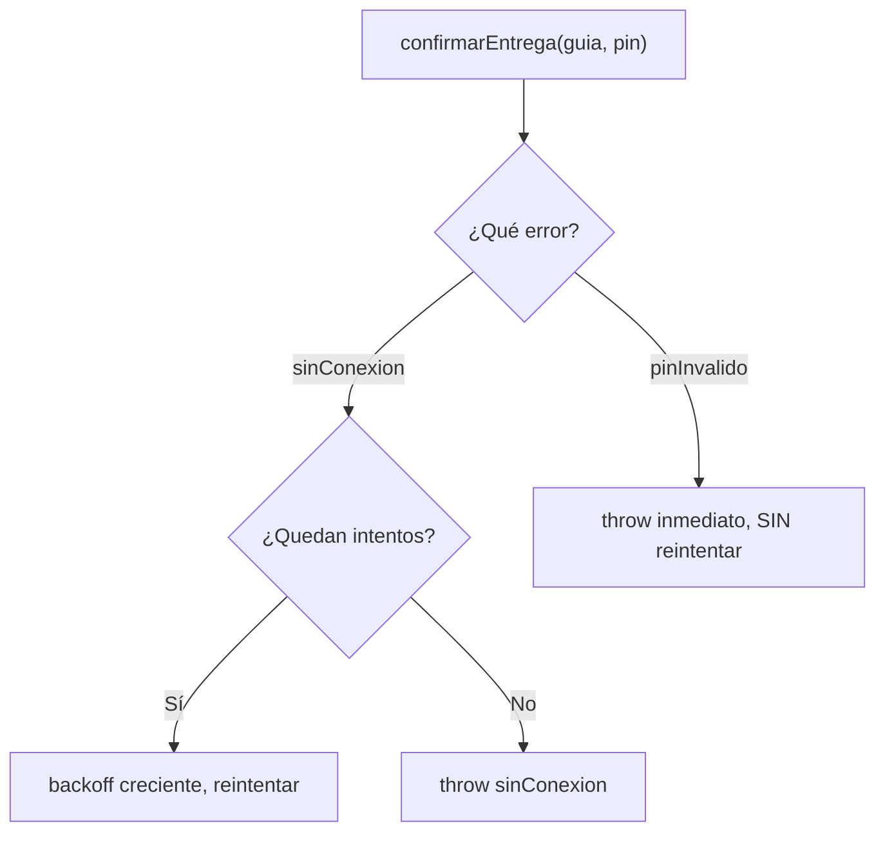

# Módulo 5: Networking con URLSession


**Proyecto del módulo:** para cada práctica, parte de una carpeta vacía y crea en Xcode (File ▸ New ▸ Project ▸ App, interfaz SwiftUI) un proyecto llamado `RutaFlowApp`; escribe manualmente todos los archivos indicados y compila, sin usar proyectos ya preparados.

## Aprende construyendo

### Tema 1: URLSession con async/await y Codable · Intermedio · 45 min

#### Paso 1 · Objetivo y preparación
Al finalizar vas a llamar a `POST /entregas` de RutaFlow desde Swift, decodificando la respuesta con `Codable`. Prerrequisitos: Módulo 4 de este track. No necesitas ningún servidor ni otro curso: en el Paso 4 registras un servidor simulado con `URLProtocol` que responde dentro de la propia app.
#### Paso 2 · Contexto y caso real
La app del conductor necesita confirmar una entrega llamando al endpoint `POST /entregas` desde código Swift real. Mientras no tengas un backend propio, un servidor simulado devuelve la misma respuesta JSON que daría el real.
#### Paso 3 · Teoría, modelo mental y analogía
`URLSession.shared.data(from:)` ejecuta la petición como una función suspendible; `Codable` traduce el JSON de respuesta a un `struct` tipado — un mensajero que confirma recepción, no solo "la envié y ya".

**¿Por qué es importante?** Porque una petición HTTP puede completar sin excepción de red y seguir representando un fallo; verificar el `statusCode` antes de decodificar evita tratar un cuerpo de error como si fuera una respuesta exitosa.
**Conceptos clave:** petición de red como función suspendible, parsing generado automáticamente.

```swift
// Fragmento: `url`, `Tarea` (abajo) y `ErrorRed` (Paso 4) se definen en este tema.
let (datos, respuesta) = try await URLSession.shared.data(from: url)
guard let http = respuesta as? HTTPURLResponse, http.statusCode == 200 else {
    throw ErrorRed.servidor
}
let tareas = try JSONDecoder().decode([Tarea].self, from: datos)
```

`URLSession.shared.data(from:)` con `async`/`await` (Módulo 4) realiza una petición de red completa como una única expresión suspendible, devolviendo tanto los datos crudos como la respuesta HTTP completa (incluyendo el código de estado), permitiendo verificar explícitamente ese código antes de intentar procesar los datos, en vez de asumir optimistamente que la petición tuvo éxito solo porque no lanzó una excepción de red.

```swift
struct Tarea: Codable, Identifiable {
    let id: String
    let titulo: String
    let completada: Bool
}
```

El compilador de Swift genera automáticamente la conformidad completa a `Codable` para cualquier `struct` cuyas propiedades sean todas ellas también `Codable` (los tipos básicos como `String`, `Bool`, `Int` ya lo son de forma nativa), eliminando por completo la necesidad de escribir parsing manual de JSON campo por campo, un contraste marcado con el manejo de JSON en versiones más antiguas de Objective-C/Swift, donde cada campo debía extraerse y convertirse manualmente desde un diccionario genérico no tipado.

**Analogía:** `Codable` es como un traductor automático certificado que convierte fielmente un documento en un formato genérico (JSON) hacia una estructura tipada específica en el idioma de destino, sin que el receptor tenga que traducir manualmente palabra por palabra cada campo del documento original.

* Código: escribe la práctica en `ContentView.swift` de tu propio proyecto `RutaFlowApp`.
* Proyecto: en el proyecto integrador RutaFlow, consume el endpoint de envíos con URLSession y Codable.

**Límites y decisión de uso:** Decodificar correctamente no significa que la respuesta HTTP represente éxito. Comprueba status, tamaño y campos de dominio antes de usar el modelo y distingue cancelación de un fallo que merece mostrarse al usuario.

#### Paso 4 · Demostración guiada desde cero
Crea `RutaFlowApp/ServidorSimulado.swift`. Intercepta las peticiones al host `rutaflow.test` (un dominio reservado que nunca sale a internet) y responde como lo haría el backend:

```swift
import Foundation

// Servidor simulado: responde POST /entregas sin red ni backend externo.
nonisolated final class ServidorSimulado: URLProtocol {
    static let host = "rutaflow.test"

    override class func canInit(with request: URLRequest) -> Bool {
        request.url?.host == host
    }

    override class func canonicalRequest(for request: URLRequest) -> URLRequest {
        request
    }

    override func startLoading() {
        let cuerpo = Data(#"{"shipmentId":"RF-4471","status":"delivered"}"#.utf8)
        guard let url = request.url,
              let respuesta = HTTPURLResponse(url: url, statusCode: 200, httpVersion: nil,
                                              headerFields: ["Content-Type": "application/json"]) else {
            client?.urlProtocol(self, didFailWithError: URLError(.badURL))
            return
        }
        client?.urlProtocol(self, didReceive: respuesta, cacheStoragePolicy: .notAllowed)
        client?.urlProtocol(self, didLoad: cuerpo)
        client?.urlProtocolDidFinishLoading(self)
    }

    override func stopLoading() {}
}

// Sesión que envía sus peticiones al servidor simulado.
func sesionSimulada() -> URLSession {
    let configuracion = URLSessionConfiguration.ephemeral
    configuracion.protocolClasses = [ServidorSimulado.self]
    return URLSession(configuration: configuracion)
}
```

Crea `RutaFlowApp/ConfirmarEntrega.swift`:

```swift
import Foundation

enum ErrorRed: Error {
    case urlInvalida
    case servidor
}

struct ConfirmacionEntrega: Codable {
    let shipmentId: String
    let status: String
}

func confirmarEntrega(guia: String, pin: String,
                      sesion: URLSession = sesionSimulada()) async throws -> ConfirmacionEntrega {
    guard let url = URL(string: "https://\(ServidorSimulado.host)/entregas") else {
        throw ErrorRed.urlInvalida
    }
    var request = URLRequest(url: url)
    request.httpMethod = "POST"
    request.setValue("application/json", forHTTPHeaderField: "Content-Type")
    request.httpBody = try JSONEncoder().encode(["shipmentId": guia, "recipientPin": pin])
    let (datos, respuesta) = try await sesion.data(for: request)
    guard let http = respuesta as? HTTPURLResponse, http.statusCode == 200 else {
        throw ErrorRed.servidor
    }
    return try JSONDecoder().decode(ConfirmacionEntrega.self, from: datos)
}
```

Para verlo en pantalla, reemplaza `ContentView.swift`:

```swift
import SwiftUI

struct ContentView: View {
    @State private var estado = "sin confirmar"

    var body: some View {
        VStack(spacing: 16) {
            Button("Confirmar RF-4471") {
                Task {
                    do {
                        estado = try await confirmarEntrega(guia: "RF-4471", pin: "837201").status
                    } catch {
                        estado = "error: \(error)"
                    }
                }
            }
            Text(estado)
        }
    }
}
```

Cuando tengas un backend real, cambia `sesion` por `URLSession.shared` y el host por el de tu servidor; el resto del código no cambia.

**Ejecuta el ejemplo:**

```bash
xcodebuild -scheme RutaFlowApp -destination 'generic/platform=iOS Simulator' build
```
Luego corre con ⌘R en el simulador, o abre el canvas de Preview con ⌥⌘↵.

Resultado esperado: al pulsar **Confirmar RF-4471**, el texto cambia de `sin confirmar` a `delivered`: `confirmarEntrega(guia: "RF-4471", pin: "837201")` devolvió un `ConfirmacionEntrega` con `status: "delivered"`, la respuesta del servidor simulado.
#### Paso 5 · Práctica guiada
Pista: en `ServidorSimulado` cambia `statusCode: 200` por `400` y el cuerpo por `{"error":"recipientPin debe tener 6 dígitos"}`; luego quita la verificación de `http.statusCode` y pasa directo a decodificar `datos` — ese es el fallo deliberado: `JSONDecoder` va a fallar al intentar decodificar un cuerpo de error como si fuera `ConfirmacionEntrega`, o peor, va a "tener éxito" decodificando campos que no significan lo que crees, porque nunca confirmaste que la petición realmente tuvo éxito.
#### Paso 6 · Práctica independiente
Corrige el Paso 5 restaurando la verificación de `statusCode`, y agrega un segundo `struct` `RespuestaError: Codable` para decodificar el cuerpo de error cuando el status no sea 200, en vez de descartarlo.
#### Paso 7 · Cierre
Entrega la confirmación decodificada del Paso 4, el fallo de decodificar un error como éxito del Paso 5, y el `RespuestaError` agregado del Paso 6; explica por qué nunca hay que asumir éxito solo porque la petición no lanzó una excepción de red. Siguiente paso: estudia persistencia. Errores comunes: ignorar status HTTP, decodificar en MainActor, retry de 4xx y ocultar PII en logs. Fuentes oficiales: https://developer.apple.com/documentation/foundation/urlsession y https://developer.apple.com/documentation/swift/codable.

### Tema 2: Errores tipados · Intermedio · 40 min

#### Paso 1 · Objetivo y preparación
Al finalizar vas a distinguir con un enum propio los tres fallos reales de `confirmarEntrega` (Tema 1): sin conexión, error del servidor y PIN inválido. Prerrequisitos: Tema 1 de este módulo.
#### Paso 2 · Contexto y caso real
Si `confirmarEntrega` falla, la app del conductor necesita mostrar un mensaje distinto según la causa: "revisa tu conexión" no es lo mismo que "el PIN tiene que tener 6 dígitos" (el 400 que configuraste en el servidor simulado del Tema 1).
#### Paso 3 · Teoría, modelo mental y analogía
Un enum de error propio comunica exactamente qué categoría de fallo ocurrió, verificable exhaustivamente por el compilador — un formulario de reporte con categorías predefinidas, no una casilla genérica de "algo salió mal".

**¿Por qué es importante?** Porque un enum de error propio verificado exhaustivamente por el compilador permite mostrar un mensaje específico por categoría de fallo, algo que un `NSError` genérico no puede garantizar.
**Conceptos clave:** categorías explícitas de fallo, mensajes específicos por caso.

```swift
enum ErrorRed: Error {
    case sinConexion
    case servidor
    case decodificacion
}
```

Modelar los errores de red con un enum propio que conforma al protocolo `Error` (en vez de propagar un `NSError` genérico, el mecanismo de error más antiguo y menos expresivo de Objective-C) permite comunicar exactamente qué categoría de fallo ocurrió mediante el sistema de tipos, y el `switch` sobre ese enum en el punto de manejo del error puede ser verificado exhaustivamente por el compilador (Módulo 0), obligando a considerar cada categoría de fallo posible de forma explícita, en vez de tratar todo error genéricamente con un mensaje único y poco informativo para el usuario o para el desarrollador que depura el problema.

Esta distinción de categorías de error (`sinConexion` frente a `servidor` frente a `decodificacion`) es directamente análoga a distinguir `IOException` de `HttpException` en Android (Módulo 5 del track de Android): ambos casos separan explícitamente "la petición nunca llegó a completarse" de "la petición completó pero con un resultado de error", permitiendo mensajes y estrategias de recuperación específicas para cada categoría.

**Analogía:** un enum de error propio es como un formulario de reporte de incidencias con categorías predefinidas específicas (falla de conexión, error del servidor, dato corrupto), en vez de una única casilla genérica de "algo salió mal" que no ayuda a decidir la acción de seguimiento apropiada para cada tipo distinto de problema.

**Implicación práctica:** Modelar errores con un enum propio frente a propagar `NSError` genérico permite un manejo específico y verificado exhaustivamente por el compilador para cada categoría de fallo, comunicando mensajes más útiles y precisos que un error genérico indiferenciado.

* Código: escribe la práctica en `ContentView.swift` de tu propio proyecto `RutaFlowApp`.
* Proyecto: en el proyecto integrador RutaFlow, modela los errores de red con un enum y muestra el mensaje correcto.

#### Paso 4 · Demostración guiada desde cero
```swift
enum ErrorEntrega: Error {
    case sinConexion
    case pinInvalido(mensaje: String)
    case servidor(codigo: Int)
}

// Reemplaza la función del Tema 1 (no la dupliques en el mismo proyecto).
func confirmarEntrega(guia: String, pin: String,
                      sesion: URLSession = sesionSimulada()) async throws -> ConfirmacionEntrega {
    guard let url = URL(string: "https://\(ServidorSimulado.host)/entregas") else {
        throw ErrorEntrega.servidor(codigo: -1)
    }
    var request = URLRequest(url: url)
    request.httpMethod = "POST"
    request.httpBody = try JSONEncoder().encode(["shipmentId": guia, "recipientPin": pin])
    let (datos, respuesta): (Data, URLResponse)
    do { (datos, respuesta) = try await sesion.data(for: request) }
    catch { throw ErrorEntrega.sinConexion }
    guard let http = respuesta as? HTTPURLResponse else { throw ErrorEntrega.servidor(codigo: -1) }
    if http.statusCode == 400 { throw ErrorEntrega.pinInvalido(mensaje: "recipientPin debe tener 6 dígitos") }
    guard http.statusCode == 200 else { throw ErrorEntrega.servidor(codigo: http.statusCode) }
    return try JSONDecoder().decode(ConfirmacionEntrega.self, from: datos)
}
```

**Ejecuta el ejemplo:**

```bash
xcodebuild -scheme RutaFlowApp -destination 'generic/platform=iOS Simulator' build
```
Luego corre con ⌘R en el simulador, o abre el canvas de Preview con ⌥⌘↵.

Resultado esperado: un `switch` sobre `ErrorEntrega` en el punto de manejo te obliga a considerar las tres categorías por separado — `sinConexion` muestra "revisá tu conexión", `pinInvalido` muestra el mensaje real del servidor, `servidor` muestra un código para reportar.
#### Paso 5 · Práctica guiada
Pista: reemplazá las tres categorías por un único `throw NSError(domain: "red", code: -1)` genérico en cada punto de fallo — ese es el fallo deliberado: ahora todo error se ve igual en el punto de manejo, y la app no puede distinguir "revisá tu conexión" de "tu PIN está mal escrito", mostrando el mismo mensaje confuso para dos problemas completamente distintos.
#### Paso 6 · Práctica independiente
Corregí el Paso 5 restaurando `ErrorEntrega`, y agregá un cuarto caso `decodificacion` para cuando `JSONDecoder` falla aunque el `statusCode` fuera 200 (una respuesta exitosa pero con un formato inesperado).
#### Paso 7 · Cierre
Entregá el `switch` exhaustivo sobre `ErrorEntrega` del Paso 4, el error genérico indiferenciado del Paso 5, y el cuarto caso agregado del Paso 6; explicá por qué el compilador puede obligarte a manejar cada caso de un enum propio, pero no de un `NSError` genérico. Siguiente paso: estudia persistencia. Errores comunes: ignorar status HTTP, decodificar en MainActor, retry de 4xx y ocultar PII en logs. Fuentes oficiales: https://developer.apple.com/documentation/foundation/urlsession y https://developer.apple.com/documentation/swift/codable.

### Tema 3: Reintentos y cancelación · Avanzado · 50 min

#### Paso 1 · Objetivo y preparación
Al finalizar vas a reintentar `confirmarEntrega` con backoff solo ante fallos transitorios, nunca ante un PIN inválido, y a cancelar la tarea si el conductor cierra la pantalla. Prerrequisitos: Tema 2 de este módulo.
#### Paso 2 · Contexto y caso real
Si la conexión del conductor falla momentáneamente, reintentar tiene sentido; pero reintentar un `ErrorEntrega.pinInvalido` tres veces no va a arreglar nada — el PIN sigue mal escrito en el reintento número tres igual que en el uno.
#### Paso 3 · Teoría, modelo mental y analogía
Reintentar con backoff es como volver a llamar a alguien que no contestó, esperando cada vez más entre intentos; cancelar una tarea en curso es retirar un pedido anterior antes de hacer uno nuevo, para que no lleguen fuera de orden.
**Conceptos clave:** resiliencia ante fallos transitorios, control explícito del ciclo de vida de una tarea en curso.

```swift
func obtenerConReintentos(intentos: Int = 3) async throws -> [Tarea] {
    for intento in 0..<intentos {
        do { return try await obtenerTareas() }
        catch { if intento == intentos - 1 { throw error } }
        try await Task.sleep(for: .seconds(Double(intento + 1)))
    }
    fatalError("inalcanzable")
}
```

Reintentar una petición ante un fallo transitorio (una interrupción momentánea de red, un timeout ocasional) con una espera creciente entre cada intento (backoff simple: esperar más tiempo en cada reintento sucesivo) mejora la resiliencia de la app frente a problemas de red temporales, sin reintentar indefinidamente ni sobrecargar un servidor que podría estar experimentando dificultades momentáneas, dado que cada reintento espera progresivamente más tiempo antes del siguiente intento.

```swift
let tarea = Task { try await obtenerTareas() }
// más tarde, si el usuario cancela:
tarea.cancel()
```

Cancelar explícitamente una `Task` en curso (por ejemplo, cuando el usuario inicia una nueva búsqueda antes de que la anterior complete) evita procesar y mostrar un resultado obsoleto que ya no corresponde a la intención actual del usuario, un problema conocido como "race condition de UI" donde una respuesta tardía de una petición anterior podría sobrescribir incorrectamente el resultado de una petición más reciente si ambas se procesan sin ningún mecanismo de cancelación explícita.

**Analogía:** reintentar con backoff es como intentar llamar nuevamente a alguien que no contestó, esperando cada vez un poco más entre intento e intento en vez de marcar repetidamente sin pausa, dando oportunidad a que la razón temporal de la falta de respuesta se resuelva por sí sola; cancelar una tarea en curso es como retirar explícitamente un pedido anterior al hacer uno nuevo, evitando que ambos pedidos lleguen fuera de orden y generen confusión sobre cuál es el resultado vigente.

**¿Por qué es importante?** Los reintentos con backoff mejoran la resiliencia ante fallos transitorios de red sin sobrecargar el servidor; cancelar tareas obsoletas evita procesar resultados desactualizados que ya no corresponden a la intención actual del usuario.

**Código del ejemplo:**

```swift
let tarea = Task { try await obtenerTareas() }
tarea.cancel() // evita procesar un resultado que ya no es relevante
```

**Diagrama: reintento selectivo por tipo de error**



En tu propio proyecto RutaFlow, crea `DetalleEntregaView.swift` con **File ▸ New ▸ File ▸ Swift File**, selecciona el target de la app y escribe allí `confirmarConReintentos` junto con la vista que lo invoca.

---

#### Paso 4 · Demostración guiada desde cero
```swift
func confirmarConReintentos(guia: String, pin: String, intentos: Int = 3) async throws -> ConfirmacionEntrega {
    for intento in 0..<intentos {
        do { return try await confirmarEntrega(guia: guia, pin: pin) }
        catch ErrorEntrega.pinInvalido { throw ErrorEntrega.pinInvalido(mensaje: "corregí el PIN") } // nunca reintentar esto
        catch ErrorEntrega.sinConexion {
            if intento == intentos - 1 { throw ErrorEntrega.sinConexion }
            try await Task.sleep(for: .seconds(Double(intento + 1)))
        }
    }
    fatalError("inalcanzable")
}
```

**Ejecuta el ejemplo:**

```bash
xcodebuild -scheme RutaFlowApp -destination 'generic/platform=iOS Simulator' build
```
Luego corre con ⌘R en el simulador, o abre el canvas de Preview con ⌥⌘↵.

Resultado esperado: un `ErrorEntrega.sinConexion` se reintenta hasta 3 veces con espera creciente; un `ErrorEntrega.pinInvalido` se propaga inmediatamente en el primer intento, sin ninguna espera ni reintento.
#### Paso 5 · Práctica guiada
Pista: quitá el `catch ErrorEntrega.pinInvalido` específico, dejando que ese error también caiga en la lógica de reintento genérica — ese es el fallo deliberado: ahora la app reintenta 3 veces un PIN que sabe con certeza que está mal, desperdiciando 3 llamadas de red y segundos de espera para un error que nunca iba a cambiar de resultado.
#### Paso 6 · Práctica independiente
Corregí el Paso 5 restaurando el `catch` específico, y envolvé la llamada completa en una `Task` que se cancele si el conductor sale de `DetalleEnvio` antes de que termine — confirmá que cancelar a mitad de un backoff no deja ninguna llamada de red "colgada" de fondo.

**Proyecto integrador:** en el proyecto independiente iniciado vacío en este tema, crea `ServicioConfirmacion.swift` con un protocolo y un fake local que pueda devolver dos `sinConexion` seguidos de éxito o un `pinInvalido` inmediato. Implementa `ConfirmacionViewModel.swift` con el backoff y un contador de llamadas, y conéctalo a `DetalleEntregaView.swift`. Ejecuta ambos escenarios: el transitorio debe realizar exactamente tres llamadas antes de mostrar éxito y el PIN inválido exactamente una; inicia otro caso transitorio, cancela durante la espera y verifica que el contador deja de aumentar y la vista no publica un resultado tardío.

#### Paso 7 · Cierre
Entregá el reintento selectivo del Paso 4, el reintento desperdiciado sobre un PIN inválido del Paso 5, y la cancelación del Paso 6; explicá por qué reintentar un error 4xx (como PIN inválido) es un desperdicio que nunca cambia el resultado, a diferencia de un error transitorio de red. Siguiente paso: estudia persistencia. Errores comunes: ignorar status HTTP, decodificar en MainActor, retry de 4xx y ocultar PII en logs. Fuentes oficiales: https://developer.apple.com/documentation/foundation/urlsession y https://developer.apple.com/documentation/swift/codable.
**Implicación práctica:** Reintentar indiscriminadamente desperdicia llamadas de red en errores que nunca van a cambiar de resultado (un PIN inválido), mientras que cancelar una tarea obsoleta evita procesar una respuesta que ya no corresponde a la intención actual del usuario.

## Laboratorio práctico

**Objetivo del laboratorio:** construir un cliente de red que consume una API real con manejo de errores tipado.

**Requisitos previos:** Módulo 4 completado.

| Paso | Acción | Código | Explicación |
|---|---|---|---|
| 1 | Petición GET con `URLSession` + `async`/`await` | Ver Tema 1 | Contra una API pública |
| 2 | Definir un `struct Codable` para la respuesta | Ver Tema 1 | Decodificar con `JSONDecoder` |
| 3 | Definir un enum de error propio | Ver Tema 2 | Según código de estado HTTP |
| 4 | Implementar cancelación de una Task en curso | Ver Tema 3 | Al iniciar una nueva búsqueda |
| 5 | Agregar reintentos con backoff simple | Ver Tema 3 | Ante error transitorio |

**Verificación:** el laboratorio se considera exitoso si la app maneja correctamente cada categoría de error de forma distinta (mostrando un mensaje específico según el caso del enum), y si iniciar una nueva búsqueda cancela correctamente cualquier petición anterior en curso.

**Errores comunes y soluciones**

- **Asumir éxito solo porque la petición no lanzó una excepción de red.** Verifica explícitamente el código de estado HTTP de la respuesta.
- **Propagar un error genérico sin categorías específicas.** Modela un enum de error propio para mensajes y manejo específicos por caso.
- **No cancelar una Task anterior al iniciar una nueva búsqueda.** Arriesga mostrar un resultado obsoleto que llega fuera de orden.

---

* Código: escribe la práctica en `ContentView.swift` de tu propio proyecto `RutaFlowApp`.
* Proyecto: en el proyecto integrador RutaFlow, reintenta la subida de evidencia con espera y cancelación.
