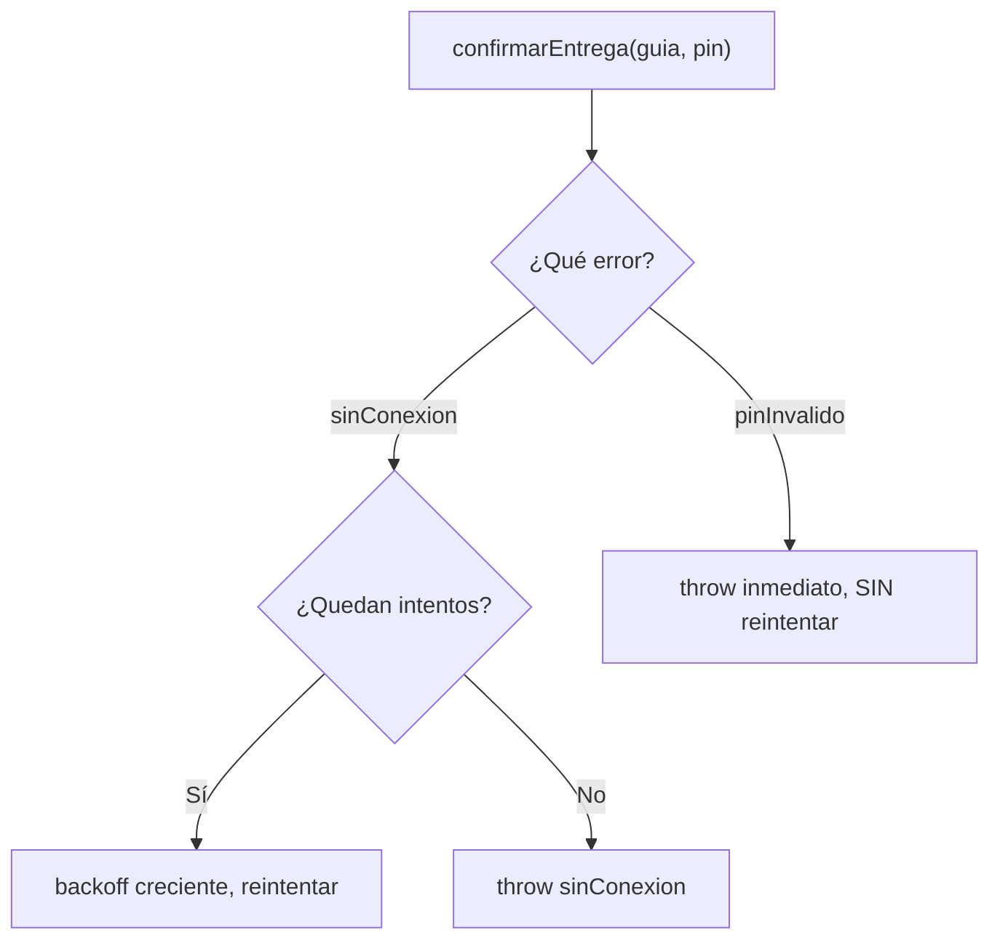

# Módulo 5: Networking con URLSession


**Proyecto del módulo:** para cada práctica, parte de una carpeta vacía y crea en Xcode (File ▸ New ▸ Project ▸ App, interfaz SwiftUI) un proyecto llamado `RutaFlowApp`; escribe manualmente todos los archivos indicados y compila, sin usar proyectos ya preparados.

## Aprende construyendo


### Tema 1: URLSession con async/await y Codable · Intermedio · 45 min

<details open>
<summary><strong>Capa 1 — Lectura</strong></summary>

#### ► DE QUÉ TRATA
Al finalizar vas a llamar a POST /entregas de RutaFlow desde Swift, decodificando la respuesta con Codable. Prerrequisitos: Módulo 4 de este track. No necesitas ningún servidor ni otro curso: en el Paso 4 registras un servidor simulado con URLProtocol que responde dentro de la pr…

#### ► LA IDEA EN UNA FRASE
**Al finalizar vas a llamar a POST /entregas de RutaFlow desde Swift, decodificando la respuesta con Codable.**

#### ► POR QUÉ EXISTE ESTO
Resuelve un problema real de diseño o implementación y evita decisiones a ciegas.

#### ► LA ANALOGÍA
Piensa en urlsession con async/await y codable como una herramienta de taller: útil cuando conoces su propósito y sus límites.
**Dónde se rompe la analogía:** en software, los efectos dependen del contexto, la escala y los trade-offs.

#### ► CÓMO FUNCIONA
1. Identifica el problema que urlsession con async/await y codable resuelve.
2. Observa sus componentes y relaciones.
3. Aplica la opción más simple que funcione.
4. Verifica el resultado y los límites.

#### ► LO QUE PUEDE SALIR MAL
| Síntoma | Causa probable | Arreglo |
|---|---|---|
| URLSession con async/await y Codable se aplica pero el resultado no mejora | Se usó sin medir el problema real | Mide antes y compara contra la alternativa simple |
| Aparece complejidad inesperada | Se adoptó la técnica sin comprender sus trade-offs | Vuelve a la sección de trade-offs y reduce el alcance |
| Falla en un caso límite | Se asumió un contexto que no se cumple | Prueba el caso límite y documenta cuándo NO usarlo |

#### ► TRADE-OFFS
| Opción | Cuándo usarla | Cuándo NO usarla |
|---|---|---|
| Usar URLSession con async/await y Codable | Cuando el problema coincide con su propósito y el beneficio es observable | Cuando agrega complejidad sin resolver un problema real |
| Alternativa más simple | Cuando el contexto es pequeño, estable o fácil de razonar | Cuando ya demostró no escalar o no cumplir el requisito |
| Postergar la decisión | Cuando falta evidencia del problema | Cuando el costo de esperar es mayor que el costo de probar |

#### ► CUÁNDO NO USAR ESTO
No uses urlsession con async/await y codable por defecto. Aplícalo cuando el problema lo justifique y puedas verificar el beneficio; si una alternativa más simple resuelve igual, prefiérela.

#### ► DE VUELTA A LA ANALOGÍA
Volviendo a la analogía: urlsession con async/await y codable funciona como el modelo inicial, pero recuerda dónde se rompe: en producción importan la evidencia, la escala y el costo de equivocarte.

#### ► LO QUE DEBES RECORDAR
- URLSession con async/await y Codable existe para resolver un problema específico.
- Mide antes de adoptar complejidad.
- Conoce el caso donde NO usarlo.
- Verifica con evidencia observable.

#### ► PREGUNTAS PARA PENSAR
1. ¿Qué problema concreto resuelve urlsession con async/await y codable en tu contexto?
2. ¿Cómo sabrías que urlsession con async/await y codable no está funcionando bien?
3. ¿Qué alternativa más simple considerarías antes de usar urlsession con async/await y codable?

</details>

<details>
<summary><strong>Capa 2 — Construcción</strong></summary>

#### Código y verificación
```swift
// Fragmento: `url`, `Tarea` (abajo) y `ErrorRed` (Paso 4) se definen en este tema.
let (datos, respuesta) = try await URLSession.shared.data(from: url)
guard let http = respuesta as? HTTPURLResponse, http.statusCode == 200 else {
    throw ErrorRed.servidor
}
let tareas = try JSONDecoder().decode([Tarea].self, from: datos)
```

```swift
struct Tarea: Codable, Identifiable {
    let id: String
    let titulo: String
    let completada: Bool
}
```

```swift
import Foundation

// Servidor simulado: responde POST /entregas sin red ni backend externo.
nonisolated final class ServidorSimulado: URLProtocol {
    static let host = "rutaflow.test"

    override class func canInit(with request: URLRequest) -> Bool {
        request.url?.host == host
    }

    override class func canonicalRequest(for request: URLRequest) -> URLRequest {
        request
    }

    override func startLoading() {
        let cuerpo = Data(#"{"shipmentId":"RF-4471","status":"delivered"}"#.utf8)
        guard let url = request.url,
              let respuesta = HTTPURLResponse(url: url, statusCode: 200, httpVersion: nil,
                                              headerFields: ["Content-Type": "application/json"]) else {
            client?.urlProtocol(self, didFailWithError: URLError(.badURL))
            return
        }
        client?.urlProtocol(self, didReceive: respuesta, cacheStoragePolicy: .notAllowed)
        client?.urlProtocol(self, didLoad: cuerpo)
        client?.urlProtocolDidFinishLoading(self)
    }

    override func stopLoading() {}
}

// Sesión que envía sus peticiones al servidor simulado.
func sesionSimulada() -> URLSession {
    let configuracion = URLSessionConfiguration.ephemeral
    configuracion.protocolClasses = [ServidorSimulado.self]
    return URLSession(configuration: configuracion)
}
```

```swift
import Foundation

enum ErrorRed: Error {
    case urlInvalida
    case servidor
}

struct ConfirmacionEntrega: Codable {
    let shipmentId: String
    let status: String
}

func confirmarEntrega(guia: String, pin: String,
                      sesion: URLSession = sesionSimulada()) async throws -> ConfirmacionEntrega {
    guard let url = URL(string: "https://\(ServidorSimulado.host)/entregas") else {
        throw ErrorRed.urlInvalida
    }
    var request = URLRequest(url: url)
    request.httpMethod = "POST"
    request.setValue("application/json", forHTTPHeaderField: "Content-Type")
    request.httpBody = try JSONEncoder().encode(["shipmentId": guia, "recipientPin": pin])
    let (datos, respuesta) = try await sesion.data(for: request)
    guard let http = respuesta as? HTTPURLResponse, http.statusCode == 200 else {
        throw ErrorRed.servidor
    }
    return try JSONDecoder().decode(ConfirmacionEntrega.self, from: datos)
}
```

```swift
import SwiftUI

struct ContentView: View {
    @State private var estado = "sin confirmar"

    var body: some View {
        VStack(spacing: 16) {
            Button("Confirmar RF-4471") {
                Task {
                    do {
                        estado = try await confirmarEntrega(guia: "RF-4471", pin: "837201").status
                    } catch {
                        estado = "error: \(error)"
                    }
                }
            }
            Text(estado)
        }
    }
}
```

```bash
xcodebuild -scheme RutaFlowApp -destination 'generic/platform=iOS Simulator' build
```

</details>

### Tema 2: Errores tipados · Intermedio · 40 min

<details open>
<summary><strong>Capa 1 — Lectura</strong></summary>

#### ► DE QUÉ TRATA
Al finalizar vas a distinguir con un enum propio los tres fallos reales de confirmarEntrega (Tema 1): sin conexión, error del servidor y PIN inválido. Prerrequisitos: Tema 1 de este módulo.

#### ► LA IDEA EN UNA FRASE
**Al finalizar vas a distinguir con un enum propio los tres fallos reales de confirmarEntrega (Tema 1): sin conexión, error del servidor y PIN inválido.**

#### ► POR QUÉ EXISTE ESTO
Resuelve un problema real de diseño o implementación y evita decisiones a ciegas.

#### ► LA ANALOGÍA
Piensa en errores tipados como una herramienta de taller: útil cuando conoces su propósito y sus límites.
**Dónde se rompe la analogía:** en software, los efectos dependen del contexto, la escala y los trade-offs.

#### ► CÓMO FUNCIONA
1. Identifica el problema que errores tipados resuelve.
2. Observa sus componentes y relaciones.
3. Aplica la opción más simple que funcione.
4. Verifica el resultado y los límites.

#### ► LO QUE PUEDE SALIR MAL
| Síntoma | Causa probable | Arreglo |
|---|---|---|
| Errores tipados se aplica pero el resultado no mejora | Se usó sin medir el problema real | Mide antes y compara contra la alternativa simple |
| Aparece complejidad inesperada | Se adoptó la técnica sin comprender sus trade-offs | Vuelve a la sección de trade-offs y reduce el alcance |
| Falla en un caso límite | Se asumió un contexto que no se cumple | Prueba el caso límite y documenta cuándo NO usarlo |

#### ► TRADE-OFFS
| Opción | Cuándo usarla | Cuándo NO usarla |
|---|---|---|
| Usar Errores tipados | Cuando el problema coincide con su propósito y el beneficio es observable | Cuando agrega complejidad sin resolver un problema real |
| Alternativa más simple | Cuando el contexto es pequeño, estable o fácil de razonar | Cuando ya demostró no escalar o no cumplir el requisito |
| Postergar la decisión | Cuando falta evidencia del problema | Cuando el costo de esperar es mayor que el costo de probar |

#### ► CUÁNDO NO USAR ESTO
No uses errores tipados por defecto. Aplícalo cuando el problema lo justifique y puedas verificar el beneficio; si una alternativa más simple resuelve igual, prefiérela.

#### ► DE VUELTA A LA ANALOGÍA
Volviendo a la analogía: errores tipados funciona como el modelo inicial, pero recuerda dónde se rompe: en producción importan la evidencia, la escala y el costo de equivocarte.

#### ► LO QUE DEBES RECORDAR
- Errores tipados existe para resolver un problema específico.
- Mide antes de adoptar complejidad.
- Conoce el caso donde NO usarlo.
- Verifica con evidencia observable.

#### ► PREGUNTAS PARA PENSAR
1. ¿Qué problema concreto resuelve errores tipados en tu contexto?
2. ¿Cómo sabrías que errores tipados no está funcionando bien?
3. ¿Qué alternativa más simple considerarías antes de usar errores tipados?

</details>

<details>
<summary><strong>Capa 2 — Construcción</strong></summary>

#### Código y verificación
```swift
enum ErrorRed: Error {
    case sinConexion
    case servidor
    case decodificacion
}
```

```swift
enum ErrorEntrega: Error {
    case sinConexion
    case pinInvalido(mensaje: String)
    case servidor(codigo: Int)
}

// Reemplaza la función del Tema 1 (no la dupliques en el mismo proyecto).
func confirmarEntrega(guia: String, pin: String,
                      sesion: URLSession = sesionSimulada()) async throws -> ConfirmacionEntrega {
    guard let url = URL(string: "https://\(ServidorSimulado.host)/entregas") else {
        throw ErrorEntrega.servidor(codigo: -1)
    }
    var request = URLRequest(url: url)
    request.httpMethod = "POST"
    request.httpBody = try JSONEncoder().encode(["shipmentId": guia, "recipientPin": pin])
    let (datos, respuesta): (Data, URLResponse)
    do { (datos, respuesta) = try await sesion.data(for: request) }
    catch { throw ErrorEntrega.sinConexion }
    guard let http = respuesta as? HTTPURLResponse else { throw ErrorEntrega.servidor(codigo: -1) }
    if http.statusCode == 400 { throw ErrorEntrega.pinInvalido(mensaje: "recipientPin debe tener 6 dígitos") }
    guard http.statusCode == 200 else { throw ErrorEntrega.servidor(codigo: http.statusCode) }
    return try JSONDecoder().decode(ConfirmacionEntrega.self, from: datos)
}
```

```bash
xcodebuild -scheme RutaFlowApp -destination 'generic/platform=iOS Simulator' build
```

</details>

### Tema 3: Reintentos y cancelación · Intermedio · 45 min

<details open>
<summary><strong>Capa 1 — Lectura</strong></summary>

#### ► DE QUÉ TRATA
Al finalizar vas a reintentar confirmarEntrega con backoff solo ante fallos transitorios, nunca ante un PIN inválido, y a cancelar la tarea si el conductor cierra la pantalla. Prerrequisitos: Tema 2 de este módulo.

#### ► LA IDEA EN UNA FRASE
**Al finalizar vas a reintentar confirmarEntrega con backoff solo ante fallos transitorios, nunca ante un PIN inválido, y a cancelar la tarea si el conductor cierra la pantalla.**

#### ► POR QUÉ EXISTE ESTO
Resuelve un problema real de diseño o implementación y evita decisiones a ciegas.

#### ► LA ANALOGÍA
Reintentar con backoff es como volver a llamar a alguien que no contestó, esperando cada vez más entre intentos; cancelar una tarea en curso es retirar un pedido anterior antes de hacer uno nuevo, para que no lleguen fuera de orden.
**Conceptos clave:** resiliencia ante fallos transitorios, control explícito del ciclo de vida de una tarea en curso.

```swift
func obtenerConReintentos(intentos: Int = 3) async throws -> [Tarea] {
    for intento in 0..<intentos {
        do { return try await obtenerTareas() }
        catch { if intento == intentos - 1 { throw error } }
        try await Task.sleep(for: .seconds(Double(intento + 1)))
    }
    fatalError("inalcanzable")
}
```

Reintentar una petición ante un fallo transitorio (una interrupción momentánea de red, un timeout ocasional) con una espera creciente entre cada intento (backoff simple: esperar más tiempo en cada reintento sucesivo) mejora la resiliencia de la app frente a problemas de red temporales, sin reintentar indefinidamente ni sobrecargar un servidor que podría estar experimentando dificultades momentáneas, dado que cada reintento espera progresivamente más tiempo antes del siguiente intento.

```swift
let tarea = Task { try await obtenerTareas() }
// más tarde, si el usuario cancela:
tarea.cancel()
```

Cancelar explícitamente una `Task` en curso (por ejemplo, cuando el usuario inicia una nueva búsqueda antes de que la anterior complete) evita procesar y mostrar un resultado obsoleto que ya no corresponde a la intención actual del usuario, un problema conocido como "race condition de UI" donde una respuesta tardía de una petición anterior podría sobrescribir incorrectamente el resultado de una petición más reciente si ambas se procesan sin ningún mecanismo de cancelación explícita.

**Analogía:** reintentar con backoff es como intentar llamar nuevamente a alguien que no contestó, esperando cada vez un poco más entre intento e intento en vez de marcar repetidamente sin pausa, dando oportunidad a que la razón temporal de la falta de respuesta se resuelva por sí sola; cancelar una tarea en curso es como retirar explícitamente un pedido anterior al hacer uno nuevo, evitando que ambos pedidos lleguen fuera de orden y generen confusión sobre cuál es el resultado vigente.

**¿Por qué es importante?** Los reintentos con backoff mejoran la resiliencia ante fallos transitorios de red sin sobrecargar el servidor; cancelar tareas obsoletas evita procesar resultados desactualizados que ya no corresponden a la intención actual del usuario.

**Código del ejemplo:**

```swift
let tarea = Task { try await obtenerTareas() }
tarea.cancel() // evita procesar un resultado que ya no es relevante
```

**Diagrama: reintento selectivo por tipo de error**



En tu propio proyecto RutaFlow, crea `DetalleEntregaView.swift` con **File ▸ New ▸ File ▸ Swift File**, selecciona el target de la app y escribe allí `confirmarConReintentos` junto con la vista que lo invoca.

---

**Dónde se rompe la analogía:** el modelo simplifica la realidad; en producción influyen escala, fallos, costo y contexto.

#### ► CÓMO FUNCIONA


#### ► LO QUE PUEDE SALIR MAL
| Síntoma | Causa probable | Arreglo |
|---|---|---|
| Reintentos y cancelación se aplica pero el resultado no mejora | Se usó sin medir el problema real | Mide antes y compara contra la alternativa simple |
| Aparece complejidad inesperada | Se adoptó la técnica sin comprender sus trade-offs | Vuelve a la sección de trade-offs y reduce el alcance |
| Falla en un caso límite | Se asumió un contexto que no se cumple | Prueba el caso límite y documenta cuándo NO usarlo |

#### ► TRADE-OFFS
| Opción | Cuándo usarla | Cuándo NO usarla |
|---|---|---|
| Usar Reintentos y cancelación | Cuando el problema coincide con su propósito y el beneficio es observable | Cuando agrega complejidad sin resolver un problema real |
| Alternativa más simple | Cuando el contexto es pequeño, estable o fácil de razonar | Cuando ya demostró no escalar o no cumplir el requisito |
| Postergar la decisión | Cuando falta evidencia del problema | Cuando el costo de esperar es mayor que el costo de probar |

#### ► CUÁNDO NO USAR ESTO
No uses reintentos y cancelación por defecto. Aplícalo cuando el problema lo justifique y puedas verificar el beneficio; si una alternativa más simple resuelve igual, prefiérela.

#### ► DE VUELTA A LA ANALOGÍA
Volviendo a la analogía: reintentos y cancelación funciona como el modelo inicial, pero recuerda dónde se rompe: en producción importan la evidencia, la escala y el costo de equivocarte.

#### ► LO QUE DEBES RECORDAR
- Reintentos y cancelación existe para resolver un problema específico.
- Mide antes de adoptar complejidad.
- Conoce el caso donde NO usarlo.
- Verifica con evidencia observable.

#### ► PREGUNTAS PARA PENSAR
1. ¿Qué problema concreto resuelve reintentos y cancelación en tu contexto?
2. ¿Cómo sabrías que reintentos y cancelación no está funcionando bien?
3. ¿Qué alternativa más simple considerarías antes de usar reintentos y cancelación?

</details>

<details>
<summary><strong>Capa 2 — Construcción</strong></summary>

#### Código y verificación
```swift
func obtenerConReintentos(intentos: Int = 3) async throws -> [Tarea] {
    for intento in 0..<intentos {
        do { return try await obtenerTareas() }
        catch { if intento == intentos - 1 { throw error } }
        try await Task.sleep(for: .seconds(Double(intento + 1)))
    }
    fatalError("inalcanzable")
}
```

```swift
let tarea = Task { try await obtenerTareas() }
// más tarde, si el usuario cancela:
tarea.cancel()
```

```swift
let tarea = Task { try await obtenerTareas() }
tarea.cancel() // evita procesar un resultado que ya no es relevante
```


```swift
func confirmarConReintentos(guia: String, pin: String, intentos: Int = 3) async throws -> ConfirmacionEntrega {
    for intento in 0..<intentos {
        do { return try await confirmarEntrega(guia: guia, pin: pin) }
        catch ErrorEntrega.pinInvalido { throw ErrorEntrega.pinInvalido(mensaje: "corregí el PIN") } // nunca reintentar esto
        catch ErrorEntrega.sinConexion {
            if intento == intentos - 1 { throw ErrorEntrega.sinConexion }
            try await Task.sleep(for: .seconds(Double(intento + 1)))
        }
    }
    fatalError("inalcanzable")
}
```

```bash
xcodebuild -scheme RutaFlowApp -destination 'generic/platform=iOS Simulator' build
```

</details>
