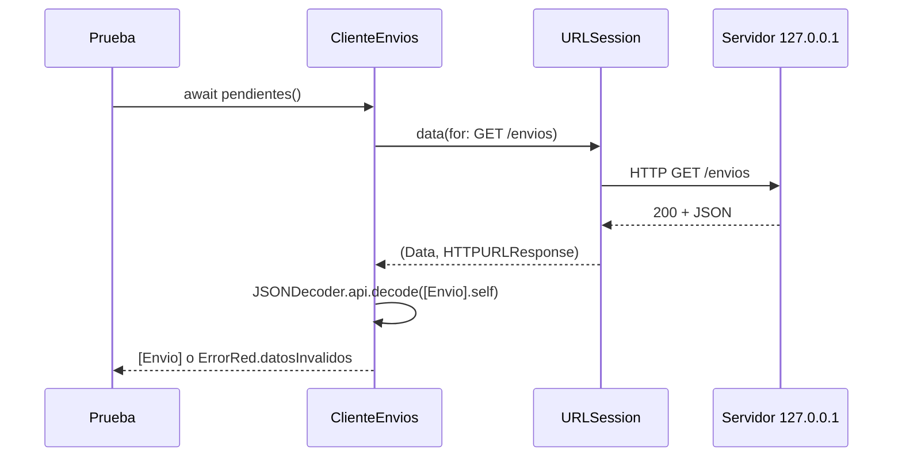
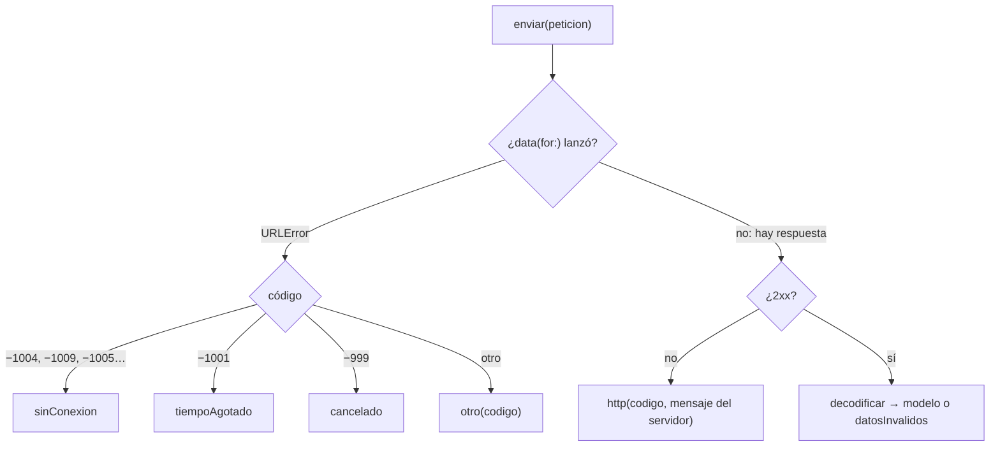
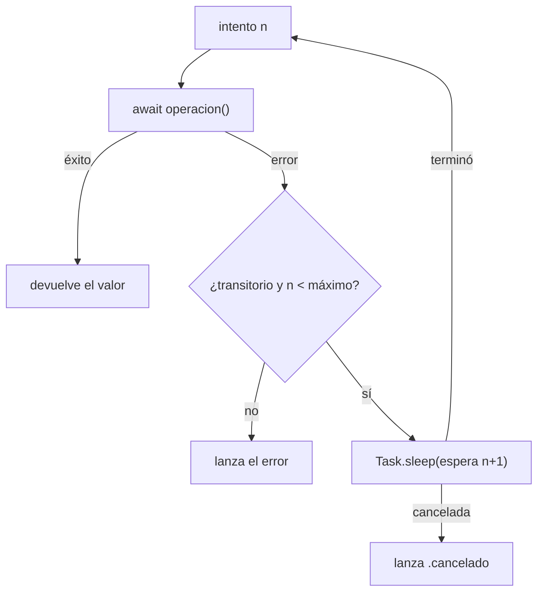
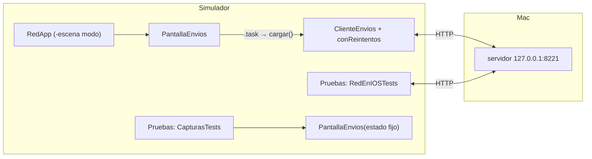

# Módulo 5: Red con URLSession

**Entorno comprobado para esta edición (2026-11-25):** la capa de red y su servidor de desarrollo se escribieron en
Swift 6.4.3 (modo de lenguaje Swift 6, concurrencia estricta) y se probaron en Linux x86_64 con FoundationNetworking y
Swift Testing 6.4.3, en `/home/estudiante/labs/ios/ios5` (tu `~/labs/ios/ios5`): 18 pruebas contra un servidor HTTP
real en `127.0.0.1`, sin dobles de `URLSession`. Lo que necesita a Apple se ejecutó en una Mac con macOS 27.2,
Xcode 27.2 (27B52), Swift 6.4.2 y el simulador iPhone 17 con iOS 27.2: las mismas 18 pruebas con `swift test` sobre
la Foundation de Apple, 7 pruebas de red dentro del simulador contra el mismo servidor encendido en la Mac, las
capturas de la pantalla en sus estados y la app real. Límites honestos: el servidor es de desarrollo (HTTP sin
cifrar, solo en `127.0.0.1`), así que aquí no se ejecuta HTTPS contra un servidor propio; y en Linux no hay SwiftUI,
por eso la pantalla del Tema 4 solo existe en la Mac.

Hasta ahora la app de la ruta mostraba datos escritos en el código. Desde este módulo los pide a un servidor, y con
eso aparecen problemas que no existían: la red tarda, se cae, responde con errores, envía datos que la app no
entiende, y la persona que reparte cierra la pantalla antes de que llegue la respuesta. Este módulo construye una
capa de red pequeña que trata cada uno de esos casos de forma explícita, y la prueba contra un servidor de verdad.

**Al terminar este módulo podrás:**
- pedir datos con `URLSession` y `async/await`, y convertir el JSON en tipos de Swift con `Codable`;
- distinguir los fallos de red, los códigos HTTP y los datos inválidos con un tipo de error propio, y enviar un
  `POST` con cuerpo JSON;
- poner un tiempo de espera que funcione, reintentar solo lo que vale la pena y cancelar de verdad;
- mostrar cada estado de la carga en una pantalla de SwiftUI y comprobarlo en el simulador.

**Esquema del módulo:** Tema 1 (GET con `async/await` y `Codable`) → Tema 2 (errores como un tipo propio y `POST`)
→ Tema 3 (tiempo de espera, reintentos y cancelación) → Tema 4 (la pantalla con estados, en el simulador) →
Proyecto 42.

**Qué necesitas saber antes:** del Módulo 4, **`async/await` y `Task`** (Tema 1), **la cancelación cooperativa**
(Tema 4) y **`Sendable` y el aislamiento de Swift 6** (Tema 6); del Módulo 0, **los enums con valores asociados**
(Tema 3); del Módulo 2, **`@State`** (Tema 1); del Módulo 1, **`List` y `NavigationStack`**.

**Qué no se repite:** cómo funcionan `async/await`, `Task` y los actores (Módulo 4), ni cómo se arma una lista en
SwiftUI (Módulo 1). Aquí se usan para hablar con un servidor.

**Prepara el proyecto:**

La lógica de red no depende de la interfaz, así que vive en un paquete de Swift que se prueba en cualquier sistema
(Linux, macOS o Windows con Swift 6), y la app de iOS la usa:

```text
$ mkdir -p ~/labs/ios/ios5 && cd ~/labs/ios/ios5
$ mkdir nucleo && cd nucleo
$ swift package init --type library --name Nucleo
```

Reemplaza `Package.swift` por este (tres módulos: la capa de red `Red`, un servidor de desarrollo y sus pruebas):

```swift
// swift-tools-version: 6.0
import PackageDescription

let package = Package(
    name: "Nucleo",
    platforms: [.macOS(.v15), .iOS(.v18)],
    products: [
        .library(name: "Red", targets: ["Red"]),
        .executable(name: "servidor", targets: ["servidor"]),
    ],
    targets: [
        // La capa de red: se copia tal cual a la app de iOS.
        .target(name: "Red"),
        // Un servidor HTTP mínimo con sockets, solo para desarrollo y pruebas.
        .target(name: "ServidorPrueba"),
        .executableTarget(name: "servidor", dependencies: ["ServidorPrueba"]),
        .testTarget(name: "RedTests", dependencies: ["Red", "ServidorPrueba"]),
    ]
)
```

La estructura final:

```text
ios5/
├── nucleo/                              paquete de Swift (se prueba con swift test)
│   ├── Sources/Red/                     la capa de red: se copia a la app
│   │   ├── Envio.swift                  modelos Codable
│   │   ├── ErrorRed.swift               el tipo de error
│   │   ├── ClienteEnvios.swift          URLSession + async/await
│   │   └── Reintentos.swift             política de reintentos
│   ├── Sources/ServidorPrueba/          servidor HTTP mínimo con sockets
│   ├── Sources/servidor/main.swift      swift run servidor 8221
│   └── Tests/RedTests/                  pruebas por tema
├── ejemplos_que_fallan/                 errores provocados a propósito
└── app/                                 proyecto de Xcode RedApp (Tema 4)
    ├── App/                             la app; App/Nucleo/ es la copia de Sources/Red
    └── Pruebas/                         pruebas en el simulador y capturas
```

En la Mac, la app se crea en Xcode con **File ▸ New ▸ Project ▸ iOS ▸ App**, nombre `RedApp`, interfaz SwiftUI,
pruebas con Swift Testing e iOS 18.0 como versión mínima. Arrastra a su carpeta una copia de `nucleo/Sources/Red`
(en el laboratorio, `mac.sh` la copia en `app/App/Nucleo/` antes de compilar).


## Aprende construyendo


### Tema 1: Una petición GET con async/await y Codable · Intermedio · 45 min

<details open>
<summary><strong>Capa 1 — Lectura</strong></summary>

#### Objetivos
Al terminar este tema podrás:
- levantar un servidor HTTP de desarrollo y ver sus respuestas con `curl`;
- pedir una lista con `URLSession.data(for:)` y `await`;
- decodificar JSON con claves en *snake_case* y fechas ISO 8601 en tipos de Swift;
- leer un `DecodingError` y saber qué campo falló.

**Conceptos clave:** `URLSession`, `URLRequest`, `async/await`, `Codable`, `JSONDecoder`, estrategias de
decodificación, `DecodingError`

#### El problema
La pantalla de la ruta necesita las entregas del día. El servidor las envía en JSON con sus propias convenciones
(`ventana_inicio`, `"en_ruta"`, fechas como texto) y la app quiere tipos de Swift (`ventanaInicio: Date`,
`EstadoEnvio.enRuta`). Si la traducción se hace a mano, con diccionarios, cualquier campo nuevo o mal escrito se
convierte en un `nil` silencioso o en un cierre de la app.

Este tema usa **`async/await`** (Módulo 4, Tema 1) y **los enums con valor bruto** (Módulo 0, Tema 3).

#### Glosario del tema

**`URLSession`**
- **Definición técnica:** la clase de Foundation que ejecuta peticiones HTTP; `data(for:)` es un método `async` que devuelve `(Data, URLResponse)` cuando llega la respuesta completa.
- **En palabras sencillas:** el mensajero que lleva la carta y trae la respuesta.
- **Dónde se rompe la comparación:** el mensajero no lee la respuesta: un 500 también es «una respuesta que llegó».
- **Ejemplo:** `let (datos, respuesta) = try await sesion.data(for: peticion)`.
- **Error típico:** crear una `URLSession` nueva en cada petición; se crea una por cliente y se reutiliza.

**`URLRequest`**
- **Definición técnica:** valor que describe una petición: URL, método, cabeceras, cuerpo y tiempo de espera.
- **En palabras sencillas:** el sobre con la dirección y lo que va adentro.
- **Dónde se rompe la comparación:** algunos campos del sobre dependen de la sesión; en Linux, por ejemplo, el tiempo de espera de la petición se ignora (Tema 3).
- **Ejemplo:** `URLRequest(url: base.appending(path: "envios"), timeoutInterval: 10)`.
- **Error típico:** armar la URL concatenando textos (`"\(base)/envios"`) y duplicar o perder barras.

**`Codable`**
- **Definición técnica:** la unión de los protocolos `Encodable` y `Decodable`; el compilador genera la conversión desde y hacia JSON a partir de las propiedades del tipo.
- **En palabras sencillas:** un molde: si el JSON encaja, sale el objeto; si no, sale un error que dice dónde no encajó.
- **Dónde se rompe la comparación:** el molde es estricto con los tipos, pero ignora los campos que sobran en el JSON.
- **Ejemplo:** `struct Envio: Codable { let guia: String; let ventanaInicio: Date }`.
- **Error típico:** declarar todo como opcional para «evitar errores»; los datos malos pasan y fallan más tarde.

**estrategias del `JSONDecoder`**
- **Definición técnica:** opciones que cambian cómo se leen claves y fechas: `keyDecodingStrategy = .convertFromSnakeCase` y `dateDecodingStrategy = .iso8601`.
- **En palabras sencillas:** el traductor de convenciones entre el servidor y Swift.
- **Dónde se rompe la comparación:** solo traduce nombres de claves, no valores: `"en_ruta"` sigue necesitando su `case enRuta = "en_ruta"`.
- **Ejemplo:** `ventana_inicio` → `ventanaInicio`.
- **Error típico:** usar `JSONDecoder()` sin estrategias y escribir `CodingKeys` a mano para cada tipo.

**`DecodingError`**
- **Definición técnica:** el error de `JSONDecoder` con cuatro casos (`keyNotFound`, `typeMismatch`, `valueNotFound`, `dataCorrupted`) y un contexto con la ruta (`codingPath`) del valor que falló.
- **En palabras sencillas:** el informe que dice qué pieza no encajó y en qué lugar.
- **Dónde se rompe la comparación:** la ruta usa los nombres de Swift (`ventanaInicio`), no los del JSON.
- **Ejemplo:** `[1].estado: Cannot initialize EstadoEnvio from invalid String value devuelto`.
- **Error típico:** `try?` al decodificar: el motivo se pierde y la pantalla queda vacía.

#### ► CÓMO FUNCIONA
La prueba enciende el servidor en un puerto, crea un `ClienteEnvios` con esa dirección y llama a `pendientes()`. El
cliente arma la `URLRequest`, la entrega a `URLSession` y espera con `await` sin bloquear el hilo. Con los bytes de
la respuesta, `JSONDecoder` aplica las estrategias y el molde de `Envio`. Si algo no encaja, el `DecodingError` se
resume con su ruta.



#### Problema resuelto 1.1
Escribe un servidor de desarrollo que entregue los envíos del día en JSON, los modelos `Codable` y el método
`pendientes()`. Pruébalo con la respuesta normal, con una lista vacía, con un estado que la app no conoce y con un
decodificador sin estrategias.

**Razonamiento:**
1. Para probar la red de verdad hace falta un servidor. Uno pequeño con sockets, en Swift, sirve en Linux y en la
   Mac; el primer segmento de la ruta elige un modo (`/raro`, `/vacio`, `/lento`…) para producir cada caso.
2. Los modelos usan nombres de Swift; el decodificador `JSONDecoder.api` traduce `snake_case` y las fechas.
3. `EstadoEnvio` es un enum con valor bruto `String`: un estado desconocido debe fallar, no convertirse en otro.
4. Cualquier `DecodingError` se convierte en `ErrorRed.datosInvalidos` con un resumen legible.
5. Cada prueba arranca su propio servidor en un puerto fijo y lo detiene al terminar.

El servidor (solo para desarrollo; no se copia a la app):

```swift
import Foundation
import Synchronization

// ServidorEnvios.swift — servidor HTTP/1.1 mínimo, con sockets, para probar la capa de red.
// Solo para desarrollo: una conexión por petición, sin TLS, escucha únicamente en 127.0.0.1.
// El primer segmento de la ruta elige un modo: /lento, /error500, /caido, /intermitente, /raro, /vacio.
#if canImport(Glibc)
    import Glibc
#elseif canImport(Darwin)
    import Darwin
#endif

public enum ErrorServidor: Error {
    case socket(Int32)
    case puertoOcupado(UInt16, Int32)
}

public final class ServidorEnvios: Sendable {
    public let puerto: UInt16
    private let socketEscucha: Int32
    private let imprimir: Bool
    private let terminado = DispatchSemaphore(value: 0)
    private let estado = Mutex(Estado())

    private struct Estado {
        var detenido = false
        var fallosPendientes = 2  // en modo /intermitente, cuántas veces responde 503 antes de funcionar
        var registro: [String] = []
    }

    private static let modos: Set<String> = ["lento", "error500", "caido", "intermitente", "raro", "vacio"]

    public init(puerto: UInt16, imprimir: Bool = false) throws {
        signal(SIGPIPE, SIG_IGN)  // si el cliente cancela y cierra, escribir no debe matar el proceso
        #if canImport(Glibc)
            let s = socket(AF_INET, Int32(SOCK_STREAM.rawValue), 0)
        #else
            let s = socket(AF_INET, SOCK_STREAM, 0)
        #endif
        guard s >= 0 else { throw ErrorServidor.socket(errno) }
        var si: Int32 = 1
        setsockopt(s, SOL_SOCKET, SO_REUSEADDR, &si, socklen_t(MemoryLayout<Int32>.size))
        var direccion = sockaddr_in()
        #if canImport(Darwin)
            direccion.sin_len = UInt8(MemoryLayout<sockaddr_in>.size)
        #endif
        direccion.sin_family = sa_family_t(AF_INET)
        direccion.sin_port = in_port_t(puerto).bigEndian
        direccion.sin_addr.s_addr = inet_addr("127.0.0.1")
        let resultado = withUnsafePointer(to: &direccion) {
            $0.withMemoryRebound(to: sockaddr.self, capacity: 1) {
                bind(s, $0, socklen_t(MemoryLayout<sockaddr_in>.size))
            }
        }
        guard resultado == 0, listen(s, 16) == 0 else {
            let codigo = errno
            close(s)
            throw ErrorServidor.puertoOcupado(puerto, codigo)
        }
        self.puerto = puerto
        self.socketEscucha = s
        self.imprimir = imprimir
    }

    /// Peticiones atendidas, en orden: «GET /intermitente/envios → 503».
    public var registro: [String] { estado.withLock { $0.registro } }

    public func iniciar() {
        Thread { [self] in bucle() }.start()
    }

    /// Deja de aceptar conexiones y cierra el socket; al volver, conectarse da «conexión rechazada».
    public func detener() {
        estado.withLock { $0.detenido = true }
        terminado.wait()
    }

    private func bucle() {
        while !estado.withLock({ $0.detenido }) {
            var pfd = pollfd(fd: socketEscucha, events: Int16(POLLIN), revents: 0)
            guard poll(&pfd, 1, 100) > 0 else { continue }  // revisa «detenido» cada 100 ms
            let cliente = accept(socketEscucha, nil, nil)
            guard cliente >= 0 else { continue }
            Thread { [self] in atender(cliente) }.start()
        }
        close(socketEscucha)
        terminado.signal()
    }

    private func atender(_ cliente: Int32) {
        defer { close(cliente) }
        guard let peticion = leerPeticion(cliente) else { return }
        let respuesta = responder(peticion)
        let linea = "\(peticion.metodo) \(peticion.ruta) → \(respuesta.codigo)"
        estado.withLock { $0.registro.append(linea) }
        if imprimir { FileHandle.standardOutput.write(Data((linea + "\n").utf8)) }  // sin búfer
        escribir(cliente, respuesta)
    }

    // MARK: - Rutas

    private func responder(_ peticion: Peticion) -> Respuesta {
        var partes = peticion.ruta.split(separator: "?")[0].split(separator: "/").map(String.init)
        var modo = "normal"
        if let primero = partes.first, Self.modos.contains(primero) {
            modo = primero
            partes.removeFirst()
        }
        switch modo {
        case "lento":
            Thread.sleep(forTimeInterval: 3)
        case "error500":
            return Respuesta(500, #"{"mensaje":"Falla interna del servidor"}"#)
        case "caido":
            return Respuesta(503, #"{"mensaje":"Servicio en mantenimiento"}"#, extra: ["Retry-After": "1"])
        case "intermitente":
            let falla = estado.withLock { e in
                guard e.fallosPendientes > 0 else { return false }
                e.fallosPendientes -= 1
                return true
            }
            if falla { return Respuesta(503, #"{"mensaje":"Servicio no disponible"}"#) }
        default:
            break
        }
        switch (peticion.metodo, partes) {
        case ("GET", ["envios"]):
            if modo == "vacio" { return Respuesta(200, "[]") }
            return Respuesta(200, modo == "raro" ? Datos.enviosConEstadoNuevo : Datos.envios)
        case ("POST", let p) where p.count == 3 && p[0] == "envios" && p[2] == "entrega":
            return confirmar(guia: p[1], cuerpo: peticion.cuerpo)
        default:
            return Respuesta(404, #"{"mensaje":"No existe \#(peticion.metodo) \#(peticion.ruta)"}"#)
        }
    }

    private func confirmar(guia: String, cuerpo: Data) -> Respuesta {
        guard Datos.guias.contains(guia) else {
            return Respuesta(404, #"{"mensaje":"La guía \#(guia) no existe"}"#)
        }
        let json = try? JSONSerialization.jsonObject(with: cuerpo) as? [String: Any]
        guard let pin = json?["pin"] as? String, pin.count == 6, pin.allSatisfy(\.isNumber) else {
            return Respuesta(422, #"{"mensaje":"El PIN debe tener 6 dígitos"}"#)
        }
        return Respuesta(200, #"{"guia":"\#(guia)","estado":"entregado","recibido_en":"2026-11-25T15:42:00Z"}"#)
    }

    // MARK: - HTTP de bajo nivel

    private struct Peticion {
        let metodo: String
        let ruta: String
        let cuerpo: Data
    }

    private struct Respuesta {
        let codigo: Int
        let cuerpo: Data
        let extra: [String: String]
        init(_ codigo: Int, _ cuerpo: String, extra: [String: String] = [:]) {
            self.codigo = codigo
            self.cuerpo = Data(cuerpo.utf8)
            self.extra = extra
        }
    }

    private func leerPeticion(_ cliente: Int32) -> Peticion? {
        var datos = Data()
        var buffer = [UInt8](repeating: 0, count: 4096)
        let finCabecera = Data("\r\n\r\n".utf8)
        while datos.range(of: finCabecera) == nil {
            let n = read(cliente, &buffer, buffer.count)
            if n <= 0 { return nil }
            datos.append(buffer, count: n)
        }
        let rango = datos.range(of: finCabecera)!
        let cabecera = String(decoding: datos[..<rango.lowerBound], as: UTF8.self)
        var cuerpo = Data(datos[rango.upperBound...])
        let lineas = cabecera.components(separatedBy: "\r\n")
        let primera = lineas[0].split(separator: " ")
        guard primera.count >= 2 else { return nil }
        var largo = 0
        for linea in lineas.dropFirst() where linea.lowercased().hasPrefix("content-length:") {
            largo = Int(linea.dropFirst("content-length:".count).trimmingCharacters(in: .whitespaces)) ?? 0
        }
        while cuerpo.count < largo {
            let n = read(cliente, &buffer, buffer.count)
            if n <= 0 { break }
            cuerpo.append(buffer, count: n)
        }
        return Peticion(metodo: String(primera[0]), ruta: String(primera[1]), cuerpo: cuerpo)
    }

    private func escribir(_ cliente: Int32, _ r: Respuesta) {
        let frases = [
            200: "OK", 404: "Not Found", 422: "Unprocessable Content", 500: "Internal Server Error",
            503: "Service Unavailable",
        ]
        var texto = "HTTP/1.1 \(r.codigo) \(frases[r.codigo] ?? "")\r\n"
        texto += "Content-Type: application/json; charset=utf-8\r\nContent-Length: \(r.cuerpo.count)\r\n"
        texto += "Connection: close\r\n"
        for (nombre, valor) in r.extra { texto += "\(nombre): \(valor)\r\n" }
        let todo = Data((texto + "\r\n").utf8) + r.cuerpo
        todo.withUnsafeBytes { p in
            var enviado = 0
            while enviado < p.count {
                let n = write(cliente, p.baseAddress! + enviado, p.count - enviado)
                if n <= 0 { return }  // el cliente cerró (por ejemplo, porque canceló)
                enviado += n
            }
        }
    }
}
```

```swift
// Datos.swift — las respuestas JSON del servidor de desarrollo (claves en snake_case, fechas ISO 8601).
enum Datos {
    static let guias: Set<String> = ["EN-4471", "EN-4472", "EN-4473"]

    static let envios = """
        [
          {"guia":"EN-4471","destinatario":"Ana Ruiz","direccion":"Cra 7 # 45-10, Bogotá",
           "estado":"pendiente","fragil":false,"ventana_inicio":"2026-11-25T13:00:00Z"},
          {"guia":"EN-4472","destinatario":"Luis Pardo","direccion":"Cl 72 # 11-30, Bogotá",
           "estado":"en_ruta","fragil":true,"ventana_inicio":"2026-11-25T14:00:00Z"},
          {"guia":"EN-4473","destinatario":"Marta Gil","direccion":"Av 68 # 22-05, Bogotá",
           "estado":"pendiente","fragil":false,"ventana_inicio":"2026-11-25T15:30:00Z"}
        ]
        """

    /// El servidor empezó a enviar un estado que la app todavía no conoce.
    static let enviosConEstadoNuevo = """
        [
          {"guia":"EN-4471","destinatario":"Ana Ruiz","direccion":"Cra 7 # 45-10, Bogotá",
           "estado":"pendiente","fragil":false,"ventana_inicio":"2026-11-25T13:00:00Z"},
          {"guia":"EN-4472","destinatario":"Luis Pardo","direccion":"Cl 72 # 11-30, Bogotá",
           "estado":"devuelto","fragil":true,"ventana_inicio":"2026-11-25T14:00:00Z"}
        ]
        """
}
```

```swift
// main.swift — `swift run servidor 8221` deja el servidor de desarrollo escuchando hasta Ctrl+C.
import Foundation
import ServidorPrueba

let puerto = CommandLine.arguments.dropFirst().first.flatMap { UInt16($0) } ?? 8221
let servidor = try ServidorEnvios(puerto: puerto, imprimir: true)
servidor.iniciar()
let aviso =
    "Servidor de envíos en http://127.0.0.1:\(puerto) (modos: /lento /error500 /caido /intermitente /raro /vacio)\n"
FileHandle.standardOutput.write(Data(aviso.utf8))
while true { sleep(3600) }
```

```text
$ swift run servidor 8221
Building for debugging...
[Pre-planning 1 / 65]
[Planning deferred tasks]
Build complete! (0.67 secs)
warning: safeExec: signal(32, SIG_DFL) failed: Invalid argument
warning: safeExec: signal(33, SIG_DFL) failed: Invalid argument
Servidor de envíos en http://127.0.0.1:8221 (modos: /lento /error500 /caido /intermitente /raro /vacio)
GET /envios → 200
GET /raro/envios → 200
POST /envios/EN-4471/entrega → 422
```

En otra terminal, la respuesta tal como la envía el servidor:

```text
$ curl -si http://127.0.0.1:8221/envios
HTTP/1.1 200 OK
Content-Type: application/json; charset=utf-8
Content-Length: 497
Connection: close

[
  {"guia":"EN-4471","destinatario":"Ana Ruiz","direccion":"Cra 7 # 45-10, Bogotá",
   "estado":"pendiente","fragil":false,"ventana_inicio":"2026-11-25T13:00:00Z"},
  {"guia":"EN-4472","destinatario":"Luis Pardo","direccion":"Cl 72 # 11-30, Bogotá",
   "estado":"en_ruta","fragil":true,"ventana_inicio":"2026-11-25T14:00:00Z"},
  {"guia":"EN-4473","destinatario":"Marta Gil","direccion":"Av 68 # 22-05, Bogotá",
   "estado":"pendiente","fragil":false,"ventana_inicio":"2026-11-25T15:30:00Z"}
]
```

Los modelos y el cliente:

```swift
// Envio.swift — los modelos que viajan por la red, con Codable.
import Foundation

public enum EstadoEnvio: String, Codable, Sendable {
    case pendiente
    case enRuta = "en_ruta"
    case entregado
}

public struct Envio: Codable, Identifiable, Equatable, Sendable {
    public var id: String { guia }
    public let guia: String
    public let destinatario: String
    public let direccion: String
    public let estado: EstadoEnvio
    public let fragil: Bool
    public let ventanaInicio: Date  // en el JSON: "ventana_inicio"

    public init(
        guia: String, destinatario: String, direccion: String, estado: EstadoEnvio, fragil: Bool,
        ventanaInicio: Date
    ) {
        self.guia = guia
        self.destinatario = destinatario
        self.direccion = direccion
        self.estado = estado
        self.fragil = fragil
        self.ventanaInicio = ventanaInicio
    }
}

public struct Confirmacion: Codable, Equatable, Sendable {
    public let guia: String
    public let estado: EstadoEnvio
    public let recibidoEn: Date  // en el JSON: "recibido_en"
}

/// El cuerpo que envía la app al confirmar una entrega.
struct CuerpoConfirmacion: Encodable {
    let pin: String
}

/// El cuerpo de error que devuelve el servidor: {"mensaje": "..."}.
struct CuerpoError: Decodable {
    let mensaje: String
}

extension JSONDecoder {
    /// El decodificador de la API: claves en snake_case y fechas ISO 8601.
    static var api: JSONDecoder {
        let decodificador = JSONDecoder()
        decodificador.keyDecodingStrategy = .convertFromSnakeCase
        decodificador.dateDecodingStrategy = .iso8601
        return decodificador
    }
}
```

```swift
// ClienteEnvios.swift — la capa de red de la app: URLSession con async/await y errores tipados.
import Foundation

#if canImport(FoundationNetworking)
    import FoundationNetworking  // en Linux, URLSession vive en este módulo aparte
#endif

public struct ClienteEnvios: Sendable {
    public let base: URL
    public let sesion: URLSession
    public let tiempoEspera: TimeInterval

    /// Crea su propia sesión con el tiempo de espera en la configuración: así funciona en iOS y también en
    /// Linux, donde FoundationNetworking ignora el `timeoutInterval` de cada URLRequest (Tema 3).
    public init(base: URL, tiempoEspera: TimeInterval = 10, sesion: URLSession? = nil) {
        self.base = base
        self.tiempoEspera = tiempoEspera
        self.sesion = sesion ?? URLSession(configuration: Self.configuracion(tiempoEspera: tiempoEspera))
    }

    static func configuracion(tiempoEspera: TimeInterval) -> URLSessionConfiguration {
        let configuracion = URLSessionConfiguration.ephemeral  // sin caché ni cookies en disco
        configuracion.timeoutIntervalForRequest = tiempoEspera  // máximo sin recibir datos
        return configuracion
    }

    /// GET /envios
    public func pendientes() async throws(ErrorRed) -> [Envio] {
        let peticion = URLRequest(url: base.appending(path: "envios"), timeoutInterval: tiempoEspera)
        return try decodificar([Envio].self, de: try await enviar(peticion))
    }

    /// POST /envios/{guia}/entrega con {"pin": "..."}
    public func confirmarEntrega(guia: String, pin: String) async throws(ErrorRed) -> Confirmacion {
        var peticion = URLRequest(url: base.appending(path: "envios/\(guia)/entrega"), timeoutInterval: tiempoEspera)
        peticion.httpMethod = "POST"
        peticion.setValue("application/json", forHTTPHeaderField: "Content-Type")
        peticion.httpBody = try? JSONEncoder().encode(CuerpoConfirmacion(pin: pin))
        return try decodificar(Confirmacion.self, de: try await enviar(peticion))
    }

    /// Envía la petición y devuelve el cuerpo solo si el código es 2xx.
    func enviar(_ peticion: URLRequest) async throws(ErrorRed) -> Data {
        let datos: Data
        let respuesta: URLResponse
        do {
            (datos, respuesta) = try await sesion.data(for: peticion)
        } catch let error as URLError {
            throw ErrorRed(error)
        } catch is CancellationError {
            throw .cancelado
        } catch {
            throw .otro(codigo: URLError.Code.unknown.rawValue)
        }
        guard let http = respuesta as? HTTPURLResponse else {
            throw .otro(codigo: URLError.Code.badServerResponse.rawValue)
        }
        guard (200..<300).contains(http.statusCode) else {
            let mensaje = try? JSONDecoder.api.decode(CuerpoError.self, from: datos).mensaje
            throw .http(codigo: http.statusCode, mensaje: mensaje)
        }
        return datos
    }

    func decodificar<T: Decodable>(_ tipo: T.Type, de datos: Data) throws(ErrorRed) -> T {
        do {
            return try JSONDecoder.api.decode(tipo, from: datos)
        } catch let error as DecodingError {
            throw .datosInvalidos(error.resumen)
        } catch {
            throw .datosInvalidos("\(error)")
        }
    }
}

extension DecodingError {
    /// «[1].estado: Cannot initialize EstadoEnvio from invalid String value devuelto»
    var resumen: String {
        let (contexto, prefijo): (Context?, String) =
            switch self {
            case .keyNotFound(let clave, let c): (c, "falta la clave «\(clave.stringValue)»")
            case .typeMismatch(_, let c), .valueNotFound(_, let c), .dataCorrupted(let c): (c, c.debugDescription)
            @unknown default: (nil, "\(self)")
            }
        let ruta = contexto?.codingPath.map { $0.intValue.map { "[\($0)]" } ?? ".\($0.stringValue)" }.joined() ?? ""
        return ruta.isEmpty ? prefijo : "\(ruta): \(prefijo)"
    }
}
```

Las pruebas, con un ayudante que enciende y apaga el servidor:

```swift
// Apoyo.swift — arranca un servidor real en 127.0.0.1 para cada prueba y lo detiene al final.
import Foundation
import ServidorPrueba

@testable import Red

/// Un puerto donde nadie escucha: conectarse da «conexión rechazada».
let puertoSinServidor: UInt16 = 8226

func conServidor(
    _ puerto: UInt16, modo: String = "", _ cuerpo: (ClienteEnvios, ServidorEnvios) async throws -> Void
) async throws {
    let servidor = try ServidorEnvios(puerto: puerto)
    servidor.iniciar()
    defer { servidor.detener() }
    let cliente = ClienteEnvios(base: URL(string: "http://127.0.0.1:\(puerto)/\(modo)")!)
    try await cuerpo(cliente, servidor)
}

/// Ejecuta la operación y devuelve el error tipado (o nil si no falló).
func errorDe<T>(_ operacion: () async throws(ErrorRed) -> T) async -> ErrorRed? {
    do {
        _ = try await operacion()
        return nil
    } catch {
        return error
    }
}

/// Segundos transcurridos desde `inicio`, con un decimal: «1.0 s».
func segundos(desde inicio: ContinuousClock.Instant) -> String {
    let d = ContinuousClock.now - inicio
    let s = Double(d.components.seconds) + Double(d.components.attoseconds) / 1e18
    return String(format: "%.1f s", s)
}

/// «sinConexion» en lugar de «Optional(Red.ErrorRed.sinConexion)».
func texto(_ error: ErrorRed?) -> String {
    error.map { "\($0)" } ?? "sin error"
}
```

```swift
// Tema1GetTests.swift — GET con async/await y Codable contra el servidor real.
import Foundation
import Testing

@testable import Red

#if canImport(FoundationNetworking)
    import FoundationNetworking
#endif

@Suite("Tema 1 · GET y Codable", .serialized)
struct Tema1GetTests {
    @Test func decodificaLosPendientes() async throws {
        try await conServidor(8222) { cliente, _ in
            let envios = try await cliente.pendientes()
            for e in envios {
                print("\(e.guia) · \(e.destinatario) · \(e.estado) · frágil: \(e.fragil) · \(e.ventanaInicio)")
            }
            #expect(envios.count == 3)
            #expect(envios[1].estado == .enRuta)
        }
    }

    @Test func listaVacia() async throws {
        try await conServidor(8222, modo: "vacio") { cliente, _ in
            let envios = try await cliente.pendientes()
            print("modo vacio: \(envios.count) envíos")
            #expect(envios.isEmpty)
        }
    }

    @Test func estadoQueLaAppNoConoce() async throws {
        try await conServidor(8222, modo: "raro") { cliente, _ in
            let error = await errorDe { () async throws(ErrorRed) in try await cliente.pendientes() }
            print("modo raro: \(texto(error))")
            #expect(
                error == .datosInvalidos("[1].estado: Cannot initialize EstadoEnvio from invalid String value devuelto")
            )
        }
    }

    /// Error común: decodificar con un JSONDecoder() sin estrategias.
    @Test func decodificadorSinEstrategias() async throws {
        try await conServidor(8222) { cliente, _ in
            let (datos, _) = try await cliente.sesion.data(from: cliente.base.appending(path: "envios"))
            do {
                _ = try JSONDecoder().decode([Envio].self, from: datos)
            } catch {
                print("JSONDecoder() sin estrategias:\n\(error)")
            }
        }
    }
}
```

```text
$ swift test --skip-build --filter Tema1GetTests
◇ Test run started.
↳ Testing Library Version: 6.4.3 (ba0861fb203553c)
↳ Target Platform: x86_64-unknown-linux-gnu
◇ Suite "Tema 1 · GET y Codable" started.
◇ Test decodificaLosPendientes() started.
EN-4471 · Ana Ruiz · pendiente · frágil: false · 2026-11-25 13:00:00 +0000
EN-4472 · Luis Pardo · enRuta · frágil: true · 2026-11-25 14:00:00 +0000
EN-4473 · Marta Gil · pendiente · frágil: false · 2026-11-25 15:30:00 +0000
✔ Test decodificaLosPendientes() passed after 0.112 seconds.
◇ Test listaVacia() started.
modo vacio: 0 envíos
✔ Test listaVacia() passed after 0.101 seconds.
◇ Test estadoQueLaAppNoConoce() started.
modo raro: datosInvalidos("[1].estado: Cannot initialize EstadoEnvio from invalid String value devuelto")
✔ Test estadoQueLaAppNoConoce() passed after 0.101 seconds.
◇ Test decodificadorSinEstrategias() started.
JSONDecoder() sin estrategias:
DecodingError.keyNotFound: Key 'ventanaInicio' not found in keyed decoding container. Path: [0]. Debug description: No value associated with key CodingKeys(stringValue: "ventanaInicio", intValue: nil) ("ventanaInicio").
✔ Test decodificadorSinEstrategias() passed after 0.102 seconds.
✔ Suite "Tema 1 · GET y Codable" passed after 0.418 seconds.
✔ Test run with 4 tests in 1 suite passed after 0.419 seconds.
```

Un error provocado a propósito: en Linux, sin `import FoundationNetworking`
(`ejemplos_que_fallan/SinFoundationNetworking.swift`):

```swift
// SinFoundationNetworking.swift — en Linux, sin `import FoundationNetworking`, URLSession no existe.
import Foundation

func codigoDe(_ url: URL) async throws -> Int {
    let (_, respuesta) = try await URLSession.shared.data(from: url)
    return (respuesta as? HTTPURLResponse)?.statusCode ?? 0
}
```

```text
$ swiftc -swift-version 6 -typecheck ejemplos_que_fallan/SinFoundationNetworking.swift
ejemplos_que_fallan/SinFoundationNetworking.swift:5:47: error: type 'URLSession' (aka 'AnyObject') has no member 'shared'
3 | 
4 | func codigoDe(_ url: URL) async throws -> Int {
5 |     let (_, respuesta) = try await URLSession.shared.data(from: url)
  |                                               `- error: type 'URLSession' (aka 'AnyObject') has no member 'shared'
6 |     return (respuesta as? HTTPURLResponse)?.statusCode ?? 0
7 | }

ejemplos_que_fallan/SinFoundationNetworking.swift:6:45: error: value of type 'HTTPURLResponse' (aka 'AnyObject') has no member 'statusCode'
4 | func codigoDe(_ url: URL) async throws -> Int {
5 |     let (_, respuesta) = try await URLSession.shared.data(from: url)
6 |     return (respuesta as? HTTPURLResponse)?.statusCode ?? 0
  |                                             `- error: value of type 'HTTPURLResponse' (aka 'AnyObject') has no member 'statusCode'
7 | }
8 | 
[código de salida: 1]
```

**Explicación por partes.**
- `swift run servidor 8221` compila y deja el servidor escuchando; las dos líneas `safeExec` son avisos de SwiftPM
  en el contenedor de pruebas y no afectan. Cada petición queda en el registro con su código.
- `curl -si` muestra la respuesta cruda: `200 OK`, `Content-Type: application/json` y 497 bytes con claves como
  `ventana_inicio` y valores como `"en_ruta"`.
- La primera prueba recibe 3 envíos ya convertidos: `EN-4472` llega como `enRuta` y `frágil: true`, y la fecha
  `"2026-11-25T14:00:00Z"` es un `Date` que se imprime como `2026-11-25 14:00:00 +0000`.
- `/vacio` devuelve `[]`, que es una respuesta válida: 0 envíos, sin error.
- `/raro` trae `"devuelto"`, un estado que la app no conoce. El resumen dice exactamente dónde: `[1].estado`, el
  segundo elemento de la lista.
- Con `JSONDecoder()` sin estrategias, el error es `keyNotFound` de `ventanaInicio` en `[0]`: el decodificador buscó
  la clave con el nombre de Swift y el JSON la trae como `ventana_inicio`.

> **Error común.** Decodificar con `JSONDecoder()` sin estrategias cuando el servidor usa *snake_case*. Falla con
> `keyNotFound` en el primer campo compuesto (`ventanaInicio`), y la tentación es volver opcional ese campo, con lo
> que el error se esconde en vez de corregirse.

> **Error común.** En Linux, olvidar `import FoundationNetworking`. `URLSession` vive en ese módulo aparte y el
> mensaje no lo dice (salida de `SinFoundationNetworking.swift`, arriba): el `(aka 'AnyObject')` es la pista de que
> el compilador no encontró el tipo. En iOS y macOS no hace falta ese `import`; por eso el código lo pone dentro de
> `#if canImport(FoundationNetworking)`.

> **Buena práctica.** Un decodificador configurado en un solo lugar (`JSONDecoder.api`). Si el servidor cambia el
> formato de fechas, se cambia una línea y todas las peticiones lo heredan.

> **Prevenir errores.** No declares opcional un campo que el servidor siempre envía. Si un día no llega, es mejor un
> `datosInvalidos` con su ruta en las pruebas que una fila sin hora en la pantalla de alguien que está repartiendo.

#### Checkpoint 1.1
El servidor agrega un campo nuevo, `"peso_kg": 2.5`, a cada envío. ¿Falla la decodificación?

Respuesta: no. `Codable` ignora las claves del JSON que no están en el tipo. Solo fallaría si se agrega
`let pesoKg: Double` a `Envio` y algún envío no trae la clave, o la trae con otro tipo.

</details>

<details>
<summary><strong>Capa 2 — Construcción</strong></summary>

#### Paso 1 · Crea el paquete y el servidor
Crea `nucleo/` con el `Package.swift` de arriba, el servidor (`ServidorEnvios.swift`, `Datos.swift`, `main.swift`) y
ejecuta `swift run servidor 8221`.

#### Paso 2 · Mira la respuesta cruda
En otra terminal, `curl -si http://127.0.0.1:8221/envios` y `curl -s http://127.0.0.1:8221/raro/envios`. Busca la
diferencia.

#### Paso 3 · Escribe los modelos y el cliente
Crea `Envio.swift` y `ClienteEnvios.swift` (por ahora puedes dejar `ErrorRed` con solo `datosInvalidos`; el Tema 2
lo completa).

#### Paso 4 · Prueba
Crea `Apoyo.swift` y `Tema1GetTests.swift` y ejecuta `swift test --filter Tema1GetTests`.

#### Paso 5 · Rompe el molde
Cambia `case enRuta = "en_ruta"` por `case enRuta` y vuelve a ejecutar. Lee el error y deja el valor bruto como
estaba.

#### Resumen
- **`URLSession.data(for:)`** con `await` devuelve los bytes y la respuesta sin bloquear.
- **`URLRequest`** describe la petición; la URL se arma con `appending(path:)`.
- **`Codable`** convierte JSON en tipos; las **estrategias** traducen claves y fechas.
- Un **`DecodingError`** dice qué y dónde; se resume, no se esconde.

#### Ejercicio verificable 1
Básico. ¿Cuántos bytes tiene la respuesta de `GET /envios` y cuántos envíos frágiles trae?

Respuesta esperada: 497 bytes (`Content-Length: 497`) y uno solo, `EN-4472`.

#### Ejercicio verificable 2
Intermedio. En el Paso 5, ¿qué ruta y qué valor aparecen en el error?

Respuesta esperada: `[1].estado` y el valor `en_ruta`: sin el valor bruto, el caso se llama `enRuta` y el decodificador
espera el texto `"enRuta"`. Como `[0]` es `"pendiente"`, el primer fallo es el segundo envío.

#### Ejercicio verificable 3
Reto. Agrega a `EstadoEnvio` un caso para lo desconocido, de modo que `/raro` no falle y el envío se muestre como
«Estado desconocido». ¿Qué tienes que escribir?

Respuesta esperada: un `case desconocido` y un `init(from decoder:)` propio que lea el texto con
`decoder.singleValueContainer()` y use `EstadoEnvio(rawValue:) ?? .desconocido`. Con eso, la prueba
`estadoQueLaAppNoConoce` debe cambiar: ya no espera un error, sino `envios[1].estado == .desconocido`.

#### En el trabajo
El contrato con el servidor (nombres de campos, formatos de fecha, valores posibles de cada estado) se escribe y se
revisa con el equipo del servidor. Cuando el servidor agrega un estado, la app que ya está publicada en los
teléfonos no se puede cambiar el mismo día: por eso se decide de antemano si un valor desconocido se rechaza (como
aquí) o se muestra como «desconocido» (Ejercicio 3).

</details>

### Tema 2: Errores de red y HTTP como un tipo propio · Intermedio · 45 min

<details open>
<summary><strong>Capa 1 — Lectura</strong></summary>

#### Objetivos
Al terminar este tema podrás:
- revisar el código HTTP de cada respuesta, porque `URLSession` no lo hace;
- convertir los `URLError` y los códigos HTTP en un enum propio con *typed throws*;
- leer el mensaje de error que envía el servidor;
- enviar un `POST` con cuerpo JSON y tratar sus respuestas 200, 404 y 422.

**Conceptos clave:** código de estado HTTP, `HTTPURLResponse`, `URLError`, error tipado (`throws(ErrorRed)`), error
transitorio, mensaje para la persona usuaria

#### El problema
Con el servidor apagado, la app muestra un texto técnico con `NSURLErrorDomain` y el número −1004. Con el
servidor en mantenimiento, la lista aparece vacía, porque el 503 se trató como «sin envíos». Y al confirmar una
entrega con un PIN mal escrito, el repartidor ve «Error 422», sin saber qué corregir.

Este tema usa **los enums con valores asociados** (Módulo 0, Tema 3) y **el manejo de errores con `throws`**
(Módulo 0).

#### Glosario del tema

**código de estado HTTP**
- **Definición técnica:** el número de tres cifras de la primera línea de la respuesta: 2xx éxito, 4xx error del cliente (la petición está mal), 5xx error del servidor.
- **En palabras sencillas:** el sello de la respuesta: «recibido», «está mal tu carta» o «aquí tuvimos un problema».
- **Dónde se rompe la comparación:** el cuerpo puede traer un JSON igual de bien formado con un 200 o con un 500; el sello es lo que decide.
- **Ejemplo:** `422 Unprocessable Content` cuando el PIN no tiene 6 dígitos.
- **Error típico:** decodificar el cuerpo sin mirar el código.

**`URLError`**
- **Definición técnica:** el error que lanza `URLSession` cuando no hay respuesta HTTP: sin conexión, servidor inalcanzable, tiempo agotado, cancelación, seguridad; su `code` es un valor como `.cannotConnectToHost` (−1004).
- **En palabras sencillas:** el mensajero vuelve sin respuesta y dice por qué.
- **Dónde se rompe la comparación:** un 500 **no** es un `URLError`: ahí sí hubo respuesta.
- **Ejemplo:** `URLError(.timedOut)`, código −1001.
- **Error típico:** mostrar `error.localizedDescription` de un `URLError` a la persona usuaria.

**error tipado (`throws(ErrorRed)`)**
- **Definición técnica:** desde Swift 6, una función puede declarar el tipo exacto que lanza; en el `catch`, `error` ya es de ese tipo y el `switch` sobre él puede ser exhaustivo.
- **En palabras sencillas:** la etiqueta de la caja dice qué puede venir adentro.
- **Dónde se rompe la comparación:** dentro de la función hay que traducir a mano los errores de otros (`URLError`, `DecodingError`), porque solo puede salir `ErrorRed`.
- **Ejemplo:** `func pendientes() async throws(ErrorRed) -> [Envio]`.
- **Error típico:** un `catch { throw error }` genérico que deja escapar un `URLError` sin traducir (con `throws(ErrorRed)` no compila, y eso es bueno).

**error transitorio**
- **Definición técnica:** un fallo que puede desaparecer sin cambiar la petición: sin conexión, tiempo agotado, 429, 502, 503 y 504; los demás (400, 404, 422, datos inválidos) se repiten igual.
- **En palabras sencillas:** «ahora no se puede», frente a «así no se puede».
- **Dónde se rompe la comparación:** un 500 a veces es transitorio y a veces no; aquí se decide no reintentarlo.
- **Ejemplo:** `ErrorRed.http(codigo: 503, …).esTransitorio == true`.
- **Error típico:** reintentar un 422: el PIN seguirá siendo inválido.

**mensaje para la persona usuaria**
- **Definición técnica:** el texto que se muestra en la interfaz para cada caso del error; se escribe una vez, junto al tipo, y no contiene códigos internos salvo cuando ayudan al soporte.
- **En palabras sencillas:** lo que le dirías por teléfono a quien está en la calle con el paquete.
- **Dónde se rompe la comparación:** a veces el mejor texto lo tiene el servidor (el 422 dice qué campo está mal), y se usa ese.
- **Ejemplo:** «Sin conexión. Revisa los datos móviles o el wifi.».
- **Error típico:** «The operation couldn't be completed.».

#### ► CÓMO FUNCIONA
`enviar(_:)` es el único lugar donde se llama a `URLSession`. Tiene dos salidas de error: si `data(for:)` lanza,
el `URLError` se traduce por su código; si hay respuesta, el código HTTP decide. Solo con 2xx sigue la
decodificación. Todo sale como `ErrorRed`, y la interfaz solo conoce ese tipo.



#### Problema resuelto 2.1
Escribe `ErrorRed` con la traducción de `URLError`, la regla de lo transitorio y los mensajes; completa
`enviar(_:)` y agrega `confirmarEntrega(guia:pin:)` con un `POST`. Prueba el 500, la conexión rechazada, el `POST`
con PIN correcto, con PIN corto y con una guía que no existe. Muestra también qué pasa si no se revisa el código.

**Razonamiento:**
1. `data(for:)` solo lanza cuando no hubo respuesta; un 500 llega como `HTTPURLResponse` con `statusCode == 500`.
2. Los códigos de `URLError` que la app trata distinto son pocos; el resto se guarda con su número para el soporte.
3. Cuando el servidor envía `{"mensaje": …}`, se conserva: es el mejor texto para un 422.
4. El `POST` lleva `Content-Type: application/json` y un cuerpo con `JSONEncoder`.
5. «Sin servidor» se prueba con un puerto donde nadie escucha: es una conexión rechazada real.

```swift
// ErrorRed.swift — todo lo que puede salir mal al hablar con el servidor, en un solo tipo.
import Foundation

#if canImport(FoundationNetworking)
    import FoundationNetworking
#endif

public enum ErrorRed: Error, Equatable, Sendable {
    case sinConexion
    case tiempoAgotado
    case cancelado
    case http(codigo: Int, mensaje: String?)
    case datosInvalidos(String)
    case otro(codigo: Int)  // otros URLError, por su código numérico (p. ej., -1022)

    /// Traduce los códigos de URLError que importan a la app; el resto queda como `.otro`.
    init(_ error: URLError) {
        switch error.code {
        case .notConnectedToInternet, .cannotConnectToHost, .networkConnectionLost, .cannotFindHost,
            .dnsLookupFailed:
            self = .sinConexion
        case .timedOut:
            self = .tiempoAgotado
        case .cancelled:
            self = .cancelado
        default:
            self = .otro(codigo: error.code.rawValue)
        }
    }

    /// ¿Tiene sentido intentarlo otra vez? Solo si el problema puede desaparecer solo.
    public var esTransitorio: Bool {
        switch self {
        case .sinConexion, .tiempoAgotado: true
        case .http(let codigo, _): [429, 502, 503, 504].contains(codigo)
        case .cancelado, .datosInvalidos, .otro: false
        }
    }

    /// Lo que ve la persona que reparte; nunca un código de URLError.
    public var mensajeParaPersona: String {
        switch self {
        case .sinConexion: "Sin conexión. Revisa los datos móviles o el wifi."
        case .tiempoAgotado: "El servidor tardó demasiado en responder."
        case .cancelado: "Se canceló la carga."
        case .http(let codigo, let mensaje) where (400..<500).contains(codigo):
            mensaje ?? "La solicitud no es válida (código \(codigo))."
        case .http(let codigo, _): "El servidor no responde bien (código \(codigo))."
        case .datosInvalidos: "La app recibió datos que no entiende. Actualízala."
        case .otro(let codigo): "Error de red (\(codigo))."
        }
    }
}
```

`enviar(_:)` y `confirmarEntrega(guia:pin:)` están en `ClienteEnvios.swift` (Tema 1). Las pruebas:

```swift
// Tema2ErroresTests.swift — códigos HTTP, errores de red y POST con cuerpo JSON.
import Foundation
import Testing

@testable import Red

#if canImport(FoundationNetworking)
    import FoundationNetworking
#endif

@Suite("Tema 2 · Errores", .serialized)
struct Tema2ErroresTests {
    @Test func error500() async throws {
        try await conServidor(8223, modo: "error500") { cliente, _ in
            let error = await errorDe { () async throws(ErrorRed) in try await cliente.pendientes() }
            print("500 → \(texto(error))")
            #expect(error == .http(codigo: 500, mensaje: "Falla interna del servidor"))
        }
    }

    @Test func sinServidor() async throws {
        let cliente = ClienteEnvios(base: URL(string: "http://127.0.0.1:\(puertoSinServidor)")!)
        let error = await errorDe { () async throws(ErrorRed) in try await cliente.pendientes() }
        print("sin servidor → \(texto(error))")
        #expect(error == .sinConexion)
        do {
            _ = try await cliente.sesion.data(from: cliente.base)
        } catch let error as URLError {
            print("  el URLError original: \(error.code) (\(error.code.rawValue))")
        }
    }

    @Test func confirmarEntrega() async throws {
        try await conServidor(8223) { cliente, servidor in
            let confirmacion = try await cliente.confirmarEntrega(guia: "EN-4471", pin: "837201")
            print("PIN correcto → \(confirmacion)")
            let pinCorto = await errorDe { () async throws(ErrorRed) in
                try await cliente.confirmarEntrega(guia: "EN-4471", pin: "83")
            }
            print("PIN de 2 dígitos → \(texto(pinCorto))")
            let otraGuia = await errorDe { () async throws(ErrorRed) in
                try await cliente.confirmarEntrega(guia: "EN-9999", pin: "837201")
            }
            print("guía inexistente → \(texto(otraGuia))")
            print("registro del servidor: \(servidor.registro)")
            #expect(confirmacion.estado == .entregado)
            #expect(pinCorto == .http(codigo: 422, mensaje: "El PIN debe tener 6 dígitos"))
            #expect(otraGuia == .http(codigo: 404, mensaje: "La guía EN-9999 no existe"))
        }
    }

    @Test func mensajesParaLaPersona() {
        let errores: [ErrorRed] = [
            .sinConexion, .tiempoAgotado, .http(codigo: 422, mensaje: "El PIN debe tener 6 dígitos"),
            .http(codigo: 503, mensaje: nil), .datosInvalidos("[1].estado"), .otro(codigo: -1000),
        ]
        for e in errores { print("\(e) | transitorio: \(e.esTransitorio) | «\(e.mensajeParaPersona)»") }
        #expect(errores.filter(\.esTransitorio).count == 3)
    }

    /// Error común: URLSession no lanza con un 500; si no se revisa el código, falla la decodificación.
    @Test func sinRevisarElCodigo() async throws {
        try await conServidor(8223, modo: "error500") { cliente, _ in
            let (datos, respuesta) = try await cliente.sesion.data(from: cliente.base.appending(path: "envios"))
            print("data(from:) no lanzó; código: \((respuesta as! HTTPURLResponse).statusCode)")
            do {
                _ = try JSONDecoder.api.decode([Envio].self, from: datos)
            } catch {
                print("al decodificar: \(error)")
            }
        }
    }
}
```

```text
$ swift test --skip-build --filter Tema2ErroresTests
◇ Test run started.
↳ Testing Library Version: 6.4.3 (ba0861fb203553c)
↳ Target Platform: x86_64-unknown-linux-gnu
◇ Suite "Tema 2 · Errores" started.
◇ Test error500() started.
500 → http(codigo: 500, mensaje: Optional("Falla interna del servidor"))
✔ Test error500() passed after 0.109 seconds.
◇ Test sinServidor() started.
sin servidor → sinConexion
  el URLError original: cannotConnectToHost (-1004)
✔ Test sinServidor() passed after 0.002 seconds.
◇ Test confirmarEntrega() started.
PIN correcto → Confirmacion(guia: "EN-4471", estado: Red.EstadoEnvio.entregado, recibidoEn: 2026-11-25 15:42:00 +0000)
PIN de 2 dígitos → http(codigo: 422, mensaje: Optional("El PIN debe tener 6 dígitos"))
guía inexistente → http(codigo: 404, mensaje: Optional("La guía EN-9999 no existe"))
registro del servidor: ["POST /envios/EN-4471/entrega → 200", "POST /envios/EN-4471/entrega → 422", "POST /envios/EN-9999/entrega → 404"]
✔ Test confirmarEntrega() passed after 0.108 seconds.
◇ Test mensajesParaLaPersona() started.
sinConexion | transitorio: true | «Sin conexión. Revisa los datos móviles o el wifi.»
tiempoAgotado | transitorio: true | «El servidor tardó demasiado en responder.»
http(codigo: 422, mensaje: Optional("El PIN debe tener 6 dígitos")) | transitorio: false | «El PIN debe tener 6 dígitos»
http(codigo: 503, mensaje: nil) | transitorio: true | «El servidor no responde bien (código 503).»
datosInvalidos("[1].estado") | transitorio: false | «La app recibió datos que no entiende. Actualízala.»
otro(codigo: -1000) | transitorio: false | «Error de red (-1000).»
✔ Test mensajesParaLaPersona() passed after 0.001 seconds.
◇ Test sinRevisarElCodigo() started.
data(from:) no lanzó; código: 500
al decodificar: DecodingError.typeMismatch: Expected value of type Array<Any>. Debug description: Expected to decode Array<Any> but found a dictionary instead.
✔ Test sinRevisarElCodigo() passed after 0.101 seconds.
✔ Suite "Tema 2 · Errores" passed after 0.324 seconds.
✔ Test run with 5 tests in 1 suite passed after 0.324 seconds.
```

Y el `POST` visto desde `curl`:

```text
$ curl -si -X POST -H 'Content-Type: application/json' -d '{"pin":"83"}' http://127.0.0.1:8221/envios/EN-4471/entrega
HTTP/1.1 422 Unprocessable Content
Content-Type: application/json; charset=utf-8
Content-Length: 42
Connection: close

{"mensaje":"El PIN debe tener 6 dígitos"}
```

**Explicación por partes.**
- El 500 llega como `http(codigo: 500, mensaje: Optional("Falla interna del servidor"))`: el texto viene del cuerpo
  JSON del servidor.
- Sin servidor, `URLSession` lanza un `URLError` con código `cannotConnectToHost` (−1004), como muestra la segunda
  línea, y la traducción da `sinConexion`, en milésimas de segundo: una conexión rechazada no espera.
- El `POST` correcto devuelve `Confirmacion` con `estado: entregado` y la hora `15:42:00 +0000`. El PIN de 2 dígitos
  da 422 con el mensaje del servidor, y la guía `EN-9999` da 404. El registro del servidor confirma las tres
  peticiones, cada una con su código.
- La tabla de mensajes muestra la regla: 3 de los 6 errores son transitorios (`sinConexion`, `tiempoAgotado` y el
  503). El 422 muestra el texto del servidor; el 503, uno genérico con el código.
- `sinRevisarElCodigo` es el error clásico: `data(from:)` **no lanzó** con el 500, y el `JSONDecoder` falló después
  con `typeMismatch`, «Expected to decode Array<Any> but found a dictionary instead.», porque el cuerpo era el objeto
  de error. Ese mensaje no dice nada del servidor caído.

> **Error común.** Creer que `URLSession` lanza un error cuando el servidor responde 404 o 500. No lo hace: la
> petición funcionó. Si no se revisa `statusCode`, el fallo aparece como un error de decodificación que despista,
> como en la prueba `sinRevisarElCodigo`.

> **Error común.** Tratar «sin conexión» y «el servidor respondió 503» igual, con un único `catch` que muestra «Error
> de red». La persona no sabe si debe buscar señal o esperar, y la app no puede decidir si reintenta.

> **Buena práctica.** Un solo método (`enviar`) habla con `URLSession` y traduce los errores. Las operaciones
> (`pendientes`, `confirmarEntrega`) solo arman la petición y decodifican; así un error nuevo se trata en un lugar.

> **Prevenir errores.** Declara la capa de red con `throws(ErrorRed)`. Si alguien agrega una llamada que lanza otro
> tipo de error y no lo traduce, el código no compila.

#### Checkpoint 2.1
El servidor responde 204 (sin contenido) a una confirmación. ¿Qué devuelve `confirmarEntrega` tal como está?

Respuesta: `enviar` lo acepta (está en 200..<300) y devuelve un `Data` vacío; luego la decodificación de
`Confirmacion` falla y sale `datosInvalidos`. Si el servidor puede responder 204, la operación debe declarar que no
espera cuerpo (por ejemplo, devolver `Void`) en lugar de decodificar.

</details>

<details>
<summary><strong>Capa 2 — Construcción</strong></summary>

#### Paso 1 · Escribe el tipo de error
Crea `ErrorRed.swift` con los casos, la traducción de `URLError`, `esTransitorio` y `mensajeParaPersona`.

#### Paso 2 · Completa el cliente
Agrega a `enviar(_:)` las dos salidas de error y escribe `confirmarEntrega(guia:pin:)`.

#### Paso 3 · Prueba
Crea `Tema2ErroresTests.swift` y ejecuta `swift test --filter Tema2ErroresTests`.

#### Paso 4 · Mira el POST desde fuera
Con `swift run servidor 8221` encendido, envía el `POST` con `curl` (con un PIN de 2 dígitos y con uno de 6) y
compara con lo que devuelve la prueba.

#### Paso 5 · Agrega un caso
Haz que el servidor responda `401` con `{"mensaje":"Sesión vencida"}` en un modo `/sinsesion`, y agrega a
`ErrorRed` un caso `.sesionVencida` para ese código. ¿Qué otros archivos tuviste que tocar?

#### Resumen
- `URLSession` no revisa el **código de estado HTTP**: lo revisa tu código.
- Un **`URLError`** significa que no hubo respuesta; se traduce por su código.
- Con **errores tipados**, la capa de red solo puede lanzar `ErrorRed`.
- Solo los **errores transitorios** se pueden reintentar (Tema 3).
- Cada caso tiene su **mensaje para la persona usuaria**.

#### Ejercicio verificable 1
Básico. ¿Qué devuelve `confirmarEntrega(guia: "EN-4471", pin: "83")` y qué texto vería el repartidor?

Respuesta esperada: lanza `http(codigo: 422, mensaje: "El PIN debe tener 6 dígitos")`, y el texto es «El PIN debe
tener 6 dígitos».

#### Ejercicio verificable 2
Intermedio. ¿Qué código de `URLError` produce el puerto sin servidor y en qué caso de `ErrorRed` termina?

Respuesta esperada: `cannotConnectToHost` (−1004), como imprime la prueba `sinServidor`; termina en `sinConexion`.

#### Ejercicio verificable 3
Reto. En el Paso 5, ¿por qué no basta con agregar el caso al enum?

Respuesta esperada: porque `ErrorRed` tiene `switch` exhaustivos en `esTransitorio` y `mensajeParaPersona`: el
compilador obliga a decidir si `.sesionVencida` es transitorio (no) y qué mensaje muestra; además hay que crearlo en
`enviar` cuando `statusCode == 401`, antes del caso general `.http`.

#### En el trabajo
Los equipos mantienen una tabla de errores: cada caso, si se reintenta, el texto que ve la persona y si se registra
para el soporte. La tabla vive en el código (`ErrorRed`) y en un documento que revisa quien escribe los textos de la
app, porque un mensaje de error es parte de la interfaz.

</details>

### Tema 3: Tiempo de espera, reintentos y cancelación · Avanzado · 50 min

<details open>
<summary><strong>Capa 1 — Lectura</strong></summary>

#### Objetivos
Al terminar este tema podrás:
- poner un tiempo de espera que se cumpla en iOS y en Linux;
- reintentar solo los errores transitorios, con esperas crecientes y un número máximo de intentos;
- cancelar una petición en curso, y también una espera entre reintentos;
- medir cada caso con un reloj, en lugar de suponer cuánto tarda.

**Conceptos clave:** `timeoutIntervalForRequest`, `timeoutInterval`, reintento con espera exponencial,
idempotencia, cancelación cooperativa, `Task.sleep`

#### El problema
En una zona con mala señal, la pantalla se queda en «Cargando…» un minuto entero. Cuando el servidor se reinicia,
un solo 503 deja la pantalla en error aunque dos segundos después funcionaría. Y cuando el repartidor sale de la
pantalla, la petición sigue y, al llegar tarde, la app intenta mostrar una lista que ya nadie ve.

Este tema usa **la cancelación cooperativa** (Módulo 4, Tema 4) y **`Sendable` y los closures `@Sendable`** (Módulo
4, Tema 6).

#### Glosario del tema

**tiempo de espera**
- **Definición técnica:** en `URLSessionConfiguration`, `timeoutIntervalForRequest` es el máximo que una petición puede pasar sin recibir datos (se reinicia cada vez que llegan bytes); `timeoutIntervalForResource` es el máximo total. `URLRequest.timeoutInterval` fija el primero para una sola petición en las plataformas de Apple.
- **En palabras sencillas:** cuánto aguantas en la línea sin que nadie diga nada antes de colgar.
- **Dónde se rompe la comparación:** una descarga lenta pero constante no se corta: siempre está llegando algo.
- **Ejemplo:** `configuracion.timeoutIntervalForRequest = 1` → `URLError(.timedOut)` al segundo.
- **Error típico:** confiar en el valor por defecto (60 s) para una pantalla que alguien está mirando.

**reintento con espera exponencial**
- **Definición técnica:** repetir una operación fallida tras esperas que crecen de forma geométrica (200 ms, 400 ms, 800 ms…) hasta un máximo de intentos, para dar tiempo a que el problema pase sin saturar al servidor.
- **En palabras sencillas:** volver a llamar, cada vez dejando pasar un poco más de tiempo.
- **Dónde se rompe la comparación:** si mil teléfonos reintentan con las mismas esperas, llegan juntos; en producción se suma un azar pequeño (*jitter*).
- **Ejemplo:** `PoliticaReintentos()` = 3 intentos, 200 ms, factor 2.
- **Error típico:** reintentar en un bucle sin espera ni límite.

**idempotencia**
- **Definición técnica:** una operación es idempotente si repetirla deja el mismo resultado que hacerla una vez; en HTTP, `GET`, `PUT` y `DELETE` lo son por definición, `POST` no.
- **En palabras sencillas:** apretar dos veces el botón del ascensor no trae dos ascensores.
- **Dónde se rompe la comparación:** que un método «deba» ser idempotente no garantiza que el servidor lo implemente así.
- **Ejemplo:** reintentar `GET /envios` es seguro; reintentar un `POST` de confirmación podría registrar dos entregas si el servidor no lo evita.
- **Error típico:** envolver cualquier petición en reintentos.

**cancelación cooperativa**
- **Definición técnica:** `Task.cancel()` solo marca la tarea; el código que corre en ella debe revisarlo. `URLSession.data(for:)` y `Task.sleep` lo revisan y terminan lanzando (`URLError(.cancelled)` y `CancellationError`).
- **En palabras sencillas:** avisar «ya no hace falta» a quien está haciendo el trámite.
- **Dónde se rompe la comparación:** si el código no escucha el aviso, sigue hasta el final.
- **Ejemplo:** cancelar a los 300 ms una petición de 3 s termina a los 0,3 s con `.cancelado`.
- **Error típico:** tratar la cancelación como un error y mostrar «Se canceló la carga» a alguien que ya se fue de la pantalla.

**`Task.sleep(for:)`**
- **Definición técnica:** suspende la tarea durante una `Duration` sin bloquear el hilo; si la tarea se cancela durante la espera, lanza `CancellationError` de inmediato.
- **En palabras sencillas:** un temporizador que se puede interrumpir.
- **Dónde se rompe la comparación:** `Thread.sleep` también espera, pero bloquea el hilo y no se entera de la cancelación.
- **Ejemplo:** `try await Task.sleep(for: .milliseconds(400))`.
- **Error típico:** `try? await Task.sleep(...)`: se traga la cancelación y el bucle sigue reintentando.

#### ► CÓMO FUNCIONA
`conReintentos` ejecuta la operación. Si falla con un error transitorio y quedan intentos, espera según la política y
vuelve a empezar; si el error no es transitorio o se acabaron los intentos, lo lanza. La espera es un
`Task.sleep`, así que una cancelación en ese momento también corta el ciclo.



#### Problema resuelto 3.1
Haz que el tiempo de espera se cumpla, escribe `conReintentos` y mide: un servidor que tarda 3 s con una espera
máxima de 1 s; un servidor intermitente (dos 503 y después 200); uno caído; un `POST` inválido dentro de
reintentos; una cancelación durante la petición y otra durante la espera entre intentos, con la red y con una operación que no
revisa la cancelación.

**Razonamiento:**
1. El servidor tiene un modo `/lento` (responde a los 3 s), `/intermitente` (los dos primeros pedidos dan 503) y
   `/caido` (siempre 503).
2. El tiempo de espera se pone en la configuración de la sesión del cliente; una prueba aparte comprueba qué pasa si
   solo se pone en la petición.
3. La regla de qué reintentar ya existe: `ErrorRed.esTransitorio` (Tema 2).
4. Para contar intentos se usa el registro del servidor, que ve llegar cada petición.
5. Los tiempos se miden con `ContinuousClock` y se imprimen con un decimal.

```swift
// Reintentos.swift — reintentar solo lo transitorio, con espera creciente y respetando la cancelación.
import Foundation

public struct PoliticaReintentos: Sendable {
    public var intentosMaximos: Int
    public var esperaInicial: Duration
    public var factor: Int

    public init(intentosMaximos: Int = 3, esperaInicial: Duration = .milliseconds(200), factor: Int = 2) {
        self.intentosMaximos = intentosMaximos
        self.esperaInicial = esperaInicial
        self.factor = factor
    }

    /// Espera antes del intento `n` (n ≥ 2): 200 ms, 400 ms, 800 ms…
    public func espera(antesDelIntento n: Int) -> Duration {
        var espera = esperaInicial
        for _ in 0..<max(0, n - 2) { espera *= factor }
        return espera
    }
}

/// Ejecuta `operacion` hasta `intentosMaximos` veces mientras falle con un error transitorio.
/// `alFallar` recibe el número de intento y el error (sirve para registrar o para las pruebas).
public func conReintentos<T: Sendable>(
    _ politica: PoliticaReintentos = PoliticaReintentos(),
    alFallar: @Sendable (Int, ErrorRed) -> Void = { _, _ in },
    _ operacion: @Sendable () async throws(ErrorRed) -> T
) async throws(ErrorRed) -> T {
    var intento = 1
    while true {
        do {
            return try await operacion()
        } catch {
            alFallar(intento, error)
            guard error.esTransitorio, intento < politica.intentosMaximos else { throw error }
        }
        intento += 1
        do {
            try await Task.sleep(for: politica.espera(antesDelIntento: intento))
        } catch {
            throw .cancelado  // Task.sleep lanza CancellationError si cancelan durante la espera
        }
    }
}
```

```swift
// Tema3TiemposTests.swift — tiempo de espera, reintentos y cancelación, con tiempos medidos.
import Foundation
import Synchronization
import Testing

@testable import Red

#if canImport(FoundationNetworking)
    import FoundationNetworking
#endif

@Suite("Tema 3 · Tiempos, reintentos y cancelación", .serialized)
struct Tema3TiemposTests {
    @Test func tiempoDeEspera() async throws {
        try await conServidor(8224, modo: "lento") { _, _ in
            let cliente = ClienteEnvios(base: URL(string: "http://127.0.0.1:8224/lento")!, tiempoEspera: 1)
            let inicio = ContinuousClock.now
            let error = await errorDe { () async throws(ErrorRed) in try await cliente.pendientes() }
            print("servidor de 3 s, espera máxima de 1 s → \(texto(error)) en \(segundos(desde: inicio))")
            #expect(error == .tiempoAgotado)
        }
    }

    /// El tiempo de espera solo en la URLRequest, con URLSession.shared: en Linux no se aplica.
    @Test func tiempoDeEsperaSoloEnLaPeticion() async throws {
        try await conServidor(8224, modo: "lento") { _, _ in
            let peticion = URLRequest(url: URL(string: "http://127.0.0.1:8224/lento/envios")!, timeoutInterval: 1)
            let inicio = ContinuousClock.now
            do {
                let (datos, _) = try await URLSession.shared.data(for: peticion)
                print(
                    "timeoutInterval = 1 en la petición → respondió \(datos.count) bytes en \(segundos(desde: inicio))")
            } catch {
                print("timeoutInterval = 1 en la petición → \(error) en \(segundos(desde: inicio))")
            }
        }
    }

    @Test func reintentaHastaQueFunciona() async throws {
        try await conServidor(8224, modo: "intermitente") { cliente, servidor in
            let inicio = ContinuousClock.now
            let envios = try await conReintentos(alFallar: { n, e in
                print("  intento \(n) falló: \(e) (\(segundos(desde: inicio)))")
            }) { () async throws(ErrorRed) in try await cliente.pendientes() }
            print("intermitente → \(envios.count) envíos en \(segundos(desde: inicio))")
            print("registro del servidor: \(servidor.registro)")
            #expect(servidor.registro.count == 3)
        }
    }

    @Test func seRindeTrasTresIntentos() async throws {
        try await conServidor(8224, modo: "caido") { cliente, servidor in
            let error = await errorDe { () async throws(ErrorRed) in
                try await conReintentos { () async throws(ErrorRed) in try await cliente.pendientes() }
            }
            print("caido → \(texto(error)) tras \(servidor.registro.count) peticiones")
            #expect(servidor.registro.count == 3)
        }
    }

    @Test func noReintentaLoQueNoEsTransitorio() async throws {
        try await conServidor(8224) { cliente, servidor in
            let error = await errorDe { () async throws(ErrorRed) in
                try await conReintentos { () async throws(ErrorRed) in
                    try await cliente.confirmarEntrega(guia: "EN-4471", pin: "83")
                }
            }
            print("PIN inválido con reintentos → \(texto(error)) tras \(servidor.registro.count) petición")
            #expect(servidor.registro.count == 1)
        }
    }

    @Test func cancelarDuranteLaPeticion() async throws {
        try await conServidor(8224, modo: "lento") { cliente, _ in
            let inicio = ContinuousClock.now
            let tarea = Task { await errorDe { () async throws(ErrorRed) in try await cliente.pendientes() } }
            try await Task.sleep(for: .milliseconds(300))
            tarea.cancel()
            let error = await tarea.value
            print("cancelada a los 0.3 s → \(texto(error)) en \(segundos(desde: inicio))")
            #expect(error == .cancelado)
        }
    }

    @Test func cancelarDuranteLaEspera() async throws {
        try await conServidor(8224, modo: "caido") { cliente, servidor in
            let inicio = ContinuousClock.now
            let lenta = PoliticaReintentos(esperaInicial: .seconds(5))
            let tarea = Task {
                await errorDe { () async throws(ErrorRed) in
                    try await conReintentos(lenta) { () async throws(ErrorRed) in try await cliente.pendientes() }
                }
            }
            try await Task.sleep(for: .milliseconds(500))
            tarea.cancel()
            let error = await tarea.value
            print(
                "cancelada esperando el reintento → \(texto(error)) en \(segundos(desde: inicio)), "
                    + "\(servidor.registro.count) petición")
            #expect(error == .cancelado)
        }
    }

    /// Una operación que no revisa la cancelación (no usa la red): solo `Task.sleep` puede cortar el ciclo.
    @Test func cancelarConUnaOperacionQueNoRevisa() async throws {
        let llamadas = Mutex(0)
        let inicio = ContinuousClock.now
        let tarea = Task {
            await errorDe { () async throws(ErrorRed) in
                try await conReintentos(PoliticaReintentos(esperaInicial: .seconds(5))) { () throws(ErrorRed) in
                    llamadas.withLock { $0 += 1 }
                    throw ErrorRed.sinConexion
                }
            }
        }
        try await Task.sleep(for: .milliseconds(500))
        tarea.cancel()
        let error = await tarea.value
        let total = llamadas.withLock { $0 }
        print(
            "operación sin red, cancelada en la espera → \(texto(error)) en \(segundos(desde: inicio)), llamadas: \(total)"
        )
        #expect(error == .cancelado)
        #expect(total == 1)
    }

    @Test func esperasDeLaPolitica() {
        let p = PoliticaReintentos(intentosMaximos: 5)
        let esperas = (2...5).map { "\(p.espera(antesDelIntento: $0))" }
        print("esperas antes de los intentos 2 a 5: \(esperas)")
        #expect(p.espera(antesDelIntento: 4) == .milliseconds(800))
    }
}
```

```text
$ swift test --skip-build --filter Tema3TiemposTests
◇ Test run started.
↳ Testing Library Version: 6.4.3 (ba0861fb203553c)
↳ Target Platform: x86_64-unknown-linux-gnu
◇ Suite "Tema 3 · Tiempos, reintentos y cancelación" started.
◇ Test tiempoDeEspera() started.
servidor de 3 s, espera máxima de 1 s → tiempoAgotado en 1.0 s
✔ Test tiempoDeEspera() passed after 1.009 seconds.
◇ Test tiempoDeEsperaSoloEnLaPeticion() started.
timeoutInterval = 1 en la petición → respondió 497 bytes en 3.0 s
✔ Test tiempoDeEsperaSoloEnLaPeticion() passed after 3.008 seconds.
◇ Test reintentaHastaQueFunciona() started.
  intento 1 falló: http(codigo: 503, mensaje: Optional("Servicio no disponible")) (0.0 s)
  intento 2 falló: http(codigo: 503, mensaje: Optional("Servicio no disponible")) (0.2 s)
intermitente → 3 envíos en 0.6 s
registro del servidor: ["GET /intermitente/envios → 503", "GET /intermitente/envios → 503", "GET /intermitente/envios → 200"]
✔ Test reintentaHastaQueFunciona() passed after 0.707 seconds.
◇ Test seRindeTrasTresIntentos() started.
caido → http(codigo: 503, mensaje: Optional("Servicio en mantenimiento")) tras 3 peticiones
✔ Test seRindeTrasTresIntentos() passed after 0.705 seconds.
◇ Test noReintentaLoQueNoEsTransitorio() started.
PIN inválido con reintentos → http(codigo: 422, mensaje: Optional("El PIN debe tener 6 dígitos")) tras 1 petición
✔ Test noReintentaLoQueNoEsTransitorio() passed after 0.102 seconds.
◇ Test cancelarDuranteLaPeticion() started.
cancelada a los 0.3 s → cancelado en 0.3 s
✔ Test cancelarDuranteLaPeticion() passed after 0.302 seconds.
◇ Test cancelarDuranteLaEspera() started.
cancelada esperando el reintento → cancelado en 0.5 s, 1 petición
✔ Test cancelarDuranteLaEspera() passed after 0.502 seconds.
◇ Test cancelarConUnaOperacionQueNoRevisa() started.
operación sin red, cancelada en la espera → cancelado en 0.5 s, llamadas: 1
✔ Test cancelarConUnaOperacionQueNoRevisa() passed after 0.500 seconds.
◇ Test esperasDeLaPolitica() started.
esperas antes de los intentos 2 a 5: ["0.2 seconds", "0.4 seconds", "0.8 seconds", "1.6 seconds"]
✔ Test esperasDeLaPolitica() passed after 0.001 seconds.
✔ Suite "Tema 3 · Tiempos, reintentos y cancelación" passed after 6.840 seconds.
✔ Test run with 9 tests in 1 suite passed after 6.841 seconds.
```

Dos errores provocados a propósito. El primero: contar los intentos con una variable capturada
(`ejemplos_que_fallan/ContadorIntentos.swift`), y la versión corregida con un `Mutex`:

```swift
// ContadorIntentos.swift — NO compila en Swift 6: se modifica una variable desde un closure @Sendable.
import Foundation

func contarIntentos(cliente: ClienteEnvios) async throws(ErrorRed) -> Int {
    var intentos = 0
    _ = try await conReintentos(alFallar: { _, _ in intentos += 1 }) { () async throws(ErrorRed) in
        try await cliente.pendientes()
    }
    return intentos
}
```

```text
$ swiftc -swift-version 6 -typecheck nucleo/Sources/Red/*.swift ejemplos_que_fallan/ContadorIntentos.swift
ejemplos_que_fallan/ContadorIntentos.swift:6:53: error: mutation of captured var 'intentos' in concurrently-executing code [#SendableClosureCaptures]
 4 | func contarIntentos(cliente: ClienteEnvios) async throws(ErrorRed) -> Int {
 5 |     var intentos = 0
 6 |     _ = try await conReintentos(alFallar: { _, _ in intentos += 1 }) { () async throws(ErrorRed) in
   |                                                     `- error: mutation of captured var 'intentos' in concurrently-executing code [#SendableClosureCaptures]
 7 |         try await cliente.pendientes()
 8 |     }

[#SendableClosureCaptures]: <https://docs.swift.org/compiler/documentation/diagnostics/sendable-closure-captures>
[código de salida: 1]
```

```swift
// ContadorIntentosArreglado.swift — sí compila: el contador vive dentro de un Mutex, que es Sendable.
import Foundation
import Synchronization

func contarIntentos(cliente: ClienteEnvios) async throws(ErrorRed) -> Int {
    let fallos = Mutex(0)
    _ = try await conReintentos(alFallar: { _, _ in fallos.withLock { $0 += 1 } }) { () async throws(ErrorRed) in
        try await cliente.pendientes()
    }
    return fallos.withLock { $0 } + 1  // los fallos más el intento que funcionó
}
```

```text
$ swiftc -swift-version 6 -typecheck nucleo/Sources/Red/*.swift ejemplos_que_fallan/ContadorIntentosArreglado.swift && echo sin errores
sin errores
```

El segundo: en `Reintentos.swift`, cambiar el `do { try await Task.sleep(…) } catch { throw .cancelado }` por
`try? await Task.sleep(…)` y ejecutar las dos pruebas de cancelación durante la espera:

```text
$ swift test --skip-build --filter 'cancelarDuranteLaEspera|cancelarConUnaOperacion'
◇ Test run started.
↳ Testing Library Version: 6.4.3 (ba0861fb203553c)
↳ Target Platform: x86_64-unknown-linux-gnu
◇ Suite "Tema 3 · Tiempos, reintentos y cancelación" started.
◇ Test cancelarDuranteLaEspera() started.
cancelada esperando el reintento → cancelado en 0.5 s, 1 petición
✔ Test cancelarDuranteLaEspera() passed after 0.606 seconds.
◇ Test cancelarConUnaOperacionQueNoRevisa() started.
operación sin red, cancelada en la espera → sinConexion en 0.5 s, llamadas: 3
✘ Test cancelarConUnaOperacionQueNoRevisa() recorded an issue at Tema3TiemposTests.swift:123:9: Expectation failed: error == .cancelado
↳ error == .cancelado → false
↳   error → .sinConexion
↳     some → .sinConexion
↳     some → .cancelado
✘ Test cancelarConUnaOperacionQueNoRevisa() recorded an issue at Tema3TiemposTests.swift:124:9: Expectation failed: total == 1
↳ total == 1 → false
↳   total → 3
✘ Test cancelarConUnaOperacionQueNoRevisa() failed after 0.501 seconds with 2 issues.
↳ /// Una operación que no revisa la cancelación (no usa la red): solo `Task.sleep` puede cortar el ciclo.
✘ Suite "Tema 3 · Tiempos, reintentos y cancelación" failed after 1.108 seconds with 2 issues.
✘ Test run with 2 tests in 1 suite failed after 1.108 seconds with 2 issues.
Note: Some test targets reported failures:
  - RedTests (Swift Testing)
[código de salida: 1]
```

**Explicación por partes.**
- Con `timeoutIntervalForRequest = 1`, la petición al servidor de 3 s termina en 1,0 s con `tiempoAgotado`.
- `tiempoDeEsperaSoloEnLaPeticion` muestra una diferencia real entre plataformas: en Linux, FoundationNetworking
  **ignoró** el `timeoutInterval` de la `URLRequest` y la respuesta llegó completa a los 3,0 s. Por eso
  `ClienteEnvios` crea su propia sesión con el valor en la configuración. En el simulador de iOS (y en macOS) la
  misma petición sí cortó: «timeoutInterval 1 s solo en la petición → URLError -1001 en 1.0 s» (Tema 4). El mismo
  código se comporta distinto según la Foundation: por eso conviene la configuración, que funciona en las dos.
- Intermitente: el intento 1 falla a los 0,0 s, el 2 a los 0,2 s (tras esperar 200 ms) y el 3 funciona; total
  0,6 s (200 + 400 ms de espera). El servidor registró dos 503 y un 200.
- Caído: 3 peticiones y después el último error, el 503 con «Servicio en mantenimiento».
- El PIN inválido no se reintenta: 1 sola petición, porque el 422 no es transitorio.
- Cancelar a los 300 ms una petición que tardaría 3 s termina en 0,3 s con `.cancelado`: `URLSession` cerró la
  conexión al enterarse.
- Cancelar durante la espera de 5 s entre intentos termina en 0,5 s, con 1 sola petición enviada: `Task.sleep`
  lanzó al cancelarse.
- Con una operación sin red que siempre falla, cancelar durante la espera de 5 s también termina en 0,5 s y con
  1 sola llamada: el ciclo depende de `Task.sleep`, no de `URLSession`.
- La política duplica la espera: 0,2, 0,4, 0,8 y 1,6 s antes de los intentos 2 a 5.
- `ContadorIntentos.swift` no compila: «mutation of captured var 'intentos' in concurrently-executing code». La
  versión con `Mutex(0)` y `withLock` compila sin errores.
- Con `try?`, `cancelarDuranteLaEspera` **sigue pasando** (1 petición): en el intento 2, `URLSession` ve la tarea
  cancelada y lanza al instante. La que falla es `cancelarConUnaOperacionQueNoRevisa`: `sinConexion` en lugar de
  `cancelado`, y 3 llamadas en lugar de 1, todo en 0,5 s porque cada espera se interrumpe al instante.

> **Error común.** Contar los intentos con una variable capturada en el closure `alFallar`. Como el closure es
> `@Sendable`, Swift 6 no deja modificarla («mutation of captured var 'intentos' in concurrently-executing code»,
> arriba), y tiene razón: nada impide que `conReintentos` llame al closure desde otra tarea. El contador va en un
> `Mutex`, que sí es `Sendable`.

> **Error común.** Escribir `try? await Task.sleep(for:)` en el bucle de reintentos. Al cancelar, el `sleep` lanza,
> el `try?` lo descarta y el bucle sigue. Con la red el fallo queda escondido (`URLSession` lanza al empezar el
> intento siguiente); con una operación que no revisa la cancelación, el bucle hace todos los intentos y termina
> con el error equivocado, como mostró la salida de arriba.

> **Buena práctica.** Reintenta solo operaciones idempotentes (`GET`), o un `POST` cuando el servidor acepta una
> clave de idempotencia que le permite reconocer el duplicado. La confirmación de entrega de este módulo no se
> reintenta sola: la persona vuelve a tocar «Confirmar» cuando ve el error.

> **Prevenir errores.** Mide. Una prueba que imprime «0,6 s» y el registro del servidor dice más sobre los
> reintentos que cualquier diagrama; si alguien cambia la política, las pruebas muestran el nuevo tiempo.

#### Checkpoint 3.1
Con la política por defecto, ¿cuánto tarda como mínimo en fallar `conReintentos` contra `/caido`, y cuántas
peticiones llegan al servidor?

Respuesta: unos 0,6 s (200 ms + 400 ms de espera, más lo que tarde cada respuesta) y 3 peticiones. La prueba
`seRindeTrasTresIntentos` tardó 0,706 s en total, con 3 peticiones registradas.

</details>

<details>
<summary><strong>Capa 2 — Construcción</strong></summary>

#### Paso 1 · Pon el tiempo de espera en la sesión
Agrega `configuracion(tiempoEspera:)` a `ClienteEnvios` y crea la sesión con ella.

#### Paso 2 · Escribe la política y `conReintentos`
Crea `Reintentos.swift`.

#### Paso 3 · Prueba y mide
Crea `Tema3TiemposTests.swift` y ejecuta `swift test --filter Tema3TiemposTests`. Compara tus tiempos con los de
arriba.

#### Paso 4 · Provoca el error de concurrencia
Compila `ejemplos_que_fallan/ContadorIntentos.swift` junto con la capa de red (`swiftc -swift-version 6 -typecheck
nucleo/Sources/Red/*.swift ejemplos_que_fallan/ContadorIntentos.swift`) y después la versión arreglada.

#### Paso 5 · Rompe la cancelación
En `conReintentos`, cambia el `do { try await Task.sleep(…) } catch { throw .cancelado }` por
`try? await Task.sleep(…)` y ejecuta `swift test --filter 'cancelarDuranteLaEspera|cancelarConUnaOperacion'`.
Vuelve a dejarlo como estaba.

#### Resumen
- El **tiempo de espera** va en la configuración de la sesión; en Linux, el de la petición se ignora.
- El **reintento con espera exponencial** solo se aplica a errores transitorios y tiene un máximo.
- Solo se reintentan operaciones con **idempotencia**.
- La **cancelación cooperativa** funciona porque `URLSession` y **`Task.sleep`** la revisan.

#### Ejercicio verificable 1
Básico. ¿Qué esperas hay antes de los intentos 2, 3 y 4 con la política por defecto?

Respuesta esperada: 0,2 s, 0,4 s y 0,8 s (aunque con `intentosMaximos = 3` nunca llega al cuarto).

#### Ejercicio verificable 2
Intermedio. En el Paso 5, ¿cuál de las dos pruebas falla y por qué la otra no?

Respuesta esperada: falla `cancelarConUnaOperacionQueNoRevisa` (`sinConexion` en lugar de `cancelado`, y 3 llamadas
en lugar de 1). `cancelarDuranteLaEspera` sigue pasando porque `URLSession` revisa la cancelación al empezar el
intento 2 y lanza `URLError(.cancelled)`, que es `.cancelado` y no es transitorio.

#### Ejercicio verificable 3
Reto. El servidor de `/caido` envía la cabecera `Retry-After: 1`. ¿Cómo la respetarías?

Respuesta esperada: agregando a `ErrorRed.http` un valor opcional `reintentarEn: Duration?` que `enviar` lee de
`http.value(forHTTPHeaderField: "Retry-After")`, y haciendo que `conReintentos` use `max(espera de la política,
reintentarEn)`. Una prueba contra `/caido` debe medir al menos 1 s entre peticiones.

#### En el trabajo
La política de reintentos se acuerda con el equipo del servidor: cuántos intentos, qué códigos y con qué esperas,
porque los reintentos de miles de teléfonos pueden tumbar un servidor que estaba a punto de recuperarse. Por eso se
limitan, se espacian con azar y respetan `Retry-After`.

</details>

### Tema 4: La pantalla con estados, en el simulador · Intermedio · 45 min

<details open>
<summary><strong>Capa 1 — Lectura</strong></summary>

#### Objetivos
Al terminar este tema podrás:
- modelar la carga como un enum de estados (cargando, lista, vacía, error) y dibujar cada uno;
- iniciar la carga con `.task`, que se cancela sola cuando la vista desaparece;
- probar la misma capa de red dentro del simulador, contra un servidor que corre en la Mac;
- comprobar con capturas la pantalla en cada estado y la app real en cada modo del servidor.

**Conceptos clave:** estado de pantalla, `.task`, `.refreshable`, `ContentUnavailableView`, App Transport Security

#### El problema
La pantalla tiene un `@State var envios: [Envio] = []` y un `@State var cargando = false`. Con esa forma, una lista
vacía y un error se ven igual (nada en la pantalla), y es posible estar «cargando» con una lista vieja y un error a
la vez. Además, la red solo se probó en Linux: falta saber si iOS se comporta igual.

Este tema usa **`@State`** (Módulo 2, Tema 1), **`List` y `NavigationStack`** (Módulo 1) y **`.task`** (Módulo 4).

#### Glosario del tema

**estado de pantalla**
- **Definición técnica:** un enum con un caso por situación visible (`cargando`, `lista([Envio])`, `vacia`, `error(ErrorRed)`); la vista hace un `switch` y cada caso lleva solo los datos que necesita.
- **En palabras sencillas:** el semáforo de la pantalla: está en un color a la vez.
- **Dónde se rompe la comparación:** a veces se quiere mostrar la lista vieja **y** un aviso de error; entonces el caso lo dice (`lista(envios, aviso:)`).
- **Ejemplo:** `case error(ErrorRed)`.
- **Error típico:** varias variables booleanas (`cargando`, `hayError`) que pueden contradecirse.

**`.task`**
- **Definición técnica:** modificador de SwiftUI que inicia una tarea asíncrona cuando la vista aparece y la cancela cuando desaparece.
- **En palabras sencillas:** el trámite que empieza al entrar a la oficina y se anula al salir.
- **Dónde se rompe la comparación:** la cancelación es cooperativa: si el código ignora el aviso, sigue (Tema 3).
- **Ejemplo:** `.task { await cargar() }`.
- **Error típico:** `onAppear { Task { … } }`: esa tarea no se cancela al salir.

**`.refreshable`**
- **Definición técnica:** modificador que agrega «deslizar para actualizar» a una `List` y espera la función `async` mientras muestra el indicador.
- **En palabras sencillas:** el gesto de «dame lo último».
- **Dónde se rompe la comparación:** solo aparece en vistas que se desplazan; en un estado de error sin lista hace falta un botón.
- **Ejemplo:** `.refreshable { await cargar() }`.
- **Error típico:** iniciar otra `Task` dentro: el indicador desaparece antes de que termine.

**`ContentUnavailableView`**
- **Definición técnica:** vista de SwiftUI (iOS 17+) para estados sin contenido, con título, símbolo, descripción y acciones.
- **En palabras sencillas:** el cartel de «no hay nada aquí, y esto es lo que puedes hacer».
- **Dónde se rompe la comparación:** no decide nada: el texto y el botón los pone tu código.
- **Ejemplo:** «Sin envíos hoy» con el símbolo `shippingbox`.
- **Error típico:** una pantalla en blanco cuando la lista está vacía.

**App Transport Security (ATS)**
- **Definición técnica:** la política de iOS que exige HTTPS con TLS moderno a las conexiones de `URLSession`; las excepciones se declaran en el `Info.plist`.
- **En palabras sencillas:** el guardia que no deja salir cartas sin sobre sellado.
- **Dónde se rompe la comparación:** hay destinos locales que no revisa; lo que hace con `127.0.0.1` y con un dominio de internet se comprueba abajo.
- **Ejemplo:** `http://example.com` desde el simulador → `URLError` −1022: «The resource could not be loaded because the App Transport Security policy requires the use of a secure connection.»
- **Error típico:** desactivar ATS para toda la app (`NSAllowsArbitraryLoads`) para que funcione un servidor de pruebas.

#### ► CÓMO FUNCIONA
La app recibe un `ClienteEnvios` y lo pasa a la pantalla. `.task` llama a `cargar()`, que pone `cargando`, llama a
`pendientes()` dentro de `conReintentos` y termina en `lista`, `vacia` o `error`. Si la tarea se cancela, no cambia
nada. Las capturas construyen la pantalla con un estado fijo y sin cliente; la app real usa el servidor de la Mac.



#### Problema resuelto 4.1
Escribe la pantalla con sus estados y la app. En la Mac: enciende el servidor, ejecuta las 18 pruebas del paquete
con la Foundation de Apple, las pruebas de red en el simulador (incluida una petición HTTP sin cifrar a internet),
captura los cinco estados y abre la app real en cada modo del servidor y, al final, con el servidor apagado.

**Razonamiento:**
1. El estado es un enum; la vista solo hace `switch`. Para las capturas, la pantalla acepta un estado inicial y un
   cliente `nil`, con lo que no carga nada.
2. `cargar()` ignora `.cancelado`: si la vista ya no está, no hay nada que mostrar.
3. La app lee el argumento de lanzamiento `-escena` y elige el modo del servidor (`real`, `lento`, `caido`, `raro`,
   `vacio`).
4. El simulador comparte la red de la Mac: `127.0.0.1:8221` dentro del simulador es el servidor encendido en la Mac.
5. Las pruebas del simulador escriben sus resultados en un archivo de la Mac (`red-ios.txt`), y `mac.sh` guarda todo.

```swift
// PantallaEnvios.swift — una pantalla con sus cuatro estados: cargando, lista, vacía y error.
import SwiftUI

enum EstadoPantalla: Equatable {
    case cargando
    case lista([Envio])
    case vacia
    case error(ErrorRed)
}

struct PantallaEnvios: View {
    let cliente: ClienteEnvios?  // nil en las capturas: la pantalla no carga nada
    @State private var estado: EstadoPantalla

    init(cliente: ClienteEnvios?, estado: EstadoPantalla = .cargando) {
        self.cliente = cliente
        _estado = State(initialValue: estado)
    }

    var body: some View {
        NavigationStack {
            contenido
                .navigationTitle("Ruta de hoy")
                .task { await cargar() }  // se cancela sola si la pantalla desaparece
                .refreshable { await cargar() }
        }
    }

    @ViewBuilder private var contenido: some View {
        switch estado {
        case .cargando:
            ProgressView("Cargando envíos…")
        case .vacia:
            ContentUnavailableView(
                "Sin envíos hoy", systemImage: "shippingbox",
                description: Text("Desliza hacia abajo para actualizar."))
        case .error(let error):
            ContentUnavailableView {
                Label(
                    "No se pudo cargar", systemImage: error == .sinConexion ? "wifi.slash" : "exclamationmark.triangle")
            } description: {
                Text(error.mensajeParaPersona)
            } actions: {
                Button("Reintentar") { Task { await cargar() } }
                    .buttonStyle(.borderedProminent)
            }
        case .lista(let envios):
            List(envios) { FilaEnvio(envio: $0) }
        }
    }

    private func cargar() async {
        guard let cliente else { return }
        estado = .cargando
        do {
            let envios = try await conReintentos { () async throws(ErrorRed) in try await cliente.pendientes() }
            estado = envios.isEmpty ? .vacia : .lista(envios)
        } catch {
            if error == .cancelado { return }  // la pantalla ya no está: no hay nada que mostrar
            estado = .error(error)
        }
    }
}

struct FilaEnvio: View {
    let envio: Envio

    var body: some View {
        VStack(alignment: .leading, spacing: 4) {
            HStack {
                Text(envio.guia).font(.headline)
                if envio.fragil {
                    Text("Frágil").font(.caption.bold()).padding(.horizontal, 6).padding(.vertical, 2)
                        .background(.orange.opacity(0.2), in: Capsule())
                }
                Spacer()
                Text(envio.estado.texto).font(.caption).foregroundStyle(.secondary)
            }
            Text(envio.destinatario)
            Text("\(envio.direccion) · desde las \(envio.ventanaInicio.formatted(Self.hora))")
                .font(.subheadline).foregroundStyle(.secondary)
        }
    }

    /// Hora de Bogotá, igual en cualquier simulador: «8:00 a. m.».
    static let hora: Date.FormatStyle = {
        var estilo = Date.FormatStyle(date: .omitted, time: .shortened).locale(Locale(identifier: "es_CO"))
        estilo.timeZone = TimeZone(identifier: "America/Bogota")!
        return estilo
    }()
}

extension EstadoEnvio {
    var texto: String {
        switch self {
        case .pendiente: "Pendiente"
        case .enRuta: "En ruta"
        case .entregado: "Entregado"
        }
    }
}
```

```swift
// RedApp.swift — la app del módulo. El argumento de lanzamiento `-escena` elige el modo del servidor.
import SwiftUI

@main
struct RedApp: App {
    /// Un solo cliente (y una sola URLSession) para toda la app.
    private let cliente = ClienteEnvios(base: RedApp.base(para: UserDefaults.standard.string(forKey: "escena")))

    var body: some Scene {
        WindowGroup {
            PantallaEnvios(cliente: cliente)
        }
    }

    /// real → servidor normal; lento, caido, raro, vacio → el mismo servidor en ese modo (Tema 1 del módulo).
    nonisolated static func base(para escena: String?) -> URL {
        let modo = escena.flatMap { ["lento", "caido", "raro", "vacio"].contains($0) ? $0 : nil } ?? ""
        return URL(string: "http://127.0.0.1:8221/\(modo)")!
    }
}
```

```swift
// RedEnIOSTests.swift — la misma capa de red, ahora en el simulador de iOS, contra el servidor que corre en la Mac.
import Foundation
import Testing

@testable import RedApp

@Suite("Red en iOS", .serialized)
struct RedEnIOSTests {
    let base = URL(string: "http://127.0.0.1:8221")!
    func nota(_ linea: String) { anotar(linea, en: "red-ios.txt") }

    func errorDe<T>(_ operacion: () async throws(ErrorRed) -> T) async -> ErrorRed? {
        do {
            _ = try await operacion()
            return nil
        } catch {
            return error
        }
    }

    @Test func pendientes() async throws {
        let envios = try await ClienteEnvios(base: base).pendientes()
        nota("GET /envios → \(envios.map(\.guia).joined(separator: ", "))")
        #expect(envios.count == 3)
    }

    @Test func estadoDesconocido() async {
        let error = await errorDe { () async throws(ErrorRed) in
            try await ClienteEnvios(base: base.appending(path: "raro")).pendientes()
        }
        nota("GET /raro/envios → \(error.map { "\($0)" } ?? "sin error")")
        #expect(error != nil)
    }

    @Test func tiempoDeEsperaEnLaConfiguracion() async {
        let cliente = ClienteEnvios(base: base.appending(path: "lento"), tiempoEspera: 1)
        let inicio = ContinuousClock.now
        let error = await errorDe { () async throws(ErrorRed) in try await cliente.pendientes() }
        nota("tiempoEspera 1 s contra /lento → \(error.map { "\($0)" } ?? "sin error") en \(segundos(desde: inicio))")
        #expect(error == .tiempoAgotado)
    }

    /// En Linux este tiempo de espera se ignora; aquí se comprueba qué hace iOS.
    @Test func tiempoDeEsperaSoloEnLaPeticion() async {
        let peticion = URLRequest(url: base.appending(path: "lento/envios"), timeoutInterval: 1)
        let inicio = ContinuousClock.now
        do {
            let (datos, _) = try await URLSession.shared.data(for: peticion)
            nota(
                "timeoutInterval 1 s solo en la petición → respondió \(datos.count) bytes en \(segundos(desde: inicio))"
            )
        } catch {
            let codigo = (error as? URLError)?.code.rawValue ?? 0
            nota("timeoutInterval 1 s solo en la petición → URLError \(codigo) en \(segundos(desde: inicio))")
        }
    }

    @Test func cancelar() async throws {
        let cliente = ClienteEnvios(base: base.appending(path: "lento"))
        let inicio = ContinuousClock.now
        let tarea = Task { await errorDe { () async throws(ErrorRed) in try await cliente.pendientes() } }
        try await Task.sleep(for: .milliseconds(300))
        tarea.cancel()
        let error = await tarea.value
        nota("cancelada a los 0.3 s → \(error.map { "\($0)" } ?? "sin error") en \(segundos(desde: inicio))")
        #expect(error == .cancelado)
    }

    @Test func reintentos() async throws {
        let cliente = ClienteEnvios(base: base.appending(path: "intermitente"))
        let inicio = ContinuousClock.now
        let envios = try await conReintentos(alFallar: { n, e in
            anotar("  intento \(n) falló: \(e)", en: "red-ios.txt")
        }) { () async throws(ErrorRed) in try await cliente.pendientes() }
        nota("intermitente → \(envios.count) envíos en \(segundos(desde: inicio))")
        #expect(envios.count == 3)
    }

    /// App Transport Security: HTTP sin cifrar a un dominio de internet.
    @Test func httpSinCifrarAInternet() async {
        let cliente = ClienteEnvios(base: URL(string: "http://example.com")!, tiempoEspera: 5)
        let error = await errorDe { () async throws(ErrorRed) in try await cliente.pendientes() }
        nota("http://example.com/envios → \(error.map { "\($0)" } ?? "sin error")")
        do {
            _ = try await URLSession.shared.data(from: URL(string: "http://example.com/envios")!)
        } catch {
            nota("  error original: \(error.localizedDescription)")
        }
    }
}
```

```swift
// CapturasTests.swift — una captura por estado de la pantalla, sin red.
import SwiftUI
import Testing

@testable import RedApp

@MainActor
@Suite("Capturas", .serialized)
struct CapturasTests {
    @Test func estados() throws {
        let estados: [(String, EstadoPantalla)] = [
            ("cargando", .cargando),
            ("lista", .lista(Muestras.envios)),
            ("vacia", .vacia),
            ("sin-conexion", .error(.sinConexion)),
            ("error-503", .error(.http(codigo: 503, mensaje: nil))),
        ]
        for (nombre, estado) in estados {
            try capturar(PantallaEnvios(cliente: nil, estado: estado), "ios5-estado-\(nombre)", alto: 600)
        }
    }

    @Test func listaEnModoOscuroYTextoGrande() throws {
        try capturar(
            PantallaEnvios(cliente: nil, estado: .lista(Muestras.envios)), "ios5-lista-oscuro-grande",
            alto: 600, estilo: .dark, tamanoTexto: .accessibilityLarge)
    }
}
```

El guion que ejecutó todo en la Mac:

```bash
#!/bin/bash
# mac.sh — Módulo 5 (red con URLSession) en la Mac. Lo ejecuta ejecutar.sh desde labs/ios5 con SIM, DESTINO,
# SALIDA y LAB definidos, y las funciones capmac, instalar y escena.
# Invocaciones de xcodebuild: 2 (xcodebuild test y la compilación de instalar).
set -u
# Nota: capmac usa eval en este mismo shell; todo «cd» va entre paréntesis para no cambiar la carpeta de mac.sh.
PATRON='Test .*(passed|failed|recorded an issue)|Suite .*(passed|failed)|Test run with|error:|\*\* TEST|Testing failed|[Cc]rash|Fatal error'
# resumir <registro> <resumen>: la orden, las líneas de resultados y errores, y el código de salida
resumir() { { head -1 "$SALIDA/$1"; grep -E "$PATRON" "$SALIDA/$1" | grep -v '^\$ '; tail -1 "$SALIDA/$1" | grep 'código de salida'; } > "$SALIDA/$2"; }

# 1. La capa de red pura se copia a la app (en la app es un solo módulo, sin paquete).
mkdir -p app/App/Nucleo
cp -R nucleo/Sources/Red/. app/App/Nucleo/
rm -rf nucleo/.build                       # por si llegó la carpeta de compilación de Linux

# 2. El servidor de desarrollo, compilado y encendido en la Mac (el simulador ve el 127.0.0.1 de la Mac).
capmac swift-build-servidor.txt "(cd nucleo && swift build -c release --product servidor 2>&1 | tail -3)"
BIN="$(cd nucleo && swift build -c release --product servidor --show-bin-path)/servidor"
"$BIN" 8221 > "$SALIDA/servidor-registro.txt" 2>&1 &
PID_SERVIDOR=$!
sleep 1

# 3. Las mismas 18 pruebas de Linux, ahora en macOS (Foundation de Apple): sin xcodebuild.
capmac swift-test-macos.txt "(cd nucleo && swift test 2>&1 | grep -v '^\[' | grep -v '^\s*$')"

# 4. Pruebas en el simulador: la capa de red contra el servidor de la Mac y las capturas de los estados.
#    Se guarda el registro completo y un resumen con los resultados de cada prueba y los errores.
rm -f "$SALIDA/red-ios.txt"
capmac pruebas-ios-completo.txt "(cd app && TEST_RUNNER_SALIDA=\"$SALIDA\" xcodebuild test -scheme RedApp \
  -destination \"$DESTINO\" -derivedDataPath \"$LAB/dd/RedApp\" -parallel-testing-enabled NO)"
resumir pruebas-ios-completo.txt pruebas-ios.txt

# 5. La app real en el simulador, contra el servidor en cada modo.
# En la primera ronda, un diálogo del sistema de otro laboratorio («¿Abrir en "Navegacion"?») tapaba las
# capturas: reiniciar el simulador lo cierra antes de fotografiar.
xcrun simctl shutdown "$SIM" 2>/dev/null; xcrun simctl boot "$SIM" 2>/dev/null; xcrun simctl bootstatus "$SIM" -b > /dev/null 2>&1
instalar app RedApp || echo "falló la compilación de la app" >> "$SALIDA/errores.txt"
escena com.academia.red ios5-app-real -escena real
ESPERA=1 escena com.academia.red ios5-app-lento -escena lento
ESPERA=4 escena com.academia.red ios5-app-caido -escena caido
escena com.academia.red ios5-app-raro -escena raro
escena com.academia.red ios5-app-vacio -escena vacio

# 6. Sin servidor: la conexión se rechaza y la app muestra «Sin conexión» tras los reintentos.
kill "$PID_SERVIDOR"
sleep 1
ESPERA=4 escena com.academia.red ios5-app-sin-servidor -escena real
xcrun simctl terminate "$SIM" com.academia.red 2>/dev/null
ls -la "$SALIDA" > "$SALIDA/_archivos.txt"
```

Las 18 pruebas del paquete con `swift test` en macOS:

```text
$ (cd nucleo && swift test 2>&1 | grep -v '^\[' | grep -v '^\s*$')
Building for debugging...
Build complete! (5,25 s)
Test Suite 'All tests' started at 2026-11-25 06:00:03.586.
Test Suite 'All tests' passed at 2026-11-25 06:00:03.588.
	 Executed 0 tests, with 0 failures (0 unexpected) in 0.000 (0.002) seconds
◇ Test run started.
↳ Testing Library Version: 2403
↳ Target Platform: arm64e-apple-macos14.0
◇ Suite "Tema 2 · Errores" started.
◇ Suite "Tema 3 · Tiempos, reintentos y cancelación" started.
◇ Suite "Tema 1 · GET y Codable" started.
◇ Test error500() started.
◇ Test decodificaLosPendientes() started.
◇ Test tiempoDeEspera() started.
500 → http(codigo: 500, mensaje: Optional("Falla interna del servidor"))
EN-4471 · Ana Ruiz · pendiente · frágil: false · 2026-11-25 13:00:00 +0000
EN-4472 · Luis Pardo · enRuta · frágil: true · 2026-11-25 14:00:00 +0000
EN-4473 · Marta Gil · pendiente · frágil: false · 2026-11-25 15:30:00 +0000
✔ Test error500() passed after 0.113 seconds.
◇ Test sinServidor() started.
✔ Test decodificaLosPendientes() passed after 0.114 seconds.
◇ Test listaVacia() started.
modo vacio: 0 envíos
sin servidor → sinConexion
  el URLError original: Code(rawValue: -1004) (-1004)
✔ Test sinServidor() passed after 0.003 seconds.
◇ Test confirmarEntrega() started.
PIN correcto → Confirmacion(guia: "EN-4471", estado: Red.EstadoEnvio.entregado, recibidoEn: 2026-11-25 15:42:00 +0000)
PIN de 2 dígitos → http(codigo: 422, mensaje: Optional("El PIN debe tener 6 dígitos"))
guía inexistente → http(codigo: 404, mensaje: Optional("La guía EN-9999 no existe"))
registro del servidor: ["POST /envios/EN-4471/entrega → 200", "POST /envios/EN-4471/entrega → 422", "POST /envios/EN-9999/entrega → 404"]
✔ Test listaVacia() passed after 0.101 seconds.
◇ Test estadoQueLaAppNoConoce() started.
modo raro: datosInvalidos("[1].estado: Cannot initialize EstadoEnvio from invalid String value devuelto")
✔ Test confirmarEntrega() passed after 0.104 seconds.
◇ Test mensajesParaLaPersona() started.
sinConexion | transitorio: true | «Sin conexión. Revisa los datos móviles o el wifi.»
tiempoAgotado | transitorio: true | «El servidor tardó demasiado en responder.»
http(codigo: 422, mensaje: Optional("El PIN debe tener 6 dígitos")) | transitorio: false | «El PIN debe tener 6 dígitos»
http(codigo: 503, mensaje: nil) | transitorio: true | «El servidor no responde bien (código 503).»
datosInvalidos("[1].estado") | transitorio: false | «La app recibió datos que no entiende. Actualízala.»
otro(codigo: -1000) | transitorio: false | «Error de red (-1000).»
✔ Test mensajesParaLaPersona() passed after 0.001 seconds.
◇ Test sinRevisarElCodigo() started.
data(from:) no lanzó; código: 500
al decodificar: DecodingError.typeMismatch: Expected value of type Array<Any>. Debug description: Expected to decode Array<Any> but found a dictionary instead.
✔ Test estadoQueLaAppNoConoce() passed after 0.102 seconds.
◇ Test decodificadorSinEstrategias() started.
JSONDecoder() sin estrategias:
DecodingError.keyNotFound: Key 'ventanaInicio' not found in keyed decoding container. Path: [0]. Debug description: No value associated with key CodingKeys(stringValue: "ventanaInicio", intValue: nil) ("ventanaInicio").
✔ Test sinRevisarElCodigo() passed after 0.102 seconds.
✔ Suite "Tema 2 · Errores" passed after 0.323 seconds.
✔ Test decodificadorSinEstrategias() passed after 0.102 seconds.
✔ Suite "Tema 1 · GET y Codable" passed after 0.420 seconds.
servidor de 3 s, espera máxima de 1 s → tiempoAgotado en 1.0 s
✔ Test tiempoDeEspera() passed after 1.022 seconds.
◇ Test tiempoDeEsperaSoloEnLaPeticion() started.
timeoutInterval = 1 en la petición → Error Domain=NSURLErrorDomain Code=-1001 "The request timed out." UserInfo={_kCFStreamErrorCodeKey=-2102, NSUnderlyingError=0x79ded0dad0 {Error Domain=kCFErrorDomainCFNetwork Code=-1001 "(null)" UserInfo={_kCFStreamErrorCodeKey=-2102, _kCFStreamErrorDomainKey=4}}, _NSURLErrorFailingURLSessionTaskErrorKey=LocalDataTask <C472CA1B-B4E7-4B27-9688-A79968B30A41>.<1>, _NSURLErrorRelatedURLSessionTaskErrorKey=(
    "LocalDataTask <C472CA1B-B4E7-4B27-9688-A79968B30A41>.<1>"
), NSLocalizedDescription=The request timed out., NSErrorFailingURLStringKey=http://127.0.0.1:8224/lento/envios, NSErrorFailingURLKey=http://127.0.0.1:8224/lento/envios, _kCFStreamErrorDomainKey=4} en 1.0 s
✔ Test tiempoDeEsperaSoloEnLaPeticion() passed after 1.025 seconds.
◇ Test reintentaHastaQueFunciona() started.
  intento 1 falló: http(codigo: 503, mensaje: Optional("Servicio no disponible")) (0.0 s)
  intento 2 falló: http(codigo: 503, mensaje: Optional("Servicio no disponible")) (0.2 s)
intermitente → 3 envíos en 0.6 s
registro del servidor: ["GET /intermitente/envios → 503", "GET /intermitente/envios → 503", "GET /intermitente/envios → 200"]
✔ Test reintentaHastaQueFunciona() passed after 0.742 seconds.
◇ Test seRindeTrasTresIntentos() started.
caido → http(codigo: 503, mensaje: Optional("Servicio en mantenimiento")) tras 3 peticiones
✔ Test seRindeTrasTresIntentos() passed after 0.724 seconds.
◇ Test noReintentaLoQueNoEsTransitorio() started.
PIN inválido con reintentos → http(codigo: 422, mensaje: Optional("El PIN debe tener 6 dígitos")) tras 1 petición
✔ Test noReintentaLoQueNoEsTransitorio() passed after 0.103 seconds.
◇ Test cancelarDuranteLaPeticion() started.
cancelada a los 0.3 s → cancelado en 0.3 s
✔ Test cancelarDuranteLaPeticion() passed after 0.403 seconds.
◇ Test cancelarDuranteLaEspera() started.
cancelada esperando el reintento → cancelado en 0.5 s, 1 petición
✔ Test cancelarDuranteLaEspera() passed after 0.606 seconds.
◇ Test cancelarConUnaOperacionQueNoRevisa() started.
operación sin red, cancelada en la espera → cancelado en 0.5 s, llamadas: 1
✔ Test cancelarConUnaOperacionQueNoRevisa() passed after 0.525 seconds.
◇ Test esperasDeLaPolitica() started.
esperas antes de los intentos 2 a 5: ["0.2 seconds", "0.4 seconds", "0.8 seconds", "1.6 seconds"]
✔ Test esperasDeLaPolitica() passed after 0.001 seconds.
✔ Suite "Tema 3 · Tiempos, reintentos y cancelación" passed after 5.155 seconds.
✔ Test run with 18 tests in 3 suites passed after 5.156 seconds.
```

Las pruebas en el simulador:

```text
$ (cd app && TEST_RUNNER_SALIDA="$SALIDA" xcodebuild test -scheme RedApp   -destination "platform=iOS Simulator,id=$SIM" -derivedDataPath "$LAB/dd/RedApp" -parallel-testing-enabled NO)
Test Suite 'All tests' passed at 2026-11-25 06:00:24.039.
✔ Test estados() passed after 4.528 seconds.
✔ Test listaEnModoOscuroYTextoGrande() passed after 0.893 seconds.
✔ Suite "Capturas" passed after 5.422 seconds.
✔ Test pendientes() passed after 0.009 seconds.
✔ Test estadoDesconocido() passed after 0.005 seconds.
✔ Test tiempoDeEsperaEnLaConfiguracion() passed after 1.006 seconds.
✔ Test tiempoDeEsperaSoloEnLaPeticion() passed after 1.019 seconds.
✔ Test cancelar() passed after 0.322 seconds.
✔ Test reintentos() passed after 0.666 seconds.
✔ Test httpSinCifrarAInternet() passed after 0.022 seconds.
✔ Suite "Red en iOS" passed after 3.053 seconds.
✔ Test run with 9 tests in 2 suites passed after 8.477 seconds.
** TEST SUCCEEDED **
```

Lo que anotaron las pruebas de red en el simulador:

```text
GET /envios → EN-4471, EN-4472, EN-4473
GET /raro/envios → datosInvalidos("[1].estado: Cannot initialize EstadoEnvio from invalid String value devuelto")
tiempoEspera 1 s contra /lento → tiempoAgotado en 1.0 s
timeoutInterval 1 s solo en la petición → URLError -1001 en 1.0 s
cancelada a los 0.3 s → cancelado en 0.3 s
  intento 1 falló: http(codigo: 503, mensaje: Optional("Servicio no disponible"))
  intento 2 falló: http(codigo: 503, mensaje: Optional("Servicio no disponible"))
intermitente → 3 envíos en 0.7 s
http://example.com/envios → otro(codigo: -1022)
  error original: The resource could not be loaded because the App Transport Security policy requires the use of a secure connection.
```

Los cinco estados, capturados desde las pruebas:

![Cinco capturas de la pantalla «Ruta de hoy» en el simulador, de izquierda a derecha: cargando, con una rueda y «Cargando envíos…»; la lista con EN-4471 (Ana Ruiz, Pendiente, «Cra 7 # 45-10, Bogotá · desde las 8:00 a.m.») y EN-4472 (Luis Pardo, chip naranja «Frágil», En ruta, desde las 9:00 a.m.); vacía, con una caja, «Sin envíos hoy» y «Desliza hacia abajo para actualizar.»; sin conexión, con el símbolo de wifi tachado, «No se pudo cargar», «Sin conexión. Revisa los datos móviles o el wifi.» y un botón azul «Reintentar»; y error, con un triángulo de advertencia, «El servidor no responde bien (código 503).» y «Reintentar»](content/figures/ios/ios5-t4-estados.png)


La app real en el simulador, contra el servidor de la Mac:

![Seis pantallas completas del iPhone 17 con la app real contra el servidor de la Mac, de izquierda a derecha: real, con tres entregas (EN-4471, EN-4472 frágil en ruta y EN-4473 de Marta Gil desde las 10:30 a.m.); lento, todavía en «Cargando envíos…» al segundo de abrir; caído, «El servidor no responde bien (código 503).» con «Reintentar»; raro, «La app recibió datos que no entiende. Actualízala.»; vacío, «Sin envíos hoy»; y sin servidor, con el wifi tachado y «Sin conexión. Revisa los datos móviles o el wifi.»](content/figures/ios/ios5-t4-app-real.png)

```text
Servidor de envíos en http://127.0.0.1:8221 (modos: /lento /error500 /caido /intermitente /raro /vacio)
GET /envios → 200
GET /envios → 200
GET /raro/envios → 200
GET /intermitente/envios → 503
GET /intermitente/envios → 503
GET /lento/envios → 200
GET /intermitente/envios → 200
GET /lento/envios → 200
GET /lento/envios → 200
GET /envios → 200
GET /lento/envios → 200
GET /caido/envios → 503
GET /caido/envios → 503
GET /caido/envios → 503
GET /raro/envios → 200
GET /vacio/envios → 200
```

**Explicación por partes.**
- En macOS pasan las 18 pruebas del paquete, con las mismas salidas que en Linux salvo una:
  `tiempoDeEsperaSoloEnLaPeticion` terminó a los 1,0 s con `NSURLErrorDomain Code=-1001 "The request timed out."`.
  En la Foundation de Apple el `timeoutInterval` de la petición sí se respeta; en Linux no (3,0 s, Tema 3). El
  `URLError` sin servidor se imprime como `Code(rawValue: -1004)` en lugar de `cannotConnectToHost`: el número es el
  mismo, cambia cómo lo describe cada Foundation.
- En el simulador pasan las 9 pruebas (7 de red y 2 de capturas). La capa de red se comporta igual que en Linux:
  tiempo agotado a 1,0 s, cancelación a 0,3 s, dos 503 y éxito al tercer intento en 0,7 s. HTTP sin cifrar a
  `example.com` no salió del teléfono: `otro(codigo: -1022)`, el error de App Transport Security, con el texto
  «…requires the use of a secure connection.».
- Las capturas tienen los textos esperados. La hora sale «8:00 a.m.» (el formato de `es_CO` en iOS 27.2) y, en
  modo oscuro con texto grande, la dirección pasa a dos líneas sin cortarse. En la app real, `lento` aparece
  cargando al segundo, `caido` llega al 503 tras los reintentos y, con el servidor apagado, «Sin conexión».
- El registro del servidor tiene 16 peticiones: las 8 de las pruebas, 7 de la app en sus cinco modos (en `caido`,
  tres `GET /caido/envios → 503` seguidas, por los reintentos) y una más al principio: `xcodebuild test` abre la app
  como anfitriona de las pruebas, y esa app sin `-escena` pidió `GET /envios` por su cuenta. En el modo sin
  servidor no hay líneas, porque nadie escuchaba.

> **Error común.** Modelar la pantalla con varios `@State` booleanos. Con `cargando = true` y `hayError = true` a la
> vez, la vista dibuja lo que encuentra primero en sus `if`, y el error queda oculto detrás de una rueda que no para.

> **Error común.** Desactivar App Transport Security para toda la app con `NSAllowsArbitraryLoads` porque «el
> servidor de pruebas es HTTP». El servidor de desarrollo en `127.0.0.1` no lo necesitó (la app real cargó sus tres
> entregas sin ninguna clave en el `Info.plist`); `http://example.com`, en cambio, dio −1022. Para un dominio de
> internet, lo correcto es HTTPS.

> **Buena práctica.** Inicia la carga con `.task`, no con `onAppear { Task { … } }`. La tarea de `.task` se cancela
> sola al salir de la pantalla, y la capa de red ya sabe terminar en `.cancelado` (Tema 3).

> **Prevenir errores.** Captura cada estado, no solo el feliz. Los estados de error y vacío son los que ve la gente
> con mala señal, y son los que nadie mira en el simulador del escritorio.

#### Checkpoint 4.1
Mientras la pantalla está en `cargando` contra `/lento`, el repartidor vuelve atrás. ¿Qué pasa con la petición y con
el estado?

Respuesta: `.task` cancela la tarea; `URLSession` corta la petición y lanza `URLError(.cancelled)`, que la capa de red
convierte en `.cancelado`; `cargar()` sale sin cambiar el estado. No se muestra ningún error.

</details>

<details>
<summary><strong>Capa 2 — Construcción</strong></summary>

#### Paso 1 · Crea la app
En Xcode, crea `RedApp` (iOS 18, SwiftUI, Swift Testing) y agrega una copia de `nucleo/Sources/Red` en `Nucleo/`.

#### Paso 2 · Escribe la pantalla
Crea `PantallaEnvios.swift` y `RedApp.swift`, y `Muestras.swift` con dos envíos fijos.

#### Paso 3 · Enciende el servidor y prueba en el simulador
En la Terminal de la Mac, `cd nucleo && swift run servidor 8221`. En Xcode, agrega a las pruebas
`RedEnIOSTests.swift`, `CapturasTests.swift`, `Anotar.swift` y `Captura.swift` (la plantilla de capturas del curso) y ejecútalas con ⌘U.

#### Paso 4 · Recorre los modos
En el esquema de la app (**Product ▸ Scheme ▸ Edit Scheme ▸ Run ▸ Arguments**), agrega `-escena caido` y ejecuta;
después `-escena lento`, y vuelve atrás mientras carga. Mira el registro del servidor.

#### Paso 5 · Apaga el servidor
Detén el servidor con Ctrl+C y toca «Reintentar». ¿Qué mensaje aparece y cuánto tarda?

#### Resumen
- Un **estado de pantalla** como enum evita combinaciones imposibles.
- **`.task`** inicia la carga y la cancela al salir; **`.refreshable`** actualiza con el gesto.
- **`ContentUnavailableView`** da forma a los estados vacíos y de error.
- **App Transport Security** exige HTTPS para internet; el servidor local de desarrollo no necesitó excepción.

#### Ejercicio verificable 1
Básico. ¿Qué símbolo y qué texto muestra la captura de «sin conexión»?

Respuesta esperada: el wifi tachado (`wifi.slash`), el título «No se pudo cargar», el texto «Sin conexión. Revisa los
datos móviles o el wifi.» y el botón azul «Reintentar».

#### Ejercicio verificable 2
Intermedio. En el Paso 4 con `-escena caido`, ¿cuántas peticiones registra el servidor por cada carga?

Respuesta esperada: 3 (`GET /caido/envios → 503` tres veces seguidas en el registro), por la política de
reintentos.

#### Ejercicio verificable 3
Reto. Cambia el estado para que, si ya había una lista y la actualización falla, se siga viendo la lista con un aviso
arriba. ¿Qué caso agregas y qué captura lo comprueba?

Respuesta esperada: un caso `lista([Envio], aviso: ErrorRed?)` (o un `aviso` aparte en el caso `lista`); `cargar()`
no pasa a `cargando` si ya hay lista, y en el `catch` conserva los envíos y pone el aviso. Una captura nueva en
`CapturasTests` con `.lista(Muestras.envios, aviso: .sinConexion)` debe mostrar las dos filas y el aviso.

#### En el trabajo
Las pantallas que dependen de la red se diseñan con todos sus estados desde el principio, y el equipo de diseño
entrega uno por estado. Las pruebas en el simulador contra un servidor local (o grabado) se ejecutan en el CI de la
Mac, porque hay diferencias reales entre la Foundation de Linux y la de Apple, como el tiempo de espera de la
petición que se vio en el Tema 3.

</details>

### Proyecto 42: la ruta del día desde el servidor

<details open>
<summary><strong>Capa 1 — Lectura</strong></summary>

Vas a conectar la app de la ruta a un servidor: cargar las entregas, confirmar una con PIN y mostrar cada estado con
mensajes que sirvan en la calle, probándolo contra un servidor real en Linux o macOS y en el simulador.

**Qué debe cumplir:**
- `Envio` y `Confirmacion` con `Codable` y un decodificador configurado en un solo lugar; un estado desconocido se
  trata según una decisión explícita (rechazar o «desconocido») (Tema 1).
- Una capa de red con `throws(ErrorRed)` que revisa el código HTTP, traduce los `URLError` y conserva el mensaje del
  servidor; `POST` de confirmación con cuerpo JSON (Tema 2).
- Tiempo de espera en la configuración de la sesión, reintentos solo para errores transitorios de operaciones
  idempotentes, y cancelación que funciona durante la petición y durante la espera (Tema 3).
- Una pantalla con estados (cargando, lista, vacía, error) iniciada con `.task`, con «Reintentar» y «deslizar para
  actualizar», sin excepciones de ATS (Tema 4).

</details>

<details>
<summary><strong>Capa 2 — Construcción</strong></summary>

**Pruebas que debes ejecutar y su evidencia esperada:**

| Prueba | Cómo | Evidencia esperada |
|---|---|---|
| Decodificación | `swift test --filter Tema1GetTests` | 3 envíos; `[1].estado` en el modo `raro` |
| Errores | `swift test --filter Tema2ErroresTests` | 500, 404 y 422 con su mensaje; `sinConexion` sin servidor |
| Tiempos | `swift test --filter Tema3TiemposTests` | 1,0 s de espera; 3 peticiones en `intermitente`; cancelación en 0,3 s |
| En iOS | pruebas del simulador contra el servidor de la Mac | los mismos resultados; el error de ATS para HTTP a internet |
| Pantalla | capturas de los cinco estados y de la app real | textos correctos en cada estado; «Sin conexión» con el servidor apagado |

**Entregables:** el paquete `nucleo` con sus pruebas; el proyecto `RedApp`; la salida de las pruebas en Linux (o
macOS) y en el simulador; las capturas de los estados y de la app real en tres modos del servidor; y `errores.md`,
la tabla de errores (caso, ¿se reintenta?, mensaje para la persona, ¿se registra?).

</details>
