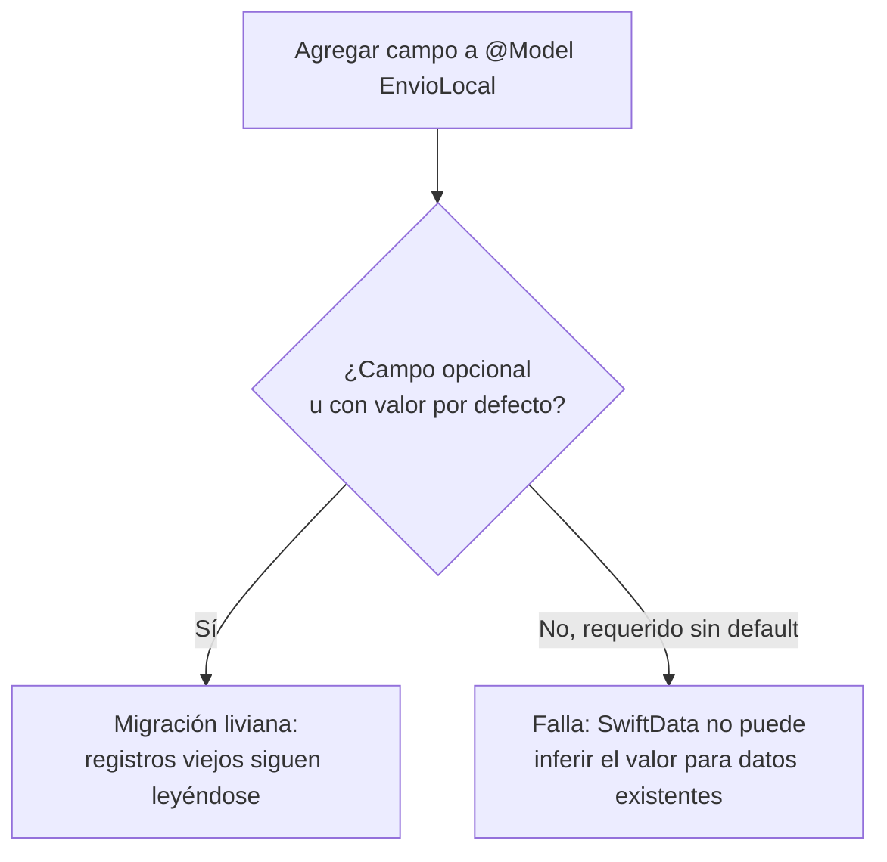
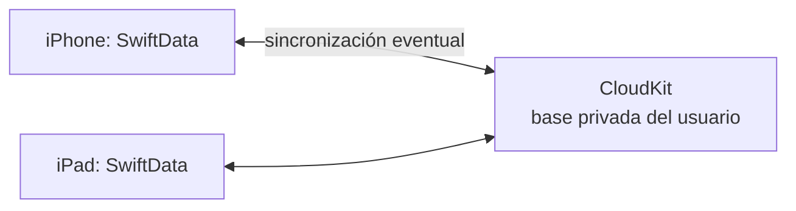
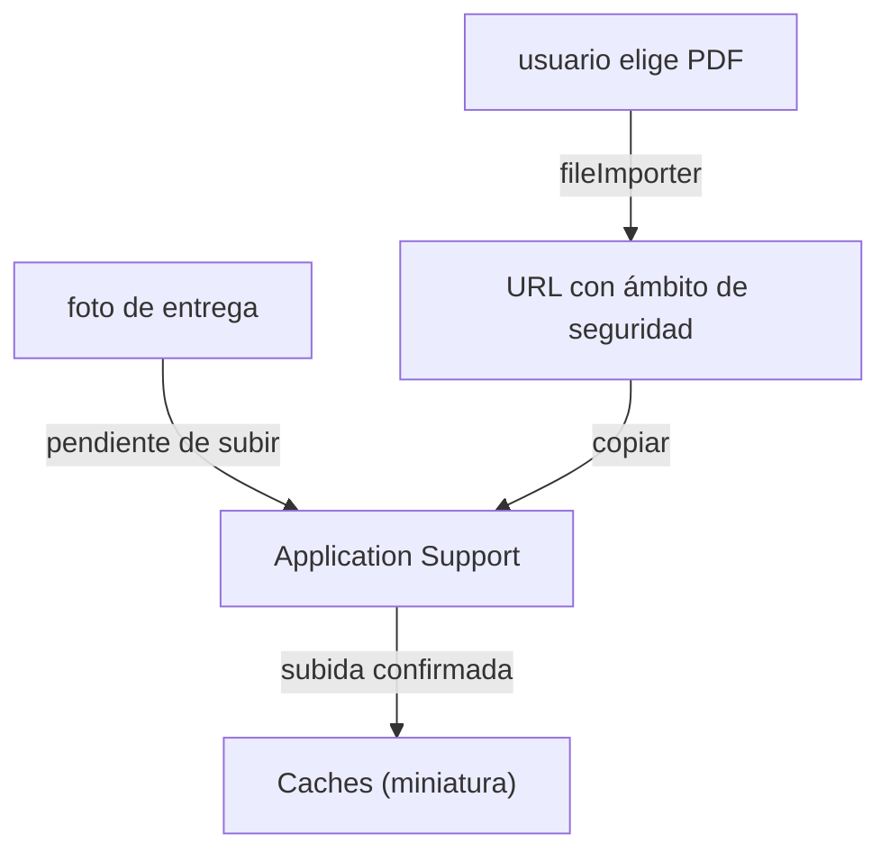

# Módulo 6: Persistencia con SwiftData


**Proyecto del módulo:** para cada práctica, parte de una carpeta vacía y crea en Xcode (File ▸ New ▸ Project ▸ App, interfaz SwiftUI) un proyecto llamado `RutaFlowApp`; escribe manualmente todos los archivos indicados y compila, sin usar proyectos ya preparados.

## Aprende construyendo

### Tema 1: @Model y ModelContainer

#### Paso 1 · Objetivo y preparación
Al finalizar vas a declarar `EnvioLocal` con `@Model` para guardar confirmaciones de entrega mientras el conductor está sin señal, listas para sincronizar después. Prerrequisitos: Módulo 5 de este track.
#### Paso 2 · Contexto y caso real
Si el conductor confirma una entrega en una zona sin señal, `confirmarEntrega` (Módulo 5) va a fallar con `sinConexion` — esa confirmación tiene que guardarse localmente para reintentar en cuanto vuelva la red, no perderse.
#### Paso 3 · Teoría, modelo mental y analogía
`@Model` transforma una clase ordinaria en una entidad persistente completa, generando toda la infraestructura automáticamente — una plantilla arquitectónica que genera los planos técnicos, en vez de dibujarlos a mano como exigiría Core Data puro.

**¿Por qué es importante?** Porque `@Model` genera toda la infraestructura de persistencia a partir de una declaración simple, pero un objeto creado sin pasar por `context.insert()` nunca se persiste ni es observable, aunque el compilador no lo señale.
**Conceptos clave:** declaración de esquema mediante macros, sin configuración manual de `NSManagedObject`.

```swift
@Model
class Tarea {
    var titulo: String
    var completada: Bool
    init(titulo: String, completada: Bool = false) {
        self.titulo = titulo
        self.completada = completada
    }
}
```

```swift
WindowGroup { ContentView() }
    .modelContainer(for: Tarea.self)
```

`@Model` es una macro de Swift que transforma una clase ordinaria en una entidad persistente completa de SwiftData, generando automáticamente todo el código de infraestructura necesario (conformidad a los protocolos internos requeridos, integración con el `ModelContext`) sin que el desarrollador escriba manualmente ese código repetitivo; esto contrasta marcadamente con configurar Core Data directamente, donde definir una entidad equivalente requería crear una subclase de `NSManagedObject`, declarar su esquema en un archivo `.xcdatamodeld` separado mediante una interfaz gráfica, y mantener sincronizados ambos artefactos (el código Swift y el archivo de modelo) manualmente.

`.modelContainer(for: Tarea.self)` en el punto de entrada de la app configura el contenedor de persistencia raíz para el esquema completo, análogo conceptualmente a `@Database` en Room (Módulo 6 del track de Android), estableciendo dónde y cómo se almacenan físicamente los datos persistentes de la app.

**Analogía:** `@Model` es como una plantilla arquitectónica que genera automáticamente todos los planos técnicos detallados de construcción a partir de una descripción simple de alto nivel del edificio deseado, en vez de requerir que un ingeniero dibuje manualmente cada plano técnico por separado y los mantenga sincronizados con la descripción original.

**Implicación práctica:** `@Model` simplifica drásticamente la definición de una entidad persistente frente a configurar Core Data manualmente (`NSManagedObject`, `NSFetchRequest`), generando la infraestructura necesaria automáticamente mediante una macro declarativa.

* Código: escribe la práctica en `ContentView.swift` y los modelos de tu propio proyecto `RutaFlowApp`.
* Proyecto: en el proyecto integrador RutaFlow, guarda la cola de entregas con @Model y ModelContainer.

#### Paso 4 · Demostración guiada desde cero
```swift
@Model
class EnvioLocal {
    var guia: String
    var pin: String
    var sincronizado: Bool
    init(guia: String, pin: String, sincronizado: Bool = false) {
        self.guia = guia
        self.pin = pin
        self.sincronizado = sincronizado
    }
}
```

**Ejecuta el ejemplo:**

```bash
xcodebuild -scheme RutaFlowApp -destination 'generic/platform=iOS Simulator' build
```
Luego corre con ⌘R en el simulador, o abre el canvas de Preview con ⌥⌘↵.

```swift
WindowGroup { AppRutaFlow() }
    .modelContainer(for: EnvioLocal.self)
```
Resultado esperado: `EnvioLocal` queda declarado como entidad persistente completa con solo la macro `@Model` — sin ningún archivo `.xcdatamodeld` separado ni subclase de `NSManagedObject` que mantener sincronizada a mano.
#### Paso 5 · Práctica guiada
Pista: guardá un `EnvioLocal` sin pasar por el `ModelContext` (por ejemplo, creándolo con `let envio = EnvioLocal(...)` e intentando leer sus cambios desde otra parte de la app sin haberlo insertado) — ese es el fallo deliberado: sin `context.insert(envio)`, ese objeto nunca se persiste ni es observable por `@Query` (Tema 2), aunque Swift no se queje en tiempo de compilación.
#### Paso 6 · Práctica independiente
Agregá una relación `Conductor` → `[EnvioLocal]` (un conductor con varias confirmaciones pendientes de sincronizar), y documentá qué pasaría si dos conductores compartieran el mismo dispositivo sin que el modelo distinga a cuál pertenece cada `EnvioLocal`.
#### Paso 7 · Cierre
Entregá `EnvioLocal` declarado y configurado en el `ModelContainer` del Paso 4, el objeto nunca insertado del Paso 5, y la relación Conductor-EnvioLocal del Paso 6; explicá qué código de infraestructura te ahorró la macro `@Model` frente a Core Data manual. Siguiente paso: estudia notificaciones. Errores comunes: guardar UI en modelo, cambios destructivos, contexto en hilo incorrecto y no probar datos antiguos. Fuentes oficiales: https://developer.apple.com/documentation/swiftdata y https://developer.apple.com/documentation/coredata.

### Tema 2: @Query y operaciones de escritura

#### Paso 1 · Objetivo y preparación
Al finalizar vas a mostrar con `@Query` la lista de `EnvioLocal` pendientes de sincronizar (Tema 1), actualizándose sola cuando el conductor confirma una nueva. Prerrequisitos: Tema 1 de este módulo.
#### Paso 2 · Contexto y caso real
Cuando vuelve la señal, RutaFlow necesita saber exactamente qué confirmaciones quedaron guardadas localmente para reenviarlas — una lista que se actualice sola, sin que nadie tenga que refrescarla manualmente.
#### Paso 3 · Teoría, modelo mental y analogía
`@Query` observa automáticamente los datos persistidos y actualiza la vista cada vez que cambian — una pantalla de monitoreo que se refresca sola, sin que un operador la actualice a mano.

**¿Por qué es importante?** Porque `@Query` mantiene la vista sincronizada automáticamente con los datos persistidos, pero modificar un objeto sin confirmar con `context.save()` puede perderse si la app se cierra antes del guardado automático.
**Conceptos clave:** observación automática de la fuente de verdad persistida.

```swift
struct ListaTareasView: View {
    @Query private var tareas: [Tarea] // se actualiza automáticamente cuando los datos cambian
    var body: some View { List(tareas) { Text($0.titulo) } }
}
```

`@Query` en una vista SwiftUI observa automáticamente los datos persistidos por SwiftData, actualizando la vista cada vez que esos datos cambian (una inserción, actualización o eliminación) sin que el desarrollador escriba ningún mecanismo de notificación de cambios manual, el mismo principio que un DAO reactivo devolviendo `Flow` en Room (Módulo 6 del track de Android): la UI se mantiene sincronizada automáticamente con la fuente de verdad persistida, cerrando el ciclo completo desde la base de datos hasta la pantalla.

```swift
@Environment(\.modelContext) private var context

context.insert(Tarea(titulo: "Nueva tarea"))
context.delete(tarea)
try? context.save()
```

`ModelContext`, inyectado vía `@Environment` (Módulo 2), es el objeto a través del cual se realizan todas las operaciones de escritura (inserción, eliminación, y la actualización de propiedades directamente sobre los objetos `@Model` obtenidos, dado que son referencias vivas gestionadas por el contexto); `try? context.save()` persiste esos cambios pendientes de forma explícita al almacenamiento subyacente, aunque SwiftData también realiza guardados automáticos periódicos según ciertas condiciones internas.

**Analogía:** `@Query` es como una pantalla de monitoreo que se actualiza sola en tiempo real cada vez que algo cambia en el almacén subyacente, sin que un operador tenga que refrescarla manualmente; `ModelContext` es como el libro de registro oficial a través del cual se asientan todos los movimientos de entrada y salida del almacén.

**Diagrama:**

```
SwiftData datos cambian → @Query re-evalúa automáticamente → la vista se actualiza sola
```

* Código: escribe la práctica en `ContentView.swift` y los modelos de tu propio proyecto `RutaFlowApp`.
* Proyecto: en el proyecto integrador RutaFlow, lista y actualiza las entregas pendientes con @Query.

**Límites y decisión de uso:** Una consulta reactiva actualiza la vista, pero no define resolución de conflictos ni convierte varias escrituras en una operación de negocio indivisible. Prueba persistencia, restricciones y errores de guardado fuera del caso feliz.

#### Paso 4 · Demostración guiada desde cero
```swift
struct PendientesDeSincronizar: View {
    @Query(filter: #Predicate<EnvioLocal> { !$0.sincronizado }) private var pendientes: [EnvioLocal]
    @Environment(\.modelContext) private var context

    var body: some View {
        List(pendientes) { envio in Text(envio.guia) }
    }

    func confirmarOffline(guia: String, pin: String) {
        context.insert(EnvioLocal(guia: guia, pin: pin))
    }
}
```

**Ejecuta el ejemplo:**

```bash
xcodebuild -scheme RutaFlowApp -destination 'generic/platform=iOS Simulator' build
```
Luego corre con ⌘R en el simulador, o abre el canvas de Preview con ⌥⌘↵.

Resultado esperado: llamar `confirmarOffline(guia: "RF-7001", pin: "111222")` hace que `pendientes` (y por lo tanto la `List`) se actualice sola, mostrando el nuevo envío sin que nadie haya llamado a ningún método de "refrescar".
#### Paso 5 · Práctica guiada
Pista: modificá `envio.sincronizado = true` directamente sobre un objeto `EnvioLocal` obtenido de `pendientes`, pero sin llamar `try? context.save()` después — ese es el fallo deliberado: el cambio puede no persistir de inmediato al almacenamiento subyacente aunque la vista ya lo refleje en memoria; si la app se cierra antes del guardado automático, ese cambio podría perderse.
#### Paso 6 · Práctica independiente
Corregí el Paso 5 agregando `try? context.save()` después de marcar `sincronizado = true`, y agregá un botón "sincronizar todo" que recorra `pendientes`, llame a `confirmarEntrega` (Módulo 5) por cada uno, y marque `sincronizado = true` solo si la llamada real tuvo éxito.
#### Paso 7 · Cierre
Entregá la lista reactiva del Paso 4, el guardado no persistido del Paso 5, y la sincronización real agregada del Paso 6; explicá por qué `@Query` resuelve el mismo problema que un `Flow` reactivo de Room en Android. Siguiente paso: estudia notificaciones. Errores comunes: guardar UI en modelo, cambios destructivos, contexto en hilo incorrecto y no probar datos antiguos. Fuentes oficiales: https://developer.apple.com/documentation/swiftdata y https://developer.apple.com/documentation/coredata.

### Tema 3: Migraciones y SwiftData vs Core Data

#### Paso 1 · Objetivo y preparación
Al finalizar vas a agregarle un campo nuevo a `EnvioLocal` (Tema 1) sin perder las confirmaciones pendientes que ya estaban guardadas en el dispositivo. Prerrequisitos: Temas 1-2 de este módulo.
#### Paso 2 · Contexto y caso real
Si RutaFlow agrega una foto de evidencia a la confirmación offline, los conductores que ya tenían entregas pendientes de sincronizar con la versión vieja del modelo no pueden perder esos datos solo porque la app se actualizó.
#### Paso 3 · Teoría, modelo mental y analogía
SwiftData es un panel de control moderno sobre la misma maquinaria de Core Data — cada cambio de esquema debe versionarse y conservar los datos existentes, como un archivo histórico que nunca descarta registros al cambiar de formato.
**Conceptos clave:** capa moderna sobre el mismo motor probado, elección según necesidad de control fino.

SwiftData es una capa moderna construida directamente sobre el mismo motor subyacente de Core Data (probado en producción durante más de una década en el ecosistema Apple), reemplazando la sintaxis imperativa y verbosa de `NSManagedObject`/`NSFetchRequest` por macros declarativas de Swift (`@Model`, `@Query`); para proyectos nuevos, SwiftData es generalmente la opción recomendada, dado que ofrece la misma robustez del motor subyacente con una experiencia de desarrollo considerablemente más simple y menos propensa a errores de configuración manual.

Core Data directo sigue siendo relevante en dos escenarios concretos: aplicaciones existentes que ya invirtieron considerablemente en su configuración de Core Data (donde una migración completa a SwiftData no siempre justifica el esfuerzo), y casos que requieren control muy fino sobre aspectos avanzados del stack de persistencia (configuraciones específicas de `NSPersistentContainer`, migraciones de esquema extremadamente complejas con lógica de transformación de datos personalizada) que SwiftData, siendo una capa de más alto nivel, todavía no expone con el mismo nivel de detalle granular que la API original de Core Data.

**Analogía:** SwiftData es como un panel de control moderno y simplificado instalado sobre la misma maquinaria industrial robusta que lleva años funcionando de forma confiable (Core Data); para la mayoría de las operaciones diarias, el panel moderno es más fácil de usar, pero un técnico especializado que necesite ajustar parámetros muy específicos de la maquinaria original podría todavía necesitar acceder directamente a los controles originales más detallados.

**¿Por qué es importante?** SwiftData simplifica drásticamente la configuración frente a Core Data manual sin sacrificar la robustez del motor subyacente; Core Data directo sigue siendo relevante para apps existentes o casos que requieren control muy fino no expuesto todavía por la capa de más alto nivel de SwiftData.

**Diagrama:**

```
Core Data (motor subyacente, probado en producción)
        ↑
SwiftData (@Model, @Query — capa declarativa moderna sobre el mismo motor)
```

**Diagrama: migración liviana vs destructiva**



En tu propio proyecto RutaFlow, crea `EnvioLocal.swift` con **File ▸ New ▸ File ▸ Swift File**, selecciona el target de la app y escribe allí el modelo `@Model` del Paso 4.

---

#### Paso 4 · Demostración guiada desde cero
```swift
@Model
class EnvioLocal {
    var guia: String
    var pin: String
    var sincronizado: Bool
    var fotoPath: String?  // nuevo campo, opcional para no romper registros viejos
    init(guia: String, pin: String, sincronizado: Bool = false, fotoPath: String? = nil) {
        self.guia = guia; self.pin = pin; self.sincronizado = sincronizado; self.fotoPath = fotoPath
    }
}
```

**Ejecuta el ejemplo:**

```bash
xcodebuild -scheme RutaFlowApp -destination 'generic/platform=iOS Simulator' build
```
Luego corre con ⌘R en el simulador, o abre el canvas de Preview con ⌥⌘↵.

Resultado esperado: los `EnvioLocal` guardados antes de este cambio siguen leyéndose sin error, con `fotoPath == nil` — agregar un campo opcional es una migración liviana que SwiftData maneja automáticamente.
#### Paso 5 · Práctica guiada
Pista: cambiá `fotoPath` de opcional a requerido (`var fotoPath: String` sin `?`, sin valor por defecto) — ese es el fallo deliberado: los registros `EnvioLocal` ya guardados en el dispositivo de un conductor real no tienen ningún valor para ese campo, y SwiftData no puede migrar automáticamente un campo requerido sin un valor conocido para los datos existentes.
#### Paso 6 · Práctica independiente
Corregí el Paso 5 volviendo a `fotoPath` opcional, y documentá en qué escenario este mismo proyecto preferiría Core Data directo en vez de SwiftData (pista: si necesitaras una migración con lógica de transformación de datos muy específica que SwiftData todavía no expone).

**Proyecto integrador:** usa el proyecto que iniciaste vacío en este tema para ensayar una actualización real sin borrar el contenedor. En `EnvioLocal.swift`, conserva primero la versión con `guia`, `pin` y `sincronizado`; desde `ContentView.swift`, inserta `RF-7001`, guarda y cierra la app. Después agrega `fotoPath: String?`, vuelve a ejecutar y asigna una ruta local a ese mismo registro. En `PruebaMigracion.md`, anota el antes y el después: la segunda apertura debe conservar la guía y el PIN, aceptar inicialmente `fotoPath == nil` y mostrar la nueva ruta tras guardar; no uses un proyecto de otro tema ni reinicies los datos para obtener el resultado.

#### Paso 7 · Cierre
Entregá la migración liviana del Paso 4, el campo requerido que rompe datos existentes del Paso 5, y el escenario de Core Data del Paso 6; explicá por qué un campo opcional es casi siempre más seguro que uno requerido al evolucionar un modelo con datos reales ya guardados. Siguiente paso: estudia notificaciones. Errores comunes: guardar UI en modelo, cambios destructivos, contexto en hilo incorrecto y no probar datos antiguos. Fuentes oficiales: https://developer.apple.com/documentation/swiftdata y https://developer.apple.com/documentation/coredata.
**Implicación práctica:** Un campo opcional permite una migración liviana que preserva los datos ya guardados en el dispositivo, mientras que un campo requerido sin valor por defecto rompe la lectura de los registros existentes.

### Tema 4: CloudKit con SwiftData: sincronizar datos entre los dispositivos del usuario · Avanzado · 45 min

**Prerrequisito:** temas «@Model y ModelContainer» y «Migraciones y SwiftData vs Core Data» de este módulo.

**Al finalizar podrás:** activar la sincronización de un modelo SwiftData con CloudKit, cumplir las reglas que CloudKit exige al esquema y comprobar que un registro creado en un dispositivo aparece en otro.

**¿Por qué es importante?** Un conductor con iPhone y iPad espera ver las mismas notas en los dos. CloudKit sincroniza la base de SwiftData con la cuenta de iCloud del usuario, sin servidor propio.

#### Paso 1 · Objetivo y preparación

Necesitas una cuenta de Apple Developer de pago, dos simuladores o dispositivos con la misma cuenta de iCloud, y en el target las capacidades **iCloud (CloudKit)** con un contenedor `iCloud.co.rutaflow.app` y **Background Modes > Remote notifications**.

#### Paso 2 · Contexto y caso real

Los conductores de RutaFlow anotan observaciones de clientes («dejar en portería»). Algunos usan iPad en la base y iPhone en la calle. Con notas solo locales, la información se quedaba en un dispositivo.

#### Paso 3 · Teoría, modelo mental y analogía

**Conceptos clave:** CloudKit, contenedor, base privada, `ModelConfiguration(cloudKitDatabase:)`, reglas del esquema, sincronización eventual.

SwiftData sincroniza con la **base privada** del usuario en CloudKit cuando el contenedor está configurado. El dato es del usuario y solo él lo ve.

CloudKit impone **reglas al esquema**:

- todas las propiedades deben ser opcionales o tener un valor por defecto;
- no se permite `@Attribute(.unique)`;
- todas las relaciones deben ser opcionales.

La sincronización es **eventual**: los cambios llegan en segundos o minutos, según la red y el sistema. No es apta para datos que varios usuarios editan a la vez; para eso usas tu servidor.

**Analogía:** CloudKit es un cuaderno con copia en cada mochila del usuario que se pone al día solo cuando hay señal. La analogía falla en que no hay aviso exacto del momento: el sistema decide cuándo sincronizar.

**Límite de uso:** solo sirve para datos del propio usuario. No reemplaza la API de RutaFlow para entregas, que comparten conductores y operadores. Cambiar el esquema después de publicar exige cambios compatibles en el entorno de producción de CloudKit.



#### Paso 4 · Demostración guiada desde cero

Archivo `academia-ios/RutaFlowApp/RutaFlowApp/NotaCliente.swift`:

```swift
import Foundation
import SwiftData

@Model
final class NotaCliente {
    // Reglas de CloudKit: valores por defecto, sin .unique, relaciones opcionales.
    var direccion: String = ""
    var texto: String = ""
    var creada: Date = Date.now

    init(direccion: String, texto: String) {
        self.direccion = direccion
        self.texto = texto
    }
}
```

Archivo `academia-ios/RutaFlowApp/RutaFlowApp/RutaFlowApp.swift`:

```swift
import SwiftData
import SwiftUI

@main
struct RutaFlowApp: App {
    let contenedor: ModelContainer = {
        let configuracion = ModelConfiguration(cloudKitDatabase: .private("iCloud.co.rutaflow.app"))
        return try! ModelContainer(for: NotaCliente.self, configurations: configuracion)
    }()

    var body: some Scene {
        WindowGroup { NotasView() }
            .modelContainer(contenedor)
    }
}
```

Compila y ejecuta en dos simuladores:

```bash
xcodebuild -scheme RutaFlowApp -destination 'generic/platform=iOS Simulator' build
# ejecuta en dos simuladores con la misma cuenta de iCloud, crea una nota en uno y espera a que aparezca en el otro
```

**Explicación por bloques:** `NotaCliente` cumple las reglas de CloudKit: cada propiedad tiene valor por defecto y no hay atributos únicos. En la app, `ModelConfiguration(cloudKitDatabase: .private(...))` conecta el almacén con el contenedor de iCloud; el resto del código de SwiftData no cambia. Al crear una nota, SwiftData la guarda localmente y el sistema la sube; el otro dispositivo la recibe por una notificación silenciosa.

**Resultado esperado:**

```text
Una nota creada en el simulador A aparece en el simulador B tras unos segundos a un par de minutos.
En CloudKit Console (icloud.developer.apple.com) se ve el tipo de registro CD_NotaCliente en el entorno Development.
```

**Fallo deliberado:** agrega `@Attribute(.unique) var direccion: String = ""`. **Error esperado:** la app falla al crear el contenedor con un error que indica que CloudKit no admite restricciones únicas. **Diagnóstico:** CloudKit no puede garantizar unicidad entre dispositivos. Quita la restricción y resuelve los duplicados en la lógica de la app.

#### Paso 5 · Práctica guiada

1. **Reproducción:** crea una nota en un simulador y mide cuánto tarda en llegar al otro.
2. **Variación:** borra una nota y comprueba que también desaparece en el otro dispositivo.
3. **Diagnóstico:** reproduce el fallo deliberado con `.unique`.
4. **Integración:** revisa el esquema generado en CloudKit Console y encuentra los campos.
5. **Diseño:** lista qué datos de RutaFlow son del usuario (aptos para CloudKit) y cuáles son compartidos (API propia).

**Pista:** si no sincroniza, revisa que los dos dispositivos usen la misma cuenta de iCloud y que la capacidad de notificaciones remotas esté activa.

#### Paso 6 · Práctica independiente

Agrega una relación opcional `notas` desde un modelo `Cliente` y comprueba que la sincronización conserva la relación.

#### Paso 7 · Cierre

- [ ] Nombras las tres reglas de esquema de CloudKit.
- [ ] Una nota viajó de un dispositivo a otro.
- [ ] Reprodujiste el error de restricción única.
- [ ] Sabes qué datos no van en CloudKit.

Si fallas dos o más, vuelve al Paso 3. **Errores comunes:** usar CloudKit para datos compartidos entre usuarios, olvidar valores por defecto y esperar sincronización inmediata. **Siguiente paso:** el tema siguiente guarda y comparte archivos (fotos, PDF) fuera de la base.

**Transferencia al proyecto integrador «RutaFlow»:** sincroniza con CloudKit las notas privadas del conductor de RutaFlow y mantén las entregas en la API.

**Fuente oficial:** [Apple — Syncing model data across a person’s devices](https://developer.apple.com/documentation/swiftdata/syncing-model-data-across-a-persons-devices).

### Tema 5: Archivos en iOS: FileManager, carpetas de la app y fileImporter · Intermedio · 40 min

**Prerrequisito:** tema «@Model y ModelContainer» de este módulo.

**Al finalizar podrás:** guardar una foto de entrega en la carpeta correcta del contenedor de la app, excluirla del respaldo si se puede regenerar y permitir al usuario importar un PDF con `fileImporter`.

**¿Por qué es importante?** Guardar archivos en el lugar equivocado tiene consecuencias: en `Caches` el sistema los borra, en `Documents` se ven en la app Archivos y ocupan respaldo de iCloud. Elegir bien evita perder evidencia o llenar el iCloud del usuario.

#### Paso 1 · Objetivo y preparación

Continúa `RutaFlowApp`. Crea `AlmacenArchivos.swift`. Para importar, necesitas un PDF de prueba en la app Archivos del simulador (arrastra uno a la ventana del simulador).

#### Paso 2 · Contexto y caso real

La app de RutaFlow guardaba las fotos de entrega en `Caches`. Cuando el teléfono se quedaba sin espacio, iOS las borraba antes de subirlas al servidor y se perdía la evidencia.

#### Paso 3 · Teoría, modelo mental y analogía

**Conceptos clave:** sandbox, `Documents`, `Application Support`, `Caches`, `tmp`, `URL.applicationSupportDirectory`, `isExcludedFromBackup`, acceso con ámbito de seguridad, `fileImporter`.

Cada app vive en su **sandbox**. Sus carpetas principales:

| Carpeta | Para | Respaldo | ¿El sistema la borra? |
|---|---|---|---|
| `Documents` | archivos del usuario, visibles en Archivos si lo habilitas | sí | no |
| `Application Support` | datos internos de la app | sí | no |
| `Caches` | lo que se puede volver a descargar | no | sí, con poco espacio |
| `tmp` | archivos de un momento | no | sí |

Las fotos pendientes de subir van en `Application Support`, no en `Caches`. Si un archivo se puede regenerar, márcalo con `isExcludedFromBackup`.

Para abrir archivos **fuera** del sandbox, `fileImporter` muestra el selector del sistema. La URL recibida requiere `startAccessingSecurityScopedResource()` antes de leerla y `stop...` al terminar.

**Analogía:** las carpetas son cajones de un escritorio: uno para papeles importantes, otro para borradores que el conserje puede tirar. La analogía falla en que el conserje (iOS) no avisa antes de vaciar el cajón de `Caches`.

**Límite de uso:** no guardes archivos grandes en SwiftData o `UserDefaults`: guarda el archivo en disco y en la base solo su ruta. No guardes rutas absolutas: el contenedor puede cambiar de ruta entre instalaciones; guarda la ruta relativa.



#### Paso 4 · Demostración guiada desde cero

Archivo `academia-ios/RutaFlowApp/RutaFlowApp/AlmacenArchivos.swift`:

```swift
import Foundation

struct AlmacenArchivos {
    private let base = URL.applicationSupportDirectory.appending(path: "entregas", directoryHint: .isDirectory)

    func guardarFoto(_ datos: Data, codigo: String) throws -> URL {
        try FileManager.default.createDirectory(at: base, withIntermediateDirectories: true)
        var destino = base.appending(path: "\(codigo).jpg")
        try datos.write(to: destino, options: [.atomic, .completeFileProtection])
        var valores = URLResourceValues()
        valores.isExcludedFromBackup = false // es evidencia: debe respaldarse
        try destino.setResourceValues(valores)
        return destino
    }

    func importar(_ externo: URL) throws -> URL {
        guard externo.startAccessingSecurityScopedResource() else { throw CocoaError(.fileReadNoPermission) }
        defer { externo.stopAccessingSecurityScopedResource() }
        let copia = base.appending(path: externo.lastPathComponent)
        try? FileManager.default.removeItem(at: copia)
        try FileManager.default.copyItem(at: externo, to: copia)
        return copia
    }
}
```

Archivo `academia-ios/RutaFlowApp/RutaFlowApp/AdjuntarPDF.swift`:

```swift
import SwiftUI
import UniformTypeIdentifiers

struct AdjuntarPDF: View {
    @State private var mostrando = false
    @State private var mensaje = "Sin adjunto"

    var body: some View {
        VStack {
            Text(mensaje)
            Button("Adjuntar remisión (PDF)") { mostrando = true }
        }
        .fileImporter(isPresented: $mostrando, allowedContentTypes: [.pdf]) { resultado in
            do {
                let copia = try AlmacenArchivos().importar(try resultado.get())
                mensaje = "Adjuntado: \(copia.lastPathComponent)"
            } catch {
                mensaje = "No se pudo adjuntar: \(error.localizedDescription)"
            }
        }
    }
}
```

Compila, ejecuta en el simulador y revisa el contenedor:

```bash
xcodebuild -scheme RutaFlowApp -destination 'generic/platform=iOS Simulator' build
# tras guardar una foto, revisa la carpeta del contenedor:
xcrun simctl get_app_container booted co.rutaflow.app data
```

**Explicación por bloques:** `AlmacenArchivos` usa `URL.applicationSupportDirectory` y una subcarpeta `entregas`. `guardarFoto` escribe de forma atómica (no deja archivos a medias) y con protección completa (cifrado mientras el teléfono está bloqueado), y deja el archivo en el respaldo porque es evidencia. `importar` abre el acceso con ámbito de seguridad, copia el PDF al sandbox y cierra el acceso con `defer`. `AdjuntarPDF` muestra el selector limitado a PDF.

**Resultado esperado:**

```text
Tras guardar la foto de ENV-42, existe Library/Application Support/entregas/ENV-42.jpg dentro del contenedor de la app.
Al adjuntar un PDF desde Archivos, la vista muestra «Adjuntado: remision.pdf».
```

**Fallo deliberado:** quita `startAccessingSecurityScopedResource()` de `importar`. **Error esperado:** «No se pudo adjuntar» con un error de permiso (`NSCocoaErrorDomain Code=257`). **Diagnóstico:** la URL apunta fuera del sandbox y necesita abrir su acceso de forma explícita. Ábrelo y ciérralo con `defer`.

#### Paso 5 · Práctica guiada

1. **Reproducción:** guarda una foto y encuentra el archivo con `simctl get_app_container`.
2. **Variación:** guarda una miniatura en `Caches` y márcala excluida del respaldo.
3. **Diagnóstico:** reproduce el fallo deliberado sin acceso con ámbito de seguridad.
4. **Integración:** guarda en SwiftData solo la ruta relativa (`entregas/ENV-42.jpg`) y reconstruye la URL al leerla.
5. **Diseño:** escribe la tabla de carpetas de RutaFlow: qué archivo va en cuál y por qué.

**Pista:** si un archivo desaparece solo, revisa si estaba en `Caches` o `tmp`.

#### Paso 6 · Práctica independiente

Borra automáticamente de `Application Support` las fotos cuya subida el servidor confirmó hace más de siete días, y registra cuántos bytes liberaste.

#### Paso 7 · Cierre

- [ ] Eliges la carpeta correcta para cada tipo de archivo.
- [ ] La foto queda en `Application Support/entregas`.
- [ ] Reprodujiste el error de permiso al importar.
- [ ] Guardas rutas relativas, no absolutas.

Si fallas dos o más, vuelve al Paso 3. **Errores comunes:** guardar evidencia en `Caches`, guardar rutas absolutas y olvidar cerrar el acceso con ámbito de seguridad. **Siguiente paso:** el módulo 13 protege estos archivos con las clases de protección de datos.

**Transferencia al proyecto integrador «RutaFlow»:** guarda las fotos de entrega de RutaFlow en `Application Support` con protección completa y bórralas solo cuando el servidor confirme la subida.

**Fuente oficial:** [Apple — File System Programming Guide: File system basics](https://developer.apple.com/library/archive/documentation/FileManagement/Conceptual/FileSystemProgrammingGuide/FileSystemOverview/FileSystemOverview.html) y [Apple — fileImporter](https://developer.apple.com/documentation/swiftui/view/fileimporter(ispresented:allowedcontenttypes:allowsmultipleselection:oncompletion:)).

## Laboratorio práctico

**Objetivo del laboratorio:** construir una app con persistencia local en SwiftData y una vista que reacciona a cambios.

**Requisitos previos:** Módulo 5 completado.

| Paso | Acción | Código | Explicación |
|---|---|---|---|
| 1 | Definir un modelo con `@Model` | Ver Tema 1 | Configurar `ModelContainer` en el entry point |
| 2 | Usar `@Query` para observar los datos | Ver Tema 2 | Actualización automática de la vista |
| 3 | Insertar, actualizar y eliminar vía `ModelContext` | Ver Tema 2 | Verifica que la vista se actualiza sola |
| 4 | Agregar un campo nuevo al modelo | Ver Tema 3 | Documenta cómo SwiftData maneja la migración |

**Verificación:** el laboratorio se considera exitoso si la vista con `@Query` se actualiza automáticamente al insertar, actualizar o eliminar un registro a través del `ModelContext`, sin ningún código adicional de notificación manual.

**Errores comunes y soluciones**

- **Configurar Core Data manualmente para un proyecto nuevo sin necesidad concreta de control fino.** Prefiere SwiftData para proyectos nuevos por su simplicidad.
- **Olvidar `try? context.save()` tras cambios que requieren persistencia inmediata.** Aunque SwiftData guarda automáticamente en ciertas condiciones, no asumas que siempre ocurre de inmediato.
- **Modificar un objeto `@Model` fuera de un `ModelContext` válido.** Los objetos `@Model` son referencias vivas gestionadas por su contexto correspondiente.

---

* Código: escribe la práctica en `ContentView.swift` y los modelos de tu propio proyecto `RutaFlowApp`.
* Proyecto: en el proyecto integrador RutaFlow, migra el esquema de entregas y documenta la decisión frente a Core Data.
