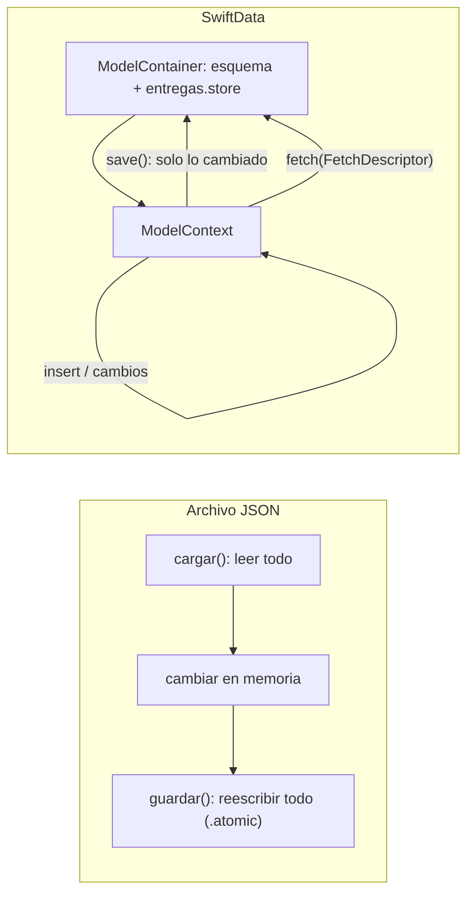
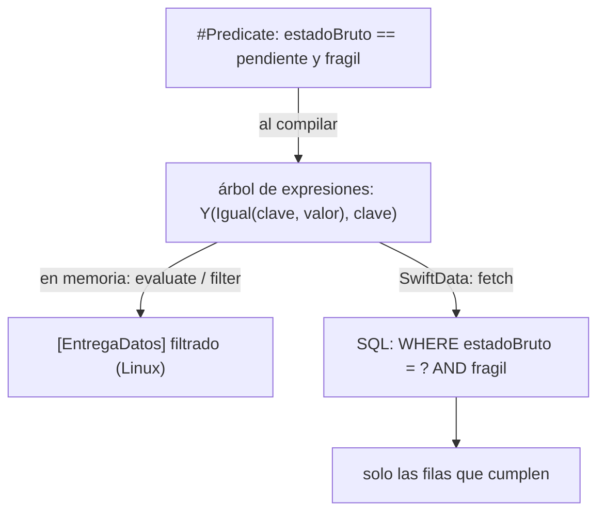
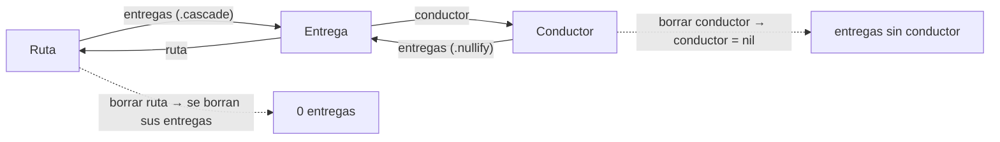
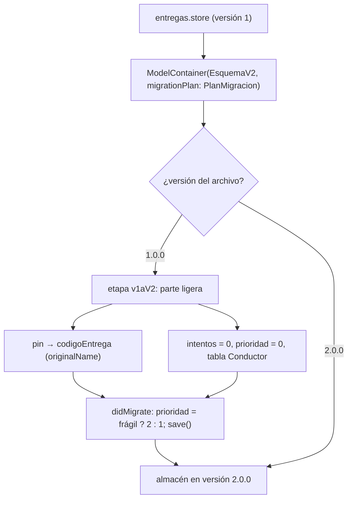

# Módulo 6: Persistencia con SwiftData

**Entorno comprobado para esta edición (2026-11-25):** SwiftData solo existe en las plataformas de Apple, así que
este módulo se ejecutó sobre todo en una Mac con macOS 27.2, Xcode 27.2 (27B52), Swift 6.4.2 y el simulador iPhone 17
con iOS 27.2: las pruebas de SwiftData corren dentro del simulador (con contenedores en memoria y en disco), los
errores de compilación se obtuvieron con el compilador del SDK de iOS (`swiftc -typecheck`), y la app real se abrió,
se cerró y se volvió a abrir para ver que los datos siguen ahí. Lo que no depende de Apple (los estados de una
entrega, los datos de muestra, un almacén en un archivo JSON para comparar y los predicados de Foundation) se
escribió en Swift 6.4.3 y se probó en Linux x86_64 con Swift Testing 6.4.3, en `/home/estudiante/labs/ios/ios6`
(tu `~/labs/ios/ios6`), y otra vez en la Mac con `swift test`. Límites honestos: la sincronización con iCloud
(CloudKit) necesita una cuenta de desarrollador y un dispositivo con sesión iniciada, y no se ejecutó; se explica al
final del Tema 3 sin salidas.

Una app de reparto no puede perder lo que el repartidor hizo porque el teléfono se quedó sin batería o porque
cerró la app. En este módulo la ruta del día se guarda en el dispositivo con SwiftData: los modelos se declaran como
clases de Swift, se consultan con predicados que el compilador revisa, se relacionan entre sí con reglas de
borrado y cambian de versión sin perder lo que ya estaba guardado.

**Al terminar este módulo podrás:**
- declarar modelos con `@Model`, crear un `ModelContainer` en disco o en memoria y guardar con `ModelContext`;
- consultar con `FetchDescriptor`, `#Predicate` y `SortDescriptor`, y mostrar resultados con `@Query`;
- relacionar modelos con `@Relationship`, sus inversos y sus reglas de borrado;
- versionar el esquema con `VersionedSchema` y migrar con `SchemaMigrationPlan` sin perder datos;
- decidir cuándo basta un archivo JSON y cuándo conviene SwiftData.

**Esquema del módulo:** Tema 1 (`@Model`, contenedor y contexto; comparación con un archivo JSON) → Tema 2
(consultas y `@Query`) → Tema 3 (relaciones) → Tema 4 (migraciones) → Proyecto 43.

**Qué necesitas saber antes:** del Módulo 5, **`Codable` y `JSONDecoder`** (Tema 1); del Módulo 4, **`@MainActor` y
`Sendable`** (Temas 3 y 6); del Módulo 2, **`@State` y `@Environment`** (Temas 1 y 3); del Módulo 0, **`struct` y
`class`** (Tema 2) y **los enums con valor bruto** (Tema 3).

**Qué no se repite:** cómo se arma una lista en SwiftUI (Módulo 1) ni cómo se decodifica JSON (Módulo 5). Aquí se
trata de **guardar**: dónde, cómo se consulta y qué pasa cuando el modelo cambia.

**Prepara el proyecto:**

```text
$ mkdir -p ~/labs/ios/ios6 && cd ~/labs/ios/ios6
$ mkdir nucleo && cd nucleo
$ swift package init --type library --name Nucleo
```

```swift
// swift-tools-version: 6.0
import PackageDescription

let package = Package(
    name: "Nucleo",
    platforms: [.macOS(.v15), .iOS(.v18)],
    products: [.library(name: "Entregas", targets: ["Entregas"])],
    targets: [
        // Lógica sin SwiftData: estados, datos de muestra, un almacén en JSON. Se copia a la app.
        .target(name: "Entregas"),
        .testTarget(name: "EntregasTests", dependencies: ["Entregas"]),
    ]
)
```

La estructura final:

```text
ios6/
├── nucleo/                              paquete de Swift sin SwiftData (swift test en Linux y en la Mac)
│   ├── Sources/Entregas/                estados, datos de muestra, almacén JSON; se copia a la app
│   └── Tests/EntregasTests/             pruebas por tema
├── ejemplos_que_fallan/                 errores de compilación provocados a propósito
└── app/                                 proyecto de Xcode DatosApp
    ├── App/Esquemas.swift               modelos @Model en dos versiones y el plan de migración
    ├── App/PantallaRuta.swift           la lista con @Query
    ├── App/DatosApp.swift               la app
    └── Pruebas/                         pruebas de SwiftData en el simulador y capturas
```

En la Mac, crea la app con **File ▸ New ▸ Project ▸ iOS ▸ App**, nombre `DatosApp`, interfaz SwiftUI, almacenamiento
**None** (el contenedor se crea a mano en el Tema 1), pruebas con Swift Testing, iOS 18.0 como mínimo; y agrega una
copia de `nucleo/Sources/Entregas` en `App/Nucleo/`.


## Aprende construyendo


### Tema 1: @Model, ModelContainer y ModelContext · Intermedio · 50 min

<details open>
<summary><strong>Capa 1 — Lectura</strong></summary>

#### Objetivos
Al terminar este tema podrás:
- guardar una lista en un archivo JSON con escritura atómica, y medir lo que cuesta cambiar un solo elemento;
- declarar un modelo con `@Model` y crear el contenedor en disco o en memoria;
- insertar, guardar y volver a leer después de «cerrar y abrir» la app;
- saber dónde queda el archivo de la base de datos y qué pasa si no se llama a `save()`.

**Conceptos clave:** escritura atómica, `@Model`, `ModelContainer`, `ModelContext`, `@Attribute(.unique)`

#### El problema
La app de la ruta guarda las entregas del día en `UserDefaults` como un arreglo de diccionarios. Funciona con diez,
pero con dos mil cada cambio reescribe todo, buscar las pendientes obliga a leerlo todo, y un día la app se cerró a
mitad de una escritura y la lista apareció vacía.

Este tema usa **`Codable`** (Módulo 5, Tema 1) y **las clases** (Módulo 0, Tema 2).

#### Glosario del tema

**escritura atómica**
- **Definición técnica:** `Data.write(to:options: .atomic)` escribe en un archivo temporal y, al terminar, lo renombra sobre el destino; el renombrado es una sola operación del sistema de archivos.
- **En palabras sencillas:** pasar a limpio en otra hoja y cambiar la hoja entera, nunca tachar sobre la buena.
- **Dónde se rompe la comparación:** protege de archivos a medias, no de dos escrituras que se pisan entre sí.
- **Ejemplo:** `try datos.write(to: archivo, options: .atomic)`.
- **Error típico:** escribir sin `.atomic` un archivo que la app lee al arrancar.

**`@Model`**
- **Definición técnica:** macro de SwiftData que convierte una clase en un modelo persistente: cada propiedad guardada pasa a ser un atributo o una relación, y la clase conforma `PersistentModel` (y con eso `Identifiable` y `Observable`).
- **En palabras sencillas:** la etiqueta que dice «esto se guarda».
- **Dónde se rompe la comparación:** solo se guardan las propiedades almacenadas; las calculadas no existen para la base de datos (Tema 2).
- **Ejemplo:** `@Model final class Entrega { @Attribute(.unique) var guia: String … }`.
- **Error típico:** ponerlo en un `struct` (no compila: abajo, en la Mac).

**`ModelContainer`**
- **Definición técnica:** el objeto que conoce el esquema (los tipos de modelo) y el almacén (un archivo SQLite o la memoria); se crea una vez y se comparte. Es `Sendable`.
- **En palabras sencillas:** la bodega con sus estantes.
- **Dónde se rompe la comparación:** la bodega puede no existir todavía: el contenedor crea el archivo la primera vez.
- **Ejemplo:** `ModelContainer(for: esquema, migrationPlan: PlanMigracion.self, configurations: configuracion)`.
- **Error típico:** crear un contenedor nuevo en cada pantalla.

**`ModelContext`**
- **Definición técnica:** el espacio de trabajo donde se insertan, cambian y borran objetos antes de guardarlos con `save()`; `mainContext` es el del actor principal y es el que usan las vistas. No es `Sendable`.
- **En palabras sencillas:** la mesa donde preparas los cambios antes de llevarlos a la bodega.
- **Dónde se rompe la comparación:** el contexto principal también guarda solo (`autosaveEnabled`), en momentos que no controlas.
- **Ejemplo:** `contexto.insert(entrega); try contexto.save()`.
- **Error típico:** usar un mismo objeto desde otra tarea dando por hecho que el compilador avisaría (en la prueba del Tema 1, no avisó).

**`@Attribute(.unique)`**
- **Definición técnica:** opción de atributo que impide dos filas con el mismo valor; al insertar un duplicado, SwiftData actualiza la fila existente en lugar de crear otra.
- **En palabras sencillas:** la guía es como la cédula: no hay dos.
- **Dónde se rompe la comparación:** no avisa con un error: reemplaza.
- **Ejemplo:** `@Attribute(.unique) var guia: String`.
- **Error típico:** esperar un error al insertar un duplicado: en la prueba, el segundo `save()` no falló y quedó 1 fila, con el destinatario de la segunda inserción.

#### ► CÓMO FUNCIONA
Con un archivo JSON, la app lee todo a memoria, cambia lo que necesita y vuelve a escribir todo. Con SwiftData, el
contenedor abre una base de datos SQLite; el contexto lleva la cuenta de lo insertado y cambiado, y `save()` escribe
solo eso. Al volver a abrir, un `FetchDescriptor` pide a la base lo que necesita.



#### Problema resuelto 1.1
Primero, en cualquier sistema: guarda la ruta en un archivo JSON, léela «en otro arranque», prueba un archivo que
todavía no existe y uno cortado a mitad, y mide con 2 000 entregas. Después, en la Mac: declara los modelos, crea el
contenedor en disco, guarda 3 entregas, ábrelo de nuevo, mira dónde vive el almacén por defecto, qué pasa sin
`save()` y con una guía repetida.

**Razonamiento:**
1. Los estados y las reglas no dependen de SwiftData: van en el paquete `nucleo` y se prueban en Linux.
2. `EntregaDatos` es el mismo dato como valor (`struct Codable`): sirve para el JSON y para sembrar SwiftData.
3. El almacén JSON escribe con `.atomic`; si el archivo no existe, la lista está vacía (primer arranque).
4. En SwiftData, «otro arranque» es otro `ModelContainer` sobre el mismo archivo.
5. Los modelos se escriben desde el principio dentro de un esquema versionado (Tema 4), con `typealias` para usar
   `Entrega` y `Ruta` sin el prefijo de la versión.

```swift
// EstadoEntrega.swift — los estados de una entrega y qué cambios están permitidos.
public enum EstadoEntrega: String, Codable, CaseIterable, Sendable {
    case pendiente
    case enRuta = "en_ruta"
    case entregada
    case fallida

    /// pendiente → en_ruta → entregada | fallida; una fallida puede volver a salir (en_ruta).
    public func puedePasar(a nuevo: EstadoEntrega) -> Bool {
        switch (self, nuevo) {
        case (.pendiente, .enRuta), (.enRuta, .entregada), (.enRuta, .fallida), (.fallida, .enRuta): true
        default: false
        }
    }
}
```

```swift
// EntregaDatos.swift — una entrega como valor: lo que se guarda en JSON y lo que se copia desde y hacia SwiftData.
import Foundation

public struct EntregaDatos: Codable, Equatable, Sendable {
    public var guia: String
    public var destinatario: String
    public var direccion: String
    public var estado: EstadoEntrega
    public var fragil: Bool
    public var ventanaInicio: Date
    public var intentos: Int

    public init(
        guia: String, destinatario: String, direccion: String, estado: EstadoEntrega = .pendiente,
        fragil: Bool = false, ventanaInicio: Date, intentos: Int = 0
    ) {
        self.guia = guia
        self.destinatario = destinatario
        self.direccion = direccion
        self.estado = estado
        self.fragil = fragil
        self.ventanaInicio = ventanaInicio
        self.intentos = intentos
    }
}

public enum Muestras {
    static let nombres = ["Ana Ruiz", "Luis Pardo", "Marta Gil", "Jorge Rincón", "Paula Díaz", "Iván Mora"]
    static let calles = ["Cra 7 # 45-10", "Cl 72 # 11-30", "Av 68 # 22-05", "Cl 26 # 59-41", "Cra 15 # 93-60"]

    /// `cantidad` entregas fijas desde EN-4471, una cada 10 minutos desde las 8:00 de Bogotá (13:00 UTC);
    /// una de cada cuatro es frágil y una de cada tres ya salió (en_ruta).
    public static func ruta(cantidad: Int) -> [EntregaDatos] {
        let inicio = Date(timeIntervalSince1970: 1_795_611_600)  // 2026-11-25 13:00 UTC
        return (0..<cantidad).map { i in
            EntregaDatos(
                guia: "EN-\(4471 + i)", destinatario: nombres[i % nombres.count],
                direccion: "\(calles[i % calles.count]), Bogotá", estado: i % 3 == 1 ? .enRuta : .pendiente,
                fragil: i % 4 == 1, ventanaInicio: inicio.addingTimeInterval(Double(i) * 600))
        }
    }
}
```

```swift
// AlmacenJSON.swift — guardar una lista de valores Codable en un archivo: la alternativa más simple a SwiftData.
import Foundation

public struct AlmacenJSON<Valor: Codable & Sendable>: Sendable {
    public let archivo: URL

    public init(archivo: URL) {
        self.archivo = archivo
    }

    /// Lee todo el archivo; si todavía no existe, devuelve una lista vacía.
    public func cargar() throws -> [Valor] {
        guard FileManager.default.fileExists(atPath: archivo.path) else { return [] }
        let datos = try Data(contentsOf: archivo)
        let decodificador = JSONDecoder()
        decodificador.dateDecodingStrategy = .iso8601
        return try decodificador.decode([Valor].self, from: datos)
    }

    /// Escribe la lista completa. `.atomic` escribe en un archivo temporal y lo renombra: si la app se cierra a
    /// mitad de camino, queda el archivo anterior entero, nunca uno a medias.
    public func guardar(_ valores: [Valor]) throws {
        try FileManager.default.createDirectory(
            at: archivo.deletingLastPathComponent(), withIntermediateDirectories: true)
        let codificador = JSONEncoder()
        codificador.dateEncodingStrategy = .iso8601
        codificador.outputFormatting = [.sortedKeys]
        try codificador.encode(valores).write(to: archivo, options: .atomic)
    }
}
```

```swift
// Apoyo.swift — carpetas temporales y medición de tiempos para las pruebas.
import Foundation

/// Una carpeta nueva y vacía para cada prueba.
func carpetaTemporal(_ nombre: String) -> URL {
    let carpeta = FileManager.default.temporaryDirectory.appending(path: "ios6-\(nombre)-\(UUID().uuidString)")
    try? FileManager.default.createDirectory(at: carpeta, withIntermediateDirectories: true)
    return carpeta
}

/// Ejecuta `bloque` y devuelve su resultado y los milisegundos que tardó.
func medir<T>(_ bloque: () throws -> T) rethrows -> (T, String) {
    let inicio = ContinuousClock.now
    let valor = try bloque()
    let d = ContinuousClock.now - inicio
    let ms = Double(d.components.seconds) * 1000 + Double(d.components.attoseconds) / 1e15
    return (valor, String(format: "%.1f ms", ms))
}

func tamano(_ archivo: URL) -> Int {
    ((try? FileManager.default.attributesOfItem(atPath: archivo.path))?[.size] as? Int) ?? 0
}
```

```swift
// Tema1AlmacenTests.swift — el mismo problema de persistencia resuelto con un archivo JSON.
import Foundation
import Testing

@testable import Entregas

@Suite("Tema 1 · Un archivo JSON como almacén", .serialized)
struct Tema1AlmacenTests {
    @Test func guardaYVuelveACargar() throws {
        let archivo = carpetaTemporal("guardar").appending(path: "Application Support/entregas.json")
        let almacen = AlmacenJSON<EntregaDatos>(archivo: archivo)
        try almacen.guardar(Muestras.ruta(cantidad: 3))
        let leidas = try AlmacenJSON<EntregaDatos>(archivo: archivo).cargar()  // otra instancia: otro arranque
        print("guardadas 3, leídas \(leidas.count): \(leidas.map(\.guia)) · archivo de \(tamano(archivo)) bytes")
        #expect(leidas == Muestras.ruta(cantidad: 3))
    }

    @Test func archivoQueTodaviaNoExiste() throws {
        let almacen = AlmacenJSON<EntregaDatos>(archivo: carpetaTemporal("nuevo").appending(path: "entregas.json"))
        let leidas = try almacen.cargar()
        print("primer arranque: \(leidas.count) entregas")
        #expect(leidas.isEmpty)
    }

    @Test func archivoCortadoAMitad() throws {
        let archivo = carpetaTemporal("cortado").appending(path: "entregas.json")
        try Data(#"[{"guia":"EN-4471","destinatario":"Ana"#.utf8).write(to: archivo)
        #expect(throws: DecodingError.self) {
            do {
                _ = try AlmacenJSON<EntregaDatos>(archivo: archivo).cargar()
            } catch {
                print("archivo cortado: \(error)")
                throw error
            }
        }
    }

    /// Para comparar con SwiftData (Tema 2): 2 000 entregas, buscar las pendientes y cambiar una.
    @Test func dosMilEntregas() throws {
        let archivo = carpetaTemporal("2000").appending(path: "entregas.json")
        let almacen = AlmacenJSON<EntregaDatos>(archivo: archivo)
        let (_, tGuardar) = try medir { try almacen.guardar(Muestras.ruta(cantidad: 2000)) }
        let (pendientes, tBuscar) = try medir { try almacen.cargar().filter { $0.estado == .pendiente }.count }
        let (_, tCambiar) = try medir {
            var todas = try almacen.cargar()
            todas[1500].estado = .enRuta
            try almacen.guardar(todas)
        }
        print("JSON con 2000 entregas: \(tamano(archivo)) bytes")
        print("  guardar todo: \(tGuardar) · cargar y filtrar \(pendientes) pendientes: \(tBuscar)")
        print("  cambiar una sola entrega (leer y reescribir todo): \(tCambiar)")
        #expect(pendientes == 1333)
    }
}
```

```text
$ swift test --skip-build --filter Tema1AlmacenTests
◇ Test run started.
↳ Testing Library Version: 6.4.3 (ba0861fb203553c)
↳ Target Platform: x86_64-unknown-linux-gnu
◇ Suite "Tema 1 · Un archivo JSON como almacén" started.
◇ Test guardaYVuelveACargar() started.
✔ Test guardaYVuelveACargar() passed after 0.003 seconds.
◇ Test archivoQueTodaviaNoExiste() started.
✔ Test archivoQueTodaviaNoExiste() passed after 0.001 seconds.
◇ Test archivoCortadoAMitad() started.
guardadas 3, leídas 3: ["EN-4471", "EN-4472", "EN-4473"] · archivo de 511 bytes
primer arranque: 0 entregas
archivo cortado: DecodingError.dataCorrupted: Data was corrupted. Debug description: The given data was not valid JSON.
✔ Test archivoCortadoAMitad() passed after 0.001 seconds.
◇ Test dosMilEntregas() started.
JSON con 2000 entregas: 342896 bytes
  guardar todo: 15.4 ms · cargar y filtrar 1333 pendientes: 11.5 ms
  cambiar una sola entrega (leer y reescribir todo): 26.9 ms
✔ Test dosMilEntregas() passed after 0.056 seconds.
✔ Suite "Tema 1 · Un archivo JSON como almacén" passed after 0.062 seconds.
✔ Test run with 4 tests in 1 suite passed after 0.063 seconds.
```

Los modelos de SwiftData (el archivo completo, con la versión 1, la 2 y el plan que se explica en el Tema 4):

```swift
// Esquemas.swift — los modelos de SwiftData en dos versiones y el plan para pasar de una a otra.
import Foundation
import SwiftData

/// Versión 1, la que se publicó primero.
enum EsquemaV1: VersionedSchema {
    static var versionIdentifier: Schema.Version { Schema.Version(1, 0, 0) }
    static var models: [any PersistentModel.Type] { [Ruta.self, Entrega.self] }

    @Model final class Ruta {
        var nombre: String
        var fecha: Date
        @Relationship(deleteRule: .cascade, inverse: \Entrega.ruta) var entregas: [Entrega] = []

        init(nombre: String, fecha: Date) {
            self.nombre = nombre
            self.fecha = fecha
        }
    }

    @Model final class Entrega {
        @Attribute(.unique) var guia: String
        var destinatario: String
        var direccion: String
        var estadoBruto: String
        var fragil: Bool
        var ventanaInicio: Date
        var pin: String
        var ruta: Ruta?

        init(guia: String, destinatario: String, direccion: String, fragil: Bool, ventanaInicio: Date, pin: String) {
            self.guia = guia
            self.destinatario = destinatario
            self.direccion = direccion
            self.estadoBruto = EstadoEntrega.pendiente.rawValue
            self.fragil = fragil
            self.ventanaInicio = ventanaInicio
            self.pin = pin
        }
    }
}

/// Versión 2: `pin` se llama `codigoEntrega`, hay `intentos` y `prioridad`, y aparece `Conductor`.
enum EsquemaV2: VersionedSchema {
    static var versionIdentifier: Schema.Version { Schema.Version(2, 0, 0) }
    static var models: [any PersistentModel.Type] { [Ruta.self, Entrega.self, Conductor.self] }

    @Model final class Ruta {
        var nombre: String
        var fecha: Date
        /// Borrar la ruta borra sus entregas.
        @Relationship(deleteRule: .cascade, inverse: \Entrega.ruta) var entregas: [Entrega] = []

        init(nombre: String, fecha: Date) {
            self.nombre = nombre
            self.fecha = fecha
        }
    }

    @Model final class Conductor {
        var nombre: String
        /// Regla por defecto (.nullify): borrar al conductor deja sus entregas sin conductor.
        @Relationship(inverse: \Entrega.conductor) var entregas: [Entrega] = []

        init(nombre: String) {
            self.nombre = nombre
        }
    }

    @Model final class Entrega {
        @Attribute(.unique) var guia: String
        var destinatario: String
        var direccion: String
        var estadoBruto: String  // se guarda el texto; `estado` lo traduce
        var fragil: Bool
        var ventanaInicio: Date
        @Attribute(originalName: "pin") var codigoEntrega: String
        var intentos: Int = 0
        var prioridad: Int = 0
        var ruta: Ruta?
        var conductor: Conductor?

        init(
            guia: String, destinatario: String, direccion: String, estado: EstadoEntrega = .pendiente,
            fragil: Bool = false, ventanaInicio: Date, codigoEntrega: String = "", prioridad: Int = 1
        ) {
            self.guia = guia
            self.destinatario = destinatario
            self.direccion = direccion
            self.estadoBruto = estado.rawValue
            self.fragil = fragil
            self.ventanaInicio = ventanaInicio
            self.codigoEntrega = codigoEntrega
            self.prioridad = prioridad
        }

        /// Propiedad calculada: no se guarda, y por eso no sirve dentro de un #Predicate (Tema 2).
        var estado: EstadoEntrega {
            get { EstadoEntrega(rawValue: estadoBruto) ?? .pendiente }
            set { estadoBruto = newValue.rawValue }
        }

        /// Cambia el estado solo si la regla del dominio lo permite.
        @discardableResult
        func avanzar(a nuevo: EstadoEntrega) -> Bool {
            guard estado.puedePasar(a: nuevo) else { return false }
            estado = nuevo
            if nuevo == .fallida { intentos += 1 }
            return true
        }
    }
}

/// Los nombres que usa el resto de la app: siempre la versión actual.
typealias Ruta = EsquemaV2.Ruta
typealias Entrega = EsquemaV2.Entrega
typealias Conductor = EsquemaV2.Conductor

extension EsquemaV2.Entrega {
    convenience init(datos: EntregaDatos) {
        self.init(
            guia: datos.guia, destinatario: datos.destinatario, direccion: datos.direccion, estado: datos.estado,
            fragil: datos.fragil, ventanaInicio: datos.ventanaInicio, prioridad: datos.fragil ? 2 : 1)
    }
}

/// De la versión 1 a la 2: el cambio de nombre y los campos nuevos los infiere SwiftData; la prioridad se calcula.
enum PlanMigracion: SchemaMigrationPlan {
    static var schemas: [any VersionedSchema.Type] { [EsquemaV1.self, EsquemaV2.self] }
    static var stages: [MigrationStage] { [v1aV2] }

    static var v1aV2: MigrationStage {
        MigrationStage.custom(
            fromVersion: EsquemaV1.self, toVersion: EsquemaV2.self, willMigrate: nil,
            didMigrate: { contexto in
                for entrega in try contexto.fetch(FetchDescriptor<EsquemaV2.Entrega>()) {
                    entrega.prioridad = entrega.fragil ? 2 : 1
                }
                try contexto.save()
            })
    }
}

enum Almacen {
    /// El contenedor de la app: versión 2 con su plan de migración, en disco (o en memoria para pruebas).
    static func contenedor(url: URL? = nil, enMemoria: Bool = false) throws -> ModelContainer {
        let esquema = Schema(versionedSchema: EsquemaV2.self)
        let configuracion =
            if let url {
                ModelConfiguration(schema: esquema, url: url)
            } else {
                ModelConfiguration(schema: esquema, isStoredInMemoryOnly: enMemoria)
            }
        return try ModelContainer(for: esquema, migrationPlan: PlanMigracion.self, configurations: configuracion)
    }

    /// Borra todo y crea una ruta con `cantidad` entregas de muestra.
    @MainActor
    static func sembrar(_ contexto: ModelContext, cantidad: Int) throws {
        try contexto.delete(model: Entrega.self)
        try contexto.delete(model: Ruta.self)
        try contexto.delete(model: Conductor.self)
        let ruta = Ruta(nombre: "Ruta norte", fecha: Date(timeIntervalSince1970: 1_795_611_600))
        contexto.insert(ruta)
        for datos in Muestras.ruta(cantidad: cantidad) {
            let entrega = Entrega(datos: datos)
            contexto.insert(entrega)
            entrega.ruta = ruta  // SwiftData completa el otro lado: ruta.entregas
        }
        try contexto.save()
    }
}
```

Las pruebas en el simulador:

```swift
// Tema1ModeloTests.swift — @Model, ModelContainer y ModelContext: guardar en disco y volver a abrir.
import Foundation
import SwiftData
import Testing

@testable import DatosApp

@MainActor
@Suite("Tema 1 · Modelo y contenedor", .serialized, .enabled(if: sinRiesgo))
struct Tema1ModeloTests {
    func nota(_ linea: String) { anotar(linea, en: "modelo.txt") }

    @Test func guardarYVolverAAbrir() throws {
        let carpeta = carpetaTemporal("disco")
        let url = carpeta.appending(path: "entregas.store")
        do {
            let contenedor = try Almacen.contenedor(url: url)
            try Almacen.sembrar(contenedor.mainContext, cantidad: 3)
            nota("primer arranque: 3 entregas guardadas · archivos: \(archivos(en: carpeta))")
        }
        let otro = try Almacen.contenedor(url: url)  // como si la app se hubiera cerrado y vuelto a abrir
        let entregas = try otro.mainContext.fetch(FetchDescriptor<Entrega>(sortBy: [SortDescriptor(\.guia)]))
        nota("segundo arranque: \(entregas.map(\.guia)) · ruta de la primera: \(entregas.first?.ruta?.nombre ?? "-")")
        #expect(entregas.count == 3)
    }

    @Test func dondeViveElAlmacenPorDefecto() {
        let url = ModelConfiguration().url
        nota("ModelConfiguration().url → …/\(url.pathComponents.suffix(3).joined(separator: "/"))")
        #expect(url.lastPathComponent == "default.store")
    }

    @Test func sinLlamarASave() throws {
        let carpeta = carpetaTemporal("sin-save")
        let url = carpeta.appending(path: "entregas.store")
        do {
            let contenedor = try Almacen.contenedor(url: url)
            let contexto = contenedor.mainContext
            contexto.insert(Entrega(guia: "EN-4471", destinatario: "Ana Ruiz", direccion: "Cra 7", ventanaInicio: .now))
            nota(
                "insertada sin save(): hasChanges = \(contexto.hasChanges), autosaveEnabled = \(contexto.autosaveEnabled)"
            )
        }
        let otro = try Almacen.contenedor(url: url)
        let cuantas = try otro.mainContext.fetchCount(FetchDescriptor<Entrega>())
        nota("al volver a abrir: \(cuantas) entregas")
    }

    @Test func guiaRepetidaConUnique() throws {
        let contenedor = try Almacen.contenedor(enMemoria: true)
        let contexto = contenedor.mainContext
        contexto.insert(Entrega(guia: "EN-4471", destinatario: "Ana Ruiz", direccion: "Cra 7", ventanaInicio: .now))
        try contexto.save()
        contexto.insert(Entrega(guia: "EN-4471", destinatario: "Otra persona", direccion: "Cl 72", ventanaInicio: .now))
        do {
            try contexto.save()
            nota("segundo save() con la misma guía: sin error")
        } catch {
            nota("segundo save() con la misma guía: \(error)")
        }
        let todas = try contexto.fetch(FetchDescriptor<Entrega>())
        nota(
            "con @Attribute(.unique) y dos inserciones de EN-4471 → \(todas.count) fila(s): \(todas.map(\.destinatario))"
        )
    }
}
```

```text
primer arranque: 3 entregas guardadas · archivos: entregas.store (90112 bytes), entregas.store-shm (32768 bytes), entregas.store-wal (74192 bytes)
segundo arranque: ["EN-4471", "EN-4472", "EN-4473"] · ruta de la primera: Ruta norte
ModelConfiguration().url → …/Library/Application Support/default.store
insertada sin save(): hasChanges = true, autosaveEnabled = true
al volver a abrir: 0 entregas
segundo save() con la misma guía: sin error
con @Attribute(.unique) y dos inserciones de EN-4471 → 1 fila(s): ["Otra persona"]
```

Y dos intentos de provocar errores de compilación, con el compilador del SDK de iOS (`swiftc -typecheck`, sin
xcodebuild). Antes, un control: los modelos solos compilan.

```text
$ xcrun --sdk iphonesimulator swiftc -typecheck -swift-version 6 -target arm64-apple-ios18.0-simulator app/App/Esquemas.swift app/App/Nucleo/*.swift && echo sin errores
sin errores
```

`@Model` sobre un `struct`:

```swift
// ModeloStruct.swift — NO compila: @Model solo se aplica a clases.
import Foundation
import SwiftData

@Model
struct EntregaValor {
    var guia: String
    var destinatario: String
}
```

```text
$ xcrun --sdk iphonesimulator swiftc -typecheck -swift-version 6 -target arm64-apple-ios18.0-simulator app/App/Esquemas.swift app/App/Nucleo/*.swift ejemplos_que_fallan/ModeloStruct.swift
ejemplos_que_fallan/ModeloStruct.swift:5:1: error: '@Model' cannot be applied to struct type 'EntregaValor' (from macro 'Model')
 3 | import SwiftData
 4 | 
 5 | @Model
   | `- error: '@Model' cannot be applied to struct type 'EntregaValor' (from macro 'Model')
 6 | struct EntregaValor {
 7 |     var guia: String

ejemplos_que_fallan/ModeloStruct.swift:5:1: error: @Model requires an initializer be provided for 'EntregaValor' (from macro 'Model')
 3 | import SwiftData
 4 | 
 5 | @Model
   | `- error: @Model requires an initializer be provided for 'EntregaValor' (from macro 'Model')
 6 | struct EntregaValor {
 7 |     var guia: String

macro expansion @Model:13:7: error: class properties are only allowed within classes; use 'static' to declare a static property
`- ejemplos_que_fallan/ModeloStruct.swift:9:1: note: expanded code originates here
 3 | import SwiftData
 4 | 
 5 | @Model
   | `- note: in expansion of macro 'Model' on struct 'EntregaValor' here
 6 | struct EntregaValor {
 7 |     var guia: String
 8 |     var destinatario: String
 9 | }
   +--- macro expansion @Model -----------------------------------------
   |11 | }
   |12 | 
   |13 | class var schemaMetadata: [SwiftData.Schema.PropertyMetadata] {
   |   |       `- error: class properties are only allowed within classes; use 'static' to declare a static property
   |14 |   return [
   |15 |     SwiftData.Schema.PropertyMetadata(name: "guia", keypath: \EntregaValor.guia, defaultValue: nil, metadata: nil),
   +--------------------------------------------------------------------
10 | 

macro expansion @Model:20:10: error: 'required' initializer in non-class type 'EntregaValor'
`- ejemplos_que_fallan/ModeloStruct.swift:9:1: note: expanded code originates here
 3 | import SwiftData
 4 | 
 5 | @Model
   | `- note: in expansion of macro 'Model' on struct 'EntregaValor' here
 6 | struct EntregaValor {
 7 |     var guia: String
 8 |     var destinatario: String
 9 | }
   +--- macro expansion @Model -----------------------------------------
   |18 | }
   |19 | 
   |20 | required init(backingData: any SwiftData.BackingData<EntregaValor>) {
   |   |          `- error: 'required' initializer in non-class type 'EntregaValor'
   |21 |   _guia = _SwiftDataNoType()
   |22 |   _destinatario = _SwiftDataNoType()
   +--------------------------------------------------------------------
10 | 

macro expansion @Model:1:1: error: non-class type 'EntregaValor' cannot conform to class protocol 'PersistentModel'
`- ejemplos_que_fallan/ModeloStruct.swift:9:2: note: expanded code originates here
 3 | import SwiftData
 4 | 
 5 | @Model
   | `- note: in expansion of macro 'Model' on struct 'EntregaValor' here
 6 | struct EntregaValor {
 7 |     var guia: String
 8 |     var destinatario: String
 9 | }
   +--- macro expansion @Model -----------------------------------------
   | 1 | extension EntregaValor: nonisolated SwiftData.PersistentModel {
   |   | `- error: non-class type 'EntregaValor' cannot conform to class protocol 'PersistentModel'
   | 2 | }
   | 3 | 
   +--------------------------------------------------------------------
10 | 

macro expansion @Model:1:1: error: type 'EntregaValor' does not conform to protocol 'PersistentModel'
`- ejemplos_que_fallan/ModeloStruct.swift:9:2: note: expanded code originates here
 3 | import SwiftData
 4 | 
 5 | @Model
   | `- note: in expansion of macro 'Model' on struct 'EntregaValor' here
 6 | struct EntregaValor {
 7 |     var guia: String
 8 |     var destinatario: String
 9 | }
   +--- macro expansion @Model -----------------------------------------
   | 1 | extension EntregaValor: nonisolated SwiftData.PersistentModel {
   |   | `- error: type 'EntregaValor' does not conform to protocol 'PersistentModel'
   | 2 | }
   | 3 | 
   +--------------------------------------------------------------------
10 | 
[código de salida: 1]
```

Un objeto `@Model` que cruza a `Task.detached`. Se esperaba un error de concurrencia de Swift 6; la orden terminó
sin imprimir nada, es decir, **sin errores** (lo mismo sin `@MainActor`):

```swift
// ModeloEntreTareas.swift — un objeto @Model que cruza a Task.detached. Se esperaba un error de Swift 6; con Xcode
// 27.2 y el SDK de iOS 27.2 compiló sin errores ni advertencias (Tema 1 del Módulo 6).
import Foundation
import SwiftData

@MainActor
func registrarIntentoEnSegundoPlano(_ entrega: Entrega) {
    Task.detached {
        entrega.intentos += 1
    }
}
```

```text
$ xcrun --sdk iphonesimulator swiftc -typecheck -swift-version 6 -target arm64-apple-ios18.0-simulator app/App/Esquemas.swift app/App/Nucleo/*.swift ejemplos_que_fallan/ModeloEntreTareas.swift
```

La forma que propone SwiftData para trabajar en otra tarea, con `@ModelActor` y el identificador:

```swift
// ModeloEntreTareasArreglado.swift — sí compila: a la otra tarea viaja el identificador (Sendable), no el objeto,
// y allí un actor con su propio ModelContext lo vuelve a buscar.
import Foundation
import SwiftData

@ModelActor
actor RegistroIntentos {
    func registrarIntento(_ id: PersistentIdentifier) throws {
        guard let entrega = modelContext.model(for: id) as? Entrega else { return }
        entrega.intentos += 1
        try modelContext.save()
    }
}

@MainActor
func registrarIntentoEnSegundoPlano(_ entrega: Entrega, contenedor: ModelContainer) {
    let id = entrega.persistentModelID
    Task.detached {
        try await RegistroIntentos(modelContainer: contenedor).registrarIntento(id)
    }
}
```

```text
$ xcrun --sdk iphonesimulator swiftc -typecheck -swift-version 6 -target arm64-apple-ios18.0-simulator app/App/Esquemas.swift app/App/Nucleo/*.swift ejemplos_que_fallan/ModeloEntreTareasArreglado.swift && echo sin errores
ejemplos_que_fallan/ModeloEntreTareasArreglado.swift:18:10: warning: unstructured throwing task created by 'detached(name:priority:operation:)' is not used, which may accidentally ignore errors thrown inside the task [#NoUseUnstructuredThrowingTask]
16 | func registrarIntentoEnSegundoPlano(_ entrega: Entrega, contenedor: ModelContainer) {
17 |     let id = entrega.persistentModelID
18 |     Task.detached {
   |          |- warning: unstructured throwing task created by 'detached(name:priority:operation:)' is not used, which may accidentally ignore errors thrown inside the task [#NoUseUnstructuredThrowingTask]
   |          `- note: to silence this warning, handle the error inside the task, or store/discard the task value explicitly
19 |         try await RegistroIntentos(modelContainer: contenedor).registrarIntento(id)
20 |     }

[#NoUseUnstructuredThrowingTask]: <https://docs.swift.org/compiler/documentation/diagnostics/no-use-throwing-unstructured-task>
sin errores
```

Por último, la app real (`DatosApp.swift`): con `-escena sembrar` borra todo y guarda 8 entregas; después se cierra
y se abre con `-escena lista`, que no siembra nada, solo muestra lo que encuentra en disco.

```swift
// DatosApp.swift — la app del módulo. `-escena` elige qué hacer al abrir:
// sembrar (borra y guarda 8 entregas), lista (solo muestra lo guardado), pendientes, buscar.
import SwiftData
import SwiftUI

@main
struct DatosApp: App {
    let escena = UserDefaults.standard.string(forKey: "escena") ?? "lista"
    let contenedor: Result<ModelContainer, any Error>

    init() {
        contenedor = Result { try Almacen.contenedor() }  // en disco: Library/Application Support/default.store
        if escena == "sembrar", case .success(let c) = contenedor {
            try? Almacen.sembrar(c.mainContext, cantidad: 8)
        }
    }

    var body: some Scene {
        WindowGroup {
            switch contenedor {
            case .success(let c):
                PantallaRuta(soloPendientes: escena == "pendientes", busqueda: escena == "buscar" ? "ana" : "")
                    .modelContainer(c)
            case .failure(let error):
                Text(verbatim: "No se pudo abrir la base de datos:\n\(error)").padding()
            }
        }
    }
}
```


```text
$ ls -la "<contenedor de la app>/Library/Application Support"
total 504
drwxr-xr-x  5 nicolasruiz  staff    160 25 nov 06:02 .
drwxr-xr-x  7 nicolasruiz  staff    224 25 nov 06:02 ..
-rw-r--r--  1 nicolasruiz  staff  90112 25 nov 06:02 default.store
-rw-r--r--  1 nicolasruiz  staff  32768 25 nov 06:03 default.store-shm
-rw-r--r--  1 nicolasruiz  staff  78312 25 nov 06:03 default.store-wal
```

**Explicación por partes.**
- En Linux, el archivo con 3 entregas ocupa 511 bytes y otra instancia del almacén lee las mismas 3. Sin archivo,
  la lista está vacía. Un archivo cortado da `dataCorrupted`, «The given data was not valid JSON.»: con escritura
  atómica ese archivo no debería aparecer nunca, pero si aparece, la app tiene que decidir qué hacer (aquí, el error
  sube).
- Con 2 000 entregas el archivo pesa 342 896 bytes; buscar las 1 333 pendientes obliga a leerlo todo (unos 11 ms en
  Linux), y cambiar **una** entrega cuesta leer y reescribir todo (unos 27 ms). Las líneas que imprime cada prueba
  pueden salir antes o después de su «passed»: la salida de las pruebas y la de `print` van por canales distintos.
- En el simulador, SwiftData creó tres archivos: `entregas.store` (90 112 bytes) y, por el modo WAL de SQLite,
  `entregas.store-shm` (32 768) y `entregas.store-wal` (74 192). El segundo contenedor leyó las 3 guías y la ruta de
  la primera, «Ruta norte»: la relación también se guardó.
- Sin URL, el almacén vive en `…/Library/Application Support/default.store` del contenedor de la app.
- Sin `save()`: `hasChanges = true` y `autosaveEnabled = true`, pero el segundo contenedor vio **0** entregas. El
  guardado automático no ocurrió antes de cerrar; en la app ocurre en momentos que el código no controla.
- Con `@Attribute(.unique)`, el segundo `save()` con la guía EN-4471 no dio error y quedó **1** fila con
  «Otra persona»: SwiftData reemplazó la primera.
- La app real, cerrada y vuelta a abrir, muestra las mismas 8 entregas, y su `Application Support` tiene
  `default.store`, `default.store-shm` y `default.store-wal`.
- `@Model` sobre un `struct` da seis errores, todos del macro; el primero lo dice claro: «'@Model' cannot be
  applied to struct type 'EntregaValor'».
- El objeto que cruza a `Task.detached` compiló **sin errores**, con y sin `@MainActor`, con este SDK. No hay que
  contar con el compilador para detectarlo. La versión con `@ModelActor` también compila, con una advertencia útil:
  la tarea que lanza errores no se usa, así que un error dentro de ella se perdería sin que nadie lo vea.

> **Error común.** Dar por hecho que Swift 6 impide usar un objeto `@Model` desde otra tarea. Con Xcode 27.2 compiló
> sin avisos (arriba). El objeto pertenece a su `ModelContext`, que no es `Sendable`. A otra tarea conviene mandar
> el `persistentModelID`, y que allí un `@ModelActor` con su propio contexto vuelva a buscar el objeto.

> **Error común.** Confiar en el guardado automático para algo importante, como la confirmación de una entrega. El
> contexto principal guarda cuando el sistema lo decide; si la app se cierra antes, el cambio se pierde. Después de
> una acción que no se puede repetir, `try contexto.save()`.

> **Buena práctica.** Un solo `ModelContainer` para toda la app, creado al arrancar (en `DatosApp`), y contenedores
> en memoria (`isStoredInMemoryOnly: true`) para las pruebas y las capturas: rápidos y sin restos entre pruebas.

> **Prevenir errores.** Prueba el «segundo arranque»: guarda con un contenedor, ábrelo con otro y compara. Es la
> única forma de saber que algo quedó en disco y no solo en el contexto.

#### Checkpoint 1.1
¿Por qué el archivo JSON necesita escritura atómica y SwiftData no te pide nada parecido?

Respuesta: el JSON se reescribe entero en cada cambio; si la app se cierra a mitad, sin `.atomic` quedaría un
archivo cortado como el de la prueba. SwiftData guarda en SQLite, que escribe con transacciones: un `save()` se
aplica completo o no se aplica.

</details>

<details>
<summary><strong>Capa 2 — Construcción</strong></summary>

#### Paso 1 · Escribe el núcleo
Crea `EstadoEntrega.swift`, `EntregaDatos.swift` y `AlmacenJSON.swift`, y las pruebas `Apoyo.swift` y
`Tema1AlmacenTests.swift`. Ejecuta `swift test --filter Tema1AlmacenTests`.

#### Paso 2 · Declara los modelos
En la app, crea `Esquemas.swift`. Por ahora basta con `EsquemaV1` y `EsquemaV2` sin el plan; el Tema 4 lo explica.

#### Paso 3 · Guarda y vuelve a abrir
Crea `Tema1ModeloTests.swift` y ejecútalo con ⌘U. Lee `modelo.txt`.

#### Paso 4 · Compila los errores
En la Terminal de la Mac, desde `ios6/`:
`xcrun --sdk iphonesimulator swiftc -typecheck -swift-version 6 -target arm64-apple-ios18.0-simulator
app/App/Esquemas.swift app/App/Nucleo/*.swift ejemplos_que_fallan/ModeloStruct.swift`. Repite con
`ModeloEntreTareas.swift` (¿avisa?) y con la versión con `@ModelActor` (lee la advertencia).

#### Paso 5 · Mide en tu equipo
Cambia `dosMilEntregas` para que use 20 000 entregas. ¿Cuánto crece el tiempo de «cambiar una sola entrega»?

#### Resumen
- La **escritura atómica** protege un archivo JSON de quedar a medias, pero cada cambio lo reescribe entero.
- **`@Model`** convierte una clase en un modelo persistente.
- Un **`ModelContainer`** por app; el **`ModelContext`** prepara los cambios y `save()` los guarda.
- **`@Attribute(.unique)`** evita duplicados reemplazando, no fallando.

#### Ejercicio verificable 1
Básico. ¿Cuántos bytes ocupa el JSON de 2 000 entregas y cuántas son pendientes?

Respuesta esperada: 342 896 bytes y 1 333 pendientes.

#### Ejercicio verificable 2
Intermedio. ¿Qué error da el archivo cortado y en qué paso de `cargar()` aparece?

Respuesta esperada: `DecodingError.dataCorrupted` («The given data was not valid JSON.»), al decodificar: la lectura
del archivo (`Data(contentsOf:)`) funcionó.

#### Ejercicio verificable 3
Reto. ¿Qué cambia en el error de `ModeloEntreTareas.swift` si quitas `@MainActor` de la función?

Respuesta esperada: nada. Con y sin `@MainActor`, `swiftc -typecheck` terminó sin errores
(`typecheck-tareas.txt` y `typecheck-tareas-sin-mainactor.txt` solo tienen la orden). La protección hay que
ponerla en el diseño (identificador y `@ModelActor`), no esperarla del compilador.

#### En el trabajo
Antes de elegir SwiftData, los equipos se preguntan cuántos datos hay, si se consultan por partes y si cambian de a
uno. Una lista de favoritos de veinte elementos vive bien en un JSON; la ruta de un repartidor con historial,
búsquedas y cambios constantes necesita una base de datos.

</details>

### Tema 2: Consultas con FetchDescriptor, #Predicate y @Query · Intermedio · 50 min

<details open>
<summary><strong>Capa 1 — Lectura</strong></summary>

#### Objetivos
Al terminar este tema podrás:
- escribir predicados con `#Predicate` y saber qué acepta el macro y qué no;
- ordenar con `SortDescriptor`, contar con `fetchCount` y limitar con `fetchLimit`;
- mostrar una consulta en una vista con `@Query` y cambiar su filtro desde el inicializador;
- comparar el costo de buscar y cambiar con SwiftData y con el archivo JSON, en la misma Mac.

**Conceptos clave:** `#Predicate`, `FetchDescriptor`, `SortDescriptor`, `fetchCount`, `@Query`

#### El problema
La pantalla carga las 2 000 entregas para mostrar las 20 pendientes de la mañana, y la búsqueda por nombre no
encuentra «ana» porque el dato dice «Ana». Alguien escribió el filtro con `lowercased()` y ahora no compila, y otra
persona filtró por la propiedad `estado` y la app se cerró al abrir la pantalla.

Este tema usa **las *key paths*** (Módulo 0) y **las vistas que dependen de un valor** (Módulo 2, Tema 1).

#### Glosario del tema

**`#Predicate`**
- **Definición técnica:** macro de Foundation que convierte un closure en un `Predicate<T>`, un árbol de expresiones que se puede evaluar en memoria o, en SwiftData, traducir a SQL; solo admite un conjunto de operaciones.
- **En palabras sencillas:** una pregunta escrita en un idioma que la base de datos entiende.
- **Dónde se rompe la comparación:** parece Swift normal, pero no todo Swift se puede traducir: `lowercased()` no.
- **Ejemplo:** `#Predicate<Entrega> { $0.estadoBruto == pendiente && $0.fragil }`.
- **Error típico:** escribir `.pendiente` (un caso de enum) dentro del predicado.

**`FetchDescriptor`**
- **Definición técnica:** describe una consulta de SwiftData: predicado, orden, `fetchLimit`, `fetchOffset` y qué relaciones precargar.
- **En palabras sencillas:** el formulario de pedido a la bodega.
- **Dónde se rompe la comparación:** no trae nada por sí mismo: lo ejecuta `contexto.fetch(_:)` o `fetchCount(_:)`.
- **Ejemplo:** `FetchDescriptor<Entrega>(predicate: …, sortBy: [SortDescriptor(\.ventanaInicio)])`.
- **Error típico:** traer todo y filtrar después con `filter`.

**`SortDescriptor`**
- **Definición técnica:** criterio de orden por una *key path* a un valor comparable, con `order: .forward` o `.reverse`; una lista de ellos desempata en orden.
- **En palabras sencillas:** «primero por prioridad y, a igual prioridad, por hora».
- **Dónde se rompe la comparación:** en SwiftData, la *key path* debe ser de una propiedad guardada.
- **Ejemplo:** `[SortDescriptor(\.prioridad, order: .reverse), SortDescriptor(\.ventanaInicio)]`.
- **Error típico:** ordenar en la vista con `sorted` cada vez que se dibuja.

**`fetchCount`**
- **Definición técnica:** ejecuta la consulta y devuelve cuántas filas cumplen el predicado, sin crear los objetos.
- **En palabras sencillas:** contar las cajas sin abrirlas.
- **Dónde se rompe la comparación:** no sirve si después vas a mostrar esas filas: tráelas de una vez.
- **Ejemplo:** `try contexto.fetchCount(FetchDescriptor<Entrega>(predicate: …))`.
- **Error típico:** `try contexto.fetch(…).count`.

**`@Query`**
- **Definición técnica:** propiedad envolvente de SwiftData para vistas: ejecuta un `FetchDescriptor` sobre el contexto del entorno y vuelve a dibujar la vista cuando cambian los datos.
- **En palabras sencillas:** una ventana a la bodega que se actualiza sola.
- **Dónde se rompe la comparación:** la consulta se fija al crear la vista; para cambiar el filtro se crea otra (con un inicializador que recibe el filtro).
- **Ejemplo:** `_entregas = Query(filter: …, sort: …)` en el `init` de `ListaEntregas`.
- **Error típico:** usar `@Query` en una clase o fuera de una vista: no tiene el contexto del entorno.

#### ► CÓMO FUNCIONA
El macro revisa el closure al compilar y produce un árbol de expresiones. En Linux (y en memoria), el árbol se
evalúa elemento por elemento; en SwiftData, se traduce a una consulta SQL que solo devuelve lo que cumple. Las
*key paths* deben ser de propiedades guardadas, y los valores de fuera (como `pendiente`) se capturan antes.



#### Problema resuelto 2.1
En Linux, escribe predicados y órdenes de Foundation sobre `EntregaDatos` y provoca los errores del macro. En la
Mac, haz las mismas consultas con SwiftData (con búsqueda sin distinguir mayúsculas), cuenta, limita, mide con
2 000 entregas en disco, y muestra la lista con `@Query`, su filtro y su búsqueda.

**Razonamiento:**
1. `#Predicate` y `SortDescriptor` son de Foundation: se aprenden y se prueban en Linux sobre valores.
2. Los casos de enum no se escriben dentro del predicado: se captura antes el valor (`let pendiente = …`).
3. En SwiftData, `estado` es calculada; el predicado usa `estadoBruto`, que sí se guarda.
4. Para buscar sin distinguir mayúsculas ni tildes, `localizedStandardContains` (que existe en las plataformas de
   Apple, no en Linux).
5. El filtro de la vista se arma en su `init`, con los valores que llegan de la pantalla.

```swift
// Tema2PredicadosTests.swift — #Predicate y SortDescriptor de Foundation, sin SwiftData.
import Foundation
import Testing

@testable import Entregas

@Suite("Tema 2 · Predicados y orden", .serialized)
struct Tema2PredicadosTests {
    let ruta = Muestras.ruta(cantidad: 12)

    @Test func pendientesFragiles() throws {
        let pendiente = EstadoEntrega.pendiente  // el valor se captura fuera del predicado
        let predicado = #Predicate<EntregaDatos> { $0.estado == pendiente && $0.fragil }
        let resultado = try ruta.filter(predicado)
        print("pendientes y frágiles: \(resultado.map(\.guia))")
        #expect(resultado.map(\.guia) == ["EN-4476", "EN-4480"])
    }

    @Test func porDestinatario() throws {
        let texto = "Ana"
        let predicado = #Predicate<EntregaDatos> { $0.destinatario.contains(texto) }
        let resultado = try ruta.filter(predicado)
        print("destinatario contiene «\(texto)»: \(resultado.map(\.guia))")
        print("evaluar una sola: \(try predicado.evaluate(ruta[0])) para \(ruta[0].destinatario)")
        #expect(resultado.count == 2)
    }

    @Test func ordenarPorVariosCriterios() {
        let orden = [
            SortDescriptor(\EntregaDatos.destinatario),
            SortDescriptor(\EntregaDatos.ventanaInicio, order: .reverse),
        ]
        let resultado = ruta.sorted(using: orden).prefix(4)
        print("por destinatario y, para cada uno, la más tardía primero: \(resultado.map(\.guia))")
        #expect(resultado.map(\.guia) == ["EN-4477", "EN-4471", "EN-4482", "EN-4476"])
    }

    @Test func transicionesDeEstado() {
        for desde in EstadoEntrega.allCases {
            let destinos = EstadoEntrega.allCases.filter { desde.puedePasar(a: $0) }.map(\.rawValue)
            print("\(desde.rawValue) → \(destinos.isEmpty ? "(ninguno)" : destinos.joined(separator: ", "))")
        }
        #expect(!EstadoEntrega.entregada.puedePasar(a: .pendiente))
    }
}
```

```text
$ swift test --skip-build --filter Tema2PredicadosTests
◇ Test run started.
↳ Testing Library Version: 6.4.3 (ba0861fb203553c)
↳ Target Platform: x86_64-unknown-linux-gnu
◇ Suite "Tema 2 · Predicados y orden" started.
◇ Test pendientesFragiles() started.
✔ Test pendientesFragiles() passed after 0.001 seconds.
◇ Test porDestinatario() started.
✔ Test porDestinatario() passed after 0.001 seconds.
◇ Test ordenarPorVariosCriterios() started.
✔ Test ordenarPorVariosCriterios() passed after 0.001 seconds.
◇ Test transicionesDeEstado() started.
✔ Test transicionesDeEstado() passed after 0.001 seconds.
✔ Suite "Tema 2 · Predicados y orden" passed after 0.003 seconds.
✔ Test run with 4 tests in 1 suite passed after 0.004 seconds.
pendientes y frágiles: ["EN-4476", "EN-4480"]
destinatario contiene «Ana»: ["EN-4471", "EN-4477"]
evaluar una sola: true para Ana Ruiz
por destinatario y, para cada uno, la más tardía primero: ["EN-4477", "EN-4471", "EN-4482", "EN-4476"]
pendiente → en_ruta
en_ruta → entregada, fallida
entregada → (ninguno)
fallida → en_ruta
```

Tres predicados que el macro rechaza (`ejemplos_que_fallan/PredicadosNoSoportados.swift`):

```swift
// PredicadosNoSoportados.swift — NO compila: tres formas habituales de escribir un predicado que el macro rechaza.
import Foundation

func predicadosQueNoCompilan(texto: String) {
    // 1. Un caso del enum escrito dentro del predicado.
    _ = #Predicate<EntregaDatos> { $0.estado == .pendiente }
    // 2. Una función que el predicado no sabe traducir.
    _ = #Predicate<EntregaDatos> { $0.destinatario.lowercased().contains(texto) }
    // 3. En Linux, tampoco localizedStandardContains (en las plataformas de Apple sí existe).
    _ = #Predicate<EntregaDatos> { $0.destinatario.localizedStandardContains(texto) }
}
```

```text
$ swiftc -swift-version 6 -typecheck nucleo/Sources/Entregas/*.swift ejemplos_que_fallan/PredicadosNoSoportados.swift
ejemplos_que_fallan/PredicadosNoSoportados.swift:6:49: error: Member access without an explicit base is not supported in this predicate (from macro 'Predicate')
 4 | func predicadosQueNoCompilan(texto: String) {
 5 |     // 1. Un caso del enum escrito dentro del predicado.
 6 |     _ = #Predicate<EntregaDatos> { $0.estado == .pendiente }
   |                                                 `- error: Member access without an explicit base is not supported in this predicate (from macro 'Predicate')
 7 |     // 2. Una función que el predicado no sabe traducir.
 8 |     _ = #Predicate<EntregaDatos> { $0.destinatario.lowercased().contains(texto) }

ejemplos_que_fallan/PredicadosNoSoportados.swift:8:52: error: The lowercased() function is not supported in this predicate (from macro 'Predicate')
 6 |     _ = #Predicate<EntregaDatos> { $0.estado == .pendiente }
 7 |     // 2. Una función que el predicado no sabe traducir.
 8 |     _ = #Predicate<EntregaDatos> { $0.destinatario.lowercased().contains(texto) }
   |                                                    `- error: The lowercased() function is not supported in this predicate (from macro 'Predicate')
 9 |     // 3. En Linux, tampoco localizedStandardContains (en las plataformas de Apple sí existe).
10 |     _ = #Predicate<EntregaDatos> { $0.destinatario.localizedStandardContains(texto) }

ejemplos_que_fallan/PredicadosNoSoportados.swift:10:52: error: The localizedStandardContains(_:) function is not supported in this predicate (from macro 'Predicate')
 8 |     _ = #Predicate<EntregaDatos> { $0.destinatario.lowercased().contains(texto) }
 9 |     // 3. En Linux, tampoco localizedStandardContains (en las plataformas de Apple sí existe).
10 |     _ = #Predicate<EntregaDatos> { $0.destinatario.localizedStandardContains(texto) }
   |                                                    `- error: The localizedStandardContains(_:) function is not supported in this predicate (from macro 'Predicate')
11 | }
12 | 
[código de salida: 1]
```

En la Mac, con SwiftData:

```swift
// Tema2ConsultasTests.swift — FetchDescriptor, #Predicate, orden, conteo y límite.
import Foundation
import SwiftData
import Testing

@testable import DatosApp

@MainActor
@Suite("Tema 2 · Consultas", .serialized, .enabled(if: sinRiesgo))
struct Tema2ConsultasTests {
    func nota(_ linea: String) { anotar(linea, en: "consultas.txt") }

    @Test func consultas() throws {
        let contenedor = try Almacen.contenedor(enMemoria: true)
        let contexto = contenedor.mainContext
        try Almacen.sembrar(contexto, cantidad: 12)
        let pendiente = EstadoEntrega.pendiente.rawValue

        let fragiles = FetchDescriptor<Entrega>(
            predicate: #Predicate<Entrega> { $0.estadoBruto == pendiente && $0.fragil },
            sortBy: [SortDescriptor(\.ventanaInicio)])
        let pendientesFragiles = try contexto.fetch(fragiles).map(\.guia)
        nota("pendientes y frágiles: \(pendientesFragiles)")

        let texto = "ana"
        let porNombre = FetchDescriptor<Entrega>(
            predicate: #Predicate<Entrega> { $0.destinatario.localizedStandardContains(texto) })
        let deAna = try contexto.fetch(porNombre).map(\.guia).sorted()
        nota("destinatario contiene «ana»: \(deAna)")

        let cuantas = try contexto.fetchCount(
            FetchDescriptor<Entrega>(predicate: #Predicate<Entrega> { $0.estadoBruto == pendiente }))
        nota("fetchCount de pendientes: \(cuantas)")

        var primeras = FetchDescriptor<Entrega>(
            sortBy: [SortDescriptor(\.prioridad, order: .reverse), SortDescriptor(\.ventanaInicio)])
        primeras.fetchLimit = 4
        let cuatro = try contexto.fetch(primeras).map(\.guia)
        nota("las 4 primeras por prioridad y hora: \(cuatro)")
        #expect(cuantas == 8)
    }

    /// Para comparar con el archivo JSON del Tema 1 (mismas 2 000 entregas, mismo equipo con `swift test`).
    @Test func dosMilEntregasEnDisco() throws {
        let carpeta = carpetaTemporal("2000")
        let contenedor = try Almacen.contenedor(url: carpeta.appending(path: "entregas.store"))
        let contexto = contenedor.mainContext
        let pendiente = EstadoEntrega.pendiente.rawValue
        let guia = "EN-5971"
        let (_, tGuardar) = try medir { try Almacen.sembrar(contexto, cantidad: 2000) }
        let (n, tContar) = try medir {
            try contexto.fetchCount(
                FetchDescriptor<Entrega>(predicate: #Predicate<Entrega> { $0.estadoBruto == pendiente }))
        }
        let (_, tCambiar) = try medir {
            let una = try contexto.fetch(FetchDescriptor<Entrega>(predicate: #Predicate<Entrega> { $0.guia == guia }))
            una.first?.avanzar(a: .enRuta)
            try contexto.save()
        }
        nota("SwiftData con 2000 entregas: \(archivos(en: carpeta))")
        nota("  guardar todo: \(tGuardar) · contar \(n) pendientes: \(tContar) · cambiar una: \(tCambiar)")
        #expect(n == 1333)
    }
}
```

```text
pendientes y frágiles: ["EN-4476", "EN-4480"]
destinatario contiene «ana»: ["EN-4471", "EN-4477"]
fetchCount de pendientes: 8
las 4 primeras por prioridad y hora: ["EN-4472", "EN-4476", "EN-4480", "EN-4471"]
SwiftData con 2000 entregas: entregas.store (90112 bytes), entregas.store-shm (32768 bytes), entregas.store-wal (420272 bytes)
  guardar todo: 141.9 ms · contar 1333 pendientes: 0.2 ms · cambiar una: 0.7 ms
```

El almacén JSON, medido en la misma Mac (`swift test` del paquete):

```text
$ (cd nucleo && swift test 2>&1 | grep -v '^\[' | grep -v '^\s*$')
Building for debugging...
Build complete! (8,69 s)
Test Suite 'All tests' started at 2026-11-25 06:01:53.601.
Test Suite 'All tests' passed at 2026-11-25 06:01:53.603.
	 Executed 0 tests, with 0 failures (0 unexpected) in 0.000 (0.002) seconds
◇ Test run started.
↳ Testing Library Version: 2403
↳ Target Platform: arm64e-apple-macos14.0
◇ Suite "Tema 2 · Predicados y orden" started.
◇ Suite "Tema 4 · Versiones del archivo JSON" started.
◇ Suite "Tema 1 · Un archivo JSON como almacén" started.
◇ Test guardaYVuelveACargar() started.
◇ Test elTipoNuevoNoLeeElArchivoViejo() started.
◇ Test pendientesFragiles() started.
pendientes y frágiles: ["EN-4476", "EN-4480"]
✔ Test pendientesFragiles() passed after 0.007 seconds.
◇ Test porDestinatario() started.
destinatario contiene «Ana»: ["EN-4471", "EN-4477"]
evaluar una sola: true para Ana Ruiz
✔ Test porDestinatario() passed after 0.001 seconds.
◇ Test ordenarPorVariosCriterios() started.
EntregaDatos (v2) con el archivo v1: DecodingError.keyNotFound: Key 'intentos' not found in keyed decoding container. Path: [0]. Debug description: No value associated with key CodingKeys(stringValue: "intentos", intValue: nil) ("intentos").
guardadas 3, leídas 3: ["EN-4471", "EN-4472", "EN-4473"] · archivo de 511 bytes
✔ Test guardaYVuelveACargar() passed after 0.011 seconds.
◇ Test archivoQueTodaviaNoExiste() started.
primer arranque: 0 entregas
✔ Test archivoQueTodaviaNoExiste() passed after 0.001 seconds.
◇ Test archivoCortadoAMitad() started.
archivo cortado: DecodingError.dataCorrupted: Data was corrupted. Debug description: The given data was not valid JSON.. Underlying error: Error Domain=NSCocoaErrorDomain Code=3840 "Unexpected end of file" UserInfo={NSDebugDescription=Unexpected end of file}
por destinatario y, para cada uno, la más tardía primero: ["EN-4477", "EN-4471", "EN-4482", "EN-4476"]
✔ Test elTipoNuevoNoLeeElArchivoViejo() passed after 0.015 seconds.
✔ Test ordenarPorVariosCriterios() passed after 0.007 seconds.
◇ Test transicionesDeEstado() started.
◇ Test elDecodificadorToleranteSi() started.
pendiente → en_ruta
en_ruta → entregada, fallida
EntregaTolerante con el archivo v1: EN-4471, intentos = 0
entregada → (ninguno)
fallida → en_ruta
✔ Test elDecodificadorToleranteSi() passed after 0.001 seconds.
✔ Suite "Tema 4 · Versiones del archivo JSON" passed after 0.015 seconds.
✔ Test transicionesDeEstado() passed after 0.001 seconds.
✔ Suite "Tema 2 · Predicados y orden" passed after 0.016 seconds.
✔ Test archivoCortadoAMitad() passed after 0.005 seconds.
◇ Test dosMilEntregas() started.
JSON con 2000 entregas: 342896 bytes
  guardar todo: 10.4 ms · cargar y filtrar 1333 pendientes: 6.5 ms
  cambiar una sola entrega (leer y reescribir todo): 11.9 ms
✔ Test dosMilEntregas() passed after 0.029 seconds.
✔ Suite "Tema 1 · Un archivo JSON como almacén" passed after 0.046 seconds.
✔ Test run with 10 tests in 3 suites passed after 0.047 seconds.
```

La vista:

```swift
// PantallaRuta.swift — la lista de entregas guardadas, con @Query, filtro y búsqueda.
import SwiftData
import SwiftUI

struct PantallaRuta: View {
    @State private var soloPendientes: Bool
    @State private var busqueda: String

    init(soloPendientes: Bool = false, busqueda: String = "") {
        _soloPendientes = State(initialValue: soloPendientes)
        _busqueda = State(initialValue: busqueda)
    }

    var body: some View {
        NavigationStack {
            ListaEntregas(soloPendientes: soloPendientes, busqueda: busqueda)
                .navigationTitle("Ruta de hoy")
                .searchable(text: $busqueda, prompt: "Destinatario")
                .toolbar {
                    Toggle("Solo pendientes", isOn: $soloPendientes)
                        .toggleStyle(.button)
                }
        }
    }
}

/// La consulta depende de los filtros, así que se arma en el inicializador.
struct ListaEntregas: View {
    @Environment(\.modelContext) private var contexto
    @Query private var entregas: [Entrega]

    init(soloPendientes: Bool, busqueda: String) {
        let pendiente = EstadoEntrega.pendiente.rawValue
        let todas = !soloPendientes
        let sinBusqueda = busqueda.isEmpty
        _entregas = Query(
            filter: #Predicate<Entrega> { entrega in
                (todas || entrega.estadoBruto == pendiente)
                    && (sinBusqueda || entrega.destinatario.localizedStandardContains(busqueda))
            },
            sort: [SortDescriptor(\Entrega.prioridad, order: .reverse), SortDescriptor(\Entrega.ventanaInicio)])
    }

    var body: some View {
        List {
            Section("\(entregas.count) entregas") {
                ForEach(entregas) { entrega in
                    FilaEntrega(entrega: entrega)
                        .swipeActions(edge: .leading) {
                            Button("En ruta") { entrega.avanzar(a: .enRuta) }.tint(.blue)
                        }
                }
                .onDelete { posiciones in
                    for posicion in posiciones { contexto.delete(entregas[posicion]) }
                }
            }
        }
        .overlay {
            if entregas.isEmpty {
                ContentUnavailableView("Sin entregas", systemImage: "tray", description: Text("Nada coincide."))
            }
        }
    }
}

struct FilaEntrega: View {
    let entrega: Entrega

    var body: some View {
        VStack(alignment: .leading, spacing: 4) {
            HStack {
                Text(entrega.guia).font(.headline)
                if entrega.fragil {
                    Text("Frágil").font(.caption.bold()).padding(.horizontal, 6).padding(.vertical, 2)
                        .background(.orange.opacity(0.2), in: Capsule())
                }
                Spacer()
                Text(entrega.estado.texto).font(.caption).foregroundStyle(.secondary)
            }
            Text(entrega.destinatario)
            Text("\(entrega.direccion) · \(entrega.ruta?.nombre ?? "sin ruta")")
                .font(.subheadline).foregroundStyle(.secondary)
        }
    }
}

extension EstadoEntrega {
    var texto: String {
        switch self {
        case .pendiente: "Pendiente"
        case .enRuta: "En ruta"
        case .entregada: "Entregada"
        case .fallida: "Fallida"
        }
    }
}
```

```swift
// CapturasTests.swift — la pantalla con @Query sobre un contenedor en memoria.
import SwiftData
import SwiftUI
import Testing

@testable import DatosApp

@MainActor
@Suite("Capturas", .serialized, .enabled(if: sinRiesgo))
struct CapturasTests {
    @Test func pantallas() throws {
        let contenedor = try Almacen.contenedor(enMemoria: true)
        try Almacen.sembrar(contenedor.mainContext, cantidad: 8)
        try capturar(PantallaRuta().modelContainer(contenedor), "ios6-lista", alto: 760)
        try capturar(PantallaRuta(soloPendientes: true).modelContainer(contenedor), "ios6-pendientes", alto: 760)
        try capturar(PantallaRuta(busqueda: "zzz").modelContainer(contenedor), "ios6-sin-resultados", alto: 500)
    }
}
```

![Tres capturas de la pantalla «Ruta de hoy» con el botón «Solo pendientes» arriba a la derecha y la barra de búsqueda «Destinatario» abajo. Izquierda: «8 entregas», primero las frágiles EN-4472 (Luis Pardo, En ruta) y EN-4476 (Iván Mora, Pendiente), luego EN-4471, EN-4473, EN-4474 y EN-4475 por hora, cada una con su dirección y «Ruta norte». Centro: el botón «Solo pendientes» encendido en azul y «5 entregas»: EN-4476, EN-4471, EN-4473, EN-4474 y EN-4477, todas Pendiente. Derecha: la búsqueda «zzz», «0 entregas» y el aviso «Sin entregas · Nada coincide.» con un ícono de bandeja](content/figures/ios/ios6-t2-pantallas.png)

Dos experimentos, ejecutados aparte porque podían cerrar el proceso (`RiesgosTests`, Tema 4): un predicado sobre un
enum guardado y otro sobre la propiedad calculada. Extractos del registro de xcodebuild (solo las líneas que
importan; las muy largas, recortadas con «…»):

```text
$ (cd app && TEST_RUNNER_SALIDA="$SALIDA" TEST_RUNNER_RIESGO=enum xcodebuild     test-without-building -scheme DatosApp -destination "platform=iOS Simulator,id=$SIM" -derivedDataPath "$LAB/dd/DatosApp"     -parallel-testing-enabled NO)
buscando con #Predicate { $0.estado == pendiente } sobre un enum guardado…
resultado: ["EN-4471"]
✔ Test predicadoSobreUnEnumGuardado() passed after 0.011 seconds.
** TEST EXECUTE SUCCEEDED **
```

```text
$ (cd app && TEST_RUNNER_SALIDA="$SALIDA" TEST_RUNNER_RIESGO=calculada xcodebuild     test-without-building -scheme DatosApp -destination "platform=iOS Simulator,id=$SIM" -derivedDataPath "$LAB/dd/DatosApp"     -parallel-testing-enabled NO)
buscando con #Predicate { $0.estado == pendiente }, donde «estado» es calculada…
SwiftData/DataUtilities.swift:110: Fatal error: Couldn't find \Entrega.estado on Entrega with fields [SwiftData.Schema.PropertyMetadata(name: "guia", keypath: \…
Restarting after unexpected exit, crash, or test timeout; summary will include totals from previous launches.
Failing tests:
	RiesgosTests.predicadoSobreUnaPropiedadCalculada()
** TEST EXECUTE FAILED **
```

**Explicación por partes.**
- En Linux, «pendientes y frágiles» da `EN-4476` y `EN-4480`; la búsqueda de «Ana» encuentra `EN-4471` y `EN-4477`,
  y `evaluate` prueba el predicado con un solo valor (`true` para Ana Ruiz). El orden por destinatario y, dentro, por
  hora descendente da `EN-4477, EN-4471, EN-4482, EN-4476`.
- Los tres errores son del macro, al compilar: «Member access without an explicit base is not supported» (el
  `.pendiente`), «The lowercased() function is not supported» y, solo en Linux, «The localizedStandardContains(_:)
  function is not supported».
- En SwiftData, las mismas consultas dan lo mismo que en Linux: pendientes y frágiles `EN-4476` y `EN-4480`; la
  búsqueda «ana», en minúsculas, encuentra `EN-4471` y `EN-4477` (`localizedStandardContains` no distingue
  mayúsculas); `fetchCount` cuenta 8 pendientes; y las 4 primeras por prioridad y hora son las tres frágiles
  (`EN-4472`, `EN-4476`, `EN-4480`) y después `EN-4471`.
- En la Mac (Apple Silicon, macOS 27.2), las 10 pruebas del paquete pasan con `swift test`. El JSON de 2 000
  entregas pesa lo mismo (342 896 bytes) y tarda 10,4 ms en guardarse, 6,5 ms en cargarse y filtrarse y 11,9 ms en
  cambiar una sola entrega (en la ronda anterior, en la misma Mac: 4,6, 4,0 y 8,6 ms; los milisegundos varían de
  una ejecución a otra, las proporciones no). Una diferencia real con Linux: en la Foundation de Apple, el archivo cortado trae además
  el error de fondo `NSCocoaErrorDomain Code=3840 "Unexpected end of file"`.
- Las 2 000 entregas en la misma Mac:

  | Operación | Archivo JSON | SwiftData en disco |
  |---|---|---|
  | Guardar todo | 10,4 ms | 141,9 ms |
  | Contar las 1 333 pendientes | 6,5 ms (leer todo y filtrar) | 0,2 ms (`fetchCount`) |
  | Cambiar una entrega | 11,9 ms (reescribir todo) | 0,7 ms (`save()` de un cambio) |
  | Tamaño en disco | 342 896 bytes | 543 152 bytes (`.store` + `-shm` + `-wal`) |

  SwiftData tarda más en la carga inicial y ocupa más, pero consultar y cambiar de a uno es un orden de magnitud más
  rápido: no hace falta leer ni reescribir todo.
- En las capturas, la cabecera cuenta bien (8, 5 y 0) y las frágiles van primero por la `prioridad`. Un detalle
  de diseño que solo se ve en la imagen: en la lista completa la última fila queda detrás de la barra de búsqueda,
  que en iOS 27 flota sobre el contenido; se puede desplazar, pero en la captura fija no se lee.
- Los dos experimentos de predicados (extractos de arriba): sobre un enum **guardado** (`EntregaConEnum.estado`),
  iOS 27.2 filtró bien y devolvió `EN-4471`. Sobre la propiedad **calculada** `estado` de `Entrega`, el proceso se
  cerró: «Fatal error: Couldn't find \Entrega.estado on Entrega with fields [...]», seguido de la lista de los
  campos guardados, entre los que no está. Xcode reinició el proceso de pruebas y marcó la prueba como fallida.

> **Error común.** Filtrar por una propiedad calculada (`estado`). Compila, porque `#Predicate` acepta cualquier
> *key path*, pero la base de datos no tiene esa columna, y la app se cierra al ejecutar la consulta: «Fatal error:
> Couldn't find \Entrega.estado on Entrega». No es un error que se pueda atrapar con `catch`.

> **Error común.** Escribir `$0.destinatario.lowercased().contains(texto)` para buscar sin mayúsculas. El macro no
> sabe traducir `lowercased()` y el código no compila; en las plataformas de Apple se usa
> `localizedStandardContains`, que además ignora las tildes.

> **Buena práctica.** Cuenta con `fetchCount` y limita con `fetchLimit`. Una cabecera «1 333 pendientes» no necesita
> crear 1 333 objetos, y una pantalla que muestra 20 no necesita 2 000.

> **Prevenir errores.** Filtra solo por propiedades guardadas. Aquí el estado se guarda como texto (`estadoBruto`) y
> la propiedad calculada `estado` queda para el resto del código; guardar el enum directamente también funcionó en
> iOS 27.2 (experimento `enum`). Lo que nunca funciona es filtrar por la calculada.

#### Checkpoint 2.1
¿Por qué `ListaEntregas` calcula `todas` y `sinBusqueda` fuera del `#Predicate`, en lugar de escribir
`!soloPendientes` y `busqueda.isEmpty` adentro?

Respuesta: lo que se escribe adentro tiene que poder traducirse a la consulta; los valores calculados afuera entran
como constantes ya resueltas (`true`/`false`), que el macro siempre acepta. Además, la vista se vuelve a crear
cuando cambian el interruptor o la búsqueda, y con ella la consulta.

</details>

<details>
<summary><strong>Capa 2 — Construcción</strong></summary>

#### Paso 1 · Predicados en Linux
Crea `Tema2PredicadosTests.swift` y ejecútalo con `swift test --filter Tema2PredicadosTests`.

#### Paso 2 · Rompe el macro
Compila `PredicadosNoSoportados.swift` con `swiftc -swift-version 6 -typecheck nucleo/Sources/Entregas/*.swift
ejemplos_que_fallan/PredicadosNoSoportados.swift` y arregla cada línea.

#### Paso 3 · Consultas en SwiftData
Crea `Tema2ConsultasTests.swift` en la app y ejecútalo.

#### Paso 4 · La vista
Crea `PantallaRuta.swift`, `CapturasTests.swift` y ejecuta las capturas. Prueba el interruptor y la búsqueda en el
simulador.

#### Paso 5 · Mide
Ejecuta `swift test` del paquete en la Mac y compara con `consultas.txt`.

#### Resumen
- **`#Predicate`** se revisa al compilar y solo admite lo que puede traducir.
- Un **`FetchDescriptor`** describe la consulta; **`SortDescriptor`** el orden.
- **`fetchCount`** cuenta sin crear objetos.
- **`@Query`** mantiene la vista al día; el filtro se arma en el `init`.

#### Ejercicio verificable 1
Básico. ¿Qué guías son pendientes y frágiles entre las 12 de muestra?

Respuesta esperada: `EN-4476` y `EN-4480`.

#### Ejercicio verificable 2
Intermedio. ¿Qué mensaje da `$0.estado == .pendiente` dentro del predicado?

Respuesta esperada: «Member access without an explicit base is not supported in this predicate». Se arregla con
`let pendiente = EstadoEntrega.pendiente` fuera del predicado.

#### Ejercicio verificable 3
Reto. Agrega a la pantalla un segundo interruptor «Solo frágiles». ¿Qué cambias en `ListaEntregas`?

Respuesta esperada: un parámetro `soloFragiles` en el `init`, una constante `todasLasFragilidades = !soloFragiles`
fuera del predicado y la condición `(todasLasFragilidades || entrega.fragil)` dentro. Entre las 8 de muestra, las
frágiles son `EN-4472` (en ruta) y `EN-4476` (pendiente): con los dos interruptores encendidos, la captura debe
mostrar solo `EN-4476`.

#### En el trabajo
Las consultas son el lugar donde una app con base de datos se vuelve lenta. Los equipos revisan qué predicados se
ejecutan en cada pantalla, prefieren contar a cargar, paginan con `fetchLimit` y `fetchOffset`, y miden con datos de
tamaño real, no con los diez de muestra.

</details>

### Tema 3: Relaciones y reglas de borrado · Intermedio · 40 min

<details open>
<summary><strong>Capa 1 — Lectura</strong></summary>

#### Objetivos
Al terminar este tema podrás:
- relacionar dos modelos con `@Relationship` y declarar su inverso;
- elegir la regla de borrado (`.cascade` o `.nullify`) según lo que significa el dato;
- cambiar una relación desde un lado y comprobar que SwiftData actualiza el otro;
- reconocer por qué un archivo JSON no resuelve bien los datos compartidos.

**Conceptos clave:** `@Relationship`, relación inversa, regla de borrado, `.cascade`, `.nullify`

#### El problema
Cada entrega pertenece a una ruta y la hace un conductor. Al borrar la ruta de ayer, sus entregas quedan sueltas en
la base, sin ruta, y aparecen en los conteos. Al quitar a un conductor que renunció, alguien propone borrar también
sus entregas, y con ellas la evidencia de que se hicieron.

Este tema usa **las clases y las referencias** (Módulo 0, Tema 2) y **los modelos del Tema 1**.

#### Glosario del tema

**`@Relationship`**
- **Definición técnica:** macro de SwiftData para una propiedad que apunta a otro modelo (uno: `Ruta?`; muchos: `[Entrega]`), con opciones de borrado, inverso y límites.
- **En palabras sencillas:** el hilo que une dos fichas del archivo.
- **Dónde se rompe la comparación:** el hilo tiene dos puntas, y SwiftData las mantiene sincronizadas si sabe cuál es el inverso.
- **Ejemplo:** `@Relationship(deleteRule: .cascade, inverse: \Entrega.ruta) var entregas: [Entrega] = []`.
- **Error típico:** declarar dos relaciones independientes (`Ruta.entregas` y `Entrega.ruta`) sin decir que son la misma.

**relación inversa**
- **Definición técnica:** la otra punta de una relación; con `inverse:`, al cambiar un lado SwiftData actualiza el otro.
- **En palabras sencillas:** si Ana está en la lista de la ruta, la ficha de Ana dice qué ruta.
- **Dónde se rompe la comparación:** basta con declararlo en un lado; declararlo en los dos es redundante.
- **Ejemplo:** `entrega.ruta = sur` hace que `sur.entregas` contenga la entrega.
- **Error típico:** actualizar los dos lados a mano y dejar uno distinto del otro.

**regla de borrado**
- **Definición técnica:** qué hace SwiftData con los objetos relacionados cuando se borra el dueño: `.nullify` (por defecto) pone en `nil` la referencia; `.cascade` los borra; `.deny` impide borrar si hay relacionados; `.noAction` no hace nada.
- **En palabras sencillas:** qué pasa con las hojas cuando se tira la carpeta.
- **Dónde se rompe la comparación:** la regla es del modelo, no de cada borrado: aplica siempre.
- **Ejemplo:** borrar una `Ruta` borra sus `Entrega`; borrar un `Conductor` las deja sin conductor.
- **Error típico:** usar `.cascade` en una relación que no es de pertenencia.

**`.cascade`**
- **Definición técnica:** regla de borrado que elimina también los objetos relacionados.
- **En palabras sencillas:** tirar la carpeta con todo lo que tiene dentro.
- **Dónde se rompe la comparación:** se propaga: si las entregas tuvieran a su vez relaciones en cascada, también se borrarían.
- **Ejemplo:** `Ruta.entregas`.
- **Error típico:** ponerla en `Conductor.entregas` y perder el historial al dar de baja a una persona.

**`.nullify`**
- **Definición técnica:** regla por defecto; al borrar el dueño, los relacionados quedan con la referencia en `nil`.
- **En palabras sencillas:** sacar a alguien del directorio sin tirar sus papeles.
- **Dónde se rompe la comparación:** los objetos quedan «huérfanos»; si eso no tiene sentido en el negocio, la regla es otra.
- **Ejemplo:** `Conductor.entregas`.
- **Error típico:** olvidar que los huérfanos siguen apareciendo en las consultas.

#### ► CÓMO FUNCIONA
`Ruta` y `Conductor` tienen cada uno una lista de entregas, y cada `Entrega` apunta a su ruta y a su conductor. Al
borrar, SwiftData mira la regla de la relación del objeto borrado y la aplica a los relacionados; el inverso hace
que nunca haya una entrega en la lista de una ruta que dice pertenecer a otra.



#### Problema resuelto 3.1
Con 4 entregas en una ruta y 2 de ellas asignadas a un conductor, borra primero al conductor y después la ruta, y
cuenta lo que queda. En otra prueba, mueve una entrega de la ruta norte a la ruta sur cambiando un solo lado.

**Razonamiento:**
1. La ruta es dueña de sus entregas (sin ruta no tienen sentido): `.cascade`.
2. El conductor solo las hizo: si se va, las entregas quedan, sin conductor: `.nullify`.
3. El inverso se declara una vez, del lado de la lista.
4. Las pruebas usan un contenedor en memoria y cuentan con `fetchCount` después de cada `save()`.
5. Este tema no tiene parte en Linux: las relaciones con reglas de borrado son de SwiftData.

```swift
// Tema3RelacionesTests.swift — relaciones, inversos y reglas de borrado.
import Foundation
import SwiftData
import Testing

@testable import DatosApp

@MainActor
@Suite("Tema 3 · Relaciones", .serialized, .enabled(if: sinRiesgo))
struct Tema3RelacionesTests {
    func nota(_ linea: String) { anotar(linea, en: "relaciones.txt") }

    @Test func cascadaYNulificar() throws {
        let contenedor = try Almacen.contenedor(enMemoria: true)
        let contexto = contenedor.mainContext
        try Almacen.sembrar(contexto, cantidad: 4)
        let ruta = try #require(try contexto.fetch(FetchDescriptor<Ruta>()).first)
        let conductor = Conductor(nombre: "Camilo Rojas")
        contexto.insert(conductor)
        let entregas = try contexto.fetch(FetchDescriptor<Entrega>(sortBy: [SortDescriptor(\.guia)]))
        entregas[0].conductor = conductor
        entregas[1].conductor = conductor
        try contexto.save()
        nota(
            "la ruta tiene \(ruta.entregas.count) entregas; el conductor, \(conductor.entregas.count) (inverso automático)"
        )

        contexto.delete(conductor)
        try contexto.save()
        let despues = try contexto.fetch(FetchDescriptor<Entrega>(sortBy: [SortDescriptor(\.guia)]))
        nota(
            "borrar al conductor (.nullify): quedan \(despues.count) entregas; conductor de EN-4471: "
                + (despues[0].conductor?.nombre ?? "nil"))

        let nombreRuta = ruta.nombre
        let sinConductor = try contexto.fetch(
            FetchDescriptor<Entrega>(
                predicate: #Predicate<Entrega> { $0.conductor == nil && $0.ruta?.nombre == nombreRuta },
                sortBy: [SortDescriptor(\.guia)]))
        nota("sin conductor en «\(nombreRuta)»: \(sinConductor.map(\.guia))")

        contexto.delete(ruta)
        try contexto.save()
        let quedan = try contexto.fetchCount(FetchDescriptor<Entrega>())
        nota("borrar la ruta (.cascade): quedan \(quedan) entregas")
        #expect(quedan == 0)
    }

    @Test func moverDeRuta() throws {
        let contenedor = try Almacen.contenedor(enMemoria: true)
        let contexto = contenedor.mainContext
        try Almacen.sembrar(contexto, cantidad: 3)
        let norte = try #require(try contexto.fetch(FetchDescriptor<Ruta>()).first)
        let sur = Ruta(nombre: "Ruta sur", fecha: norte.fecha)
        contexto.insert(sur)
        let entrega = try #require(norte.entregas.first { $0.guia == "EN-4472" })
        sur.entregas.append(entrega)  // se cambia un lado; SwiftData actualiza el otro
        try contexto.save()
        nota(
            "tras mover EN-4472: norte \(norte.entregas.count), sur \(sur.entregas.count), "
                + "ruta de EN-4472: \(entrega.ruta?.nombre ?? "-")")
        #expect(entrega.ruta?.nombre == "Ruta sur")
    }
}
```

```text
la ruta tiene 4 entregas; el conductor, 2 (inverso automático)
borrar al conductor (.nullify): quedan 4 entregas; conductor de EN-4471: nil
sin conductor en «Ruta norte»: ["EN-4471", "EN-4472", "EN-4473", "EN-4474"]
borrar la ruta (.cascade): quedan 0 entregas
tras mover EN-4472: norte 2, sur 1, ruta de EN-4472: Ruta sur
```

**Explicación por partes.**
- La ruta tenía 4 entregas y el conductor 2. La lista del conductor se llenó sola, por el inverso: la prueba solo
  asignó `entregas[0].conductor` y `entregas[1].conductor`.
- Al borrar al conductor (`.nullify`) quedan las 4 entregas, y EN-4471 tiene `conductor` en `nil`. Por eso la
  consulta «sin conductor en Ruta norte» devuelve las cuatro guías. Al borrar la ruta (`.cascade`) quedan 0.
- Al hacer `sur.entregas.append` con EN-4472, la ruta norte quedó con 2, la sur con 1, y la entrega dice
  «Ruta sur»: cambiar un lado actualizó el otro.
- Con un archivo JSON, las entregas tendrían que ir anidadas dentro de la ruta **o** dentro del conductor, no en los
  dos; la otra relación se guardaría como un texto (`"conductor": "Camilo Rojas"`) que nadie actualiza si el nombre
  cambia. Por eso, cuando los datos se cruzan, conviene una base de datos.

> **Error común.** Poner `.cascade` en toda relación «para no dejar basura». Al dar de baja a un conductor se borra el
> historial de entregas que hizo, y ese historial era la evidencia para un reclamo.

> **Error común.** No declarar el inverso. Cambiar `entrega.ruta` no actualiza `ruta.entregas` hasta que se vuelve a
> leer de la base, y la pantalla muestra conteos distintos según por dónde se mire.

> **Buena práctica.** Escribe al lado de cada relación una línea con su regla y el porqué («borrar la ruta borra sus
> entregas»), como en `Esquemas.swift`. La regla es una decisión del negocio, no un detalle técnico.

> **Prevenir errores.** Prueba cada regla de borrado con un conteo antes y después, como `cascadaYNulificar`. Un
> cambio de regla (o un inverso que se borró por error) se nota en la prueba y no en producción.

#### Checkpoint 3.1
Quieres que no se pueda borrar una ruta que todavía tiene entregas pendientes. ¿Qué regla de borrado te sirve y qué
pasa al intentarlo?

Respuesta: `.deny` impide el borrado mientras haya entregas relacionadas, sin mirar su estado; si la condición es
«pendientes», la regla no alcanza y hay que comprobarlo en el código antes de llamar a `delete`. Por eso, en este
módulo se mantiene `.cascade` y la regla de negocio iría en la acción de borrar.

</details>

<details>
<summary><strong>Capa 2 — Construcción</strong></summary>

#### Paso 1 · Declara las relaciones
En `EsquemaV2`, agrega `Conductor` y las relaciones con sus reglas.

#### Paso 2 · Prueba el borrado
Crea `Tema3RelacionesTests.swift` y ejecútalo.

#### Paso 3 · Cambia una regla
Cambia `Ruta.entregas` a `.nullify`, ejecuta `cascadaYNulificar` y lee el conteo final. Vuelve a `.cascade`.

#### Paso 4 · Quita el inverso
Quita `inverse: \Entrega.ruta` de `Ruta.entregas` y ejecuta `moverDeRuta`. ¿Qué cambia en `relaciones.txt`?

#### Paso 5 · Muestra la ruta
En `FilaEntrega` ya aparece el nombre de la ruta. Agrega el del conductor (`entrega.conductor?.nombre ?? "sin
conductor"`) y vuelve a capturar.

#### Resumen
- **`@Relationship`** une modelos; la **relación inversa** mantiene las dos puntas iguales.
- La **regla de borrado** expresa qué significa el dato.
- **`.cascade`** para lo que pertenece; **`.nullify`** para lo que solo se asocia.

#### Ejercicio verificable 1
Básico. Tras borrar la ruta en `cascadaYNulificar`, ¿cuántas entregas quedan?

Respuesta esperada: 0 («borrar la ruta (.cascade): quedan 0 entregas»).

#### Ejercicio verificable 2
Intermedio. Tras borrar al conductor, ¿cuántas entregas quedan y qué conductor tiene EN-4471?

Respuesta esperada: las 4, y EN-4471 queda sin conductor (`nil`): la regla `.nullify` solo cortó la referencia.

#### Ejercicio verificable 3
Reto. ¿Cómo listarías las entregas sin conductor de una ruta?

Respuesta esperada: con un `FetchDescriptor<Entrega>` y el predicado
`#Predicate<Entrega> { $0.conductor == nil && $0.ruta?.nombre == nombreRuta }`, con `nombreRuta` capturado fuera; es
la consulta que hace `cascadaYNulificar` antes de borrar la ruta, y devolvió `["EN-4471", "EN-4472", "EN-4473",
"EN-4474"]` (el conductor ya se había borrado).

#### En el trabajo
Las reglas de borrado se discuten con quien conoce el negocio, porque deciden qué historia se conserva. En apps que
sincronizan con un servidor (o con iCloud mediante CloudKit, que SwiftData admite con `cloudKitDatabase` en la
configuración), las relaciones tienen más condiciones: CloudKit exige que todas las relaciones sean opcionales y no
admite `@Attribute(.unique)`. Esa sincronización no se ejecutó en esta edición (necesita una cuenta de desarrollador
y un dispositivo con iCloud).

</details>

### Tema 4: Migraciones con VersionedSchema · Avanzado · 50 min

<details open>
<summary><strong>Capa 1 — Lectura</strong></summary>

#### Objetivos
Al terminar este tema podrás:
- declarar cada versión del esquema con `VersionedSchema`;
- renombrar una propiedad sin perder sus datos con `@Attribute(originalName:)`;
- escribir un `SchemaMigrationPlan` con una etapa personalizada que calcula datos nuevos;
- reconocer los cambios que SwiftData no puede migrar solo, y lo mismo en un archivo JSON.

**Conceptos clave:** `VersionedSchema`, migración ligera, `@Attribute(originalName:)`, `SchemaMigrationPlan`,
`MigrationStage.custom`

#### El problema
La versión 1 de la app guardaba un `pin`; la 2 lo llama `codigoEntrega`, cuenta los `intentos` y ordena por
`prioridad`. En los teléfonos hay rutas guardadas con la versión 1. Si la versión 2 no sabe leerlas, la app se abre
vacía o no se abre, y el repartidor pierde las confirmaciones que no había sincronizado.

Este tema usa **los modelos del Tema 1** y **`Codable` con claves opcionales** (Módulo 5, Tema 1).

#### Glosario del tema

**`VersionedSchema`**
- **Definición técnica:** protocolo de SwiftData para un enum que agrupa los modelos de una versión (`models`) con su número (`versionIdentifier`); cada versión tiene sus propias clases `@Model` anidadas.
- **En palabras sencillas:** la foto de cómo eran los datos en cada versión de la app.
- **Dónde se rompe la comparación:** la foto no se puede cambiar después de publicada: la versión 1 queda como está para siempre.
- **Ejemplo:** `enum EsquemaV1: VersionedSchema { static var versionIdentifier: Schema.Version { Schema.Version(1, 0, 0) } … }`.
- **Error típico:** modificar los modelos de `EsquemaV1` en lugar de crear `EsquemaV2`.

**migración ligera**
- **Definición técnica:** la que SwiftData infiere sola entre dos esquemas: agregar o quitar propiedades, agregar modelos, renombrar con `originalName`, agregar propiedades con valor por defecto.
- **En palabras sencillas:** cambios que se hacen sin tener que mirar cada registro.
- **Dónde se rompe la comparación:** no sabe calcular datos nuevos a partir de los viejos.
- **Ejemplo:** agregar `var intentos: Int = 0`.
- **Error típico:** agregar una propiedad obligatoria sin valor por defecto.

**`@Attribute(originalName:)`**
- **Definición técnica:** indica que la propiedad se llamaba de otra forma en el esquema anterior, para que la migración copie los valores en lugar de borrar una columna y crear otra.
- **En palabras sencillas:** «antes me llamaba pin».
- **Dónde se rompe la comparación:** solo sirve para renombrar, no para cambiar el tipo.
- **Ejemplo:** `@Attribute(originalName: "pin") var codigoEntrega: String`.
- **Error típico:** renombrar sin `originalName`: la columna vieja se descarta con sus datos.

**`SchemaMigrationPlan`**
- **Definición técnica:** protocolo para un enum con la lista ordenada de versiones (`schemas`) y las etapas (`stages`) para pasar de una a la siguiente; se entrega al `ModelContainer`.
- **En palabras sencillas:** el plan de mudanza, paso por paso.
- **Dónde se rompe la comparación:** el plan no se salta versiones: un teléfono con la 1 pasa por todas las etapas hasta la última.
- **Ejemplo:** `ModelContainer(for: esquema, migrationPlan: PlanMigracion.self, configurations: …)`.
- **Error típico:** crear el contenedor sin el plan.

**`MigrationStage.custom`**
- **Definición técnica:** etapa con dos closures opcionales, `willMigrate` (con el esquema viejo) y `didMigrate` (con el nuevo), que reciben un `ModelContext` para leer y cambiar datos.
- **En palabras sencillas:** el paso de la mudanza en el que alguien abre las cajas y acomoda.
- **Dónde se rompe la comparación:** dentro del closure se usan las clases de la versión correspondiente (`EsquemaV2.Entrega`), no las de la app.
- **Ejemplo:** `didMigrate: { contexto in … entrega.prioridad = entrega.fragil ? 2 : 1 … }`.
- **Error típico:** olvidar `try contexto.save()` al final del closure.

#### ► CÓMO FUNCIONA
Al abrir el almacén, el contenedor compara su esquema con el del archivo. Si son de versiones distintas, sigue el
plan: aplica la etapa de la versión 1 a la 2, que primero hace la parte ligera (renombrar `pin`, agregar
`intentos`, `prioridad` y `Conductor`) y después ejecuta `didMigrate`, que calcula la prioridad.



#### Problema resuelto 4.1
En Linux: lee un archivo JSON de la versión 1 con el tipo de la versión 2, primero sin y después con un
decodificador tolerante. En la Mac: crea un almacén con `EsquemaV1`, ábrelo con la versión 2 y su plan, y comprueba
cada campo. Como experimentos: ábrelo sin plan, y con una versión que agrega un campo obligatorio sin valor por
defecto.

**Razonamiento:**
1. El tipo de la versión 2 exige `intentos`; un archivo viejo no lo trae.
2. En JSON, la «migración» es un decodificador que acepta las dos formas (`decodeIfPresent ?? 0`).
3. En SwiftData, el renombrado y los campos con valor por defecto son ligeros; la prioridad necesita código.
4. El almacén de la versión 1 se crea en la misma prueba, con las clases de `EsquemaV1`.
5. Los experimentos que pueden cerrar el proceso se ejecutan aparte (`RiesgosTests`, con `TEST_RUNNER_RIESGO`), para
   no perder el resto de los resultados.

```swift
// VersionesJSON.swift — la «migración» de un archivo JSON: leer el formato viejo con el tipo nuevo.
import Foundation

/// La versión 1 del archivo no tenía `intentos` y llamaba `pin` a lo que la versión 2 no guarda.
/// Este decodificador tolerante acepta las dos versiones.
public struct EntregaTolerante: Decodable, Sendable {
    public let datos: EntregaDatos

    enum Claves: String, CodingKey {
        case guia, destinatario, direccion, estado, fragil, ventanaInicio, intentos
    }

    public init(from decoder: any Decoder) throws {
        let c = try decoder.container(keyedBy: Claves.self)
        datos = EntregaDatos(
            guia: try c.decode(String.self, forKey: .guia),
            destinatario: try c.decode(String.self, forKey: .destinatario),
            direccion: try c.decode(String.self, forKey: .direccion),
            estado: try c.decode(EstadoEntrega.self, forKey: .estado),
            fragil: try c.decodeIfPresent(Bool.self, forKey: .fragil) ?? false,
            ventanaInicio: try c.decode(Date.self, forKey: .ventanaInicio),
            intentos: try c.decodeIfPresent(Int.self, forKey: .intentos) ?? 0)  // nuevo en la versión 2
    }
}
```

```swift
// Tema4VersionesTests.swift — leer un archivo de la versión 1 con el tipo de la versión 2.
import Foundation
import Testing

@testable import Entregas

@Suite("Tema 4 · Versiones del archivo JSON", .serialized)
struct Tema4VersionesTests {
    /// Así guardaba la versión 1 de la app: sin «intentos» y con un «pin» que ya no se usa.
    let archivoV1 = Data(
        """
        [{"guia":"EN-4471","destinatario":"Ana Ruiz","direccion":"Cra 7 # 45-10, Bogotá","estado":"pendiente",
          "fragil":false,"ventanaInicio":"2026-11-25T13:00:00Z","pin":"837201"}]
        """.utf8)

    func decodificador() -> JSONDecoder {
        let d = JSONDecoder()
        d.dateDecodingStrategy = .iso8601
        return d
    }

    @Test func elTipoNuevoNoLeeElArchivoViejo() {
        #expect(throws: DecodingError.self) {
            do {
                _ = try decodificador().decode([EntregaDatos].self, from: archivoV1)
            } catch {
                print("EntregaDatos (v2) con el archivo v1: \(error)")
                throw error
            }
        }
    }

    @Test func elDecodificadorToleranteSi() throws {
        let leidas = try decodificador().decode([EntregaTolerante].self, from: archivoV1).map(\.datos)
        print("EntregaTolerante con el archivo v1: \(leidas[0].guia), intentos = \(leidas[0].intentos)")
        #expect(leidas[0].intentos == 0)
    }
}
```

```text
$ swift test --skip-build --filter Tema4VersionesTests
◇ Test run started.
↳ Testing Library Version: 6.4.3 (ba0861fb203553c)
↳ Target Platform: x86_64-unknown-linux-gnu
◇ Suite "Tema 4 · Versiones del archivo JSON" started.
◇ Test elTipoNuevoNoLeeElArchivoViejo() started.
EntregaDatos (v2) con el archivo v1: DecodingError.keyNotFound: Key 'intentos' not found in keyed decoding container. Path: [0]. Debug description: No value associated with key CodingKeys(stringValue: "intentos", intValue: nil) ("intentos").
✔ Test elTipoNuevoNoLeeElArchivoViejo() passed after 0.002 seconds.
◇ Test elDecodificadorToleranteSi() started.
✔ Test elDecodificadorToleranteSi() passed after 0.001 seconds.
✔ Suite "Tema 4 · Versiones del archivo JSON" passed after 0.003 seconds.
✔ Test run with 2 tests in 1 suite passed after 0.003 seconds.
EntregaTolerante con el archivo v1: EN-4471, intentos = 0
```

En la Mac (el plan está en `Esquemas.swift`, Tema 1):

```swift
// Tema4MigracionTests.swift — abrir con la versión 2 un almacén creado con la versión 1.
import Foundation
import SwiftData
import Testing

@testable import DatosApp

/// Crea en `url` un almacén con el esquema de la versión 1 y dos entregas.
@MainActor
func crearAlmacenV1(_ url: URL, registro: String) throws {
    let esquema = Schema(versionedSchema: EsquemaV1.self)
    let contenedor = try ModelContainer(for: esquema, configurations: ModelConfiguration(schema: esquema, url: url))
    let contexto = contenedor.mainContext
    let ruta = EsquemaV1.Ruta(nombre: "Ruta norte", fecha: Date(timeIntervalSince1970: 1_795_611_600))
    contexto.insert(ruta)
    let datos = [("EN-4471", "Ana Ruiz", true, "837201"), ("EN-4472", "Luis Pardo", false, "550912")]
    for (guia, nombre, fragil, pin) in datos {
        let entrega = EsquemaV1.Entrega(
            guia: guia, destinatario: nombre, direccion: "Bogotá", fragil: fragil, ventanaInicio: ruta.fecha, pin: pin)
        contexto.insert(entrega)
        entrega.ruta = ruta
    }
    try contexto.save()
    anotar("almacén v1 creado: \(archivos(en: url.deletingLastPathComponent()))", en: registro)
}

@MainActor
@Suite("Tema 4 · Migraciones", .serialized, .enabled(if: sinRiesgo))
struct Tema4MigracionTests {
    func nota(_ linea: String) { anotar(linea, en: "migracion.txt") }

    @Test func deV1aV2ConPlan() throws {
        let url = carpetaTemporal("migracion").appending(path: "entregas.store")
        try crearAlmacenV1(url, registro: "migracion.txt")
        let contenedor = try Almacen.contenedor(url: url)  // versión 2 + PlanMigracion
        let entregas = try contenedor.mainContext.fetch(FetchDescriptor<Entrega>(sortBy: [SortDescriptor(\.guia)]))
        for e in entregas {
            nota(
                "\(e.guia): codigoEntrega = \(e.codigoEntrega), prioridad = \(e.prioridad), intentos = \(e.intentos), "
                    + "ruta = \(e.ruta?.nombre ?? "-")")
        }
        #expect(entregas.map(\.codigoEntrega) == ["837201", "550912"])
        #expect(entregas.map(\.prioridad) == [2, 1])
    }
}
```

```text
almacén v1 creado: entregas.store (81920 bytes), entregas.store-shm (32768 bytes), entregas.store-wal (70072 bytes)
EN-4471: codigoEntrega = 837201, prioridad = 2, intentos = 0, ruta = Ruta norte
EN-4472: codigoEntrega = 550912, prioridad = 1, intentos = 0, ruta = Ruta norte
```

Los experimentos:

```swift
// RiesgosTests.swift — experimentos que pueden terminar en un error o en un cierre del proceso.
// mac.sh los ejecuta aparte, en tres tandas: TEST_RUNNER_RIESGO=migraciones | enum | calculada
import Foundation
import SwiftData
import Testing

@testable import DatosApp

/// Una versión «3» mal hecha: agrega un campo obligatorio sin valor por defecto.
enum EsquemaRoto: VersionedSchema {
    static var versionIdentifier: Schema.Version { Schema.Version(3, 0, 0) }
    static var models: [any PersistentModel.Type] { [Ruta.self, Entrega.self] }

    @Model final class Ruta {
        var nombre: String
        var fecha: Date
        @Relationship(deleteRule: .cascade, inverse: \Entrega.ruta) var entregas: [Entrega] = []
        init(nombre: String, fecha: Date) {
            self.nombre = nombre
            self.fecha = fecha
        }
    }

    @Model final class Entrega {
        @Attribute(.unique) var guia: String
        var destinatario: String
        var direccion: String
        var estadoBruto: String
        var fragil: Bool
        var ventanaInicio: Date
        var pin: String
        var zona: String  // nuevo y obligatorio, sin valor por defecto
        var ruta: Ruta?
        init(guia: String, zona: String) {
            self.guia = guia
            self.destinatario = ""
            self.direccion = ""
            self.estadoBruto = "pendiente"
            self.fragil = false
            self.ventanaInicio = .now
            self.pin = ""
            self.zona = zona
        }
    }
}

/// Un modelo que guarda el enum directamente, en lugar de su texto.
@Model final class EntregaConEnum {
    var guia: String
    var estado: EstadoEntrega
    init(guia: String, estado: EstadoEntrega) {
        self.guia = guia
        self.estado = estado
    }
}

@MainActor
@Suite("Riesgos", .serialized)
struct RiesgosTests {
    func nota(_ linea: String) { anotar(linea, en: "riesgo-\(riesgoElegido ?? "ninguno").txt") }

    @Test(.enabled(if: riesgoElegido == "migraciones"))
    func abrirV1ConV2SinPlan() throws {
        let url = carpetaTemporal("sinplan").appending(path: "entregas.store")
        try crearAlmacenV1(url, registro: "riesgo-migraciones.txt")
        let esquema = Schema(versionedSchema: EsquemaV2.self)
        nota("abriendo el almacén v1 con el esquema v2, sin plan de migración…")
        do {
            let contenedor = try ModelContainer(
                for: esquema, configurations: ModelConfiguration(schema: esquema, url: url))
            let entregas = try contenedor.mainContext.fetch(FetchDescriptor<Entrega>(sortBy: [SortDescriptor(\.guia)]))
            for e in entregas {
                nota("\(e.guia): codigoEntrega = «\(e.codigoEntrega)», prioridad = \(e.prioridad)")
            }
        } catch {
            nota("error: \(error)")
        }
    }

    @Test(.enabled(if: riesgoElegido == "migraciones"))
    func campoObligatorioSinValorPorDefecto() throws {
        let url = carpetaTemporal("sindefault").appending(path: "entregas.store")
        try crearAlmacenV1(url, registro: "riesgo-migraciones.txt")
        let esquema = Schema(versionedSchema: EsquemaRoto.self)
        nota("abriendo el almacén v1 con un esquema que agrega «zona: String» sin valor por defecto…")
        do {
            let contenedor = try ModelContainer(
                for: esquema, configurations: ModelConfiguration(schema: esquema, url: url))
            let cuantas = try contenedor.mainContext.fetchCount(FetchDescriptor<EsquemaRoto.Entrega>())
            nota("abrió sin error; entregas: \(cuantas)")
        } catch {
            nota("error: \(error)")
        }
    }

    @Test(.enabled(if: riesgoElegido == "enum"))
    func predicadoSobreUnEnumGuardado() throws {
        let contenedor = try ModelContainer(
            for: EntregaConEnum.self, configurations: ModelConfiguration(isStoredInMemoryOnly: true))
        let contexto = contenedor.mainContext
        contexto.insert(EntregaConEnum(guia: "EN-4471", estado: .pendiente))
        contexto.insert(EntregaConEnum(guia: "EN-4472", estado: .enRuta))
        try contexto.save()
        let pendiente = EstadoEntrega.pendiente
        nota("buscando con #Predicate { $0.estado == pendiente } sobre un enum guardado…")
        do {
            let resultado = try contexto.fetch(
                FetchDescriptor<EntregaConEnum>(predicate: #Predicate<EntregaConEnum> { $0.estado == pendiente }))
            nota("resultado: \(resultado.map(\.guia))")
        } catch {
            nota("error: \(error)")
        }
    }

    @Test(.enabled(if: riesgoElegido == "calculada"))
    func predicadoSobreUnaPropiedadCalculada() throws {
        let contenedor = try Almacen.contenedor(enMemoria: true)
        let contexto = contenedor.mainContext
        try Almacen.sembrar(contexto, cantidad: 4)
        let pendiente = EstadoEntrega.pendiente
        nota("buscando con #Predicate { $0.estado == pendiente }, donde «estado» es calculada…")
        do {
            let resultado = try contexto.fetch(
                FetchDescriptor<Entrega>(predicate: #Predicate<Entrega> { $0.estado == pendiente }))
            nota("resultado: \(resultado.map(\.guia))")
        } catch {
            nota("error: \(error)")
        }
    }
}
```

Lo que anotaron los dos experimentos de migración (la línea del `SwiftDataError`, de más de mil caracteres, va
recortada con «…»; las dos últimas son del registro de CoreData en el mismo intento):

```text
almacén v1 creado: entregas.store (81920 bytes), entregas.store-shm (32768 bytes), entregas.store-wal (70072 bytes)
abriendo el almacén v1 con el esquema v2, sin plan de migración…
EN-4471: codigoEntrega = «837201», prioridad = 0
EN-4472: codigoEntrega = «550912», prioridad = 0
almacén v1 creado: entregas.store (81920 bytes), entregas.store-shm (32768 bytes), entregas.store-wal (70072 bytes)
abriendo el almacén v1 con un esquema que agrega «zona: String» sin valor por defecto…
error: SwiftDataError(_error: SwiftData.SwiftDataError._Error.loadIssueModelContainer, _explanation: Optional("Unresolved Cocoa Error loading container"), _underlyingCocoaError: Optional(Foundation.CocoaError(_nsError: Error Domai…
CoreData: error: 	reason : Cannot migrate store in-place: Validation error missing attribute values on mandatory destination attribute
NSUnderlyingError : Error Domain=NSCocoaErrorDomain Code=134110 "Se ha producido un error durante la migración del almacenamiento persistente." UserInfo={entity=Entrega, attribute=zona, reason=Validation error missing attribute values on mandatory destination attribute}
```

El guion que ejecutó todo el módulo en la Mac:

```bash
#!/bin/bash
# mac.sh — Módulo 6 (SwiftData) en la Mac. Lo ejecuta ejecutar.sh desde labs/ios6 con SIM, DESTINO, SALIDA y LAB
# definidos, y las funciones capmac, instalar y escena.
# Invocaciones de xcodebuild: 5 (un test, tres test-without-building para los experimentos y la compilación de
# instalar). Los errores de compilación se capturan con swiftc -typecheck, sin xcodebuild.
set -u
# Nota: capmac usa eval en este mismo shell; todo «cd» va entre paréntesis para no cambiar la carpeta de mac.sh.
PATRON='Test .*(passed|failed|skipped|recorded an issue)|Suite .*(passed|failed)|Test run with|error:|\*\* TEST|Testing failed|[Cc]rash|Fatal error|unexpected exit'
# resumir <registro> <resumen>: la orden, las líneas de resultados y errores, y el código de salida
resumir() { { head -1 "$SALIDA/$1"; grep -E "$PATRON" "$SALIDA/$1" | grep -v '^\$ '; tail -1 "$SALIDA/$1" | grep 'código de salida'; } > "$SALIDA/$2"; }

# 1. La lógica sin SwiftData se copia a la app (estados, datos de muestra, almacén JSON).
mkdir -p app/App/Nucleo
cp -R nucleo/Sources/Entregas/. app/App/Nucleo/
rm -rf nucleo/.build

# 2. Las 10 pruebas de Linux, en macOS: los tiempos del archivo JSON en la misma Mac que SwiftData.
capmac swift-test-macos.txt "(cd nucleo && swift test 2>&1 | grep -v '^\[' | grep -v '^\s*$')"

# 3. Errores de compilación con SwiftData, con el compilador del SDK de iOS (sin xcodebuild).
TC="xcrun --sdk iphonesimulator swiftc -typecheck -swift-version 6 -target arm64-apple-ios18.0-simulator app/App/Esquemas.swift app/App/Nucleo/*.swift"
capmac typecheck-control.txt "$TC && echo sin errores"
capmac typecheck-struct.txt "$TC ejemplos_que_fallan/ModeloStruct.swift"
capmac typecheck-tareas.txt "$TC ejemplos_que_fallan/ModeloEntreTareas.swift"
capmac typecheck-tareas-sin-mainactor.txt "$TC ejemplos_que_fallan/ModeloEntreTareasSinMainActor.swift"
capmac typecheck-tareas-arreglado.txt "$TC ejemplos_que_fallan/ModeloEntreTareasArreglado.swift && echo sin errores"

# 4. Pruebas en el simulador (los experimentos de RiesgosTests quedan desactivados).
rm -f "$SALIDA"/modelo.txt "$SALIDA"/consultas.txt "$SALIDA"/relaciones.txt "$SALIDA"/migracion.txt "$SALIDA"/riesgo-*
capmac pruebas-ios-completo.txt "(cd app && TEST_RUNNER_SALIDA=\"$SALIDA\" xcodebuild test -scheme DatosApp \
  -destination \"$DESTINO\" -derivedDataPath \"$LAB/dd/DatosApp\" -parallel-testing-enabled NO)"
resumir pruebas-ios-completo.txt pruebas-ios.txt

# 5. Experimentos que pueden cerrar el proceso: cada tanda por separado, sin volver a compilar.
for r in migraciones enum calculada; do
  capmac "riesgo-$r-completo.txt" "(cd app && TEST_RUNNER_SALIDA=\"$SALIDA\" TEST_RUNNER_RIESGO=$r xcodebuild \
    test-without-building -scheme DatosApp -destination \"$DESTINO\" -derivedDataPath \"$LAB/dd/DatosApp\" \
    -parallel-testing-enabled NO)"
  resumir "riesgo-$r-completo.txt" "riesgo-$r-xcodebuild.txt"
done

# 6. La app real: guarda 8 entregas, se cierra y se vuelve a abrir sin sembrar (¿siguen ahí?).
# En la primera ronda, un diálogo del sistema de otro laboratorio («¿Abrir en "Navegacion"?») tapaba las
# capturas: reiniciar el simulador lo cierra antes de fotografiar.
xcrun simctl shutdown "$SIM" 2>/dev/null; xcrun simctl boot "$SIM" 2>/dev/null; xcrun simctl bootstatus "$SIM" -b > /dev/null 2>&1
instalar app DatosApp || echo "falló la compilación de la app" >> "$SALIDA/errores.txt"
escena com.academia.datos ios6-app-sembrar -escena sembrar
escena com.academia.datos ios6-app-relanzada -escena lista
escena com.academia.datos ios6-app-pendientes -escena pendientes
escena com.academia.datos ios6-app-buscar -escena buscar
xcrun simctl terminate "$SIM" com.academia.datos 2>/dev/null
DATOS=$(xcrun simctl get_app_container "$SIM" com.academia.datos data)
capmac almacen-app.txt "ls -la \"$DATOS/Library/Application Support\""
ls -la "$SALIDA" > "$SALIDA/_archivos.txt"
```

```text
$ (cd app && TEST_RUNNER_SALIDA="$SALIDA" xcodebuild test -scheme DatosApp   -destination "platform=iOS Simulator,id=$SIM" -derivedDataPath "$LAB/dd/DatosApp" -parallel-testing-enabled NO)
Test Suite 'All tests' passed at 2026-11-25 06:02:13.150.
✔ Test pantallas() passed after 2.754 seconds.
✔ Suite "Capturas" passed after 2.754 seconds.
​➜ Test abrirV1ConV2SinPlan() skipped.
​​➜ Test campoObligatorioSinValorPorDefecto() skipped.
​​➜ Test predicadoSobreUnEnumGuardado() skipped.
​​➜ Test predicadoSobreUnaPropiedadCalculada() skipped.
​✔ Suite "Riesgos" passed after 0.001 seconds.
✔ Test guardarYVolverAAbrir() passed after 0.023 seconds.
✔ Test dondeViveElAlmacenPorDefecto() passed after 0.001 seconds.
✔ Test sinLlamarASave() passed after 0.004 seconds.
✔ Test guiaRepetidaConUnique() passed after 0.005 seconds.
✔ Suite "Tema 1 · Modelo y contenedor" passed after 0.034 seconds.
✔ Test consultas() passed after 0.004 seconds.
✔ Test dosMilEntregasEnDisco() passed after 0.147 seconds.
✔ Suite "Tema 2 · Consultas" passed after 0.152 seconds.
✔ Test cascadaYNulificar() passed after 0.013 seconds.
✔ Test moverDeRuta() passed after 0.003 seconds.
✔ Suite "Tema 3 · Relaciones" passed after 0.016 seconds.
✔ Test deV1aV2ConPlan() passed after 0.027 seconds.
✔ Suite "Tema 4 · Migraciones" passed after 0.027 seconds.
✔ Test run with 14 tests in 6 suites passed after 2.988 seconds.
** TEST SUCCEEDED **
```

**Explicación por partes.**
- En Linux, `EntregaDatos` no lee el archivo viejo: `keyNotFound` de `intentos` en `[0]`. `EntregaTolerante` lo lee
  con `intentos = 0`; la clave `pin`, que ya no existe en el tipo, se ignora.
- En el simulador, el almacén v1 ocupó tres archivos (81 920 + 32 768 + 70 072 bytes). Al abrirlo con la versión 2
  y el plan: `codigoEntrega` conserva 837201 y 550912 (el renombrado con `originalName` copió los datos),
  `prioridad` es 2 para la frágil y 1 para la otra (lo hizo `didMigrate`), `intentos` es 0 y la ruta sigue siendo
  «Ruta norte».
- Sin plan, el almacén **también abrió**: SwiftData infirió la parte ligera y `codigoEntrega` se conservó, pero
  `prioridad` quedó en 0 en las dos entregas. No hubo error: los datos quedaron incompletos en silencio.
- Con `zona: String` sin valor por defecto, `ModelContainer` lanzó `SwiftDataError` `loadIssueModelContainer` con
  el error de Core Data 134110: «Cannot migrate store in-place: Validation error missing attribute values on
  mandatory destination attribute», en `entity=Entrega, attribute=zona`. Este sí se atrapa con `catch`; el mensaje
  traducido sale en el idioma del simulador («Se ha producido un error durante la migración…»).
- En la ejecución principal pasaron las 9 pruebas de los Temas 1 a 4 y la de capturas, y las 4 de los
  experimentos quedaron desactivadas (`skipped`); el total que informa Swift Testing es «14 tests in 6 suites».

> **Error común.** Agregar una propiedad obligatoria sin valor por defecto (`var zona: String`). Los registros que ya
> existen no tienen con qué llenarla, y el contenedor no abre: error 134110, «Validation error missing attribute
> values on mandatory destination attribute».

> **Error común.** Crear el contenedor sin el plan «porque la migración es ligera». SwiftData puede inferir la parte
> ligera, pero la etapa personalizada no se ejecuta: en el experimento, `prioridad` quedó en 0 y nada avisó.

> **Buena práctica.** Desde la primera versión publicada, escribe los modelos dentro de un `VersionedSchema` y usa
> `typealias` para el resto del código. Cuando llegue la versión 2, solo agregas un enum y una etapa.

> **Prevenir errores.** Guarda en el repositorio un almacén real de cada versión publicada (o una prueba que lo
> cree, como `crearAlmacenV1`) y prueba la migración desde cada una antes de publicar.

#### Checkpoint 4.1
Un teléfono tiene la versión 1 y se actualiza directamente a una futura versión 3. ¿Qué necesita el plan?

Respuesta: `schemas = [EsquemaV1, EsquemaV2, EsquemaV3]` y dos etapas, `v1aV2` y `v2aV3`. SwiftData aplica las dos en
orden: no hace falta (ni conviene) escribir una etapa directa de la 1 a la 3.

</details>

<details>
<summary><strong>Capa 2 — Construcción</strong></summary>

#### Paso 1 · Versiona el JSON
Crea `VersionesJSON.swift` y `Tema4VersionesTests.swift` y ejecútalos con `swift test --filter Tema4VersionesTests`.

#### Paso 2 · Escribe el plan
Completa `PlanMigracion` en `Esquemas.swift`.

#### Paso 3 · Migra de verdad
Crea `Tema4MigracionTests.swift` y ejecútalo. Lee `migracion.txt`.

#### Paso 4 · Ejecuta los experimentos
En la Terminal de la Mac, con el proyecto ya compilado:
`TEST_RUNNER_RIESGO=migraciones xcodebuild test-without-building -scheme DatosApp -destination 'platform=iOS
Simulator,name=iPhone 17'`.

#### Paso 5 · Agrega una versión 3
Crea `EsquemaV3` que agrega `var zona: String = ""` a `Entrega` y una etapa `v2aV3` que la llena con la última parte
de la dirección. Prueba la migración de 1 a 3.

#### Resumen
- Cada versión publicada es un **`VersionedSchema`** que no se vuelve a tocar.
- La **migración ligera** cubre lo que SwiftData puede inferir; **`@Attribute(originalName:)`** conserva los datos
  al renombrar.
- El **`SchemaMigrationPlan`** ordena las versiones; **`MigrationStage.custom`** calcula lo que no se infiere.

#### Ejercicio verificable 1
Básico. ¿Qué error da `EntregaDatos` con el archivo de la versión 1?

Respuesta esperada: `DecodingError.keyNotFound` de la clave `intentos`, en `[0]`.

#### Ejercicio verificable 2
Intermedio. Tras migrar con el plan, ¿qué prioridad tiene EN-4471 y por qué?

Respuesta esperada: 2, porque era frágil y `didMigrate` asigna `fragil ? 2 : 1` (`mac/migracion.txt`).

#### Ejercicio verificable 3
Reto. En el Paso 5, ¿por qué `zona` lleva `= ""` si la etapa la va a llenar?

Respuesta esperada: porque la parte ligera de la etapa crea la columna antes de `didMigrate`, y los registros viejos
necesitan un valor en ese momento; sin valor por defecto ocurre el error 134110 del experimento con `zona`. Después,
`didMigrate` reemplaza el `""` por la zona calculada.

#### En el trabajo
Las migraciones se prueban antes de cada versión con almacenes reales de las versiones anteriores, porque un error
aquí no se arregla con otra actualización: los datos ya se perdieron en el teléfono. Los equipos guardan una
historia de esquemas y nunca editan uno publicado.

</details>

### Proyecto 43: la ruta del día guardada en el teléfono

<details open>
<summary><strong>Capa 1 — Lectura</strong></summary>

Vas a guardar la ruta del día con SwiftData: entregas, rutas y conductores que sobreviven a cerrar la app, se
consultan con filtros y búsqueda, y pasan de una versión de la app a la siguiente sin perder nada.

**Qué debe cumplir:**
- Modelos `@Model` dentro de un `VersionedSchema`, un solo `ModelContainer` creado al arrancar, guardado explícito
  después de cada acción importante y una prueba de «segundo arranque»; una justificación escrita de por qué
  SwiftData y no un archivo JSON, con las medidas del Tema 1 y el Tema 2 (Tema 1).
- Una pantalla con `@Query` filtrada (pendientes) y con búsqueda sin distinguir mayúsculas ni tildes; conteos con
  `fetchCount`; ningún predicado sobre propiedades calculadas (Tema 2).
- Relaciones con inverso y regla de borrado justificada, probadas con conteos antes y después (Tema 3).
- Una versión 2 del esquema con un renombrado y un campo calculado en una etapa personalizada, probada desde un
  almacén de la versión 1 (Tema 4).

</details>

<details>
<summary><strong>Capa 2 — Construcción</strong></summary>

**Pruebas que debes ejecutar y su evidencia esperada:**

| Prueba | Cómo | Evidencia esperada |
|---|---|---|
| Lógica y JSON | `swift test` en `nucleo` (Linux o Mac) | 10 pruebas; 1 333 pendientes de 2 000 |
| Segundo arranque | `Tema1ModeloTests` en el simulador | las mismas entregas al volver a abrir |
| Consultas | `Tema2ConsultasTests` | los mismos resultados que en Linux; tiempos frente al JSON |
| Relaciones | `Tema3RelacionesTests` | conteos antes y después de cada borrado |
| Migración | `Tema4MigracionTests` | `codigoEntrega` conservado; `prioridad` calculada |
| App real | sembrar, cerrar y abrir | la misma lista tras volver a abrir |

**Entregables:** el paquete `nucleo` y el proyecto `DatosApp` con sus pruebas; las salidas de las pruebas; las
capturas de la lista, el filtro y la app relanzada; y `persistencia.md` con la comparación JSON frente a SwiftData
(tamaños y tiempos medidos en tu equipo) y la tabla de relaciones con su regla de borrado y el porqué.

</details>
