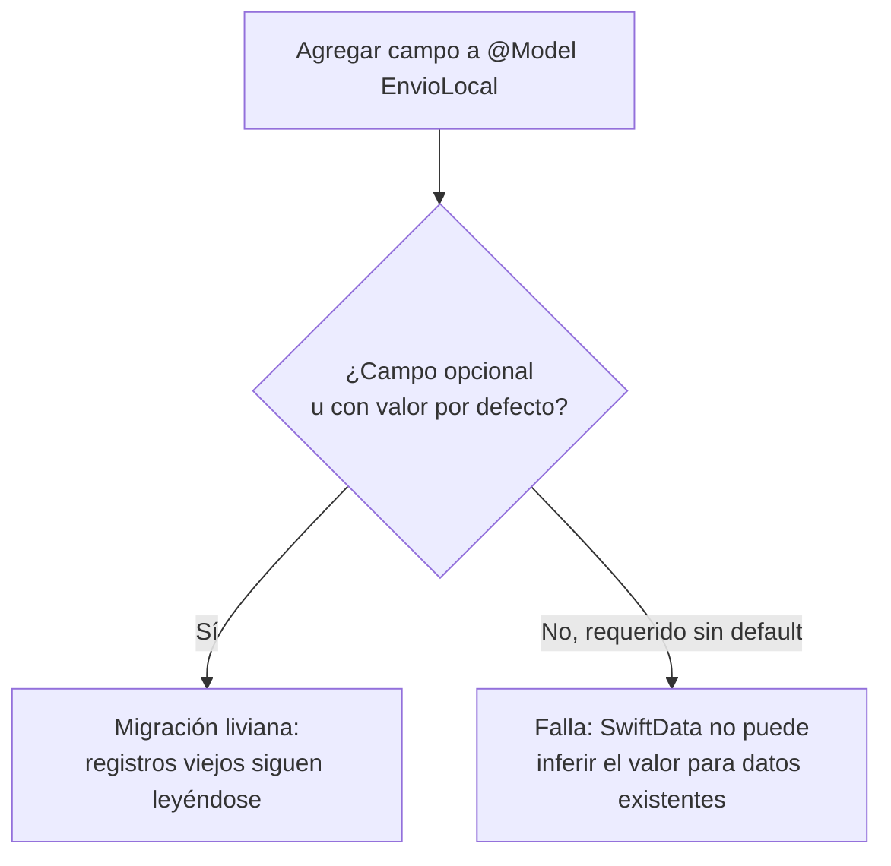
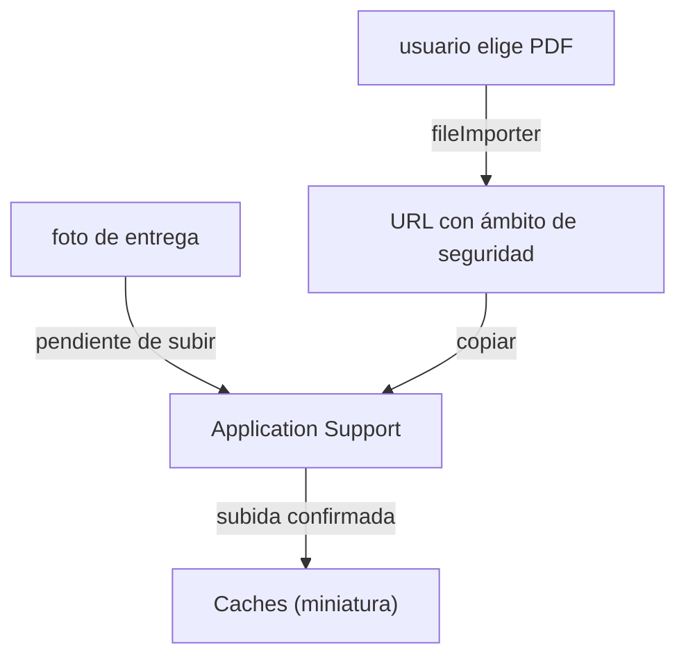
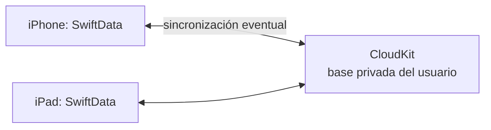

# Módulo 6: Persistencia con SwiftData


**Proyecto del módulo:** para cada práctica, parte de una carpeta vacía y crea en Xcode (File ▸ New ▸ Project ▸ App, interfaz SwiftUI) un proyecto llamado `RutaFlowApp`; escribe manualmente todos los archivos indicados y compila, sin usar proyectos ya preparados.

## Aprende construyendo


### Tema 1: @Model y ModelContainer · Básico · 35 min

<details open>
<summary><strong>Capa 1 — Lectura</strong></summary>

#### ► DE QUÉ TRATA
Al finalizar vas a declarar EnvioLocal con @Model para guardar confirmaciones de entrega mientras el conductor está sin señal, listas para sincronizar después. Prerrequisitos: Módulo 5 de este track.

</details>

<details>
<summary><strong>Capa 2 — Construcción</strong></summary>

#### Código y verificación
```swift
@Model
class Tarea {
    var titulo: String
    var completada: Bool
    init(titulo: String, completada: Bool = false) {
        self.titulo = titulo
        self.completada = completada
    }
}
```

```swift
WindowGroup { ContentView() }
    .modelContainer(for: Tarea.self)
```

```swift
import SwiftData

@Model
class EnvioLocal {
    var guia: String
    var pin: String
    var sincronizado: Bool
    init(guia: String, pin: String, sincronizado: Bool = false) {
        self.guia = guia
        self.pin = pin
        self.sincronizado = sincronizado
    }
}
```

```bash
xcodebuild -scheme RutaFlowApp -destination 'generic/platform=iOS Simulator' build
```

```swift
WindowGroup { AppRutaFlow() }
    .modelContainer(for: EnvioLocal.self)
```

</details>

### Tema 2: @Query y operaciones de escritura · Intermedio · 35 min

<details open>
<summary><strong>Capa 1 — Lectura</strong></summary>

#### ► DE QUÉ TRATA
Al finalizar vas a mostrar con @Query la lista de EnvioLocal pendientes de sincronizar (Tema 1), actualizándose sola cuando el conductor confirma una nueva. Prerrequisitos: Tema 1 de este módulo.

</details>

<details>
<summary><strong>Capa 2 — Construcción</strong></summary>

#### Código y verificación
```swift
struct ListaTareasView: View {
    @Query private var tareas: [Tarea] // se actualiza automáticamente cuando los datos cambian
    var body: some View { List(tareas) { Text($0.titulo) } }
}
```

```swift
@Environment(\.modelContext) private var context

context.insert(Tarea(titulo: "Nueva tarea"))
context.delete(tarea)
try? context.save()
```

```
SwiftData datos cambian → @Query re-evalúa automáticamente → la vista se actualiza sola
```

```swift
import SwiftData
import SwiftUI

struct PendientesDeSincronizar: View {
    @Query(filter: #Predicate<EnvioLocal> { !$0.sincronizado }) private var pendientes: [EnvioLocal]
    @Environment(\.modelContext) private var context

    var body: some View {
        List(pendientes) { envio in Text(envio.guia) }
    }

    func confirmarOffline(guia: String, pin: String) {
        context.insert(EnvioLocal(guia: guia, pin: pin))
    }
}
```

```bash
xcodebuild -scheme RutaFlowApp -destination 'generic/platform=iOS Simulator' build
```

</details>

### Tema 3: Migraciones y SwiftData vs Core Data · Intermedio · 40 min

<details open>
<summary><strong>Capa 1 — Lectura</strong></summary>

#### ► DE QUÉ TRATA
Al finalizar vas a agregarle un campo nuevo a EnvioLocal (Tema 1) sin perder las confirmaciones pendientes que ya estaban guardadas en el dispositivo. Prerrequisitos: Temas 1-2 de este módulo.

#### ► LA ANALOGÍA
SwiftData es un panel de control moderno sobre la misma maquinaria de Core Data — cada cambio de esquema debe versionarse y conservar los datos existentes, como un archivo histórico que nunca descarta registros al cambiar de formato.
**Conceptos clave:** capa moderna sobre el mismo motor probado, elección según necesidad de control fino.

SwiftData es una capa moderna construida directamente sobre el mismo motor subyacente de Core Data (probado en producción durante más de una década en el ecosistema Apple), reemplazando la sintaxis imperativa y verbosa de `NSManagedObject`/`NSFetchRequest` por macros declarativas de Swift (`@Model`, `@Query`); para proyectos nuevos, SwiftData es generalmente la opción recomendada, dado que ofrece la misma robustez del motor subyacente con una experiencia de desarrollo considerablemente más simple y menos propensa a errores de configuración manual.

Core Data directo sigue siendo relevante en dos escenarios concretos: aplicaciones existentes que ya invirtieron considerablemente en su configuración de Core Data (donde una migración completa a SwiftData no siempre justifica el esfuerzo), y casos que requieren control muy fino sobre aspectos avanzados del stack de persistencia (configuraciones específicas de `NSPersistentContainer`, migraciones de esquema extremadamente complejas con lógica de transformación de datos personalizada) que SwiftData, siendo una capa de más alto nivel, todavía no expone con el mismo nivel de detalle granular que la API original de Core Data.

**Analogía:** SwiftData es como un panel de control moderno y simplificado instalado sobre la misma maquinaria industrial robusta que lleva años funcionando de forma confiable (Core Data); para la mayoría de las operaciones diarias, el panel moderno es más fácil de usar, pero un técnico especializado que necesite ajustar parámetros muy específicos de la maquinaria original podría todavía necesitar acceder directamente a los controles originales más detallados.

**¿Por qué es importante?** SwiftData simplifica drásticamente la configuración frente a Core Data manual sin sacrificar la robustez del motor subyacente; Core Data directo sigue siendo relevante para apps existentes o casos que requieren control muy fino no expuesto todavía por la capa de más alto nivel de SwiftData.

**Regla práctica:** para proyectos nuevos, prefiere SwiftData; usa Core Data directo solo si ya tienes una inversión grande en su configuración o necesitas control muy fino que SwiftData todavía no expone.

**Diagrama:**

```
Core Data (motor subyacente, probado en producción)
        ↑
SwiftData (@Model, @Query — capa declarativa moderna sobre el mismo motor)
```

**Diagrama: migración liviana vs destructiva**



En tu propio proyecto RutaFlow, crea `EnvioLocal.swift` con **File ▸ New ▸ File ▸ Swift File**, selecciona el target de la app y escribe allí el modelo `@Model` del Paso 4.

---

#### ► CÓMO FUNCIONA


</details>

<details>
<summary><strong>Capa 2 — Construcción</strong></summary>

#### Código y verificación
```
Core Data (motor subyacente, probado en producción)
        ↑
SwiftData (@Model, @Query — capa declarativa moderna sobre el mismo motor)
```


```swift
import SwiftData

@Model
class EnvioLocal {
    var guia: String
    var pin: String
    var sincronizado: Bool
    var fotoPath: String?  // nuevo campo, opcional para no romper registros viejos
    init(guia: String, pin: String, sincronizado: Bool = false, fotoPath: String? = nil) {
        self.guia = guia; self.pin = pin; self.sincronizado = sincronizado; self.fotoPath = fotoPath
    }
}
```

```bash
xcodebuild -scheme RutaFlowApp -destination 'generic/platform=iOS Simulator' build
```

</details>

### Tema 4: Archivos en iOS: FileManager, carpetas de la app y fileImporter · Intermedio · 40 min

<details open>
<summary><strong>Capa 1 — Lectura</strong></summary>

#### ► DE QUÉ TRATA
Continúa RutaFlowApp. Crea AlmacenArchivos.swift. Para importar, necesitas un PDF de prueba en la app Archivos del simulador (arrastra uno a la ventana del simulador).

#### ► LA ANALOGÍA
**Conceptos clave:** sandbox, `Documents`, `Application Support`, `Caches`, `tmp`, `URL.applicationSupportDirectory`, `isExcludedFromBackup`, acceso con ámbito de seguridad, `fileImporter`.

Cada app vive en su **sandbox**. Sus carpetas principales:

| Carpeta | Para | Respaldo | ¿El sistema la borra? |
|---|---|---|---|
| `Documents` | archivos del usuario, visibles en Archivos si lo habilitas | sí | no |
| `Application Support` | datos internos de la app | sí | no |
| `Caches` | lo que se puede volver a descargar | no | sí, con poco espacio |
| `tmp` | archivos de un momento | no | sí |

Las fotos pendientes de subir van en `Application Support`, no en `Caches`. Si un archivo se puede regenerar, márcalo con `isExcludedFromBackup`.

Para abrir archivos **fuera** del sandbox, `fileImporter` muestra el selector del sistema. La URL recibida requiere `startAccessingSecurityScopedResource()` antes de leerla y `stop...` al terminar.

**Analogía:** las carpetas son cajones de un escritorio: uno para papeles importantes, otro para borradores que el conserje puede tirar. La analogía falla en que el conserje (iOS) no avisa antes de vaciar el cajón de `Caches`.

**Límite de uso:** no guardes archivos grandes en SwiftData o `UserDefaults`: guarda el archivo en disco y en la base solo su ruta. No guardes rutas absolutas: el contenedor puede cambiar de ruta entre instalaciones; guarda la ruta relativa.



#### ► CÓMO FUNCIONA


</details>

<details>
<summary><strong>Capa 2 — Construcción</strong></summary>

#### Código y verificación


```swift
import Foundation

struct AlmacenArchivos {
    private let base = URL.applicationSupportDirectory.appending(path: "entregas", directoryHint: .isDirectory)

    func guardarFoto(_ datos: Data, codigo: String) throws -> URL {
        try FileManager.default.createDirectory(at: base, withIntermediateDirectories: true)
        var destino = base.appending(path: "\(codigo).jpg")
        try datos.write(to: destino, options: [.atomic, .completeFileProtection])
        var valores = URLResourceValues()
        valores.isExcludedFromBackup = false // es evidencia: debe respaldarse
        try destino.setResourceValues(valores)
        return destino
    }

    func importar(_ externo: URL) throws -> URL {
        guard externo.startAccessingSecurityScopedResource() else { throw CocoaError(.fileReadNoPermission) }
        defer { externo.stopAccessingSecurityScopedResource() }
        let copia = base.appending(path: externo.lastPathComponent)
        try? FileManager.default.removeItem(at: copia)
        try FileManager.default.copyItem(at: externo, to: copia)
        return copia
    }
}
```

```swift
import SwiftUI
import UniformTypeIdentifiers

struct AdjuntarPDF: View {
    @State private var mostrando = false
    @State private var mensaje = "Sin adjunto"

    var body: some View {
        VStack {
            Text(mensaje)
            Button("Adjuntar remisión (PDF)") { mostrando = true }
        }
        .fileImporter(isPresented: $mostrando, allowedContentTypes: [.pdf]) { resultado in
            do {
                let copia = try AlmacenArchivos().importar(try resultado.get())
                mensaje = "Adjuntado: \(copia.lastPathComponent)"
            } catch {
                mensaje = "No se pudo adjuntar: \(error.localizedDescription)"
            }
        }
    }
}
```

```bash
xcodebuild -scheme RutaFlowApp -destination 'generic/platform=iOS Simulator' build
# tras guardar una foto, revisa la carpeta del contenedor:
xcrun simctl get_app_container booted co.rutaflow.app data
```

```text
Tras guardar la foto de ENV-42, existe Library/Application Support/entregas/ENV-42.jpg dentro del contenedor de la app.
Al adjuntar un PDF desde Archivos, la vista muestra «Adjuntado: remision.pdf».
```

</details>

### Tema 5: CloudKit con SwiftData: sincronizar datos entre los dispositivos del usuario · Avanzado · 45 min

<details open>
<summary><strong>Capa 1 — Lectura</strong></summary>

#### ► DE QUÉ TRATA
Necesitas una cuenta de Apple Developer de pago, dos simuladores o dispositivos con la misma cuenta de iCloud, y en el target las capacidades iCloud (CloudKit) con un contenedor iCloud.co.rutaflow.app y Background Modes > Remote notifications.

#### ► CÓMO FUNCIONA


</details>

<details>
<summary><strong>Capa 2 — Construcción</strong></summary>

#### Código y verificación


```swift
import Foundation
import SwiftData

@Model
final class NotaCliente {
    // Reglas de CloudKit: valores por defecto, sin .unique, relaciones opcionales.
    var direccion: String = ""
    var texto: String = ""
    var creada: Date = Date.now

    init(direccion: String, texto: String) {
        self.direccion = direccion
        self.texto = texto
    }
}
```

```swift
import SwiftData
import SwiftUI

@main
struct RutaFlowApp: App {
    let contenedor: ModelContainer = {
        let configuracion = ModelConfiguration(cloudKitDatabase: .private("iCloud.co.rutaflow.app"))
        do {
            return try ModelContainer(for: NotaCliente.self, configurations: configuracion)
        } catch {
            // Sin almacén la app no puede funcionar: detente con un mensaje que diga por qué.
            fatalError("No se pudo crear el contenedor de SwiftData: \(error)")
        }
    }()

    var body: some Scene {
        WindowGroup { NotasView() }
            .modelContainer(contenedor)
    }
}
```

```swift
import SwiftData
import SwiftUI

struct NotasView: View {
    @Environment(\.modelContext) private var contexto
    @Query(sort: \NotaCliente.creada, order: .reverse) private var notas: [NotaCliente]

    var body: some View {
        NavigationStack {
            List(notas) { nota in
                VStack(alignment: .leading) {
                    Text(nota.direccion).font(.headline)
                    Text(nota.texto)
                }
            }
            .navigationTitle("Notas")
            .toolbar {
                Button("Agregar") {
                    contexto.insert(NotaCliente(direccion: "Calle 10 #5-20", texto: "Dejar en portería"))
                }
            }
        }
    }
}
```

```bash
xcodebuild -scheme RutaFlowApp -destination 'generic/platform=iOS Simulator' build
# ejecuta en dos simuladores con la misma cuenta de iCloud, crea una nota en uno y espera a que aparezca en el otro
```

```text
Una nota creada en el simulador A aparece en el simulador B tras unos segundos a un par de minutos.
En CloudKit Console (icloud.developer.apple.com) se ve el tipo de registro CD_NotaCliente en el entorno Development.
```

</details>
