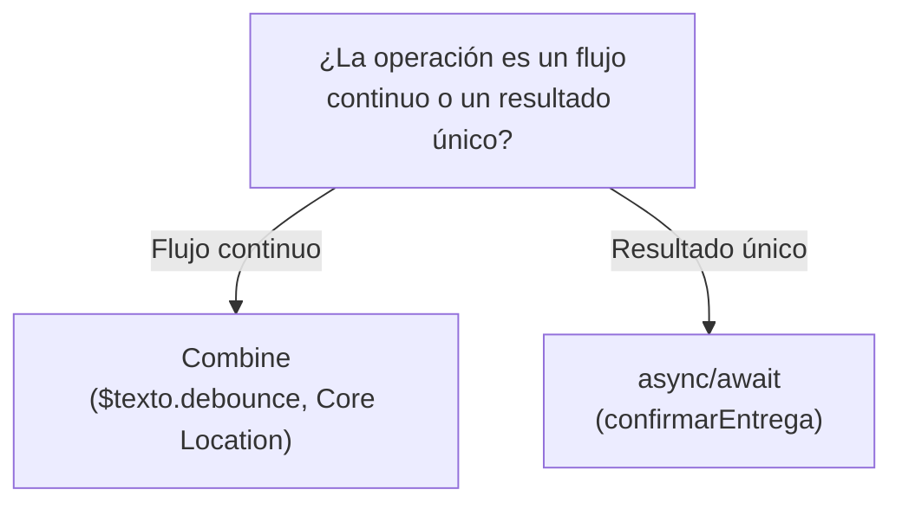

# Módulo 7: Combine y programación reactiva


**Proyecto del módulo:** para cada práctica, parte de una carpeta vacía y crea en Xcode (File ▸ New ▸ Project ▸ App, interfaz SwiftUI) un proyecto llamado `RutaFlowApp`; escribe manualmente todos los archivos indicados y compila, sin usar proyectos ya preparados.

## Aprende construyendo


### Tema 1: Publishers y Subscribers · Intermedio · 35 min

<details open>
<summary><strong>Capa 1 — Lectura</strong></summary>

#### ► DE QUÉ TRATA
Al finalizar vas a conectar el campo de búsqueda de guía de RutaFlow a un Publisher, confirmando que cada letra tecleada emite un nuevo valor. Prerrequisitos: Módulo 6 completo.

#### ► LA IDEA EN UNA FRASE
**Al finalizar vas a conectar el campo de búsqueda de guía de RutaFlow a un Publisher, confirmando que cada letra tecleada emite un nuevo valor.**

#### ► POR QUÉ EXISTE ESTO
Resuelve un problema real de diseño o implementación y evita decisiones a ciegas.

#### ► LA ANALOGÍA
Un Publisher emite valores continuamente; un Subscriber reacciona a cada emisión — una emisora de radio que transmite mientras está encendida, distinta de una llamada puntual (`async`) que produce una única respuesta.

**¿Por qué es importante?** Porque un Publisher modela un flujo continuo de valores en el tiempo, no una única respuesta puntual, y sin `.store(in:)` la suscripción se cancela apenas sale de ámbito, dejando de reaccionar a cambios futuros.
**Conceptos clave:** flujo continuo de valores en el tiempo, no una única respuesta puntual.

```swift
class BuscadorViewModel: ObservableObject {
    @Published var texto = ""
    private var cancelables = Set<AnyCancellable>()

    init() {
        $texto
            .debounce(for: .milliseconds(300), scheduler: RunLoop.main)
            .removeDuplicates()
            .sink { [weak self] valor in self?.buscar(valor) }
            .store(in: &cancelables)
    }
}
```

`$texto` (el prefijo `$` sobre una propiedad `@Published`) expone un `Publisher`: un flujo continuo de valores en el tiempo que emite cada vez que la propiedad subyacente cambia, a diferencia de una función `async` que representa una única operación con un resultado final puntual; un `Subscriber` (aquí, el closure dentro de `.sink { }`) se suscribe a ese Publisher para reaccionar a cada emisión, y `.store(in: &cancelables)` retiene esa suscripción activa mientras el `ViewModel` viva, cancelándola automáticamente cuando ese conjunto de cancelables se libera.

Este modelo de "flujo continuo de valores observables" es conceptualmente el mismo que `Flow` en Kotlin (Módulo 2 del track de Kotlin Multiplatform) o los Observables de RxJS/RxJava, todos resolviendo el mismo problema fundamental de modelar secuencias de eventos asíncronos a lo largo del tiempo, con distintas sintaxis y ecosistemas de operadores según el lenguaje.

**Analogía:** un Publisher es como una emisora de radio que transmite continuamente mientras está encendida, y un Subscriber es un receptor sintonizado que reacciona a cada nueva transmisión, en contraste con una llamada telefónica puntual (una función `async`) que produce una única respuesta y luego termina.

**Implicación práctica:** Combine modela flujos continuos de valores en el tiempo, un caso de uso distinto al de `async`/`await` (una única operación con resultado final), compartiendo el mismo principio fundamental que `Flow` en Kotlin o RxJS en JavaScript.

**Código del ejemplo:**

```swift
$texto
    .debounce(for: .milliseconds(300), scheduler: RunLoop.main)
    .removeDuplicates()
    .sink { valor in buscar(valor) }
```

* Código: escribe la práctica en `ContentView.swift` y `BuscadorEnviosViewModel.swift` de tu propio proyecto `RutaFlowApp`.
* Proyecto: en el proyecto integrador RutaFlow, publica la posición del conductor y verifica el subscriber.

**Dónde se rompe la analogía:** el modelo simplifica la realidad; en producción influyen escala, fallos, costo y contexto.

#### ► CÓMO FUNCIONA
1. Identifica el problema que publishers y subscribers resuelve.
2. Observa sus componentes y relaciones.
3. Aplica la opción más simple que funcione.
4. Verifica el resultado y los límites.

#### ► LO QUE PUEDE SALIR MAL
| Síntoma | Causa probable | Arreglo |
|---|---|---|
| Publishers y Subscribers se aplica pero el resultado no mejora | Se usó sin medir el problema real | Mide antes y compara contra la alternativa simple |
| Aparece complejidad inesperada | Se adoptó la técnica sin comprender sus trade-offs | Vuelve a la sección de trade-offs y reduce el alcance |
| Falla en un caso límite | Se asumió un contexto que no se cumple | Prueba el caso límite y documenta cuándo NO usarlo |

#### ► TRADE-OFFS
| Opción | Cuándo usarla | Cuándo NO usarla |
|---|---|---|
| Usar Publishers y Subscribers | Cuando el problema coincide con su propósito y el beneficio es observable | Cuando agrega complejidad sin resolver un problema real |
| Alternativa más simple | Cuando el contexto es pequeño, estable o fácil de razonar | Cuando ya demostró no escalar o no cumplir el requisito |
| Postergar la decisión | Cuando falta evidencia del problema | Cuando el costo de esperar es mayor que el costo de probar |

#### ► CUÁNDO NO USAR ESTO
No uses publishers y subscribers por defecto. Aplícalo cuando el problema lo justifique y puedas verificar el beneficio; si una alternativa más simple resuelve igual, prefiérela.

#### ► DE VUELTA A LA ANALOGÍA
Volviendo a la analogía: publishers y subscribers funciona como el modelo inicial, pero recuerda dónde se rompe: en producción importan la evidencia, la escala y el costo de equivocarte.

#### ► LO QUE DEBES RECORDAR
- Publishers y Subscribers existe para resolver un problema específico.
- Mide antes de adoptar complejidad.
- Conoce el caso donde NO usarlo.
- Verifica con evidencia observable.

#### ► PREGUNTAS PARA PENSAR
1. ¿Qué problema concreto resuelve publishers y subscribers en tu contexto?
2. ¿Cómo sabrías que publishers y subscribers no está funcionando bien?
3. ¿Qué alternativa más simple considerarías antes de usar publishers y subscribers?

</details>

<details>
<summary><strong>Capa 2 — Construcción</strong></summary>

#### Código y verificación
```swift
class BuscadorViewModel: ObservableObject {
    @Published var texto = ""
    private var cancelables = Set<AnyCancellable>()

    init() {
        $texto
            .debounce(for: .milliseconds(300), scheduler: RunLoop.main)
            .removeDuplicates()
            .sink { [weak self] valor in self?.buscar(valor) }
            .store(in: &cancelables)
    }
}
```

```swift
$texto
    .debounce(for: .milliseconds(300), scheduler: RunLoop.main)
    .removeDuplicates()
    .sink { valor in buscar(valor) }
```

```swift
import Combine

class BuscadorEnviosViewModel: ObservableObject {
    @Published var textoBusqueda = ""
    private var cancelables = Set<AnyCancellable>()

    init() {
        $textoBusqueda
            .sink { valor in print("buscando: \(valor)") }
            .store(in: &cancelables)
    }
}
```

```bash
xcodebuild -scheme RutaFlowApp -destination 'generic/platform=iOS Simulator' build
```

</details>

### Tema 2: Operadores: debounce y combineLatest · Intermedio · 35 min

<details open>
<summary><strong>Capa 1 — Lectura</strong></summary>

#### ► DE QUÉ TRATA
Al finalizar vas a agregar debounce a la búsqueda de guía de RutaFlow (Tema 1) y a combinar texto + filtro de zona con combineLatest. Prerrequisitos: Tema 1 de este módulo.

#### ► LA IDEA EN UNA FRASE
**Al finalizar vas a agregar debounce a la búsqueda de guía de RutaFlow (Tema 1) y a combinar texto + filtro de zona con combineLatest.**

#### ► POR QUÉ EXISTE ESTO
Resuelve un problema real de diseño o implementación y evita decisiones a ciegas.

#### ► LA ANALOGÍA
`debounce` espera un silencio antes de emitir, como esperar a que alguien termine de hablar antes de responder; `combineLatest` reacciona a cualquiera de dos fuentes, siempre con el último valor conocido de la otra.

**¿Por qué es importante?** Porque `debounce` evita disparar una búsqueda costosa en cada tecla individual, y `combineLatest` reacciona a cualquiera de dos fuentes de estado independientes sin tener que coordinar manualmente cuál cambió más recientemente.
**Conceptos clave:** transformación declarativa de un flujo, reacción a múltiples fuentes simultáneas.

`debounce(for:scheduler:)` espera un intervalo de silencio (aquí, 300 milisegundos sin nuevos cambios) antes de emitir el valor más reciente, un patrón extremadamente común para buscadores en tiempo real: evita disparar una búsqueda en cada tecla presionada individualmente, esperando en cambio a que el usuario deje de escribir por un breve instante antes de ejecutar la búsqueda real, el mismo operador `debounceTime` estudiado en RxJS dentro de Angular (Módulo 1 del track de Angular), reflejando que este patrón de "esperar silencio antes de reaccionar" es universal en programación reactiva independientemente del ecosistema.

```swift
Publishers.CombineLatest($filtro, $orden)
    .sink { filtro, orden in actualizarLista(filtro, orden) }
    .store(in: &cancelables)
```

`combineLatest` combina dos (o más) Publishers, re-emitiendo un valor combinado cada vez que **cualquiera** de los Publishers de origen emite un nuevo valor, usando siempre el último valor conocido del otro Publisher que no cambió en ese instante; esto es apropiado cuando una acción depende de múltiples fuentes de estado independientes que pueden cambiar en momentos distintos (un filtro de búsqueda y un criterio de ordenamiento, cada uno modificable independientemente por el usuario), sin necesidad de coordinar manualmente cuál cambió más recientemente.

**Analogía:** `debounce` es como esperar a que alguien termine completamente de hablar antes de responder, en vez de interrumpir después de cada palabra individual; `combineLatest` es como un tablero que se actualiza automáticamente cada vez que cualquiera de dos indicadores independientes cambia, mostrando siempre la combinación más reciente de ambos sin importar cuál se actualizó más recientemente.

* Código: escribe la práctica en `ContentView.swift` y `BuscadorEnviosViewModel.swift` de tu propio proyecto `RutaFlowApp`.
* Proyecto: en el proyecto integrador RutaFlow, aplica debounce a la búsqueda y combina posición y filtro.

**Límites y decisión de uso:** Debounce retrasa emisiones y puede ser inapropiado para acciones que deben ejecutarse inmediatamente. combineLatest necesita valores de sus fuentes; define estados iniciales y prueba ausencia de datos para no dejar la pantalla esperando sin explicación.

**Dónde se rompe la analogía:** el modelo simplifica la realidad; en producción influyen escala, fallos, costo y contexto.

#### ► CÓMO FUNCIONA
1. Identifica el problema que operadores: debounce y combinelatest resuelve.
2. Observa sus componentes y relaciones.
3. Aplica la opción más simple que funcione.
4. Verifica el resultado y los límites.

#### ► LO QUE PUEDE SALIR MAL
| Síntoma | Causa probable | Arreglo |
|---|---|---|
| Operadores: debounce y combineLatest se aplica pero el resultado no mejora | Se usó sin medir el problema real | Mide antes y compara contra la alternativa simple |
| Aparece complejidad inesperada | Se adoptó la técnica sin comprender sus trade-offs | Vuelve a la sección de trade-offs y reduce el alcance |
| Falla en un caso límite | Se asumió un contexto que no se cumple | Prueba el caso límite y documenta cuándo NO usarlo |

#### ► TRADE-OFFS
| Opción | Cuándo usarla | Cuándo NO usarla |
|---|---|---|
| Usar Operadores: debounce y combineLatest | Cuando el problema coincide con su propósito y el beneficio es observable | Cuando agrega complejidad sin resolver un problema real |
| Alternativa más simple | Cuando el contexto es pequeño, estable o fácil de razonar | Cuando ya demostró no escalar o no cumplir el requisito |
| Postergar la decisión | Cuando falta evidencia del problema | Cuando el costo de esperar es mayor que el costo de probar |

#### ► CUÁNDO NO USAR ESTO
No uses operadores: debounce y combinelatest por defecto. Aplícalo cuando el problema lo justifique y puedas verificar el beneficio; si una alternativa más simple resuelve igual, prefiérela.

#### ► DE VUELTA A LA ANALOGÍA
Volviendo a la analogía: operadores: debounce y combinelatest funciona como el modelo inicial, pero recuerda dónde se rompe: en producción importan la evidencia, la escala y el costo de equivocarte.

#### ► LO QUE DEBES RECORDAR
- Operadores: debounce y combineLatest existe para resolver un problema específico.
- Mide antes de adoptar complejidad.
- Conoce el caso donde NO usarlo.
- Verifica con evidencia observable.

#### ► PREGUNTAS PARA PENSAR
1. ¿Qué problema concreto resuelve operadores: debounce y combinelatest en tu contexto?
2. ¿Cómo sabrías que operadores: debounce y combinelatest no está funcionando bien?
3. ¿Qué alternativa más simple considerarías antes de usar operadores: debounce y combinelatest?

</details>

<details>
<summary><strong>Capa 2 — Construcción</strong></summary>

#### Código y verificación
```swift
Publishers.CombineLatest($filtro, $orden)
    .sink { filtro, orden in actualizarLista(filtro, orden) }
    .store(in: &cancelables)
```

```swift
import Combine
import Foundation

class BuscadorEnviosViewModel: ObservableObject {
    @Published var textoBusqueda = ""
    @Published var zonaFiltro = "Norte"
    private var cancelables = Set<AnyCancellable>()

    init() {
        $textoBusqueda
            .debounce(for: .milliseconds(300), scheduler: RunLoop.main)
            .removeDuplicates()
            .sink { valor in print("buscando guía: \(valor)") }
            .store(in: &cancelables)

        Publishers.CombineLatest($textoBusqueda, $zonaFiltro)
            .sink { texto, zona in print("filtrar: \(texto) en \(zona)") }
            .store(in: &cancelables)
    }
}
```

```bash
xcodebuild -scheme RutaFlowApp -destination 'generic/platform=iOS Simulator' build
```

</details>

### Tema 3: Combine vs async/await · Avanzado · 45 min

<details open>
<summary><strong>Capa 1 — Lectura</strong></summary>

#### ► DE QUÉ TRATA
Al finalizar vas a decidir, para dos operaciones reales de RutaFlow, cuál necesita Combine y cuál debería ser simplemente async/await. Prerrequisitos: Tema 2 de este módulo, Módulo 4 completo.

#### ► LA IDEA EN UNA FRASE
**Al finalizar vas a decidir, para dos operaciones reales de RutaFlow, cuál necesita Combine y cuál debería ser simplemente async/await.**

#### ► POR QUÉ EXISTE ESTO
Resuelve un problema real de diseño o implementación y evita decisiones a ciegas.

#### ► LA ANALOGÍA
Piensa en combine vs async/await como una herramienta de taller: útil cuando conoces su propósito y sus límites.
**Dónde se rompe la analogía:** en software, los efectos dependen del contexto, la escala y los trade-offs.

#### ► CÓMO FUNCIONA


#### ► LO QUE PUEDE SALIR MAL
| Síntoma | Causa probable | Arreglo |
|---|---|---|
| Combine vs async/await se aplica pero el resultado no mejora | Se usó sin medir el problema real | Mide antes y compara contra la alternativa simple |
| Aparece complejidad inesperada | Se adoptó la técnica sin comprender sus trade-offs | Vuelve a la sección de trade-offs y reduce el alcance |
| Falla en un caso límite | Se asumió un contexto que no se cumple | Prueba el caso límite y documenta cuándo NO usarlo |

#### ► TRADE-OFFS
| Opción | Cuándo usarla | Cuándo NO usarla |
|---|---|---|
| Usar Combine vs async/await | Cuando el problema coincide con su propósito y el beneficio es observable | Cuando agrega complejidad sin resolver un problema real |
| Alternativa más simple | Cuando el contexto es pequeño, estable o fácil de razonar | Cuando ya demostró no escalar o no cumplir el requisito |
| Postergar la decisión | Cuando falta evidencia del problema | Cuando el costo de esperar es mayor que el costo de probar |

#### ► CUÁNDO NO USAR ESTO
No uses combine vs async/await por defecto. Aplícalo cuando el problema lo justifique y puedas verificar el beneficio; si una alternativa más simple resuelve igual, prefiérela.

#### ► DE VUELTA A LA ANALOGÍA
Volviendo a la analogía: combine vs async/await funciona como el modelo inicial, pero recuerda dónde se rompe: en producción importan la evidencia, la escala y el costo de equivocarte.

#### ► LO QUE DEBES RECORDAR
- Combine vs async/await existe para resolver un problema específico.
- Mide antes de adoptar complejidad.
- Conoce el caso donde NO usarlo.
- Verifica con evidencia observable.

#### ► PREGUNTAS PARA PENSAR
1. ¿Qué problema concreto resuelve combine vs async/await en tu contexto?
2. ¿Cómo sabrías que combine vs async/await no está funcionando bien?
3. ¿Qué alternativa más simple considerarías antes de usar combine vs async/await?

</details>

<details>
<summary><strong>Capa 2 — Construcción</strong></summary>

#### Código y verificación
```
async/await  → una operación puntual con resultado final (cargar datos una vez)
Combine      → flujo continuo de valores en el tiempo (texto cambiando, ubicación actualizándose)
```


```swift
import Combine
import Foundation

// Flujo continuo: correcto con Combine (Temas 1-2)
let texto = PassthroughSubject<String, Never>()
let suscripcion = texto
    .debounce(for: .milliseconds(300), scheduler: DispatchQueue.main)
    .sink { valor in print("buscando guía: \(valor)") }
for parcial in ["R", "RF", "RF-4471"] { texto.send(parcial) } // solo pasa el último
try await Task.sleep(nanoseconds: 500_000_000)

// Operación puntual: correcto con async/await (Módulo 5), NO con Combine
func confirmarEntrega(guia: String, pin: String) async throws -> String {
    try await Task.sleep(nanoseconds: 100_000_000) // simula la petición del Módulo 5
    return "\(guia) entregado"
}
let resultado = try await confirmarEntrega(guia: "RF-4471", pin: "837201")
print(resultado)
suscripcion.cancel()
```

```bash
# una sola vez, fuera de RutaFlowApp:
mkdir Practica && cd Practica
swift package init --type executable
rm Sources/Practica/Practica.swift   # la plantilla de Swift 6.2 trae un @main que choca con main.swift
# pega el código en Sources/Practica/main.swift
swift run
```

</details>
