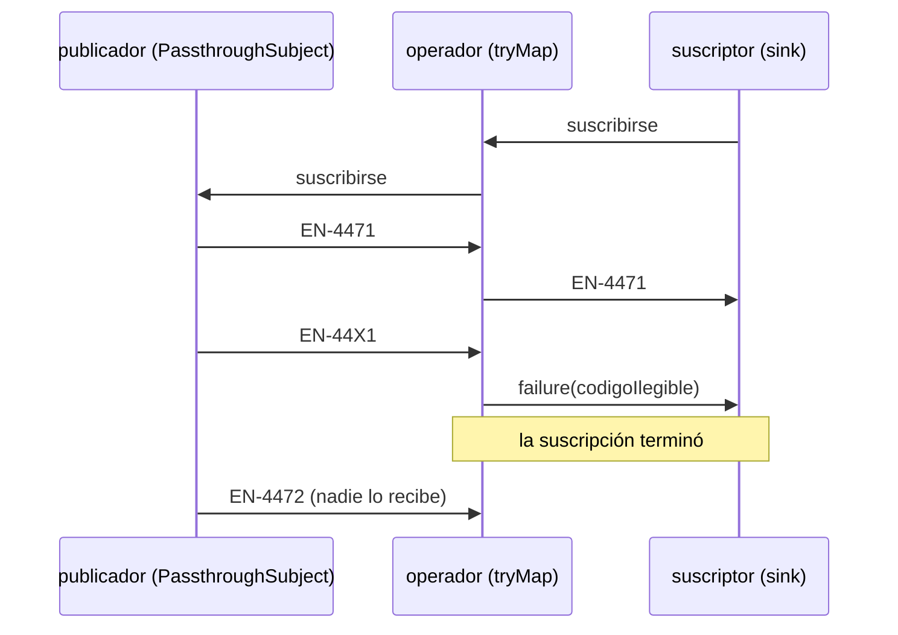
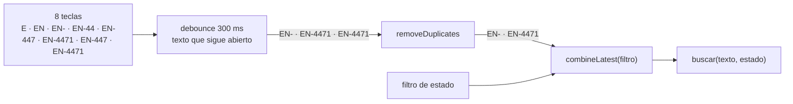
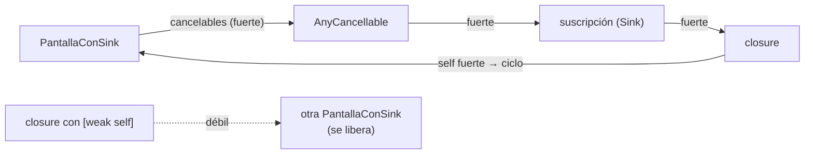
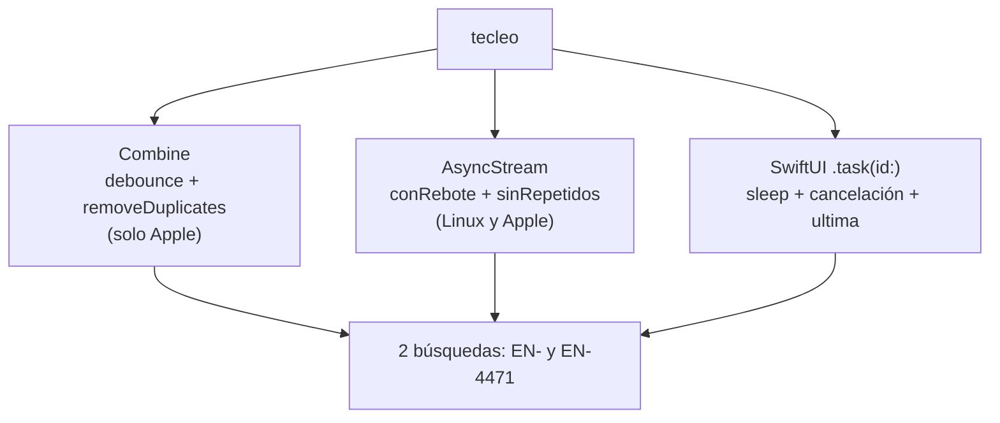

# Módulo 7: Combine y programación reactiva

**Entorno comprobado para esta edición (2026-11-25):** Combine es un framework de Apple: existe en macOS, iOS y sus
hermanos, y **no existe en Linux** (el Tema 1 muestra el error real). Por eso este módulo se ejecutó en dos lugares.
En la Mac (Xcode 27.2 (27B52), Swift 6.4.2, simulador del iPhone 17 con iOS 27.2) se ejecutaron el paquete `combine`
(demostraciones y pruebas de Combine con `swift run` y `swift test`) y la app SwiftUI con sus pruebas y pantallazos.
En Linux (Swift 6.4.3, Ubuntu 24.04) se ejecutó todo lo que no es Combine: la búsqueda, el tecleo simulado y sus
equivalentes con `AsyncStream`, con los que se compara Combine en los Temas 3 y 4. Todo está en
`/home/estudiante/labs/ios/ios7` (tu `~/labs/ios/ios7`). El paquete `combine` necesitó tres rondas en la Mac: las dos primeras fallaron por errores de
módulos (un paquete sin `platforms` y un inicializador `internal`), que se cuentan en el Tema 4; la tercera compiló en
modo Swift 6 y sus 4 pruebas pasaron. Límite honesto: los tiempos se muestran redondeados a la
centena de milisegundos, porque los exactos cambian en cada ejecución.

Antes de `async`/`await`, la forma de Apple de manejar valores que llegan con el tiempo era Combine (2019): una
biblioteca de **publicadores** que emiten valores, **operadores** que los transforman y **suscriptores** que los
reciben. Mucho código de apps reales sigue escrito así, y SwiftUI lo usó durante años para su estado
(`ObservableObject`, `@Published`). Este módulo enseña a leerlo, escribirlo y probarlo, con el buscador de envíos de la
ruta como ejemplo, y a decidir cuándo conviene pasarlo a `async`/`await`.

**Al terminar este módulo podrás:**
- crear publicadores y *subjects*, suscribirte con `sink` y explicar qué pasa con un `AnyCancellable` que no se
  guarda;
- construir la cadena de un buscador con `debounce`, `removeDuplicates`, `combineLatest` y `switchToLatest`, y medirla;
- usar Combine en SwiftUI con `ObservableObject`, `@Published` y `assign(to:)` sin fugas de memoria;
- pasar de Combine a `async`/`await` y al revés, y escribir con `AsyncStream` lo que Combine da hecho.

**Esquema del módulo:** Tema 1 (publicadores, suscriptores y cancelables) → Tema 2 (operadores para un buscador) →
Tema 3 (Combine en SwiftUI y la memoria) → Tema 4 (Combine frente a `async`/`await`) → Proyecto 44.

**Qué necesitas saber antes:** del Módulo 0, **los closures que escapan y `[weak self]`** (Tema 4); del Módulo 2,
**`@State`, `@Observable` y los *bindings***; del Módulo 4, **`Task`, la cancelación** (Temas 1 y 2) y **`AsyncStream`
con `for await`** (Tema 5), que aquí se usan como punto de comparación.

**Qué no se repite:** `AsyncStream`, sus políticas de búfer y `onTermination` se explicaron en el Módulo 4, Tema 5;
aquí solo se usan para escribir el equivalente de dos operadores de Combine. La red de verdad es el Módulo 5: el
«servidor» de este módulo es un publicador con demora.

**Prepara el proyecto:** son tres piezas, y la lógica que no depende de Combine se escribe una sola vez:

```text
$ mkdir -p ~/labs/ios/ios7 && cd ~/labs/ios/ios7
$ mkdir nucleo combine app
```

- `nucleo/` — paquete SwiftPM sin Combine (búsqueda, tecleo, rebote con `AsyncStream`): compila en Linux y en la Mac.
  Declara el producto `Nucleo` para que otro paquete lo use:

```swift
// swift-tools-version: 6.0
import PackageDescription

let package = Package(
    name: "Nucleo",
    platforms: [.macOS(.v15)],  // en la Mac: Duration pide macOS 13 y Mutex, macOS 15 (en Linux no cuenta)
    products: [.library(name: "Nucleo", targets: ["Nucleo"])],  // lo usa también el paquete `combine` (en la Mac)
    targets: [
        .target(name: "Nucleo"),
        .executableTarget(name: "Demos", dependencies: ["Nucleo"]),
        .testTarget(name: "NucleoTests", dependencies: ["Nucleo"]),
    ]
)
```

- `combine/` — paquete SwiftPM con Combine, para la Mac. Depende de `nucleo` por ruta local (sin descargar nada):

```swift
// swift-tools-version: 6.0
// Paquete de Combine: SOLO compila en sistemas de Apple (en Linux no existe el módulo Combine).
import PackageDescription

let package = Package(
    name: "Reactivo",
    platforms: [.macOS(.v15)],
    dependencies: [.package(path: "../nucleo")],  // la búsqueda y el tecleo, los mismos de Linux
    targets: [
        .target(name: "Reactivo", dependencies: [.product(name: "Nucleo", package: "nucleo")]),
        .executableTarget(
            name: "DemosCombine", dependencies: ["Reactivo", .product(name: "Nucleo", package: "nucleo")]),
        .testTarget(name: "ReactivoTests", dependencies: ["Reactivo", .product(name: "Nucleo", package: "nucleo")]),
    ]
)
```

- `app/` — la app SwiftUI (`App/`, `Pruebas/` y el proyecto de Xcode `Buscador.xcodeproj`, iOS 18 como mínimo y
  Swift 6). `mac.sh` copia `nucleo/Sources/Nucleo` dentro de `App/Nucleo` antes de compilar.

La lógica compartida, que usan las tres piezas:

```swift
// Catalogo.swift — los envíos del día y la búsqueda (lógica pura: la usan Combine, AsyncStream y la app)

public enum EstadoEnvio: String, CaseIterable, Hashable, Sendable {
    case pendiente
    case enRuta = "en ruta"
    case entregado
}

public struct Envio: Identifiable, Equatable, Sendable {
    public let id: String  // la guía
    public let destinatario: String
    public let barrio: String
    public let estado: EstadoEnvio
}

public let enviosDelDia: [Envio] = [
    Envio(id: "EN-4471", destinatario: "Ana Ruiz", barrio: "Chapinero", estado: .pendiente),
    Envio(id: "EN-4472", destinatario: "Luis Pardo", barrio: "Teusaquillo", estado: .enRuta),
    Envio(id: "EN-4473", destinatario: "Marta Gil", barrio: "Suba", estado: .pendiente),
    Envio(id: "EN-4474", destinatario: "Pedro Díaz", barrio: "Kennedy", estado: .entregado),
    Envio(id: "EN-4475", destinatario: "Sara León", barrio: "Usaquén", estado: .enRuta),
    Envio(id: "EN-4476", destinatario: "Jorge Rincón", barrio: "Suba", estado: .entregado),
    Envio(id: "EN-4477", destinatario: "Lucía Mora", barrio: "Chapinero", estado: .pendiente),
    Envio(id: "EN-4478", destinatario: "Andrés Vela", barrio: "Bosa", estado: .pendiente),
]

/// Texto vacío: todos. Si no, los que contienen el texto en la guía, el nombre o el barrio (sin distinguir mayúsculas).
public func buscar(_ texto: String, en envios: [Envio], estado: EstadoEnvio? = nil) -> [Envio] {
    let consulta = texto.lowercased()
    return envios.filter { envio in
        let coincide =
            consulta.isEmpty || envio.id.lowercased().contains(consulta)
            || envio.destinatario.lowercased().contains(consulta) || envio.barrio.lowercased().contains(consulta)
        return coincide && (estado == nil || envio.estado == estado)
    }
}

/// Lo que llega del lector de códigos de barras.
public struct Escaneo: Equatable, Sendable {
    public let guia: String
    public let lector: String
    public init(guia: String, lector: String) {
        self.guia = guia
        self.lector = lector
    }
}

/// Una tecla del buscador: el texto que queda después de escribirla y la pausa (ms) desde la tecla anterior.
public struct Tecla: Sendable {
    public let texto: String
    public let pausaMs: Int

    /// El inicializador automático de un struct es `internal`: para usarlo desde otro módulo hay que escribirlo.
    public init(texto: String, pausaMs: Int) {
        self.texto = texto
        self.pausaMs = pausaMs
    }
}

/// El repartidor escribe «EN-», se detiene, escribe «EN-4471», borra un dígito y lo vuelve a escribir.
public let tecleoDeEjemplo: [Tecla] = [
    Tecla(texto: "E", pausaMs: 0), Tecla(texto: "EN", pausaMs: 90), Tecla(texto: "EN-", pausaMs: 90),
    Tecla(texto: "EN-44", pausaMs: 600), Tecla(texto: "EN-447", pausaMs: 90), Tecla(texto: "EN-4471", pausaMs: 90),
    Tecla(texto: "EN-447", pausaMs: 600), Tecla(texto: "EN-4471", pausaMs: 90),
]
```


## Aprende construyendo


### Tema 1: Publicadores, suscriptores y cancelables · Intermedio · 40 min

<details open>
<summary><strong>Capa 1 — Lectura</strong></summary>

#### Objetivos
Al terminar este tema podrás:
- crear publicadores con valores conocidos (`Just`, `.publisher`) y *subjects* para enviar valores a mano;
- suscribirte con `sink`, recibir valores y la terminación, y cancelar;
- explicar por qué una suscripción cuyo `AnyCancellable` no se guarda no recibe nada;
- ver cómo un error termina una cadena y cómo tratarlo sin terminarla.

**Conceptos clave:** publicador, suscriptor y `sink`, `PassthroughSubject` y `CurrentValueSubject`, `AnyCancellable`, terminación con error

#### El problema
El lector de códigos de barras de la bodega avisa cada escaneo con un *callback*. Tres pantallas necesitan esos
escaneos y cada una registra su propio *callback*; nadie los quita al salir. Además, el estado de la ruta («sin
iniciar», «en ruta») se guarda en una variable y cada pantalla pregunta por él cada segundo. Y cuando el lector lee
mal un código, la lista deja de actualizarse para siempre sin que nadie sepa por qué.

Este tema usa **los closures que escapan** (Módulo 0, Tema 4) y **los errores con `throws`** (Módulo 0, Tema 1).

#### Glosario del tema

**publicador**
- **Definición técnica:** tipo que cumple el protocolo `Publisher`, con un tipo de valor (`Output`) y un tipo de error (`Failure`, que es `Never` si no puede fallar); emite cero o más valores y, quizá, una terminación (`.finished` o `.failure`).
- **En palabras sencillas:** una emisora de radio: transmite, y quien quiera sintoniza.
- **Dónde se rompe la comparación:** la mayoría de los publicadores no emiten nada hasta que alguien se suscribe, y cada suscripción puede empezar su propia transmisión.
- **Ejemplo:** `Just(8)` emite un valor y termina; `["EN-4471", "EN-4472"].publisher` emite cada elemento y termina.
- **Error típico:** crear un publicador y esperar que «haga algo» sin suscribirse.

**suscriptor y `sink`**
- **Definición técnica:** el suscriptor recibe los valores y la terminación; `sink(receiveCompletion:receiveValue:)` crea uno a partir de dos closures y devuelve un `AnyCancellable`.
- **En palabras sencillas:** el radio que sintoniza la emisora.
- **Dónde se rompe la comparación:** el radio se apaga solo si nadie lo sostiene: el `AnyCancellable` hay que guardarlo.
- **Ejemplo:** `escaneos.sink { recibidos.append($0.guia) }`.
- **Error típico:** usar `sink(receiveValue:)` con un publicador que puede fallar: solo existe cuando `Failure` es `Never`.

**`PassthroughSubject` y `CurrentValueSubject`**
- **Definición técnica:** *subjects*: publicadores a los que se les envían valores con `send(_:)`; `PassthroughSubject` no guarda nada (quien no estaba suscrito se lo pierde), y `CurrentValueSubject` guarda el último valor en `.value` y se lo entrega a cada suscriptor nuevo.
- **En palabras sencillas:** un altavoz (lo que no oíste, se perdió) y una pizarra (siempre puedes leer lo último que se escribió).
- **Dónde se rompe la comparación:** los dos son clases: compartirlos es compartir el mismo canal.
- **Ejemplo:** `escaneos` es `PassthroughSubject<Escaneo, Never>`; `estadoRuta` es `CurrentValueSubject<String, Never>("sin iniciar")`.
- **Error típico:** usar `PassthroughSubject` para un estado y que la pantalla que se abre después no sepa en qué estado está la ruta.

**`AnyCancellable`**
- **Definición técnica:** objeto que representa una suscripción; al llamar a `cancel()` o al liberarse (su `deinit`), cancela la suscripción. Se guardan en un `Set<AnyCancellable>` con `store(in:)`.
- **En palabras sencillas:** el contrato de la suscripción: si se tira a la basura, se cancela.
- **Dónde se rompe la comparación:** cancelar no avisa a nadie: los valores simplemente dejan de llegar.
- **Ejemplo:** `_ = escaneos.sink { … }` descarta el contrato en el acto: no recibe nada.
- **Error típico:** guardar el `AnyCancellable` en una variable local de una función, que se libera al terminar la función.

**terminación con error**
- **Definición técnica:** cuando un publicador emite `.failure`, la suscripción termina: después no llega ningún valor más, aunque el origen siga enviando. Operadores como `catch` y `replaceError` reemplazan el error por otro publicador o un valor.
- **En palabras sencillas:** una emisora que se cae no vuelve sola.
- **Dónde se rompe la comparación:** se puede «aislar» el error dentro de `flatMap` para que cada valor falle por su cuenta.
- **Ejemplo:** `tryMap { try leerGuia($0) }` con `EN-44X1` termina la cadena.
- **Error típico:** poner `catch` al final de la cadena del lector y descubrir que, tras el primer error, la cadena terminó igual (reemplazada por el `Just`).

#### ► CÓMO FUNCIONA

##### 1. La idea en lenguaje sencillo
Piensa en las alertas de tu banco por mensaje de texto. Te inscribes una vez y, desde entonces, cada movimiento te
llega solo. Si te das de baja, dejan de llegar. Si la línea se cancela por un problema, no vuelve a funcionar hasta
que te inscribas de nuevo.

Combine organiza los valores que llegan con el tiempo de esa manera. El lector de códigos de la bodega produce
escaneos cuando quiere; la ruta cambia de estado cuando el repartidor sale. En vez de que cada pantalla pregunte
cada segundo, cada pantalla se **suscribe** y recibe los cambios.

Este tema presenta las tres piezas: quien emite, quien recibe y el contrato que los une. También muestra el detalle
que más sorprende al principio: si tiras el contrato, la suscripción se acaba en ese instante.

##### 2. Definición formal y vocabulario
Un **publicador** es un tipo que cumple el protocolo `Publisher`. Declara dos tipos asociados: `Output`, el tipo de
los valores, y `Failure`, el tipo de error. Si no puede fallar, `Failure` es `Never`.

Un publicador emite cero o más valores y, quizá, una **terminación**. La terminación es `.finished` o
`.failure(error)`, y después de ella no llega nada más.

Un **suscriptor** cumple el protocolo `Subscriber` y recibe esos eventos. **`sink`** es la forma rápida de crear
uno a partir de closures.

Un *subject* es un publicador al que le envías valores a mano con `send(_:)`. **`PassthroughSubject`** reenvía y
olvida. **`CurrentValueSubject`** guarda el último valor en `.value` y se lo entrega a cada suscriptor nuevo.

**`AnyCancellable`** representa una suscripción viva. Cancela al llamar a `cancel()` o al liberarse de la memoria.

##### 3. Cómo funciona por dentro, paso a paso
El diagrama muestra la cadena del lector con un `tryMap` en medio, y el momento en que el error la termina.



Detrás de una sola llamada a `sink` hay un acuerdo en varios pasos:

1. **Suscribirse.** `sink` crea un suscriptor y lo entrega al último eslabón, aquí `tryMap`. Cada operador es a la
   vez suscriptor del anterior y publicador del siguiente, así que la petición sube hasta el *subject*.
2. **Recibir la suscripción.** El origen responde con un objeto `Subscription`. Es el canal por el que el suscriptor
   pedirá valores y por el que podrá cancelar.
3. **Pedir valores.** El suscriptor indica cuántos quiere con una **demanda** (`Subscribers.Demand`). `sink` pide
   una cantidad ilimitada.
4. **Recibir valores.** Cada `send` del *subject* baja por la cadena. `tryMap` transforma `EN-4471` y lo pasa al
   `sink`.
5. **Terminar.** Con `EN-44X1`, `leerGuia` lanza. `tryMap` convierte el error en `.failure` y lo envía hacia abajo.
   La suscripción queda terminada en toda la cadena.
6. **Después de terminar.** `EN-4472` sale del *subject*, pero ya no hay nadie conectado. La salida real lo muestra:
   tras `fin failure(…)` no aparece ninguna otra guía.

El `AnyCancellable` encaja en el paso 2. Envuelve la `Subscription` y la cancela en su `deinit`. Observa esta línea
de la demostración:

```swift
_ = escaneos.sink { recibidos.append("sin guardar: \($0.guia)") }
```

El resultado se descarta, el cancelable se libera en la misma línea y la suscripción muere antes del siguiente
`send`. Por eso `recibidos` termina solo con `["EN-4471"]`.

Para que la cadena sobreviva a un error, el error tiene que ocurrir en una cadena interna y desechable:

```swift
lectorConCatch
    .flatMap { texto in Just(texto).tryMap { try leerGuia($0) }.catch { _ in Just("ilegible") } }
```

Cada texto crea su propio `Just`. Si ese falla, `catch` lo reemplaza por `"ilegible"`, y la cadena externa nunca ve
un `.failure`.

##### 4. Reglas, variantes y casos límite
- **Nada sin suscriptor.** La mayoría de los publicadores no hacen trabajo hasta que alguien se suscribe. Cada
  suscripción nueva puede empezar su propia ejecución.
- **`sink` según el error.** `sink(receiveValue:)`, con un solo closure, solo existe cuando `Failure` es `Never`. Si
  el publicador puede fallar, necesitas también `receiveCompletion`.
- **`Just` y `.publisher`.** Tienen sus valores desde el principio: los entregan al suscribirse y terminan con
  `.finished`.
- **Lo que no se guarda, se pierde.** `PassthroughSubject` no guarda historial. `EN-4470` se envió antes de la
  suscripción y nadie lo recibió.
- **Una terminación por suscripción.** Tras `.finished` o `.failure`, la especificación de Combine prohíbe más
  valores. Un `catch` al final reemplaza el publicador caído por otro, pero la cadena original ya terminó.
- **Cancelar en silencio.** `cancel()` no envía terminación. Los valores dejan de llegar, sin avisar a nadie.
- **Plataformas.** Combine apareció en 2019, con iOS 13 y macOS 10.15. No existe en Linux: el compilador responde
  `no such module 'Combine'`.

##### 5. Relación con lo que ya sabes y lo que viene
`sink` recibe closures que escapan, como los del Módulo 0, Tema 4. Quedan guardados dentro de la suscripción y se
ejecutan mucho después de que `sink` devolvió.

El `throws` de `leerGuia` es el mismo de siempre. Lo nuevo es que, dentro de una cadena, un error no sube por la
pila de llamadas: baja por la cadena como un evento y la cierra.

Compara un *subject* con un `AsyncStream` del Módulo 4, Tema 5. Los dos permiten empujar valores a mano. El primero
admite muchos suscriptores; un `AsyncStream` se recorre con un solo `for await`.

El Tema 2 inserta operadores de tiempo entre el *subject* y el `sink`. El Tema 3 guarda los cancelables en un
*view model* y estudia la memoria. El Tema 4 convierte estas cadenas en `AsyncSequence` con `.values`.

#### Problema resuelto 1.1
Muestra los dos tipos de publicadores con valores conocidos y los dos *subjects*; demuestra qué recibe una suscripción
que llega tarde, una cancelada y una cuyo `AnyCancellable` no se guarda; y lee tres códigos con un error en medio, con
y sin aislar el error.

**Razonamiento:**
1. Primero, el error de Linux: el mismo código no compila fuera de Apple. El resto del tema se ejecuta en la Mac.
2. `recibidos` es un arreglo que solo llena la suscripción a `escaneos`, para comparar lo enviado con lo recibido.
3. `estadoRuta` se suscribe **después** de tener un valor: debe recibirlo de inmediato.
4. `leerGuia` vive en `Reactivo` para probarla igual desde las pruebas.
5. El error se trata de dos formas: al final (termina todo) y dentro de `flatMap` (falla solo ese valor).

```swift
// combine_en_linux.swift — Combine es un framework de Apple: fuera de sus sistemas no existe (no compila en Linux)
import Combine

let escaneos = PassthroughSubject<String, Never>()
let suscripcion = escaneos.sink { print("escaneo: \($0)") }
escaneos.send("EN-4471")
```

```text
$ swiftc -swift-version 6 -typecheck ejemplos_que_fallan/combine_en_linux.swift
ejemplos_que_fallan/combine_en_linux.swift:2:8: error: no such module 'Combine'
1 | // combine_en_linux.swift — Combine es un framework de Apple: fuera de sus sistemas no existe (no compila en Linux)
2 | import Combine
  |        `- error: no such module 'Combine'
3 | 
4 | let escaneos = PassthroughSubject<String, Never>()
[código de salida: 1]
```

```swift
// Publicadores.swift — publicadores propios del dominio: el lector de guías, el tecleo y el servidor simulado
import Combine
import Foundation
import Nucleo

public enum ErrorLector: Error, Equatable {
    case codigoIlegible(String)
}

/// «EN-4471» es una guía; cualquier otra cosa es un código ilegible.
public func leerGuia(_ texto: String) throws -> String {
    guard texto.hasPrefix("EN-"), Int(texto.dropFirst(3)) != nil else { throw ErrorLector.codigoIlegible(texto) }
    return texto
}

/// El tecleo con sus pausas reales: cada tecla sale `pausaMs` después de la anterior.
public func tecleo(_ teclas: [Tecla], en cola: DispatchQueue) -> AnyPublisher<String, Never> {
    teclas.publisher
        .flatMap(maxPublishers: .max(1)) { tecla in  // una a la vez: la siguiente espera a que salga esta
            Just(tecla.texto).delay(for: .milliseconds(tecla.pausaMs), scheduler: cola)
        }
        .eraseToAnyPublisher()
}

/// La cadena del buscador: espera una pausa de `esperaMs` y no repite la consulta anterior.
public func consultasConRebote(
    _ teclas: AnyPublisher<String, Never>, esperaMs: Int, en cola: DispatchQueue
) -> AnyPublisher<String, Never> {
    teclas
        .debounce(for: .milliseconds(esperaMs), scheduler: cola)
        .removeDuplicates()
        .eraseToAnyPublisher()
}

/// El servidor simulado: responde la búsqueda después de `demoraMs` y avisa si la cancelan antes.
public func servidor(
    _ consulta: String, demoraMs: Int, en cola: DispatchQueue, avisar: @escaping (String) -> Void
) -> AnyPublisher<[String], Never> {
    Just(buscar(consulta, en: enviosDelDia).map(\.id))
        .delay(for: .milliseconds(demoraMs), scheduler: cola)
        .handleEvents(receiveCancel: { avisar("cancelada «\(consulta)»") })
        .eraseToAnyPublisher()
}
```

```swift
// Demo1Publicadores.swift — Tema 1: publicadores, suscriptores, subjects, cancelables y errores
import Combine
import Nucleo
import Reactivo

func demoPublicadores() {
    var cancelables = Set<AnyCancellable>()

    // 1. Publicadores que ya tienen sus valores: los entregan al suscribirse y terminan.
    Just(enviosDelDia.count)
        .sink { print("Just: \($0) envíos") }
        .store(in: &cancelables)
    enviosDelDia.prefix(3).map(\.id).publisher
        .sink(receiveCompletion: { print("secuencia: fin \($0)") }, receiveValue: { print("secuencia: \($0)") })
        .store(in: &cancelables)

    // 2. Subjects: valores que se envían a mano.
    let escaneos = PassthroughSubject<Escaneo, Never>()
    let estadoRuta = CurrentValueSubject<String, Never>("sin iniciar")
    var recibidos: [String] = []
    escaneos.send(Escaneo(guia: "EN-4470", lector: "L1"))  // nadie escucha todavía
    let suscripcion = escaneos.sink { recibidos.append($0.guia) }
    estadoRuta.sink { print("estado de la ruta: \($0)") }.store(in: &cancelables)
    escaneos.send(Escaneo(guia: "EN-4471", lector: "L1"))
    estadoRuta.send("en ruta")
    print("estadoRuta.value: \(estadoRuta.value)")
    suscripcion.cancel()
    escaneos.send(Escaneo(guia: "EN-4472", lector: "L1"))  // ya se canceló
    _ = escaneos.sink { recibidos.append("sin guardar: \($0.guia)") }  // el cancelable se descarta en el acto
    escaneos.send(Escaneo(guia: "EN-4473", lector: "L1"))
    print("escaneos enviados: 4 → recibidos: \(recibidos)")

    // 3. Un error termina la cadena: después, nada más llega.
    let lector = PassthroughSubject<String, Never>()
    lector
        .tryMap { try leerGuia($0) }
        .sink(receiveCompletion: { print("lector: fin \($0)") }, receiveValue: { print("lector: guía \($0)") })
        .store(in: &cancelables)
    for texto in ["EN-4471", "EN-44X1", "EN-4472"] { lector.send(texto) }

    // 4. Con el error tratado DENTRO de flatMap, cada valor falla por su cuenta y la cadena sigue.
    let lectorConCatch = PassthroughSubject<String, Never>()
    lectorConCatch
        .flatMap { texto in Just(texto).tryMap { try leerGuia($0) }.catch { _ in Just("ilegible") } }
        .sink { print("lector con catch: \($0)") }
        .store(in: &cancelables)
    for texto in ["EN-4471", "EN-44X1", "EN-4472"] { lectorConCatch.send(texto) }
}
```

Desde `~/labs/ios/ios7/combine`, en la Mac:

```text
$ (cd combine && swift run -q  DemosCombine publicadores)
Just: 8 envíos
secuencia: EN-4471
secuencia: EN-4472
secuencia: EN-4473
secuencia: fin finished
estado de la ruta: sin iniciar
estado de la ruta: en ruta
estadoRuta.value: en ruta
escaneos enviados: 4 → recibidos: ["EN-4471"]
lector: guía EN-4471
lector: fin failure(Reactivo.ErrorLector.codigoIlegible("EN-44X1"))
lector con catch: EN-4471
lector con catch: ilegible
lector con catch: EN-4472
```

**Explicación por partes.**
- En Linux: `no such module 'Combine'`. No hay paquete que instalar: Combine viene con los sistemas de Apple. Para
  código que deba correr en un servidor Linux, la alternativa es `AsyncSequence` (Tema 4).
- `Just` entrega 8 (los envíos del día) y la secuencia entrega `EN-4471`, `EN-4472` y `EN-4473` y termina con
  `fin finished`: los dos tienen sus valores desde el principio y terminan solos.
- `estado de la ruta: sin iniciar` sale en el momento de suscribirse, antes de cualquier `send`: el
  `CurrentValueSubject` entrega su valor actual. Después llega `en ruta`, y `.value` lo dice sin suscribirse.
- De los cuatro escaneos, `recibidos` solo tiene `["EN-4471"]`: `EN-4470` se envió antes de suscribirse, `EN-4472`
  después de `cancel()` y `EN-4473` a una suscripción cuyo `AnyCancellable` se descartó con `_ =`.
- El lector recibe `EN-4471` y con `EN-44X1` termina: `fin failure(Reactivo.ErrorLector.codigoIlegible("EN-44X1"))`.
  `EN-4472` ya no llega.
- Con el error aislado dentro de `flatMap`, la cadena sigue: `EN-4471`, `ilegible`, `EN-4472`.

> **Error común.** `_ = publicador.sink { … }` o un `AnyCancellable` en una variable local. La suscripción se cancela
> al liberarse el cancelable, y el código parece correcto pero no recibe nada.

> **Error común.** Tratar el error al final de una cadena que debe seguir viva (el lector de la bodega). La cadena ya
> terminó cuando `catch` actúa: aísla el error por valor, dentro de `flatMap`.

> **Buena práctica.** Usa `CurrentValueSubject` para estados (quien llega tarde necesita el valor actual) y
> `PassthroughSubject` para eventos (un escaneo que pasó, pasó).

> **Prevenir errores.** Guarda todos los cancelables de un objeto en una propiedad `Set<AnyCancellable>` con
> `store(in:)`. Así viven lo mismo que el objeto, y se cancelan solos cuando el objeto se libera.

#### Checkpoint 1.1
`estadoRuta` es un `CurrentValueSubject` con «sin iniciar». ¿Cuántas líneas «estado de la ruta» imprime la
demostración y por qué la primera aparece aunque nadie llamó a `send` después de suscribirse?

Respuesta: dos: «sin iniciar» y «en ruta». Un `CurrentValueSubject` entrega su valor actual a cada suscriptor nuevo en
el momento de suscribirse; por eso la pantalla que se abre tarde sabe en qué estado está la ruta. Así salió en la Mac.

</details>

<details>
<summary><strong>Capa 2 — Construcción</strong></summary>

#### Paso 1 · Compruébalo en Linux
Compila `ejemplos_que_fallan/combine_en_linux.swift` en Linux. Lee el error y no busques cómo instalar Combine: no
existe fuera de Apple.

#### Paso 2 · Crea el paquete de Combine
En la Mac, crea `combine/` con su `Package.swift` y `Sources/Reactivo/Publicadores.swift`.

#### Paso 3 · Ejecuta la demostración
Crea `main.swift` y `Demo1Publicadores.swift`, y ejecuta `swift run -q DemosCombine publicadores`.

```swift
// main.swift — demostraciones de Combine (solo en la Mac): `swift run -q DemosCombine <tema>`
let tema = CommandLine.arguments.dropFirst().first ?? "publicadores"

switch tema {
case "publicadores": demoPublicadores()
case "operadores": demoOperadores()
case "cambiar": demoCambiarAlUltimo()
case "memoria": demoMemoria()
case "rebote": demoReboteCombine()
default: print("temas: publicadores operadores cambiar memoria rebote")
}
```

#### Paso 4 · Cambia el *subject*
Cambia `estadoRuta` a `PassthroughSubject<String, Never>()` (sin valor inicial; quita la línea de `.value`). ¿Qué
líneas de «estado de la ruta» desaparecen?

#### Paso 5 · Prueba
Crea `Tests/ReactivoTests/ReactivoTests.swift` (sirve para los Temas 1 a 4) y ejecuta `swift test` en la Mac:

```swift
// ReactivoTests.swift — pruebas de Combine en la Mac (Swift Testing)
import Combine
import Nucleo
import Testing

@testable import Reactivo

@Test func combineLatestRecalculaConCualquieraDeLosDos() {
    let texto = CurrentValueSubject<String, Never>("")
    let filtro = CurrentValueSubject<EstadoEnvio?, Never>(nil)
    var conteos: [Int] = []
    let suscripcion = texto.combineLatest(filtro)
        .map { consulta, estado in buscar(consulta, en: enviosDelDia, estado: estado).count }
        .sink { conteos.append($0) }
    texto.send("suba")
    filtro.send(.pendiente)
    suscripcion.cancel()
    texto.send("chapinero")  // ya no llega
    #expect(conteos == [8, 2, 1])
}

@Test func unErrorTerminaLaCadena() {
    let lector = PassthroughSubject<String, Never>()
    var guias: [String] = []
    var fin: String?
    let suscripcion = lector.tryMap { try leerGuia($0) }
        .sink(receiveCompletion: { fin = "\($0)" }, receiveValue: { guias.append($0) })
    for texto in ["EN-4471", "EN-44X1", "EN-4472"] { lector.send(texto) }
    suscripcion.cancel()
    #expect(guias == ["EN-4471"])
    #expect(fin?.contains("codigoIlegible") == true)
}

@Test(arguments: FormaDeSuscribir.allCases)
func soloElSinkDebilLiberaLaPantalla(forma: FormaDeSuscribir) {
    let escaneos = PassthroughSubject<Escaneo, Never>()
    weak var pantalla: PantallaConSink?
    do {
        let abierta = PantallaConSink(escaneos: escaneos, forma: forma)
        pantalla = abierta
        escaneos.send(Escaneo(guia: "EN-4471", lector: "L1"))
        #expect(abierta.ultima == "EN-4471")
    }
    #expect((pantalla == nil) == (forma == .sinkDebil))
}

@Test func valuesConvierteUnPublicadorEnAsyncSequence() async {
    var guias: [String] = []
    for await guia in enviosDelDia.prefix(3).map(\.id).publisher.values {
        guias.append(guia)
    }
    #expect(guias == ["EN-4471", "EN-4472", "EN-4473"])
}
```

#### Resumen
- Un **publicador** emite valores y quizá una terminación; nada pasa sin suscriptores.
- **`sink`** crea un suscriptor y devuelve un **`AnyCancellable`** que hay que guardar.
- **`PassthroughSubject`** para eventos, **`CurrentValueSubject`** para estados.
- Una **terminación con error** acaba la suscripción; aísla el error por valor si la cadena debe seguir.

#### Ejercicio verificable 1
Básico. ¿Qué dice el compilador de Linux al compilar `combine_en_linux.swift`?

Respuesta esperada: `error: no such module 'Combine'` en la línea 2 (`import Combine`), con código de salida 1.

#### Ejercicio verificable 2
Intermedio. De los cuatro escaneos enviados en la demostración, ¿cuáles recibe la suscripción y por qué los demás no?

Respuesta esperada: solo `EN-4471`. `EN-4470` se envió antes de suscribirse (un `PassthroughSubject` no guarda);
`EN-4472`, después de `cancel()`; y `EN-4473` iba a una suscripción cuyo cancelable se descartó con `_ =`. La salida lo confirma: `recibidos: ["EN-4471"]`.

#### Ejercicio verificable 3
Reto. En la prueba `unErrorTerminaLaCadena`, ¿cuántas guías llegan y qué contiene `fin`?

Respuesta esperada: una (`["EN-4471"]`); `fin` es la descripción de `.failure(ErrorLector.codigoIlegible("EN-44X1"))`,
y la prueba comprueba que contiene `codigoIlegible`. `EN-4472` no llega: la cadena terminó. La prueba pasó en la Mac.

#### En el trabajo
En el código de apps de los últimos años vas a encontrar `PassthroughSubject` para eventos (notificaciones, toques,
escaneos) y `Set<AnyCancellable>` en casi todos los *view models*. Las revisiones de código buscan dos cosas:
cancelables que no se guardan y cadenas que se mueren con el primer error.

</details>

### Tema 2: Operadores para un buscador: `debounce`, `removeDuplicates`, `combineLatest` y `switchToLatest` · Intermedio · 45 min

<details open>
<summary><strong>Capa 1 — Lectura</strong></summary>

#### Objetivos
Al terminar este tema podrás:
- esperar a que la persona deje de escribir con `debounce` y no repetir consultas con `removeDuplicates`;
- recalcular un resultado cuando cambia cualquiera de dos entradas con `combineLatest`;
- descartar la respuesta de una búsqueda vieja con `map` + `switchToLatest`, y ver por qué `flatMap` no lo hace;
- medir una cadena con el tiempo real, con un tecleo simulado.

**Conceptos clave:** operador, `debounce` y programador (scheduler), `removeDuplicates`, `combineLatest`, `switchToLatest`

#### El problema
El buscador de envíos consulta al servidor con cada tecla: «E», «EN», «EN-»… ocho consultas para escribir una guía.
Cuando el repartidor borra un dígito y lo vuelve a escribir, se repite la misma consulta. Al cambiar el filtro de
estado, la lista no se actualiza hasta que escribe otra letra. Y a veces la lista muestra los resultados de «suba»
aunque ya escribió «chapinero», porque la respuesta vieja llegó después.

Este tema usa **los publicadores y `sink`** (Tema 1) y **la búsqueda del catálogo** (`buscar`, en `Catalogo.swift`).

#### Glosario del tema

**operador**
- **Definición técnica:** método de `Publisher` que devuelve otro publicador transformando los valores, el tiempo o la terminación del anterior; se encadenan.
- **En palabras sencillas:** una estación en la cinta transportadora.
- **Dónde se rompe la comparación:** cada suscripción arma su propia cadena de estaciones, salvo que se comparta con `share()`.
- **Ejemplo:** `.debounce(…).removeDuplicates()`.
- **Error típico:** cadenas de veinte operadores que nadie puede leer ni probar.

**`debounce` y programador (scheduler)**
- **Definición técnica:** `debounce(for:scheduler:)` emite un valor solo cuando pasó el tiempo indicado sin que llegara otro; el programador (`DispatchQueue.main`, `RunLoop.main`) decide en qué cola y con qué reloj se mide y se entrega.
- **En palabras sencillas:** «avísame cuando deje de escribir».
- **Dónde se rompe la comparación:** necesita que el tiempo corra: en una herramienta de línea de órdenes hay que hacer correr el `RunLoop`, porque no hay una app que lo haga.
- **Ejemplo:** `.debounce(for: .milliseconds(300), scheduler: DispatchQueue.main)`.
- **Error típico:** confundirlo con `throttle`, que emite cada cierto tiempo mientras siguen llegando valores.

**`removeDuplicates`**
- **Definición técnica:** deja pasar un valor solo si es distinto del último que dejó pasar (requiere `Equatable`).
- **En palabras sencillas:** «eso ya me lo dijiste».
- **Dónde se rompe la comparación:** compara con el anterior, no con todos los anteriores.
- **Ejemplo:** «EN-4471», borrar un dígito, «EN-4471» otra vez: la segunda consulta no sale.
- **Error típico:** ponerlo **antes** de `debounce`: cada tecla es distinta de la anterior y no quita nada.

**`combineLatest`**
- **Definición técnica:** combina dos (o más) publicadores y emite una tupla con el último valor de cada uno cada vez que **cualquiera** emite, a partir de que todos emitieron al menos una vez.
- **En palabras sencillas:** el tablero que se actualiza si cambia el texto o el filtro.
- **Dónde se rompe la comparación:** si uno de los dos nunca emite, no sale nada; por eso los `CurrentValueSubject` (y `@Published`) encajan bien: emiten al suscribirse.
- **Ejemplo:** `texto.combineLatest(filtro)`.
- **Error típico:** usar `zip`, que empareja el primero con el primero, el segundo con el segundo…, y espera.

**`switchToLatest`**
- **Definición técnica:** sobre un publicador de publicadores, se suscribe solo al más reciente y **cancela** el anterior; `flatMap`, en cambio, mantiene todos y entrega lo que llegue.
- **En palabras sencillas:** colgar la llamada anterior al marcar un número nuevo.
- **Dónde se rompe la comparación:** cancelar en Combine no detiene el trabajo de quien no lo revisa: el publicador debe soportar la cancelación (aquí, `delay` lo hace).
- **Ejemplo:** `.map { servidor($0, …) }.switchToLatest()`.
- **Error típico:** usar `flatMap` para búsquedas y mostrar resultados de una consulta vieja.

#### ► CÓMO FUNCIONA

##### 1. La idea en lenguaje sencillo
Cuando le dictas una dirección a alguien, esa persona no corre a buscarla con cada sílaba. Espera a que hagas una
pausa. Si repites lo mismo, no vuelve a buscar. Y si cambias de idea a mitad de camino, abandona la búsqueda vieja
y empieza la nueva.

Un buscador bien hecho se comporta igual. El repartidor escribe «EN-4471» en ocho teclas, pero el servidor solo
necesita las consultas que quedan tras cada pausa. Si cambia el filtro de estado, la lista debe recalcularse sin
esperar otra tecla. Y si una respuesta vieja llega tarde, no debe tapar la nueva.

Cada una de esas costumbres es un **operador** de Combine. Este tema arma la cadena del buscador con cuatro de
ellos y mide su comportamiento con un tecleo que tiene pausas reales.

##### 2. Definición formal y vocabulario
Un **operador** es un método de `Publisher` que devuelve otro publicador. El nuevo transforma los valores, el
momento en que salen o la terminación del anterior.

**`debounce(for:scheduler:)`** emite un valor solo cuando pasó el intervalo indicado sin que llegara otro. El
**programador** (*scheduler*) es el objeto que mide ese tiempo y decide en qué cola se entrega el valor:
`DispatchQueue.main`, `RunLoop.main` u otro que cumpla el protocolo `Scheduler`.

**`removeDuplicates()`** deja pasar un valor solo si es distinto del último que dejó pasar. **`combineLatest`**
une dos o más publicadores y emite una tupla con el último valor de cada uno cuando cualquiera emite.

**`switchToLatest()`** trabaja sobre un publicador de publicadores. Se suscribe al más reciente y cancela el
anterior.

##### 3. Cómo funciona por dentro, paso a paso
El diagrama muestra la cadena completa del buscador, con lo que sale de cada operador cuando el texto sigue abierto,
como en una app real.



1. **`debounce` arma un temporizador.** Con cada tecla guarda el valor y programa una entrega 300 ms después en su
   programador. Si llega otra tecla antes, descarta el valor guardado y reprograma.
2. **La pausa dispara la entrega.** Las teclas separadas por 90 ms se agrupan. Tras «EN-» hay 600 ms de silencio:
   el temporizador vence y sale «EN-».
3. **`removeDuplicates` compara.** Guarda el último valor que dejó pasar. El segundo «EN-4471» es igual al
   anterior y no sale.
4. **`combineLatest` espera a sus dos entradas.** No emite hasta que cada una tiene al menos un valor. Desde ahí,
   cualquier cambio en el texto o en el filtro produce una tupla nueva.
5. **`map` + `switchToLatest` cambian de consulta.** `map` convierte cada texto en un publicador del servidor.
   `switchToLatest` se suscribe a él y cancela la suscripción al anterior.

El orden de los pasos 1 y 3 importa. Esta es la función del curso:

```swift
teclas
    .debounce(for: .milliseconds(esperaMs), scheduler: cola)
    .removeDuplicates()
    .eraseToAnyPublisher()
```

Si inviertes el orden, `removeDuplicates` compara tecla contra tecla. Cada una es distinta de la anterior, así que
no quita nada; después nadie compara consultas.

El paso 5 se ve en la salida de `cambiar`. Con `switchToLatest`, a los ≈200 ms aparece `cancelada «suba»`. Ese
aviso lo produce `handleEvents(receiveCancel:)` en el servidor simulado: la suscripción vieja recibió `cancel()`.

`eraseToAnyPublisher()` oculta el tipo concreto de la cadena. Sin él, el tipo de retorno sería un anidamiento como
`Publishers.RemoveDuplicates<Publishers.Debounce<…>>`.

##### 4. Reglas, variantes y casos límite
- **Una fuente que termina.** La medición real dio dos consultas, no tres. Al recibir la terminación del tecleo,
  el `debounce` de Combine terminó sin entregar el valor pendiente. Un buscador real no termina, así que no lo nota.
- **El tiempo tiene que correr.** El temporizador depende del programador. En una herramienta de línea de órdenes
  nadie mueve el `RunLoop`, por eso la demostración llama a `RunLoop.main.run(until:)`.
- **`debounce` frente a `throttle`.** `throttle` emite como máximo un valor por intervalo mientras siguen llegando.
  `debounce` espera al silencio.
- **`combineLatest` frente a `zip`.** `zip` empareja el primero con el primero y el segundo con el segundo. Si el
  filtro cambia sin que cambie el texto, `zip` espera; `combineLatest` recalcula.
- **Arranque de `combineLatest`.** Con dos `CurrentValueSubject`, la primera tupla sale al suscribirse. Por eso la
  salida empieza con las 8 guías.
- **`flatMap` frente a `switchToLatest`.** `flatMap` mantiene todas las suscripciones internas. En la medición,
  entregó «suba» y «chapinero»; la vieja llegaría primero a la pantalla.
- **Cancelar no siempre detiene.** `switchToLatest` cancela la suscripción. Si el publicador interno no reacciona a
  la cancelación, el trabajo sigue aunque nadie reciba el resultado.

##### 5. Relación con lo que ya sabes y lo que viene
Todo operador se apoya en el acuerdo del Tema 1: cada eslabón se suscribe al anterior. Un `debounce` es un
suscriptor que guarda un valor y un publicador que lo entrega más tarde.

`switchToLatest` recuerda la cancelación cooperativa del Módulo 4, Tema 2. En los dos casos, cancelar es pedir que
algo se detenga; quien hace el trabajo decide si escucha.

Compara esta cadena con la de `AsyncStream` del Tema 4. Allí escribes a mano lo que aquí son dos operadores, y la
versión manual sí entrega el valor pendiente al terminar.

El Tema 3 conecta esta cadena a SwiftUI con `@Published` en un *view model*. El Módulo 8, Tema 1, resuelve la misma
pantalla con `@Observable` y `async`/`await`.

#### Problema resuelto 2.1
Reproduce el tecleo de ejemplo con sus pausas reales y aplícale `debounce`, y después `debounce` más
`removeDuplicates`, con la hora aproximada de cada consulta. Combina texto y filtro con `combineLatest`. Y compara
`flatMap` con `switchToLatest` para dos consultas seguidas a un servidor que tarda 400 ms.

**Razonamiento:**
1. `tecleo` convierte la lista de teclas en un publicador con `flatMap(maxPublishers: .max(1))` y `delay`: cada tecla
   espera a que salga la anterior, así que las pausas se suman como en la realidad.
2. Las dos cadenas se suscriben por separado, guardan lo recibido en arreglos y se imprimen al final, para que el
   orden de impresión no dependa de cuál termina primero.
3. `RunLoop.main.run(until:)` deja correr 2.4 s: el tecleo dura 1.65 s más la última pausa de 300 ms.
4. Para `combineLatest` se usan dos `CurrentValueSubject` y envíos síncronos: no hace falta reloj.
5. El servidor avisa con `handleEvents(receiveCancel:)` cuando cancelan una búsqueda.

```swift
// Demo2Operadores.swift — Tema 2: debounce, removeDuplicates, combineLatest y switchToLatest
import Combine
import Foundation
import Nucleo
import Reactivo

/// Milisegundos desde `inicio`, redondeados a la centena (los exactos cambian en cada ejecución).
func centenas(desde inicio: Date) -> Int {
    Int((Date().timeIntervalSince(inicio) * 10).rounded()) * 100
}

func demoOperadores() {
    var cancelables = Set<AnyCancellable>()
    let inicio = Date()
    var soloDebounce: [String] = []
    var conRepetidosQuitados: [String] = []

    print("teclas: \(tecleoDeEjemplo.map(\.texto))")
    tecleo(tecleoDeEjemplo, en: .main)
        .debounce(for: .milliseconds(300), scheduler: DispatchQueue.main)
        .sink { soloDebounce.append("≈\(centenas(desde: inicio)) ms «\($0)»") }
        .store(in: &cancelables)
    consultasConRebote(tecleo(tecleoDeEjemplo, en: .main), esperaMs: 300, en: .main)
        .map { consulta in (consulta, buscar(consulta, en: enviosDelDia).count) }
        .sink { conRepetidosQuitados.append("≈\(centenas(desde: inicio)) ms buscar «\($0.0)» → \($0.1)") }
        .store(in: &cancelables)
    RunLoop.main.run(until: Date().addingTimeInterval(2.4))  // deja correr el tiempo (no hay app que lo haga)
    print("debounce:                   \(soloDebounce)")
    print("debounce + removeDuplicates: \(conRepetidosQuitados)")

    // combineLatest: el resultado se recalcula cuando cambia CUALQUIERA de los dos.
    let texto = CurrentValueSubject<String, Never>("")
    let filtro = CurrentValueSubject<EstadoEnvio?, Never>(nil)
    texto.combineLatest(filtro)
        .map { consulta, estado in buscar(consulta, en: enviosDelDia, estado: estado).map(\.id) }
        .sink { print("combineLatest: \($0)") }
        .store(in: &cancelables)
    texto.send("suba")
    filtro.send(.pendiente)
    filtro.send(nil)
}

func demoCambiarAlUltimo() {
    var cancelables = Set<AnyCancellable>()
    let inicio = Date()
    var eventos: [String] = []
    let consultas = [Tecla(texto: "suba", pausaMs: 0), Tecla(texto: "chapinero", pausaMs: 200)]
    let avisar: (String) -> Void = { eventos.append("≈\(centenas(desde: inicio)) ms \($0)") }

    // flatMap: cada consulta llega a su respuesta, aunque ya no sirva.
    tecleo(consultas, en: .main)
        .flatMap { consulta in
            servidor(consulta, demoraMs: 400, en: .main, avisar: avisar).map { (consulta, $0) }
        }
        .sink { eventos.append("≈\(centenas(desde: inicio)) ms flatMap recibe «\($0.0)» → \($0.1)") }
        .store(in: &cancelables)
    RunLoop.main.run(until: Date().addingTimeInterval(1.0))

    // switchToLatest: al llegar una consulta nueva, la anterior se cancela.
    let inicio2 = Date()
    let avisar2: (String) -> Void = { eventos.append("≈\(centenas(desde: inicio2)) ms \($0)") }
    tecleo(consultas, en: .main)
        .map { consulta in servidor(consulta, demoraMs: 400, en: .main, avisar: avisar2).map { (consulta, $0) } }
        .switchToLatest()
        .sink { eventos.append("≈\(centenas(desde: inicio2)) ms switchToLatest recibe «\($0.0)» → \($0.1)") }
        .store(in: &cancelables)
    RunLoop.main.run(until: Date().addingTimeInterval(1.0))
    for evento in eventos { print(evento) }
}
```

```text
$ (cd combine && swift run -q  DemosCombine operadores)
teclas: ["E", "EN", "EN-", "EN-44", "EN-447", "EN-4471", "EN-447", "EN-4471"]
debounce:                   ["≈500 ms «EN-»", "≈1300 ms «EN-4471»"]
debounce + removeDuplicates: ["≈500 ms buscar «EN-» → 8", "≈1300 ms buscar «EN-4471» → 1"]
combineLatest: ["EN-4471", "EN-4472", "EN-4473", "EN-4474", "EN-4475", "EN-4476", "EN-4477", "EN-4478"]
combineLatest: ["EN-4473", "EN-4476"]
combineLatest: ["EN-4473"]
combineLatest: ["EN-4473", "EN-4476"]
```

```text
$ (cd combine && swift run -q  DemosCombine cambiar)
≈400 ms flatMap recibe «suba» → ["EN-4473", "EN-4476"]
≈600 ms flatMap recibe «chapinero» → ["EN-4471", "EN-4477"]
≈200 ms cancelada «suba»
≈600 ms switchToLatest recibe «chapinero» → ["EN-4471", "EN-4477"]
```

**Explicación por partes.**
- **Lo que no esperaba:** `debounce` solo dio **dos** consultas, no tres: `EN-` a ≈500 ms y `EN-4471` a ≈1300 ms. La
  tercera pausa (después del último «EN-4471», a 1650 ms) no produjo nada, aunque el `RunLoop` corrió 2.4 s. La causa
  es que el tecleo **termina** después de la última tecla, y el `debounce` de Combine, al recibir la terminación,
  termina sin entregar el valor que tenía pendiente. La versión de `AsyncStream` del Tema 4 (`conRebote`) sí lo
  entrega antes de terminar: por eso la prueba de Linux `elReboteAgrupaElTecleo` da tres. En un buscador real el
  texto no termina nunca, así que no se nota; con una fuente que termina, sí.
- Con `removeDuplicates`, las mismas dos: `EN-` (8 envíos) y `EN-4471` (1). Aquí no le tocó quitar nada, porque el
  `EN-4471` repetido ya lo había perdido `debounce`.
- `combineLatest` imprime cuatro listas: las 8 al suscribirse (los dos `CurrentValueSubject` ya tenían valor),
  `["EN-4473", "EN-4476"]` con «suba», `["EN-4473"]` al filtrar pendientes y otra vez las dos al quitar el filtro.
- `flatMap`: llegan las dos respuestas, «suba» a ≈400 ms y «chapinero» a ≈600 ms; la vieja se mostraría primero.
  `switchToLatest`: a ≈200 ms aparece `cancelada «suba»` (el servidor se enteró) y solo llega «chapinero» a ≈600 ms.

> **Error común.** Probar el rebote con una fuente que termina. Combine descarta el valor pendiente al terminar, y la
> prueba cuenta una consulta menos que la app real.

> **Error común.** `removeDuplicates` antes de `debounce`. Cada tecla es distinta de la anterior y no se quita nada;
> el orden correcto es esperar la pausa y después comparar con la consulta anterior.

> **Error común.** Buscar con `flatMap`. Si la red responde en desorden, la lista muestra los resultados de una
> consulta que ya no es la escrita; `switchToLatest` cancela la vieja.

> **Buena práctica.** Pon el programador explícito (`DispatchQueue.main`) en los operadores de tiempo de las cadenas
> que actualizan la interfaz: los valores llegan a la cola principal, donde SwiftUI espera recibirlos.

> **Prevenir errores.** Prueba las cadenas con tiempo con el tecleo real, como hacen las pruebas de la app en el Tema
> 3: un número de consultas esperado (2) es una prueba sencilla que detecta un operador fuera de lugar.

#### Checkpoint 2.1
Si se cambia `debounce` de 300 a 100 ms con el mismo tecleo, ¿cuántas consultas salen después de `removeDuplicates`?

Respuesta: las pausas entre teclas son de 90 ms, menos de 100: siguen agrupándose. Salen las mismas consultas que con
300 ms (`EN-` y `EN-4471`); el cambio solo adelanta 200 ms cada una. Con 80 ms, cada tecla sale sola. Comprobado
en Linux con la versión de `AsyncStream` del Tema 4, tres veces cada una: con 100 ms, `["EN-", "EN-4471"]`; con 80 ms,
las ocho teclas, de `"E"` a `"EN-4471"`. Un margen de 10 ms es frágil: en un teléfono ocupado, una pausa de 90 ms
puede durar más de 100.

</details>

<details>
<summary><strong>Capa 2 — Construcción</strong></summary>

#### Paso 1 · Simula el tecleo
`tecleo` ya está en `Publicadores.swift` (Tema 1), junto con `consultasConRebote` y `servidor`.

#### Paso 2 · Mide el rebote
Crea `Demo2Operadores.swift` y ejecuta `swift run -q DemosCombine operadores`.

#### Paso 3 · Cambia de orden
En `consultasConRebote`, pon `removeDuplicates()` antes de `debounce`. ¿Cuántas consultas salen?

#### Paso 4 · Compara `flatMap` y `switchToLatest`
Ejecuta `swift run -q DemosCombine cambiar`.

#### Paso 5 · Agrega un filtro
Agrega a la cadena de `combineLatest` un tercer `CurrentValueSubject<String, Never>` con el barrio y usa
`combineLatest(_:_:)` con tres entradas.

#### Resumen
- Un **operador** transforma un publicador en otro; se encadenan.
- **`debounce`** espera la pausa; necesita un **programador** y que el tiempo corra.
- **`removeDuplicates`** quita la repetición inmediata, después de `debounce`.
- **`combineLatest`** recalcula con cualquier entrada; **`switchToLatest`** se queda con la última consulta.

#### Ejercicio verificable 1
Básico. Con el tecleo de ejemplo, ¿cuántas consultas da `debounce` solo, y cuántas con `removeDuplicates`?

Respuesta esperada: con Combine, dos y dos (`EN-` y `EN-4471` en los dos casos): el `debounce` de Combine pierde
el último valor pendiente cuando el tecleo termina. Con la versión de `AsyncStream` del Tema 4, tres y dos
(`elReboteAgrupaElTecleo` da `["EN-", "EN-4471", "EN-4471"]`), porque `conRebote` entrega el pendiente antes de
terminar.

#### Ejercicio verificable 2
Intermedio. En el Paso 3 (`removeDuplicates` antes de `debounce`), ¿por qué `removeDuplicates` deja de servir?

Respuesta esperada: antes de `debounce`, cada tecla es distinta de la anterior, así que no quita nada, y después
nadie compara las consultas. Con los equivalentes de `AsyncStream` en ese orden (`conRebote(sinRepetidos(…))`),
Linux dio `["EN-", "EN-4471", "EN-4471"]`: el `EN-4471` repetido se busca dos veces. Con Combine, ese repetido es
justo el que se pierde al terminar el tecleo, así que este ejemplo no lo deja ver.

#### Ejercicio verificable 3
Reto. ¿Qué devuelve `buscar("suba", en: enviosDelDia, estado: .pendiente)` y qué emite `combineLatest` al enviar
`.pendiente` como filtro?

Respuesta esperada: `["EN-4473"]` (Marta Gil, pendiente; EN-4476 está entregado). Lo comprueba en Linux la prueba
`buscaEnGuiaNombreYBarrio`; `combineLatest` emite esa misma lista.

#### En el trabajo
`debounce` + `removeDuplicates` + `switchToLatest` es la receta del buscador en cientos de apps, y suele estar en un
*view model* (Tema 3). Cuando un buscador «hace demasiadas consultas», casi siempre falta uno de los tres o está en el
orden equivocado.

</details>

### Tema 3: Combine en SwiftUI y la memoria: `@Published`, `assign(to:)` y `[weak self]` · Avanzado · 45 min

<details open>
<summary><strong>Capa 1 — Lectura</strong></summary>

#### Objetivos
Al terminar este tema podrás:
- escribir un *view model* `ObservableObject` con `@Published` y una cadena de Combine que alimenta la vista;
- usar `assign(to: &$propiedad)` para que la cadena no retenga al *view model*;
- reconocer las dos suscripciones que no dejan liberar una pantalla (`sink` con `self` fuerte y `assign(to:on: self)`);
- encontrar la misma fuga en la versión con `Task` y `for await`, incluido el `guard let self` mal puesto.

**Conceptos clave:** `ObservableObject` y `@Published`, `$propiedad`, `assign(to:)`, `assign(to:on:)`, fuga por suscripción

#### El problema
El buscador funciona, pero cada vez que el repartidor abre y cierra la pantalla, la memoria sube un poco: las
pantallas cerradas siguen vivas, suscritas al lector de escaneos. Y al pasar la misma lógica a `async`/`await` con una
`Task`, alguien puso `[weak self]` y `guard let self` «como siempre», y la fuga sigue ahí.

Este tema usa **los operadores del buscador** (Tema 2), **los ciclos de retención y `[weak self]`** (Módulo 0, Tema
4), **`@StateObject` y `@Observable`** (Módulo 2) y **las tareas con `for await`** (Módulo 4, Tema 5).

#### Glosario del tema

**`ObservableObject` y `@Published`**
- **Definición técnica:** `ObservableObject` es el protocolo de Combine que SwiftUI observaba antes de `@Observable`; cada propiedad `@Published` avisa por `objectWillChange` antes de cambiar, y la vista (con `@StateObject` u `@ObservedObject`) se redibuja.
- **En palabras sencillas:** el tablero que avisa «voy a cambiar» y la vista que se vuelve a dibujar.
- **Dónde se rompe la comparación:** la vista se redibuja con cualquier propiedad `@Published`, aunque no la use; `@Observable` solo con las que lee.
- **Ejemplo:** `@MainActor final class BuscadorCombine: ObservableObject` con `@Published var texto`.
- **Error típico:** crear el objeto con `@ObservedObject` en la vista que lo posee: se recrea en cada redibujo.

**`$propiedad`**
- **Definición técnica:** en una propiedad `@Published`, `$texto` es su publicador (`Published<String>.Publisher`): emite el valor actual al suscribirse y cada valor nuevo (en el momento del `willSet`).
- **En palabras sencillas:** el mismo dato visto como emisora.
- **Dónde se rompe la comparación:** en una vista, `$buscador.texto` es otra cosa: un *binding* para un campo de texto.
- **Ejemplo:** `$texto.debounce(…)`.
- **Error típico:** leer `self.texto` dentro de un `sink` de `$texto` esperando el valor nuevo: como emite en `willSet`, todavía tiene el viejo; usa el valor que recibe el closure.

**`assign(to:)`**
- **Definición técnica:** `assign(to: &$resultados)` conecta la cadena a otra propiedad `@Published`; no devuelve `AnyCancellable`: la suscripción vive lo que viva esa propiedad, y no retiene al objeto.
- **En palabras sencillas:** enchufar la cadena directo al tablero.
- **Dónde se rompe la comparación:** solo sirve para propiedades `@Published` del mismo objeto; para otras cosas hace falta `sink`.
- **Ejemplo:** la última línea del `init` de `BuscadorCombine`.
- **Error típico:** confundirla con `assign(to:on:)`.

**`assign(to:on:)`**
- **Definición técnica:** versión anterior que asigna en una propiedad de cualquier objeto mediante una *key path*; **retiene con fuerza** al objeto, y devuelve un `AnyCancellable`.
- **En palabras sencillas:** un enchufe que no se suelta.
- **Dónde se rompe la comparación:** si el objeto guarda ese cancelable (`on: self`), se forma un ciclo: ninguno se libera.
- **Ejemplo:** `.assign(to: \.ultima, on: self).store(in: &cancelables)` en `PantallaConSink`.
- **Error típico:** usarla con `on: self` dentro del propio objeto.

**fuga por suscripción**
- **Definición técnica:** un objeto sigue vivo porque una suscripción (o una tarea) lo retiene, aunque ya nadie más lo use; si el objeto además guarda esa suscripción, es un ciclo y no se libera nunca.
- **En palabras sencillas:** la pantalla cerrada que sigue escuchando la radio.
- **Dónde se rompe la comparación:** con tareas, la fuga dura mientras dure el `for await`: si la fuente termina, la pantalla se libera.
- **Ejemplo:** `escaneos.sink { escaneo in self.ultima = escaneo.guia }`.
- **Error típico:** `[weak self]` seguido de `guard let self` **antes** del `for await`: `self` vuelve a ser fuerte durante todo el ciclo.

#### ► CÓMO FUNCIONA

##### 1. La idea en lenguaje sencillo
Imagina dos personas que se toman de la mano para no perderse. Ninguna puede irse mientras la otra no suelte. Si
cada una espera a que la otra suelte primero, se quedan ahí para siempre, aunque el evento terminó hace horas.

En memoria pasa igual. Una pantalla guarda su suscripción para que no se cancele. Si la suscripción, a su vez,
guarda a la pantalla, las dos se sostienen mutuamente. El repartidor cierra la pantalla y esta sigue viva,
escuchando escaneos que nadie verá.

Este tema conecta la cadena del buscador a SwiftUI con el estilo que se usó desde 2019: `ObservableObject` y
`@Published`. Después mide qué formas de suscribirse dejan liberar una pantalla y cuáles no, en Combine y con
tareas.

##### 2. Definición formal y vocabulario
**`ObservableObject`** es un protocolo de Combine para clases. Le da al objeto un publicador `objectWillChange`
que SwiftUI observa para redibujar. **`@Published`** es una propiedad envolvente que dispara ese aviso antes de cada
cambio.

En una propiedad `@Published`, **`$propiedad`** es su publicador. Emite el valor actual al suscribirse y cada valor
nuevo en el momento del `willSet`, es decir, justo antes de que la propiedad cambie.

**`assign(to:)`** conecta una cadena a otra propiedad `@Published` del mismo objeto, con la forma
`assign(to: &$resultados)`. **`assign(to:on:)`** es la versión anterior: asigna mediante una *key path* en
cualquier objeto y devuelve un `AnyCancellable`.

Una **fuga por suscripción** ocurre cuando una suscripción o una tarea retiene a un objeto que ya nadie usa. Si el
objeto guarda esa suscripción, hay un **ciclo de retención**, y ninguno de los dos se libera.

##### 3. Cómo funciona por dentro, paso a paso
El diagrama muestra la cadena de referencias fuertes de `PantallaConSink`, y cómo una captura débil la corta.



Primero, cómo llega un cambio de texto hasta la pantalla en `BuscadorCombine`:

1. **La vista escribe.** `.searchable(text: $buscador.texto)` asigna el texto nuevo. Antes del cambio, `@Published`
   envía `objectWillChange` y emite por `$texto`.
2. **La cadena procesa.** `debounce`, `removeDuplicates` y `combineLatest($estado)` hacen lo del Tema 2, en la cola
   principal.
3. **`assign(to:)` asigna.** El resultado de `buscar` se guarda en `resultados`, que también es `@Published`.
4. **SwiftUI redibuja.** `@StateObject` está suscrito a `objectWillChange`. Programa un nuevo `body` con los
   valores actuales.

La línea clave del paso 3 es esta:

```swift
.map { consulta, estado in buscar(consulta, en: enviosDelDia, estado: estado) }
.assign(to: &$resultados)
```

No devuelve cancelable. La suscripción queda guardada dentro del almacenamiento de `resultados` y vive lo que viva
el objeto. Como no captura `self` con fuerza, no forma ciclo.

Ahora sigue el diagrama, que muestra el caso contrario en `PantallaConSink`:

1. **La pantalla guarda el cancelable** en `cancelables`, una referencia fuerte.
2. **El cancelable mantiene la suscripción**, también con fuerza: es su trabajo.
3. **La suscripción guarda el closure** de `sink`, porque lo ejecutará con cada escaneo.
4. **El closure captura `self`.** Si la captura es fuerte, el círculo se cierra. Al cerrar la pantalla, el contador
   de referencias nunca llega a cero.
5. **Con `[weak self]`, el último eslabón es débil.** La pantalla se libera, su `Set<AnyCancellable>` se destruye y
   cada cancelable cancela su suscripción.

`assign(to: \.ultima, on: self)` cae en el paso 4 aunque no veas ningún closure. Esa variante retiene con fuerza al
objeto del parámetro `on`. La medición lo confirma: «cerrada → ¿sigue viva? true».

##### 4. Reglas, variantes y casos límite
- **`willSet`, no `didSet`.** Dentro de un `sink` de `$texto`, `self.texto` todavía tiene el valor viejo. Usa el
  valor que recibe el closure.
- **Redibujos de más.** Con `ObservableObject`, la vista se redibuja ante cualquier `@Published`, aunque no la lea.
  `@Observable` solo avisa por las propiedades que la vista leyó.
- **Quién posee el objeto.** La vista que crea el *view model* usa `@StateObject`. `@ObservedObject` es para recibir
  uno que posee otra vista; si lo creas ahí, se recrea en cada redibujo.
- **Versiones.** `ObservableObject`, `@Published` y `assign(to:on:)` existen desde iOS 13. `assign(to:)` con `&$` y
  `@StateObject` llegaron en iOS 14.
- **Tareas: la fuga dura lo que el ciclo.** Una `Task` con `for await` retiene lo que captura mientras el ciclo
  corre. Si la fuente termina, la pantalla se libera; si no termina, nunca.
- **El `guard let self` mal puesto.** `[weak self]` seguido de `guard let self` antes del `for await` vuelve fuerte
  a `self` durante todo el ciclo. Debe ir dentro, en cada vuelta.
- **Cancelar al liberar.** Una `Task` no se cancela sola al perder su referencia. `PantallaEscaneos` la cancela en
  su `deinit`, imitando a `AnyCancellable`.

##### 5. Relación con lo que ya sabes y lo que viene
Los ciclos de retención y `[weak self]` vienen del Módulo 0, Tema 4. Aquí el ciclo es menos visible: pasa por un
objeto de la biblioteca, el cancelable, que tú no escribiste.

`@StateObject` es el antecesor de `@State` con un objeto `@Observable`, del Módulo 2, Tema 3. El comportamiento al
redibujar es la gran diferencia: el modelo nuevo avisa con más precisión.

Compara las dos pantallas del problema resuelto. `VistaBuscadorCombine` delega el rebote a operadores. `VistaBuscadorAsync`
usa `.task(id:)`, que cancela y reinicia la tarea cuando cambia la consulta. Las dos hicieron 2 búsquedas con el
tecleo real.

El Tema 4 estudia esa versión con `async`/`await` y los puentes entre los dos mundos. El Módulo 8, Tema 1, adopta
`@Observable` para todos los *view models* del curso.

#### Problema resuelto 3.1
Escribe el buscador como `ObservableObject` con la cadena del Tema 2 y pruébalo en el simulador con el tecleo real.
Después, mide en la Mac cuál de las tres formas de suscribirse deja liberar una pantalla, y en Linux, cuál de las
tres formas de capturar `self` en una `Task` con `for await`.

**Razonamiento:**
1. `BuscadorCombine` es `@MainActor` (es estado de pantalla) y termina su cadena con `assign(to: &$resultados)`.
2. `handleEvents(receiveOutput:)` cuenta las búsquedas con `[weak self]`, para mostrarlas en la pantalla.
3. La prueba del simulador escribe el tecleo con sus pausas (con `Task.sleep`, mientras la cola principal queda libre
   para el `debounce`) y espera 2 búsquedas.
4. `PantallaConSink` se suscribe de tres formas; una referencia `weak` dice si sobrevivió al cerrar.
5. `PantallaEscaneos` (Linux) hace lo mismo con una `Task`, y su `deinit` cancela la tarea, como un `AnyCancellable`.

```swift
// BuscadorCombine.swift — el buscador con ObservableObject, @Published y una cadena de Combine
import Combine
import Foundation

@MainActor
final class BuscadorCombine: ObservableObject {
    @Published var texto: String
    @Published var estado: EstadoEnvio?
    @Published private(set) var resultados: [Envio] = enviosDelDia
    @Published private(set) var busquedasHechas = 0

    init(texto: String = "", esperaMs: Int = 300) {
        self.texto = texto
        self.estado = nil
        $texto
            .debounce(for: .milliseconds(esperaMs), scheduler: DispatchQueue.main)
            .removeDuplicates()
            .combineLatest($estado)
            .handleEvents(receiveOutput: { [weak self] _ in self?.busquedasHechas += 1 })
            .map { consulta, estado in buscar(consulta, en: enviosDelDia, estado: estado) }
            .assign(to: &$resultados)  // sin AnyCancellable: vive lo que viva `resultados`, y no retiene a self
    }
}
```

```swift
// VistasBuscador.swift — dos pantallas iguales; solo cambia de dónde salen los resultados
import SwiftUI

struct FilaEnvio: View {
    let envio: Envio

    var body: some View {
        VStack(alignment: .leading, spacing: 2) {
            Text("\(envio.id) · \(envio.destinatario)").font(.headline)
            Text("\(envio.barrio) · \(envio.estado.rawValue)").font(.subheadline).foregroundStyle(.secondary)
        }
    }
}

struct SelectorEstado: View {
    @Binding var estado: EstadoEnvio?

    var body: some View {
        Picker("Estado", selection: $estado) {
            Text("Todos").tag(EstadoEnvio?.none)
            ForEach(EstadoEnvio.allCases, id: \.self) { opcion in
                Text(opcion.rawValue).tag(EstadoEnvio?.some(opcion))
            }
        }
        .pickerStyle(.segmented)
    }
}

struct VistaBuscadorCombine: View {
    @StateObject private var buscador: BuscadorCombine

    init(buscador: BuscadorCombine = BuscadorCombine()) {
        _buscador = StateObject(wrappedValue: buscador)
    }

    var body: some View {
        NavigationStack {
            List {
                SelectorEstado(estado: $buscador.estado)
                Section("\(buscador.resultados.count) envíos · \(buscador.busquedasHechas) búsquedas") {
                    ForEach(buscador.resultados) { envio in FilaEnvio(envio: envio) }
                }
            }
            .searchable(text: $buscador.texto, prompt: "Guía, nombre o barrio")
            .navigationTitle("Combine")
        }
    }
}

struct VistaBuscadorAsync: View {
    @State private var buscador: BuscadorAsync

    init(buscador: BuscadorAsync = BuscadorAsync()) {
        _buscador = State(initialValue: buscador)
    }

    var body: some View {
        NavigationStack {
            List {
                SelectorEstado(estado: $buscador.estado)
                Section("\(buscador.resultados.count) envíos · \(buscador.busquedasHechas) búsquedas") {
                    ForEach(buscador.resultados) { envio in FilaEnvio(envio: envio) }
                }
            }
            .searchable(text: $buscador.texto, prompt: "Guía, nombre o barrio")
            .navigationTitle("async/await")
        }
        .task(id: buscador.consulta) { await buscador.buscarConRebote() }
    }
}
```

```swift
// BuscadorTests.swift — el rebote de los dos buscadores con el tecleo real, en el simulador
import Combine
import Foundation
import SwiftUI
import Testing

@testable import Buscador

/// Escribe un texto en la carpeta de resultados (la variable SALIDA llega desde mac.sh).
func escribir(_ nombre: String, _ texto: String) throws {
    let salida = ProcessInfo.processInfo.environment["SALIDA"] ?? NSTemporaryDirectory()
    try texto.write(to: URL(fileURLWithPath: salida).appendingPathComponent(nombre), atomically: true, encoding: .utf8)
}

@MainActor
@Test func combineBuscaDosVecesConElTecleo() async throws {
    let buscador = BuscadorCombine()
    var emitidos: [Int] = []
    let suscripcion = buscador.$resultados.dropFirst().sink { emitidos.append($0.count) }
    for tecla in tecleoDeEjemplo {
        try await Task.sleep(for: .milliseconds(tecla.pausaMs))
        buscador.texto = tecla.texto
    }
    try await Task.sleep(for: .milliseconds(700))
    suscripcion.cancel()
    try escribir(
        "rebote-combine.txt",
        "teclas: \(tecleoDeEjemplo.count), búsquedas: \(buscador.busquedasHechas), resultados emitidos: \(emitidos)\n")
    #expect(buscador.busquedasHechas == 2)
}

@MainActor
@Test func asyncBuscaDosVecesConElTecleo() async throws {
    let buscador = BuscadorAsync()
    var tarea: Task<Void, Never>?
    for tecla in tecleoDeEjemplo {
        try await Task.sleep(for: .milliseconds(tecla.pausaMs))
        buscador.texto = tecla.texto
        tarea?.cancel()  // lo que hace .task(id:) cuando cambia la consulta
        tarea = Task { await buscador.buscarConRebote() }
    }
    try await Task.sleep(for: .milliseconds(700))
    try escribir(
        "rebote-async.txt",
        "teclas: \(tecleoDeEjemplo.count), búsquedas: \(buscador.busquedasHechas), "
            + "resultados: \(buscador.resultados.map(\.id))\n")
    #expect(buscador.busquedasHechas == 2)
}

@MainActor
@Test func capturasDeLosDosBuscadores() async throws {
    let conCombine = BuscadorCombine(texto: "suba")
    try await Task.sleep(for: .milliseconds(600))  // deja pasar el rebote antes de fotografiar
    #expect(conCombine.resultados.map(\.id) == ["EN-4473", "EN-4476"])
    try capturar(VistaBuscadorCombine(buscador: conCombine), "ios7-combine-suba")

    let conAsync = BuscadorAsync(texto: "chapinero")
    await conAsync.buscarConRebote()
    #expect(conAsync.resultados.map(\.id) == ["EN-4471", "EN-4477"])
    try capturar(VistaBuscadorAsync(buscador: conAsync), "ios7-async-chapinero")
}
```

```text
$ (cd app && TEST_RUNNER_SALIDA="$SALIDA" xcodebuild test -scheme Buscador -destination "$DESTINO" -derivedDataPath "$LAB/dd/Buscador" 2>&1 | tee "$SALIDA/xcodebuild-test.log" | grep -E 'error:|warning:|Test (run|case|Suite)|✔|✘|passed|failed|\*\* TEST')
Ignoring --strip-bitcode because --sign was not passed
2026-11-25 05:35:47.566 appintentsmetadataprocessor[79900:2450623] warning: Metadata extraction skipped, no AppIntents.framework dependency found
Ignoring --strip-bitcode because --sign was not passed
2026-11-25 05:35:47.777 appintentsmetadataprocessor[79904:2450639] warning: Metadata extraction skipped, no AppIntents.framework dependency found
Test Suite 'All tests' started at 2026-11-25 05:35:54.995.
Test Suite 'All tests' passed at 2026-11-25 05:35:54.997.
◇ Test run started.
IOSurfaceClientSetSurfaceNotify failed e00002c7
2026-11-25 05:35:55.851431-0500 Buscador[79916:2451313] fopen failed for data file: errno = 2 (No such file or directory)
2026-11-25 05:35:56.380327-0500 Buscador[79916:2451313] fopen failed for data file: errno = 2 (No such file or directory)
✔ Test capturasDeLosDosBuscadores() passed after 2.822 seconds.
✔ Test asyncBuscaDosVecesConElTecleo() passed after 3.633 seconds.
✔ Test combineBuscaDosVecesConElTecleo() passed after 3.633 seconds.
✔ Test run with 3 tests in 0 suites passed after 3.635 seconds.
** TEST SUCCEEDED **
```

```text
teclas: 8, búsquedas: 2, resultados emitidos: [8, 1]
```


La memoria, en la Mac:

```swift
// Memoria.swift — tres formas de suscribirse desde un objeto, y cuál lo deja liberarse
import Combine
import Nucleo

public enum FormaDeSuscribir: String, CaseIterable, Sendable {
    case sinkFuerte = "sink con self fuerte"
    case assignOnSelf = "assign(to:on: self)"
    case sinkDebil = "sink con [weak self]"
}

public final class PantallaConSink {
    public private(set) var ultima: String?
    private var cancelables = Set<AnyCancellable>()

    public init(escaneos: PassthroughSubject<Escaneo, Never>, forma: FormaDeSuscribir) {
        switch forma {
        case .sinkFuerte:
            escaneos.sink { escaneo in self.ultima = escaneo.guia }.store(in: &cancelables)
        case .assignOnSelf:
            escaneos.map { escaneo -> String? in escaneo.guia }.assign(to: \.ultima, on: self).store(in: &cancelables)
        case .sinkDebil:
            escaneos.sink { [weak self] escaneo in self?.ultima = escaneo.guia }.store(in: &cancelables)
        }
    }
}
```

```text
$ (cd combine && swift run -q  DemosCombine memoria)
sink con self fuerte: última EN-4471
   cerrada → ¿sigue viva? true
assign(to:on: self): última EN-4471
   cerrada → ¿sigue viva? true
sink con [weak self]: última EN-4471
   cerrada → ¿sigue viva? false
```

Y la misma fuga con tareas, en Linux:

```swift
// Suscripciones.swift — el equivalente de `sink` con tareas, y las tres formas de capturar `self`

public enum Captura: String, CaseIterable, Sendable {
    case fuerte = "self fuerte"
    case debilConGuard = "[weak self] + guard let self al empezar"
    case debilEnCadaVuelta = "[weak self] en cada vuelta"
}

/// Una pantalla que escucha escaneos con `for await` dentro de una `Task` (como un `sink` de Combine).
@MainActor
public final class PantallaEscaneos {
    public private(set) var ultima: String?
    private var tarea: Task<Void, Never>?

    public init(escaneos: AsyncStream<Escaneo>, captura: Captura) {
        switch captura {
        case .fuerte:
            tarea = Task { for await escaneo in escaneos { self.ultima = escaneo.guia } }
        case .debilConGuard:
            tarea = Task { [weak self] in
                guard let self else { return }  // desde aquí, `self` es fuerte durante TODO el ciclo
                for await escaneo in escaneos { self.ultima = escaneo.guia }
            }
        case .debilEnCadaVuelta:
            tarea = Task { [weak self] in
                for await escaneo in escaneos {
                    guard let self else { return }  // fuerte solo durante esta vuelta
                    self.ultima = escaneo.guia
                }
            }
        }
    }

    deinit {
        tarea?.cancel()  // como AnyCancellable: al morir la pantalla, se cancela la suscripción
    }
}
```

```swift
// DemoSuscripciones.swift — ¿se libera la pantalla que escucha con for await?
import Nucleo

@MainActor
func demoSuscripciones() async {
    for captura in Captura.allCases {
        let (escaneos, lector) = AsyncStream.makeStream(of: Escaneo.self)
        weak var pantalla: PantallaEscaneos?
        do {
            let abierta = PantallaEscaneos(escaneos: escaneos, captura: captura)
            pantalla = abierta
            lector.yield(Escaneo(guia: "EN-4471", lector: "L1"))
            try? await Task.sleep(for: .milliseconds(50))
            print("\(captura.rawValue): última \(abierta.ultima ?? "-")")
        }  // aquí se «cierra» la pantalla: nadie más la tiene
        lector.yield(Escaneo(guia: "EN-4472", lector: "L1"))  // un escaneo después de cerrar
        try? await Task.sleep(for: .milliseconds(50))
        print("   cerrada → ¿sigue viva? \(pantalla != nil)")
        lector.finish()
        try? await Task.sleep(for: .milliseconds(50))
        print("   y cuando el lector termina → ¿sigue viva? \(pantalla != nil)")
    }
}
```

```text
$ swift run -q Demos suscripciones
self fuerte: última EN-4471
   cerrada → ¿sigue viva? true
   y cuando el lector termina → ¿sigue viva? false
[weak self] + guard let self al empezar: última EN-4471
   cerrada → ¿sigue viva? true
   y cuando el lector termina → ¿sigue viva? false
[weak self] en cada vuelta: última EN-4471
   cerrada → ¿sigue viva? false
   y cuando el lector termina → ¿sigue viva? false
```

**Explicación por partes.**
- En el simulador pasaron las 3 pruebas (`** TEST SUCCEEDED **`). Con las 8 teclas, el buscador de Combine hizo 2
  búsquedas, y `resultados` emitió dos veces: 8 envíos (para «EN-») y 1 (para «EN-4471»). El tercer «EN-4471» no
  llegó a buscar: `removeDuplicates`. La captura muestra «suba» con 1 búsqueda y sus 2 envíos de Suba.
- En la Mac, las tres formas reciben `EN-4471`; al cerrar, siguen vivas `sink con self fuerte` y `assign(to:on:
  self)` (`true`), y solo se libera `sink con [weak self]` (`false`). La prueba `soloElSinkDebilLiberaLaPantalla`
  pasó con sus 3 casos.
- En Linux, con `self` fuerte la pantalla sigue viva al cerrarla (`true`) y solo se libera cuando el lector termina
  (`finish()`): la tarea la retiene mientras el `for await` espera.
- Con `[weak self]` + `guard let self` **al empezar**, pasa exactamente lo mismo: el `guard` convierte la referencia
  débil en fuerte para toda la tarea. Es el error más común al pasar de Combine a tareas.
- Con `guard let self` **dentro** de cada vuelta, la pantalla se libera al cerrarla (`false`): su `deinit` cancela la
  tarea y el `for await` termina.

> **Error común.** `assign(to: \.propiedad, on: self)` guardado en los cancelables del propio objeto. Es un ciclo: el
> objeto no se libera nunca. Usa `assign(to: &$propiedad)` o `sink` con `[weak self]`.

> **Error común.** `Task { [weak self] in guard let self else { return }; for await … }`. El `guard` al empezar retiene
> a `self` durante todo el ciclo; ponlo dentro de cada vuelta.

> **Buena práctica.** Para código nuevo de SwiftUI, usa `@Observable` (Módulo 2) en lugar de `ObservableObject`, y
> `.task` para el trabajo asíncrono. `ObservableObject` sigue siendo necesario para mantener código existente y en
> lugares que esperan un publicador.

> **Prevenir errores.** Para cada pantalla con suscripciones o tareas, escribe una prueba con una referencia `weak`
> como `soloElSinkDebilLiberaLaPantalla` y `laPantallaSeLiberaSoloConWeakEnCadaVuelta`: las fugas no dan errores, solo
> se ven si se miden.

#### Checkpoint 3.1
¿Por qué `BuscadorCombine` no necesita `Set<AnyCancellable>` ni `[weak self]` en su cadena principal, pero sí
`[weak self]` en `handleEvents`?

Respuesta: la cadena termina en `assign(to: &$resultados)`, que no devuelve cancelable y no retiene al objeto: la
suscripción vive dentro de la propiedad `resultados`. El closure de `map` no usa `self`. En cambio, el closure de
`handleEvents` sí usa `self` (para contar), y esa cadena vive dentro del propio objeto: con `self` fuerte, el objeto se
retendría a sí mismo.

</details>

<details>
<summary><strong>Capa 2 — Construcción</strong></summary>

#### Paso 1 · Escribe el *view model*
Crea `BuscadorCombine.swift` en la app y `VistasBuscador.swift` con `VistaBuscadorCombine`.

#### Paso 2 · Prueba en el simulador
Crea `BuscadorTests.swift` (con `Captura.swift`, del Módulo 1) y ejecuta las pruebas en la Mac (lo hace `mac.sh`).

#### Paso 3 · Mide la memoria con Combine
Crea `Memoria.swift` y `Demo3Memoria.swift` en el paquete `combine`, y ejecuta `swift run -q DemosCombine memoria`.

```swift
// Demo3Memoria.swift — Tema 3: ¿se libera la pantalla que se suscribió?
import Combine
import Nucleo
import Reactivo

func demoMemoria() {
    for forma in FormaDeSuscribir.allCases {
        let escaneos = PassthroughSubject<Escaneo, Never>()
        weak var pantalla: PantallaConSink?
        do {
            let abierta = PantallaConSink(escaneos: escaneos, forma: forma)
            pantalla = abierta
            escaneos.send(Escaneo(guia: "EN-4471", lector: "L1"))
            print("\(forma.rawValue): última \(abierta.ultima ?? "-")")
        }
        print("   cerrada → ¿sigue viva? \(pantalla != nil)")
    }
}
```

#### Paso 4 · Mide la memoria con tareas
En Linux, crea `Suscripciones.swift` y `DemoSuscripciones.swift`, y ejecuta `swift run -q Demos suscripciones` desde
`nucleo/`.

#### Paso 5 · Prueba las tres capturas
Ejecuta las pruebas de `nucleo` en Linux:

```swift
// NucleoTests.swift — búsqueda, rebote y suscripciones con tareas (todo en Linux, sin Combine)
import Testing

@testable import Nucleo

@Test func buscaEnGuiaNombreYBarrio() {
    #expect(buscar("", en: enviosDelDia).count == 8)
    #expect(buscar("suba", en: enviosDelDia).map(\.id) == ["EN-4473", "EN-4476"])
    #expect(buscar("suba", en: enviosDelDia, estado: .pendiente).map(\.id) == ["EN-4473"])
    #expect(buscar("ana", en: enviosDelDia).map(\.id) == ["EN-4471"])
}

@Test func elReboteAgrupaElTecleo() async {
    var consultas: [String] = []
    for await consulta in conRebote(teclear(tecleoDeEjemplo), espera: .milliseconds(300)) {
        consultas.append(consulta)
    }
    #expect(consultas == ["EN-", "EN-4471", "EN-4471"])  // tres pausas largas: tres consultas
}

@Test func sinRepetidosQuitaLaConsultaRepetida() async {
    var consultas: [String] = []
    for await consulta in sinRepetidos(conRebote(teclear(tecleoDeEjemplo), espera: .milliseconds(300))) {
        consultas.append(consulta)
    }
    #expect(consultas == ["EN-", "EN-4471"])
}

@MainActor
@Test(arguments: Captura.allCases)
func laPantallaSeLiberaSoloConWeakEnCadaVuelta(captura: Captura) async throws {
    let (escaneos, lector) = AsyncStream.makeStream(of: Escaneo.self)
    weak var pantalla: PantallaEscaneos?
    do {
        let abierta = PantallaEscaneos(escaneos: escaneos, captura: captura)
        pantalla = abierta
        lector.yield(Escaneo(guia: "EN-4471", lector: "L1"))
        try await Task.sleep(for: .milliseconds(30))
        #expect(abierta.ultima == "EN-4471")
    }
    lector.yield(Escaneo(guia: "EN-4472", lector: "L1"))
    try await Task.sleep(for: .milliseconds(30))
    #expect((pantalla == nil) == (captura == .debilEnCadaVuelta))
    lector.finish()
}
```

```text
$ swift test 2>&1 | grep -E '^(✔|✘)'
✔ Test buscaEnGuiaNombreYBarrio() passed after 0.001 seconds.
✔ Test laPantallaSeLiberaSoloConWeakEnCadaVuelta(captura:) with 3 test cases passed after 0.078 seconds.
✔ Test elReboteAgrupaElTecleo() passed after 1.954 seconds.
✔ Test sinRepetidosQuitaLaConsultaRepetida() passed after 1.953 seconds.
✔ Test run with 4 tests in 0 suites passed after 1.954 seconds.
```

#### Resumen
- **`ObservableObject`** y **`@Published`** fueron el estado de SwiftUI con Combine; **`$propiedad`** es su publicador.
- **`assign(to:)`** conecta la cadena a una propiedad sin retener al objeto.
- **`assign(to:on:)`** con `self` forma un ciclo.
- Una **fuga por suscripción** se repite con tareas si `guard let self` va antes del `for await`.

#### Ejercicio verificable 1
Básico. En Linux, ¿cuál de las tres capturas deja liberar la pantalla al cerrarla?

Respuesta esperada: solo `[weak self] en cada vuelta` (`¿sigue viva? false`). Las otras dos siguen vivas (`true`)
hasta que el lector termina.

#### Ejercicio verificable 2
Intermedio. En `PantallaEscaneos`, ¿qué pasaría con la versión `[weak self] en cada vuelta` si se quita el `deinit`?

Respuesta esperada: la pantalla se libera igual (la tarea no la retiene), pero la tarea sigue viva, esperando en el
`for await`, hasta el siguiente escaneo (ahí el `guard let self` la termina) o hasta que el lector termine. No hay fuga
de la pantalla; sí una tarea esperando para nada. El `deinit` que cancela es el equivalente del `AnyCancellable` que
cancela al liberarse.

#### Ejercicio verificable 3
Reto. ¿Por qué la prueba de Linux usa `#expect((pantalla == nil) == (captura == .debilEnCadaVuelta))` en lugar de tres
pruebas separadas?

Respuesta esperada: es una prueba con argumentos (`@Test(arguments: Captura.allCases)`): Swift Testing la ejecuta una
vez por caso (`with 3 test cases` en la salida) y la expectativa dice en una línea qué caso debe liberarse y cuáles
no.

#### En el trabajo
Las fugas por suscripción aparecen en el *Memory Graph Debugger* de Xcode como pantallas cerradas que siguen en
memoria, cada una con su `Sink` o su `Task`. Al migrar de Combine a `async`/`await`, revisa cada `[weak self]`: el
patrón cambia, y el `guard let self` al empezar es el error que más se repite.

</details>

### Tema 4: Combine frente a `async`/`await`: puentes y cuándo usar cada uno · Avanzado · 40 min

<details open>
<summary><strong>Capa 1 — Lectura</strong></summary>

#### Objetivos
Al terminar este tema podrás:
- escribir con `AsyncStream` el equivalente de `debounce` y `removeDuplicates`, y comprobar que da lo mismo;
- convertir un publicador en `AsyncSequence` con `.values`;
- reconocer qué pasa al envolver una función `async` en un `Future` en modo Swift 6;
- escribir el mismo buscador con `@Observable` y `.task(id:)`, y decidir cuál usar en cada caso.

**Conceptos clave:** `AsyncSequence` como alternativa, `.values`, `Future`, `.task(id:)` como rebote, swift-async-algorithms

#### El problema
El equipo quiere que la lógica del buscador corra también en el servidor (Linux), donde no hay Combine. En la app,
la mitad del código usa `async`/`await` y la otra mitad Combine, y cada frontera entre los dos se resuelve distinto.
Nadie sabe si el código nuevo debe escribirse con publicadores o con tareas.

Este tema usa **los operadores del buscador** (Tema 2), **`AsyncStream` y `for await`** (Módulo 4, Tema 5) y
**`.task` y la cancelación** (Módulo 4, Temas 2 y 4).

#### Glosario del tema

**`AsyncSequence` como alternativa**
- **Definición técnica:** las secuencias asíncronas cubren lo mismo que un publicador sin error (`Failure == Never`) o con error (`for try await`), con `map`, `filter`, `prefix` y `reduce` en la biblioteca estándar; los operadores de tiempo (`debounce`, `throttle`) y de combinación (`combineLatest`, `merge`) no están en ella.
- **En palabras sencillas:** la misma cinta transportadora, sin la caja de herramientas de Combine.
- **Dónde se rompe la comparación:** un `AsyncStream` tiene un solo lector; un publicador puede tener muchos suscriptores.
- **Ejemplo:** `sinRepetidos(conRebote(teclear(tecleoDeEjemplo), espera: .milliseconds(300)))`.
- **Error típico:** escribir a mano un operador con errores de cancelación que una biblioteca ya resolvió.

**`.values`**
- **Definición técnica:** propiedad de `Publisher` (iOS 15, macOS 12) que lo convierte en una `AsyncSequence` (`AsyncPublisher`, o `AsyncThrowingPublisher` si puede fallar) para leerlo con `for await`.
- **En palabras sencillas:** el adaptador de enchufe de Combine a `async`.
- **Dónde se rompe la comparación:** pide valores de a uno: lo que el publicador emita mientras el lector está ocupado puede perderse si el publicador no espera la demanda (un `PassthroughSubject`, por ejemplo).
- **Ejemplo:** `for await guia in enviosDelDia.prefix(3).map(\.id).publisher.values`.
- **Error típico:** leer `.values` de un `PassthroughSubject` y perder los envíos hechos antes de empezar el `for await`.

**`Future`**
- **Definición técnica:** publicador que produce un solo valor (o un error) a partir de un closure que recibe una «promesa» para cumplir; empieza en cuanto se crea, no al suscribirse.
- **En palabras sencillas:** un vale que se cambia por un resultado.
- **Dónde se rompe la comparación:** la promesa es un closure no `Sendable`: llamarla desde una `Task` cruza dominios de aislamiento, y Swift 6 lo revisa.
- **Ejemplo:** `Future { promesa in Task { promesa(.success(await detalleAsync(guia))) } }`.
- **Error típico:** creer que el `Future` espera a que alguien se suscriba.

**`.task(id:)` como rebote**
- **Definición técnica:** el modificador de SwiftUI ejecuta una tarea al aparecer la vista y la **cancela y reinicia** cada vez que cambia el `id`; con un `Task.sleep` al principio, solo las consultas que duran la pausa llegan a buscar.
- **En palabras sencillas:** un `debounce` hecho con la cancelación de SwiftUI.
- **Dónde se rompe la comparación:** la regla de «no repetir» (`removeDuplicates`) hay que escribirla a mano (`ultima`).
- **Ejemplo:** `.task(id: buscador.consulta) { await buscador.buscarConRebote() }`.
- **Error típico:** usar `try?` en el `Task.sleep` y seguir buscando aunque la tarea se canceló.

**swift-async-algorithms**
- **Definición técnica:** paquete de código abierto de Apple con operadores para `AsyncSequence` (`debounce`, `throttle`, `combineLatest`, `merge`, `zip`…), que se agrega como dependencia de SwiftPM.
- **En palabras sencillas:** la caja de herramientas que falta en la biblioteca estándar.
- **Dónde se rompe la comparación:** es una dependencia externa: este módulo no la descargó (el laboratorio no usa paquetes alojados en GitHub) y escribió a mano los dos operadores que necesitaba.
- **Ejemplo:** con el paquete, `teclas.debounce(for: .milliseconds(300))`.
- **Error típico:** copiar implementaciones de internet sin pruebas de cancelación.

#### ► CÓMO FUNCIONA

##### 1. La idea en lenguaje sencillo
Una misma receta se puede preparar en dos cocinas. Una tiene todos los electrodomésticos: licuadora, batidora,
procesador. La otra tiene ollas y cuchillos. En la segunda haces lo mismo, pero algunas cosas las armas a mano.

Combine es la cocina equipada: trae `debounce` y `removeDuplicates` listos. `async`/`await` es la cocina sencilla,
que existe en todas partes, incluido el servidor Linux del equipo. Allí escribes esos dos operadores con
`AsyncStream` y `Task.sleep`.

Mucho código real mezcla las dos cocinas. Este tema construye el buscador en ambas y comprueba que dan lo
mismo. También muestra cómo pasar valores de una a otra sin romper las reglas de concurrencia de Swift 6.

##### 2. Definición formal y vocabulario
Una **`AsyncSequence`** es una secuencia cuyos elementos llegan con el tiempo y se recorren con `for await`. La
biblioteca estándar incluye `map`, `filter`, `prefix` y `reduce`, pero no operadores de tiempo ni de combinación.

**`.values`** es una propiedad de `Publisher` que lo adapta a `AsyncSequence`. Devuelve un `AsyncPublisher` o, si
el publicador puede fallar, un `AsyncThrowingPublisher`.

**`Future`** es un publicador que produce un solo resultado. Recibe un closure con una **promesa**: una función que
llamas una vez con `.success` o `.failure`.

**`.task(id:)`** es el modificador de SwiftUI que cancela y reinicia su tarea cuando cambia el `id`. Usado con un
`Task.sleep` al principio, funciona como un rebote.

**swift-async-algorithms** es un paquete de código abierto de Apple con operadores de tiempo y combinación para
`AsyncSequence`, como `debounce`, `throttle` y `combineLatest`.

##### 3. Cómo funciona por dentro, paso a paso
El diagrama resume las tres versiones del buscador y su resultado medido con el mismo tecleo.



La rama de Combine ya la conoces del Tema 2. La rama de `AsyncStream` imita sus dos operadores, y vale la pena
seguir `conRebote` por dentro:

1. **Crear la salida.** `AsyncStream.makeStream` devuelve la secuencia de salida y su **continuación**, el objeto con
   el que se le empujan valores.
2. **Leer la entrada en una tarea.** La tarea `lector` recorre la secuencia base con `for try await`.
3. **Programar cada valor.** Por cada tecla, cancela la tarea `pendiente` anterior y crea otra que duerme `espera`.
4. **Entregar o descartar.** Si la tarea duerme completa, llama a `continuacion.yield(valor)`. Si la cancelaron,
   `Task.sleep` lanza y el `catch` sale sin entregar.
5. **Terminar con lo pendiente.** Cuando la entrada termina, el lector espera `await pendiente?.value` y luego
   llama a `finish()`. Por eso esta versión no pierde el último valor.
6. **Limpiar.** `onTermination` cancela al lector si quien consume la salida deja de leerla.

El corazón del paso 4 es una sola línea:

```swift
pendiente = Task {
    do { try await Task.sleep(for: espera) } catch { return }
    continuacion.yield(valor)
}
```

Con `try?` en lugar de `do`/`catch`, una espera cancelada seguiría a la línea siguiente y entregaría el valor. El
rebote dejaría de funcionar.

La rama de SwiftUI no crea ninguna secuencia. Cada cambio de `buscador.consulta` hace que `.task(id:)` cancele la
tarea anterior, que estaba en su `Task.sleep`, e inicie otra. Solo la que sobrevive la pausa compara con `ultima` y
busca.

##### 4. Reglas, variantes y casos límite
- **Un lector frente a muchos.** Un `AsyncStream` admite un solo `for await` útil. Un publicador admite muchos
  suscriptores, cada uno con su propia cadena.
- **`.values` y la demanda.** `.values` pide valores de a uno. Un `PassthroughSubject` no espera la demanda, así que
  lo enviado mientras el lector está ocupado, o antes de empezar, puede perderse.
- **`Future` empieza solo.** El closure se ejecuta al crear el `Future`, no al suscribirse. Para retrasarlo hasta la
  suscripción se envuelve en `Deferred`.
- **`Future` y Swift 6.** Llamar a la promesa desde una `Task` falló con «passing closure as a 'sending' parameter
  risks causing data races». La promesa no es `Sendable` y la tarea la lleva a otra región de aislamiento.
- **Versiones.** `.values` existe desde iOS 15 y macOS 12. `AsyncStream.makeStream` llegó con Swift 5.9. Los
  parámetros `sending` son de Swift 6.
- **Plataformas de un paquete.** Una dependencia no puede exigir un sistema más nuevo que el paquete que la usa. Por
  eso `combine` subió a `.macOS(.v15)`.
- **Inicializadores entre módulos.** El inicializador automático de un `struct` es `internal`, aunque el tipo sea
  `public`. Desde otro módulo hay que escribir `public init`.

##### 5. Relación con lo que ya sabes y lo que viene
`AsyncStream`, su continuación y `onTermination` vienen del Módulo 4, Tema 5. Aquí los usas para construir
operadores, no solo para consumir valores.

La cancelación que hace funcionar el rebote es la del Módulo 4, Tema 2. `Task.sleep` la revisa por ti, como viste en
el Módulo 5, Tema 3, con los reintentos.

Compara las tres ramas con un criterio práctico. Combine conviene cuando ya existe en el código o necesitas varios
suscriptores y operadores de tiempo. `async`/`await` conviene para código nuevo y para todo lo que deba compilar fuera
de Apple.

El Módulo 8, Tema 1, escribe los *view models* del curso con `@Observable` y `async`, sin Combine. El Módulo 9,
Tema 2, enseña a probar código asíncrono como este con Swift Testing.

#### Problema resuelto 4.1
Escribe `conRebote` y `sinRepetidos` para cualquier `AsyncSequence`, aplícalos en Linux al tecleo de ejemplo y
compáralos con la versión de Combine en la Mac. Convierte un publicador en `AsyncSequence`, prueba en Swift 6 el
`Future` que envuelve una tarea, y escribe el buscador con `@Observable` y `.task(id:)`.

**Razonamiento:**
1. `conRebote` lee la entrada en una tarea; por cada valor cancela la espera anterior y empieza otra; solo la que
   termina su `Task.sleep` entrega el valor.
2. `Task.sleep` lanza al cancelarse; con `do`/`catch` se sale sin entregar (con `try?` se entregaría igual).
3. `onTermination` cancela la tarea lectora si quien consume se va.
4. `teclear` reproduce las pausas con `Task.sleep`, como `tecleo` con `delay` en Combine.
5. `BuscadorAsync` guarda la última consulta (`ultima`) para no repetirla.

```swift
// Rebote.swift — `debounce` y `removeDuplicates` de Combine, escritos para cualquier AsyncSequence

/// Emite un valor solo cuando pasa `espera` sin que llegue otro (lo que Combine llama `debounce`).
/// Si la secuencia de entrada termina con un valor pendiente, lo entrega antes de terminar.
public func conRebote<Base: AsyncSequence & Sendable>(
    _ base: Base, espera: Duration
) -> AsyncStream<Base.Element> where Base.Element: Sendable {
    let (salida, continuacion) = AsyncStream.makeStream(of: Base.Element.self)
    let lector = Task {
        var pendiente: Task<Void, Never>?
        do {
            for try await valor in base {
                pendiente?.cancel()  // llegó otro: el anterior ya no se entrega
                pendiente = Task {
                    do { try await Task.sleep(for: espera) } catch { return }  // cancelado durante la espera
                    continuacion.yield(valor)
                }
            }
        } catch {}
        await pendiente?.value
        continuacion.finish()
    }
    continuacion.onTermination = { _ in lector.cancel() }
    return salida
}

/// Deja pasar un valor solo si es distinto del anterior que dejó pasar (lo que Combine llama `removeDuplicates`).
public func sinRepetidos<Base: AsyncSequence & Sendable>(
    _ base: Base
) -> AsyncStream<Base.Element> where Base.Element: Equatable & Sendable {
    let (salida, continuacion) = AsyncStream.makeStream(of: Base.Element.self)
    let lector = Task {
        var anterior: Base.Element?
        do {
            for try await valor in base where valor != anterior {
                anterior = valor
                continuacion.yield(valor)
            }
        } catch {}
        continuacion.finish()
    }
    continuacion.onTermination = { _ in lector.cancel() }
    return salida
}

/// Reproduce un tecleo en tiempo real como AsyncStream (para probar el rebote sin interfaz).
public func teclear(_ teclas: [Tecla]) -> AsyncStream<String> {
    let (salida, continuacion) = AsyncStream.makeStream(of: String.self)
    let escritor = Task {
        for tecla in teclas {
            do { try await Task.sleep(for: .milliseconds(tecla.pausaMs)) } catch { break }
            continuacion.yield(tecla.texto)
        }
        continuacion.finish()
    }
    continuacion.onTermination = { _ in escritor.cancel() }
    return salida
}
```

```swift
// DemoRebote.swift — el tecleo del buscador con rebote y sin repetidos, solo con AsyncStream
import Nucleo

func demoRebote() async {
    let reloj = ContinuousClock()
    let inicio = reloj.now
    func ms() -> Int {
        let d = reloj.now - inicio
        return Int(d.components.seconds) * 1000 + Int(d.components.attoseconds / 1_000_000_000_000_000)
    }
    print("teclas: \(tecleoDeEjemplo.map(\.texto))")
    for await consulta in sinRepetidos(conRebote(teclear(tecleoDeEjemplo), espera: .milliseconds(300))) {
        let encontrados = buscar(consulta, en: enviosDelDia).map(\.id)
        print("≈\((ms() + 50) / 100 * 100) ms  buscar «\(consulta)» → \(encontrados.count): \(encontrados)")
    }
    print("sin rebote se habrían hecho \(tecleoDeEjemplo.count) búsquedas")
}
```

En Linux:

```text
$ swift run -q Demos rebote
teclas: ["E", "EN", "EN-", "EN-44", "EN-447", "EN-4471", "EN-447", "EN-4471"]
≈500 ms  buscar «EN-» → 8: ["EN-4471", "EN-4472", "EN-4473", "EN-4474", "EN-4475", "EN-4476", "EN-4477", "EN-4478"]
≈1300 ms  buscar «EN-4471» → 1: ["EN-4471"]
sin rebote se habrían hecho 8 búsquedas
```

En la Mac, con Combine (`swift run -q DemosCombine rebote`) y con la misma versión de `AsyncStream`:

```swift
// Demo4Rebote.swift — Tema 4: el mismo tecleo que la demostración de Linux, ahora con Combine
import Combine
import Foundation
import Nucleo
import Reactivo

func demoReboteCombine() {
    var cancelables = Set<AnyCancellable>()
    let inicio = Date()
    var lineas: [String] = []
    print("teclas: \(tecleoDeEjemplo.map(\.texto))")
    consultasConRebote(tecleo(tecleoDeEjemplo, en: .main), esperaMs: 300, en: .main)
        .sink { consulta in
            let encontrados = buscar(consulta, en: enviosDelDia).map(\.id)
            lineas.append("≈\(centenas(desde: inicio)) ms  buscar «\(consulta)» → \(encontrados.count): \(encontrados)")
        }
        .store(in: &cancelables)
    RunLoop.main.run(until: Date().addingTimeInterval(2.4))
    for linea in lineas { print(linea) }
    print("sin rebote se habrían hecho \(tecleoDeEjemplo.count) búsquedas")
}
```

```text
$ (cd combine && swift run -q  DemosCombine rebote)
teclas: ["E", "EN", "EN-", "EN-44", "EN-447", "EN-4471", "EN-447", "EN-4471"]
≈500 ms  buscar «EN-» → 8: ["EN-4471", "EN-4472", "EN-4473", "EN-4474", "EN-4475", "EN-4476", "EN-4477", "EN-4478"]
≈1300 ms  buscar «EN-4471» → 1: ["EN-4471"]
sin rebote se habrían hecho 8 búsquedas
```

```text
$ (cd nucleo && swift run -q Demos rebote)
teclas: ["E", "EN", "EN-", "EN-44", "EN-447", "EN-4471", "EN-447", "EN-4471"]
≈500 ms  buscar «EN-» → 8: ["EN-4471", "EN-4472", "EN-4473", "EN-4474", "EN-4475", "EN-4476", "EN-4477", "EN-4478"]
≈1300 ms  buscar «EN-4471» → 1: ["EN-4471"]
sin rebote se habrían hecho 8 búsquedas
```

En la primera ronda, el paquete `combine` no llegó a compilar, y no por Combine: su dependencia `nucleo` no declaraba
`platforms`, y en macOS `Duration` pide la versión 13:

```text
$ (cd combine && swift build 2>&1 | grep -E 'error|warning|Compiling|Build complete' | grep -v '^\[' | tail -40)
error: SwiftCompile normal arm64 failed with a nonzero exit code. Command line:     cd ~/labs/ios/ios7
~/labs/ios/ios7/nucleo/Sources/Nucleo/Rebote.swift:6:27: error: 'Duration' is only available in macOS 13.0 or newer
   |                           `- error: 'Duration' is only available in macOS 13.0 or newer
error: Build failed
```

Los dos paquetes declaran ahora `platforms: [.macOS(.v15)]`. Una dependencia no puede pedir un sistema más nuevo que
el paquete que la usa: por eso `combine` pasó de `.v14` a `.v15`.

En la segunda ronda apareció el siguiente error, también de módulos y no de Combine:

```text
$ (cd combine && swift build 2>&1 | sed 's/\x1b\[[0-9;]*m//g' | grep -E 'error:|warning:|^Build complete' | head -40)
error: SwiftCompile normal arm64 ~/labs/ios/ios7/combine/Sources/DemosCombine/Demo2Operadores.swift failed with a nonzero exit code. Command line:     cd ~/labs/ios/ios7
~/labs/ios/ios7/combine/Sources/DemosCombine/Demo2Operadores.swift:47:22: error: 'Tecla' initializer is inaccessible due to 'internal' protection level
   |                      `- error: 'Tecla' initializer is inaccessible due to 'internal' protection level
~/labs/ios/ios7/combine/Sources/DemosCombine/Demo2Operadores.swift:47:56: error: 'Tecla' initializer is inaccessible due to 'internal' protection level
   |                                                        `- error: 'Tecla' initializer is inaccessible due to 'internal' protection level
error: Build failed
```

El inicializador que Swift escribe solo para un `struct` es `internal`, aunque el `struct` y sus propiedades sean
`public`: desde otro módulo (`DemosCombine` usa `Nucleo`) no existe. En Linux nunca falló porque todos los usos de
`Tecla(…)` estaban dentro de `Nucleo`. Se corrigió escribiendo `public init(texto:pausaMs:)` en `Catalogo.swift`.

El `Future` que envuelve una tarea, compilado en modo Swift 6:

```swift
// FuturoConTask.swift — envolver una función async en un Future de Combine, en modo Swift 6
import Combine

func detalleAsync(_ guia: String) async -> String {
    try? await Task.sleep(for: .milliseconds(100))
    return "Ana Ruiz"
}

func detalleComoFuture(_ guia: String) -> Future<String, Never> {
    Future { promesa in
        Task {
            let nombre = await detalleAsync(guia)
            promesa(.success(nombre))  // ¿se puede llamar a la promesa desde otra tarea?
        }
    }
}
```

```text
$ xcrun swiftc -swift-version 6 -emit-sil -o /dev/null ejemplos_que_fallan_mac/FuturoConTask.swift
ejemplos_que_fallan_mac/FuturoConTask.swift:11:9: error: passing closure as a 'sending' parameter risks causing data races between code in the current isolation context and concurrent execution of the closure [#RegionIsolation::SendingClosureRisksDataRace]
 9 | func detalleComoFuture(_ guia: String) -> Future<String, Never> {
10 |     Future { promesa in
11 |         Task {
   |         `- error: passing closure as a 'sending' parameter risks causing data races between code in the current isolation context and concurrent execution of the closure [#RegionIsolation::SendingClosureRisksDataRace]
12 |             let nombre = await detalleAsync(guia)
13 |             promesa(.success(nombre))  // ¿se puede llamar a la promesa desde otra tarea?
   |             `- note: closure captures 'promesa' which is accessible to code in the current isolation context
14 |         }
15 |     }

[#RegionIsolation]: <https://docs.swift.org/compiler/documentation/diagnostics/region-isolation>
[#SendingClosureRisksDataRace]: <https://docs.swift.org/compiler/documentation/diagnostics/sending-closure-risks-data-race>
[código de salida: 1]
```

Swift 6 lo rechaza: `passing closure as a 'sending' parameter risks causing data races`, con la nota `closure
captures 'promesa' which is accessible to code in the current isolation context`. La promesa de `Future` es un closure
no `Sendable` que pertenece a la región de quien crea el `Future`; la `Task` lo lleva a otra tarea, y el compilador no
puede probar que nadie más lo llame a la vez. El puente en ese sentido hay que hacerlo con cuidado (o al revés: que la
pantalla use `async` y no un `Future`). La salida es de la primera ronda en la Mac, con el Swift 6.4.2 de Xcode.

Y el buscador con `@Observable` y `.task(id:)` (la vista está en `VistasBuscador.swift`, Tema 3):

```swift
// BuscadorAsync.swift — el mismo buscador con @Observable y una tarea que la vista cancela en cada cambio
import Observation

struct ConsultaBusqueda: Equatable {
    let texto: String
    let estado: EstadoEnvio?
}

@Observable
@MainActor
final class BuscadorAsync {
    var texto: String
    var estado: EstadoEnvio? = nil
    private(set) var resultados: [Envio] = enviosDelDia
    private(set) var busquedasHechas = 0
    private var ultima: ConsultaBusqueda?

    init(texto: String = "") {
        self.texto = texto
    }

    var consulta: ConsultaBusqueda { ConsultaBusqueda(texto: texto, estado: estado) }

    /// La llama `.task(id: consulta)`: cada cambio de la consulta cancela esta espera y empieza otra (rebote).
    func buscarConRebote(espera: Duration = .milliseconds(300)) async {
        do { try await Task.sleep(for: espera) } catch { return }  // cancelada: llegó otra tecla
        let actual = consulta
        guard actual != ultima else { return }  // lo que en Combine hace removeDuplicates
        ultima = actual
        busquedasHechas += 1
        resultados = buscar(actual.texto, en: enviosDelDia, estado: actual.estado)
    }
}
```

```text
teclas: 8, búsquedas: 2, resultados: ["EN-4471"]
```


**Explicación por partes.**
- En Linux, ocho teclas dan dos búsquedas: `EN-` a ≈500 ms (8 envíos) y `EN-4471` a ≈1300 ms (1 envío). La tercera
  pausa produce otra vez `EN-4471`, que `sinRepetidos` quita.
- En la Mac, la misma versión de `AsyncStream` dio exactamente lo mismo que en Linux: `EN-` a ≈500 ms y `EN-4471` a
  ≈1300 ms, y 8 teclas sin rebote.
- Con Combine, en la Mac, las mismas dos búsquedas y a los mismos tiempos (`EN-` a ≈500 ms y `EN-4471` a ≈1300 ms).
  Coinciden aquí porque la tercera pausa repite `EN-4471`: `sinRepetidos` la quita en `AsyncStream`, y Combine ni
  siquiera la produce, porque `debounce` pierde el pendiente cuando el tecleo termina (Tema 2).
- En el simulador, el buscador con tareas hizo 2 búsquedas con el mismo tecleo y terminó en `["EN-4471"]`, igual que
  el de Combine (y que el mismo modelo compilado en Linux fuera de la app). La captura muestra «chapinero» con 1
  búsqueda y sus 2 envíos.

**Cuándo usar cada uno:**

| Situación | Usa | Por qué |
|---|---|---|
| Código nuevo de SwiftUI | `@Observable` + `.task(id:)` | sin publicadores; la cancelación la maneja la vista |
| Lógica que debe correr en Linux o en un servidor | `AsyncSequence` | Combine no existe fuera de Apple |
| Código existente con `ObservableObject` o `@Published` | Combine | migrar todo de una vez no compensa |
| Varias fuentes con tiempo (`debounce`, `combineLatest`, `throttle`) | Combine, o swift-async-algorithms | están hechos y probados |
| Una API que devuelve un publicador | `.values` | se lee con `for await` |

> **Error común.** `try? await Task.sleep(…)` en un rebote hecho a mano. La cancelación se traga y la búsqueda se hace
> igual: cada tecla termina buscando. Sal con `do`/`catch`, como `conRebote` y `buscarConRebote`.

> **Error común.** Leer `.values` de un `PassthroughSubject` y enviarle valores antes de empezar el `for await`. El
> *subject* no guarda nada: esos valores se pierden.

> **Buena práctica.** Pon la lógica que no depende del tiempo (`buscar`) en funciones puras, fuera de Combine y de las
> tareas. Así la usan las tres versiones y se prueba en Linux.

> **Prevenir errores.** Si escribes un operador asíncrono a mano, pruébalo con el tiempo real y con la cancelación,
> como `elReboteAgrupaElTecleo` y `sinRepetidosQuitaLaConsultaRepetida`.

#### Checkpoint 4.1
En `conRebote`, ¿por qué el valor se entrega dentro de la tarea `pendiente` y no en el ciclo `for try await`?

Respuesta: el ciclo recibe el valor en el momento en que se escribe, cuando todavía no se sabe si vendrá otro. La tarea
`pendiente` espera la pausa: si llega otro valor, el ciclo la cancela y su `Task.sleep` lanza; si no, termina la
espera y entrega. Entregar en el ciclo sería no tener rebote.

</details>

<details>
<summary><strong>Capa 2 — Construcción</strong></summary>

#### Paso 1 · Escribe los operadores
Crea `Rebote.swift` en `nucleo/` con `conRebote`, `sinRepetidos` y `teclear`.

#### Paso 2 · Compara
Ejecuta `swift run -q Demos rebote` en Linux y `swift run -q DemosCombine rebote` en la Mac.

#### Paso 3 · Cambia la espera
En `DemoRebote.swift`, cambia la espera a 100 ms y después a 80 ms. ¿Cuántas búsquedas hay en cada caso?

#### Paso 4 · Escribe el buscador con `.task(id:)`
Crea `BuscadorAsync.swift` y `VistaBuscadorAsync` en la app. Ábrela con `-escena async -consulta chapinero`.

#### Paso 5 · Rompe el rebote
En `buscarConRebote`, cambia `do { try await Task.sleep(for: espera) } catch { return }` por `try? await
Task.sleep(for: espera)`. ¿Cuántas búsquedas hace la prueba `asyncBuscaDosVecesConElTecleo`?

#### Resumen
- Una **`AsyncSequence`** hace lo mismo que un publicador; los operadores de tiempo hay que escribirlos o tomarlos de
  **swift-async-algorithms**.
- **`.values`** pasa de Combine a `async`; un **`Future`** pasa de `async` a Combine, con cuidado en Swift 6.
- **`.task(id:)`** es el rebote de SwiftUI.

#### Ejercicio verificable 1
Básico. En la salida de Linux, ¿a qué hora aproximada y con cuántos resultados se hacen las dos búsquedas?

Respuesta esperada: `EN-` a ≈500 ms con 8 envíos y `EN-4471` a ≈1300 ms con 1.

#### Ejercicio verificable 2
Intermedio. En el Paso 3, ¿cuántas búsquedas hay con 100 ms y con 80 ms?

Respuesta esperada: con 100 ms, 2 (`EN-` y `EN-4471`); con 80 ms, 8: las pausas de 90 ms superan la espera y cada
tecla sale sola, y ninguna es igual a la anterior. Comprobado tres veces cada una en Linux.

#### Ejercicio verificable 3
Reto. En el Paso 5, ¿cuántas búsquedas hace la prueba y por qué?

Respuesta esperada: 4 en lugar de 2 (medido tres veces en Linux con el mismo modelo, siempre 4, terminando en
`["EN-4471"]`). `try?` se traga el `CancellationError`: cada tarea cancelada despierta **en el acto** y busca la
consulta **actual**. La de «E», cancelada al llegar «EN», busca «EN»; la de «EN» busca «EN-»; la de «EN-44» busca
«EN-447»; la de «EN-447», «EN-4471». Las demás encuentran una consulta igual a `ultima` y no cuentan. Son búsquedas
intermedias que el rebote debía evitar.

#### En el trabajo
Muchos equipos mantienen Combine donde ya está (*view models* con `@Published`, cadenas de formularios) y escriben lo
nuevo con `async`/`await` y `@Observable`. Las fronteras se resuelven con `.values` en un sentido y con propiedades
`@Observable` en el otro, y la lógica pura queda fuera de los dos, probada en el CI de Linux.

</details>

### Proyecto 44: el buscador de envíos, en Combine y en `async`/`await`

<details open>
<summary><strong>Capa 1 — Lectura</strong></summary>

Vas a escribir el buscador de envíos de la ruta dos veces, con Combine y con `async`/`await`, sobre la misma lógica
pura, y a demostrar con pruebas que se comportan igual: las mismas consultas con el mismo tecleo, sin consultas viejas
y sin fugas de memoria.

**Qué debe cumplir:**
- El lector de escaneos usa un `PassthroughSubject`, el estado de la ruta un `CurrentValueSubject`, y un código
  ilegible no termina la cadena (Tema 1).
- La cadena del buscador usa `debounce`, `removeDuplicates`, `combineLatest` con el filtro de estado y
  `switchToLatest` hacia un servidor simulado que avisa las cancelaciones (Tema 2).
- El *view model* de Combine termina en `assign(to:)`; tres pruebas con `weak` demuestran qué forma de suscribirse
  libera la pantalla, en Combine y con tareas (Tema 3).
- La lógica pura y los operadores de `AsyncStream` se prueban en Linux; el buscador con `@Observable` y `.task(id:)`
  hace las mismas búsquedas que el de Combine con el tecleo de ejemplo, comprobado en el simulador (Tema 4).

</details>

<details>
<summary><strong>Capa 2 — Construcción</strong></summary>

**Pruebas que debes ejecutar y su evidencia esperada:**

| Prueba | Cómo | Evidencia esperada |
|---|---|---|
| Lógica pura | `swift test` en `nucleo/` (Linux) | búsqueda, rebote y capturas en verde |
| Combine | `swift test` en `combine/` (Mac) | `combineLatest`, errores, memoria y `.values` en verde |
| Rebote | tecleo de ejemplo en Linux, en la Mac y en el simulador | 2 búsquedas en las tres versiones |
| Consultas viejas | `DemosCombine cambiar` | `switchToLatest` cancela la consulta anterior |
| Fugas | pruebas con `weak` | solo se liberan las versiones débiles |
| App | `mac.sh` | pruebas del simulador y pantallazos de los dos buscadores |

**Entregables:** los tres proyectos (`nucleo`, `combine`, `app`); las salidas de las pruebas en Linux, en la Mac y en
el simulador; los pantallazos; y `decision.md` con la tabla de cuándo usar Combine y cuándo `async`/`await` aplicada a
tres pantallas de tu app.

</details>
