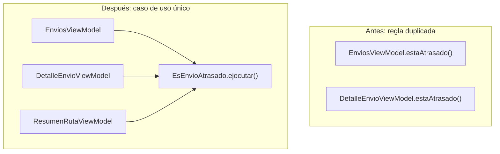

# Módulo 8: Arquitectura MVVM


**Proyecto del módulo:** para cada práctica, parte de una carpeta vacía y crea en Xcode (File ▸ New ▸ Project ▸ App, interfaz SwiftUI) un proyecto llamado `RutaFlowApp`; escribe manualmente todos los archivos indicados y compila, sin usar proyectos ya preparados.

## Aprende construyendo


### Tema 1: De una vista "gorda" a MVVM · Intermedio · 40 min

<details open>
<summary><strong>Capa 1 — Lectura</strong></summary>

#### ► DE QUÉ TRATA
Al finalizar vas a extraer la lógica de carga de ListaEnvios (que hoy llama a ServicioAPI y decide qué hacer con la respuesta directamente en su body) hacia un EnviosViewModel dedicado. Prerrequisitos: Módulo 2 completo (@Observable, @Environment).

#### ► LA IDEA EN UNA FRASE
**Al finalizar vas a extraer la lógica de carga de ListaEnvios (que hoy llama a ServicioAPI y decide qué hacer con la respuesta directamente en su body) hacia un EnviosViewModel dedicado.**

#### ► POR QUÉ EXISTE ESTO
Resuelve un problema real de diseño o implementación y evita decisiones a ciegas.

#### ► LA ANALOGÍA
Piensa en de una vista "gorda" a mvvm como una herramienta de taller: útil cuando conoces su propósito y sus límites.
**Dónde se rompe la analogía:** en software, los efectos dependen del contexto, la escala y los trade-offs.

#### ► CÓMO FUNCIONA
1. Identifica el problema que de una vista "gorda" a mvvm resuelve.
2. Observa sus componentes y relaciones.
3. Aplica la opción más simple que funcione.
4. Verifica el resultado y los límites.

#### ► LO QUE PUEDE SALIR MAL
| Síntoma | Causa probable | Arreglo |
|---|---|---|
| De una vista "gorda" a MVVM se aplica pero el resultado no mejora | Se usó sin medir el problema real | Mide antes y compara contra la alternativa simple |
| Aparece complejidad inesperada | Se adoptó la técnica sin comprender sus trade-offs | Vuelve a la sección de trade-offs y reduce el alcance |
| Falla en un caso límite | Se asumió un contexto que no se cumple | Prueba el caso límite y documenta cuándo NO usarlo |

#### ► TRADE-OFFS
| Opción | Cuándo usarla | Cuándo NO usarla |
|---|---|---|
| Usar De una vista "gorda" a MVVM | Cuando el problema coincide con su propósito y el beneficio es observable | Cuando agrega complejidad sin resolver un problema real |
| Alternativa más simple | Cuando el contexto es pequeño, estable o fácil de razonar | Cuando ya demostró no escalar o no cumplir el requisito |
| Postergar la decisión | Cuando falta evidencia del problema | Cuando el costo de esperar es mayor que el costo de probar |

#### ► CUÁNDO NO USAR ESTO
No uses de una vista "gorda" a mvvm por defecto. Aplícalo cuando el problema lo justifique y puedas verificar el beneficio; si una alternativa más simple resuelve igual, prefiérela.

#### ► DE VUELTA A LA ANALOGÍA
Volviendo a la analogía: de una vista "gorda" a mvvm funciona como el modelo inicial, pero recuerda dónde se rompe: en producción importan la evidencia, la escala y el costo de equivocarte.

#### ► LO QUE DEBES RECORDAR
- De una vista "gorda" a MVVM existe para resolver un problema específico.
- Mide antes de adoptar complejidad.
- Conoce el caso donde NO usarlo.
- Verifica con evidencia observable.

#### ► PREGUNTAS PARA PENSAR
1. ¿Qué problema concreto resuelve de una vista "gorda" a mvvm en tu contexto?
2. ¿Cómo sabrías que de una vista "gorda" a mvvm no está funcionando bien?
3. ¿Qué alternativa más simple considerarías antes de usar de una vista "gorda" a mvvm?

</details>

<details>
<summary><strong>Capa 2 — Construcción</strong></summary>

#### Código y verificación
```swift
struct ListaEnvios: View {
    @State var vm: EnviosViewModel  // la vista solo describe, no decide
    var body: some View { List(vm.envios, id: \.self) { Text($0) } }
}
```

```swift
import SwiftUI
import Observation

// Servicio mínimo para el ejemplo; en tu proyecto es el ServicioAPI real.
@Observable
class ServicioAPI {
    func obtenerEnvios() async throws -> [String] { ["RF-4471", "RF-5002"] }
}

// Antes: ListaEnvios hace fetching y decide qué hacer con el resultado en su body
struct ListaEnvios: View {
    @State private var envios: [String] = []
    @Environment(ServicioAPI.self) var servicio
    var body: some View {
        List(envios, id: \.self) { Text($0) }
            .task { envios = (try? await servicio.obtenerEnvios()) ?? [] }
    }
}

// Después: la vista solo describe, el ViewModel orquesta
@Observable
class EnviosViewModel {
    var envios: [String] = []
    private let servicio: ServicioAPI
    init(servicio: ServicioAPI) { self.servicio = servicio }
    func cargar() async {
        envios = (try? await servicio.obtenerEnvios()) ?? []
    }
}

struct ListaEnvios: View {
    @State var vm: EnviosViewModel
    var body: some View {
        List(vm.envios, id: \.self) { Text($0) }
            .task { await vm.cargar() }
    }
}
```

```bash
xcodebuild -scheme RutaFlowApp -destination 'generic/platform=iOS Simulator' build
```

</details>

### Tema 2: Capas del proyecto e inyección por inicializador · Intermedio · 35 min

<details open>
<summary><strong>Capa 1 — Lectura</strong></summary>

#### ► DE QUÉ TRATA
Al finalizar vas a organizar EnviosViewModel y ServicioAPI en carpetas por capa, e inyectar ServicioAPI por el inicializador del ViewModel en vez de crearlo adentro. Prerrequisitos: Tema 1 de este módulo.

#### ► LA IDEA EN UNA FRASE
**Al finalizar vas a organizar EnviosViewModel y ServicioAPI en carpetas por capa, e inyectar ServicioAPI por el inicializador del ViewModel en vez de crearlo adentro.**

#### ► POR QUÉ EXISTE ESTO
Resuelve un problema real de diseño o implementación y evita decisiones a ciegas.

#### ► LA ANALOGÍA
Piensa en capas del proyecto e inyección por inicializador como una herramienta de taller: útil cuando conoces su propósito y sus límites.
**Dónde se rompe la analogía:** en software, los efectos dependen del contexto, la escala y los trade-offs.

#### ► CÓMO FUNCIONA
1. Identifica el problema que capas del proyecto e inyección por inicializador resuelve.
2. Observa sus componentes y relaciones.
3. Aplica la opción más simple que funcione.
4. Verifica el resultado y los límites.

#### ► LO QUE PUEDE SALIR MAL
| Síntoma | Causa probable | Arreglo |
|---|---|---|
| Capas del proyecto e inyección por inicializador se aplica pero el resultado no mejora | Se usó sin medir el problema real | Mide antes y compara contra la alternativa simple |
| Aparece complejidad inesperada | Se adoptó la técnica sin comprender sus trade-offs | Vuelve a la sección de trade-offs y reduce el alcance |
| Falla en un caso límite | Se asumió un contexto que no se cumple | Prueba el caso límite y documenta cuándo NO usarlo |

#### ► TRADE-OFFS
| Opción | Cuándo usarla | Cuándo NO usarla |
|---|---|---|
| Usar Capas del proyecto e inyección por inicializador | Cuando el problema coincide con su propósito y el beneficio es observable | Cuando agrega complejidad sin resolver un problema real |
| Alternativa más simple | Cuando el contexto es pequeño, estable o fácil de razonar | Cuando ya demostró no escalar o no cumplir el requisito |
| Postergar la decisión | Cuando falta evidencia del problema | Cuando el costo de esperar es mayor que el costo de probar |

#### ► CUÁNDO NO USAR ESTO
No uses capas del proyecto e inyección por inicializador por defecto. Aplícalo cuando el problema lo justifique y puedas verificar el beneficio; si una alternativa más simple resuelve igual, prefiérela.

#### ► DE VUELTA A LA ANALOGÍA
Volviendo a la analogía: capas del proyecto e inyección por inicializador funciona como el modelo inicial, pero recuerda dónde se rompe: en producción importan la evidencia, la escala y el costo de equivocarte.

#### ► LO QUE DEBES RECORDAR
- Capas del proyecto e inyección por inicializador existe para resolver un problema específico.
- Mide antes de adoptar complejidad.
- Conoce el caso donde NO usarlo.
- Verifica con evidencia observable.

#### ► PREGUNTAS PARA PENSAR
1. ¿Qué problema concreto resuelve capas del proyecto e inyección por inicializador en tu contexto?
2. ¿Cómo sabrías que capas del proyecto e inyección por inicializador no está funcionando bien?
3. ¿Qué alternativa más simple considerarías antes de usar capas del proyecto e inyección por inicializador?

</details>

<details>
<summary><strong>Capa 2 — Construcción</strong></summary>

#### Código y verificación
```swift
init(servicio: ServicioAPI = ServicioAPI()) { self.servicio = servicio }
// Producción: EnviosViewModel()
// Test: EnviosViewModel(servicio: ServicioAPIFalso())
```

```swift
// Vistas/ListaEnvios.swift      — SwiftUI puro
// ViewModels/EnviosViewModel.swift
// Servicios/ServicioAPI.swift   — networking real
// Dominio/Envio.swift           — modelo puro

// Archivo ViewModels/EnviosViewModel.swift
import Observation

@Observable
class EnviosViewModel {
    var envios: [String] = []
    private let servicio: ServicioAPI
    init(servicio: ServicioAPI = ServicioAPI()) {
        self.servicio = servicio
    }
    func cargar() async {
        envios = (try? await servicio.obtenerEnvios()) ?? []
    }
}

// Archivo Servicios/ServicioAPI.swift (versión mínima; la real hace la petición de red)
import Observation

@Observable
class ServicioAPI {
    func obtenerEnvios() async throws -> [String] { ["RF-4471", "RF-5002"] }
}
```

```bash
xcodebuild -scheme RutaFlowApp -destination 'generic/platform=iOS Simulator' build
```

</details>

### Tema 3: Cuándo MVVM no alcanza · Avanzado · 45 min

<details open>
<summary><strong>Capa 1 — Lectura</strong></summary>

#### ► DE QUÉ TRATA
Al finalizar vas a identificar en qué momento EnviosViewModel empieza a necesitar algo más que MVVM simple, usando como ejemplo una regla de negocio que se repite entre varios ViewModels de RutaFlow. Prerrequisitos: Temas 1 y 2 de este módulo.

#### ► LA IDEA EN UNA FRASE
**Al finalizar vas a identificar en qué momento EnviosViewModel empieza a necesitar algo más que MVVM simple, usando como ejemplo una regla de negocio que se repite entre varios ViewModels de RutaFlow.**

#### ► POR QUÉ EXISTE ESTO
Resuelve un problema real de diseño o implementación y evita decisiones a ciegas.

#### ► LA ANALOGÍA
Cuando una regla de negocio se repite entre varios ViewModels, equipos suelen agregar una capa de "casos de uso" entre el ViewModel y el Servicio — cada caso de uso encapsula una sola operación de negocio reutilizable.

**¿Por qué es importante?** Porque reconocer cuándo una regla se duplica evita tanto la sub-arquitectura (lógica copiada entre ViewModels) como la sobre-arquitectura (casos de uso para reglas usadas una sola vez).
**Conceptos clave:** caso de uso como regla de negocio reutilizable; límite entre MVVM simple y capas adicionales.

Para apps con varios ViewModels que comparten lógica de negocio sustancial, o con flujos de navegación complejos coordinados entre pantallas, algunos equipos adoptan además TCA (The Composable Architecture), una arquitectura de terceros que estructura estado y acciones de forma más explícita y testeable a gran escala, a costa de una curva de aprendizaje y un boilerplate inicial mayor que el MVVM simple de este módulo. Reconocer cuándo MVVM simple empieza a quedarse corto es una habilidad tan importante como saber implementarlo bien desde el principio: introducir complejidad arquitectónica antes de necesitarla también tiene un costo de mantenimiento.

**Analogía:** MVVM simple es la organización adecuada para un restaurante de tamaño mediano con roles claros; a medida que el negocio crece hasta ser una cadena con varias sucursales, se vuelve necesario agregar una oficina central de operaciones — algo que sería puro exceso de burocracia para el restaurante original pequeño.

**Implicación práctica:** Un caso de uso evita duplicar reglas de negocio entre ViewModels; adoptar TCA o capas adicionales antes de necesitarlas agrega complejidad sin beneficio real todavía.

**Diagrama:**

```
MVVM simple:        Vista ↔ ViewModel ↔ Servicio
MVVM + casos de uso: Vista ↔ ViewModel ↔ Caso de Uso ↔ Servicio (lógica de negocio reutilizable entre ViewModels)
```

**Diagrama: regla duplicada vs caso de uso compartido**



En tu propio proyecto RutaFlow, crea `Dominio/EsEnvioAtrasado.swift`: primero crea el grupo `Dominio` en el navegador de Xcode y después **File ▸ New ▸ File ▸ Swift File** dentro de ese grupo, con el target de la app seleccionado. Escribe allí el caso de uso del Paso 4.

---

**Dónde se rompe la analogía:** el modelo simplifica la realidad; en producción influyen escala, fallos, costo y contexto.

#### ► CÓMO FUNCIONA


#### ► LO QUE PUEDE SALIR MAL
| Síntoma | Causa probable | Arreglo |
|---|---|---|
| Cuándo MVVM no alcanza se aplica pero el resultado no mejora | Se usó sin medir el problema real | Mide antes y compara contra la alternativa simple |
| Aparece complejidad inesperada | Se adoptó la técnica sin comprender sus trade-offs | Vuelve a la sección de trade-offs y reduce el alcance |
| Falla en un caso límite | Se asumió un contexto que no se cumple | Prueba el caso límite y documenta cuándo NO usarlo |

#### ► TRADE-OFFS
| Opción | Cuándo usarla | Cuándo NO usarla |
|---|---|---|
| Usar Cuándo MVVM no alcanza | Cuando el problema coincide con su propósito y el beneficio es observable | Cuando agrega complejidad sin resolver un problema real |
| Alternativa más simple | Cuando el contexto es pequeño, estable o fácil de razonar | Cuando ya demostró no escalar o no cumplir el requisito |
| Postergar la decisión | Cuando falta evidencia del problema | Cuando el costo de esperar es mayor que el costo de probar |

#### ► CUÁNDO NO USAR ESTO
No uses cuándo mvvm no alcanza por defecto. Aplícalo cuando el problema lo justifique y puedas verificar el beneficio; si una alternativa más simple resuelve igual, prefiérela.

#### ► DE VUELTA A LA ANALOGÍA
Volviendo a la analogía: cuándo mvvm no alcanza funciona como el modelo inicial, pero recuerda dónde se rompe: en producción importan la evidencia, la escala y el costo de equivocarte.

#### ► LO QUE DEBES RECORDAR
- Cuándo MVVM no alcanza existe para resolver un problema específico.
- Mide antes de adoptar complejidad.
- Conoce el caso donde NO usarlo.
- Verifica con evidencia observable.

#### ► PREGUNTAS PARA PENSAR
1. ¿Qué problema concreto resuelve cuándo mvvm no alcanza en tu contexto?
2. ¿Cómo sabrías que cuándo mvvm no alcanza no está funcionando bien?
3. ¿Qué alternativa más simple considerarías antes de usar cuándo mvvm no alcanza?

</details>

<details>
<summary><strong>Capa 2 — Construcción</strong></summary>

#### Código y verificación
```
MVVM simple:        Vista ↔ ViewModel ↔ Servicio
MVVM + casos de uso: Vista ↔ ViewModel ↔ Caso de Uso ↔ Servicio (lógica de negocio reutilizable entre ViewModels)
```


```swift
import Foundation

struct Envio { let fechaEstimada: Date }

// Antes: la regla "está atrasado" duplicada en dos ViewModels
class EnviosViewModel {
    func estaAtrasado(_ envio: Envio) -> Bool { envio.fechaEstimada < Date() }
}
class DetalleEnvioViewModel {
    func estaAtrasado(_ envio: Envio) -> Bool { envio.fechaEstimada < Date() } // copiada
}

// Después: un caso de uso reutilizable
struct EsEnvioAtrasado {
    func ejecutar(_ envio: Envio) -> Bool { envio.fechaEstimada < Date() }
}
class EnviosViewModel { private let esAtrasado = EsEnvioAtrasado() }
class DetalleEnvioViewModel { private let esAtrasado = EsEnvioAtrasado() }
```

```bash
xcodebuild -scheme RutaFlowApp -destination 'generic/platform=iOS Simulator' build
```

</details>
