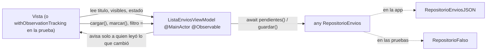
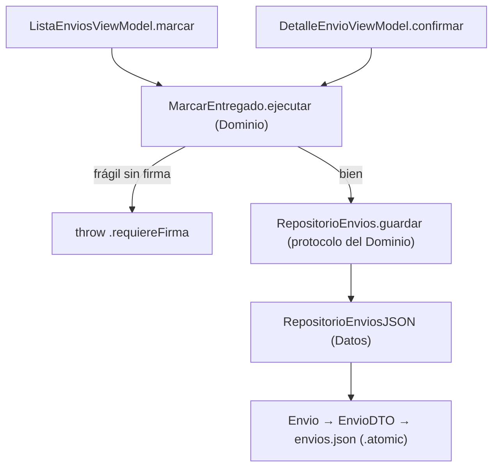
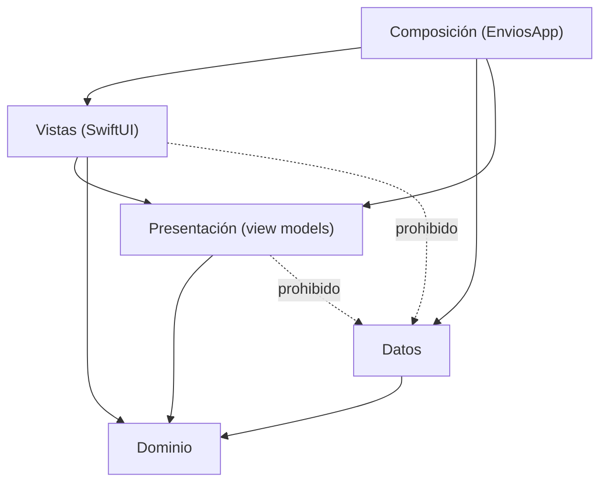
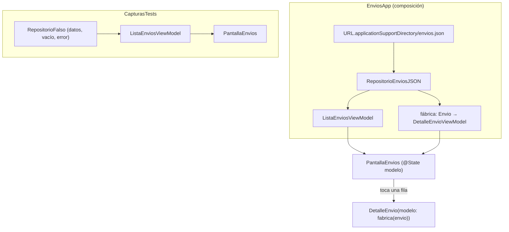

# Módulo 8: Arquitectura MVVM y capas

**Entorno comprobado para esta edición (2026-11-25):** los view models, el dominio, la capa de datos y la prueba de
arquitectura se escribieron en Swift 6.4.3 (modo de lenguaje Swift 6) y se probaron en Linux x86_64 con Swift
Testing 6.4.3, en `/home/estudiante/labs/ios/ios8` (tu `~/labs/ios/ios8`): `@Observable` y
`withObservationTracking` vienen con Swift (el módulo `Observation`), así que los view models se prueban sin
ninguna vista y sin la Mac. Las vistas de SwiftUI y la app real se compilaron y ejecutaron en una Mac con macOS
27.2, Xcode 27.2 (27B52), Swift 6.4.2 y el simulador iPhone 17 con iOS 27.2, donde también se repitieron las 11
pruebas del paquete con `swift test`. Límites honestos: en la Mac, las capas se copian a la app como carpetas de un
solo módulo (el laboratorio no agrega el paquete local al proyecto de Xcode); lo que eso cambia se explica en el
Tema 3.

En los módulos anteriores, cada pantalla hacía todo: pedía los datos, decidía las reglas y dibujaba. Funciona
hasta que hay que probar una regla sin abrir el simulador, reutilizarla en otra pantalla o cambiar de dónde salen
los datos. Este módulo separa la app en capas con responsabilidades claras, prueba cada una por su lado y, lo más
importante, comprueba con una prueba que nadie rompa la separación.

**Al terminar este módulo podrás:**
- mover el estado y las acciones de una pantalla a un view model `@Observable` y probarlo sin vistas;
- poner las reglas de negocio en casos de uso del dominio y los datos detrás de un protocolo;
- separar las capas en módulos de Swift y escribir una prueba de arquitectura que revise sus `import`;
- conectar todo en una raíz de composición y dibujar las vistas a partir de los view models.

**Esquema del módulo:** Tema 1 (el view model probado sin vista) → Tema 2 (dominio: casos de uso y repositorios) →
Tema 3 (capas como módulos y prueba de arquitectura) → Tema 4 (composición y vistas, en el simulador) → Proyecto 45.

**Qué necesitas saber antes:** del Módulo 2, **`@Observable` y `@State`** (Temas 1 y 2); del Módulo 4, **`actor`,
`@MainActor` y `Sendable`** (Temas 2, 3 y 6); del Módulo 5, **los errores tipados** (Tema 2); del Módulo 0, **los
protocolos** (Tema 3).

**Qué no se repite:** cómo funciona `@Observable` por dentro (Módulo 2), la red (Módulo 5) ni SwiftData (Módulo 6).
La capa de datos de este módulo usa un archivo JSON para que todo se pueda ejecutar en cualquier sistema; cambiarla
por la red o por SwiftData es justo lo que la arquitectura permite sin tocar lo demás.

**Prepara el proyecto:**

```text
$ mkdir -p ~/labs/ios/ios8 && cd ~/labs/ios/ios8
$ mkdir nucleo && cd nucleo
$ swift package init --type library --name Nucleo
```

Reemplaza `Package.swift` por este, con un módulo por capa:

```swift
// swift-tools-version: 6.0
import PackageDescription

// Una capa por módulo: el compilador hace cumplir quién puede importar a quién.
let package = Package(
    name: "Nucleo",
    platforms: [.macOS(.v15), .iOS(.v18)],
    products: [
        .library(name: "Dominio", targets: ["Dominio"]),
        .library(name: "Datos", targets: ["Datos"]),
        .library(name: "Presentacion", targets: ["Presentacion"]),
    ],
    targets: [
        .target(name: "Dominio"),  // modelos, reglas, contratos: no depende de nadie
        .target(name: "Datos", dependencies: ["Dominio"]),  // implementa los contratos
        .target(name: "Presentacion", dependencies: ["Dominio"]),  // view models: no conoce Datos
        .testTarget(name: "DominioTests", dependencies: ["Dominio", "Datos"]),
        .testTarget(name: "PresentacionTests", dependencies: ["Presentacion", "Dominio"]),
        .testTarget(name: "ArquitecturaTests"),
    ]
)
```

La estructura final:

```text
ios8/
├── nucleo/
│   ├── Sources/Dominio/          Envio, RepositorioEnvios (protocolo), MarcarEntregado (caso de uso)
│   ├── Sources/Datos/            EnvioDTO, RepositorioEnviosJSON
│   ├── Sources/Presentacion/     ListaEnviosViewModel, DetalleEnvioViewModel, mensajes
│   └── Tests/                    PresentacionTests, DominioTests, ArquitecturaTests
├── ejemplos_que_fallan/          una violación de capas, para el Tema 3
└── app/                          proyecto de Xcode EnviosApp
    ├── App/Vistas/               PantallaEnvios, DetalleEnvio (solo SwiftUI)
    ├── App/Composicion/          EnviosApp (raíz de composición), Muestras
    └── Pruebas/                  capturas
```


## Aprende construyendo


### Tema 1: El view model @Observable, probado sin vista · Intermedio · 45 min

<details open>
<summary><strong>Capa 1 — Lectura</strong></summary>

#### Objetivos
Al terminar este tema podrás:
- reunir el estado de una pantalla y sus acciones en un view model `@MainActor @Observable`;
- exponer solo lo que la vista necesita (`titulo`, `visibles`, `estado`, `aviso`) y proteger el resto;
- probar carga, error, filtro y acciones con un repositorio falso, sin ninguna vista;
- comprobar con `withObservationTracking` qué cambios redibujarían una vista.

**Conceptos clave:** view model, `@Observable`, `@MainActor`, estado derivado, doble de prueba, seguimiento de
observación

#### El problema
`PantallaEnvios` tiene en su `body` la carga del archivo, el filtro, el conteo del título y la regla «un frágil
necesita firma». Para probar que el título dice «1 pendiente» y no «1 pendientes» hay que abrir el simulador y
contar a ojo, y para probar la regla de la firma hay que tocar la pantalla. Cada cambio de diseño rompe la lógica y
cada cambio de lógica obliga a revisar el diseño.

Este tema usa **`@Observable`** (Módulo 2, Tema 2), **`actor`** (Módulo 4, Tema 2) y **`@MainActor`** (Módulo 4,
Tema 3).

#### Glosario del tema

**view model**
- **Definición técnica:** clase que contiene el estado de una pantalla (lo que se muestra) y sus acciones (lo que el usuario puede hacer), sin depender de SwiftUI; la vista lo lee y le pasa los eventos.
- **En palabras sencillas:** el guion de la pantalla; la vista es la actuación.
- **Dónde se rompe la comparación:** no decide las reglas del negocio: las pide al dominio (Tema 2).
- **Ejemplo:** `ListaEnviosViewModel` con `estado`, `titulo`, `visibles`, `cargar()` y `marcar(_:firma:)`.
- **Error típico:** un view model que importa SwiftUI y devuelve `Color` o `Text`.

**`@Observable`**
- **Definición técnica:** macro del módulo `Observation` que hace que cada lectura de una propiedad quede registrada y cada escritura avise solo a quienes la leyeron.
- **En palabras sencillas:** un tablero que avisa a cada persona solo de las casillas que miró.
- **Dónde se rompe la comparación:** las propiedades calculadas (`titulo`) no se observan por sí mismas, sino a través de las guardadas que leen (`envios`).
- **Ejemplo:** `@MainActor @Observable public final class ListaEnviosViewModel`.
- **Error típico:** pensar que cualquier cambio del view model redibuja todas las vistas.

**`@MainActor` en el view model**
- **Definición técnica:** aísla la clase en el actor principal: sus propiedades solo se leen y escriben desde ahí, igual que SwiftUI dibuja; las llamadas `async` al repositorio salen y vuelven a él.
- **En palabras sencillas:** el guion se cambia en un solo escritorio, el mismo donde se actúa.
- **Dónde se rompe la comparación:** las pruebas también tienen que estar en el actor principal (`@MainActor` en la suite).
- **Ejemplo:** `await repositorio.pendientes()` sale del actor principal y el resultado se asigna de vuelta en él.
- **Error típico:** quitar `@MainActor` para «arreglar» un error de compilación y abrir la puerta a carreras de datos.

**estado derivado**
- **Definición técnica:** propiedad calculada a partir de otras (`titulo` desde `envios`, `visibles` desde `envios` y `filtro`); no se guarda y por eso no puede contradecirse.
- **En palabras sencillas:** el total de una factura: se calcula, no se escribe a mano.
- **Dónde se rompe la comparación:** si calcularla es costoso y se lee muchas veces, conviene guardarla y actualizarla en un solo lugar.
- **Ejemplo:** `"Ruta de hoy · \(envios.count) \(envios.count == 1 ? "pendiente" : "pendientes")"`.
- **Error típico:** guardar `titulo` y `envios` por separado y olvidar actualizar uno.

**doble de prueba**
- **Definición técnica:** implementación del protocolo hecha para una prueba: devuelve lo que la prueba necesita y registra cómo la usaron.
- **En palabras sencillas:** el actor de reemplazo en el ensayo.
- **Dónde se rompe la comparación:** debe cumplir el mismo contrato que la real; si no, las pruebas mienten.
- **Ejemplo:** `actor RepositorioFalso` con `guardados`.
- **Error típico:** un doble que nunca falla, y por eso el estado de error nunca se prueba.

#### ► CÓMO FUNCIONA
La vista lee propiedades del view model dentro de su `body`; Observation anota cuáles. El view model llama al
repositorio (un protocolo del dominio) y cambia `envios`, `estado` o `aviso`; Observation avisa solo a las vistas
que leyeron esas propiedades. En las pruebas, en lugar de la vista, `withObservationTracking` hace la lectura.



#### Problema resuelto 1.1
Escribe el view model de la lista de envíos y pruébalo sin vista: carga con datos, sin datos y con error; el filtro
por destinatario y por guía; marcar un frágil sin firma, uno normal y los demás; y qué cambios avisarían a una vista
que solo muestra el título y a otra que muestra la lista.

**Razonamiento:**
1. El view model depende de un protocolo del dominio (`RepositorioEnvios`), no de una clase concreta.
2. `estado` y `aviso` tienen `private(set)`: solo el view model los cambia. `filtro` es escribible porque lo escribe
   la caja de búsqueda.
3. Los textos de error se escriben en la capa de presentación (`MensajesError.swift`), no en el dominio.
4. El doble de prueba es un `actor` (el contrato es `Sendable`) y anota las guías guardadas.
5. Para saber qué observa una vista, la prueba lee lo mismo que ella dentro de `withObservationTracking`.

```swift
// Envio.swift — el modelo del dominio: sin Codable, sin SwiftUI, sin nada de cómo se guarda o se muestra.
public enum EstadoEnvio: String, Sendable {
    case pendiente
    case entregado
}

public struct Envio: Identifiable, Equatable, Sendable {
    public var id: String { guia }
    public let guia: String
    public let destinatario: String
    public let direccion: String
    public let fragil: Bool
    public var estado: EstadoEnvio
    public var firmadoPor: String?

    public init(
        guia: String, destinatario: String, direccion: String, fragil: Bool = false,
        estado: EstadoEnvio = .pendiente, firmadoPor: String? = nil
    ) {
        self.guia = guia
        self.destinatario = destinatario
        self.direccion = direccion
        self.fragil = fragil
        self.estado = estado
        self.firmadoPor = firmadoPor
    }
}

/// Los errores que el dominio sabe que pueden pasar.
public enum ErrorEnvios: Error, Equatable, Sendable {
    case requiereFirma(guia: String)
    case noEncontrado(guia: String)
    case almacenamiento(String)
}
```

```swift
// RepositorioEnvios.swift — el contrato que el dominio necesita; lo implementa la capa de datos.
public protocol RepositorioEnvios: Sendable {
    func pendientes() async throws(ErrorEnvios) -> [Envio]
    func guardar(_ envio: Envio) async throws(ErrorEnvios)
}
```

```swift
// ListaEnviosViewModel.swift — el estado de la pantalla de la ruta y sus acciones. Sin SwiftUI: se prueba solo.
import Dominio
import Foundation
import Observation

@MainActor
@Observable
public final class ListaEnviosViewModel {
    public enum Estado: Equatable {
        case cargando
        case lista
        case vacia
        case error(String)
    }

    public private(set) var estado: Estado = .cargando
    public private(set) var envios: [Envio] = []
    public var filtro = ""
    /// Mensaje breve para la persona (por ejemplo, «EN-4472 es frágil: pide el nombre de quien recibe.»).
    public private(set) var aviso: String?

    private let repositorio: any RepositorioEnvios
    private let marcarEntregado: MarcarEntregado

    public init(repositorio: any RepositorioEnvios) {
        self.repositorio = repositorio
        self.marcarEntregado = MarcarEntregado(repositorio: repositorio)
    }

    public var titulo: String {
        "Ruta de hoy · \(envios.count) \(envios.count == 1 ? "pendiente" : "pendientes")"
    }

    /// Lo que se ve con el filtro aplicado (por destinatario o por guía).
    public var visibles: [Envio] {
        let texto = filtro.trimmingCharacters(in: .whitespaces)
        guard !texto.isEmpty else { return envios }
        return envios.filter {
            $0.destinatario.localizedCaseInsensitiveContains(texto) || $0.guia.localizedCaseInsensitiveContains(texto)
        }
    }

    public func cargar() async {
        estado = .cargando
        do {
            envios = try await repositorio.pendientes()
            estado = envios.isEmpty ? .vacia : .lista
        } catch {
            estado = .error(error.mensaje)
        }
    }

    public func marcar(_ envio: Envio, firma: String? = nil) async {
        do {
            _ = try await marcarEntregado.ejecutar(envio, firma: firma)
            envios.removeAll { $0.guia == envio.guia }
            if envios.isEmpty { estado = .vacia }
            aviso = nil
        } catch {
            aviso = error.mensaje
        }
    }
}
```

```swift
// MensajesError.swift — el texto que ve la persona es asunto de la presentación, no del dominio.
import Dominio

extension ErrorEnvios {
    var mensaje: String {
        switch self {
        case .requiereFirma(let guia): "\(guia) es frágil: pide el nombre de quien recibe."
        case .noEncontrado(let guia): "No se encontró la guía \(guia)."
        case .almacenamiento: "No se pudieron leer las entregas guardadas."
        }
    }
}
```

```swift
// RepositorioFalso.swift — un doble del contrato: responde lo que la prueba pida y anota lo que se guardó.
import Dominio

actor RepositorioFalso: RepositorioEnvios {
    private var envios: [Envio]
    private let falla: ErrorEnvios?
    private(set) var guardados: [String] = []

    init(_ envios: [Envio], falla: ErrorEnvios? = nil) {
        self.envios = envios
        self.falla = falla
    }

    func pendientes() async throws(ErrorEnvios) -> [Envio] {
        if let falla { throw falla }
        return envios.filter { $0.estado == .pendiente }
    }

    func guardar(_ envio: Envio) async throws(ErrorEnvios) {
        guardados.append(envio.guia)
        envios.removeAll { $0.guia == envio.guia }
        envios.append(envio)
    }
}

let tresEnvios = [
    Envio(guia: "EN-4471", destinatario: "Ana Ruiz", direccion: "Cra 7 # 45-10, Bogotá"),
    Envio(guia: "EN-4472", destinatario: "Luis Pardo", direccion: "Cl 72 # 11-30, Bogotá", fragil: true),
    Envio(guia: "EN-4473", destinatario: "Marta Gil", direccion: "Av 68 # 22-05, Bogotá"),
]
```

```swift
// Tema1ViewModelTests.swift — el view model probado sin ninguna vista.
import Dominio
import Observation
import Synchronization
import Testing

@testable import Presentacion

@MainActor
@Suite("Tema 1 · View model sin vista", .serialized)
struct Tema1ViewModelTests {
    @Test func cargaLaLista() async {
        let modelo = ListaEnviosViewModel(repositorio: RepositorioFalso(tresEnvios))
        #expect(modelo.estado == .cargando)
        await modelo.cargar()
        print("cargar(): \(modelo.estado) · «\(modelo.titulo)»")
        #expect(modelo.estado == .lista)
        #expect(modelo.titulo == "Ruta de hoy · 3 pendientes")
    }

    @Test func vaciaYError() async {
        let vacia = ListaEnviosViewModel(repositorio: RepositorioFalso([]))
        await vacia.cargar()
        let rota = ListaEnviosViewModel(repositorio: RepositorioFalso(tresEnvios, falla: .almacenamiento("disco")))
        await rota.cargar()
        print("sin envíos: \(vacia.estado) · «\(vacia.titulo)»")
        print("repositorio que falla: \(rota.estado)")
        #expect(vacia.estado == .vacia)
        #expect(rota.estado == .error("No se pudieron leer las entregas guardadas."))
    }

    @Test func filtro() async {
        let modelo = ListaEnviosViewModel(repositorio: RepositorioFalso(tresEnvios))
        await modelo.cargar()
        for texto in ["ana", "4473", "  ", "zzz"] {
            modelo.filtro = texto
            print("filtro «\(texto)» → \(modelo.visibles.map(\.guia))")
        }
        modelo.filtro = "ANA"
        #expect(modelo.visibles.map(\.guia) == ["EN-4471"])
    }

    @Test func marcar() async {
        let repositorio = RepositorioFalso(tresEnvios)
        let modelo = ListaEnviosViewModel(repositorio: repositorio)
        await modelo.cargar()
        await modelo.marcar(tresEnvios[1])  // frágil, sin firma
        print("marcar EN-4472 sin firma → aviso: «\(modelo.aviso ?? "-")» · guardados: \(await repositorio.guardados)")
        await modelo.marcar(tresEnvios[0])
        print(
            "marcar EN-4471 → «\(modelo.titulo)» · aviso: \(modelo.aviso ?? "ninguno") · "
                + "guardados: \(await repositorio.guardados)")
        await modelo.marcar(tresEnvios[1], firma: "Luis Pardo")
        await modelo.marcar(tresEnvios[2])
        print("marcar las otras dos → \(modelo.estado) · «\(modelo.titulo)»")
        #expect(await repositorio.guardados == ["EN-4471", "EN-4472", "EN-4473"])
        #expect(modelo.estado == .vacia)
    }

    /// Lo que hace SwiftUI: leer propiedades dentro de un seguimiento y enterarse solo cuando cambia algo leído.
    @Test func quePropiedadesObservaLaVista() async {
        let modelo = ListaEnviosViewModel(repositorio: RepositorioFalso(tresEnvios))
        await modelo.cargar()
        let soloTitulo = Mutex(0)
        let laLista = Mutex(0)
        withObservationTracking {
            _ = modelo.titulo
        } onChange: {
            soloTitulo.withLock { $0 += 1 }
        }
        withObservationTracking {
            _ = modelo.visibles
        } onChange: {
            laLista.withLock { $0 += 1 }
        }
        modelo.filtro = "ana"
        print(
            "tras cambiar el filtro: avisos a la vista del título = \(soloTitulo.withLock { $0 }), "
                + "a la vista de la lista = \(laLista.withLock { $0 })")
        await modelo.marcar(tresEnvios[0])
        print("tras marcar EN-4471: avisos a la vista del título = \(soloTitulo.withLock { $0 })")
        #expect(soloTitulo.withLock { $0 } == 1)
        #expect(laLista.withLock { $0 } == 1)
    }
}
```

```text
$ swift test --skip-build --filter Tema1ViewModelTests
◇ Test run started.
↳ Testing Library Version: 6.4.3 (ba0861fb203553c)
↳ Target Platform: x86_64-unknown-linux-gnu
◇ Suite "Tema 1 · View model sin vista" started.
◇ Test cargaLaLista() started.
cargar(): lista · «Ruta de hoy · 3 pendientes»
✔ Test cargaLaLista() passed after 0.001 seconds.
◇ Test vaciaYError() started.
sin envíos: vacia · «Ruta de hoy · 0 pendientes»
repositorio que falla: error("No se pudieron leer las entregas guardadas.")
✔ Test vaciaYError() passed after 0.001 seconds.
◇ Test filtro() started.
filtro «ana» → ["EN-4471"]
filtro «4473» → ["EN-4473"]
filtro «  » → ["EN-4471", "EN-4472", "EN-4473"]
filtro «zzz» → []
✔ Test filtro() passed after 0.001 seconds.
◇ Test marcar() started.
marcar EN-4472 sin firma → aviso: «EN-4472 es frágil: pide el nombre de quien recibe.» · guardados: []
marcar EN-4471 → «Ruta de hoy · 2 pendientes» · aviso: ninguno · guardados: ["EN-4471"]
marcar las otras dos → vacia · «Ruta de hoy · 0 pendientes»
✔ Test marcar() passed after 0.001 seconds.
◇ Test quePropiedadesObservaLaVista() started.
tras cambiar el filtro: avisos a la vista del título = 0, a la vista de la lista = 1
tras marcar EN-4471: avisos a la vista del título = 1
✔ Test quePropiedadesObservaLaVista() passed after 0.001 seconds.
✔ Suite "Tema 1 · View model sin vista" passed after 0.003 seconds.
✔ Test run with 5 tests in 1 suite passed after 0.003 seconds.
```

**Explicación por partes.**
- Con 3 envíos, `cargar()` deja el estado en `lista` y el título en «Ruta de hoy · 3 pendientes». Sin envíos,
  `vacia`; con un repositorio que falla, `error` con el texto que verá la persona.
- El filtro no distingue mayúsculas (`ana` encuentra a Ana Ruiz), busca también en la guía (`4473`) e ignora los
  espacios: `"  "` muestra los 3.
- Marcar `EN-4472` sin firma deja un aviso y **no guarda nada** (`guardados: []`): la regla se cumplió antes de
  llegar al repositorio. Al marcar `EN-4471`, el título baja a «2 pendientes» y el aviso se borra. Con los tres
  marcados, el estado pasa a `vacia`.
- Observación: cambiar el filtro avisó **0** veces a la vista que solo lee el título y **1** vez a la que lee la
  lista; marcar avisó a la del título. Es lo que hace SwiftUI: solo redibuja lo que depende de lo que cambió.
- Todo corrió en Linux, en milésimas de segundo, sin simulador: el view model no sabe que existe SwiftUI.

> **Error común.** Hacer que el view model devuelva cosas de la interfaz (`Color`, `Image`, `Text`) «para facilitarle
> la vida a la vista». El view model pasa a depender de SwiftUI, ya no se prueba en cualquier sistema, y la prueba
> de arquitectura del Tema 3 lo rechaza (en la Mac se comprobó con un `import SwiftUI` provocado a propósito).

> **Error común.** Dejar `estado` con `set` público. Cualquier vista puede escribir `modelo.estado = .lista` sin
> datos, y el view model deja de ser la única fuente de verdad de la pantalla.

> **Buena práctica.** Un doble de prueba por protocolo, con la opción de fallar (`falla:`) y un registro de lo que
> recibió (`guardados`). Con eso, cada estado de la pantalla tiene su prueba, incluido el de error.

> **Prevenir errores.** Escribe primero la prueba del texto que verá la persona («1 pendiente», «0 pendientes»). Los
> errores de redacción son los más visibles y los más fáciles de atrapar sin vista.

#### Checkpoint 1.1
¿Por qué `titulo` no necesita `@ObservationIgnored` ni nada especial para que la vista se actualice al marcar?

Respuesta: porque es calculada y lee `envios`, que sí está observada. Al leer `titulo`, la vista registra `envios`;
cuando `marcar` cambia `envios`, Observation avisa. La prueba lo muestra: 1 aviso tras marcar.

</details>

<details>
<summary><strong>Capa 2 — Construcción</strong></summary>

#### Paso 1 · Crea el paquete y el dominio mínimo
Crea `Package.swift`, `Envio.swift` y `RepositorioEnvios.swift`.

#### Paso 2 · Escribe el view model
Crea `ListaEnviosViewModel.swift` y `MensajesError.swift` (el caso de uso `MarcarEntregado` llega en el Tema 2;
puedes empezar con la regla dentro de `marcar` y moverla después).

#### Paso 3 · Prueba sin vista
Crea `RepositorioFalso.swift` y `Tema1ViewModelTests.swift` y ejecuta `swift test --filter Tema1ViewModelTests`.

#### Paso 4 · Observa
Agrega a `quePropiedadesObservaLaVista` un tercer seguimiento que lea `aviso` y comprueba cuántos avisos recibe al
marcar el frágil sin firma.

#### Paso 5 · Rompe el singular
Cambia el título para que siempre diga «pendientes» y ejecuta las pruebas. ¿Cuál falla?

#### Resumen
- Un **view model** reúne el estado de una pantalla y sus acciones, sin SwiftUI.
- **`@Observable`** avisa solo a quien leyó lo que cambió; **`@MainActor`** lo mantiene en el actor de la interfaz.
- El **estado derivado** se calcula y no se contradice.
- Con un **doble de prueba**, cada estado se prueba sin vista y sin red.

#### Ejercicio verificable 1
Básico. ¿Qué título muestra el view model con 3 envíos cargados?

Respuesta esperada: «Ruta de hoy · 3 pendientes».

#### Ejercicio verificable 2
Intermedio. ¿Por qué después de marcar `EN-4472` sin firma la lista de guardados está vacía?

Respuesta esperada: porque `MarcarEntregado.ejecutar` lanza `requiereFirma` antes de llamar a
`repositorio.guardar`; el view model captura el error y lo muestra como aviso.

#### Ejercicio verificable 3
Reto. En el Paso 4, ¿cuántos avisos recibe la vista que lee `aviso` y por qué?

Respuesta esperada: 1, porque `marcar` asigna `aviso` con el mensaje del frágil. Para confirmarlo, el seguimiento
debe empezar antes de esa llamada; si empieza después, recibe 0.

#### En el trabajo
En los equipos, el view model es la pieza que más pruebas tiene, porque concentra lo que la persona ve y puede
hacer. Se revisa en el pull request que no importe SwiftUI, que sus propiedades de estado sean de solo lectura y que
cada estado de la pantalla tenga una prueba.

</details>

### Tema 2: Dominio: casos de uso y repositorios · Avanzado · 45 min

<details open>
<summary><strong>Capa 1 — Lectura</strong></summary>

#### Objetivos
Al terminar este tema podrás:
- escribir una regla de negocio como caso de uso y reutilizarla desde dos view models;
- definir el contrato de los datos en el dominio y la implementación en la capa de datos;
- traducir entre la forma del archivo (DTO) y el modelo del dominio en un solo lugar;
- reconocer cuándo MVVM solo no alcanza.

**Conceptos clave:** caso de uso, inversión de dependencias, repositorio, DTO, `actor` como repositorio

#### El problema
La regla «un envío frágil solo se entrega con firma» está escrita en la lista (al deslizar «Entregar») y otra vez
en el detalle (en el botón «Confirmar»). Un día alguien cambia la del detalle para aceptar firmas de dos letras y
olvida la de la lista. Además, `ListaEnviosViewModel` crea su propio `RepositorioEnviosJSON`, y para probarlo hay
que escribir archivos.

Este tema usa **los protocolos** (Módulo 0, Tema 3), **los errores tipados** (Módulo 5, Tema 2) y **los actores**
(Módulo 4, Tema 2).

#### Glosario del tema

**caso de uso**
- **Definición técnica:** tipo del dominio que ejecuta una operación del negocio completa (validar, cambiar, guardar) usando contratos, sin saber de interfaz ni de almacenamiento.
- **En palabras sencillas:** el procedimiento oficial de la empresa para hacer una cosa.
- **Dónde se rompe la comparación:** no todo necesita uno: si la operación es solo «leer y mostrar», el view model llama al repositorio directamente.
- **Ejemplo:** `MarcarEntregado.ejecutar(_:firma:)`.
- **Error típico:** copiar la regla en cada view model que la necesita.

**inversión de dependencias**
- **Definición técnica:** la capa de alto nivel (dominio) define el protocolo y la de bajo nivel (datos) lo implementa; así el dominio no importa a los datos, sino al revés.
- **En palabras sencillas:** el enchufe lo define la casa, no el electrodoméstico.
- **Dónde se rompe la comparación:** alguien tiene que enchufar: la raíz de composición (Tema 4).
- **Ejemplo:** `protocol RepositorioEnvios` en `Dominio`; `actor RepositorioEnviosJSON: RepositorioEnvios` en `Datos`.
- **Error típico:** un protocolo por cada clase, aunque nadie lo reemplace nunca.

**repositorio**
- **Definición técnica:** implementación del contrato de datos que esconde de dónde salen (archivo, red, base de datos) y entrega modelos del dominio.
- **En palabras sencillas:** el encargado de la bodega: le pides «los pendientes» y no te dice en qué estante estaban.
- **Dónde se rompe la comparación:** no decide reglas de negocio; solo guarda y entrega.
- **Ejemplo:** `RepositorioEnviosJSON.pendientes()`.
- **Error típico:** un repositorio que devuelve el DTO en lugar del modelo del dominio.

**DTO**
- **Definición técnica:** *data transfer object*: la forma exacta del dato en el borde (JSON con `snake_case`, estados como texto), con su traducción al modelo del dominio, que puede fallar.
- **En palabras sencillas:** el formulario tal como llega, antes de pasarlo al sistema.
- **Dónde se rompe la comparación:** no es otra copia del modelo: existe porque el borde y el dominio cambian por razones distintas.
- **Ejemplo:** `EnvioDTO` con `firmado_por` y `estado: String`.
- **Error típico:** hacer `Envio: Codable` y atar el dominio al formato del archivo.

**`actor` como repositorio**
- **Definición técnica:** un `actor` serializa el acceso a su estado; si el repositorio es un actor, dos `guardar` simultáneos no leen y escriben el archivo a la vez.
- **En palabras sencillas:** una sola ventanilla para la bodega.
- **Dónde se rompe la comparación:** protege dentro del proceso; otro proceso que escriba el mismo archivo no se entera.
- **Ejemplo:** `public actor RepositorioEnviosJSON: RepositorioEnvios`.
- **Error típico:** una `class` con un `var` cache y llamadas desde varias tareas.

#### ► CÓMO FUNCIONA
Los dos view models crean su `MarcarEntregado` con el mismo repositorio. El caso de uso valida la firma y, si pasa,
pide al repositorio que guarde. El repositorio JSON traduce entre `Envio` y `EnvioDTO` y escribe el archivo.



#### Problema resuelto 2.1
Extrae la regla de la firma a un caso de uso, úsala desde la lista y desde un view model de detalle, e implementa el
repositorio con un archivo JSON. Prueba la regla con el repositorio real, una guía que no existe, un archivo con un
estado desconocido y el detalle con una firma de espacios.

**Razonamiento:**
1. La regla vive en `Dominio/MarcarEntregado.swift`; los view models solo la llaman.
2. El detalle deshabilita el botón si falta la firma (`puedeConfirmar`), pero la decisión final sigue en el caso de
   uso: la vista puede equivocarse, la regla no.
3. El repositorio es un `actor` y escribe con `.atomic`; `sembrar` es estática para poder llamarla sin `await` al
   arrancar.
4. El DTO traduce `firmado_por` y el estado; un estado desconocido es un error del almacenamiento, con la guía.
5. Las pruebas del caso de uso usan el repositorio JSON real con archivos temporales: son rápidas y prueban el borde.

```swift
// MarcarEntregado.swift — caso de uso: la regla de negocio de entregar, en un solo lugar.
import Foundation

public struct MarcarEntregado: Sendable {
    private let repositorio: any RepositorioEnvios

    public init(repositorio: any RepositorioEnvios) {
        self.repositorio = repositorio
    }

    /// Un envío frágil solo se entrega con el nombre de quien recibe.
    public func ejecutar(_ envio: Envio, firma: String?) async throws(ErrorEnvios) -> Envio {
        let firmaLimpia = firma?.trimmingCharacters(in: .whitespaces) ?? ""
        if envio.fragil && firmaLimpia.isEmpty { throw .requiereFirma(guia: envio.guia) }
        var entregado = envio
        entregado.estado = .entregado
        entregado.firmadoPor = firmaLimpia.isEmpty ? nil : firmaLimpia
        try await repositorio.guardar(entregado)
        return entregado
    }
}
```

```swift
// DetalleEnvioViewModel.swift — otra pantalla con la misma regla: la usa por el caso de uso, no la copia.
import Dominio
import Foundation
import Observation

@MainActor
@Observable
public final class DetalleEnvioViewModel {
    public private(set) var envio: Envio
    public var firma = ""
    public private(set) var error: String?

    private let marcarEntregado: MarcarEntregado

    public init(envio: Envio, repositorio: any RepositorioEnvios) {
        self.envio = envio
        self.marcarEntregado = MarcarEntregado(repositorio: repositorio)
    }

    /// El botón «Confirmar» solo se habilita si hay lo necesario; la regla final la decide el caso de uso.
    public var puedeConfirmar: Bool {
        envio.estado == .pendiente && (!envio.fragil || !firma.trimmingCharacters(in: .whitespaces).isEmpty)
    }

    public func confirmar() async {
        do {
            envio = try await marcarEntregado.ejecutar(envio, firma: firma)
            error = nil
        } catch {
            self.error = error.mensaje
        }
    }
}
```

```swift
// EnvioDTO.swift — la forma del dato en el archivo (snake_case, texto) y su traducción al dominio.
import Dominio
import Foundation

struct EnvioDTO: Codable {
    var guia: String
    var destinatario: String
    var direccion: String
    var fragil: Bool
    var estado: String
    var firmadoPor: String?

    enum CodingKeys: String, CodingKey {
        case guia, destinatario, direccion, fragil, estado
        case firmadoPor = "firmado_por"
    }

    init(_ envio: Envio) {
        guia = envio.guia
        destinatario = envio.destinatario
        direccion = envio.direccion
        fragil = envio.fragil
        estado = envio.estado.rawValue
        firmadoPor = envio.firmadoPor
    }

    func aDominio() throws(ErrorEnvios) -> Envio {
        guard let estado = EstadoEnvio(rawValue: estado) else {
            throw .almacenamiento("estado desconocido «\(estado)» en \(guia)")
        }
        return Envio(
            guia: guia, destinatario: destinatario, direccion: direccion, fragil: fragil, estado: estado,
            firmadoPor: firmadoPor)
    }
}
```

```swift
// RepositorioEnviosJSON.swift — implementa el contrato del dominio con un archivo JSON.
// Es un actor: dos guardados al mismo tiempo no pueden pisarse.
import Dominio
import Foundation

public actor RepositorioEnviosJSON: RepositorioEnvios {
    private let archivo: URL

    public init(archivo: URL) {
        self.archivo = archivo
    }

    public func pendientes() async throws(ErrorEnvios) -> [Envio] {
        try leer().filter { $0.estado == .pendiente }
    }

    public func guardar(_ envio: Envio) async throws(ErrorEnvios) {
        var todos = try leer()
        guard let posicion = todos.firstIndex(where: { $0.guia == envio.guia }) else {
            throw .noEncontrado(guia: envio.guia)
        }
        todos[posicion] = envio
        try Self.escribir(todos, en: archivo)
    }

    /// Escribe `envios` como contenido inicial (primer arranque y pruebas). Es estática, y por eso no está
    /// aislada en el actor: se puede llamar sin `await`, antes de crear el repositorio.
    public static func sembrar(_ envios: [Envio], en archivo: URL) throws(ErrorEnvios) {
        try escribir(envios, en: archivo)
    }

    private func leer() throws(ErrorEnvios) -> [Envio] {
        guard FileManager.default.fileExists(atPath: archivo.path) else { return [] }
        let dtos: [EnvioDTO]
        do {
            dtos = try JSONDecoder().decode([EnvioDTO].self, from: Data(contentsOf: archivo))
        } catch {
            throw .almacenamiento("no se pudo leer \(archivo.lastPathComponent)")
        }
        return try dtos.map { dto throws(ErrorEnvios) in try dto.aDominio() }
    }

    private static func escribir(_ envios: [Envio], en archivo: URL) throws(ErrorEnvios) {
        do {
            try FileManager.default.createDirectory(
                at: archivo.deletingLastPathComponent(), withIntermediateDirectories: true)
            let codificador = JSONEncoder()
            codificador.outputFormatting = [.prettyPrinted, .sortedKeys]
            try codificador.encode(envios.map(EnvioDTO.init)).write(to: archivo, options: .atomic)
        } catch {
            throw .almacenamiento("no se pudo escribir \(archivo.lastPathComponent)")
        }
    }
}
```

```swift
// Tema2CasoDeUsoTests.swift — la regla de negocio y el repositorio real con un archivo JSON.
import Datos
import Dominio
import Foundation
import Testing

@Suite("Tema 2 · Caso de uso y repositorio", .serialized)
struct Tema2CasoDeUsoTests {
    let envios = [
        Envio(guia: "EN-4471", destinatario: "Ana Ruiz", direccion: "Cra 7 # 45-10, Bogotá"),
        Envio(guia: "EN-4472", destinatario: "Luis Pardo", direccion: "Cl 72 # 11-30, Bogotá", fragil: true),
    ]

    func archivoTemporal() -> URL {
        FileManager.default.temporaryDirectory.appending(path: "ios8-\(UUID().uuidString)/envios.json")
    }

    @Test func reglaDeLaFirma() async throws {
        let archivo = archivoTemporal()
        try RepositorioEnviosJSON.sembrar(envios, en: archivo)
        let repositorio = RepositorioEnviosJSON(archivo: archivo)
        let caso = MarcarEntregado(repositorio: repositorio)
        await #expect(throws: ErrorEnvios.requiereFirma(guia: "EN-4472")) {
            try await caso.ejecutar(envios[1], firma: nil)
        }
        print("frágil sin firma → requiereFirma; pendientes: \(try await repositorio.pendientes().map(\.guia))")
        let entregado = try await caso.ejecutar(envios[1], firma: " Luis Pardo ")
        print("con firma → \(entregado.estado), firmado por «\(entregado.firmadoPor ?? "-")»")
        print("pendientes en el archivo: \(try await repositorio.pendientes().map(\.guia))")
        let texto = try String(contentsOf: archivo, encoding: .utf8)
        print("en el archivo:\n\(texto)")
    }

    @Test func guiaQueNoExiste() async throws {
        let archivo = archivoTemporal()
        try RepositorioEnviosJSON.sembrar(envios, en: archivo)
        let otra = Envio(guia: "EN-9999", destinatario: "Nadie", direccion: "-")
        await #expect(throws: ErrorEnvios.noEncontrado(guia: "EN-9999")) {
            try await MarcarEntregado(repositorio: RepositorioEnviosJSON(archivo: archivo)).ejecutar(otra, firma: nil)
        }
    }

    @Test func estadoDesconocidoEnElArchivo() async throws {
        let archivo = archivoTemporal()
        try FileManager.default.createDirectory(
            at: archivo.deletingLastPathComponent(), withIntermediateDirectories: true)
        try Data(
            #"[{"guia":"EN-4471","destinatario":"Ana","direccion":"-","fragil":false,"estado":"devuelto"}]"#.utf8
        ).write(to: archivo)
        do {
            _ = try await RepositorioEnviosJSON(archivo: archivo).pendientes()
        } catch {
            print("archivo con estado «devuelto» → \(error)")
            #expect(error == .almacenamiento("estado desconocido «devuelto» en EN-4471"))
        }
    }
}
```

```swift
// Tema2DetalleTests.swift — otro view model que reutiliza el caso de uso en lugar de copiar la regla.
import Dominio
import Testing

@testable import Presentacion

@MainActor
@Suite("Tema 2 · Detalle con el mismo caso de uso", .serialized)
struct Tema2DetalleTests {
    @Test func confirmarUnFragil() async {
        let repositorio = RepositorioFalso(tresEnvios)
        let modelo = DetalleEnvioViewModel(envio: tresEnvios[1], repositorio: repositorio)
        print("frágil sin firma: puedeConfirmar = \(modelo.puedeConfirmar)")
        modelo.firma = "   "
        print("firma de espacios: puedeConfirmar = \(modelo.puedeConfirmar)")
        await modelo.confirmar()  // aunque la vista no debería permitirlo, la regla la decide el caso de uso
        print("confirmar igual → error: «\(modelo.error ?? "-")»")
        modelo.firma = " Luis Pardo "
        await modelo.confirmar()
        print("con firma → estado: \(modelo.envio.estado), firmadoPor: «\(modelo.envio.firmadoPor ?? "-")»")
        #expect(modelo.envio.firmadoPor == "Luis Pardo")
        #expect(await repositorio.guardados == ["EN-4472"])
    }
}
```

```text
$ swift test --skip-build --filter 'Tema2CasoDeUsoTests|Tema2DetalleTests'
◇ Test run started.
↳ Testing Library Version: 6.4.3 (ba0861fb203553c)
↳ Target Platform: x86_64-unknown-linux-gnu
◇ Suite "Tema 2 · Detalle con el mismo caso de uso" started.
◇ Test confirmarUnFragil() started.
frágil sin firma: puedeConfirmar = false
firma de espacios: puedeConfirmar = false
confirmar igual → error: «EN-4472 es frágil: pide el nombre de quien recibe.»
con firma → estado: entregado, firmadoPor: «Luis Pardo»
✔ Test confirmarUnFragil() passed after 0.001 seconds.
✔ Suite "Tema 2 · Detalle con el mismo caso de uso" passed after 0.001 seconds.
✔ Test run with 1 test in 1 suite passed after 0.001 seconds.
◇ Test run started.
↳ Testing Library Version: 6.4.3 (ba0861fb203553c)
↳ Target Platform: x86_64-unknown-linux-gnu
◇ Suite "Tema 2 · Caso de uso y repositorio" started.
◇ Test reglaDeLaFirma() started.
frágil sin firma → requiereFirma; pendientes: ["EN-4471", "EN-4472"]
con firma → entregado, firmado por «Luis Pardo»
pendientes en el archivo: ["EN-4471"]
en el archivo:
[
  {
    "destinatario" : "Ana Ruiz",
    "direccion" : "Cra 7 # 45-10, Bogotá",
    "estado" : "pendiente",
    "fragil" : false,
    "guia" : "EN-4471"
  },
  {
    "destinatario" : "Luis Pardo",
    "direccion" : "Cl 72 # 11-30, Bogotá",
    "estado" : "entregado",
    "firmado_por" : "Luis Pardo",
    "fragil" : true,
    "guia" : "EN-4472"
  }
]
✔ Test reglaDeLaFirma() passed after 0.003 seconds.
◇ Test guiaQueNoExiste() started.
✔ Test guiaQueNoExiste() passed after 0.001 seconds.
◇ Test estadoDesconocidoEnElArchivo() started.
archivo con estado «devuelto» → almacenamiento("estado desconocido «devuelto» en EN-4471")
✔ Test estadoDesconocidoEnElArchivo() passed after 0.001 seconds.
✔ Suite "Tema 2 · Caso de uso y repositorio" passed after 0.005 seconds.
✔ Test run with 3 tests in 1 suite passed after 0.005 seconds.
```

**Explicación por partes.**
- En el detalle, sin firma y con una firma de espacios, `puedeConfirmar` es `false`. Aun así, si se llama a
  `confirmar()` (por ejemplo, porque una vista futura olvidó deshabilitar el botón), el caso de uso responde con el
  mismo mensaje que en la lista. Con « Luis Pardo », la firma queda limpia: «Luis Pardo».
- Con el repositorio real: el frágil sin firma lanza `requiereFirma` y el archivo sigue con 2 pendientes; con firma
  queda 1, y el archivo muestra `"estado" : "entregado"` y `"firmado_por" : "Luis Pardo"` (el nombre del borde,
  no el del dominio).
- Una guía que no existe da `noEncontrado(guia: "EN-9999")`; un archivo con `"devuelto"` da
  `almacenamiento("estado desconocido «devuelto» en EN-4471")`.
- La salida viene en dos bloques porque `swift test` ejecuta por separado cada módulo de pruebas
  (`PresentacionTests` y `DominioTests`).

> **Error común.** Copiar la regla en el view model del detalle «porque ahí se ve el botón». Dos copias de una regla
> terminan siendo dos reglas distintas; con el caso de uso, la prueba `confirmarUnFragil` comprueba que el detalle
> rechaza la firma de espacios con el mismo texto que la lista.

> **Error común.** Hacer `Envio: Codable` con `CodingKeys` en `snake_case` para «ahorrarse» el DTO. El modelo del
> dominio queda atado al formato del archivo; cuando los datos vengan de la red con otros nombres, hay que tocar el
> dominio.

> **Buena práctica.** Crea un caso de uso cuando una operación tiene una regla y se usa desde más de un lugar, o
> cuando combina varias fuentes. Para «leer y mostrar», el view model llama al repositorio y basta.

> **Prevenir errores.** Prueba el caso de uso con el repositorio real y archivos temporales, y los view models con
> el doble. Así cada prueba revisa una cosa y, si falla, sabes en qué capa buscar.

#### Checkpoint 2.1
¿Cuándo MVVM solo no alcanza en esta app, y qué se agregó?

Respuesta: cuando una regla de negocio (la firma del frágil) se necesita en dos view models. MVVM organiza cada
pantalla, pero no dice dónde van las reglas compartidas; para eso se agregó la capa de dominio con el caso de uso
`MarcarEntregado` y el contrato `RepositorioEnvios`.

</details>

<details>
<summary><strong>Capa 2 — Construcción</strong></summary>

#### Paso 1 · Extrae la regla
Crea `MarcarEntregado.swift` en `Dominio` y cambia `marcar` del view model para usarlo.

#### Paso 2 · Escribe el detalle
Crea `DetalleEnvioViewModel.swift` y `Tema2DetalleTests.swift`.

#### Paso 3 · Implementa el repositorio
Crea `EnvioDTO.swift` y `RepositorioEnviosJSON.swift` en `Datos`, y `Tema2CasoDeUsoTests.swift`.

#### Paso 4 · Prueba
`swift test --filter 'Tema2CasoDeUsoTests|Tema2DetalleTests'`.

#### Paso 5 · Cambia la regla una sola vez
Haz que la firma necesite al menos 3 caracteres. ¿Cuántos archivos cambias y qué pruebas lo comprueban?

#### Resumen
- Un **caso de uso** pone una regla de negocio en un solo lugar del dominio.
- Con **inversión de dependencias**, el dominio define el contrato y los datos lo implementan.
- El **repositorio** entrega modelos del dominio; el **DTO** traduce el borde.
- Un **`actor` como repositorio** evita que dos guardados se pisen.

#### Ejercicio verificable 1
Básico. ¿Qué queda en `firmado_por` al confirmar con « Luis Pardo »?

Respuesta esperada: `"Luis Pardo"`, sin los espacios.

#### Ejercicio verificable 2
Intermedio. ¿Qué error da el repositorio con un estado `"devuelto"` en el archivo?

Respuesta esperada: `almacenamiento("estado desconocido «devuelto» en EN-4471")`.

#### Ejercicio verificable 3
Reto. En el Paso 5, ¿cuántos archivos cambias?

Respuesta esperada: uno, `MarcarEntregado.swift` (la condición pasa a `firmaLimpia.count < 3`), y conviene que
`puedeConfirmar` del detalle use el mismo criterio para no habilitar un botón que va a fallar (un segundo archivo, de
presentación). Lo comprueban una prueba nueva del caso de uso con una firma de 2 letras y `confirmarUnFragil`.

#### En el trabajo
Las reglas de negocio cambian más que las pantallas: un cliente nuevo pide foto además de firma, otro acepta código
en lugar de firma. Tenerlas en casos de uso con sus pruebas permite cambiarlas en un solo lugar, revisarlas con quien
conoce el negocio y saber exactamente qué pantallas las usan.

</details>

### Tema 3: Capas como módulos y una prueba de arquitectura · Avanzado · 45 min

<details open>
<summary><strong>Capa 1 — Lectura</strong></summary>

#### Objetivos
Al terminar este tema podrás:
- separar las capas en módulos de SwiftPM con dependencias declaradas;
- saber qué hace (y qué no hace) el compilador cuando una capa importa a otra que no debe;
- escribir una prueba de arquitectura que revise los `import` de cada capa;
- revisar las vistas de una app de un solo módulo, donde no hay `import` entre carpetas.

**Conceptos clave:** módulo, dependencia declarada, regla de dependencia, prueba de arquitectura, app de un solo
módulo

#### El problema
El equipo acordó que la presentación no conoce los datos. Tres semanas después, alguien agrega a
`ListaEnviosViewModel` un `init(archivo:)` que crea el `RepositorioEnviosJSON` «para no tener que pasarlo». En su
computador compila. Y en la app, las vistas están en la misma carpeta que todo lo demás: nada impide que una vista
cree su propio repositorio.

Este tema usa **los módulos y `import`** (Módulo 0) y **las pruebas con Swift Testing** (Módulo 0).

#### Glosario del tema

**módulo**
- **Definición técnica:** unidad de compilación de Swift (un *target* de SwiftPM o de Xcode); lo `internal` solo se ve dentro, y para usar lo `public` de otro hace falta `import`.
- **En palabras sencillas:** un edificio con su puerta: lo de adentro no se ve desde la calle.
- **Dónde se rompe la comparación:** la puerta existe, pero la llave (la dependencia declarada) no siempre se revisa, como se ve abajo.
- **Ejemplo:** `Dominio`, `Datos`, `Presentacion`.
- **Error típico:** marcar todo `public` «por si acaso».

**dependencia declarada**
- **Definición técnica:** en `Package.swift`, la lista `dependencies:` de cada *target*; decide el orden de compilación y con qué se enlaza.
- **En palabras sencillas:** la lista de edificios a los que cada uno tiene llave.
- **Dónde se rompe la comparación:** con el sistema de compilación por defecto de SwiftPM 6.4, un `import` no declarado de un módulo **ya compilado** puede pasar (se comprueba abajo).
- **Ejemplo:** `.target(name: "Presentacion", dependencies: ["Dominio"])`.
- **Error típico:** agregar la dependencia en `Package.swift` para que el error desaparezca.

**regla de dependencia**
- **Definición técnica:** qué capa puede importar a cuál: el dominio a nadie (salvo Foundation); los datos y la presentación al dominio; las vistas a la presentación y al dominio; solo la composición a todos.
- **En palabras sencillas:** quién puede llamar a quién.
- **Dónde se rompe la comparación:** una regla escrita en un documento no se cumple sola.
- **Ejemplo:** «`Presentacion` no importa `Datos`».
- **Error típico:** un `import` «temporal» que se queda.

**prueba de arquitectura**
- **Definición técnica:** prueba que lee el código fuente (aquí, las líneas `import` de cada módulo y los nombres que usan las vistas) y falla si una capa usa algo que no le está permitido.
- **En palabras sencillas:** el inspector de obra que revisa los planos en cada cambio.
- **Dónde se rompe la comparación:** revisa dependencias, no calidad: código malo con buenos `import` pasa.
- **Ejemplo:** `ArquitecturaTests`.
- **Error típico:** escribirla una vez y no ejecutarla en el CI.

**app de un solo módulo**
- **Definición técnica:** un *target* de app de Xcode con todos sus archivos en el mismo módulo: entre sus carpetas no hay `import`, todo lo `internal` se ve desde cualquier archivo.
- **En palabras sencillas:** un edificio de planta abierta con las oficinas marcadas con cinta en el piso.
- **Dónde se rompe la comparación:** la cinta no detiene a nadie; la prueba tiene que revisar los nombres.
- **Ejemplo:** `app/App/Vistas/` y `app/App/Composicion/` en el mismo módulo `EnviosApp`.
- **Error típico:** creer que las carpetas de Xcode separan algo.

#### ► CÓMO FUNCIONA
La prueba recorre `Sources/<Capa>/` y compara cada `import` con la tabla de permitidos. Para las vistas de la app,
como no hay `import` entre carpetas, reúne los nombres declarados en `Datos` (más una lista de tipos de
infraestructura) y busca cada uno como palabra completa en los archivos de `app/App/Vistas/`.



#### Problema resuelto 3.1
Escribe la prueba de arquitectura y ejecútala. Después provoca tres violaciones: el dominio importando
`FoundationNetworking`, una vista que crea un `RepositorioEnviosJSON`, y el view model con un `import Datos` (el
«atajo» de `ejemplos_que_fallan/ListaEnviosViewModelConAtajo.swift`); mira qué dicen el compilador y la prueba. En
la Mac, una violación que en Linux no compila: un view model que importa SwiftUI.

**Razonamiento:**
1. La tabla de permitidos está en la prueba, junto a la de `Package.swift`: si cambia una, cambia la otra.
2. La ruta del paquete sale de `#filePath`, así la prueba funciona en cualquier carpeta y en la Mac.
3. Las vistas se revisan por nombres (palabra completa, sin comentarios) y por sus `import`.
4. Las violaciones se agregan a propósito, se ejecuta y se quitan.
5. Se compila en tres situaciones distintas para ver qué hace SwiftPM con un `import` no declarado.

```swift
// ArquitecturaTests.swift — revisa los `import` de cada capa del paquete y los nombres que usan las vistas de la app.
import Foundation
import Testing

/// …/ios8/nucleo (este archivo está en nucleo/Tests/ArquitecturaTests/).
let nucleo = URL(fileURLWithPath: #filePath).deletingLastPathComponent().deletingLastPathComponent()
    .deletingLastPathComponent()
let fuentes = nucleo.appending(path: "Sources")
let vistasDeLaApp = nucleo.deletingLastPathComponent().appending(path: "app/App/Vistas")

/// Qué puede importar cada módulo del paquete (además de sí mismo).
let permitidos: [String: Set<String>] = [
    "Dominio": ["Foundation"],
    "Datos": ["Foundation", "Dominio"],
    "Presentacion": ["Foundation", "Observation", "Dominio"],
]
/// Las vistas de la app solo importan esto…
let importsDeVistas: Set<String> = ["SwiftUI", "Foundation", "Observation"]
/// …y no nombran nada de la capa de datos ni de cómo se guarda o se pide.
let nombresDeInfraestructura = [
    "URLSession", "FileManager", "JSONDecoder", "JSONEncoder", "ModelContext", "UserDefaults",
]

func archivosSwift(en carpeta: URL) -> [URL] {
    let enumerador = FileManager.default.enumerator(at: carpeta, includingPropertiesForKeys: nil)
    return (enumerador?.allObjects as? [URL] ?? []).filter { $0.pathExtension == "swift" }
        .sorted { $0.path < $1.path }
}

/// Los módulos de las líneas `import X` (también `@testable import X` o `import struct X.Y`).
func imports(de archivo: URL) -> [String] {
    let texto = (try? String(contentsOf: archivo, encoding: .utf8)) ?? ""
    return texto.split(separator: "\n").compactMap { linea in
        let palabras = linea.split(separator: " ").map(String.init)
        guard let i = palabras.firstIndex(of: "import"), i + 1 < palabras.count, !linea.hasPrefix("//") else {
            return nil
        }
        let siguiente = ["struct", "class", "enum", "protocol", "func"].contains(palabras[i + 1]) ? i + 2 : i + 1
        return siguiente < palabras.count ? String(palabras[siguiente].split(separator: ".")[0]) : nil
    }
}

func relativo(_ archivo: URL) -> String {
    archivo.path.replacingOccurrences(of: nucleo.deletingLastPathComponent().path + "/", with: "")
}

@Suite("Tema 3 · Arquitectura", .serialized)
struct ArquitecturaTests {
    @Test func cadaCapaImportaSoloLoPermitido() {
        var violaciones: [String] = []
        var total = 0
        for (modulo, permitidosDelModulo) in permitidos.sorted(by: { $0.key < $1.key }) {
            let archivos = archivosSwift(en: fuentes.appending(path: modulo))
            let usados = Set(archivos.flatMap(imports))
            total += archivos.count
            print("\(modulo) (\(archivos.count) archivos) importa: \(usados.sorted().joined(separator: ", "))")
            for archivo in archivos {
                for modulo2 in imports(de: archivo) where !permitidosDelModulo.contains(modulo2) {
                    violaciones.append("\(relativo(archivo)) (\(modulo)) importa \(modulo2)")
                }
            }
        }
        print("\(total) archivos revisados")
        for v in violaciones { print("  VIOLACIÓN: \(v)") }
        #expect(violaciones.isEmpty)
    }

    /// En la app todo es un solo módulo: entre carpetas no hay `import`, así que se revisan los nombres.
    @Test func lasVistasNoConocenLosDatos() throws {
        let declarados = archivosSwift(en: fuentes.appending(path: "Datos")).flatMap { archivo in
            let texto = (try? String(contentsOf: archivo, encoding: .utf8)) ?? ""
            return texto.matches(of: /(?:struct|class|actor|enum|protocol)\s+(\w+)/).map { String($0.1) }
        }
        let prohibidos = declarados.filter { $0 != "CodingKeys" } + nombresDeInfraestructura
        let vistas = archivosSwift(en: vistasDeLaApp)
        print("vistas: \(vistas.map(\.lastPathComponent)) · nombres prohibidos: \(prohibidos)")
        var violaciones: [String] = []
        for archivo in vistas {
            let lineas = try String(contentsOf: archivo, encoding: .utf8).split(
                separator: "\n", omittingEmptySubsequences: false)
            for (numero, linea) in lineas.enumerated() where !linea.trimmingCharacters(in: .whitespaces).hasPrefix("//")
            {
                for nombre in prohibidos where linea.contains(try Regex("\\b\(nombre)\\b")) {
                    violaciones.append("\(relativo(archivo)):\(numero + 1) nombra \(nombre)")
                }
            }
            for modulo in imports(de: archivo) where !importsDeVistas.contains(modulo) {
                violaciones.append("\(relativo(archivo)) importa \(modulo)")
            }
        }
        for v in violaciones { print("  VIOLACIÓN: \(v)") }
        #expect(violaciones.isEmpty)
    }
}
```

```text
$ swift test --skip-build --filter ArquitecturaTests
◇ Test run started.
↳ Testing Library Version: 6.4.3 (ba0861fb203553c)
↳ Target Platform: x86_64-unknown-linux-gnu
◇ Suite "Tema 3 · Arquitectura" started.
◇ Test cadaCapaImportaSoloLoPermitido() started.
Datos (2 archivos) importa: Dominio, Foundation
Dominio (3 archivos) importa: Foundation
Presentacion (3 archivos) importa: Dominio, Foundation, Observation
8 archivos revisados
✔ Test cadaCapaImportaSoloLoPermitido() passed after 0.003 seconds.
◇ Test lasVistasNoConocenLosDatos() started.
vistas: ["DetalleEnvio.swift", "PantallaEnvios.swift"] · nombres prohibidos: ["EnvioDTO", "RepositorioEnviosJSON", "URLSession", "FileManager", "JSONDecoder", "JSONEncoder", "ModelContext", "UserDefaults"]
✔ Test lasVistasNoConocenLosDatos() passed after 0.059 seconds.
✔ Suite "Tema 3 · Arquitectura" passed after 0.062 seconds.
✔ Test run with 2 tests in 1 suite passed after 0.062 seconds.
```

Con `import FoundationNetworking` en `Dominio/Envio.swift` y una línea
`private let respaldo = RepositorioEnviosJSON(archivo: URL.documentsDirectory)` en `PantallaEnvios.swift`:

```text
$ swift test --skip-build --filter ArquitecturaTests
◇ Test run started.
↳ Testing Library Version: 6.4.3 (ba0861fb203553c)
↳ Target Platform: x86_64-unknown-linux-gnu
◇ Suite "Tema 3 · Arquitectura" started.
◇ Test cadaCapaImportaSoloLoPermitido() started.
Datos (2 archivos) importa: Dominio, Foundation
Dominio (3 archivos) importa: Foundation, FoundationNetworking
Presentacion (3 archivos) importa: Dominio, Foundation, Observation
8 archivos revisados
  VIOLACIÓN: nucleo/Sources/Dominio/Envio.swift (Dominio) importa FoundationNetworking
✘ Test cadaCapaImportaSoloLoPermitido() recorded an issue at ArquitecturaTests.swift:65:9: Expectation failed: violaciones.isEmpty
↳ violaciones.isEmpty → false
↳   violaciones → ["nucleo/Sources/Dominio/Envio.swift (Dominio) importa FoundationNetworking"]
↳   isEmpty → false
✘ Test cadaCapaImportaSoloLoPermitido() failed after 0.004 seconds with 1 issue.
◇ Test lasVistasNoConocenLosDatos() started.
vistas: ["DetalleEnvio.swift", "PantallaEnvios.swift"] · nombres prohibidos: ["EnvioDTO", "RepositorioEnviosJSON", "URLSession", "FileManager", "JSONDecoder", "JSONEncoder", "ModelContext", "UserDefaults"]
  VIOLACIÓN: app/App/Vistas/PantallaEnvios.swift:7 nombra RepositorioEnviosJSON
✘ Test lasVistasNoConocenLosDatos() recorded an issue at ArquitecturaTests.swift:92:9: Expectation failed: violaciones.isEmpty
↳ violaciones.isEmpty → false
↳   violaciones → ["app/App/Vistas/PantallaEnvios.swift:7 nombra RepositorioEnviosJSON"]
↳   isEmpty → false
✘ Test lasVistasNoConocenLosDatos() failed after 0.058 seconds with 1 issue.
↳ /// En la app todo es un solo módulo: entre carpetas no hay `import`, así que se revisan los nombres.
✘ Suite "Tema 3 · Arquitectura" failed after 0.063 seconds with 2 issues.
✘ Test run with 2 tests in 1 suite failed after 0.063 seconds with 2 issues.
Note: Some test targets reported failures:
  - ArquitecturaTests (Swift Testing)
[código de salida: 1]
```

El «atajo» en el view model:

```swift
// ListaEnviosViewModel.swift — el estado de la pantalla de la ruta y sus acciones. Sin SwiftUI: se prueba solo.
import Datos  // VIOLACIÓN a propósito: la presentación no debe conocer los datos
import Dominio
import Foundation
import Observation

@MainActor
@Observable
public final class ListaEnviosViewModel {
    public enum Estado: Equatable {
        case cargando
        case lista
        case vacia
        case error(String)
    }

    public private(set) var estado: Estado = .cargando
    public private(set) var envios: [Envio] = []
    public var filtro = ""
    /// Mensaje breve para la persona (por ejemplo, «EN-4472 es frágil: pide el nombre de quien recibe.»).
    public private(set) var aviso: String?

    private let repositorio: any RepositorioEnvios
    private let marcarEntregado: MarcarEntregado

    /// «Atajo»: crear el repositorio aquí mismo.
    public convenience init(archivo: URL) {
        self.init(repositorio: RepositorioEnviosJSON(archivo: archivo))
    }

    public init(repositorio: any RepositorioEnvios) {
        self.repositorio = repositorio
        self.marcarEntregado = MarcarEntregado(repositorio: repositorio)
    }

    public var titulo: String {
        "Ruta de hoy · \(envios.count) \(envios.count == 1 ? "pendiente" : "pendientes")"
    }

    /// Lo que se ve con el filtro aplicado (por destinatario o por guía).
    public var visibles: [Envio] {
        let texto = filtro.trimmingCharacters(in: .whitespaces)
        guard !texto.isEmpty else { return envios }
        return envios.filter {
            $0.destinatario.localizedCaseInsensitiveContains(texto) || $0.guia.localizedCaseInsensitiveContains(texto)
        }
    }

    public func cargar() async {
        estado = .cargando
        do {
            envios = try await repositorio.pendientes()
            estado = envios.isEmpty ? .vacia : .lista
        } catch {
            estado = .error(error.mensaje)
        }
    }

    public func marcar(_ envio: Envio, firma: String? = nil) async {
        do {
            _ = try await marcarEntregado.ejecutar(envio, firma: firma)
            envios.removeAll { $0.guia == envio.guia }
            if envios.isEmpty { estado = .vacia }
            aviso = nil
        } catch {
            aviso = error.mensaje
        }
    }
}
```

Con ese archivo en `Sources/Presentacion/`, primero con las demás capas ya compiladas:

```text
$ swift build 2>&1 | grep -E 'error:|Build'
Building for debugging...
Build complete! (0.93 secs)
```

La prueba de arquitectura sí lo ve:

```text
$ swift test --skip-build --filter cadaCapaImportaSoloLoPermitido
◇ Test run started.
↳ Testing Library Version: 6.4.3 (ba0861fb203553c)
↳ Target Platform: x86_64-unknown-linux-gnu
◇ Suite "Tema 3 · Arquitectura" started.
◇ Test cadaCapaImportaSoloLoPermitido() started.
Datos (2 archivos) importa: Dominio, Foundation
Dominio (3 archivos) importa: Foundation
Presentacion (3 archivos) importa: Datos, Dominio, Foundation, Observation
8 archivos revisados
  VIOLACIÓN: nucleo/Sources/Presentacion/ListaEnviosViewModel.swift (Presentacion) importa Datos
✘ Test cadaCapaImportaSoloLoPermitido() recorded an issue at ArquitecturaTests.swift:65:9: Expectation failed: violaciones.isEmpty
↳ violaciones.isEmpty → false
↳   violaciones → ["nucleo/Sources/Presentacion/ListaEnviosViewModel.swift (Presentacion) importa Datos"]
↳   isEmpty → false
✘ Test cadaCapaImportaSoloLoPermitido() failed after 0.003 seconds with 1 issue.
✘ Suite "Tema 3 · Arquitectura" failed after 0.003 seconds with 1 issue.
✘ Test run with 1 test in 1 suite failed after 0.004 seconds with 1 issue.
Note: Some test targets reported failures:
  - ArquitecturaTests (Swift Testing)
[código de salida: 1]
```

Al compilar también las pruebas:

```text
$ swift build --build-tests 2>&1 | grep -E 'error:|Build'
Building for debugging...
error: link command failed with exit code 1 (use -v to see invocation)
/home/estudiante/labs/ios/ios8/nucleo/Package.swift: PresentacionTests-test-runner: /home/estudiante/labs/ios/ios8/nucleo/.build/out/Products/Debug-linux-x86_64/PresentacionTests.so: error: undefined reference to '$s5Datos21RepositorioEnviosJSONC7Dominio0bC0AAWP'
/home/estudiante/labs/ios/ios8/nucleo/Package.swift: PresentacionTests-test-runner: /home/estudiante/labs/ios/ios8/nucleo/.build/out/Products/Debug-linux-x86_64/PresentacionTests.so: error: undefined reference to '$s5Datos21RepositorioEnviosJSONC7archivoAC20FoundationEssentials3URLV_tcfC'
/home/estudiante/labs/ios/ios8/nucleo/Package.swift: PresentacionTests-test-runner: /home/estudiante/labs/ios/ios8/nucleo/.build/out/Products/Debug-linux-x86_64/PresentacionTests.so: error: undefined reference to '$s5Datos21RepositorioEnviosJSONCMa'
/home/estudiante/labs/ios/ios8/nucleo/Package.swift: PresentacionTests-test-runner: clang: error: linker command failed with exit code 1 (use -v to see invocation)
error: Ld /home/estudiante/labs/ios/ios8/nucleo/.build/out/Products/Debug-linux-x86_64/PresentacionTests-test-runner normal failed with a nonzero exit code. Command line:     cd /home/estudiante/labs/ios/ios8/nucleo
error: Build failed
```

Y desde cero, sin la carpeta `.build`:

```text
$ rm -rf .build && swift build 2>&1 | grep -E 'error:|Build'
Building for debugging...
error: SwiftCompile normal x86_64 failed with a nonzero exit code. Command line:     cd /home/estudiante/labs/ios/ios8
/home/estudiante/labs/ios/ios8/nucleo/Sources/Presentacion/ListaEnviosViewModel.swift:2:8: error: no such module 'Datos'
   |        `- error: no such module 'Datos'
error: Build failed
```

En la Mac, con `import SwiftUI` agregado a una copia de `ListaEnviosViewModel.swift` (pasos 3 y 2 de `mac.sh`):

```text
$ (cd nucleo-violacion && swift test --filter ArquitecturaTests 2>&1 | grep -v '^\[' | grep -v '^\s*$')
Building for debugging...
Build complete! (9,19 s)
◇ Test run started.
↳ Testing Library Version: 2403
↳ Target Platform: arm64e-apple-macos14.0
◇ Suite "Tema 3 · Arquitectura" started.
◇ Test cadaCapaImportaSoloLoPermitido() started.
Datos (2 archivos) importa: Dominio, Foundation
Dominio (3 archivos) importa: Foundation
Presentacion (3 archivos) importa: Dominio, Foundation, Observation, SwiftUI
8 archivos revisados
  VIOLACIÓN: nucleo-violacion/Sources/Presentacion/ListaEnviosViewModel.swift (Presentacion) importa SwiftUI
✘ Test cadaCapaImportaSoloLoPermitido() recorded an issue at ArquitecturaTests.swift:65:9: Expectation failed: violaciones.isEmpty
↳ violaciones.isEmpty → false
↳   violaciones → ["nucleo-violacion/Sources/Presentacion/ListaEnviosViewModel.swift (Presentacion) importa SwiftUI"]
↳   isEmpty → false
✘ Test cadaCapaImportaSoloLoPermitido() failed after 0.006 seconds with 1 issue.
◇ Test lasVistasNoConocenLosDatos() started.
vistas: ["DetalleEnvio.swift", "PantallaEnvios.swift"] · nombres prohibidos: ["EnvioDTO", "RepositorioEnviosJSON", "URLSession", "FileManager", "JSONDecoder", "JSONEncoder", "ModelContext", "UserDefaults"]
✔ Test lasVistasNoConocenLosDatos() passed after 0.028 seconds.
✘ Suite "Tema 3 · Arquitectura" failed after 0.035 seconds with 1 issue.
✘ Test run with 2 tests in 1 suite failed after 0.035 seconds with 1 issue.
Note: Some test targets reported failures:
  - ArquitecturaTests (Swift Testing)
```

```text
$ (cd nucleo && swift test 2>&1 | grep -v '^\[' | grep -v '^\s*$')
Building for debugging...
Build complete! (6,82 s)
Test Suite 'All tests' started at 2026-11-25 06:04:33.004.
Test Suite 'All tests' passed at 2026-11-25 06:04:33.006.
	 Executed 0 tests, with 0 failures (0 unexpected) in 0.000 (0.002) seconds
Test Suite 'All tests' started at 2026-11-25 06:04:33.176.
Test Suite 'All tests' passed at 2026-11-25 06:04:33.177.
	 Executed 0 tests, with 0 failures (0 unexpected) in 0.000 (0.001) seconds
Test Suite 'All tests' started at 2026-11-25 06:04:33.353.
Test Suite 'All tests' passed at 2026-11-25 06:04:33.354.
	 Executed 0 tests, with 0 failures (0 unexpected) in 0.000 (0.001) seconds
◇ Test run started.
↳ Testing Library Version: 2403
↳ Target Platform: arm64e-apple-macos14.0
◇ Suite "Tema 1 · View model sin vista" started.
◇ Suite "Tema 2 · Detalle con el mismo caso de uso" started.
◇ Test confirmarUnFragil() started.
◇ Test cargaLaLista() started.
frágil sin firma: puedeConfirmar = false
firma de espacios: puedeConfirmar = false
cargar(): lista · «Ruta de hoy · 3 pendientes»
confirmar igual → error: «EN-4472 es frágil: pide el nombre de quien recibe.»
✔ Test cargaLaLista() passed after 0.001 seconds.
◇ Test vaciaYError() started.
con firma → estado: entregado, firmadoPor: «Luis Pardo»
✔ Test confirmarUnFragil() passed after 0.001 seconds.
✔ Suite "Tema 2 · Detalle con el mismo caso de uso" passed after 0.001 seconds.
sin envíos: vacia · «Ruta de hoy · 0 pendientes»
repositorio que falla: error("No se pudieron leer las entregas guardadas.")
✔ Test vaciaYError() passed after 0.001 seconds.
◇ Test filtro() started.
filtro «ana» → ["EN-4471"]
filtro «4473» → ["EN-4473"]
filtro «  » → ["EN-4471", "EN-4472", "EN-4473"]
filtro «zzz» → []
✔ Test filtro() passed after 0.002 seconds.
◇ Test marcar() started.
marcar EN-4472 sin firma → aviso: «EN-4472 es frágil: pide el nombre de quien recibe.» · guardados: []
marcar EN-4471 → «Ruta de hoy · 2 pendientes» · aviso: ninguno · guardados: ["EN-4471"]
marcar las otras dos → vacia · «Ruta de hoy · 0 pendientes»
✔ Test marcar() passed after 0.001 seconds.
◇ Test quePropiedadesObservaLaVista() started.
tras cambiar el filtro: avisos a la vista del título = 0, a la vista de la lista = 1
tras marcar EN-4471: avisos a la vista del título = 1
✔ Test quePropiedadesObservaLaVista() passed after 0.001 seconds.
✔ Suite "Tema 1 · View model sin vista" passed after 0.003 seconds.
✔ Test run with 6 tests in 2 suites passed after 0.003 seconds.
◇ Test run started.
↳ Testing Library Version: 2403
↳ Target Platform: arm64e-apple-macos14.0
◇ Suite "Tema 2 · Caso de uso y repositorio" started.
◇ Test reglaDeLaFirma() started.
frágil sin firma → requiereFirma; pendientes: ["EN-4471", "EN-4472"]
con firma → entregado, firmado por «Luis Pardo»
pendientes en el archivo: ["EN-4471"]
en el archivo:
  {
    "destinatario" : "Ana Ruiz",
    "direccion" : "Cra 7 # 45-10, Bogotá",
    "estado" : "pendiente",
    "fragil" : false,
    "guia" : "EN-4471"
  },
  {
    "destinatario" : "Luis Pardo",
    "direccion" : "Cl 72 # 11-30, Bogotá",
    "estado" : "entregado",
    "firmado_por" : "Luis Pardo",
    "fragil" : true,
    "guia" : "EN-4472"
  }
]
✔ Test reglaDeLaFirma() passed after 0.002 seconds.
◇ Test guiaQueNoExiste() started.
✔ Test guiaQueNoExiste() passed after 0.001 seconds.
◇ Test estadoDesconocidoEnElArchivo() started.
archivo con estado «devuelto» → almacenamiento("estado desconocido «devuelto» en EN-4471")
✔ Test estadoDesconocidoEnElArchivo() passed after 0.001 seconds.
✔ Suite "Tema 2 · Caso de uso y repositorio" passed after 0.003 seconds.
✔ Test run with 3 tests in 1 suite passed after 0.003 seconds.
◇ Test run started.
↳ Testing Library Version: 2403
↳ Target Platform: arm64e-apple-macos14.0
◇ Suite "Tema 3 · Arquitectura" started.
◇ Test cadaCapaImportaSoloLoPermitido() started.
Datos (2 archivos) importa: Dominio, Foundation
Dominio (3 archivos) importa: Foundation
Presentacion (3 archivos) importa: Dominio, Foundation, Observation
8 archivos revisados
✔ Test cadaCapaImportaSoloLoPermitido() passed after 0.002 seconds.
◇ Test lasVistasNoConocenLosDatos() started.
vistas: ["DetalleEnvio.swift", "PantallaEnvios.swift"] · nombres prohibidos: ["EnvioDTO", "RepositorioEnviosJSON", "URLSession", "FileManager", "JSONDecoder", "JSONEncoder", "ModelContext", "UserDefaults"]
✔ Test lasVistasNoConocenLosDatos() passed after 0.026 seconds.
✔ Suite "Tema 3 · Arquitectura" passed after 0.029 seconds.
✔ Test run with 2 tests in 1 suite passed after 0.029 seconds.
```

**Explicación por partes.**
- Sin violaciones: 8 archivos en 3 capas; `Dominio` solo importa `Foundation`; las 2 vistas de la app no nombran
  ninguno de los 8 nombres prohibidos.
- Las dos primeras violaciones salen con el archivo y la línea: `Dominio importa FoundationNetworking` y
  `PantallaEnvios.swift:7 nombra RepositorioEnviosJSON`. La segunda **compila** en la app (todo es un solo módulo):
  solo la prueba la detecta.
- El «atajo» muestra algo que pocos esperan: con `Datos` ya compilado, `swift build` dice **«Build complete!»**
  aunque `Presentacion` no declara esa dependencia; el sistema de compilación por defecto de SwiftPM 6.4 encontró
  el módulo en la carpeta de compilación compartida. Al compilar las pruebas, el error aparece como un fallo del
  enlazador (`undefined reference to '$s5Datos21RepositorioEnviosJSON…'`), que no dice qué `import` sobra. Solo
  desde cero aparece el mensaje claro: `no such module 'Datos'`. La prueba de arquitectura lo dice siempre, con el
  archivo: `Presentacion importa Datos`.
- En la Mac, las 11 pruebas del paquete pasan también con la Foundation y el Observation de Apple (6 + 3 + 2, una
  ejecución por módulo de pruebas), con las mismas salidas que en Linux.
- En la Mac, la copia con `import SwiftUI` en `ListaEnviosViewModel.swift` **compiló** («Build complete!»: en macOS
  SwiftUI existe), y la prueba la rechazó: «VIOLACIÓN: nucleo-violacion/Sources/Presentacion/ListaEnviosViewModel.swift
  (Presentacion) importa SwiftUI». La otra prueba, la de las vistas, siguió pasando.

> **Error común.** Confiar en que los módulos de SwiftPM hacen cumplir las capas por sí solos. Como se vio, un
> `import` no declarado puede compilar según lo que ya esté en `.build`, y el error que aparece después (un símbolo
> sin definir al enlazar) no apunta al `import` culpable.

> **Error común.** Creer que las carpetas de un proyecto de Xcode separan capas. En una app de un solo módulo, una
> vista puede crear un `RepositorioEnviosJSON` sin ningún `import`; solo una revisión de nombres lo detecta.

> **Buena práctica.** Ejecuta la prueba de arquitectura con las demás, en cada pull request, y compila desde cero en
> el CI. Las dos cosas juntas atrapan lo que el compilador incremental deja pasar.

> **Prevenir errores.** Cuando una regla estorbe de verdad, cámbiala en la tabla de la prueba y en `Package.swift`
> en el mismo pull request, con una explicación. No la saltes con un `import` «temporal».

#### Checkpoint 3.1
¿Por qué la prueba no necesita compilar el código que revisa, y qué ventaja tiene eso?

Respuesta: porque lee los archivos `.swift` como texto. Por eso detecta `import SwiftUI` en un view model aunque se
ejecute en Linux, donde ese código ni siquiera compilaría, y revisa las vistas de la app desde el paquete, sin Xcode.

</details>

<details>
<summary><strong>Capa 2 — Construcción</strong></summary>

#### Paso 1 · Escribe la prueba
Crea `ArquitecturaTests.swift` y ejecuta `swift test --filter ArquitecturaTests`.

#### Paso 2 · Rómpela
Agrega `import FoundationNetworking` a `Dominio/Envio.swift` y la línea del `respaldo` a `PantallaEnvios.swift`.
Ejecuta y quítalas.

#### Paso 3 · Prueba el atajo
Copia `ejemplos_que_fallan/ListaEnviosViewModelConAtajo.swift` sobre `Sources/Presentacion/ListaEnviosViewModel.swift`
y ejecuta, en este orden, `swift build`, `swift test --skip-build --filter cadaCapaImportaSoloLoPermitido`,
`swift build --build-tests` y `rm -rf .build && swift build`. Deja el archivo como estaba.

#### Paso 4 · Agrega una regla
Haz que la prueba también rechace `print(` en `Dominio` y `Presentacion` (los registros van por otro camino).

#### Paso 5 · Agrega una capa
Agrega un módulo `Plataforma` (ubicación, cámara). ¿Qué cambia en `Package.swift` y en la tabla?

#### Resumen
- Cada capa es un **módulo** con sus **dependencias declaradas**.
- La **regla de dependencia** se escribe en una tabla y se comprueba con una **prueba de arquitectura**.
- El compilador no siempre la hace cumplir: depende de lo que ya esté compilado.
- En una **app de un solo módulo**, la prueba revisa nombres en lugar de `import`.

#### Ejercicio verificable 1
Básico. ¿Cuántos archivos revisa la prueba en las tres capas y qué importa `Presentacion`?

Respuesta esperada: 8 archivos; `Presentacion` importa `Dominio`, `Foundation` y `Observation`.

#### Ejercicio verificable 2
Intermedio. En el Paso 3, ¿cuál de las cuatro órdenes no detecta el problema?

Respuesta esperada: la primera, `swift build` con las capas ya compiladas («Build complete!»). La prueba lo ve
siempre; `--build-tests` falla al enlazar y la compilación desde cero da `no such module 'Datos'`.

#### Ejercicio verificable 3
Reto. En el Paso 5, ¿qué entradas agregas?

Respuesta esperada: en `Package.swift`, `.target(name: "Plataforma", dependencies: ["Dominio"])` y `Plataforma` en
las dependencias de `Datos` si la usa; en la tabla, `"Plataforma": ["Foundation", "Dominio", "CoreLocation"]` y
`Plataforma` en los permitidos de `Datos`, nunca en los de `Presentacion`.

#### En el trabajo
Los equipos grandes escriben sus reglas de dependencia como pruebas o con herramientas de análisis, y las ejecutan
en cada pull request. La arquitectura se discute al cambiar una regla, no al descubrir meses después que la
interfaz crea repositorios en veinte lugares.

</details>

### Tema 4: Composición y vistas, en el simulador · Intermedio · 40 min

<details open>
<summary><strong>Capa 1 — Lectura</strong></summary>

#### Objetivos
Al terminar este tema podrás:
- conectar implementaciones y view models en una raíz de composición;
- escribir vistas que solo leen el view model y le pasan acciones (`@State`, `$modelo.filtro`);
- crear el view model del detalle con una fábrica, sin que la vista conozca el repositorio;
- capturar cada estado de la pantalla con view models alimentados por un doble.

**Conceptos clave:** raíz de composición, `@State` con un `@Observable`, enlace a un view model, fábrica de view
models

#### El problema
Con todo separado, falta quién lo une: alguien tiene que crear el repositorio con su archivo, el view model con ese
repositorio y entregárselo a la vista. Si cada vista lo hace por su cuenta, el repositorio vuelve a aparecer en las
vistas, que es justo lo que la prueba del Tema 3 prohíbe.

Este tema usa **`@State`, `@Bindable` y los enlaces** (Módulo 2), **`NavigationStack`** (Módulo 3) y **la pantalla
con estados** (Módulo 5, Tema 4).

#### Glosario del tema

**raíz de composición**
- **Definición técnica:** el único lugar que conoce las implementaciones concretas (`RepositorioEnviosJSON`, la ruta del archivo) y crea los objetos conectados; en SwiftUI, el `App`.
- **En palabras sencillas:** el tablero eléctrico de la casa.
- **Dónde se rompe la comparación:** puede importar todas las capas, y por eso debe ser pequeña y sin lógica.
- **Ejemplo:** `EnviosApp.init()`.
- **Error típico:** crear repositorios dentro de las vistas.

**`@State` con un `@Observable`**
- **Definición técnica:** guardar el view model en `@State` hace que SwiftUI lo conserve mientras la vista exista, aunque el `body` se evalúe muchas veces.
- **En palabras sencillas:** el guion se guarda en el camerino, no se reimprime en cada función.
- **Dónde se rompe la comparación:** si quien crea la vista le pasa otro view model, `@State` conserva el primero.
- **Ejemplo:** `@State private var modelo: ListaEnviosViewModel`.
- **Error típico:** crear el view model dentro del `body`.

**enlace a un view model**
- **Definición técnica:** `$modelo.filtro` es un `Binding<String>` hacia una propiedad escribible del view model; con `@State` (o `@Bindable`), SwiftUI lo deriva por *key path*.
- **En palabras sencillas:** un cable directo entre la caja de búsqueda y el guion.
- **Dónde se rompe la comparación:** solo para propiedades con `set` público; `estado` no se puede enlazar, y está bien.
- **Ejemplo:** `.searchable(text: $modelo.filtro)`.
- **Error típico:** copiar el texto a un `@State` local y sincronizarlo a mano.

**fábrica de view models**
- **Definición técnica:** una función que recibe lo que solo la vista conoce (el envío tocado) y devuelve el view model ya conectado; la crea la composición y la vista solo la llama.
- **En palabras sencillas:** un formulario prellenado: la vista solo pone el nombre.
- **Dónde se rompe la comparación:** si crece mucho, se convierte en un contenedor de dependencias; aquí es una sola función.
- **Ejemplo:** `detalle: @MainActor (Envio) -> DetalleEnvioViewModel`.
- **Error típico:** pasar el repositorio a la vista para que ella cree el view model del detalle.

**vista pasiva**
- **Definición técnica:** vista que solo transforma el estado del view model en elementos de interfaz y convierte los gestos en llamadas a sus acciones; no tiene reglas ni accesos a datos.
- **En palabras sencillas:** el escenario: muestra lo que dice el guion.
- **Dónde se rompe la comparación:** sí decide cosas de presentación (colores, disposición, qué símbolo usar), que no son del negocio.
- **Ejemplo:** `.disabled(!modelo.puedeConfirmar)` en lugar de repetir la condición de la firma.
- **Error típico:** un `if envio.fragil && firma.isEmpty` en la vista.

#### ► CÓMO FUNCIONA
`EnviosApp` crea el repositorio y el view model de la lista, y una fábrica de detalles que captura el repositorio.
La vista recibe el view model y la fábrica; al tocar una fila, llama a la fábrica. En las capturas, la composición
es otra: un `RepositorioFalso` por estado.



#### Problema resuelto 4.1
Escribe las dos vistas y la raíz de composición. Captura la lista con datos, vacía, con error, con el aviso del
frágil y con el filtro «ana»; el detalle de un frágil sin firma y ya entregado; y la app real, sembrada en
`Application Support`.

**Razonamiento:**
1. Las vistas no tienen `if` de reglas: usan `estado`, `visibles`, `aviso` y `puedeConfirmar`.
2. La composición siembra el archivo con `RepositorioEnviosJSON.sembrar` (estática, sin `await`) si no existe.
3. La fábrica es `@MainActor` porque crea un view model del actor principal.
4. En la app, las capas se copian como carpetas del mismo módulo (`mac.sh` quita los `import` entre capas).
5. Cada captura se revisa leyendo sus textos.

```swift
// PantallaEnvios.swift — la vista solo dibuja el estado del view model y le pasa las acciones.
import SwiftUI

struct PantallaEnvios: View {
    @State private var modelo: ListaEnviosViewModel
    private let detalle: @MainActor (Envio) -> DetalleEnvioViewModel

    init(modelo: ListaEnviosViewModel, detalle: @escaping @MainActor (Envio) -> DetalleEnvioViewModel) {
        _modelo = State(initialValue: modelo)
        self.detalle = detalle
    }

    var body: some View {
        NavigationStack {
            contenido
                .navigationTitle(modelo.titulo)
                .navigationBarTitleDisplayMode(.inline)
                .searchable(text: $modelo.filtro, prompt: "Guía o destinatario")
                .safeAreaInset(edge: .bottom) {
                    if let aviso = modelo.aviso {
                        Label(aviso, systemImage: "exclamationmark.triangle.fill")
                            .padding().frame(maxWidth: .infinity)
                            .background(.yellow.opacity(0.3), in: RoundedRectangle(cornerRadius: 12))
                            .padding()
                    }
                }
                .task { await modelo.cargar() }
                .refreshable { await modelo.cargar() }
        }
    }

    @ViewBuilder private var contenido: some View {
        switch modelo.estado {
        case .cargando:
            ProgressView("Cargando…")
        case .vacia:
            ContentUnavailableView(
                "Ruta terminada", systemImage: "checkmark.seal", description: Text("No hay pendientes."))
        case .error(let mensaje):
            ContentUnavailableView(
                "No se pudo cargar", systemImage: "exclamationmark.triangle", description: Text(mensaje))
        case .lista:
            List(modelo.visibles) { envio in
                NavigationLink {
                    DetalleEnvio(modelo: detalle(envio))
                } label: {
                    FilaEnvio(envio: envio)
                }
                .swipeActions {
                    Button("Entregar") { Task { await modelo.marcar(envio) } }.tint(.green)
                }
            }
        }
    }
}

struct FilaEnvio: View {
    let envio: Envio

    var body: some View {
        VStack(alignment: .leading, spacing: 4) {
            HStack {
                Text(envio.guia).font(.headline)
                if envio.fragil {
                    Text("Frágil").font(.caption.bold()).padding(.horizontal, 6).padding(.vertical, 2)
                        .background(.orange.opacity(0.2), in: Capsule())
                }
            }
            Text(envio.destinatario)
            Text(envio.direccion).font(.subheadline).foregroundStyle(.secondary)
        }
    }
}
```

```swift
// DetalleEnvio.swift — la pantalla de confirmar una entrega; la regla de la firma no está aquí.
import SwiftUI

struct DetalleEnvio: View {
    @State var modelo: DetalleEnvioViewModel

    var body: some View {
        Form {
            Section("Envío") {
                LabeledContent("Guía", value: modelo.envio.guia)
                LabeledContent("Destinatario", value: modelo.envio.destinatario)
                LabeledContent("Dirección", value: modelo.envio.direccion)
                if modelo.envio.fragil {
                    Label("Frágil: se entrega con firma", systemImage: "exclamationmark.triangle")
                        .foregroundStyle(.orange)
                }
            }
            Section("Quién recibe") {
                TextField("Nombre de quien recibe", text: $modelo.firma)
            }
            if let error = modelo.error {
                Text(error).foregroundStyle(.red)
            }
            if modelo.envio.estado == .entregado {
                Label("Entregado a \(modelo.envio.firmadoPor ?? "destinatario")", systemImage: "checkmark.circle.fill")
                    .foregroundStyle(.green)
            } else {
                Button("Confirmar entrega") { Task { await modelo.confirmar() } }
                    .disabled(!modelo.puedeConfirmar)
            }
        }
        .navigationTitle(modelo.envio.guia)
    }
}
```

```swift
// EnviosApp.swift — la raíz de composición: el único lugar que conoce las implementaciones y las conecta.
import SwiftUI

@main
struct EnviosApp: App {
    private let repositorio: RepositorioEnviosJSON
    private let lista: ListaEnviosViewModel

    init() {
        let archivo = URL.applicationSupportDirectory.appending(path: "envios.json")
        let escena = UserDefaults.standard.string(forKey: "escena")
        if escena == "sembrar" || !FileManager.default.fileExists(atPath: archivo.path) {
            try? RepositorioEnviosJSON.sembrar(Muestras.envios, en: archivo)
        }
        repositorio = RepositorioEnviosJSON(archivo: archivo)
        lista = ListaEnviosViewModel(repositorio: repositorio)
    }

    var body: some Scene {
        WindowGroup {
            PantallaEnvios(modelo: lista) { [repositorio] envio in
                DetalleEnvioViewModel(envio: envio, repositorio: repositorio)
            }
        }
    }
}
```

```swift
// CapturasTests.swift — la misma vista con view models en distintos estados; ningún dato real.
import SwiftUI
import Testing

@testable import EnviosApp

@MainActor
@Suite("Capturas", .serialized)
struct CapturasTests {
    func lista(_ envios: [Envio], falla: ErrorEnvios? = nil) async -> ListaEnviosViewModel {
        let modelo = ListaEnviosViewModel(repositorio: RepositorioFalso(envios, falla: falla))
        await modelo.cargar()
        return modelo
    }

    func pantalla(_ modelo: ListaEnviosViewModel) -> PantallaEnvios {
        let repositorio = RepositorioFalso(Muestras.envios)
        return PantallaEnvios(modelo: modelo) { DetalleEnvioViewModel(envio: $0, repositorio: repositorio) }
    }

    @Test func estadosDeLaLista() async throws {
        let conDatos = await lista(Muestras.envios)
        let vacia = await lista([])
        let conError = await lista(Muestras.envios, falla: .almacenamiento("disco"))
        try capturar(pantalla(conDatos), "ios8-lista", alto: 640)
        try capturar(pantalla(vacia), "ios8-vacia", alto: 640)
        try capturar(pantalla(conError), "ios8-error", alto: 640)
    }

    @Test func avisoYFiltro() async throws {
        let conAviso = await lista(Muestras.envios)
        await conAviso.marcar(Muestras.envios[1])  // frágil, sin firma: el caso de uso lo rechaza
        try capturar(pantalla(conAviso), "ios8-aviso-fragil", alto: 640)
        let filtrada = await lista(Muestras.envios)
        filtrada.filtro = "ana"
        try capturar(pantalla(filtrada), "ios8-filtro", alto: 640)
    }

    @Test func detalle() async throws {
        let repositorio = RepositorioFalso(Muestras.envios)
        let sinFirma = DetalleEnvioViewModel(envio: Muestras.envios[1], repositorio: repositorio)
        try capturar(NavigationStack { DetalleEnvio(modelo: sinFirma) }, "ios8-detalle-sin-firma", alto: 640)
        let conFirma = DetalleEnvioViewModel(envio: Muestras.envios[1], repositorio: repositorio)
        conFirma.firma = "Luis Pardo"
        await conFirma.confirmar()
        try capturar(NavigationStack { DetalleEnvio(modelo: conFirma) }, "ios8-detalle-entregado", alto: 640)
    }
}
```

El guion de la Mac:

```bash
#!/bin/bash
# mac.sh — Módulo 8 (MVVM y capas) en la Mac. Lo ejecuta ejecutar.sh desde labs/ios8 con SIM, DESTINO, SALIDA y LAB
# definidos, y las funciones capmac, instalar y escena.
# Invocaciones de xcodebuild: 2 (xcodebuild test y la compilación de instalar).
set -u
# Nota: capmac usa eval en este mismo shell; todo «cd» va entre paréntesis para no cambiar la carpeta de mac.sh.
PATRON='Test .*(passed|failed|skipped|recorded an issue)|Suite .*(passed|failed)|Test run with|error:|\*\* TEST|Testing failed|[Cc]rash|Fatal error'
resumir() { { head -1 "$SALIDA/$1"; grep -E "$PATRON" "$SALIDA/$1" | grep -v '^\$ '; tail -1 "$SALIDA/$1" | grep 'código de salida'; } > "$SALIDA/$2"; }

# 1. Las capas del paquete se copian a la app, que es un solo módulo: se quitan los `import` entre capas.
for capa in Dominio Datos Presentacion; do
  mkdir -p "app/App/$capa"
  cp nucleo/Sources/$capa/*.swift "app/App/$capa/"
done
sed -i '' -E '/^import (Dominio|Datos|Presentacion)$/d' app/App/Dominio/*.swift app/App/Datos/*.swift app/App/Presentacion/*.swift
rm -rf nucleo/.build

# 2. Las 11 pruebas del paquete (view models, caso de uso, repositorio y arquitectura) en macOS.
capmac swift-test-macos.txt "(cd nucleo && swift test 2>&1 | grep -v '^\[' | grep -v '^\s*$')"

# 3. Una violación que solo compila en la Mac: un view model que importa SwiftUI. La prueba de arquitectura la ve.
rm -rf nucleo-violacion && cp -R nucleo nucleo-violacion && rm -rf nucleo-violacion/.build
ARCHIVO=nucleo-violacion/Sources/Presentacion/ListaEnviosViewModel.swift
{ echo 'import SwiftUI  // VIOLACIÓN a propósito'; cat "$ARCHIVO"; } > "$ARCHIVO.nuevo" && mv "$ARCHIVO.nuevo" "$ARCHIVO"
capmac violacion-swiftui.txt "(cd nucleo-violacion && swift test --filter ArquitecturaTests 2>&1 | grep -v '^\[' | grep -v '^\s*$')"
rm -rf nucleo-violacion

# 4. Capturas de la vista con view models en cada estado.
capmac pruebas-ios-completo.txt "(cd app && TEST_RUNNER_SALIDA=\"$SALIDA\" xcodebuild test -scheme EnviosApp \
  -destination \"$DESTINO\" -derivedDataPath \"$LAB/dd/EnviosApp\" -parallel-testing-enabled NO)"
resumir pruebas-ios-completo.txt pruebas-ios.txt

# 5. La app real: raíz de composición con el repositorio JSON en Application Support.
# En la primera ronda, un diálogo del sistema de otro laboratorio («¿Abrir en "Navegacion"?») tapaba las
# capturas: reiniciar el simulador lo cierra antes de fotografiar.
xcrun simctl shutdown "$SIM" 2>/dev/null; xcrun simctl boot "$SIM" 2>/dev/null; xcrun simctl bootstatus "$SIM" -b > /dev/null 2>&1
instalar app EnviosApp || echo "falló la compilación de la app" >> "$SALIDA/errores.txt"
escena com.academia.mvvm ios8-app-real -escena sembrar
xcrun simctl terminate "$SIM" com.academia.mvvm 2>/dev/null
DATOS=$(xcrun simctl get_app_container "$SIM" com.academia.mvvm data)
capmac envios-json-app.txt "cat \"$DATOS/Library/Application Support/envios.json\""
ls -la "$SALIDA" > "$SALIDA/_archivos.txt"
```

```text
$ (cd app && TEST_RUNNER_SALIDA="$SALIDA" xcodebuild test -scheme EnviosApp   -destination "platform=iOS Simulator,id=$SIM" -derivedDataPath "$LAB/dd/EnviosApp" -parallel-testing-enabled NO)
Test Suite 'All tests' passed at 2026-11-25 06:05:03.612.
✔ Test estadosDeLaLista() passed after 2.774 seconds.
✔ Test avisoYFiltro() passed after 1.851 seconds.
✔ Test detalle() passed after 1.825 seconds.
✔ Suite "Capturas" passed after 6.455 seconds.
✔ Test run with 3 tests in 1 suite passed after 6.456 seconds.
** TEST SUCCEEDED **
```

![Cinco capturas de la lista que debían mostrar cinco estados distintos y muestran casi lo mismo: título en línea «Ruta de hoy · 4 pendientes» (en la segunda y la tercera, «· 0 pendientes»), una rueda con «Cargando…» en el centro y la barra de búsqueda «Guía o destinatario» abajo. La cuarta tiene además, sobre la rueda, un aviso amarillo con un triángulo: «EN-4472 es frágil: pide el nombre de quien recibe.», y la quinta, el texto «ana» en la búsqueda. Ninguna muestra la lista, «Ruta terminada» ni el error](content/figures/ios/ios8-t4-lista.png)


```text
$ cat "<contenedor de la app>/Library/Application Support/envios.json"
[
  {
    "destinatario" : "Ana Ruiz",
    "direccion" : "Cra 7 # 45-10, Bogotá",
    "estado" : "pendiente",
    "fragil" : false,
    "guia" : "EN-4471"
  },
  {
    "destinatario" : "Luis Pardo",
    "direccion" : "Cl 72 # 11-30, Bogotá",
    "estado" : "pendiente",
    "fragil" : true,
    "guia" : "EN-4472"
  },
  {
    "destinatario" : "Marta Gil",
    "direccion" : "Av 68 # 22-05, Bogotá",
    "estado" : "pendiente",
    "fragil" : false,
    "guia" : "EN-4473"
  },
  {
    "destinatario" : "Jorge Rincón",
    "direccion" : "Cl 26 # 59-41, Bogotá",
    "estado" : "pendiente",
    "fragil" : false,
    "guia" : "EN-4474"
  }
]
```

**Explicación por partes.**
- Las vistas, la composición y las capas copiadas compilaron a la primera con Swift 6 y concurrencia estricta, y
  las 3 pruebas de captura pasaron («TEST SUCCEEDED»). Pero «pasar» solo significa que no hubo errores: hay que
  mirar las imágenes.
- Las capturas del detalle y la app real están bien: el botón deshabilitado sin firma, «Entregado a Luis Pardo» con
  firma, y la app real con sus 4 entregas sembradas en `Application Support`. El archivo que escribió está abajo
  del todo, con el formato del DTO (`"estado" : "pendiente"`).
- Las cinco capturas de la lista tienen un **defecto real**: todas muestran «Cargando…». El view model llegaba ya
  cargado (por eso el título dice «4 pendientes» o «0 pendientes»), pero al aparecer la vista, `.task` volvió a
  llamar a `cargar()`, que lo primero que hace es poner `estado = .cargando`. Lo más probable es que la carga no
  terminara porque la prueba sigue ocupando el actor principal mientras espera los 0,8 s de la captura, y la
  continuación de `cargar()` necesita ese mismo actor. En la app real no pasa, porque nadie bloquea el hilo
  principal. Con el aviso del frágil se ve bien: `cargar()` no borra el aviso, así que aparece sobre la rueda.
- No hubo una tercera ronda en la Mac para comprobar una corrección. La corrección se propone en el Ejercicio
  verificable 3.

> **Error común.** Dar por buena una prueba de captura porque pasó. Las cinco de la lista pasaron y las cinco
> muestran «Cargando…»: la vista vuelve a cargar al aparecer (`.task`) y pisa el estado que la prueba había
> preparado. Una captura se revisa mirándola, como cualquier otra pantalla.

> **Error común.** Pasar el repositorio a la vista «solo para crear el detalle». La vista queda dependiendo de la
> capa de datos, y la prueba de arquitectura lo marca si el tipo concreto aparece en `Vistas/`.

> **Buena práctica.** Captura los estados con un doble del repositorio, no con la app real: cada estado se produce
> en milisegundos y siempre igual, y la app real queda para una sola captura de punta a punta. Si la vista carga
> sola al aparecer, el estado preparado tiene que sobrevivir a esa carga (Ejercicio verificable 3).

> **Prevenir errores.** Mantén la raíz de composición sin lógica: crear y conectar. Si aparece un `if` de negocio
> en `EnviosApp`, va a un caso de uso.

#### Checkpoint 4.1
¿Qué tendrías que cambiar para que los envíos vengan del servidor del Módulo 5 en lugar del archivo JSON?

Respuesta: una implementación nueva de `RepositorioEnvios` en `Datos` (por ejemplo, `RepositorioEnviosHTTP` con el
`ClienteEnvios` del Módulo 5) y una línea en `EnviosApp` para crearla. Dominio, view models, vistas y sus pruebas no
cambian, y la prueba de arquitectura vigila que el cambio no se filtre a otra capa.

</details>

<details>
<summary><strong>Capa 2 — Construcción</strong></summary>

#### Paso 1 · Crea la app
En Xcode, `EnviosApp` (iOS 18, SwiftUI, Swift Testing). Agrega las carpetas `Dominio`, `Datos` y `Presentacion`
con copias de `nucleo/Sources` (sin los `import` entre capas), o agrega el paquete con **File ▸ Add Package
Dependencies ▸ Add Local** y deja los `import`.

#### Paso 2 · Escribe las vistas y la composición
Crea `PantallaEnvios.swift`, `DetalleEnvio.swift`, `EnviosApp.swift` y `Muestras.swift`.

#### Paso 3 · Captura
Crea `RepositorioFalso.swift` y `CapturasTests.swift` en las pruebas, y ejecuta con ⌘U.

#### Paso 4 · Recorre la app
Ejecuta la app, entrega `EN-4471` deslizando, intenta entregar `EN-4472` y después confírmala desde el detalle con
una firma. Cierra y vuelve a abrir: ¿qué quedó en la lista?

#### Paso 5 · Cambia la fuente de datos
Escribe `RepositorioEnviosMemoria` en `Datos` y úsalo en `EnviosApp` solo en el simulador. ¿Qué archivos tocaste?

#### Resumen
- La **raíz de composición** crea y conecta; las vistas solo reciben.
- **`@State` con un `@Observable`** conserva el view model; el **enlace** `$modelo.filtro` conecta controles.
- Una **fábrica de view models** permite crear el detalle sin conocer el repositorio.

#### Ejercicio verificable 1
Básico. ¿Qué título tiene la captura de la lista con las 4 muestras?

Respuesta esperada: «Ruta de hoy · 4 pendientes», igual que en la app real. El título es correcto aunque el
cuerpo de la captura muestre «Cargando…» (ver la Explicación por partes).

#### Ejercicio verificable 2
Intermedio. En el Paso 4, ¿qué guías quedan pendientes al volver a abrir la app?

Respuesta esperada: `EN-4473` y `EN-4474`: las otras dos se guardaron en `envios.json` como entregadas y
`pendientes()` las filtra.

#### Ejercicio verificable 3
Reto. Corrige el defecto de las capturas de la lista sin quitar `.task`. ¿Qué cambias, en qué capa, y cómo lo
compruebas sin simulador?

Respuesta esperada: el problema es que la vista pide una carga aunque el view model ya tenga datos. Se arregla en
la presentación: un método `cargarSiHaceFalta()` en `ListaEnviosViewModel` que solo llama a `cargar()` cuando
`estado == .cargando` y `envios` está vacío, y `.task { await modelo.cargarSiHaceFalta() }` en la vista
(`.refreshable` sigue llamando a `cargar()`). Se comprueba en Linux con una prueba del view model: después de
`cargar()`, llamar a `cargarSiHaceFalta()` no cambia el estado ni pide datos otra vez al repositorio. La nueva captura
en el simulador no se ejecutó en esta edición.

#### En el trabajo
En una app de equipo, la composición suele crecer hacia un contenedor de dependencias o un conjunto de fábricas por
funcionalidad, y las vistas se prueban con capturas alimentadas por dobles. Lo que no cambia es la dirección: las
vistas reciben, la composición conecta y las reglas viven en el dominio.

</details>

### Proyecto 45: la app de la ruta, por capas

<details open>
<summary><strong>Capa 1 — Lectura</strong></summary>

Vas a reorganizar la app de la ruta en capas: un dominio con sus reglas, datos detrás de un contrato, view models
que se prueban sin vistas y vistas que solo dibujan, con una prueba que impide que alguien mezcle las capas.

**Qué debe cumplir:**
- Un view model `@MainActor @Observable` por pantalla, sin SwiftUI, con estado de solo lectura y pruebas de cada
  estado con un doble (Tema 1).
- Las reglas de negocio en casos de uso del dominio, usadas desde al menos dos view models; los datos detrás de un
  protocolo del dominio, con un DTO en el borde (Tema 2).
- Un módulo por capa y una prueba de arquitectura que revise los `import` de cada capa y los nombres que usan las
  vistas; compilación desde cero en el CI (Tema 3).
- Una raíz de composición que conecta todo, vistas sin reglas y capturas de cada estado (Tema 4).

</details>

<details>
<summary><strong>Capa 2 — Construcción</strong></summary>

**Pruebas que debes ejecutar y su evidencia esperada:**

| Prueba | Cómo | Evidencia esperada |
|---|---|---|
| View models | `swift test --filter Tema1ViewModelTests` | 5 estados probados; avisos de observación correctos |
| Dominio y datos | `swift test --filter 'Tema2CasoDeUsoTests|Tema2DetalleTests'` | la regla rechaza al frágil sin firma en las dos pantallas |
| Arquitectura | `swift test --filter ArquitecturaTests` | sin violaciones; con una provocada, el archivo y la línea |
| Desde cero | `rm -rf .build && swift build` | compila sin `import` no declarados |
| Vistas | capturas en el simulador | cada estado con sus textos correctos |

**Entregables:** el paquete `nucleo` con sus pruebas; el proyecto de la app; las salidas de las pruebas (incluida
una violación provocada y su corrección); las capturas; y `arquitectura.md` con el diagrama de capas, la tabla de
reglas y una línea por cada caso de uso (qué regla tiene y qué pantallas lo usan).

</details>
