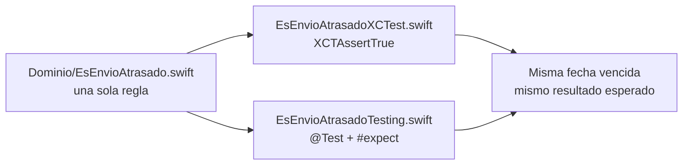
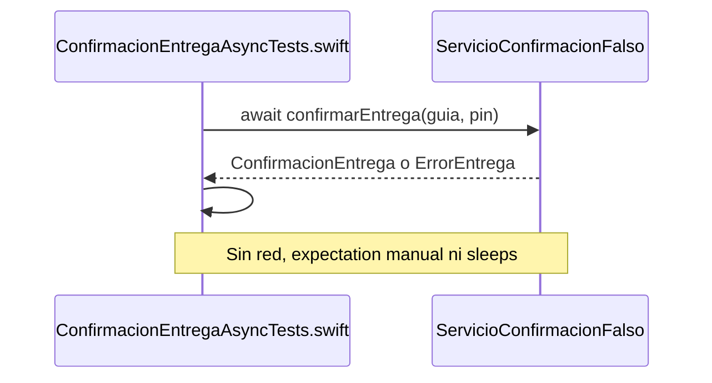
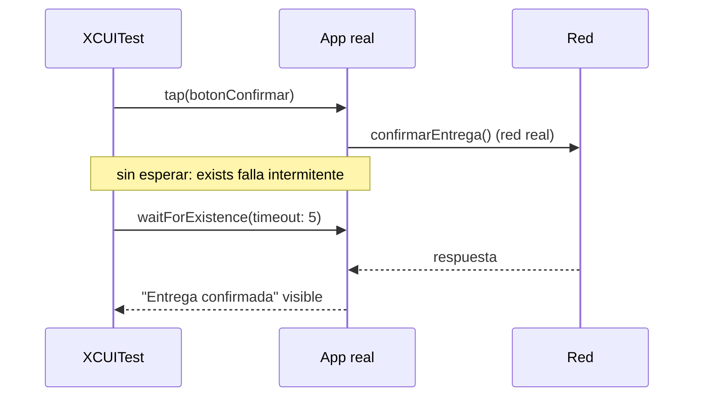

# Módulo 9: Testing en iOS


**Proyecto del módulo:** para cada práctica, parte de una carpeta vacía y crea en Xcode (File ▸ New ▸ Project ▸ App, interfaz SwiftUI) un proyecto llamado `RutaFlowApp`; escribe manualmente todos los archivos indicados y compila, sin usar proyectos ya preparados.

## Aprende construyendo


### Tema 1: XCTest clásico y Swift Testing · Intermedio · 40 min

<details open>
<summary><strong>Capa 1 — Lectura</strong></summary>

#### ► DE QUÉ TRATA
Al finalizar vas a escribir el mismo test para EsEnvioAtrasado (Módulo 8) dos veces: una con XCTest clásico y otra con Swift Testing, para comparar su sintaxis sobre el mismo caso real. Prerrequisitos: Módulo 8 completo.

#### ► LA IDEA EN UNA FRASE
**Al finalizar vas a escribir el mismo test para EsEnvioAtrasado (Módulo 8) dos veces: una con XCTest clásico y otra con Swift Testing, para comparar su sintaxis sobre el mismo caso real.**

#### ► POR QUÉ EXISTE ESTO
Resuelve un problema real de diseño o implementación y evita decisiones a ciegas.

#### ► LA ANALOGÍA
XCTest exige heredar de `XCTestCase` y elegir la aserción específica (`XCTAssertEqual`, `XCTAssertTrue`); Swift Testing usa `struct`s comunes con `@Test` y una única macro `#expect` para cualquier expresión booleana — un formulario con una casilla por tipo de verificación frente a una sola pregunta abierta.



Parte de una carpeta vacía y crea `RutaFlowApp` con tests incluidos. En el target de la app crea `Dominio/Envio.swift` con una versión local mínima de `Envio` y `Dominio/EsEnvioAtrasado.swift` con la regla usada por ambas pruebas; no importes archivos de otro tema. En el target `RutaFlowAppTests`, crea `EsEnvioAtrasadoXCTest.swift` para la primera variante y `EsEnvioAtrasadoTesting.swift` para la segunda, cada uno con su import correspondiente.

**¿Por qué es importante?** Porque Swift Testing simplifica la sintaxis de verificación sin cambiar qué se verifica, y elegir mal entre ambos frameworks es un error de ergonomía, no de lógica.
**Conceptos clave:** sintaxis más concisa de Swift Testing, misma capacidad fundamental de verificación que XCTest.

```swift
import XCTest

final class CalculadoraTests: XCTestCase {
    func testSuma() {
        XCTAssertEqual(Calculadora().sumar(2, 3), 5)
    }
}
```

```swift
import Testing

struct CalculadoraTests {
    @Test func suma() {
        #expect(Calculadora().sumar(2, 3) == 5)
    }
}
```

XCTest, el framework de pruebas clásico de Apple, requiere heredar de `XCTestCase` y usar variantes específicas de aserción (`XCTAssertEqual`, `XCTAssertTrue`, `XCTAssertNil`, cada una para un tipo distinto de comparación); Swift Testing, el framework moderno introducido más recientemente, reemplaza esa API con una sintaxis considerablemente más concisa: cualquier `struct` puede contener tests marcados con `@Test`, y una única macro `#expect` (que acepta cualquier expresión booleana) reemplaza todas las variantes específicas de `XCTAssert`, además de ofrecer mejor soporte nativo para tests parametrizados (ejecutar el mismo test con múltiples conjuntos de datos de entrada) y paralelización de ejecución por defecto, reduciendo el tiempo total de la suite de tests en proyectos grandes.

Esta evolución de framework de testing (de una API más verbosa basada en herencia de clase, hacia una sintaxis más ligera basada en macros) refleja una tendencia similar observada en otros lenguajes hacia frameworks de testing más expresivos y con menos boilerplate, aunque el objetivo fundamental (verificar que el código se comporta según lo esperado) permanece idéntico entre ambos frameworks.

**Analogía:** XCTest es como un formulario de evaluación estandarizado con casillas específicas para cada tipo de verificación (una casilla para "es igual a", otra para "es verdadero", otra para "es nulo"); Swift Testing es como una única pregunta abierta de verificación ("¿esto es cierto?") que se adapta a cualquier tipo de comparación sin necesitar una casilla distinta para cada caso.

**Implicación práctica:** Swift Testing ofrece una sintaxis considerablemente más concisa que XCTest clásico, además de mejor soporte para tests parametrizados y paralelización por defecto, aunque ambos frameworks cumplen la misma función fundamental de verificación de comportamiento.

**Código del ejemplo:**

```swift
// XCTest
XCTAssertEqual(Calculadora().sumar(2, 3), 5)

// Swift Testing
#expect(Calculadora().sumar(2, 3) == 5)
```

**Dónde se rompe la analogía:** el modelo simplifica la realidad; en producción influyen escala, fallos, costo y contexto.

#### ► CÓMO FUNCIONA


#### ► LO QUE PUEDE SALIR MAL
| Síntoma | Causa probable | Arreglo |
|---|---|---|
| XCTest clásico y Swift Testing se aplica pero el resultado no mejora | Se usó sin medir el problema real | Mide antes y compara contra la alternativa simple |
| Aparece complejidad inesperada | Se adoptó la técnica sin comprender sus trade-offs | Vuelve a la sección de trade-offs y reduce el alcance |
| Falla en un caso límite | Se asumió un contexto que no se cumple | Prueba el caso límite y documenta cuándo NO usarlo |

#### ► TRADE-OFFS
| Opción | Cuándo usarla | Cuándo NO usarla |
|---|---|---|
| Usar XCTest clásico y Swift Testing | Cuando el problema coincide con su propósito y el beneficio es observable | Cuando agrega complejidad sin resolver un problema real |
| Alternativa más simple | Cuando el contexto es pequeño, estable o fácil de razonar | Cuando ya demostró no escalar o no cumplir el requisito |
| Postergar la decisión | Cuando falta evidencia del problema | Cuando el costo de esperar es mayor que el costo de probar |

#### ► CUÁNDO NO USAR ESTO
No uses xctest clásico y swift testing por defecto. Aplícalo cuando el problema lo justifique y puedas verificar el beneficio; si una alternativa más simple resuelve igual, prefiérela.

#### ► DE VUELTA A LA ANALOGÍA
Volviendo a la analogía: xctest clásico y swift testing funciona como el modelo inicial, pero recuerda dónde se rompe: en producción importan la evidencia, la escala y el costo de equivocarte.

#### ► LO QUE DEBES RECORDAR
- XCTest clásico y Swift Testing existe para resolver un problema específico.
- Mide antes de adoptar complejidad.
- Conoce el caso donde NO usarlo.
- Verifica con evidencia observable.

#### ► PREGUNTAS PARA PENSAR
1. ¿Qué problema concreto resuelve xctest clásico y swift testing en tu contexto?
2. ¿Cómo sabrías que xctest clásico y swift testing no está funcionando bien?
3. ¿Qué alternativa más simple considerarías antes de usar xctest clásico y swift testing?

</details>

<details>
<summary><strong>Capa 2 — Construcción</strong></summary>

#### Código y verificación


```swift
import XCTest

final class CalculadoraTests: XCTestCase {
    func testSuma() {
        XCTAssertEqual(Calculadora().sumar(2, 3), 5)
    }
}
```

```swift
import Testing

struct CalculadoraTests {
    @Test func suma() {
        #expect(Calculadora().sumar(2, 3) == 5)
    }
}
```

```swift
// XCTest
XCTAssertEqual(Calculadora().sumar(2, 3), 5)

// Swift Testing
#expect(Calculadora().sumar(2, 3) == 5)
```

```swift
// XCTest clásico
import XCTest
@testable import RutaFlowApp
final class EsEnvioAtrasadoTests: XCTestCase {
    func testEnvioVencidoEstaAtrasado() {
        let envio = Envio(fechaEstimada: Date().addingTimeInterval(-3600))
        XCTAssertTrue(EsEnvioAtrasado().ejecutar(envio))
    }
}

// Swift Testing
import Foundation
import Testing
@testable import RutaFlowApp
struct EsEnvioAtrasadoTests {
    @Test func envioVencidoEstaAtrasado() {
        let envio = Envio(fechaEstimada: Date().addingTimeInterval(-3600))
        #expect(EsEnvioAtrasado().ejecutar(envio))
    }
}
```

```bash
xcodebuild -scheme RutaFlowApp -destination 'platform=iOS Simulator,name=iPhone 17' test
```

</details>

### Tema 2: Testing de código async · Avanzado · 40 min

<details open>
<summary><strong>Capa 1 — Lectura</strong></summary>

#### ► DE QUÉ TRATA
Al finalizar vas a testear confirmarEntrega (Módulo 5) con Swift Testing, marcando el test mismo como async en vez de usar una XCTestExpectation manual. Prerrequisitos: Módulo 5 completo, Tema 1 de este módulo.

#### ► LA IDEA EN UNA FRASE
**Al finalizar vas a testear confirmarEntrega (Módulo 5) con Swift Testing, marcando el test mismo como async en vez de usar una XCTestExpectation manual.**

#### ► POR QUÉ EXISTE ESTO
Resuelve un problema real de diseño o implementación y evita decisiones a ciegas.

#### ► LA ANALOGÍA
Marcar el test mismo como `async` permite usar `await` directamente dentro del test, exactamente como en cualquier otro contexto asíncrono — poder simplemente esperar el resultado de un trámite, en vez de configurar una alarma de tiempo límite de antemano.



Crea otro proyecto `RutaFlowApp` desde una carpeta vacía, con target de unit tests. En el target de la app escribe `ServicioConfirmacion.swift` con el modelo de respuesta, el error y una función `confirmarEntrega` inyectable; en el target de tests crea `ServicioConfirmacionFalso.swift`, que devuelve resultados controlados sin red, y `ConfirmacionEntregaAsyncTests.swift`, donde van las pruebas `async` de éxito y PIN incorrecto. Estos archivos son completos para esta práctica: no reutilices el cliente de ningún tema anterior.

**¿Por qué es importante?** Porque marcar el test como `async` permite usar `await` directo, sin expectativas manuales, simplificando el testing de funciones `async throws` como `confirmarEntrega`.
**Conceptos clave:** el test mismo puede ser una función suspendible, sin expectativas manuales.

```swift
@Test func obtieneUsuario() async throws {
    let usuario = try await servicio.obtenerUsuario(id: "1")
    #expect(usuario.nombre == "Ana")
}
```

Testear una función `async` (Módulo 4) con Swift Testing simplemente requiere marcar la función de test misma como `async`, permitiendo usar `await` directamente dentro del cuerpo del test exactamente como en cualquier otro contexto asíncrono; esto contrasta con el modelo previo de testing de código asíncrono basado en callbacks, que requería crear manualmente una `XCTestExpectation`, cumplirla explícitamente dentro del callback de la operación asíncrona bajo prueba, y esperar esa expectativa con un timeout configurado manualmente, un mecanismo considerablemente más verboso y propenso a errores (olvidar cumplir la expectativa deja el test colgado hasta que expire el timeout) que simplemente escribir `await` de forma lineal.

Esta simplificación de testing async es directamente análoga a `runTest` en Kotlin (Módulo 9 del track de Kotlin Multiplatform) y a testear hooks async en React con `renderHook` (Módulo 8 del track de React): todos los ecosistemas modernos de testing han convergido hacia permitir que el propio test sea una función asíncrona nativa, en vez de requerir mecanismos indirectos de espera basados en callbacks o expectativas manuales.

**Analogía:** testear código async con `await` directo en el test es como poder simplemente esperar el resultado de un trámite y continuar cuando llega, en vez de tener que configurar de antemano una alarma de tiempo límite y un mecanismo de notificación manual para saber cuándo el trámite efectivamente concluyó.

**Implicación práctica:** Marcar el test mismo como `async` permite usar `await` directamente, sin necesidad de expectativas manuales (`XCTestExpectation`) como en el modelo basado en callbacks previo, simplificando considerablemente el testing de código asíncrono.

* Código: escribe la práctica en los archivos de vista y tests de tu propio proyecto `RutaFlowApp`.
* Proyecto: en el proyecto integrador RutaFlow, prueba la carga asíncrona de envíos con expectativas controladas.

**Dónde se rompe la analogía:** el modelo simplifica la realidad; en producción influyen escala, fallos, costo y contexto.

#### ► CÓMO FUNCIONA


#### ► LO QUE PUEDE SALIR MAL
| Síntoma | Causa probable | Arreglo |
|---|---|---|
| Testing de código async se aplica pero el resultado no mejora | Se usó sin medir el problema real | Mide antes y compara contra la alternativa simple |
| Aparece complejidad inesperada | Se adoptó la técnica sin comprender sus trade-offs | Vuelve a la sección de trade-offs y reduce el alcance |
| Falla en un caso límite | Se asumió un contexto que no se cumple | Prueba el caso límite y documenta cuándo NO usarlo |

#### ► TRADE-OFFS
| Opción | Cuándo usarla | Cuándo NO usarla |
|---|---|---|
| Usar Testing de código async | Cuando el problema coincide con su propósito y el beneficio es observable | Cuando agrega complejidad sin resolver un problema real |
| Alternativa más simple | Cuando el contexto es pequeño, estable o fácil de razonar | Cuando ya demostró no escalar o no cumplir el requisito |
| Postergar la decisión | Cuando falta evidencia del problema | Cuando el costo de esperar es mayor que el costo de probar |

#### ► CUÁNDO NO USAR ESTO
No uses testing de código async por defecto. Aplícalo cuando el problema lo justifique y puedas verificar el beneficio; si una alternativa más simple resuelve igual, prefiérela.

#### ► DE VUELTA A LA ANALOGÍA
Volviendo a la analogía: testing de código async funciona como el modelo inicial, pero recuerda dónde se rompe: en producción importan la evidencia, la escala y el costo de equivocarte.

#### ► LO QUE DEBES RECORDAR
- Testing de código async existe para resolver un problema específico.
- Mide antes de adoptar complejidad.
- Conoce el caso donde NO usarlo.
- Verifica con evidencia observable.

#### ► PREGUNTAS PARA PENSAR
1. ¿Qué problema concreto resuelve testing de código async en tu contexto?
2. ¿Cómo sabrías que testing de código async no está funcionando bien?
3. ¿Qué alternativa más simple considerarías antes de usar testing de código async?

</details>

<details>
<summary><strong>Capa 2 — Construcción</strong></summary>

#### Código y verificación


```swift
@Test func obtieneUsuario() async throws {
    let usuario = try await servicio.obtenerUsuario(id: "1")
    #expect(usuario.nombre == "Ana")
}
```

```swift
import Testing
@testable import RutaFlowApp

@Test func confirmarEntregaDelConductorAsignado() async throws {
    // confirmarEntrega y su servidor simulado son los del Módulo 5.
    let resultado = try await confirmarEntrega(guia: "RF-4471", pin: "837201")
    #expect(resultado.status == "delivered")
}
```

```bash
xcodebuild -scheme RutaFlowApp -destination 'platform=iOS Simulator,name=iPhone 17' test
```

</details>

### Tema 3: UI Tests con XCUITest · Avanzado · 45 min

<details open>
<summary><strong>Capa 1 — Lectura</strong></summary>

#### ► DE QUÉ TRATA
Al finalizar vas a escribir un XCUITest que lance la app de RutaFlow, complete guía y PIN en la pantalla de confirmación de entrega, y verifique que aparece "Entrega confirmada". Prerrequisitos: Tema 2 de este módulo.

#### ► LA IDEA EN UNA FRASE
**Al finalizar vas a escribir un XCUITest que lance la app de RutaFlow, complete guía y PIN en la pantalla de confirmación de entrega, y verifique que aparece "Entrega confirmada".**

#### ► POR QUÉ EXISTE ESTO
Resuelve un problema real de diseño o implementación y evita decisiones a ciegas.

#### ► LA ANALOGÍA
XCUITest lanza la app compilada e instalada y simula interacciones reales (`tap`, `typeText`) contra la UI efectivamente renderizada — una inspección de calidad de punta a punta, mucho más lenta que verificar un componente aislado en un banco de pruebas.
**Conceptos clave:** simulación de interacciones reales contra la app compilada, más lento pero valida el recorrido end-to-end.

```swift
func testCrearTarea() {
    let app = XCUIApplication()
    app.launch()
    app.buttons["Agregar"].tap()
    app.textFields["titulo"].typeText("Nueva tarea")
    app.buttons["Guardar"].tap()
    XCTAssertTrue(app.staticTexts["Nueva tarea"].exists)
}
```

XCUITest lanza la app real (compilada e instalada, no solo componentes aislados en memoria) y simula interacciones reales de usuario (`tap`, `typeText`) contra la UI efectivamente renderizada, permitiendo validar un flujo completo end-to-end (crear una tarea y verificar que aparece correctamente en la lista) exactamente como lo experimentaría un usuario real; esto lo hace considerablemente más lento y frágil que un unit test de la capa de dominio (que ejecuta lógica pura en memoria sin necesidad de lanzar toda la app ni renderizar ninguna UI real), y más propenso a fallar por razones ajenas a la lógica bajo prueba, como cambios de layout, timing de animaciones, o inestabilidad del simulador.

Esta distinción de velocidad y fragilidad entre unit tests y UI tests refleja la misma "pirámide de tests" estudiada en el track de Spring Boot (Módulo 6 de ese track) y con Espresso en Android (Módulo 9 de ese track): se recomienda tener muchos unit tests rápidos cubriendo la lógica de negocio, y reservar los UI tests end-to-end, más costosos de ejecutar y mantener, para validar únicamente los flujos críticos de la app.

**Analogía:** un UI Test es como una inspección completa de calidad que recorre todo el proceso de fabricación de un producto de principio a fin, tal como lo experimentaría el cliente final; un unit test de la capa de dominio es como verificar un componente aislado en un banco de pruebas de laboratorio — ambos son necesarios, pero el primero es considerablemente más costoso de ejecutar repetidamente.

**¿Por qué es importante?** Un UI Test valida el flujo completo end-to-end tal como lo experimenta el usuario real, pero es más lento y frágil que un unit test de la capa de dominio, que ejecuta lógica pura sin necesidad de lanzar toda la app ni renderizar UI real.

**Diagrama:**

```
Unit tests de dominio (Swift Testing) → rápidos, muchos, base de la pirámide
UI Tests (XCUITest)                   → lentos, pocos, solo flujos críticos end-to-end
```

**Diagrama: XCUITest esperando la UI real**



En tu propio proyecto RutaFlow, escribe la vista bajo prueba en `DetalleEntregaView.swift` dentro del target de la app. Crea el test en `RutaFlowAppUITests/ConfirmacionEntregaUITests.swift` con **File ▸ New ▸ File ▸ Swift File** y selecciona únicamente el target UI Testing; si ese target no existe, agrégalo antes con **File ▸ New ▸ Target ▸ UI Testing Bundle**. Límite de la decisión: no conviene cubrir con XCUITest cada combinación posible de entrada — es demasiado lento y frágil para eso; reservalo específicamente para los flujos críticos end-to-end (como confirmar una entrega), y dejá la cobertura exhaustiva de casos a los unit tests de dominio del Tema 1.

---

**Dónde se rompe la analogía:** el modelo simplifica la realidad; en producción influyen escala, fallos, costo y contexto.

#### ► CÓMO FUNCIONA


#### ► LO QUE PUEDE SALIR MAL
| Síntoma | Causa probable | Arreglo |
|---|---|---|
| UI Tests con XCUITest se aplica pero el resultado no mejora | Se usó sin medir el problema real | Mide antes y compara contra la alternativa simple |
| Aparece complejidad inesperada | Se adoptó la técnica sin comprender sus trade-offs | Vuelve a la sección de trade-offs y reduce el alcance |
| Falla en un caso límite | Se asumió un contexto que no se cumple | Prueba el caso límite y documenta cuándo NO usarlo |

#### ► TRADE-OFFS
| Opción | Cuándo usarla | Cuándo NO usarla |
|---|---|---|
| Usar UI Tests con XCUITest | Cuando el problema coincide con su propósito y el beneficio es observable | Cuando agrega complejidad sin resolver un problema real |
| Alternativa más simple | Cuando el contexto es pequeño, estable o fácil de razonar | Cuando ya demostró no escalar o no cumplir el requisito |
| Postergar la decisión | Cuando falta evidencia del problema | Cuando el costo de esperar es mayor que el costo de probar |

#### ► CUÁNDO NO USAR ESTO
No uses ui tests con xcuitest por defecto. Aplícalo cuando el problema lo justifique y puedas verificar el beneficio; si una alternativa más simple resuelve igual, prefiérela.

#### ► DE VUELTA A LA ANALOGÍA
Volviendo a la analogía: ui tests con xcuitest funciona como el modelo inicial, pero recuerda dónde se rompe: en producción importan la evidencia, la escala y el costo de equivocarte.

#### ► LO QUE DEBES RECORDAR
- UI Tests con XCUITest existe para resolver un problema específico.
- Mide antes de adoptar complejidad.
- Conoce el caso donde NO usarlo.
- Verifica con evidencia observable.

#### ► PREGUNTAS PARA PENSAR
1. ¿Qué problema concreto resuelve ui tests con xcuitest en tu contexto?
2. ¿Cómo sabrías que ui tests con xcuitest no está funcionando bien?
3. ¿Qué alternativa más simple considerarías antes de usar ui tests con xcuitest?

</details>

<details>
<summary><strong>Capa 2 — Construcción</strong></summary>

#### Código y verificación
```swift
func testCrearTarea() {
    let app = XCUIApplication()
    app.launch()
    app.buttons["Agregar"].tap()
    app.textFields["titulo"].typeText("Nueva tarea")
    app.buttons["Guardar"].tap()
    XCTAssertTrue(app.staticTexts["Nueva tarea"].exists)
}
```

```
Unit tests de dominio (Swift Testing) → rápidos, muchos, base de la pirámide
UI Tests (XCUITest)                   → lentos, pocos, solo flujos críticos end-to-end
```


```swift
import XCTest

final class ConfirmacionEntregaUITests: XCTestCase {
    @MainActor
    func testConfirmarEntregaDesdeLaUI() {
        let app = XCUIApplication()
        app.launch()
        app.textFields["campoGuia"].tap()
        app.textFields["campoGuia"].typeText("RF-4471")
        app.textFields["campoPin"].tap()
        app.textFields["campoPin"].typeText("837201")
        app.buttons["botonConfirmar"].tap()
        XCTAssertTrue(app.staticTexts["Entrega confirmada"].waitForExistence(timeout: 5))
    }
}
```

```bash
xcodebuild -scheme RutaFlowApp -destination 'platform=iOS Simulator,name=iPhone 17' test
```

</details>
