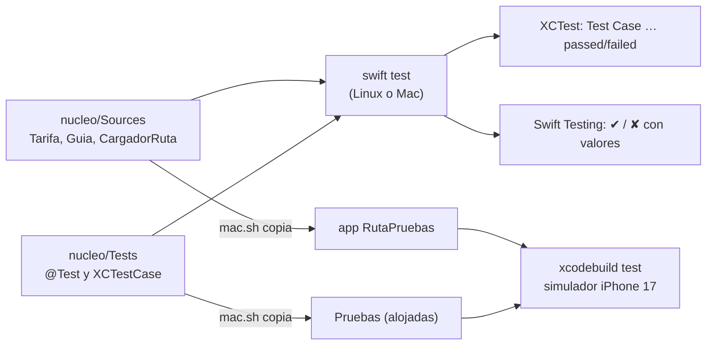
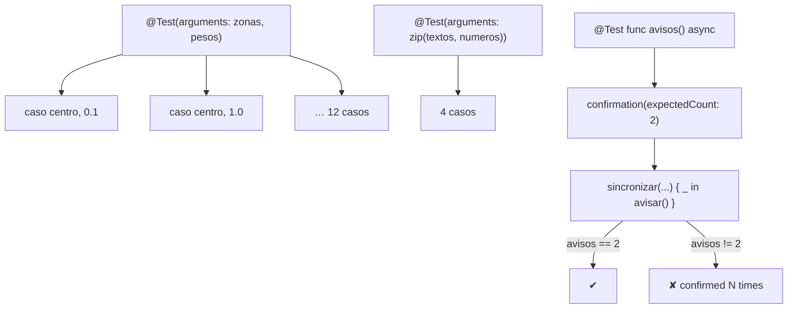
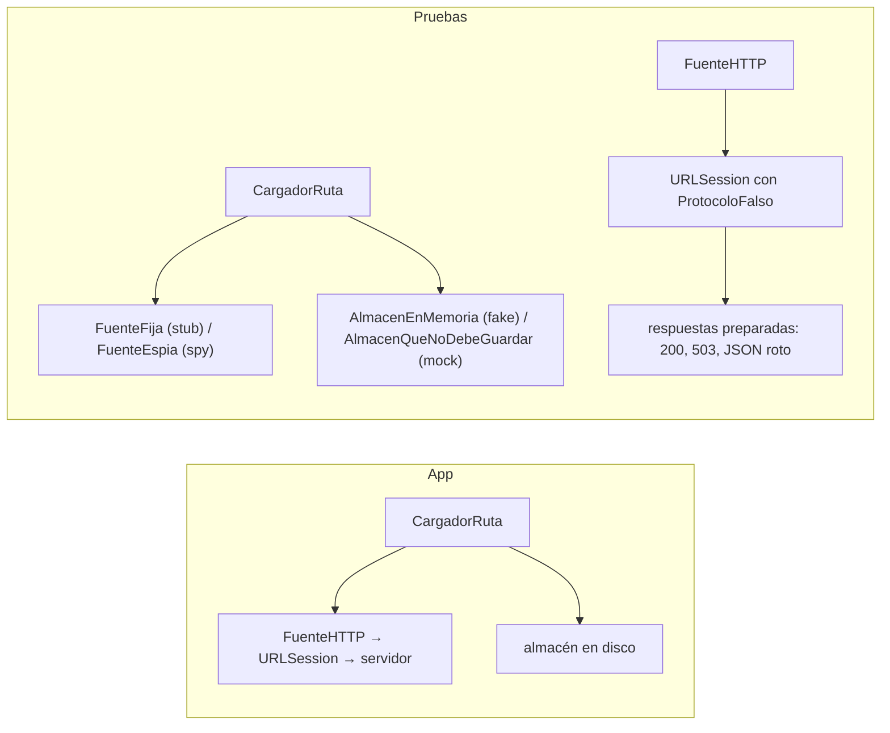
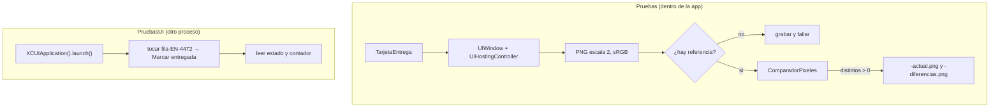

# Módulo 9: Pruebas en iOS

**Entorno comprobado para esta edición (2026-11-25):** Swift 6.4.3 en Linux x86_64 para la lógica pura: el paquete
`nucleo` (tarifa, guías, carga de la ruta, cliente HTTP, comparador de píxeles) con Swift Testing y XCTest; todo lo de
los Temas 1, 2 y 3 se ejecutó ahí con `swift test`, en `/home/estudiante/labs/ios/ios9` (tu `~/labs/ios/ios9`). Lo que
necesita las bibliotecas de Apple (la app SwiftUI, las pruebas alojadas en la app, las capturas comparadas y XCUITest)
se compiló y ejecutó con Xcode 27.2 (27B52), Swift 6.4.2 y el simulador iPhone 17 con iOS 27.2, con el script
`mac.sh` del laboratorio. Límites honestos: en Linux, XCTest es la versión de código abierto (no hay XCUITest ni
`measure`), y los tiempos de Linux y del simulador no se comparan entre sí.

Una app que cobra contraentregas no puede equivocarse en un redondeo, ni dejar de mostrar la copia local cuando no hay
red, ni cambiar de aspecto sin que nadie lo note. Este módulo arma la red de seguridad: pruebas de la lógica con los
dos marcos de Apple, pruebas con muchos casos y con código asíncrono, dobles para no depender de la red ni del disco,
capturas que detectan cambios visuales y pruebas que usan la app como una persona.

**Al terminar este módulo podrás:**
- escribir la misma prueba con Swift Testing y con XCTest, y leer el informe de fallo de cada uno;
- convertir una lista de casos en una prueba parametrizada y probar código `async`, cancelación y *callbacks*;
- reemplazar red, disco y servidor por dobles (stub, fake, spy, mock y un `URLProtocol` falso);
- detectar cambios visuales con capturas comparadas píxel a píxel y probar un flujo completo con XCUITest.

**Esquema del módulo:** Tema 1 (Swift Testing y XCTest) → Tema 2 (pruebas parametrizadas, rasgos y código
asíncrono) → Tema 3 (dobles de prueba) → Tema 4 (capturas comparadas y XCUITest) → Proyecto 46.

**Qué necesitas saber antes:** del Módulo 0, **protocolos, `enum` con valores asociados y errores** (`throws`); del
Módulo 2, **`@Observable` y `@State`**; del Módulo 4, **`async`/`await`, `Task`, cancelación, actores y `Sendable`**;
del Módulo 5, **`URLSession` y `Codable`**; del Módulo 8, **la inyección de dependencias por inicializador**.

**Qué no se repite:** cómo funciona la concurrencia de Swift 6 (Módulo 4) ni la arquitectura en capas (Módulo 8).
Aquí se usan para que el código se pueda probar. La medición de rendimiento con `measure` y las pruebas de
accesibilidad están en el Módulo 10.

**Prepara el proyecto:**

```text
$ mkdir -p ~/labs/ios/ios9/nucleo && cd ~/labs/ios/ios9/nucleo
$ swift package init --type library --name Nucleo
```

Reemplaza `Package.swift` por el del Tema 1. El laboratorio trae además `app/RutaPruebas.xcodeproj` con tres
objetivos: la app `RutaPruebas` (código en `app/App`), las pruebas alojadas `Pruebas` (en `app/Pruebas`, se ejecutan
dentro de la app) y las pruebas de interfaz `PruebasUI` (en `app/PruebasUI`). Si lo creas tú en Xcode: *File › New ›
Project › App* con *Testing System: Swift Testing*, y después *File › New › Target › UI Testing Bundle*. El núcleo se
copia a `app/App/Nucleo` antes de compilar (lo hace `mac.sh`), así la app no depende de referencias a paquetes.


## Aprende construyendo


### Tema 1: Swift Testing y XCTest: la misma regla en los dos marcos · Intermedio · 40 min

<details open>
<summary><strong>Capa 1 — Lectura</strong></summary>

#### Objetivos
Al terminar este tema podrás:
- escribir pruebas con Swift Testing (`@Test`, `#expect`, `#require`) y con XCTest (`XCTestCase`, `XCTAssert…`);
- ejecutarlas con `swift test` en un paquete y con `xcodebuild` en la app;
- leer qué dice cada marco cuando una prueba falla, y qué no dice;
- saber por qué no se mezclan las aserciones de los dos.

**Conceptos clave:** `@Test` y `@Suite`, `#expect`, `#require`, `XCTestCase` y `XCTAssert…`, pruebas alojadas

#### El problema
La tarifa de envío cobra la base de la zona por el primer kilo y 1 500 pesos por cada kilo adicional **iniciado**: un
paquete de 1,2 kg paga un kilo adicional. Alguien «simplifica» el redondeo y cambia `rounded(.up)` por `rounded()`.
Compila, la app funciona y el paquete de 1,2 kg deja de cobrar 1 500 pesos. Nadie lo nota hasta el cierre de caja.

Este tema usa **los errores con `throws`** (Módulo 0) y **los paquetes de Swift con `swift test`** (Módulo 0, «Prepara el proyecto»).

#### Glosario del tema

**`@Test` y `@Suite`**
- **Definición técnica:** macros de Swift Testing que marcan una función (libre o dentro de un tipo) como prueba y un tipo como grupo de pruebas; aceptan un nombre legible y rasgos (Tema 2).
- **En palabras sencillas:** la etiqueta «esto es una prueba» y la carpeta que las agrupa.
- **Dónde se rompe la comparación:** cada prueba de una `@Suite` recibe una instancia nueva del tipo; nada se comparte entre pruebas salvo lo `static`.
- **Ejemplo:** `@Test("cada kilo adicional iniciado cuesta 1 500") func kiloAdicionalIniciado()`.
- **Error típico:** escribir `func testAlgo()` en una `struct` sin `@Test` y creer que corre: sin la macro, Swift Testing no la ve.

**`#expect`**
- **Definición técnica:** macro que evalúa una condición y, si es falsa, registra un fallo con la expresión y los valores de sus partes; la prueba sigue ejecutándose.
- **En palabras sencillas:** «compruébalo y, si está mal, anótalo y sigue».
- **Dónde se rompe la comparación:** solo muestra los valores de las partes que pudo evaluar por separado; con `try` dentro, a veces no puede (lo verás abajo).
- **Ejemplo:** `#expect(costo == 7_500)` → `costo → 6000`, `7_500 → 7500`.
- **Error típico:** comparar `Double` con `==` después de operar: falla por el último decimal.

**`#require`**
- **Definición técnica:** macro que comprueba una condición o desenvuelve un opcional y, si falla, registra el fallo **y lanza**, así que la prueba termina ahí; se usa con `try`.
- **En palabras sencillas:** «sin esto no tiene sentido seguir».
- **Dónde se rompe la comparación:** detiene la prueba actual, no las demás.
- **Ejemplo:** `let primera = try #require(Entrega.ejemplos.first)`.
- **Error típico:** usar `!` para desenvolver en una prueba: si es `nil`, se cae todo el proceso de pruebas, no solo esa.

**`XCTestCase` y `XCTAssert…`**
- **Definición técnica:** el marco anterior: una clase que hereda de `XCTestCase`, métodos que empiezan por `test` y una función de aserción por cada comparación (`XCTAssertEqual`, `XCTAssertThrowsError`, `XCTUnwrap`…).
- **En palabras sencillas:** el mismo trabajo con más ceremonia.
- **Dónde se rompe la comparación:** sigue siendo necesario para XCUITest y para `measure` (Módulo 10); Swift Testing no los reemplaza.
- **Ejemplo:** `XCTAssertEqual(try Tarifa.costo(pesoKg: 1.2, zona: .centro), 7_500)`.
- **Error típico:** usar `XCTAssert…` dentro de una función `@Test`: el fallo se convierte en un aviso y la prueba **pasa**.

**pruebas alojadas (hosted tests)**
- **Definición técnica:** un paquete de pruebas que se carga dentro del proceso de la app (la app anfitriona) en el simulador, con `@testable import` para ver lo `internal`.
- **En palabras sencillas:** las pruebas viajan dentro de la app y la usan por dentro.
- **Dónde se rompe la comparación:** la app arranca de verdad (su `App`, su primera pantalla) antes de las pruebas.
- **Ejemplo:** el objetivo `Pruebas` de `RutaPruebas.xcodeproj`, con las pruebas del núcleo copiadas.
- **Error típico:** hacer trabajo pesado o de red al arrancar la app: retrasa (o rompe) todas las pruebas alojadas.

#### ► CÓMO FUNCIONA

##### 1. La idea en lenguaje sencillo
Antes de cerrar la caja del día, alguien cuenta los billetes con una lista de control: «el paquete de 1,2 kg cobró
7 500». Si la cuenta no cuadra, lo sabes esa noche y no a fin de mes. Una prueba automática es esa lista,
ejecutada por la máquina cada vez que cambias el código.

El cambio de `rounded(.up)` por `rounded()` compila y la app funciona. Solo una comprobación explícita del caso de
1,2 kg lo delata. Este tema escribe esas comprobaciones con los dos marcos de pruebas de Apple: Swift Testing, el
nuevo, y XCTest, el que encontrarás en casi todo el código existente.

Lo importante no es solo que una prueba falle. Es cuánto te dice al fallar, y ahí los dos marcos son muy distintos.

##### 2. Definición formal y vocabulario
Un **marco de pruebas** es una biblioteca que descubre funciones de prueba, las ejecuta y genera un informe. Swift
Testing llegó con Swift 6 y Xcode 16, en 2024; XCTest existe desde 2013.

En Swift Testing, **`@Test`** marca una función como prueba y **`@Suite`** marca un tipo como grupo. **`#expect`**
comprueba una condición: si es falsa, registra un fallo y la prueba continúa. **`#require`** comprueba o desenvuelve
un opcional, y si falla, registra el fallo y lanza un error que termina esa prueba.

En XCTest, una prueba es un método cuyo nombre empieza por `test`, dentro de una subclase de **`XCTestCase`**. Cada
comparación tiene su función: `XCTAssertEqual`, `XCTAssertThrowsError`, `XCTUnwrap`.

Una **prueba alojada** se carga dentro del proceso de la app, en el simulador. Con `@testable import` ve también lo
`internal` del módulo probado.

##### 3. Cómo funciona por dentro, paso a paso
El diagrama muestra los dos lugares donde corre el mismo código de pruebas.



Con `swift test`, el camino es este:

1. **Compilar.** SwiftPM compila el módulo `Nucleo` y el *target* de pruebas. `@testable import Nucleo` pide que el
   módulo se compile con permiso para ver lo `internal`.
2. **Expandir las macros.** Cada `@Test` genera código que registra la función en el catálogo de Swift Testing. Cada
   `#expect` se expande en código que evalúa por separado las partes de la expresión.
3. **Ejecutar XCTest.** El ejecutable de pruebas busca las subclases de `XCTestCase` y sus métodos `test…`. En Linux
   se ejecutaron primero, como muestra la salida.
4. **Ejecutar Swift Testing.** Después recorre el catálogo de `@Test`. Por defecto las ejecuta en paralelo, y por eso
   terminan en otro orden que el del archivo.
5. **Informar.** Cada marco escribe sus líneas: `Test Case … passed` en XCTest, `✔ Test … passed` en Swift Testing.

La diferencia de informes nace en el paso 2. Observa la prueba del kilo adicional:

```swift
let costo = try Tarifa.costo(pesoKg: 1.2, zona: .centro)
#expect(costo == 7_500)
```

La macro ve la expresión `costo == 7_500` y guarda cada lado antes de compararlos. Por eso el fallo dice `costo →
6000` y `7_500 → 7500`. `XCTAssertEqual` es una función normal: recibe dos valores y solo puede decir «("6000") is
not equal to ("7500")».

En la app, `xcodebuild test` hace algo más: instala la app, la abre en el simulador y carga el paquete de pruebas
dentro de su proceso. La app arranca de verdad antes de la primera prueba.

##### 4. Reglas, variantes y casos límite
- **`try` dentro de `#expect`.** Si la expresión contiene `try`, la macro no siempre puede evaluar sus partes. La
  salida real lo mostró: `→ <not evaluated>`. Guarda el resultado en una constante y compara la constante.
- **Instancia nueva por prueba.** En una `@Suite`, cada `@Test` recibe una instancia nueva del tipo. El estado no se
  comparte, salvo lo `static`.
- **Sin macro no hay prueba.** Una `func testAlgo()` dentro de una `struct` sin `@Test` no se ejecuta. Swift Testing
  no busca por nombre, como XCTest.
- **No mezclar marcos.** Un `XCTAssertEqual` dentro de `@Test` no hizo fallar la prueba. Swift Testing lo registró
  como dos avisos y la marcó como pasada.
- **Errores exactos.** `#expect(throws: ErrorTarifa.pesoInvalido(0))` exige ese error con ese valor, gracias a que
  `ErrorTarifa` es `Equatable`.
- **Lo que XCTest sigue haciendo solo.** XCUITest y `measure` siguen siendo de XCTest. Por eso los dos marcos
  conviven en un mismo proyecto.
- **XCTest en Linux.** Es la versión de código abierto: tiene `XCTestCase` y las aserciones, pero no XCUITest.

Los dos marcos pueden vivir en el mismo *target*, incluso en el mismo archivo. Lo que no se mezcla son las
aserciones dentro de una misma prueba.

##### 5. Relación con lo que ya sabes y lo que viene
Ya ejecutaste pruebas de Swift Testing en todos los módulos anteriores, desde el Módulo 5. Aquí aprendes a leer su
informe y a compararlo con el de XCTest.

`ErrorTarifa` y `throws(ErrorTarifa)` repiten el patrón de `ErrorRed` del Módulo 5, Tema 2. El tipo exacto del
error permite que una prueba exija «este error» y no «algún error».

Compara una prueba con un `print` en la consola. El `print` muestra un valor y tú decides si está bien. La prueba
decide por ti, cada vez, y falla en voz alta.

El Tema 2 convierte varios casos en una prueba parametrizada y prueba código `async`. El Tema 3 reemplaza la red por
dobles. El Módulo 10, Tema 1, usa `measure` de XCTest para medir rendimiento.

#### Problema resuelto 1.1
Escribe la tarifa y cuatro pruebas con cada marco: base, kilo adicional, pesos imposibles y la primera entrega de
ejemplo. Ejecútalas. Después mete el error de redondeo en una copia del paquete y compara los dos informes.

**Razonamiento:**
1. La tarifa lanza errores tipados (`throws(ErrorTarifa)`) para que la prueba pueda exigir **el** error exacto.
2. Las dos versiones prueban lo mismo; así se compara el informe, no la prueba.
3. El borde importa: 1,2 kg es el primer peso que paga un kilo adicional.
4. `demo_fallo.sh` copia el núcleo a una carpeta temporal y cambia una sola cosa con `sed`; el núcleo queda intacto.

```swift
// swift-tools-version: 6.0
import PackageDescription

// La lógica pura de la app de la ruta: se prueba aquí con `swift test` y se copia a la app de iOS.
let package = Package(
    name: "Nucleo",
    targets: [
        .target(name: "Nucleo"),
        .testTarget(name: "NucleoTests", dependencies: ["Nucleo"]),
    ]
)
```

```swift
/// Zonas de reparto de Bogotá con tarifa base distinta.
public enum Zona: String, Sendable, CaseIterable {
    case centro, norte, sur
}

/// Por qué no se puede cobrar un envío.
public enum ErrorTarifa: Error, Equatable {
    case pesoInvalido(Double)
    case excedePesoMaximo(Double)
}

/// Costo de un envío en pesos: la base de la zona incluye 1 kg; cada kilo adicional iniciado cuesta 1 500.
public enum Tarifa {
    public static let pesoMaximoKg = 30.0
    public static let porKiloAdicional = 1_500

    public static func base(_ zona: Zona) -> Int {
        switch zona {
        case .centro: 6_000
        case .norte: 7_000
        case .sur: 7_500
        }
    }

    public static func costo(pesoKg: Double, zona: Zona) throws(ErrorTarifa) -> Int {
        guard pesoKg > 0 else { throw .pesoInvalido(pesoKg) }
        guard pesoKg <= pesoMaximoKg else { throw .excedePesoMaximo(pesoKg) }
        let adicionales = Int((pesoKg - 1).rounded(.up))  // 1,2 kg → 0,2 → 1 kilo adicional
        return base(zona) + max(0, adicionales) * porKiloAdicional
    }
}
```

```swift
import Foundation

/// Estado de una entrega en la ruta del día.
public enum EstadoEntrega: String, Codable, Sendable {
    case pendiente, entregada, fallida
}

/// Una entrega de la ruta: la guía, a quién va, dónde, cuánto pesa y cuánto hay que cobrar (0 si nada).
public struct Entrega: Codable, Sendable, Equatable, Identifiable {
    public var id: String { guia }
    public let guia: String
    public let destinatario: String
    public let barrio: String
    public let pesoKg: Double
    public let contraentrega: Int
    public var estado: EstadoEntrega

    public init(
        guia: String, destinatario: String, barrio: String, pesoKg: Double, contraentrega: Int = 0,
        estado: EstadoEntrega = .pendiente
    ) {
        self.guia = guia
        self.destinatario = destinatario
        self.barrio = barrio
        self.pesoKg = pesoKg
        self.contraentrega = contraentrega
        self.estado = estado
    }
}

extension Entrega {
    /// Las entregas de ejemplo que usan la app, las pruebas y los pantallazos.
    public static let ejemplos: [Entrega] = [
        Entrega(guia: "EN-4471", destinatario: "Ana Ruiz", barrio: "Chapinero", pesoKg: 1.2, contraentrega: 52_000),
        Entrega(guia: "EN-4472", destinatario: "Luis Pardo", barrio: "Usaquén", pesoKg: 0.8),
        Entrega(guia: "EN-4473", destinatario: "Marta Gil", barrio: "Teusaquillo", pesoKg: 3.5, contraentrega: 18_500),
    ]
}
```

```swift
import Testing

@testable import Nucleo

/// La tarifa con Swift Testing: funciones sueltas con `@Test`, comprobaciones con `#expect` y `#require`.
@Suite("Tarifa de envío")
struct TarifaTests {
    @Test("un kilo o menos paga solo la base")
    func baseIncluyeUnKilo() throws {
        #expect(try Tarifa.costo(pesoKg: 1.0, zona: .centro) == 6_000)
        #expect(try Tarifa.costo(pesoKg: 0.3, zona: .sur) == 7_500)
    }

    @Test("cada kilo adicional iniciado cuesta 1 500")
    func kiloAdicionalIniciado() throws {
        let costo = try Tarifa.costo(pesoKg: 1.2, zona: .centro)
        #expect(costo == 7_500)
    }

    @Test("rechaza pesos imposibles con el error exacto")
    func pesosInvalidos() {
        #expect(throws: ErrorTarifa.pesoInvalido(0)) { try Tarifa.costo(pesoKg: 0, zona: .norte) }
        #expect(throws: ErrorTarifa.excedePesoMaximo(31)) { try Tarifa.costo(pesoKg: 31, zona: .norte) }
    }

    @Test("la primera entrega de ejemplo existe y cuesta 7 500 en el centro")
    func primeraEntrega() throws {
        let primera = try #require(Entrega.ejemplos.first)  // si falla, la prueba se detiene aquí
        #expect(primera.guia == "EN-4471")
        #expect(try Tarifa.costo(pesoKg: primera.pesoKg, zona: .centro) == 7_500)
    }
}
```

```swift
import XCTest

@testable import Nucleo

/// Las mismas reglas con XCTest: una clase que hereda de `XCTestCase` y métodos que empiezan por `test`.
final class TarifaXCTests: XCTestCase {
    func testBaseIncluyeUnKilo() throws {
        XCTAssertEqual(try Tarifa.costo(pesoKg: 1.0, zona: .centro), 6_000)
        XCTAssertEqual(try Tarifa.costo(pesoKg: 0.3, zona: .sur), 7_500)
    }

    func testKiloAdicionalIniciado() throws {
        XCTAssertEqual(try Tarifa.costo(pesoKg: 1.2, zona: .centro), 7_500)
    }

    func testPesosInvalidos() {
        XCTAssertThrowsError(try Tarifa.costo(pesoKg: 0, zona: .norte)) { error in
            XCTAssertEqual(error as? ErrorTarifa, .pesoInvalido(0))
        }
    }

    func testPrimeraEntrega() throws {
        let primera = try XCTUnwrap(Entrega.ejemplos.first)
        XCTAssertEqual(primera.guia, "EN-4471")
    }
}
```

```text
$ cd nucleo && swift test --filter 'TarifaTests|TarifaXCTests' 2>&1 | grep -v ' started'
Building for debugging...
[Using on-disk description]
Build complete! (0.56 secs)
Test Case 'TarifaXCTests.testBaseIncluyeUnKilo' passed (0.003 seconds)
Test Case 'TarifaXCTests.testKiloAdicionalIniciado' passed (0.0 seconds)
Test Case 'TarifaXCTests.testPesosInvalidos' passed (0.0 seconds)
Test Case 'TarifaXCTests.testPrimeraEntrega' passed (0.0 seconds)
Test Suite 'TarifaXCTests' passed at 2026-11-25 05:09:07.150
	 Executed 4 tests, with 0 failures (0 unexpected) in 0.003 (0.003) seconds
Test Suite 'Selected tests' passed at 2026-11-25 05:09:07.150
	 Executed 4 tests, with 0 failures (0 unexpected) in 0.003 (0.003) seconds
↳ Testing Library Version: 6.4.3 (ba0861fb203553c)
↳ Target Platform: x86_64-unknown-linux-gnu
✔ Test "un kilo o menos paga solo la base" passed after 0.001 seconds.
✔ Test "rechaza pesos imposibles con el error exacto" passed after 0.001 seconds.
✔ Test "la primera entrega de ejemplo existe y cuesta 7 500 en el centro" passed after 0.001 seconds.
✔ Test "cada kilo adicional iniciado cuesta 1 500" passed after 0.001 seconds.
✔ Suite "Tarifa de envío" passed after 0.001 seconds.
✔ Test run with 4 tests in 1 suite passed after 0.001 seconds.
```

```bash
#!/bin/bash
# Copia el núcleo, mete un error de redondeo en la tarifa (rounded(.up) → rounded()) y ejecuta las pruebas de la
# tarifa con los dos frameworks, para comparar cómo informa cada uno un fallo.
copia="${TMPDIR:-/tmp}/nucleo-fallo"
rm -rf "$copia" && cp -R nucleo "$copia" && rm -rf "$copia/.build"
sed -i.bak 's/rounded(.up)/rounded()/' "$copia/Sources/Nucleo/Tarifa.swift" && rm "$copia/Sources/Nucleo/Tarifa.swift.bak"
cd "$copia" && swift build --build-tests -q 2>&1 | grep -v warning
swift test --skip-build --filter 'TarifaTests|TarifaXCTests' 2>&1
```

```text
$ ./demo_fallo.sh
Test Suite 'Selected tests' started at 2026-11-25 05:09:25.028
Test Suite 'TarifaXCTests' started at 2026-11-25 05:09:25.030
Test Case 'TarifaXCTests.testBaseIncluyeUnKilo' started at 2026-11-25 05:09:25.030
Test Case 'TarifaXCTests.testBaseIncluyeUnKilo' passed (0.001 seconds)
Test Case 'TarifaXCTests.testKiloAdicionalIniciado' started at 2026-11-25 05:09:25.030
/tmp/nucleo-fallo/Tests/NucleoTests/TarifaXCTests.swift:13: error: TarifaXCTests.testKiloAdicionalIniciado : XCTAssertEqual failed: ("6000") is not equal to ("7500") - 
Test Case 'TarifaXCTests.testKiloAdicionalIniciado' failed (0.0 seconds)
Test Case 'TarifaXCTests.testPesosInvalidos' started at 2026-11-25 05:09:25.031
Test Case 'TarifaXCTests.testPesosInvalidos' passed (0.0 seconds)
Test Case 'TarifaXCTests.testPrimeraEntrega' started at 2026-11-25 05:09:25.031
Test Case 'TarifaXCTests.testPrimeraEntrega' passed (0.101 seconds)
Test Suite 'TarifaXCTests' failed at 2026-11-25 05:09:25.132
	 Executed 4 tests, with 1 failure (0 unexpected) in 0.102 (0.102) seconds
Test Suite 'Selected tests' failed at 2026-11-25 05:09:25.132
	 Executed 4 tests, with 1 failure (0 unexpected) in 0.102 (0.102) seconds
◇ Test run started.
↳ Testing Library Version: 6.4.3 (ba0861fb203553c)
↳ Target Platform: x86_64-unknown-linux-gnu
◇ Suite "Tarifa de envío" started.
◇ Test "cada kilo adicional iniciado cuesta 1 500" started.
✘ Test "cada kilo adicional iniciado cuesta 1 500" recorded an issue at TarifaTests.swift:17:9: Expectation failed: costo == 7_500
↳ costo == 7_500 → false
↳   costo → 6000
↳   7_500 → 7500
✘ Test "cada kilo adicional iniciado cuesta 1 500" failed after 0.001 seconds with 1 issue.
◇ Test "rechaza pesos imposibles con el error exacto" started.
✔ Test "rechaza pesos imposibles con el error exacto" passed after 0.001 seconds.
◇ Test "un kilo o menos paga solo la base" started.
✔ Test "un kilo o menos paga solo la base" passed after 0.001 seconds.
◇ Test "la primera entrega de ejemplo existe y cuesta 7 500 en el centro" started.
✘ Test "la primera entrega de ejemplo existe y cuesta 7 500 en el centro" recorded an issue at TarifaTests.swift:30:9: Expectation failed: try Tarifa.costo(pesoKg: primera.pesoKg, zona: .centro) == 7_500
↳ try Tarifa.costo(pesoKg: primera.pesoKg, zona: .centro) == 7_500 → <not evaluated>
✘ Test "la primera entrega de ejemplo existe y cuesta 7 500 en el centro" failed after 0.001 seconds with 1 issue.
✘ Suite "Tarifa de envío" failed after 0.001 seconds with 2 issues.
↳ /// La tarifa con Swift Testing: funciones sueltas con `@Test`, comprobaciones con `#expect` y `#require`.
✘ Test run with 4 tests in 1 suite failed after 0.002 seconds with 2 issues.
Note: Some test targets reported failures:
  - NucleoTests (XCTest)
  - NucleoTests (Swift Testing)
[código de salida: 1]
```

Las mismas pruebas, copiadas a la app, corren en el simulador (la salida completa está en el Tema 4). Así las
informa `xcodebuild`, una de cada marco:

```text
Test Case '-[Pruebas.TarifaXCTests testKiloAdicionalIniciado]' passed (0.000 seconds).
✔ Test "cada kilo adicional iniciado cuesta 1 500" passed after 0.001 seconds.
```

Y lo que pasa si se mezclan los marcos, con una aserción de XCTest dentro de una prueba `@Test` que debería fallar:

```swift
import Testing
import XCTest

@testable import Nucleo

/// Una aserción de XCTest dentro de una prueba de Swift Testing (pasa al migrar a medias).
@Test("migrada a medias")
func migradaAMedias() throws {
    XCTAssertEqual(try Tarifa.costo(pesoKg: 1.2, zona: .centro), 6_000)  // está mal a propósito: es 7 500
}
```

```text
$ ./demo_error.sh xctassert_en_test migradaAMedias
↳ Testing Library Version: 6.4.3 (ba0861fb203553c)
↳ Target Platform: x86_64-unknown-linux-gnu
⚠︎ Test "migrada a medias" recorded a warning at xctassert_en_test.swift:9:1: Issue recorded
⚠︎ Test "migrada a medias" recorded a warning at xctassert_en_test.swift:9:1: An API was misused
↳ Replace XCTest API such as 'XCTAssert' with a Swift Testing equivalent such as '#expect'.
✔ Test "migrada a medias" passed after 0.001 seconds with 2 warnings.
✔ Test run with 1 test in 0 suites passed after 0.001 seconds with 2 warnings.
```

**Explicación por partes.**
- Con el código bien, pasan las 4 de XCTest (`Executed 4 tests, with 0 failures`) y las 4 de Swift Testing (`Test run
  with 4 tests in 1 suite passed`). En Linux, `swift test` corre primero XCTest y después Swift Testing.
- Con el error, XCTest dice `XCTAssertEqual failed: ("6000") is not equal to ("7500")` en la línea 13: los dos
  valores, sin la expresión.
- Swift Testing dice `Expectation failed: costo == 7_500` y desarma la expresión: `costo → 6000`, `7_500 → 7500`.
- **El hallazgo:** en la prueba de la primera entrega, el `try` está **dentro** de `#expect` y el informe dice
  `→ <not evaluated>`: la macro no pudo mostrar el valor de la llamada. En la prueba del kilo adicional el resultado se
  guardó antes en `costo`, y por eso sí se ve el 6000.
- XCTest marcó 1 fallo y Swift Testing 2: la versión XCTest de «primera entrega» solo revisa la guía, no el costo.
  Dos pruebas que «prueban lo mismo» rara vez lo hacen exactamente.
- Las de Swift Testing terminan en otro orden que el del archivo: se ejecutan en paralelo.
- La aserción de XCTest dentro de `@Test` no hizo fallar nada: Swift Testing la registró como dos avisos (`⚠︎ … Issue
  recorded` y `An API was misused`) y marcó la prueba como **pasada** (`passed … with 2 warnings`).

> **Error común.** Poner la llamada con `try` dentro de `#expect`. El fallo se registra, pero sin el valor que
> importa (`<not evaluated>`). Guarda el resultado en una constante y compara la constante.

> **Error común.** Migrar de XCTest a Swift Testing a medias. Como se vio, `XCTAssertEqual` dentro de `@Test` no
> hace fallar la prueba: la marca como pasada «with 2 warnings» y el error queda escondido. Cambia cada `XCTAssert…`
> por `#expect` o `#require` al mover la prueba.

> **Buena práctica.** Un comportamiento por prueba y un nombre que lo diga en español («cada kilo adicional
> iniciado cuesta 1 500»). Cuando falle, el nombre ya explica qué regla se rompió.

> **Prevenir errores.** Escribe primero la prueba del borde (1,0 y 1,01 kg; 30 y 31 kg). Los errores de redondeo y
> de límites viven ahí, no en el caso típico.

#### Checkpoint 1.1
Si `#require(Entrega.ejemplos.first)` falla, ¿se ejecuta el `#expect` de la línea siguiente? ¿Y las otras pruebas de
la suite?

Respuesta: el `#expect` siguiente no, porque `#require` lanza y termina esa prueba. Las otras pruebas sí: cada una es
independiente.

</details>

<details>
<summary><strong>Capa 2 — Construcción</strong></summary>

#### Paso 1 · Crea el paquete
Crea `Package.swift`, `Entrega.swift` y `Tarifa.swift` en `nucleo`, y ejecuta `swift build`.

#### Paso 2 · Escribe las pruebas en los dos marcos
Crea `TarifaTests.swift` y `TarifaXCTests.swift` y ejecuta
`swift test --filter 'TarifaTests|TarifaXCTests'`. Deben pasar 4 y 4.

#### Paso 3 · Provoca el fallo
Crea `demo_fallo.sh` y ejecútalo. Ubica en la salida el número de línea y los valores que da cada marco.

#### Paso 4 · Arregla el informe
En la prueba «primera entrega», guarda el costo en una constante antes del `#expect`, vuelve a ejecutar
`demo_fallo.sh` y compara el informe.

#### Paso 5 · Iguala las dos versiones
Agrega a `testPrimeraEntrega` la comprobación del costo con `XCTAssertEqual`. ¿Cuántos fallos da ahora XCTest con
el error de redondeo?

#### Resumen
- **`@Test`** marca una prueba y **`@Suite`** las agrupa; **`#expect`** anota y sigue; **`#require`** anota y detiene.
- **`XCTestCase`** con **`XCTAssert…`** sigue siendo necesario para XCUITest y `measure`.
- Una **prueba alojada** corre dentro de la app en el simulador.
- No mezcles las aserciones de los dos marcos en la misma prueba.

#### Ejercicio verificable 1
Básico. Con el error de redondeo, ¿qué valor calculó la tarifa para 1,2 kg en el centro?

Respuesta esperada: 6000 (lo correcto es 7500).

#### Ejercicio verificable 2
Intermedio. Después del Paso 4, ¿qué líneas `↳` aparecen para la prueba «primera entrega»?

Respuesta esperada: las mismas que para el kilo adicional, con el nombre de tu constante: `<constante> == 7_500 →
false`, `<constante> → 6000` y `7_500 → 7500`.

#### Ejercicio verificable 3
Reto. En el Paso 5, ¿cuántos fallos informa XCTest y en qué pruebas?

Respuesta esperada: 2 fallos (`with 2 failures`): `testKiloAdicionalIniciado` y `testPrimeraEntrega`, porque las dos
calculan 1,2 kg en el centro.

#### En el trabajo
Los equipos de iOS conviven con los dos marcos: el código nuevo se prueba con Swift Testing y lo heredado sigue en
XCTest hasta que alguien lo toca. Las revisiones de código piden una prueba que falle antes del arreglo y pase después,
y la integración continua ejecuta `swift test` en el paquete y `xcodebuild test` en la app en cada cambio.

</details>

### Tema 2: Pruebas parametrizadas, rasgos y código asíncrono · Intermedio · 45 min

<details open>
<summary><strong>Capa 1 — Lectura</strong></summary>

#### Objetivos
Al terminar este tema podrás:
- convertir una tabla de casos en una prueba parametrizada, con combinaciones o con `zip`;
- leer qué argumento hizo fallar un caso;
- organizar pruebas con rasgos: etiquetas, límite de tiempo y ejecución en serie;
- probar funciones `async`, la cancelación y las API con *callbacks* con `confirmation`.

**Conceptos clave:** prueba parametrizada, `zip`, rasgos (traits), `confirmation`, `XCTestExpectation`

#### El problema
La validación de guías tiene que aceptar `EN-4471` y ` en-4472 ` y rechazar `EN-447`, `EX-4471` o `EN-+447`. Escribir
una función de prueba por caso produce veinte funciones casi iguales; meter los casos en un `for` dentro de una prueba
hace que el primer fallo esconda a los demás y que el informe no diga cuál falló. Además, la carga de la ruta es
`async`, se puede cancelar, y el sincronizador avisa con un *callback*: nada de eso se prueba con un `#expect` suelto.

Este tema usa **`async`/`await`, `Task` y la cancelación** (Módulo 4) y **las pruebas del Tema 1**.

#### Glosario del tema

**prueba parametrizada**
- **Definición técnica:** una función `@Test(arguments: …)` con parámetros; Swift Testing la ejecuta una vez por argumento (o por combinación) y cada ejecución es un caso independiente, con su propio resultado.
- **En palabras sencillas:** una tabla de casos con una sola función que la recorre.
- **Dónde se rompe la comparación:** los argumentos deben ser `Sendable`; los casos pueden correr en paralelo.
- **Ejemplo:** `@Test(arguments: ["EN-447", "EN-44711", …]) func guiasInvalidas(texto: String)`.
- **Error típico:** un `for` dentro de una prueba normal: si falla el tercero, el informe no dice cuál era.

**`zip` frente a combinaciones**
- **Definición técnica:** con dos colecciones en `arguments:`, Swift Testing prueba todas las combinaciones (producto cartesiano); con `zip(a, b)`, solo los pares en la misma posición.
- **En palabras sencillas:** «todos con todos» o «cada uno con su pareja».
- **Dónde se rompe la comparación:** el producto crece rápido: 3 × 4 son 12 casos; 10 × 10, 100.
- **Ejemplo:** `zip(["EN-4471", …], [4471, …])`: 4 casos, no 16.
- **Error típico:** pasar entradas y resultados esperados como dos colecciones sin `zip`: se prueban parejas que no van juntas.

**rasgos (traits)**
- **Definición técnica:** un valor que se pasa a `@Test` o `@Suite` para cambiar cómo se ejecuta o se filtra: `.tags(…)`, `.timeLimit(.minutes(1))`, `.serialized`, `.disabled("motivo")`, `.enabled(if:)`, `.bug(…)`.
- **En palabras sencillas:** las instrucciones pegadas en la carpeta de la prueba.
- **Dónde se rompe la comparación:** `.serialized` solo afecta a las pruebas de esa suite, no a todo el proceso.
- **Ejemplo:** `@Suite("FuenteHTTP…", .serialized)` porque sus pruebas comparten un estado estático.
- **Error típico:** desactivar una prueba que falla con `.disabled` sin motivo ni fecha.

**`confirmation`**
- **Definición técnica:** función de Swift Testing que da un objeto para «confirmar» que algo ocurrió, y falla si al terminar el bloque se confirmó un número distinto de veces que `expectedCount`.
- **En palabras sencillas:** un contador de «me avisaron».
- **Dónde se rompe la comparación:** el evento tiene que ocurrir **antes** de que termine el bloque; no espera a nada que siga corriendo después.
- **Ejemplo:** `await confirmation(expectedCount: 2) { avisar in … { _ in avisar() } }`.
- **Error típico:** usarla para un *callback* que llega más tarde, en otra tarea, sin esperarlo dentro del bloque.

**`XCTestExpectation`**
- **Definición técnica:** el equivalente en XCTest: `expectation(description:)`, `fulfill()` cuando ocurre y `await fulfillment(of:timeout:)` para esperar con un límite.
- **En palabras sencillas:** la misma idea, con espera explícita.
- **Dónde se rompe la comparación:** sí espera hasta el `timeout`; `confirmation` no.
- **Ejemplo:** `testAvisos` en `AsincronasTests.swift`.
- **Error típico:** usar `wait(for:)` (síncrono) dentro de una prueba `async`; en Swift 6 se usa `await fulfillment(of:)`.

#### ► CÓMO FUNCIONA

##### 1. La idea en lenguaje sencillo
Un inspector de calidad no escribe un informe distinto para cada paquete que revisa. Usa una planilla con columnas
(peso, zona, costo esperado) y una fila por paquete. Al final, la planilla dice exactamente qué fila no cuadró.

Una **prueba parametrizada** es esa planilla. Escribes la comprobación una sola vez y le das la tabla de casos. Cada
fila se ejecuta como un caso independiente, con su propio resultado.

El tema tiene una segunda parte: el código que no termina de inmediato. La carga de la ruta es `async`, se puede
cancelar, y el sincronizador avisa con un *callback*. Para probarlos hay que esperar, cancelar y contar avisos, y
Swift Testing trae herramientas para cada cosa.

##### 2. Definición formal y vocabulario
Una **prueba parametrizada** es una función `@Test(arguments: …)` con parámetros. Swift Testing la ejecuta una vez por
argumento, y cada ejecución es un **caso de prueba** con su propio informe.

Con dos colecciones, Swift Testing prueba el **producto cartesiano**: todas las combinaciones. Con **`zip`**, solo los
pares en la misma posición.

Un **rasgo** (*trait*) es un valor que se pasa a `@Test` o a `@Suite` para cambiar cómo se ejecuta o se filtra la
prueba. Ejemplos: `.tags(…)`, `.timeLimit(.minutes(1))`, `.serialized` y `.disabled("motivo")`.

**`confirmation`** da un objeto que la prueba llama cada vez que ocurre un evento. Al terminar el bloque, falla si
el número de llamadas no es `expectedCount`. **`XCTestExpectation`** es la versión de XCTest: `fulfill()` cuando
ocurre y `await fulfillment(of:timeout:)` para esperar.

##### 3. Cómo funciona por dentro, paso a paso
El diagrama muestra cómo se multiplican los casos y cómo se cuentan los avisos.



Primero, lo que hace Swift Testing con los argumentos:

1. **Descubrir.** Encuentra `nuncaMenosQueBase` y lee sus dos colecciones: 3 zonas y 4 pesos.
2. **Expandir.** Calcula el producto: 12 casos. Con `zip`, en `guiasValidas`, solo 4.
3. **Ejecutar en paralelo.** Lanza los casos como tareas independientes. Por eso los argumentos deben ser
   `Sendable`: varias tareas los leen a la vez.
4. **Informar por caso.** Si uno falla, el informe nombra su argumento. La salida real lo muestra: `recorded an
   issue with 1 argument texto → "EN-4473` seguido del salto de línea.

La diferencia con un `for` dentro de una prueba es el paso 4. En el `for`, el primer `#require` fallido detiene todo
y los demás casos nunca se ejecutan. Aquí cada caso corre aunque otro falle.

Ahora, el código asíncrono. Una función `@Test` puede ser `async`, y Swift Testing espera a que termine. Así se
cuentan los avisos del sincronizador:

```swift
await confirmation("aviso por entrega", expectedCount: 2) { avisar in
    await sincronizador.sincronizar(entregas) { _ in avisar() }
}
```

1. **Abrir el contador.** `confirmation` crea `avisar` con la cuenta en cero.
2. **Ejecutar el bloque.** `sincronizar` envía las dos entregas cerradas y llama al *callback* dos veces; cada
   llamada suma uno.
3. **Comparar al salir.** Cuando el bloque termina, la cuenta debe ser 2. Si no, falla con «confirmed N times».

La cancelación se prueba al revés: creas una `Task`, la cancelas y exiges que lance `CancellationError`. Si el
cargador ignorara la cancelación, la `FuenteLenta` de 60 s chocaría con el `.timeLimit(.minutes(1))` de la suite.

##### 4. Reglas, variantes y casos límite
- **Máximo dos colecciones.** `@Test(arguments:)` combina como mucho dos colecciones. Para más dimensiones, usa una
  sola colección de tuplas, como la tabla de costos.
- **El producto crece.** 3 × 4 son 12 casos; 10 × 10 serían 100. `zip` evita combinaciones que no tienen sentido.
- **`confirmation` no espera.** Cuenta lo que ocurrió dentro del bloque. Un *callback* que llega después, en otra
  tarea, no se cuenta. `fulfillment(of:timeout:)` sí espera hasta el límite.
- **`wait` en pruebas `async`.** En XCTest, dentro de una prueba `async` se usa `await fulfillment(of:)`. El
  `wait(for:)` síncrono bloquea el hilo.
- **`.timeLimit` en minutos.** El límite se expresa con `.minutes(_:)`. Es una red de seguridad, no una medición.
- **`.serialized`.** Hace que las pruebas de esa suite corran una tras otra. No afecta a las demás suites.
- **Etiquetas.** `@Tag static var tarifa: Self` declara una etiqueta. Con ella puedes filtrar ejecuciones por tema en
  vez de por nombre.

Un detalle de la tabla de guías: `"EN-4४71"` lleva un dígito devanagari. `Character.isNumber` lo acepta, por eso
`Guia` exige además `isASCII`. Las tablas de casos son el lugar para esos bordes.

##### 5. Relación con lo que ya sabes y lo que viene
La cancelación que pruebas aquí es la del Módulo 4, Tema 2. El `CargadorRuta` la trata como en el Módulo 5, Tema 4:
cancelar no es un error que se muestre, y no debe activar la copia local.

`.serialized` ya apareció en las pruebas del Módulo 5, donde varias pruebas compartían un puerto. Ahora sabes que es
un rasgo y que hay otros.

Compara una tabla de casos con varias funciones de prueba. Las funciones repiten código y cada una necesita nombre.
La tabla concentra los datos y deja la regla escrita una vez.

El Tema 3 reemplaza `FuenteEntregas` y `AlmacenRuta` por dobles, incluido un servidor HTTP falso. El Módulo 13,
Tema 4, usa estas técnicas para probar una cola con reintentos.

#### Problema resuelto 2.1
Escribe la validación de guías y pruebas parametrizadas para guías y tarifas. Después prueba la carga cancelada y el
sincronizador con *callback*, en Swift Testing y en XCTest. Provoca dos fallos: un caso nuevo en la tabla y una
confirmación mal contada.

**Razonamiento:**
1. `Guia` limpia espacios y mayúsculas y exige `EN-` y cuatro dígitos ASCII. Los casos raros (`EN-+447`, un dígito
   devanagari `४`) van en la tabla porque `Int("+447")` sí convierte.
2. La tarifa se prueba con una tabla de bordes y con una propiedad («nunca cobra menos que la base») sobre todas las
   combinaciones de zona y peso.
3. La cancelación se prueba con una fuente que tarda 60 s: si el cargador no respeta la cancelación, la prueba choca
   con su `.timeLimit`.
4. Los errores provocados van en `errores/` y se ejecutan sobre una copia con `demo_error.sh`.

```swift
import Foundation

/// Número de guía con el formato `EN-` y cuatro dígitos, por ejemplo `EN-4471`.
public struct Guia: Hashable, Sendable, CustomStringConvertible {
    public let numero: Int

    /// Acepta espacios alrededor y minúsculas; rechaza todo lo demás.
    public init?(_ texto: String) {
        let limpio = texto.trimmingCharacters(in: .whitespaces).uppercased()
        guard limpio.hasPrefix("EN-") else { return nil }
        let digitos = limpio.dropFirst(3)
        guard digitos.count == 4, digitos.allSatisfy(\.isASCII), digitos.allSatisfy(\.isNumber),
            let numero = Int(digitos)
        else { return nil }
        self.numero = numero
    }

    public var description: String { "EN-\(numero)" }
}
```

```swift
import Testing

@testable import Nucleo

extension Tag {
    @Tag static var tarifa: Self
    @Tag static var guias: Self
}

/// Una sola función de prueba, muchos casos: cada argumento es un caso con su propio resultado.
@Suite("Pruebas parametrizadas", .tags(.tarifa))
struct ParametrizadasTests {
    /// Tabla de casos: peso, zona y costo esperado. Los bordes (1,0 y 1,01) son los que importan.
    @Test(
        "costo por peso y zona",
        arguments: [
            (1.0, Zona.centro, 6_000),
            (1.01, Zona.centro, 7_500),
            (2.0, Zona.norte, 8_500),
            (2.5, Zona.sur, 10_500),
            (30.0, Zona.centro, 49_500),
        ])
    func costo(peso: Double, zona: Zona, esperado: Int) throws {
        #expect(try Tarifa.costo(pesoKg: peso, zona: zona) == esperado)
    }

    /// Dos colecciones: Swift Testing prueba todas las combinaciones (3 zonas × 4 pesos = 12 casos).
    @Test("nunca cobra menos que la base", arguments: Zona.allCases, [0.1, 1.0, 7.3, 30.0])
    func nuncaMenosQueBase(zona: Zona, peso: Double) throws {
        #expect(try Tarifa.costo(pesoKg: peso, zona: zona) >= Tarifa.base(zona))
    }

    /// `zip` empareja en lugar de combinar: 4 casos, no 16.
    @Test(
        "textos de guía y su número", .tags(.guias),
        arguments: zip(
            ["EN-4471", " en-4472 ", "EN-0001", "EN-9999"], [4471, 4472, 1, 9999]))
    func guiasValidas(texto: String, numero: Int) throws {
        let guia = try #require(Guia(texto))
        #expect(guia.numero == numero)
    }

    @Test(
        "rechaza guías mal escritas", .tags(.guias),
        arguments: ["EN-447", "EN-44711", "EX-4471", "EN-+447", "EN-4४71", ""])
    func guiasInvalidas(texto: String) {
        #expect(Guia(texto) == nil)
    }
}
```

```text
$ cd nucleo && swift test --filter Parametrizadas 2>&1 | grep -E '✔|✘|↳'
↳ Testing Library Version: 6.4.3 (ba0861fb203553c)
↳ Target Platform: x86_64-unknown-linux-gnu
✔ Test "nunca cobra menos que la base" with 12 test cases passed after 0.002 seconds.
✔ Test "costo por peso y zona" with 5 test cases passed after 0.002 seconds.
✔ Test "rechaza guías mal escritas" with 6 test cases passed after 0.002 seconds.
✔ Test "textos de guía y su número" with 4 test cases passed after 0.002 seconds.
✔ Suite "Pruebas parametrizadas" passed after 0.003 seconds.
✔ Test run with 4 tests in 1 suite passed after 0.003 seconds.
```

```swift
import Foundation

/// De dónde salen las entregas de una ruta (en la app, el servidor).
public protocol FuenteEntregas: Sendable {
    func entregas(ruta: String) async throws -> [Entrega]
}

/// Dónde se guarda la última copia de cada ruta (en la app, un archivo o SwiftData).
public protocol AlmacenRuta: Sendable {
    func guardar(_ entregas: [Entrega], ruta: String) async throws
    func leer(ruta: String) async throws -> [Entrega]?
}

/// Lo que la pantalla necesita de una ruta.
public struct ResumenRuta: Equatable, Sendable {
    public enum Origen: Equatable, Sendable { case red, copiaLocal }
    public let entregas: [Entrega]
    public let pendientes: Int
    public let porCobrar: Int
    public let origen: Origen
}

/// Carga una ruta: primero la red; si falla, la última copia guardada. Si la tarea se cancela, no hace nada más.
public struct CargadorRuta: Sendable {
    let fuente: any FuenteEntregas
    let almacen: any AlmacenRuta

    public init(fuente: any FuenteEntregas, almacen: any AlmacenRuta) {
        self.fuente = fuente
        self.almacen = almacen
    }

    public func cargar(ruta: String) async throws -> ResumenRuta {
        do {
            let entregas = try await fuente.entregas(ruta: ruta)
            try await almacen.guardar(entregas, ruta: ruta)
            return Self.resumir(entregas, origen: .red)
        } catch is CancellationError {
            throw CancellationError()  // cancelar no es «sin red»: no se usa la copia
        } catch {
            guard let copia = try await almacen.leer(ruta: ruta) else { throw error }
            return Self.resumir(copia, origen: .copiaLocal)
        }
    }

    static func resumir(_ entregas: [Entrega], origen: ResumenRuta.Origen) -> ResumenRuta {
        let pendientes = entregas.filter { $0.estado == .pendiente }
        return ResumenRuta(
            entregas: entregas.sorted { $0.guia < $1.guia },
            pendientes: pendientes.count,
            porCobrar: pendientes.reduce(0) { $0 + $1.contraentrega },
            origen: origen
        )
    }
}
```

```swift
/// Envía al servidor las entregas cerradas y avisa por cada una con un *callback* (API al estilo antiguo).
public final class Sincronizador: Sendable {
    let enviar: @Sendable (Entrega) async throws -> Void

    public init(enviar: @escaping @Sendable (Entrega) async throws -> Void) {
        self.enviar = enviar
    }

    /// Llama a `alEnviar` una vez por cada entrega que no esté pendiente y que el servidor aceptó.
    public func sincronizar(_ entregas: [Entrega], alEnviar: @escaping @Sendable (String) -> Void) async {
        for entrega in entregas where entrega.estado != .pendiente {
            do {
                try await enviar(entrega)
                alEnviar(entrega.guia)
            } catch {
                continue  // se reintenta en la siguiente sincronización
            }
        }
    }
}
```

```swift
import Foundation
import Testing
import XCTest

@testable import Nucleo

/// Código asíncrono: `async` en la prueba, cancelación y *callbacks* con `confirmation`.
@Suite("Pruebas asíncronas", .timeLimit(.minutes(1)))
struct AsincronasTests {
    @Test("cancelar no usa la copia local: lanza CancellationError")
    func cancelar() async throws {
        let cargador = CargadorRuta(fuente: FuenteLenta(), almacen: AlmacenEnMemoria(["norte-3": Entrega.ejemplos]))
        let tarea = Task { try await cargador.cargar(ruta: "norte-3") }
        tarea.cancel()
        await #expect(throws: CancellationError.self) { try await tarea.value }
    }

    @Test("avisa una vez por cada entrega cerrada que el servidor aceptó")
    func avisos() async {
        var entregas = Entrega.ejemplos
        entregas[0].estado = .entregada
        entregas[1].estado = .fallida  // la tercera sigue pendiente: no se envía
        let sincronizador = Sincronizador { _ in }

        await confirmation("aviso por entrega", expectedCount: 2) { avisar in
            await sincronizador.sincronizar(entregas) { _ in avisar() }
        }
    }

    @Test("si el servidor rechaza una, no avisa por ella")
    func rechazo() async {
        let entregas = Entrega.ejemplos.map {
            var e = $0
            e.estado = .entregada
            return e
        }
        let sincronizador = Sincronizador { entrega in
            if entrega.guia == "EN-4472" { throw ErrorDePrueba.sinConexion }
        }
        await confirmation(expectedCount: 2) { avisar in
            await sincronizador.sincronizar(entregas) { _ in avisar() }
        }
    }
}

/// Lo mismo con XCTest: método `async` y `XCTestExpectation` con `fulfillment(of:)`.
final class AsincronasXCTests: XCTestCase {
    func testAvisos() async {
        var entregas = Entrega.ejemplos
        entregas[0].estado = .entregada
        let aviso = expectation(description: "aviso")
        aviso.expectedFulfillmentCount = 1
        await Sincronizador { _ in }.sincronizar(entregas) { _ in aviso.fulfill() }
        await fulfillment(of: [aviso], timeout: 1)
    }
}
```

```text
$ cd nucleo && swift test --filter Asincronas 2>&1 | grep -v ' started'
Building for debugging...
[Using on-disk description]
Build complete! (0.56 secs)
Test Case 'AsincronasXCTests.testAvisos' passed (0.001 seconds)
Test Suite 'AsincronasXCTests' passed at 2026-11-25 05:09:27.991
	 Executed 1 test, with 0 failures (0 unexpected) in 0.001 (0.001) seconds
Test Suite 'Selected tests' passed at 2026-11-25 05:09:27.991
	 Executed 1 test, with 0 failures (0 unexpected) in 0.001 (0.001) seconds
↳ Testing Library Version: 6.4.3 (ba0861fb203553c)
↳ Target Platform: x86_64-unknown-linux-gnu
✔ Test "si el servidor rechaza una, no avisa por ella" passed after 0.001 seconds.
✔ Test "avisa una vez por cada entrega cerrada que el servidor aceptó" passed after 0.001 seconds.
✔ Test "cancelar no usa la copia local: lanza CancellationError" passed after 0.001 seconds.
✔ Suite "Pruebas asíncronas" passed after 0.001 seconds.
✔ Test run with 3 tests in 1 suite passed after 0.001 seconds.
```

```bash
#!/bin/bash
# Uso: ./demo_error.sh <nombre> <filtro>
# Copia el núcleo, agrega la prueba errores/<nombre>.swift y ejecuta solo las pruebas que coinciden con <filtro>.
# Sirve para ver errores provocados a propósito sin ensuciar el núcleo.
copia="${TMPDIR:-/tmp}/nucleo-$1"
rm -rf "$copia" && cp -R nucleo "$copia" && rm -rf "$copia/.build"
cp "errores/$1.swift" "$copia/Tests/NucleoTests/"
cd "$copia" || exit 1
if ! swift build --build-tests > compilar.txt 2>&1; then
    sed 's/\x1b\[[0-9;]*m//g' compilar.txt | grep -E '^/.*: error:|^ *[0-9]+ \||^ +\| ' | awk '!visto[$0]++'
    exit 1
fi
swift test --skip-build --filter "$2" 2>&1 | grep -vE ' started|^Test Suite|Executed 0 tests'
```

```swift
import Testing

@testable import Nucleo

/// Un caso nuevo en la tabla: la guía viene de un lector de códigos que agrega un salto de línea.
@Test("guías leídas por el escáner", arguments: ["EN-4471", " EN-4472", "EN-4473\n"])
func guiasDelEscaner(texto: String) {
    #expect(Guia(texto) != nil)
}
```

```text
$ ./demo_error.sh salto_de_linea guiasDelEscaner
↳ Testing Library Version: 6.4.3 (ba0861fb203553c)
↳ Target Platform: x86_64-unknown-linux-gnu
◇ Test case passing 1 argument texto → "EN-4473
✘ Test "guías leídas por el escáner" recorded an issue with 1 argument texto → "EN-4473
" at salto_de_linea.swift:8:5: Expectation failed: Guia(texto) != nil
↳ Guia(texto) != nil → false
↳   Guia(texto) → nil
✘ Test "guías leídas por el escáner" with 3 test cases failed after 0.001 seconds with 1 issue.
↳ /// Un caso nuevo en la tabla: la guía viene de un lector de códigos que agrega un salto de línea.
✘ Test run with 1 test in 0 suites failed after 0.001 seconds with 1 issue.
Note: Some test targets reported failures:
  - NucleoTests (Swift Testing)
```

```swift
import Testing

@testable import Nucleo

/// Se espera un aviso por cada una de las 3 entregas, pero una sigue pendiente.
@Test("tres avisos")
func tresAvisos() async {
    var entregas = Entrega.ejemplos
    entregas[0].estado = .entregada
    entregas[1].estado = .entregada
    await confirmation(expectedCount: 3) { avisar in
        await Sincronizador { _ in }.sincronizar(entregas) { _ in avisar() }
    }
}
```

```text
$ ./demo_error.sh confirmacion tresAvisos
↳ Testing Library Version: 6.4.3 (ba0861fb203553c)
↳ Target Platform: x86_64-unknown-linux-gnu
✘ Test "tres avisos" recorded an issue at confirmacion.swift:11:23: Confirmation was confirmed 2 times, but expected to be confirmed 3 times
✘ Test "tres avisos" failed after 0.001 seconds with 1 issue.
↳ /// Se espera un aviso por cada una de las 3 entregas, pero una sigue pendiente.
✘ Test run with 1 test in 0 suites failed after 0.001 seconds with 1 issue.
Note: Some test targets reported failures:
  - NucleoTests (Swift Testing)
```

**Explicación por partes.**
- Cuatro funciones de prueba produjeron 27 casos: 5 de la tabla de tarifas, 12 de las combinaciones (3 zonas × 4
  pesos), 4 con `zip` y 6 guías inválidas. El informe dice cuántos casos tuvo cada una.
- El caso nuevo del escáner falló y el informe dice **qué argumento**: `with 1 argument texto → "EN-4473` seguido de
  un salto de línea, y `Guia(texto) → nil`. `trimmingCharacters(in: .whitespaces)` quita espacios, no saltos de línea;
  `.whitespacesAndNewlines` sí. Los otros dos casos de esa tabla pasaron (`with 3 test cases failed … with 1 issue`).
- `confirmation` dice exactamente lo que pasó: `Confirmation was confirmed 2 times, but expected to be confirmed 3
  times`. La tercera entrega estaba pendiente y no se envía.
- La prueba de cancelación pasó en milisegundos, no en 60 s: `Task.sleep` lanza `CancellationError` al cancelar, y el
  cargador lo deja pasar en lugar de usar la copia local.
- La versión XCTest del aviso (`AsincronasXCTests.testAvisos`) usa `expectation` y `await fulfillment(of:timeout:)`.

> **Error común.** Un `for` con `#expect` dentro de una prueba normal. Falla igual, pero el informe no dice con qué
> valor, y con `#require` el primer fallo detiene los demás casos. Usa `arguments:`.

> **Error común.** Probar la cancelación «a ojo». Si el código atrapa `CancellationError` con un `catch` general y
> usa la copia local, la pantalla muestra datos viejos al salir de ella. La prueba `cancelar` lo detecta.

> **Buena práctica.** Cuando aparezca un caso real que rompió algo (la guía con salto de línea del escáner), agrégalo
> a la tabla antes de arreglarlo: falla, arreglas, pasa, y queda para siempre.

> **Prevenir errores.** Pon `.timeLimit` en las suites asíncronas. Una prueba que espera algo que nunca llega no
> falla: se queda colgada, y la integración continua se detiene sin explicar por qué.

#### Checkpoint 2.1
Con `@Test(arguments: Zona.allCases, [0.1, 1.0, 7.3, 30.0])`, ¿cuántos casos hay? ¿Y con
`zip(Zona.allCases, [0.1, 1.0, 7.3, 30.0])`?

Respuesta: 12 (3 × 4) y 3: `zip` se detiene en la colección más corta (las 3 zonas).

</details>

<details>
<summary><strong>Capa 2 — Construcción</strong></summary>

#### Paso 1 · La guía y su tabla
Crea `Guia.swift` y `ParametrizadasTests.swift` y ejecuta `swift test --filter Parametrizadas`.

#### Paso 2 · El caso del escáner
Crea `demo_error.sh` y `errores/salto_de_linea.swift` y ejecuta
`./demo_error.sh salto_de_linea guiasDelEscaner`. Después cambia `.whitespaces` por `.whitespacesAndNewlines` en
`Guia.swift` y agrega `"EN-4473\n"` a la tabla de guías válidas.

#### Paso 3 · Asíncronas
Crea `CargadorRuta.swift`, `Sincronizador.swift` y `AsincronasTests.swift`. Ejecuta `swift test --filter Asincronas`.

#### Paso 4 · Rompe la cancelación
En `CargadorRuta.cargar`, borra el `catch is CancellationError` y ejecuta otra vez. ¿Qué dice la prueba `cancelar`?

#### Paso 5 · Filtra y salta
Ejecuta `swift test --filter Parametrizadas --skip guias`. `--filter` y `--skip` usan expresiones regulares sobre el
nombre completo de la prueba (suite y función). ¿Cuántas pruebas corren? Las etiquetas (`.tags`) sirven para
agrupar en el navegador de pruebas de Xcode y en sus planes de pruebas.

#### Resumen
- Una **prueba parametrizada** ejecuta un caso por argumento y dice cuál falló.
- Dos colecciones se combinan todas con todas; **`zip`** las empareja.
- Los **rasgos** etiquetan, limitan el tiempo y ordenan la ejecución.
- **`confirmation`** cuenta avisos dentro del bloque; **`XCTestExpectation`** espera con un límite.

#### Ejercicio verificable 1
Básico. ¿Cuántos casos tuvo la prueba «nunca cobra menos que la base»?

Respuesta esperada: 12 (`with 12 test cases passed`).

#### Ejercicio verificable 2
Intermedio. En el Paso 2, antes del arreglo, ¿cuántos casos de «guías leídas por el escáner» pasaron?

Respuesta esperada: 2 de 3; falló solo `"EN-4473\n"`.

#### Ejercicio verificable 3
Reto. En el Paso 4, ¿qué pasa con la prueba `cancelar` y por qué?

Respuesta esperada: falla con `an error was expected but none was thrown and "ResumenRuta(…, origen:
Nucleo.ResumenRuta.Origen.copiaLocal)" was returned`: el `catch` general atrapa la cancelación, encuentra la copia
local de `norte-3` y la devuelve en lugar de lanzar.

#### En el trabajo
Las tablas de casos crecen con los incidentes: cada guía mal leída, cada peso raro o cada respuesta extraña del
servidor se convierte en una fila. Las etiquetas permiten ejecutar en cada cambio solo las pruebas rápidas y dejar las
lentas para la noche.

</details>

### Tema 3: Dobles de prueba: stub, fake, spy, mock y una red falsa · Avanzado · 45 min

<details open>
<summary><strong>Capa 1 — Lectura</strong></summary>

#### Objetivos
Al terminar este tema podrás:
- diseñar el código con protocolos para poder cambiar sus dependencias en las pruebas;
- elegir entre stub, fake, spy y mock según lo que quieras comprobar;
- escribir dobles que cumplan `Sendable` en Swift 6 (actores y `Mutex`);
- probar un cliente `URLSession` real sin red, con un `URLProtocol` falso, y un modelo de vista `@MainActor`.

**Conceptos clave:** doble de prueba, stub, fake, spy, mock, `URLProtocol`

#### El problema
`CargadorRuta` habla con el servidor y con el disco. Una prueba que use los de verdad es lenta, necesita red, falla
cuando el servidor está caído y no puede provocar a voluntad un «sin red» ni un 503. Y en Swift 6, el espía que se
escribía antes como una clase con una lista mutable ya no compila.

Este tema usa **los protocolos** (Módulo 0), **los actores y `Sendable`** (Módulo 4), **`URLSession`** (Módulo 5) y
**la inyección por inicializador** (Módulo 8).

#### Glosario del tema

**doble de prueba**
- **Definición técnica:** cualquier objeto que reemplaza a una dependencia real durante una prueba, con el mismo protocolo; se inyecta por el inicializador.
- **En palabras sencillas:** el actor de reparto que reemplaza al protagonista en la escena peligrosa.
- **Dónde se rompe la comparación:** el doble solo sirve si el código depende del protocolo, no del tipo concreto (`any FuenteEntregas`, no `FuenteHTTP`).
- **Ejemplo:** `CargadorRuta(fuente: FuenteFija(…), almacen: AlmacenEnMemoria())`.
- **Error típico:** crear la dependencia dentro del tipo (`let fuente = FuenteHTTP()`): ya no se puede cambiar.

**stub**
- **Definición técnica:** doble que devuelve respuestas fijas preparadas por la prueba, sin lógica ni memoria.
- **En palabras sencillas:** una grabadora que siempre dice lo mismo.
- **Dónde se rompe la comparación:** no sirve para saber **cómo** lo llamaron.
- **Ejemplo:** `FuenteFija(resultado: .failure(.sinConexion))`.
- **Error típico:** meterle lógica condicional al stub hasta que necesita sus propias pruebas.

**fake**
- **Definición técnica:** implementación que funciona de verdad pero con un atajo que la hace inadecuada para producción (en memoria en lugar de disco).
- **En palabras sencillas:** un almacén de juguete que sí guarda.
- **Dónde se rompe la comparación:** puede comportarse distinto del real en casos raros (disco lleno, permisos).
- **Ejemplo:** `actor AlmacenEnMemoria` con un diccionario.
- **Error típico:** no probar nunca el almacén real porque «el fake ya funciona».

**spy**
- **Definición técnica:** doble que, además de responder, registra las llamadas que recibe para que la prueba las consulte después.
- **En palabras sencillas:** un testigo que anota quién vino y qué pidió.
- **Dónde se rompe la comparación:** en Swift 6 su registro es estado compartido entre tareas: debe ser un actor o estar protegido.
- **Ejemplo:** `actor FuenteEspia` con `rutasPedidas`.
- **Error típico:** comprobar llamadas que no le importan a nadie; la prueba se rompe con cada refactorización.

**mock**
- **Definición técnica:** doble que lleva dentro las expectativas sobre cómo debe usarse y las verifica él mismo.
- **En palabras sencillas:** un inspector que trae la lista de lo que no se puede hacer.
- **Dónde se rompe la comparación:** en Swift sin bibliotecas de *mocking*, la frontera con el spy es difusa; importa más qué compruebas que el nombre.
- **Ejemplo:** `AlmacenQueNoDebeGuardar` y su `verificar()`.
- **Error típico:** usar mocks para todo: las pruebas describen la implementación y no el resultado.

**`URLProtocol`**
- **Definición técnica:** clase abstracta de Foundation que atiende peticiones de URL; una subclase con `canInit(with:)` y `startLoading()`, puesta en `URLSessionConfiguration.protocolClasses`, responde en lugar de la red.
- **En palabras sencillas:** un falso servidor dentro del propio proceso, que contesta lo que la prueba preparó.
- **Dónde se rompe la comparación:** la sesión es real (cabeceras, códigos, decodificación); solo el transporte es falso, así que no prueba la red ni el servidor de verdad.
- **Ejemplo:** `configuracion.protocolClasses = [ProtocoloFalso.self]` antes de crear `URLSession(configuration: configuracion)`.
- **Error típico:** cambiar `protocolClasses` después de crear la sesión: la sesión copia la configuración al crearse y la petición sale a la red real.

#### ► CÓMO FUNCIONA

##### 1. La idea en lenguaje sencillo
En un simulacro de evacuación no se prende fuego al edificio. Se usa humo artificial, una alarma de prueba y una
persona que hace de herido. Todo se comporta lo bastante parecido a lo real como para entrenar, sin el peligro ni el
costo de lo real.

Probar `CargadorRuta` contra el servidor real es como hacer el simulacro con fuego. Es lento, necesita red y no
puedes provocar un «sin conexión» o un 503 cuando quieras. Un **doble de prueba** es el humo artificial: reemplaza
la dependencia por algo que tú controlas.

Hay varios tipos de doble, según lo que quieras comprobar. Este tema los distingue y además engaña a `URLSession`
para que responda sin salir a internet.

##### 2. Definición formal y vocabulario
Un **doble de prueba** es cualquier objeto que reemplaza a una dependencia real durante una prueba, cumpliendo el
mismo protocolo. Los nombres de cada tipo vienen del libro *xUnit Test Patterns*, de Gerard Meszaros (2007).

Un **stub** devuelve respuestas fijas, sin memoria. Un **fake** funciona de verdad pero con un atajo, como guardar en
memoria en lugar de en disco. Un **spy** responde y además registra cómo lo llamaron, para que la prueba lo consulte.
Un **mock** lleva dentro sus expectativas y las verifica él mismo.

**`URLProtocol`** es una clase abstracta de Foundation que atiende peticiones de URL. `URLSession` consulta sus
subclases registradas antes de abrir una conexión. Si una acepta la petición, la respuesta sale de ella y no de la
red.

##### 3. Cómo funciona por dentro, paso a paso
El diagrama compara las dependencias de la app con las de las pruebas.



Los dobles funcionan por una decisión de diseño anterior: `CargadorRuta` recibe sus dependencias en el
inicializador, como `any FuenteEntregas` y `any AlmacenRuta`. Si las creara dentro, no habría forma de cambiarlas.

Con eso, la prueba `sinRedUsaCopia` recorre estos pasos:

1. **Preparar.** Crea un stub que siempre falla con `.sinConexion` y un fake con una copia guardada.
2. **Inyectar.** Construye `CargadorRuta(fuente:almacen:)` con los dos dobles.
3. **Ejecutar.** `cargar(ruta:)` pide a la fuente; el stub lanza; el cargador lee la copia del fake.
4. **Comprobar el resultado.** La prueba mira el `ResumenRuta`: origen `.copiaLocal`, 2 pendientes y 18 500 por
   cobrar.

El spy y el mock cambian el paso 4. En vez de mirar solo el resultado, preguntan cómo se usó la dependencia: qué ruta
se pidió o si alguien llamó a `guardar` cuando no debía.

`FuenteHTTP` se prueba un nivel más abajo, con `URLSession` real y un `URLProtocol` falso:

1. **Configurar la sesión.** `configuracion.protocolClasses = [ProtocoloFalso.self]` pone la clase falsa en la lista
   de la sesión.
2. **Preguntar.** Al pedir una URL, la sesión llama a `canInit(with:)`. El doble responde `true` a todo.
3. **Cargar.** La sesión crea una instancia y llama a `startLoading()`. El doble busca la respuesta preparada para esa
   ruta.
4. **Responder.** El doble entrega a `client` la respuesta HTTP, los datos y el fin. `URLSession` los devuelve como si
   vinieran de un servidor.

El paso 4 son tres llamadas al cliente, siempre en este orden:

```swift
client?.urlProtocol(self, didReceive: respuesta, cacheStoragePolicy: .notAllowed)
client?.urlProtocol(self, didLoad: cuerpo)
client?.urlProtocolDidFinishLoading(self)
```

Así `FuenteHTTP` ejecuta su código real: revisa el código, decodifica y lanza sus errores. Solo la red es falsa.

##### 4. Reglas, variantes y casos límite
- **Dobles `Sendable`.** Los protocolos heredan de `Sendable`. Una clase con una `var` no lo cumple: Swift 6 respondió
  «stored property 'rutasPedidas' of 'Sendable'-conforming class 'EspiaClase' is mutable».
- **Actor o `Mutex`.** El spy es un `actor` y su lista se lee con `await`. El protocolo falso usa `Mutex` en
  propiedades `static`, porque `URLSession` crea sus instancias y no puedes pasarles nada.
- **Estado estático compartido.** Las respuestas del protocolo falso son `static`. Por eso su suite es `.serialized`:
  dos pruebas en paralelo se pisarían las respuestas.
- **Stubs sin lógica.** Si un stub necesita condiciones complejas, ya es otra implementación que habría que probar.
- **Fakes que difieren.** Un almacén en memoria nunca se llena ni pierde permisos. El almacén real necesita sus
  propias pruebas.
- **Mocks con medida.** Un mock fija cómo se usa una dependencia. Si lo usas para todo, cada refactorización rompe
  pruebas aunque el resultado no cambie.
- **Linux.** `URLProtocol` también existe en FoundationNetworking: estas pruebas pasaron en Linux, sin red.

##### 5. Relación con lo que ya sabes y lo que viene
La inyección por inicializador es la de la raíz de composición del Módulo 8, Tema 4. Allí la usaste para conectar la
app; aquí la misma costura deja entrar a los dobles.

`RepositorioFalso`, del Módulo 8, Tema 1, era un fake con algo de spy: guardaba de verdad y anotaba `guardados`. Ahora
tienes el nombre preciso para cada papel.

Compara el protocolo falso con el servidor de desarrollo del Módulo 5. El servidor prueba la red real por sockets y
detecta problemas de HTTP. El protocolo falso es más rápido y controla cada respuesta, pero no abre ninguna conexión.

El Tema 4 sube un nivel más: prueba las vistas con capturas y la app completa con XCUITest. El Módulo 13, Tema 2,
vuelve a `URLSession` para fijar certificados.

#### Problema resuelto 3.1
Prueba `CargadorRuta` en cuatro situaciones (con red, sin red con copia, sin red sin copia, y que no sobrescriba la
copia si falla) y `FuenteHTTP` con 200, 503 y JSON roto, sin red y sin disco. Después intenta el espía «de siempre».

**Razonamiento:**
1. El stub decide el resultado de la red con un `Result`; el fake guarda de verdad, así la prueba comprueba que se
   guardó leyendo el almacén.
2. El spy es un actor: su lista se consulta con `await`.
3. El mock acumula violaciones en lugar de fallar en el momento: la prueba decide cuándo verificar.
4. El `URLProtocol` falso guarda respuestas y peticiones en propiedades `static` protegidas con `Mutex`; por eso su
   suite es `.serialized`.

```swift
import Foundation

@testable import Nucleo

/// Errores que provocan los dobles.
enum ErrorDePrueba: Error, Equatable {
    case sinConexion, discoLleno
}

/// STUB: devuelve una respuesta fija. No le importa cuántas veces ni con qué la llamen.
struct FuenteFija: FuenteEntregas {
    let resultado: Result<[Entrega], ErrorDePrueba>
    func entregas(ruta: String) async throws -> [Entrega] { try resultado.get() }
}

/// FAKE: un almacén que funciona de verdad, pero en memoria. Es un actor porque lo comparten tareas.
actor AlmacenEnMemoria: AlmacenRuta {
    private var rutas: [String: [Entrega]] = [:]
    init(_ inicial: [String: [Entrega]] = [:]) { rutas = inicial }
    func guardar(_ entregas: [Entrega], ruta: String) async throws { rutas[ruta] = entregas }
    func leer(ruta: String) async throws -> [Entrega]? { rutas[ruta] }
}

/// SPY: responde como un stub y además anota cómo lo llamaron, para preguntarle después.
actor FuenteEspia: FuenteEntregas {
    private(set) var rutasPedidas: [String] = []
    let respuesta: [Entrega]
    init(respuesta: [Entrega]) { self.respuesta = respuesta }
    func entregas(ruta: String) async throws -> [Entrega] {
        rutasPedidas.append(ruta)
        return respuesta
    }
}

/// MOCK: lleva dentro lo que espera que pase y lo verifica él mismo (aquí: que nunca se guarde).
actor AlmacenQueNoDebeGuardar: AlmacenRuta {
    private var violaciones: [String] = []
    let copia: [Entrega]?
    init(copia: [Entrega]?) { self.copia = copia }
    func guardar(_ entregas: [Entrega], ruta: String) async throws {
        violaciones.append("guardó \(entregas.count) entregas en «\(ruta)»")
    }
    func leer(ruta: String) async throws -> [Entrega]? { copia }
    func verificar() -> [String] { violaciones }
}

/// Una fuente que tarda «para siempre» (hasta que cancelen la tarea): sirve para probar la cancelación.
struct FuenteLenta: FuenteEntregas {
    func entregas(ruta: String) async throws -> [Entrega] {
        try await Task.sleep(for: .seconds(60))
        return []
    }
}
```

```swift
import Testing

@testable import Nucleo

/// `CargadorRuta` probado sin red ni disco: cada dependencia es un doble.
@Suite("Cargador de ruta con dobles")
struct CargadorTests {
    let ejemplos = Entrega.ejemplos

    @Test("con red: resume, ordena y guarda la copia")
    func conRed() async throws {
        let almacen = AlmacenEnMemoria()
        let cargador = CargadorRuta(fuente: FuenteFija(resultado: .success(ejemplos.reversed())), almacen: almacen)

        let resumen = try await cargador.cargar(ruta: "norte-3")

        #expect(resumen.origen == .red)
        #expect(resumen.entregas.map(\.guia) == ["EN-4471", "EN-4472", "EN-4473"])
        #expect(resumen.pendientes == 3)
        #expect(resumen.porCobrar == 70_500)
        #expect(try await almacen.leer(ruta: "norte-3")?.count == 3)  // el fake guardó de verdad
    }

    @Test("sin red: usa la copia local")
    func sinRedUsaCopia() async throws {
        var copia = ejemplos
        copia[0].estado = .entregada
        let cargador = CargadorRuta(
            fuente: FuenteFija(resultado: .failure(.sinConexion)), almacen: AlmacenEnMemoria(["norte-3": copia]))

        let resumen = try await cargador.cargar(ruta: "norte-3")

        #expect(resumen.origen == .copiaLocal)
        #expect(resumen.pendientes == 2)
        #expect(resumen.porCobrar == 18_500)
    }

    @Test("sin red y sin copia: propaga el error original")
    func sinRedSinCopia() async {
        let cargador = CargadorRuta(fuente: FuenteFija(resultado: .failure(.sinConexion)), almacen: AlmacenEnMemoria())
        await #expect(throws: ErrorDePrueba.sinConexion) { try await cargador.cargar(ruta: "norte-3") }
    }

    @Test("pide exactamente la ruta indicada, una vez")
    func pideLaRuta() async throws {
        let espia = FuenteEspia(respuesta: ejemplos)
        _ = try await CargadorRuta(fuente: espia, almacen: AlmacenEnMemoria()).cargar(ruta: "sur-1")
        #expect(await espia.rutasPedidas == ["sur-1"])
    }

    @Test("si la red falla, no sobrescribe la copia")
    func noGuardaSiFalla() async throws {
        let mock = AlmacenQueNoDebeGuardar(copia: ejemplos)
        _ = try await CargadorRuta(fuente: FuenteFija(resultado: .failure(.sinConexion)), almacen: mock)
            .cargar(ruta: "norte-3")
        #expect(await mock.verificar().isEmpty)
    }
}
```

```swift
import Foundation

#if canImport(FoundationNetworking)
    import FoundationNetworking
#endif

/// Errores de la fuente HTTP que la app distingue.
public enum ErrorServidor: Error, Equatable {
    case estado(Int)
}

/// La fuente real: `GET <base>/rutas/<ruta>/entregas` con JSON. La sesión se inyecta para poder probarla.
public struct FuenteHTTP: FuenteEntregas {
    let base: URL
    let sesion: URLSession

    public init(base: URL, sesion: URLSession = .shared) {
        self.base = base
        self.sesion = sesion
    }

    public func entregas(ruta: String) async throws -> [Entrega] {
        let url = base.appendingPathComponent("rutas").appendingPathComponent(ruta).appendingPathComponent("entregas")
        let (datos, respuesta) = try await sesion.data(from: url)
        let codigo = (respuesta as? HTTPURLResponse)?.statusCode ?? 0
        guard (200..<300).contains(codigo) else { throw ErrorServidor.estado(codigo) }
        return try JSONDecoder().decode([Entrega].self, from: datos)
    }
}
```

```swift
import Foundation
import Synchronization
import Testing

@testable import Nucleo

#if canImport(FoundationNetworking)
    import FoundationNetworking
#endif

/// Un doble de RED: `URLSession` pregunta a esta clase en lugar de salir a internet.
final class ProtocoloFalso: URLProtocol {
    /// Respuesta por ruta pedida: código y cuerpo. `Mutex` la hace segura entre hilos (Swift 6).
    static let respuestas = Mutex<[String: (Int, Data)]>([:])
    static let pedidas = Mutex<[String]>([])

    override class func canInit(with request: URLRequest) -> Bool { true }
    override class func canonicalRequest(for request: URLRequest) -> URLRequest { request }

    override func startLoading() {
        let url = request.url!
        Self.pedidas.withLock { $0.append(url.path) }
        let (codigo, cuerpo) = Self.respuestas.withLock { $0[url.path] } ?? (404, Data())
        let respuesta = HTTPURLResponse(url: url, statusCode: codigo, httpVersion: "HTTP/1.1", headerFields: nil)!
        client?.urlProtocol(self, didReceive: respuesta, cacheStoragePolicy: .notAllowed)
        client?.urlProtocol(self, didLoad: cuerpo)
        client?.urlProtocolDidFinishLoading(self)
    }

    override func stopLoading() {}

    /// Una sesión que solo usa este protocolo.
    static func sesion() -> URLSession {
        let configuracion = URLSessionConfiguration.ephemeral
        configuracion.protocolClasses = [ProtocoloFalso.self]
        return URLSession(configuration: configuracion)
    }
}

@Suite("FuenteHTTP con un protocolo falso", .serialized)  // comparten el estado estático del protocolo
struct FuenteHTTPTests {
    let fuente = FuenteHTTP(base: URL(string: "https://api.ejemplo.test/v1")!, sesion: ProtocoloFalso.sesion())

    @Test("decodifica la respuesta 200")
    func decodifica() async throws {
        let json = try JSONEncoder().encode(Array(Entrega.ejemplos.prefix(2)))
        ProtocoloFalso.respuestas.withLock { $0["/v1/rutas/norte-3/entregas"] = (200, json) }

        let entregas = try await fuente.entregas(ruta: "norte-3")

        #expect(entregas.map(\.guia) == ["EN-4471", "EN-4472"])
        #expect(ProtocoloFalso.pedidas.withLock { $0.last } == "/v1/rutas/norte-3/entregas")
    }

    @Test("un 503 se convierte en ErrorServidor.estado(503)")
    func errorDelServidor() async {
        ProtocoloFalso.respuestas.withLock { $0["/v1/rutas/sur-1/entregas"] = (503, Data()) }
        await #expect(throws: ErrorServidor.estado(503)) { try await fuente.entregas(ruta: "sur-1") }
    }

    @Test("un JSON roto lanza DecodingError")
    func jsonRoto() async {
        ProtocoloFalso.respuestas.withLock { $0["/v1/rutas/centro/entregas"] = (200, Data("[{\"guia\":1}]".utf8)) }
        await #expect(throws: DecodingError.self) { try await fuente.entregas(ruta: "centro") }
    }
}
```

```text
$ cd nucleo && swift test --filter 'Cargador|FuenteHTTP' 2>&1 | grep -E '✔|✘'
✔ Test "si la red falla, no sobrescribe la copia" passed after 0.001 seconds.
✔ Test "pide exactamente la ruta indicada, una vez" passed after 0.001 seconds.
✔ Test "sin red: usa la copia local" passed after 0.001 seconds.
✔ Test "con red: resume, ordena y guarda la copia" passed after 0.001 seconds.
✔ Test "sin red y sin copia: propaga el error original" passed after 0.001 seconds.
✔ Suite "Cargador de ruta con dobles" passed after 0.001 seconds.
✔ Test "decodifica la respuesta 200" passed after 0.008 seconds.
✔ Test "un 503 se convierte en ErrorServidor.estado(503)" passed after 0.002 seconds.
✔ Test "un JSON roto lanza DecodingError" passed after 0.002 seconds.
✔ Suite "FuenteHTTP con un protocolo falso" passed after 0.014 seconds.
✔ Test run with 8 tests in 2 suites passed after 0.015 seconds.
```

```swift
import Testing

@testable import Nucleo

/// Un espía escrito como clase con una lista mutable, como se hacía antes de Swift 6.
final class EspiaClase: FuenteEntregas {
    var rutasPedidas: [String] = []
    func entregas(ruta: String) async throws -> [Entrega] {
        rutasPedidas.append(ruta)
        return []
    }
}

@Test func espiaClase() async throws {
    let espia = EspiaClase()
    _ = try await CargadorRuta(fuente: espia, almacen: AlmacenEnMemoria()).cargar(ruta: "sur-1")
    #expect(espia.rutasPedidas == ["sur-1"])
}
```

```text
$ ./demo_error.sh espia_clase espiaClase
/tmp/nucleo-espia_clase/Tests/NucleoTests/espia_clase.swift:7:9: error: stored property 'rutasPedidas' of 'Sendable'-conforming class 'EspiaClase' is mutable
 5 | /// Un espía escrito como clase con una lista mutable, como se hacía antes de Swift 6.
 6 | final class EspiaClase: FuenteEntregas {
 7 |     var rutasPedidas: [String] = []
   |         `- error: stored property 'rutasPedidas' of 'Sendable'-conforming class 'EspiaClase' is mutable
 8 |     func entregas(ruta: String) async throws -> [Entrega] {
 9 |         rutasPedidas.append(ruta)
[código de salida: 1]
```

En la app, el modelo de la pantalla (`@MainActor @Observable`) se prueba con los mismos dobles, en el simulador:

```swift
import Observation

/// El modelo de la pantalla de la ruta: carga con `CargadorRuta` y marca entregas.
@MainActor
@Observable
final class ModeloRuta {
    enum Estado: Equatable {
        case cargando
        case listo(ResumenRuta)
        case error(String)
    }

    private(set) var estado: Estado = .cargando
    private let cargador: CargadorRuta

    init(cargador: CargadorRuta) {
        self.cargador = cargador
    }

    var entregas: [Entrega] {
        if case .listo(let resumen) = estado { resumen.entregas } else { [] }
    }

    var pendientes: Int { entregas.filter { $0.estado == .pendiente }.count }

    func cargar(ruta: String = "norte-3") async {
        do {
            estado = .listo(try await cargador.cargar(ruta: ruta))
        } catch {
            estado = .error("No se pudo cargar la ruta \(ruta).")
        }
    }

    func marcarEntregada(_ guia: String) {
        guard case .listo(let resumen) = estado else { return }
        let nuevas = resumen.entregas.map { entrega in
            var copia = entrega
            if copia.guia == guia { copia.estado = .entregada }
            return copia
        }
        estado = .listo(CargadorRuta.resumir(nuevas, origen: resumen.origen))
    }
}
```

```swift
import Testing

@testable import RutaPruebas

/// El modelo de la pantalla vive en el actor principal: la prueba también.
@MainActor
@Suite("ModeloRuta")
struct ModeloRutaTests {
    @Test("carga y cuenta las pendientes")
    func carga() async {
        let modelo = ModeloRuta(
            cargador: CargadorRuta(
                fuente: FuenteFija(resultado: .success(Entrega.ejemplos)), almacen: AlmacenEnMemoria()))
        #expect(modelo.estado == .cargando)
        await modelo.cargar()
        #expect(modelo.pendientes == 3)
    }

    @Test("marcar una entrega baja las pendientes y el cobro")
    func marcar() async throws {
        let modelo = ModeloRuta(
            cargador: CargadorRuta(
                fuente: FuenteFija(resultado: .success(Entrega.ejemplos)), almacen: AlmacenEnMemoria()))
        await modelo.cargar()
        modelo.marcarEntregada("EN-4471")
        guard case .listo(let resumen) = modelo.estado else {
            Issue.record("estado inesperado: \(modelo.estado)")
            return
        }
        #expect(resumen.pendientes == 2)
        #expect(resumen.porCobrar == 18_500)
    }

    @Test("sin red y sin copia: mensaje para la persona")
    func error() async {
        let modelo = ModeloRuta(
            cargador: CargadorRuta(fuente: FuenteFija(resultado: .failure(.sinConexion)), almacen: AlmacenEnMemoria()))
        await modelo.cargar(ruta: "sur-1")
        #expect(modelo.estado == .error("No se pudo cargar la ruta sur-1."))
    }
}
```

En el simulador, las tres pasaron (de `ronda1/pruebas_2`):

```text
✔ Test "carga y cuenta las pendientes" passed after 0.001 seconds.
✔ Test "marcar una entrega baja las pendientes y el cobro" passed after 0.001 seconds.
✔ Test "sin red y sin copia: mensaje para la persona" passed after 0.001 seconds.
✔ Suite "ModeloRuta" passed after 0.001 seconds.
```

**Explicación por partes.**
- Las 8 pruebas pasaron sin red ni disco, en milisegundos. La de «con red» comprueba el orden (`EN-4471`, `EN-4472`,
  `EN-4473` aunque el stub las dio al revés), las 3 pendientes, los 70 500 por cobrar y que el fake guardó 3.
- «Sin red: usa la copia local» marca una entrega de la copia como entregada: el resumen da 2 pendientes y 18 500, así
  se sabe que el resumen salió de la copia y no de los ejemplos.
- La red falsa probó el camino completo de `FuenteHTTP`: la URL armada (`/v1/rutas/norte-3/entregas`), el 503
  convertido en `ErrorServidor.estado(503)` y el JSON roto como `DecodingError`. Funcionó igual en Linux, con
  `FoundationNetworking`.
- El espía como clase no compila en Swift 6: `stored property 'rutasPedidas' of 'Sendable'-conforming class
  'EspiaClase' is mutable`. `FuenteEntregas` hereda de `Sendable` (el cargador la usa desde varias tareas), y una
  clase con una propiedad `var` no protegida no puede serlo. Las salidas son un actor (`FuenteEspia`) o una clase
  con el estado dentro de un `Mutex` (como `ProtocoloFalso`).

> **Error común.** «Arreglar» el error del espía con `@unchecked Sendable`. Compila, pero si dos tareas llaman a la
> vez, la lista se corrompe y la prueba falla una de cada tantas veces. Usa un actor.

> **Error común.** Probar con la red real «porque es más realista». La prueba falla cuando el servidor de pruebas
> se cae o cuando no hay internet en la integración continua, y nunca puede provocar un 503. La red real se prueba
> aparte, en pocas pruebas de integración.

> **Buena práctica.** Prefiere stubs y fakes y comprueba **resultados** (el resumen, lo guardado). Usa spies y mocks
> solo cuando la llamada misma es el requisito («no sobrescribir la copia si falla»).

> **Prevenir errores.** Haz que los protocolos de dependencias hereden de `Sendable` desde el principio. El
> compilador te obliga entonces a que los dobles también lo sean, como se vio con el espía.

#### Checkpoint 3.1
¿Qué doble usarías para comprobar que, sin red y sin copia, el error que llega a la pantalla es el original
(`sinConexion`) y no otro?

Respuesta: un stub que falle con `.sinConexion` y un fake vacío; la prueba compara el error lanzado
(`sinRedSinCopia`). No hace falta spy ni mock: se comprueba el resultado.

</details>

<details>
<summary><strong>Capa 2 — Construcción</strong></summary>

#### Paso 1 · Protocolos y cargador
Crea `CargadorRuta.swift` con los dos protocolos y el cargador, y `Dobles.swift` en las pruebas.

#### Paso 2 · Prueba el cargador
Crea `CargadorTests.swift` y ejecuta `swift test --filter Cargador`.

#### Paso 3 · Red falsa
Crea `FuenteHTTP.swift` y `FuenteHTTPTests.swift`. Agrega una prueba: un 401 se convierte en
`ErrorServidor.estado(401)`.

#### Paso 4 · El espía de antes
Ejecuta `./demo_error.sh espia_clase espiaClase`. Después convierte `EspiaClase` en `actor` y ajusta la prueba
(`await espia.rutasPedidas`).

#### Paso 5 · Un cambio que nadie detecta
Agrega al cargador un reintento: si la fuente falla, la llama otra vez antes de ir a la copia. Ejecuta todas las
pruebas. ¿Cuál falla? Después escribe la prueba que lo haría visible.

#### Resumen
- Un **doble de prueba** reemplaza una dependencia que se inyecta por protocolo.
- El **stub** responde fijo; el **fake** funciona de verdad con un atajo; el **spy** anota; el **mock** verifica.
- En Swift 6, los dobles con estado son actores o usan `Mutex`.
- `URLProtocol` prueba un cliente `URLSession` real sin red.

#### Ejercicio verificable 1
Básico. ¿Qué ruta de URL pidió `FuenteHTTP` para la ruta `norte-3`?

Respuesta esperada: `/v1/rutas/norte-3/entregas`.

#### Ejercicio verificable 2
Intermedio. ¿Por qué `FuenteHTTPTests` lleva `.serialized`?

Respuesta esperada: porque sus pruebas escriben y leen las mismas propiedades `static` de `ProtocoloFalso`; en
paralelo, una prueba podría leer la última petición de otra.

#### Ejercicio verificable 3
Reto. En el Paso 5, ¿cuál falla y qué prueba lo haría visible?

Respuesta esperada: ninguna: las 23 de Swift Testing y las 5 de XCTest siguen pasando, porque los stubs que fallan
fallan siempre (el reintento también) y el spy nunca falla. Hace falta un spy que falle la primera vez y responda la
segunda, y comprobar `rutasPedidas == ["sur-1", "sur-1"]` y el origen `.red`: así el reintento queda como requisito
probado, o se descubre que nadie lo pidió.

#### En el trabajo
En los equipos de iOS, cada servicio (red, base de datos, ubicación, notificaciones) entra por un protocolo y tiene
un fake en el módulo de pruebas. Los `URLProtocol` falsos se usan para probar el cliente HTTP completo, y unas pocas
pruebas de integración contra un servidor de pruebas corren de noche.

</details>

### Tema 4: Pruebas de vistas: capturas comparadas y XCUITest · Avanzado · 50 min

<details open>
<summary><strong>Capa 1 — Lectura</strong></summary>

#### Objetivos
Al terminar este tema podrás:
- dibujar una vista de SwiftUI en una prueba alojada y compararla píxel a píxel con una imagen de referencia;
- grabar, revisar y actualizar referencias, y leer un mapa de diferencias;
- escribir una prueba de interfaz con XCUITest que abre la app, toca y comprueba;
- compilar una vez y ejecutar las pruebas varias veces con `build-for-testing` y `test-without-building`.

**Conceptos clave:** captura comparada (golden), imagen de referencia, umbral, XCUITest, identificador de accesibilidad, `build-for-testing`

#### El problema
Las pruebas de los temas anteriores no ven la pantalla. Alguien cambia el espaciado de la tarjeta de 4 a 6 puntos
«para que respire», y en la lista de 40 entregas ya no cabe la última sin desplazarse. Ninguna prueba falla. Y el
botón «Marcar entregada» puede dejar de funcionar por un cambio de navegación sin que ninguna prueba de la lógica lo
note.

Este tema usa **las pruebas alojadas** (Tema 1), **`@Observable`** (Módulo 2) y **la navegación** (Módulo 3).

#### Glosario del tema

**captura comparada (golden) o snapshot**
- **Definición técnica:** prueba que dibuja una vista con datos y tamaño fijos, la convierte en imagen y la compara con una imagen de referencia aprobada antes; falla si difieren más que un umbral.
- **En palabras sencillas:** una foto de cómo debe verse, comparada cada vez.
- **Dónde se rompe la comparación:** detecta **cualquier** cambio, querido o no; alguien tiene que decidir si se actualiza la referencia.
- **Ejemplo:** `compararConReferencia(TarjetaEntrega(…), "ios9-tarjeta-pendiente", ancho: 390, alto: 110)`.
- **Error típico:** comparar capturas hechas en simuladores o versiones de iOS distintos: las fuentes cambian unos píxeles.

**imagen de referencia**
- **Definición técnica:** el PNG aprobado contra el que se compara; vive en el repositorio, junto a las pruebas, y se revisa en cada cambio como el código.
- **En palabras sencillas:** la foto oficial.
- **Dónde se rompe la comparación:** si se graba con un error visual, la prueba protege el error.
- **Ejemplo:** `app/Referencias/ios9-tarjeta-pendiente.png`.
- **Error típico:** regrabar todas las referencias para «arreglar» las pruebas sin mirar qué cambió.

**umbral**
- **Definición técnica:** cuánto puede diferir un canal de color (aquí, 2 de 255) para que el píxel cuente como igual, y qué fracción de píxeles distintos se tolera (aquí, 0).
- **En palabras sencillas:** el margen de «parecido es igual».
- **Dónde se rompe la comparación:** un umbral alto deja pasar cambios reales pequeños, como un punto de relleno.
- **Ejemplo:** `ComparadorPixeles.comparar(a, b, umbralCanal: 2)`.
- **Error típico:** subir el umbral cada vez que una prueba falla.

**XCUITest**
- **Definición técnica:** pruebas de interfaz de XCTest que corren en **otro proceso**: abren la app, la manejan con toques y teclado a través del árbol de accesibilidad (`XCUIApplication`, `XCUIElement`) y comprueban lo que se ve.
- **En palabras sencillas:** un robot que usa la app como una persona.
- **Dónde se rompe la comparación:** no ve el código ni el estado interno; solo lo que la accesibilidad expone. Y es lento.
- **Ejemplo:** `app.buttons["Marcar entregada"].tap()`.
- **Error típico:** buscar elementos por el texto visible, que cambia con el idioma o el diseño.

**identificador de accesibilidad**
- **Definición técnica:** `accessibilityIdentifier`: una cadena para las pruebas que VoiceOver no lee y que no cambia con el idioma.
- **En palabras sencillas:** el número de serie del elemento.
- **Dónde se rompe la comparación:** no reemplaza la etiqueta de accesibilidad (Módulo 10); son cosas distintas.
- **Ejemplo:** `.accessibilityIdentifier("fila-EN-4472")`.
- **Error típico:** repetir el mismo identificador en todas las filas.

**`build-for-testing`**
- **Definición técnica:** acción de `xcodebuild` que compila la app y sus paquetes de pruebas sin ejecutarlos; `test-without-building` ejecuta después esas pruebas, las veces que haga falta, sin recompilar.
- **En palabras sencillas:** preparar la cocina una vez y servir varios platos sin volver a encender el horno.
- **Dónde se rompe la comparación:** si cambias el código, lo ya compilado queda viejo: hay que volver a ejecutar `build-for-testing`.
- **Ejemplo:** `xcodebuild build-for-testing -scheme RutaPruebas -destination "$DESTINO"` y luego `xcodebuild test-without-building` con los mismos argumentos.
- **Error típico:** editar una prueba y ejecutar solo `test-without-building`: corre la versión anterior y el cambio no se ve.

#### ► CÓMO FUNCIONA

##### 1. La idea en lenguaje sencillo
Una imprenta guarda una hoja aprobada de cada folleto. Cada tiraje nuevo se pone encima, a contraluz, y cualquier
letra corrida salta a la vista. Además, alguien abre un folleto y prueba que el cupón se pueda recortar: no basta con
que se vea bien, tiene que funcionar.

Las pruebas de los temas anteriores no ven la pantalla. Un cambio de espaciado de 4 a 6 puntos pasa todas. Este tema
agrega las dos comprobaciones de la imprenta. La **captura comparada** pone la vista nueva sobre una imagen
aprobada, píxel a píxel. **XCUITest** abre la app y la usa como una persona.

Las dos son caras y lentas comparadas con una prueba de lógica. Por eso se usan para lo que solo ellas pueden ver: el
aspecto y el recorrido completo.

##### 2. Definición formal y vocabulario
Una **captura comparada**, también llamada *golden* o *snapshot*, dibuja una vista con datos y tamaño fijos y la
compara con una **imagen de referencia** aprobada antes. La referencia es un PNG que vive en el repositorio y se revisa
como el código.

El **umbral** define cuánto puede diferir un canal de color para que el píxel cuente como igual. Aquí es 2 de 255,
para tolerar el suavizado de bordes (*antialiasing*).

**XCUITest** es la parte de XCTest para pruebas de interfaz. Corre en un proceso distinto del de la app y la maneja a
través del **árbol de accesibilidad**: la descripción de cada elemento que el sistema expone también a VoiceOver.

Un **identificador de accesibilidad** (`accessibilityIdentifier`) es una cadena para las pruebas. VoiceOver no la lee
y no cambia con el idioma. **`build-for-testing`** compila la app y sus pruebas una vez; **`test-without-building`**
las ejecuta sin recompilar.

##### 3. Cómo funciona por dentro, paso a paso
El diagrama separa las dos pruebas por el proceso donde corren.



La captura comparada corre dentro de la app, como prueba alojada:

1. **Montar la vista.** Crea un `UIHostingController` con `TarjetaEntrega` y lo pone en una `UIWindow` de tamaño fijo:
   390 × 110 puntos.
2. **Dibujar.** Deja que SwiftUI calcule el diseño y pinte. Después convierte la ventana en un PNG con escala 2 y
   color sRGB de 8 bits: 780 × 220 píxeles.
3. **Buscar la referencia.** La ubica en `app/Referencias` con `#filePath`. Si no existe, la graba y falla a
   propósito, para obligar a alguien a mirarla.
4. **Comparar.** Lee los dos PNG como bytes RGBA y llama a `ComparadorPixeles.comparar`. Un píxel es distinto si
   algún canal difiere más de 2.
5. **Informar.** Si hay píxeles distintos, guarda la imagen actual y un mapa con los distintos en rojo, y registra el
   fallo con el porcentaje.

El corazón del paso 4 es un bucle sobre grupos de 4 bytes, uno por canal:

```swift
for c in 0..<4 where (a[i + c] > b[i + c] ? a[i + c] - b[i + c] : b[i + c] - a[i + c]) > umbralCanal {
    difiere = true
}
```

La resta se escribe en los dos sentidos porque `UInt8` no admite negativos: restar al revés detendría el programa.

XCUITest sigue otro camino:

1. **Lanzar.** `XCUIApplication().launch()` instala y abre la app en su propio proceso.
2. **Consultar el árbol.** `app.buttons["Marcar entregada"]` pregunta al sistema por un elemento con ese texto o
   identificador. La prueba nunca ve los objetos de Swift.
3. **Actuar y comprobar.** Toca, espera a que el árbol cambie y lee la etiqueta del elemento `estado`.

##### 4. Reglas, variantes y casos límite
- **Mismo entorno.** Una referencia solo vale para el simulador, la versión de iOS y la escala con que se grabó. Otro
  modelo cambia las fuentes unos píxeles.
- **Determinismo.** Dos ejecuciones dieron exactamente 0 de 171 600 píxeles distintos. Sin eso, la prueba fallaría al
  azar.
- **Revisar la primera imagen.** La primera referencia salió cortada por el área segura, y la segunda ejecución la
  confirmó con 0 diferencias. Una referencia mal grabada protege el error.
- **No subir el umbral para pasar.** Con el espaciado en 6, la prueba vio 4,71 % de píxeles distintos. Un umbral alto
  habría escondido ese cambio real.
- **Elementos combinados.** `LabeledContent` une título y valor en un solo elemento de accesibilidad. Por eso la
  prueba lee «Estado, Pendiente» y no «Pendiente».
- **XCUITest es lento.** La prueba de interfaz duró 15,8 s; las 28 alojadas, 1,6 s juntas. Úsalo para pocos flujos
  críticos.
- **Compilar una vez.** `build-for-testing` tardó 9 s; cada `test-without-building` reutilizó ese resultado.

XCUITest existe desde Xcode 7, en 2015, y sigue siendo de XCTest: Swift Testing no tiene pruebas de interfaz.

##### 5. Relación con lo que ya sabes y lo que viene
Las capturas del Módulo 5 al 8 eran imágenes para el libro: alguien las miraba. Aquí la misma técnica se vuelve una
prueba: la máquina las compara y falla sola.

El hallazgo de XCUITest conecta con el Módulo 5, Tema 4: `.task` se ejecuta cada vez que la vista aparece. Al volver
del detalle, la lista recargó y borró la marca. Las pruebas del modelo no podían verlo; el recorrido completo sí.

Compara las cuatro capas de este módulo. Las pruebas de lógica son rápidas y precisas. Los dobles aíslan
dependencias. Las capturas vigilan el aspecto. XCUITest vigila el recorrido, a cambio de ser lento.

El Módulo 10, Tema 2, usa el mismo árbol de accesibilidad para VoiceOver y la auditoría automática. El Módulo 14,
Tema 1, retoma las pruebas visuales para animaciones.

#### Problema resuelto 4.1
Protege la tarjeta con dos capturas comparadas (pendiente en modo claro, entregada en modo oscuro) y el flujo «marcar
una entrega» con XCUITest. Ejecuta en el simulador: la primera vez, sin referencias; la segunda, con ellas; y una
tercera después de cambiar el espaciado de 4 a 6 puntos.

**Razonamiento:**
1. El comparador es lógica pura y se prueba en Linux con imágenes de 2 × 2 píxeles.
2. La captura fija escala (2) y rango de color (estándar, 8 bits), y se compara la imagen **releída** del PNG, para
   que la referencia y la nueva pasen por el mismo camino.
3. Las referencias se guardan en `app/Referencias`, fuera de las carpetas que entran a la app, ubicadas con
   `#filePath`.
4. La prueba de interfaz encuentra la fila por su identificador y lee el estado por el identificador `estado`.
5. `mac.sh` compila una vez (`build-for-testing`) y ejecuta varias (`test-without-building`).

```swift
/// Resultado de comparar dos imágenes RGBA del mismo tamaño, píxel por píxel.
public struct Comparacion: Sendable {
    public let distintos: Int
    public let total: Int
    /// Imagen RGBA del mismo tamaño: rojo donde hay diferencia y la referencia aclarada donde no.
    public let diferencias: [UInt8]

    public var fraccion: Double { total == 0 ? 0 : Double(distintos) / Double(total) }
}

/// Compara píxeles RGBA (4 bytes por píxel). Un píxel es distinto si algún canal difiere más que `umbralCanal`.
public enum ComparadorPixeles {
    public static func comparar(_ a: [UInt8], _ b: [UInt8], umbralCanal: UInt8 = 0) -> Comparacion? {
        guard a.count == b.count, a.count % 4 == 0 else { return nil }  // tamaños distintos: no se compara
        var distintos = 0
        var mapa = [UInt8](repeating: 255, count: a.count)
        for i in stride(from: 0, to: a.count, by: 4) {
            var difiere = false
            for c in 0..<4 where (a[i + c] > b[i + c] ? a[i + c] - b[i + c] : b[i + c] - a[i + c]) > umbralCanal {
                difiere = true
            }
            if difiere {
                distintos += 1
                (mapa[i], mapa[i + 1], mapa[i + 2]) = (255, 0, 0)
            } else {  // la referencia, aclarada, para ubicar la diferencia
                for c in 0..<3 { mapa[i + c] = 255 - (255 - a[i + c]) / 4 }
            }
        }
        return Comparacion(distintos: distintos, total: a.count / 4, diferencias: mapa)
    }
}
```

```swift
import Testing

@testable import Nucleo

/// La comparación píxel a píxel que usa la prueba de capturas en la app, probada con imágenes de 2 × 2.
@Suite("Comparador de píxeles")
struct ComparadorTests {
    // Cuatro píxeles RGBA: blanco, negro, rojo, azul.
    let referencia: [UInt8] = [255, 255, 255, 255, 0, 0, 0, 255, 255, 0, 0, 255, 0, 0, 255, 255]

    @Test("dos imágenes iguales no tienen diferencias")
    func iguales() throws {
        let resultado = try #require(ComparadorPixeles.comparar(referencia, referencia))
        #expect(resultado.distintos == 0)
        #expect(resultado.total == 4)
    }

    @Test("un canal cambiado en un píxel cuenta como un píxel distinto, marcado en rojo")
    func unPixel() throws {
        var otra = referencia
        otra[1] = 250  // el verde del píxel blanco
        let resultado = try #require(ComparadorPixeles.comparar(referencia, otra))
        #expect(resultado.distintos == 1)
        #expect(resultado.fraccion == 0.25)
        #expect(Array(resultado.diferencias[0..<4]) == [255, 0, 0, 255])
    }

    @Test("el umbral por canal tolera diferencias pequeñas (antialiasing)")
    func umbral() throws {
        var otra = referencia
        otra[1] = 253
        #expect(ComparadorPixeles.comparar(referencia, otra, umbralCanal: 2)?.distintos == 0)
        #expect(ComparadorPixeles.comparar(referencia, otra, umbralCanal: 1)?.distintos == 1)
    }

    @Test("tamaños distintos no se comparan")
    func tamanos() {
        #expect(ComparadorPixeles.comparar(referencia, Array(referencia.prefix(8))) == nil)
    }
}
```

```text
$ cd nucleo && swift test --filter Comparador 2>&1 | grep -E '✔|✘'
✔ Test "un canal cambiado en un píxel cuenta como un píxel distinto, marcado en rojo" passed after 0.001 seconds.
✔ Test "el umbral por canal tolera diferencias pequeñas (antialiasing)" passed after 0.001 seconds.
✔ Test "dos imágenes iguales no tienen diferencias" passed after 0.001 seconds.
✔ Test "tamaños distintos no se comparan" passed after 0.001 seconds.
✔ Suite "Comparador de píxeles" passed after 0.001 seconds.
✔ Test run with 4 tests in 1 suite passed after 0.001 seconds.
```

```swift
import SwiftUI

/// Una fila de la ruta: guía, destinatario, barrio, cobro y estado.
struct TarjetaEntrega: View {
    let entrega: Entrega

    var body: some View {
        HStack(alignment: .top, spacing: 12) {
            Image(systemName: icono)
                .font(.title2)
                .foregroundStyle(color)
                .frame(width: 32)
            VStack(alignment: .leading, spacing: 4) {
                Text(entrega.guia).font(.headline.monospacedDigit())
                Text(entrega.destinatario)
                Text(entrega.barrio).font(.subheadline).foregroundStyle(.secondary)
            }
            Spacer()
            VStack(alignment: .trailing, spacing: 4) {
                Text(estadoTexto).font(.caption.bold()).foregroundStyle(color)
                if entrega.contraentrega > 0 {
                    Text(
                        entrega.contraentrega,
                        format: .currency(code: "COP").precision(.fractionLength(0)).locale(Locale(identifier: "es_CO"))
                    )
                    .font(.subheadline.monospacedDigit())
                }
            }
        }
        .padding(12)
    }

    var estadoTexto: String {
        switch entrega.estado {
        case .pendiente: "Pendiente"
        case .entregada: "Entregada"
        case .fallida: "Fallida"
        }
    }

    var icono: String {
        switch entrega.estado {
        case .pendiente: "shippingbox"
        case .entregada: "checkmark.circle.fill"
        case .fallida: "exclamationmark.triangle.fill"
        }
    }

    var color: Color {
        switch entrega.estado {
        case .pendiente: .blue
        case .entregada: .green
        case .fallida: .orange
        }
    }
}
```

```swift
import SwiftUI

/// La ruta del día: lista de tarjetas y detalle con el botón para marcar la entrega.
struct ListaEntregas: View {
    let modelo: ModeloRuta

    var body: some View {
        NavigationStack {
            List {
                Section {
                    ForEach(modelo.entregas) { entrega in
                        NavigationLink(value: entrega.guia) {
                            TarjetaEntrega(entrega: entrega)
                        }
                        .accessibilityIdentifier("fila-\(entrega.guia)")
                    }
                } header: {
                    Text("Pendientes: \(modelo.pendientes)").accessibilityIdentifier("contador")
                }
            }
            .navigationTitle("Ruta de hoy")
            .navigationDestination(for: String.self) { guia in
                DetalleEntrega(modelo: modelo, guia: guia)
            }
            .task {
                // `.task` se ejecuta cada vez que la lista vuelve a aparecer; cargar solo la primera vez.
                if modelo.estado == .cargando { await modelo.cargar() }
            }
        }
    }
}

struct DetalleEntrega: View {
    let modelo: ModeloRuta
    let guia: String

    var body: some View {
        if let entrega = modelo.entregas.first(where: { $0.guia == guia }) {
            Form {
                LabeledContent("Destinatario", value: entrega.destinatario)
                LabeledContent("Barrio", value: entrega.barrio)
                LabeledContent("Estado") {
                    Text(TarjetaEntrega(entrega: entrega).estadoTexto).accessibilityIdentifier("estado")
                }
                Button("Marcar entregada") { modelo.marcarEntregada(guia) }
                    .disabled(entrega.estado == .entregada)
            }
            .navigationTitle(guia)
        }
    }
}
```

```swift
// Pruebas/Golden.swift — prueba de capturas comparadas («golden»): dibuja una vista, la compara píxel a píxel con
// una imagen de referencia guardada junto al proyecto y, si difieren, deja la imagen actual y un mapa de diferencias.
import SwiftUI
import Testing
import UIKit

@testable import RutaPruebas

/// Las referencias viven en app/Referencias, fuera de las carpetas sincronizadas (no entran al paquete de la app).
func carpetaReferencias(_ archivo: String = #filePath) -> URL {
    URL(fileURLWithPath: archivo).deletingLastPathComponent().deletingLastPathComponent()
        .appendingPathComponent("Referencias")
}

/// Dibuja la vista en una ventana de la app anfitriona, con escala 2 y color estándar (sRGB de 8 bits).
@MainActor
func renderizar<V: View>(_ vista: V, ancho: CGFloat, alto: CGFloat, estilo: UIUserInterfaceStyle) -> UIImage {
    let escena = UIApplication.shared.connectedScenes.first as? UIWindowScene
    let ventana = escena.map { UIWindow(windowScene: $0) } ?? UIWindow()
    ventana.frame = CGRect(x: 0, y: 0, width: ancho, height: alto)
    ventana.overrideUserInterfaceStyle = estilo
    let anfitrion = UIHostingController(rootView: vista)
    anfitrion.safeAreaRegions = []  // sin esto, la ventana reserva arriba el espacio de la barra de estado
    ventana.rootViewController = anfitrion
    ventana.makeKeyAndVisible()
    RunLoop.main.run(until: Date().addingTimeInterval(0.5))  // deja terminar el diseño
    let formato = UIGraphicsImageRendererFormat()
    formato.scale = 2  // fija: no depende del simulador
    formato.preferredRange = .standard  // sin color extendido: 8 bits por canal
    let imagen = UIGraphicsImageRenderer(bounds: ventana.bounds, format: formato).image { _ in
        _ = ventana.drawHierarchy(in: ventana.bounds, afterScreenUpdates: true)
    }
    ventana.isHidden = true
    return imagen
}

/// Los píxeles RGBA (8 bits, sRGB) de una imagen: el formato que espera `ComparadorPixeles`.
func pixeles(_ imagen: CGImage) -> [UInt8] {
    let (ancho, alto) = (imagen.width, imagen.height)
    var datos = [UInt8](repeating: 0, count: ancho * alto * 4)
    datos.withUnsafeMutableBytes { bytes in
        let contexto = CGContext(
            data: bytes.baseAddress, width: ancho, height: alto, bitsPerComponent: 8, bytesPerRow: ancho * 4,
            space: CGColorSpace(name: CGColorSpace.sRGB)!, bitmapInfo: CGImageAlphaInfo.premultipliedLast.rawValue)
        contexto?.draw(imagen, in: CGRect(x: 0, y: 0, width: ancho, height: alto))
    }
    return datos
}

/// Convierte píxeles RGBA en un PNG (para el mapa de diferencias).
func png(rgba datos: [UInt8], ancho: Int, alto: Int) -> Data? {
    guard let proveedor = CGDataProvider(data: Data(datos) as CFData),
        let imagen = CGImage(
            width: ancho, height: alto, bitsPerComponent: 8, bitsPerPixel: 32, bytesPerRow: ancho * 4,
            space: CGColorSpace(name: CGColorSpace.sRGB)!,
            bitmapInfo: CGBitmapInfo(rawValue: CGImageAlphaInfo.premultipliedLast.rawValue),
            provider: proveedor, decode: nil, shouldInterpolate: false, intent: .defaultIntent)
    else { return nil }
    return UIImage(cgImage: imagen).pngData()
}

/// Compara la vista con `Referencias/<nombre>.png`. Sin referencia, la graba y falla (para que alguien la revise).
@MainActor
func compararConReferencia<V: View>(
    _ vista: V, _ nombre: String, ancho: CGFloat, alto: CGFloat, estilo: UIUserInterfaceStyle = .light,
    maximoDistintos: Double = 0, sourceLocation: SourceLocation = #_sourceLocation
) throws {
    let carpeta = carpetaReferencias()
    let salida = URL(fileURLWithPath: ProcessInfo.processInfo.environment["SALIDA"] ?? NSTemporaryDirectory())
    let archivo = carpeta.appendingPathComponent("\(nombre).png")
    let actual = try #require(renderizar(vista, ancho: ancho, alto: alto, estilo: estilo).pngData())

    guard let referencia = UIImage(contentsOfFile: archivo.path)?.cgImage else {
        try FileManager.default.createDirectory(at: carpeta, withIntermediateDirectories: true)
        try actual.write(to: archivo)
        Issue.record(
            "No había referencia: se grabó \(nombre).png. Revísala y vuelve a ejecutar.",
            sourceLocation: sourceLocation)
        return
    }
    // Se compara la imagen releída del PNG: las dos pasan por el mismo camino de decodificación.
    let nueva = try #require(UIImage(data: actual)?.cgImage)
    guard let resultado = ComparadorPixeles.comparar(pixeles(referencia), pixeles(nueva), umbralCanal: 2) else {
        try actual.write(to: salida.appendingPathComponent("\(nombre)-actual.png"))
        let tamanos = "referencia \(referencia.width)×\(referencia.height), actual \(nueva.width)×\(nueva.height) px"
        Issue.record(Comment(rawValue: "Tamaño distinto: " + tamanos), sourceLocation: sourceLocation)
        return
    }
    print("golden \(nombre): \(resultado.distintos) de \(resultado.total) píxeles distintos")
    if resultado.fraccion > maximoDistintos {
        try actual.write(to: salida.appendingPathComponent("\(nombre)-actual.png"))
        try png(rgba: resultado.diferencias, ancho: nueva.width, alto: nueva.height)?
            .write(to: salida.appendingPathComponent("\(nombre)-diferencias.png"))
        let porcentaje = (resultado.fraccion * 100).formatted(.number.precision(.fractionLength(2)))
        Issue.record(
            "\(nombre): \(resultado.distintos) de \(resultado.total) píxeles distintos (\(porcentaje) %)",
            sourceLocation: sourceLocation)
    }
}
```

```swift
import SwiftUI
import Testing

@testable import RutaPruebas

/// Capturas comparadas de la tarjeta: cualquier cambio visual, querido o no, hace fallar la prueba.
@MainActor
@Suite("Capturas comparadas", .serialized)
struct GoldenTests {
    @Test("tarjeta pendiente con cobro, modo claro")
    func tarjetaPendiente() throws {
        try compararConReferencia(
            TarjetaEntrega(entrega: Entrega.ejemplos[0]), "ios9-tarjeta-pendiente", ancho: 390, alto: 110)
    }

    @Test("tarjeta entregada, modo oscuro")
    func tarjetaEntregadaOscura() throws {
        var entrega = Entrega.ejemplos[1]
        entrega.estado = .entregada
        try compararConReferencia(
            TarjetaEntrega(entrega: entrega), "ios9-tarjeta-entregada-oscura", ancho: 390, alto: 110, estilo: .dark)
    }
}
```

```swift
import XCTest

/// Prueba de interfaz: otro proceso abre la app y la usa como una persona, a través de la accesibilidad.
final class FlujoEntregaUITests: XCTestCase {
    override func setUpWithError() throws {
        continueAfterFailure = false
    }

    @MainActor
    func testMarcarEntregaDesdeElDetalle() throws {
        let app = XCUIApplication()
        app.launchArguments = ["-escena", "lista"]
        app.launch()

        let contador = app.staticTexts["contador"]
        XCTAssertTrue(contador.waitForExistence(timeout: 10))
        XCTAssertEqual(contador.label, "Pendientes: 3")

        app.descendants(matching: .any)["fila-EN-4472"].firstMatch.tap()
        let estado = app.staticTexts["estado"]
        XCTAssertTrue(estado.waitForExistence(timeout: 5))
        XCTAssertEqual(estado.label, "Estado, Pendiente")  // LabeledContent une título y valor

        app.buttons["Marcar entregada"].tap()
        XCTAssertEqual(estado.label, "Estado, Entregada")
        XCTAssertFalse(app.buttons["Marcar entregada"].isEnabled)
        guardarPantalla("ios9-ui-detalle")

        app.navigationBars.buttons.element(boundBy: 0).tap()
        XCTAssertTrue(contador.waitForExistence(timeout: 5))
        XCTAssertEqual(contador.label, "Pendientes: 2")
        guardarPantalla("ios9-ui-lista")
    }

    /// Adjunta el pantallazo al resultado y, si existe SALIDA, lo guarda también como PNG.
    @MainActor
    func guardarPantalla(_ nombre: String) {
        let captura = XCUIScreen.main.screenshot()
        let adjunto = XCTAttachment(screenshot: captura)
        adjunto.name = nombre
        adjunto.lifetime = .keepAlways
        add(adjunto)
        if let salida = ProcessInfo.processInfo.environment["SALIDA"] {
            try? captura.pngRepresentation.write(
                to: URL(fileURLWithPath: salida).appendingPathComponent("\(nombre).png"))
        }
    }
}
```

```bash
#!/bin/bash
# mac.sh — Módulo 9 (Pruebas en iOS) en la Mac. Lo ejecuta ejecutar.sh desde labs/ios9 con SIM, DESTINO, SALIDA,
# LAB y las funciones capmac, instalar y escena. Hace 5 invocaciones de xcodebuild: compilar una vez para pruebas,
# probar tres veces sin compilar (grabar referencias, todo, regresión) y recompilar una vez con la regresión.

# 1. El núcleo entra a la app; sus pruebas, a las pruebas alojadas (importando la app en lugar del paquete).
rm -rf app/App/Nucleo app/Pruebas/Nucleo app/Referencias
mkdir -p app/App/Nucleo app/Pruebas/Nucleo
cp -R nucleo/Sources/Nucleo/. app/App/Nucleo/
for f in nucleo/Tests/NucleoTests/*.swift; do
    sed 's/@testable import Nucleo/@testable import RutaPruebas/' "$f" > "app/Pruebas/Nucleo/$(basename "$f")"
done
cd app || exit 1

XC=(-scheme RutaPruebas -destination "$DESTINO" -derivedDataPath "$LAB/dd/RutaPruebas")
FILTRO='✔|✘|↳ +[^/]|Test Case .*(passed|failed)|error:|golden |Executed|\*\* (TEST|BUILD)'

# compilar <nombre>: build-for-testing; guarda el registro completo y deja en <nombre> solo errores y el final.
compilar() {
    local n="$1" inicio=$SECONDS
    xcodebuild build-for-testing "${XC[@]}" > "$SALIDA/registro_$n.txt" 2>&1
    local c=$?
    { echo "\$ xcodebuild build-for-testing -scheme RutaPruebas -destination \"\$DESTINO\""
      grep -E 'error:|warning: .*(Sendable|isolat|actor)|\*\* ' "$SALIDA/registro_$n.txt" | sort -u
      [ $c -ne 0 ] && echo "[código de salida: $c]"
      echo "[$(( SECONDS - inicio )) s]"; } > "$SALIDA/$n"
}

# probar <nombre> [argumentos…]: test-without-building; registro completo aparte y, en <nombre>, las líneas útiles.
probar() {
    local n="$1" inicio=$SECONDS; shift
    TEST_RUNNER_SALIDA="$SALIDA" xcodebuild test-without-building "${XC[@]}" -parallel-testing-enabled NO "$@" \
        > "$SALIDA/registro_$n.txt" 2>&1
    local c=$?
    { echo "\$ xcodebuild test-without-building -scheme RutaPruebas -destination \"\$DESTINO\" $*"
      grep -E "$FILTRO" "$SALIDA/registro_$n.txt"
      [ $c -ne 0 ] && echo "[código de salida: $c]"
      echo "[$(( SECONDS - inicio )) s]"; } > "$SALIDA/$n"
}

# 2. Compilar una vez (app + pruebas alojadas + pruebas de interfaz).
compilar compilar

# 3. Primera ejecución de las pruebas alojadas: no hay referencias, las capturas comparadas las graban y fallan.
probar pruebas_1 -only-testing:Pruebas
capmac referencias "ls Referencias && sips -g pixelWidth -g pixelHeight Referencias/*.png | grep pixel"

# 4. Segunda ejecución, con todo (pruebas alojadas y de interfaz): ahora las capturas se comparan.
probar pruebas_2

# 5. Una «regresión»: alguien cambia el espaciado vertical de la tarjeta de 4 a 6 puntos. Se recompila y se prueba.
sed -i.bak 's/VStack(alignment: .leading, spacing: 4)/VStack(alignment: .leading, spacing: 6)/' App/TarjetaEntrega.swift
capmac regresion_diff "diff App/TarjetaEntrega.swift.bak App/TarjetaEntrega.swift"
compilar compilar_regresion
probar pruebas_3 -only-testing:Pruebas
mv App/TarjetaEntrega.swift.bak App/TarjetaEntrega.swift  # se deshace la regresión

# 6. Las referencias, para las figuras de la lección.
cp Referencias/*.png "$SALIDA/" 2>/dev/null
ls "$SALIDA"/*.png > "$SALIDA/imagenes.txt" 2>&1
```

Así salió la **primera ronda** en el simulador. Compilar una vez:

```text
$ xcodebuild build-for-testing -scheme RutaPruebas -destination "$DESTINO"
** TEST BUILD SUCCEEDED **
[9 s]
```

Primera ejecución de las pruebas alojadas, sin referencias:

```text
$ xcodebuild test-without-building -scheme RutaPruebas -destination "$DESTINO" -only-testing:Pruebas
Test Case '-[Pruebas.AsincronasXCTests testAvisos]' passed (0.003 seconds).
	 Executed 1 test, with 0 failures (0 unexpected) in 0.003 (0.004) seconds
Test Case '-[Pruebas.TarifaXCTests testBaseIncluyeUnKilo]' passed (0.000 seconds).
Test Case '-[Pruebas.TarifaXCTests testKiloAdicionalIniciado]' passed (0.000 seconds).
Test Case '-[Pruebas.TarifaXCTests testPesosInvalidos]' passed (0.010 seconds).
Test Case '-[Pruebas.TarifaXCTests testPrimeraEntrega]' passed (0.000 seconds).
	 Executed 4 tests, with 0 failures (0 unexpected) in 0.011 (0.012) seconds
	 Executed 5 tests, with 0 failures (0 unexpected) in 0.014 (0.017) seconds
	 Executed 5 tests, with 0 failures (0 unexpected) in 0.014 (0.019) seconds
↳ Testing Library Version: 2403
↳ Target Platform: arm64-apple-ios17.0-simulator
✔ Test "cancelar no usa la copia local: lanza CancellationError" passed after 0.001 seconds.
✔ Test "avisa una vez por cada entrega cerrada que el servidor aceptó" passed after 0.001 seconds.
✔ Test "si el servidor rechaza una, no avisa por ella" passed after 0.001 seconds.
✔ Suite "Pruebas asíncronas" passed after 0.005 seconds.
✔ Test "con red: resume, ordena y guarda la copia" passed after 0.001 seconds.
✔ Test "sin red: usa la copia local" passed after 0.001 seconds.
✔ Test "sin red y sin copia: propaga el error original" passed after 0.002 seconds.
✔ Test "pide exactamente la ruta indicada, una vez" passed after 0.001 seconds.
✔ Test "si la red falla, no sobrescribe la copia" passed after 0.001 seconds.
✔ Suite "Cargador de ruta con dobles" passed after 0.003 seconds.
✔ Test "dos imágenes iguales no tienen diferencias" passed after 0.001 seconds.
✔ Test "un canal cambiado en un píxel cuenta como un píxel distinto, marcado en rojo" passed after 0.001 seconds.
✔ Test "el umbral por canal tolera diferencias pequeñas (antialiasing)" passed after 0.001 seconds.
✔ Test "tamaños distintos no se comparan" passed after 0.001 seconds.
✔ Suite "Comparador de píxeles" passed after 0.001 seconds.
✔ Test "decodifica la respuesta 200" passed after 0.069 seconds.
✔ Test "un 503 se convierte en ErrorServidor.estado(503)" passed after 0.002 seconds.
✔ Test "un JSON roto lanza DecodingError" passed after 0.012 seconds.
✔ Suite "FuenteHTTP con un protocolo falso" passed after 0.084 seconds.
✘ Test "tarjeta pendiente con cobro, modo claro" recorded an issue at GoldenTests.swift:12:34: Issue recorded
↳ No había referencia: se grabó ios9-tarjeta-pendiente.png. Revísala y vuelve a ejecutar.
✘ Test "tarjeta pendiente con cobro, modo claro" failed after 0.571 seconds with 1 issue.
✘ Test "tarjeta entregada, modo oscuro" recorded an issue at GoldenTests.swift:20:34: Issue recorded
↳ No había referencia: se grabó ios9-tarjeta-entregada-oscura.png. Revísala y vuelve a ejecutar.
✘ Test "tarjeta entregada, modo oscuro" failed after 0.537 seconds with 1 issue.
✘ Suite "Capturas comparadas" failed after 1.109 seconds with 2 issues.
✔ Test "carga y cuenta las pendientes" passed after 0.001 seconds.
✔ Test "marcar una entrega baja las pendientes y el cobro" passed after 0.001 seconds.
✔ Test "sin red y sin copia: mensaje para la persona" passed after 0.001 seconds.
✔ Suite "ModeloRuta" passed after 0.001 seconds.
​✔ Test "costo por peso y zona" with 5 test cases passed after 0.007 seconds.
​✔ Test "nunca cobra menos que la base" with 12 test cases passed after 0.001 seconds.
​✔ Test "textos de guía y su número" with 4 test cases passed after 0.002 seconds.
​✔ Test "rechaza guías mal escritas" with 6 test cases passed after 0.001 seconds.
✔ Suite "Pruebas parametrizadas" passed after 0.011 seconds.
✔ Test "un kilo o menos paga solo la base" passed after 0.001 seconds.
✔ Test "cada kilo adicional iniciado cuesta 1 500" passed after 0.001 seconds.
✔ Test "rechaza pesos imposibles con el error exacto" passed after 0.002 seconds.
✔ Test "la primera entrega de ejemplo existe y cuesta 7 500 en el centro" passed after 0.001 seconds.
✔ Suite "Tarifa de envío" passed after 0.002 seconds.
✘ Test run with 28 tests in 8 suites failed after 1.220 seconds with 2 issues.
** TEST EXECUTE FAILED **
[código de salida: 65]
[18 s]
```

```text
$ ls Referencias && sips -g pixelWidth -g pixelHeight Referencias/*.png | grep pixel
ios9-tarjeta-entregada-oscura.png
ios9-tarjeta-pendiente.png
  pixelWidth: 780
  pixelHeight: 220
  pixelWidth: 780
  pixelHeight: 220
```


Segunda ejecución, con referencias y con la prueba de interfaz:

```text
$ xcodebuild test-without-building -scheme RutaPruebas -destination "$DESTINO" 
Test Case '-[Pruebas.AsincronasXCTests testAvisos]' passed (0.002 seconds).
	 Executed 1 test, with 0 failures (0 unexpected) in 0.002 (0.003) seconds
Test Case '-[Pruebas.TarifaXCTests testBaseIncluyeUnKilo]' passed (0.000 seconds).
Test Case '-[Pruebas.TarifaXCTests testKiloAdicionalIniciado]' passed (0.000 seconds).
Test Case '-[Pruebas.TarifaXCTests testPesosInvalidos]' passed (0.010 seconds).
Test Case '-[Pruebas.TarifaXCTests testPrimeraEntrega]' passed (0.000 seconds).
	 Executed 4 tests, with 0 failures (0 unexpected) in 0.011 (0.012) seconds
	 Executed 5 tests, with 0 failures (0 unexpected) in 0.013 (0.016) seconds
	 Executed 5 tests, with 0 failures (0 unexpected) in 0.013 (0.018) seconds
↳ Testing Library Version: 2403
↳ Target Platform: arm64-apple-ios17.0-simulator
✔ Test "cancelar no usa la copia local: lanza CancellationError" passed after 0.001 seconds.
✔ Test "avisa una vez por cada entrega cerrada que el servidor aceptó" passed after 0.001 seconds.
✔ Test "si el servidor rechaza una, no avisa por ella" passed after 0.001 seconds.
✔ Suite "Pruebas asíncronas" passed after 0.005 seconds.
✔ Test "con red: resume, ordena y guarda la copia" passed after 0.001 seconds.
✔ Test "sin red: usa la copia local" passed after 0.001 seconds.
✔ Test "sin red y sin copia: propaga el error original" passed after 0.001 seconds.
✔ Test "pide exactamente la ruta indicada, una vez" passed after 0.001 seconds.
✔ Test "si la red falla, no sobrescribe la copia" passed after 0.001 seconds.
✔ Suite "Cargador de ruta con dobles" passed after 0.002 seconds.
✔ Test "dos imágenes iguales no tienen diferencias" passed after 0.001 seconds.
✔ Test "un canal cambiado en un píxel cuenta como un píxel distinto, marcado en rojo" passed after 0.001 seconds.
✔ Test "el umbral por canal tolera diferencias pequeñas (antialiasing)" passed after 0.001 seconds.
✔ Test "tamaños distintos no se comparan" passed after 0.001 seconds.
✔ Suite "Comparador de píxeles" passed after 0.005 seconds.
✔ Test "decodifica la respuesta 200" passed after 0.075 seconds.
✔ Test "un 503 se convierte en ErrorServidor.estado(503)" passed after 0.002 seconds.
✔ Test "un JSON roto lanza DecodingError" passed after 0.016 seconds.
✔ Suite "FuenteHTTP con un protocolo falso" passed after 0.094 seconds.
golden ios9-tarjeta-pendiente: 0 de 171600 píxeles distintos
✔ Test "tarjeta pendiente con cobro, modo claro" passed after 0.810 seconds.
golden ios9-tarjeta-entregada-oscura: 0 de 171600 píxeles distintos
✔ Test "tarjeta entregada, modo oscuro" passed after 0.658 seconds.
✔ Suite "Capturas comparadas" passed after 1.468 seconds.
✔ Test "carga y cuenta las pendientes" passed after 0.001 seconds.
✔ Test "marcar una entrega baja las pendientes y el cobro" passed after 0.001 seconds.
✔ Test "sin red y sin copia: mensaje para la persona" passed after 0.001 seconds.
✔ Suite "ModeloRuta" passed after 0.001 seconds.
​✔ Test "costo por peso y zona" with 5 test cases passed after 0.007 seconds.
​✔ Test "nunca cobra menos que la base" with 12 test cases passed after 0.001 seconds.
​✔ Test "textos de guía y su número" with 4 test cases passed after 0.003 seconds.
​✔ Test "rechaza guías mal escritas" with 6 test cases passed after 0.002 seconds.
✔ Suite "Pruebas parametrizadas" passed after 0.013 seconds.
✔ Test "un kilo o menos paga solo la base" passed after 0.001 seconds.
✔ Test "cada kilo adicional iniciado cuesta 1 500" passed after 0.001 seconds.
✔ Test "rechaza pesos imposibles con el error exacto" passed after 0.002 seconds.
✔ Test "la primera entrega de ejemplo existe y cuesta 7 500 en el centro" passed after 0.001 seconds.
✔ Suite "Tarifa de envío" passed after 0.003 seconds.
✔ Test run with 28 tests in 8 suites passed after 1.595 seconds.
~/labs/ios/ios9/app/PruebasUI/FlujoEntregaUITests.swift:22: error: -[PruebasUI.FlujoEntregaUITests testMarcarEntregaDesdeElDetalle] : XCTAssertEqual failed: ("Estado, Pendiente") is not equal to ("Pendiente")
Test Case '-[PruebasUI.FlujoEntregaUITests testMarcarEntregaDesdeElDetalle]' failed (15.819 seconds).
	 Executed 1 test, with 1 failure (0 unexpected) in 15.819 (15.830) seconds
	 Executed 1 test, with 1 failure (0 unexpected) in 15.819 (15.833) seconds
	 Executed 1 test, with 1 failure (0 unexpected) in 15.819 (15.834) seconds
** TEST EXECUTE FAILED **
[código de salida: 65]
[45 s]
```

La regresión: el cambio, la recompilación y la tercera ejecución.

```text
$ diff App/TarjetaEntrega.swift.bak App/TarjetaEntrega.swift
13c13
<             VStack(alignment: .leading, spacing: 4) {
---
>             VStack(alignment: .leading, spacing: 6) {
[código de salida: 1]
```

```text
$ xcodebuild build-for-testing -scheme RutaPruebas -destination "$DESTINO"
** TEST BUILD SUCCEEDED **
[3 s]
```

```text
$ xcodebuild test-without-building -scheme RutaPruebas -destination "$DESTINO" -only-testing:Pruebas
Test Case '-[Pruebas.AsincronasXCTests testAvisos]' passed (0.002 seconds).
	 Executed 1 test, with 0 failures (0 unexpected) in 0.002 (0.004) seconds
Test Case '-[Pruebas.TarifaXCTests testBaseIncluyeUnKilo]' passed (0.001 seconds).
Test Case '-[Pruebas.TarifaXCTests testKiloAdicionalIniciado]' passed (0.001 seconds).
Test Case '-[Pruebas.TarifaXCTests testPesosInvalidos]' passed (0.010 seconds).
Test Case '-[Pruebas.TarifaXCTests testPrimeraEntrega]' passed (0.000 seconds).
	 Executed 4 tests, with 0 failures (0 unexpected) in 0.011 (0.012) seconds
	 Executed 5 tests, with 0 failures (0 unexpected) in 0.013 (0.018) seconds
	 Executed 5 tests, with 0 failures (0 unexpected) in 0.013 (0.018) seconds
↳ Testing Library Version: 2403
↳ Target Platform: arm64-apple-ios17.0-simulator
✔ Test "cancelar no usa la copia local: lanza CancellationError" passed after 0.002 seconds.
✔ Test "avisa una vez por cada entrega cerrada que el servidor aceptó" passed after 0.001 seconds.
✔ Test "si el servidor rechaza una, no avisa por ella" passed after 0.001 seconds.
✔ Suite "Pruebas asíncronas" passed after 0.003 seconds.
✔ Test "con red: resume, ordena y guarda la copia" passed after 0.001 seconds.
✔ Test "sin red: usa la copia local" passed after 0.001 seconds.
✔ Test "sin red y sin copia: propaga el error original" passed after 0.001 seconds.
✔ Test "pide exactamente la ruta indicada, una vez" passed after 0.001 seconds.
✔ Test "si la red falla, no sobrescribe la copia" passed after 0.001 seconds.
✔ Suite "Cargador de ruta con dobles" passed after 0.002 seconds.
✔ Test "dos imágenes iguales no tienen diferencias" passed after 0.001 seconds.
✔ Test "un canal cambiado en un píxel cuenta como un píxel distinto, marcado en rojo" passed after 0.001 seconds.
✔ Test "el umbral por canal tolera diferencias pequeñas (antialiasing)" passed after 0.001 seconds.
✔ Test "tamaños distintos no se comparan" passed after 0.001 seconds.
✔ Suite "Comparador de píxeles" passed after 0.001 seconds.
✔ Test "decodifica la respuesta 200" passed after 0.058 seconds.
✔ Test "un 503 se convierte en ErrorServidor.estado(503)" passed after 0.002 seconds.
✔ Test "un JSON roto lanza DecodingError" passed after 0.013 seconds.
✔ Suite "FuenteHTTP con un protocolo falso" passed after 0.074 seconds.
golden ios9-tarjeta-pendiente: 6966 de 171600 píxeles distintos
✘ Test "tarjeta pendiente con cobro, modo claro" recorded an issue at GoldenTests.swift:12:34: Issue recorded
↳ ios9-tarjeta-pendiente: 6966 de 171600 píxeles distintos (4,06 %)
✘ Test "tarjeta pendiente con cobro, modo claro" failed after 0.726 seconds with 1 issue.
golden ios9-tarjeta-entregada-oscura: 5066 de 171600 píxeles distintos
✘ Test "tarjeta entregada, modo oscuro" recorded an issue at GoldenTests.swift:20:34: Issue recorded
↳ ios9-tarjeta-entregada-oscura: 5066 de 171600 píxeles distintos (2,95 %)
✘ Test "tarjeta entregada, modo oscuro" failed after 0.631 seconds with 1 issue.
✘ Suite "Capturas comparadas" failed after 1.357 seconds with 2 issues.
✔ Test "carga y cuenta las pendientes" passed after 0.001 seconds.
✔ Test "marcar una entrega baja las pendientes y el cobro" passed after 0.001 seconds.
✔ Test "sin red y sin copia: mensaje para la persona" passed after 0.001 seconds.
✔ Suite "ModeloRuta" passed after 0.001 seconds.
​✔ Test "costo por peso y zona" with 5 test cases passed after 0.004 seconds.
​✔ Test "nunca cobra menos que la base" with 12 test cases passed after 0.001 seconds.
​✔ Test "textos de guía y su número" with 4 test cases passed after 0.004 seconds.
​✔ Test "rechaza guías mal escritas" with 6 test cases passed after 0.002 seconds.
✔ Suite "Pruebas parametrizadas" passed after 0.012 seconds.
✔ Test "un kilo o menos paga solo la base" passed after 0.001 seconds.
✔ Test "cada kilo adicional iniciado cuesta 1 500" passed after 0.001 seconds.
✔ Test "rechaza pesos imposibles con el error exacto" passed after 0.001 seconds.
✔ Test "la primera entrega de ejemplo existe y cuesta 7 500 en el centro" passed after 0.002 seconds.
✔ Suite "Tarifa de envío" passed after 0.004 seconds.
✘ Test run with 28 tests in 8 suites failed after 1.459 seconds with 2 issues.
** TEST EXECUTE FAILED **
[código de salida: 65]
[19 s]
```


Con las dos correcciones (sin área segura en la captura y la etiqueta real en XCUITest), la **segunda ronda**: la
primera ejecución vuelve a grabar (ahora sin recorte), la segunda compara y lanza XCUITest, y la tercera prueba la
regresión.

```text
$ xcodebuild test-without-building -scheme RutaPruebas -destination "$DESTINO" 
Test Case '-[Pruebas.AsincronasXCTests testAvisos]' passed (0.002 seconds).
	 Executed 1 test, with 0 failures (0 unexpected) in 0.002 (0.003) seconds
Test Case '-[Pruebas.TarifaXCTests testBaseIncluyeUnKilo]' passed (0.000 seconds).
Test Case '-[Pruebas.TarifaXCTests testKiloAdicionalIniciado]' passed (0.000 seconds).
Test Case '-[Pruebas.TarifaXCTests testPesosInvalidos]' passed (0.000 seconds).
Test Case '-[Pruebas.TarifaXCTests testPrimeraEntrega]' passed (0.012 seconds).
	 Executed 4 tests, with 0 failures (0 unexpected) in 0.013 (0.013) seconds
	 Executed 5 tests, with 0 failures (0 unexpected) in 0.015 (0.018) seconds
	 Executed 5 tests, with 0 failures (0 unexpected) in 0.015 (0.020) seconds
↳ Testing Library Version: 2403
↳ Target Platform: arm64-apple-ios17.0-simulator
✔ Test "cancelar no usa la copia local: lanza CancellationError" passed after 0.002 seconds.
✔ Test "avisa una vez por cada entrega cerrada que el servidor aceptó" passed after 0.002 seconds.
✔ Test "si el servidor rechaza una, no avisa por ella" passed after 0.001 seconds.
✔ Suite "Pruebas asíncronas" passed after 0.005 seconds.
✔ Test "con red: resume, ordena y guarda la copia" passed after 0.001 seconds.
✔ Test "sin red: usa la copia local" passed after 0.001 seconds.
✔ Test "sin red y sin copia: propaga el error original" passed after 0.001 seconds.
✔ Test "pide exactamente la ruta indicada, una vez" passed after 0.001 seconds.
✔ Test "si la red falla, no sobrescribe la copia" passed after 0.001 seconds.
✔ Suite "Cargador de ruta con dobles" passed after 0.002 seconds.
✔ Test "dos imágenes iguales no tienen diferencias" passed after 0.001 seconds.
✔ Test "un canal cambiado en un píxel cuenta como un píxel distinto, marcado en rojo" passed after 0.001 seconds.
✔ Test "el umbral por canal tolera diferencias pequeñas (antialiasing)" passed after 0.001 seconds.
✔ Test "tamaños distintos no se comparan" passed after 0.001 seconds.
✔ Suite "Comparador de píxeles" passed after 0.001 seconds.
✔ Test "decodifica la respuesta 200" passed after 0.050 seconds.
✔ Test "un 503 se convierte en ErrorServidor.estado(503)" passed after 0.002 seconds.
✔ Test "un JSON roto lanza DecodingError" passed after 0.017 seconds.
✔ Suite "FuenteHTTP con un protocolo falso" passed after 0.071 seconds.
golden ios9-tarjeta-pendiente: 0 de 171600 píxeles distintos
✔ Test "tarjeta pendiente con cobro, modo claro" passed after 0.707 seconds.
golden ios9-tarjeta-entregada-oscura: 0 de 171600 píxeles distintos
✔ Test "tarjeta entregada, modo oscuro" passed after 0.695 seconds.
✔ Suite "Capturas comparadas" passed after 1.402 seconds.
✔ Test "carga y cuenta las pendientes" passed after 0.001 seconds.
✔ Test "marcar una entrega baja las pendientes y el cobro" passed after 0.001 seconds.
✔ Test "sin red y sin copia: mensaje para la persona" passed after 0.001 seconds.
✔ Suite "ModeloRuta" passed after 0.001 seconds.
​✔ Test "costo por peso y zona" with 5 test cases passed after 0.007 seconds.
​✔ Test "nunca cobra menos que la base" with 12 test cases passed after 0.001 seconds.
​✔ Test "textos de guía y su número" with 4 test cases passed after 0.002 seconds.
​✔ Test "rechaza guías mal escritas" with 6 test cases passed after 0.001 seconds.
✔ Suite "Pruebas parametrizadas" passed after 0.012 seconds.
✔ Test "un kilo o menos paga solo la base" passed after 0.001 seconds.
✔ Test "cada kilo adicional iniciado cuesta 1 500" passed after 0.001 seconds.
✔ Test "rechaza pesos imposibles con el error exacto" passed after 0.001 seconds.
✔ Test "la primera entrega de ejemplo existe y cuesta 7 500 en el centro" passed after 0.001 seconds.
✔ Suite "Tarifa de envío" passed after 0.002 seconds.
✔ Test run with 28 tests in 8 suites passed after 1.499 seconds.
~/labs/ios/ios9/app/PruebasUI/FlujoEntregaUITests.swift:31: error: -[PruebasUI.FlujoEntregaUITests testMarcarEntregaDesdeElDetalle] : XCTAssertEqual failed: ("Pendientes: 3") is not equal to ("Pendientes: 2")
Test Case '-[PruebasUI.FlujoEntregaUITests testMarcarEntregaDesdeElDetalle]' failed (17.050 seconds).
	 Executed 1 test, with 1 failure (0 unexpected) in 17.050 (17.055) seconds
	 Executed 1 test, with 1 failure (0 unexpected) in 17.050 (17.059) seconds
	 Executed 1 test, with 1 failure (0 unexpected) in 17.050 (17.062) seconds
** TEST EXECUTE FAILED **
[código de salida: 65]
[46 s]
```

```text
$ xcodebuild test-without-building -scheme RutaPruebas -destination "$DESTINO" -only-testing:Pruebas
Test Case '-[Pruebas.AsincronasXCTests testAvisos]' passed (0.002 seconds).
	 Executed 1 test, with 0 failures (0 unexpected) in 0.002 (0.003) seconds
Test Case '-[Pruebas.TarifaXCTests testBaseIncluyeUnKilo]' passed (0.001 seconds).
Test Case '-[Pruebas.TarifaXCTests testKiloAdicionalIniciado]' passed (0.000 seconds).
Test Case '-[Pruebas.TarifaXCTests testPesosInvalidos]' passed (0.012 seconds).
Test Case '-[Pruebas.TarifaXCTests testPrimeraEntrega]' passed (0.000 seconds).
	 Executed 4 tests, with 0 failures (0 unexpected) in 0.014 (0.014) seconds
	 Executed 5 tests, with 0 failures (0 unexpected) in 0.016 (0.020) seconds
	 Executed 5 tests, with 0 failures (0 unexpected) in 0.016 (0.020) seconds
↳ Testing Library Version: 2403
↳ Target Platform: arm64-apple-ios17.0-simulator
✔ Test "cancelar no usa la copia local: lanza CancellationError" passed after 0.002 seconds.
✔ Test "avisa una vez por cada entrega cerrada que el servidor aceptó" passed after 0.001 seconds.
✔ Test "si el servidor rechaza una, no avisa por ella" passed after 0.001 seconds.
✔ Suite "Pruebas asíncronas" passed after 0.005 seconds.
✔ Test "con red: resume, ordena y guarda la copia" passed after 0.001 seconds.
✔ Test "sin red: usa la copia local" passed after 0.001 seconds.
✔ Test "sin red y sin copia: propaga el error original" passed after 0.001 seconds.
✔ Test "pide exactamente la ruta indicada, una vez" passed after 0.001 seconds.
✔ Test "si la red falla, no sobrescribe la copia" passed after 0.001 seconds.
✔ Suite "Cargador de ruta con dobles" passed after 0.003 seconds.
✔ Test "dos imágenes iguales no tienen diferencias" passed after 0.001 seconds.
✔ Test "un canal cambiado en un píxel cuenta como un píxel distinto, marcado en rojo" passed after 0.001 seconds.
✔ Test "el umbral por canal tolera diferencias pequeñas (antialiasing)" passed after 0.001 seconds.
✔ Test "tamaños distintos no se comparan" passed after 0.001 seconds.
✔ Suite "Comparador de píxeles" passed after 0.001 seconds.
✔ Test "decodifica la respuesta 200" passed after 0.066 seconds.
✔ Test "un 503 se convierte en ErrorServidor.estado(503)" passed after 0.002 seconds.
✔ Test "un JSON roto lanza DecodingError" passed after 0.011 seconds.
✔ Suite "FuenteHTTP con un protocolo falso" passed after 0.079 seconds.
golden ios9-tarjeta-pendiente: 8079 de 171600 píxeles distintos
✘ Test "tarjeta pendiente con cobro, modo claro" recorded an issue at GoldenTests.swift:12:34: Issue recorded
↳ ios9-tarjeta-pendiente: 8079 de 171600 píxeles distintos (4,71 %)
✘ Test "tarjeta pendiente con cobro, modo claro" failed after 0.762 seconds with 1 issue.
golden ios9-tarjeta-entregada-oscura: 6117 de 171600 píxeles distintos
✘ Test "tarjeta entregada, modo oscuro" recorded an issue at GoldenTests.swift:20:34: Issue recorded
↳ ios9-tarjeta-entregada-oscura: 6117 de 171600 píxeles distintos (3,56 %)
✘ Test "tarjeta entregada, modo oscuro" failed after 0.630 seconds with 1 issue.
✘ Suite "Capturas comparadas" failed after 1.393 seconds with 2 issues.
✔ Test "carga y cuenta las pendientes" passed after 0.001 seconds.
✔ Test "marcar una entrega baja las pendientes y el cobro" passed after 0.001 seconds.
✔ Test "sin red y sin copia: mensaje para la persona" passed after 0.001 seconds.
✔ Suite "ModeloRuta" passed after 0.001 seconds.
​✔ Test "costo por peso y zona" with 5 test cases passed after 0.004 seconds.
​✔ Test "nunca cobra menos que la base" with 12 test cases passed after 0.001 seconds.
​✔ Test "textos de guía y su número" with 4 test cases passed after 0.002 seconds.
​✔ Test "rechaza guías mal escritas" with 6 test cases passed after 0.001 seconds.
✔ Suite "Pruebas parametrizadas" passed after 0.007 seconds.
✔ Test "un kilo o menos paga solo la base" passed after 0.001 seconds.
✔ Test "cada kilo adicional iniciado cuesta 1 500" passed after 0.001 seconds.
✔ Test "rechaza pesos imposibles con el error exacto" passed after 0.001 seconds.
✔ Test "la primera entrega de ejemplo existe y cuesta 7 500 en el centro" passed after 0.001 seconds.
✔ Suite "Tarifa de envío" passed after 0.001 seconds.
✘ Test run with 28 tests in 8 suites failed after 1.496 seconds with 2 issues.
** TEST EXECUTE FAILED **
[código de salida: 65]
[21 s]
```


**Explicación por partes.**
- El comparador pasó sus 4 pruebas en Linux: iguales, un píxel distinto (marcado en rojo, 25 % de 4 píxeles), el
  umbral que tolera una diferencia de 2 y tamaños distintos que no se comparan.
- En esta Mac, `build-for-testing` (app, pruebas alojadas y pruebas de interfaz) tardó 9 s; recompilar tras cambiar
  una línea, 3 s. Cada `test-without-building` tardó entre 18 s (solo las alojadas) y 45 s (con XCUITest): la prueba
  de interfaz sola duró 15,8 s, diez veces más que las 28 alojadas juntas (1,6 s).
- Las mismas 28 pruebas del núcleo (23 de Swift Testing más 5 de XCTest), copiadas a la app, pasaron dentro del
  simulador; `xcodebuild` informa `Test run with 28 tests in 8 suites` porque cuenta también las dos suites nuevas
  de la app («Capturas comparadas» y «ModeloRuta»).
- Primera ejecución: las dos capturas fallan a propósito con «No había referencia: se grabó …»; `sips` confirma 780
  × 220 píxeles (390 × 110 puntos a escala 2). Segunda ejecución: `golden ios9-tarjeta-pendiente: 0 de 171600
  píxeles distintos`, igual la oscura. La captura es determinista: dos ejecuciones dan exactamente los mismos píxeles.
- Con el espaciado en 6, la prueba detecta el cambio: 6 966 de 171 600 píxeles distintos (4,06 %) en la clara y
  5 066 (2,95 %) en la oscura. El mapa muestra por qué: el bloque de texto crece 4 puntos y, centrado en la fila, la
  guía sube y el barrio baja; la línea del medio («Ana Ruiz») queda en su sitio y no se marca.
- **El hallazgo 1:** la referencia de la primera ronda estaba mal y nadie lo notó en la salida: la ventana de la
  captura empieza arriba de la pantalla, donde iOS reserva el área segura de la barra de estado, y la tarjeta se
  dibujó 50 puntos más abajo, cortada. La segunda ejecución la dio por buena (0 píxeles distintos). Se corrigió con
  `anfitrion.safeAreaRegions = []` en `Golden.swift`.
- **El hallazgo 2:** la prueba de interfaz falló en la línea 22 con `XCTAssertEqual failed: ("Estado, Pendiente") is
  not equal to ("Pendiente")`. `LabeledContent` une su título y su valor en un solo elemento de accesibilidad, y el
  identificador `estado` quedó en ese elemento combinado: es lo que leerá VoiceOver. La prueba ahora espera
  «Estado, Pendiente».
- En la segunda ronda, las referencias sin recorte también fueron deterministas (0 de 171 600 en las dos) y la
  regresión dio 8 079 píxeles distintos (4,71 %) en la clara y 6 117 (3,56 %) en la oscura: más que en la primera
  ronda, porque ahora la línea del barrio, que antes quedaba fuera, también se mueve y se cuenta.
- **El hallazgo 3:** con la etiqueta corregida, XCUITest pasó el detalle (el pantallazo muestra «Entregada» y el
  botón desactivado) y falló al volver: `XCTAssertEqual failed: ("Pendientes: 3") is not equal to ("Pendientes:
  2")`, línea 31, tras 17 s. La prueba encontró un error de la **app**, no de la prueba: `ListaEntregas` carga con
  `.task`, y `.task` se ejecuta cada vez que la lista vuelve a aparecer; al volver del detalle, la app recargó las
  entregas de ejemplo y borró la marca. Las pruebas del modelo no podían verlo, porque el error está en cuándo la
  vista llama al modelo. El código de arriba ya trae la corrección (cargar solo si el estado es `.cargando`); esa
  versión **no se volvió a ejecutar en el simulador** para esta edición, así que no hay pantallazo de la lista.

> **Error común.** Grabar la referencia y darla por buena sin mirarla. Pasó aquí: la primera referencia salió
> cortada por el área segura y la segunda ejecución la confirmó con 0 píxeles distintos. La primera ejecución falla
> a propósito para obligar a abrir la imagen; ábrela.

> **Error común.** Cargar datos en `.task` (u `.onAppear`) sin preguntar si ya se cargaron. La vista aparece de nuevo
> al volver de una navegación, y la recarga borra lo que la persona hizo. XCUITest lo encontró aquí; la prueba del
> modelo no.

> **Error común.** Escribir la prueba de interfaz con el texto que **crees** que expone la vista. El identificador
> `estado` estaba en un `Text` dentro de `LabeledContent`, y XCUITest leyó «Estado, Pendiente». Antes de escribir
> la comparación, mira el árbol de accesibilidad (con el *Accessibility Inspector* o `print(app.debugDescription)`).

> **Error común.** Capturar con `ImageRenderer`. Para vistas sueltas funciona, pero `List` y `NavigationStack`
> salen como un signo amarillo de prohibido: no se dibujan fuera de una ventana. Por eso la captura usa una
> `UIWindow` de la app anfitriona y `drawHierarchy`.

> **Buena práctica.** Compila una vez con `build-for-testing` y ejecuta con `test-without-building` (o
> `-only-testing:Pruebas` para no lanzar XCUITest): la integración continua repite pruebas sin recompilar, y se
> separan las rápidas de las lentas.

> **Prevenir errores.** Fija todo lo que cambia la imagen y no es tu código: simulador y versión de iOS, escala,
> rango de color, tamaño del texto, modo claro u oscuro, idioma y datos. Y guarda en el repositorio la versión de
> Xcode con la que se grabaron las referencias.

#### Checkpoint 4.1
¿Por qué la prueba de interfaz busca `app.descendants(matching: .any)["fila-EN-4472"]` y no
`app.staticTexts["EN-4472"]`?

Respuesta: porque el identificador no cambia con el idioma ni con el diseño de la tarjeta, y es único por fila. El
texto visible podría repetirse (en el título del detalle, por ejemplo) o cambiar de formato.

</details>

<details>
<summary><strong>Capa 2 — Construcción</strong></summary>

#### Paso 1 · El comparador
Crea `ComparadorPixeles.swift` y `ComparadorTests.swift` en el núcleo y ejecuta `swift test --filter Comparador`.

#### Paso 2 · La app y la captura
Crea las vistas de la app, `Golden.swift` y `GoldenTests.swift`. Ejecuta las pruebas alojadas dos veces con
`-only-testing:Pruebas`: la primera graba, la segunda compara. Abre los PNG de `app/Referencias`.

#### Paso 3 · Provoca una regresión
Cambia `spacing: 4` por `spacing: 6` en `TarjetaEntrega`, recompila con `build-for-testing` y ejecuta. Abre
`-diferencias.png` y `-actual.png` en la carpeta de salida.

#### Paso 4 · La prueba de interfaz
Crea `FlujoEntregaUITests.swift` y ejecútala con `-only-testing:PruebasUI`. En Xcode, abre el resultado en el
navegador de informes y mira los adjuntos.

#### Paso 5 · Una tercera captura
Agrega una captura de la tarjeta de EN-4473 con el texto en tamaño `.accessibilityLarge` (usa `capturar` de
`Captura.swift` como guía para cambiar el tamaño del texto). ¿Qué pasa la primera vez y la segunda?

#### Resumen
- Una **captura comparada** dibuja la vista y la compara con una **imagen de referencia**, con un **umbral** fijo.
- La primera ejecución graba y falla para que alguien revise la imagen.
- **XCUITest** usa la app desde otro proceso, a través de los **identificadores de accesibilidad**.
- `build-for-testing` una vez; `test-without-building` las veces que haga falta.

#### Ejercicio verificable 1
Básico. ¿Dónde quedan las referencias y por qué ahí?

Respuesta esperada: en `app/Referencias`, fuera de `App`, `Pruebas` y `PruebasUI`; así no entran al paquete de la
app ni al de pruebas, y se ubican desde la prueba con `#filePath`.

#### Ejercicio verificable 2
Intermedio. ¿Qué prueba falló en la tercera ejecución y con qué mensaje?

Respuesta esperada: las dos capturas. En la segunda ronda (referencias sin recorte): «ios9-tarjeta-pendiente: 8079
de 171600 píxeles distintos (4,71 %)» y «ios9-tarjeta-entregada-oscura: 6117 de 171600 píxeles distintos (3,56 %)».

#### Ejercicio verificable 3
Reto. En el Paso 5, ¿qué pasa la primera vez y la segunda?

Respuesta esperada: la primera vez la prueba nueva falla con «No había referencia: se grabó …» y las otras dos
capturas pasan; la segunda vez, las tres pasan con 0 píxeles distintos.

#### En el trabajo
Las capturas comparadas protegen los componentes del sistema de diseño (tarjetas, botones, celdas) en sus variantes:
claro y oscuro, tamaños de texto, idiomas largos. Las referencias se revisan en el *pull request* como imágenes. Las
pruebas de interfaz se reservan para los flujos que no pueden fallar (iniciar sesión, cobrar, cerrar la ruta),
porque son lentas y frágiles.

</details>


### Proyecto 46: la app de la ruta, con red de seguridad

<details open>
<summary><strong>Capa 1 — Lectura</strong></summary>

Vas a proteger la app de la ruta con pruebas en todas las capas: la lógica en el paquete, el modelo de la pantalla
con dobles, el aspecto de los componentes con capturas comparadas y el flujo principal con XCUITest.

**Qué debe cumplir:**
- La tarifa, las guías y el resumen tienen pruebas de borde, en Swift Testing, con tablas parametrizadas; ninguna
  usa `XCTAssert…` dentro de `@Test` (Temas 1 y 2).
- La carga de la ruta se prueba con red, sin red con y sin copia, y cancelada; el sincronizador, con `confirmation`
  (Tema 2).
- Red y disco entran por protocolos `Sendable`; hay un stub, un fake, un spy (actor) y una prueba del cliente HTTP
  con `URLProtocol` falso que cubre 200, 4xx/5xx y JSON roto (Tema 3).
- La tarjeta tiene capturas comparadas en claro y oscuro con referencias revisadas, y el flujo «marcar entregada» una
  prueba XCUITest con identificadores (Tema 4).

</details>

<details>
<summary><strong>Capa 2 — Construcción</strong></summary>

**Pruebas que debes ejecutar y su evidencia esperada:**

| Prueba | Cómo | Evidencia esperada |
|---|---|---|
| Lógica | `swift test` en `nucleo` | todas pasan; el informe de casos parametrizados |
| Fallo provocado | `./demo_fallo.sh` | los dos informes de fallo con los valores |
| Dobles | `swift test --filter 'Cargador\|FuenteHTTP'` | 8 pruebas sin red ni disco |
| Capturas | `test-without-building -only-testing:Pruebas` dos veces | graba y falla; luego 0 píxeles distintos |
| Regresión | cambio de 4 a 6 puntos | falla con el número de píxeles y el mapa en rojo |
| Interfaz | `-only-testing:PruebasUI` | el flujo completo pasa, también al volver a la lista; dos pantallazos |

**Entregables:** el paquete y el proyecto con sus tres objetivos; las referencias en `app/Referencias`; las salidas
de las ejecuciones (incluida la de la regresión con su mapa de diferencias); y `pruebas.md` con qué protege cada
prueba, qué dobles usa y cuánto tarda cada grupo.

</details>
