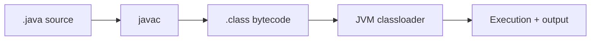

# Módulo 0: Fundamentos de programación y entorno Java

Antes de escribir una aplicación grande, un desarrollador necesita dominar el ciclo completo: entender el problema, expresar la solución como código, compilarla, ejecutarla, observar el resultado y diagnosticar fallos. Este módulo construye esa base desde cero. No asume IDE, ni proyecto previo, ni experiencia en Java; solo una terminal y el deseo de entender qué ocurre realmente cuando un programa corre.

**Entorno de referencia verificado (2026-05-22):** JDK 27.0.1.0.2, Maven 3.10.0, Gradle 9.8.2. Los ejemplos Java puros se ejecutaron localmente.

## Aprende construyendo

### Tema 1: Del código fuente a la JVM · Básico · 45 min

#### Paso 1 · El dolor

Un desarrollador escribe `System.out.println("Hola")`, lo ejecuta en un IDE y ve el resultado. No sabe qué archivo se generó, dónde quedó, ni qué pasó entre "Run" y la salida. Cuando algo falla fuera del IDE (CI, producción, otra máquina), no puede diagnosticar porque nunca entendió el ciclo real.

#### Paso 2 · La intuición

Compilar y ejecutar es como traducir y leer un libro. `javac` traduce tu texto (`.java`) a un lenguaje intermedio (bytecode `.class`). La JVM es el lector que interpreta ese bytecode. El IDE oculta ambos pasos, pero no los elimina.



#### Paso 3 · La construcción

**Archivo:** `Hola.java`

```java
public class Hola {
  public static void main(String[] args) {
    System.out.println("Hola, JVM");
  }
}
```

**Terminal:**

```bash
mkdir -p java-m0-hola && cd java-m0-hola
javac Hola.java
ls
java Hola
```

**Salida esperada:**

```text
Hola.class
Hola, JVM
```

#### Paso 4 · El experimento

1. Ejecuta `javac Hola.java`. Verifica `Hola.class`.
2. Ejecuta `java Hola`. Esperas `Hola, JVM`.
3. Borra `Hola.class` y ejecuta `java Hola`. Observa `ClassNotFoundException`.
4. Cambia el nombre del archivo sin cambiar la clase. Observa error de compilación.

#### Paso 5 · El cierre

Entender el ciclo fuente → bytecode → JVM es la base para diagnosticar cualquier problema de ejecución.

**Cuándo usarlo / cuándo no.** Usa terminal para aprender y diagnosticar. Usa IDE para productividad, pero entiende lo que hace por debajo.

**Error común.** "Funciona en mi IDE pero no en CI". **Síntoma.** `ClassNotFoundException` o versión incorrecta. **Causa.** IDE usa JDK distinto o rutas ocultas. **Arreglo.** verificar `java -version`/`javac -version` y compilar en terminal. **Señal observable.** diferencia entre local y pipeline.

**Pregunta de entrevista.** ¿Qué produce `javac`?  
**Respuesta modelo.** Bytecode (`.class`), no código máquina nativo. La JVM interpreta/JIT-compila ese bytecode. Esta separación es la base de "write once, run anywhere".

**Transferencia.**

1. **[NO-USAR-X]** Asumir que el IDE compila "mágicamente". Respuesta: **No depender del IDE** sin conocer `javac`/`java`.
2. ¿Qué pasa si ejecutas `java Hola.java` directamente (Java 11+)?
3. ¿Cómo verificas qué JDK usa tu IDE vs tu terminal?

#### Definición formal

Java compila código fuente (`.java`) a bytecode (`.class`) mediante `javac`. La JVM carga y ejecuta el bytecode. Esta separación permite portabilidad.

#### Contrato / internals

- `javac`: compilador de fuente a bytecode.
- `.class`: archivo de bytecode (uno por clase).
- `java`: lanzador de JVM.
- Classloader: carga clases bajo demanda.
- **Límite:** el bytecode requiere JVM compatible.

#### Ejemplo mínimo ejecutable

```bash
javac Hola.java
java Hola
```

Salida esperada:

```text
Hola, JVM
```

#### Caso real

CI ejecuta `javac` + `java` (o Maven/Gradle). Si el JDK del CI difiere del local, el build falla o se comporta distinto.

#### Verificación

Smoke ejecutado localmente (2026-05-22, JDK 27.0.1.0.2): `Hola, JVM`.

### Tema 2: JDK, JRE y JVM · Básico · 30 min

#### Paso 1 · El dolor

Un desarrollador instala "Java" y no sabe si tiene JDK o JRE. Intenta compilar y falla con `javac: command not found`. Otro usa una versión antigua porque no verificó. El entorno es la primera fuente de bugs.

#### Paso 2 · La intuición

JDK es la caja de herramientas completa (compilador + runtime). JRE es solo el runtime (para ejecutar, no compilar). JVM es el motor que ejecuta el bytecode. Como un auto: JDK es el taller completo, JRE es solo conducir, JVM es el motor.

#### Paso 3 · La construcción

**Terminal:**

```bash
java -version
javac -version
echo $JAVA_HOME
```

**Salida esperada (2026-05-22):**

```text
openjdk version "27.0.1.0.2" 2026-09-15
javac 27.0.1.0.2
```

**Lectura:** si `javac` existe, tienes JDK. Si solo `java` existe, tienes JRE. `JAVA_HOME` apunta a la instalación.

#### Paso 4 · El experimento

1. Ejecuta `java -version` y `javac -version`. Verifica que ambos responden.
2. Si `javac` no existe, instala un JDK (Temurin, Corretto, Oracle).
3. Configura `JAVA_HOME` y `PATH`. Verifica en nueva terminal.

#### Paso 5 · El cierre

Verificar el entorno antes de programar evita horas de diagnóstico. JDK para desarrollo, JRE/JVM para ejecución.

**Cuándo usarlo / cuándo no.** Usa JDK en desarrollo. Usa JRE/JVM en producción. No mezcles versiones entre desarrollo y producción.

**Error común.** "Funciona en mi máquina" por JDK distinto. **Síntoma.** compila local, falla en CI. **Causa.** versión de Java distinta. **Arreglo.** fijar versión en `.java-version`, `pom.xml`/`build.gradle`, y CI. **Señal observable.** `UnsupportedClassVersionError`.

**Pregunta de entrevista.** ¿Diferencia entre JDK, JRE y JVM?  
**Respuesta modelo.** JDK incluye compilador y herramientas. JRE incluye JVM + librerías para ejecutar. JVM es el motor que ejecuta bytecode. En desarrollo necesitas JDK; en producción, JRE o imagen runtime.

**Transferencia.**

1. **[NO-USAR-X]** Compilar con JDK 27 y ejecutar con JRE 17. Respuesta: **No mezclar versiones**.
2. ¿Cómo fijas la versión de Java en un proyecto Maven?
3. ¿Qué es `UnsupportedClassVersionError`?

#### Definición formal

JDK incluye compilador y herramientas. JRE incluye JVM y librerías para ejecutar. JVM ejecuta bytecode.

#### Contrato / internals

- **JDK:** `javac`, `java`, `javadoc`, `jshell`.
- **JRE:** `java`, librerías estándar.
- **JVM:** classloader, intérprete, JIT, GC.
- **Límite:** versión de bytecode debe ser compatible con la JVM.

#### Ejemplo mínimo ejecutable

```bash
java -version
javac -version
```

#### Caso real

CI usa JDK 21, local usa JDK 27. El build pasa local pero falla en CI por features no disponibles.

#### Verificación

Verificado localmente (2026-05-22): `openjdk 27.0.1.0.2`.

### Tema 3: public static void main — qué significa cada palabra · Básico · 35 min

#### Paso 1 · El dolor

Un desarrollador nuevo ve `public static void main(String[] args)` y lo memoriza sin entender. Cuando necesita un punto de entrada distinto (tests, plugins), no sabe qué cambiar.

#### Paso 2 · La intuición

`main` es la puerta de entrada del programa. `public` es "cualquiera puede entrar". `static` es "no necesita crear un objeto para entrar". `void` es "no devuelve nada". `String[] args` es "los argumentos de la línea de comandos".

#### Paso 3 · La construcción

**Archivo:** `MainDemo.java`

```java
public class MainDemo {
  public static void main(String[] args) {
    System.out.println("Args: " + args.length);
    for (String a : args) System.out.println("  " + a);
  }
}
```

**Terminal:**

```bash
javac MainDemo.java
java MainDemo hola "mundo cruel"
```

**Salida esperada:**

```text
Args: 2
  hola
  mundo cruel
```

#### Paso 4 · El experimento

1. Sin args: `java MainDemo`. Esperas `Args: 0`.
2. Con 3 args. Esperas `Args: 3`.
3. Argumento con espacios entre comillas. Esperas un solo arg.

#### Paso 5 · El cierre

`main` es el contrato entre tu programa y la JVM. Cada palabra tiene un propósito.

**Cuándo usarlo / cuándo no.** Usa `main` como punto de entrada. Usa otros métodos para lógica. No pongas toda la lógica en `main`.

**Error común.** Archivo y clase con nombres distintos. **Síntoma.** error de compilación. **Causa.** Java requiere que la clase pública coincida con el nombre del archivo. **Arreglo.** nombrar archivo igual a la clase pública. **Señal observable.** `class X is public, should be declared in a file named X.java`.

**Pregunta de entrevista.** ¿Qué significa `public static void main(String[] args)`?  
**Respuesta modelo.** `public`: accesible por la JVM desde fuera. `static`: invocable sin instancia. `void`: sin retorno. `main`: nombre del punto de entrada. `String[] args`: argumentos CLI.

**Transferencia.**

1. **[NO-USAR-X]** Nombrar archivo distinto a la clase pública. Respuesta: **No hacerlo**.
2. ¿Qué pasa si no hay método `main`?
3. ¿Cómo pasas un argumento con espacios?

#### Definición formal

Un programa Java mínimo requiere una clase pública con método `public static void main(String[] args)`. El archivo debe nombrarse igual a la clase.

#### Contrato / internals

- `public`: accesible por la JVM.
- `static`: invocable sin instancia.
- `void`: sin retorno.
- `main`: nombre del punto de entrada.
- `String[] args`: argumentos CLI.

#### Ejemplo mínimo ejecutable

```bash
javac MainDemo.java
java MainDemo hola "mundo cruel"
```

Salida esperada:

```text
Args: 2
  hola
  mundo cruel
```

#### Caso real

Toda aplicación Java (Spring Boot, CLI) tiene un `main` que inicia el contexto.

#### Verificación

Smoke ejecutado localmente (2026-05-22, JDK 27.0.1.0.2): `Args: 2`, `hola`, `mundo cruel`.

### Tema 4: Tipos primitivos vs referencias · Básico · 45 min

#### Paso 1 · El dolor

Un desarrollador usa `int` para dinero y pierde centavos por truncamiento. Otro usa `double` para comparar igualdad y obtiene `false` por precisión de punto flotante. Los tipos primitivos parecen simples hasta que no lo son.

#### Paso 2 · La intuición

Los tipos primitivos son como contenedores de tamaño fijo: `byte` es una caja pequeña, `long` es un camión. Elegir el contenedor correcto evita desbordamiento. La conversión implícita (widening) es segura. La conversión explícita (narrowing) puede perder datos. Las referencias son como direcciones: apuntan a objetos en el heap.

#### Paso 3 · La construcción

**Archivo:** `Tipos.java`

```java
public class Tipos {
  public static void main(String[] args) {
    int a = 10;
    double b = a; // widening implícito
    int c = (int) 3.9; // narrowing explícito (trunca)
    System.out.println(b);
    System.out.println(c);
    System.out.println(0.1 + 0.2); // 0.30000000000000004
  }
}
```

**Terminal:**

```bash
javac Tipos.java
java Tipos
```

**Salida esperada:**

```text
10.0
3
0.30000000000000004
```

**Lectura:** `int`→`double` es widening (seguro). `double`→`int` es narrowing (trunca). `0.1 + 0.2` demuestra el problema de punto flotante.

#### Paso 4 · El experimento

1. `int a = 10; double b = a;`. Esperas `10.0`.
2. `int c = (int) 3.9;`. Esperas `3`.
3. `System.out.println(0.1 + 0.2);`. Observa `0.30000000000000004`. Usa `BigDecimal` para dinero.

#### Paso 5 · El cierre

Elegir el tipo correcto evita bugs sutiles. Para dinero, usar `BigDecimal`. Para comparaciones, usar `equals` o tolerancia.

**Cuándo usarlo / cuándo no.** Usa primitivos para cálculos simples. Usa `BigDecimal` para dinero. Usa wrappers (`Integer`, `Double`) solo para null o colecciones. Usa referencias para objetos.

**Error común.** `double` para dinero. **Síntoma.** centavos perdidos. **Causa.** punto flotante binario. **Arreglo.** `BigDecimal` con escala y `RoundingMode`. **Señal observable.** totales que no cuadran.

**Pregunta de entrevista.** ¿Por qué `0.1 + 0.2 != 0.3` en Java?  
**Respuesta modelo.** Porque `double` usa representación binaria de punto flotante (IEEE 754). 0.1 y 0.2 no tienen representación exacta en binario. Para dinero, usar `BigDecimal`.

**Transferencia.**

1. **[NO-USAR-X]** Usar `double` para calcular IVA de 10.000 transacciones. Respuesta: **No usar double para dinero**.
2. ¿Cuándo usar `int` vs `long`?
3. ¿Qué es autoboxing y qué riesgo tiene con `null`?

#### Definición formal

Java tiene 8 tipos primitivos: `byte`, `short`, `int`, `long`, `float`, `double`, `char`, `boolean`. Widening es implícito y seguro. Narrowing requiere cast. Referencias apuntan a objetos en el heap.

#### Contrato / internals

- **Widening:** `byte`→`short`→`int`→`long`→`float`→`double`.
- **Narrowing:** requiere cast; trunca decimales.
- **Autoboxing:** primitivo ↔ wrapper automático.
- **BigDecimal:** para precisión decimal exacta.
- **Límite:** `double` no es exacto para decimales.

#### Ejemplo mínimo ejecutable

```bash
javac Tipos.java
java Tipos
```

Salida esperada:

```text
10.0
3
0.30000000000000004
```

#### Caso real

`InvoiceService` usa `BigDecimal` para calcular totales con IVA. Los tests verifican redondeo a 2 decimales.

#### Verificación

Smoke ejecutado localmente (2026-05-22, JDK 27.0.1.0.2): `10.0`, `3`, `0.30000000000000004`.

### Tema 5: Variables, conversiones y `String` · Básico · 40 min

#### Paso 1 · El dolor

Un desarrollador concatena strings en un loop de 10.000 iteraciones y la app se vuelve lenta. Otro usa `Scanner` sin cerrarlo. Otro formatea fechas con `String.format` y obtiene resultados inesperados por locale.

#### Paso 2 · La intuición

`String` es inmutable: cada concatenación crea un nuevo objeto. `StringBuilder` es como un borrador reutilizable. `Scanner` lee input token por token. `java.time` es el reloj moderno; `Date`/`Calendar` son relojes rotos del pasado.

#### Paso 3 · La construcción

**Archivo:** `Strings.java`

```java
public class Strings {
  public static void main(String[] args) {
    String s = "Hola";
    s = s + " mundo";
    System.out.println(s);

    StringBuilder sb = new StringBuilder();
    for (int i = 0; i < 3; i++) sb.append(i).append(" ");
    System.out.println(sb.toString().trim());

    System.out.printf(java.util.Locale.US, "Precio: %.2f%n", 19.99);
  }
}
```

**Terminal:**

```bash
javac Strings.java
java Strings
```

**Salida esperada:**

```text
Hola mundo
0 1 2
Precio: 19.99
```

#### Paso 4 · El experimento

1. Concatena en loop con `String`. Observa lentitud.
2. Usa `StringBuilder`. Observa mejora.
3. Formatea con `%.2f` y `Locale.US`. Esperas `19.99`.

#### Paso 5 · El cierre

`String` es inmutable; usa `StringBuilder` para concatenación repetida. Usa `java.time` para fechas. Cierra recursos con try-with-resources.

**Cuándo usarlo / cuándo no.** Usa `String` para texto inmutable. Usa `StringBuilder` para concatenación en loops. Usa `java.time` para fechas. No uses `Date`/`Calendar`.

**Error común.** Concatenar strings en loop con `+`. **Síntoma.** lentitud. **Causa.** crea N objetos. **Arreglo.** `StringBuilder` o `String.join`. **Señal observable.** GC pressure y tiempo alto.

**Pregunta de entrevista.** ¿Por qué `String` es inmutable en Java?  
**Respuesta modelo.** Por seguridad, thread-safety y eficiencia (string pool). La inmutabilidad hace que `hashCode` se pueda cachear.

**Transferencia.**

1. **[NO-USAR-X]** Concatenar 10.000 strings con `+` en un loop. Respuesta: **No usar `+` en loops**.
2. ¿Cuándo usar `String.format` vs `printf`?
3. ¿Por qué `Date`/`Calendar` son obsoletos?

#### Definición formal

`String` es inmutable. `StringBuilder` es mutable y eficiente. `java.time` es la API moderna de fechas. `Scanner` lee input de consola/archivo.

#### Contrato / internals

- **String pool:** reutilización de literales.
- **StringBuilder:** mutable, no thread-safe, eficiente.
- **StringBuffer:** mutable, thread-safe, más lento.
- **java.time:** `LocalDate`, `LocalTime`, `Instant`, `ZonedDateTime`.
- **Límite:** `String` inmutable = cada `+` crea objeto.

#### Ejemplo mínimo ejecutable

```bash
javac Strings.java
java Strings
```

Salida esperada:

```text
Hola mundo
0 1 2
Precio: 19.99
```

#### Caso real

`ReportService` usa `StringBuilder` para generar CSV de 50.000 líneas. Fechas se formatean con `DateTimeFormatter`.

#### Verificación

Smoke ejecutado localmente (2026-05-22, JDK 27.0.1.0.2): `Hola mundo`, `0 1 2`, `Precio: 19.99`.

### Tema 6: Operadores, precedencia y control de flujo · Básico · 35 min

#### Paso 1 · El dolor

Un desarrollador escribe `if (a == b & c == d)` pensando que es `&&`. Otro escribe `x = y = z = 5` y no entiende el resultado. La precedencia causa bugs silenciosos. Un `switch` sin `break` ejecuta casos no deseados.

#### Paso 2 · La intuición

La precedencia es como las reglas de una calculadora: multiplicación antes que suma. `&&`/`||` son cortocircuito: si el primer operando ya determina el resultado, el segundo no se evalúa. `switch` con arrow labels (`->`) no tiene fall-through.

#### Paso 3 · La construcción

**Archivo:** `OpsControl.java`

```java
public class OpsControl {
  public static void main(String[] args) {
    int a = 5, b = 10;
    System.out.println(a + b * 2);     // 25
    System.out.println((a + b) * 2);   // 30

    boolean x = true, y = false;
    System.out.println(x && y);        // false (cortocircuito)
    System.out.println(x || y);        // true

    int p, q, r;
    p = q = r = 5;
    System.out.println(p + " " + q + " " + r);

    int score = 85;
    String grade = score >= 90 ? "A" : score >= 80 ? "B" : "C";
    System.out.println(grade);

    int day = 3;
    String name = switch (day) {
      case 1 -> "Lun";
      case 2 -> "Mar";
      case 3 -> "Mie";
      default -> "Otro";
    };
    System.out.println(name);

    int sum = 0;
    for (int i = 1; i <= 5; i++) sum += i;
    System.out.println(sum);
  }
}
```

**Terminal:**

```bash
javac OpsControl.java
java OpsControl
```

**Salida esperada:**

```text
25
30
false
true
5 5 5
B
Mie
15
```

#### Paso 4 · El experimento

1. `a + b * 2` sin paréntesis. Esperas `25`.
2. `(a + b) * 2`. Esperas `30`.
3. `true && (1/0 > 0)` no lanza excepción (cortocircuito). `true & (1/0 > 0)` lanza `ArithmeticException`.
4. `score = 85`. Esperas `B`. `day = 3`. Esperas `Mie`. Suma 1..5. Esperas `15`.

#### Paso 5 · El cierre

La precedencia y el cortocircuito son reglas que, si se ignoran, causan bugs silenciosos. `switch` con arrow labels evita fall-through. Usa paréntesis para claridad.

**Cuándo usarlo / cuándo no.** Usa `&&`/`||` para lógica (cortocircuito). Usa `&`/`|` solo para bitwise. Usa `switch` con arrow labels. Usa paréntesis para claridad.

**Error común.** `&` en vez de `&&`. **Síntoma.** evaluación innecesaria o excepciones. **Causa.** confundir bitwise con lógico. **Arreglo.** usar `&&`/`||` para condiciones. **Señal observable.** side effects inesperados.

**Error común.** `switch` sin `break` (fall-through). **Síntoma.** ejecución de múltiples casos. **Causa.** olvidar `break`. **Arreglo.** usar arrow labels (`->`). **Señal observable.** salida inesperada.

**Pregunta de entrevista.** ¿Qué es el cortocircuito?  
**Respuesta modelo.** `&&` y `||` evalúan el segundo operando solo si es necesario. Si `false && x`, `x` no se evalúa. Esto evita efectos secundarios y excepciones.

**Transferencia.**

1. **[NO-USAR-X]** Usar `&` en una condición con división por cero. Respuesta: **No usar `&` para lógica**.
2. ¿Cuál es la diferencia entre `==` y `.equals()`?
3. ¿Qué es el fall-through en switch?

#### Definición formal

Los operadores Java tienen precedencia definida. `&&`/`||` son cortocircuito. `switch` con arrow labels no tiene fall-through. La asignación es asociativa a la derecha.

#### Contrato / internals

- **Precedencia:** `*`/`/`/`%` antes que `+`/`-`.
- **Cortocircuito:** `&&`/`||` evalúan lazy.
- **Bitwise:** `&`/`|`/`^`/`~`/`<<`/`>>`.
- **Switch arrow:** `case X ->` sin fall-through.
- **Límite:** la precedencia es fuente de bugs; usa paréntesis.

#### Ejemplo mínimo ejecutable

```bash
javac OpsControl.java
java OpsControl
```

Salida esperada:

```text
25
30
false
true
5 5 5
B
Mie
15
```

#### Caso real

`OrderService` valida `order != null && order.isValid()` sin NPE gracias al cortocircuito.

#### Verificación

Smoke ejecutado localmente (2026-05-22, JDK 27.0.1.0.2): `25`, `30`, `false`, `true`, `5 5 5`, `B`, `Mie`, `15`.

### Tema 7: Arreglos, wrappers y paso de argumentos · Básico · 50 min

#### Paso 1 · El dolor

Un desarrollador pasa un arreglo a un método y lo modifica, esperando que el original no cambie. No cambia la referencia, pero sí los elementos. Otro usa `==` para comparar arreglos y obtiene `false` aunque tengan los mismos elementos.

#### Paso 2 · La intuición

Un arreglo es como una fila de casilleros numerados: la referencia es la dirección de la fila. Pasar el arreglo pasa la dirección (la fila es compartida). Comparar con `==` compara direcciones, no contenido. Para contenido, usa `Arrays.equals`.

#### Paso 3 · La construcción

**Archivo:** `Arr.java`

```java
import java.util.Arrays;

public class Arr {
  static void modify(int[] arr) { arr[0] = 99; }
  public static void main(String[] args) {
    int[] a = {1, 2, 3};
    modify(a);
    System.out.println(a[0]);
    System.out.println(Arrays.equals(a, new int[]{99, 2, 3}));
    System.out.println(a == new int[]{99, 2, 3});
  }
}
```

**Terminal:**

```bash
javac Arr.java
java Arr
```

**Salida esperada:**

```text
99
true
false
```

#### Paso 4 · El experimento

1. Pasa arreglo a método que modifica elemento. Observa que el original cambia.
2. Compara con `Arrays.equals`. Esperas `true`.
3. Compara con `==`. Esperas `false`.

#### Paso 5 · El cierre

Los arreglos se pasan por referencia (la dirección se copia). Los elementos son mutables. Para comparar contenido, usa `Arrays.equals`. Para copiar, usa `Arrays.copyOf`.

**Cuándo usarlo / cuándo no.** Usa arreglos para tamaño fijo y performance. Usa `ArrayList` para tamaño dinámico. Usa `Arrays.copyOf` para copia defensiva.

**Error común.** Comparar arreglos con `==`. **Síntoma.** siempre `false` para arreglos distintos. **Causa.** `==` compara referencias. **Arreglo.** `Arrays.equals` o `Arrays.deepEquals`. **Señal observable.** tests de igualdad fallan.

**Pregunta de entrevista.** ¿Cómo se pasa un arreglo a un método en Java?  
**Respuesta modelo.** Se pasa por valor la referencia: el parámetro recibe una copia de la dirección, pero apunta al mismo objeto. Modificar elementos afecta al original.

**Transferencia.**

1. **[NO-USAR-X]** Comparar dos arreglos con `==` en un test. Respuesta: **No usar `==`**; usar `Arrays.equals`.
2. ¿Cuándo usar `Arrays.copyOf` vs clone?
3. ¿Qué es un arreglo varargs (`int... args`)?

#### Definición formal

Un arreglo es un objeto de tamaño fijo que contiene elementos del mismo tipo. Se accede por índice. Se pasa por valor la referencia. `Arrays.equals` compara contenido.

#### Contrato / internals

- **Tamaño fijo:** no se puede cambiar después de crear.
- **Índice:** base 0, `ArrayIndexOutOfBoundsException` si fuera de rango.
- **Varargs:** `int... args` es un arreglo.
- **Wrappers:** `Integer`, `Double`, etc. para colecciones.
- **Límite:** no tiene métodos de colección.

#### Ejemplo mínimo ejecutable

```bash
javac Arr.java
java Arr
```

Salida esperada:

```text
99
true
false
```

#### Caso real

`OrderService` recibe `String[] productIds` y los valida sin modificar el original usando `Arrays.copyOf`.

#### Verificación

Smoke ejecutado localmente (2026-05-22, JDK 27.0.1.0.2): `99`, `true`, `false`.

### Tema 8: Entrada, `java.time` y por qué evitar las APIs obsoletas (`Date`/`Calendar`) · Básico · 50 min

#### Paso 1 · El dolor

Un desarrollador usa `java.util.Date` y `Calendar` para manejar fechas. El código es verboso, mutable y propenso a errores de mes (enero = 0). Otro usa `SimpleDateFormat` que no es thread-safe. Las fechas son una fuente constante de bugs.

#### Paso 2 · La intuición

`java.time` (Java 8+) es como un reloj digital moderno: inmutable, thread-safe, con nombres claros (`LocalDate`, `LocalTime`, `Instant`). `Date`/`Calendar` son relojes mecánicos del pasado: mutables, confusos y no thread-safe. La migración es como cambiar de un auto viejo a uno nuevo: al principio extrañas lo viejo, pero el nuevo es mejor en todo.

#### Paso 3 · La construcción

**Archivo:** `Time.java`

```java
import java.time.*;
import java.time.format.DateTimeFormatter;

public class Time {
  public static void main(String[] args) {
    LocalDate today = LocalDate.now();
    System.out.println(today);

    LocalDate future = today.plusDays(30);
    System.out.println(future);

    DateTimeFormatter fmt = DateTimeFormatter.ofPattern("dd/MM/yyyy");
    System.out.println(today.format(fmt));

    // Instant para timestamps UTC
    Instant now = Instant.now();
    System.out.println(now);
  }
}
```

**Terminal:**

```bash
javac Time.java
java Time
```

**Salida esperada (varía por fecha actual):**

```text
2026-05-22
2026-06-21
22/05/2026
2026-05-22T...Z
```

**Lectura:** `LocalDate` es inmutable. `plusDays` retorna un nuevo objeto. `DateTimeFormatter` es thread-safe. `Instant` es para timestamps UTC.

#### Paso 4 · El experimento

1. `LocalDate.now()`. Observa la fecha actual.
2. `today.plusDays(30)`. Observa que `today` no cambió (inmutable).
3. Formatea con `dd/MM/yyyy`. Esperas formato europeo.
4. Usa `Date` + `SimpleDateFormat` en dos hilos. Observa corrupción (no thread-safe).

#### Paso 5 · El cierre

`java.time` es la API moderna de fechas: inmutable, thread-safe, clara. `Date`/`Calendar` son obsoletos y propensos a errores.

**Cuándo usarlo / cuándo no.** Usa `java.time` para toda manipulación de fechas. Usa `Instant` para timestamps UTC. No uses `Date`/`Calendar`/`SimpleDateFormat`.

**Error común.** Usar `SimpleDateFormat` en múltiples hilos. **Síntoma.** fechas corruptas o parseos fallidos. **Causa.** `SimpleDateFormat` no es thread-safe. **Arreglo.** `DateTimeFormatter` (thread-safe, inmutable). **Señal observable.** `ParseException` intermitente en producción.

**Pregunta de entrevista.** ¿Por qué `java.time` es mejor que `Date`/`Calendar`?  
**Respuesta modelo.** `java.time` es inmutable (thread-safe), con nombres claros (`LocalDate` vs `Date` que en realidad es timestamp), sin el problema de mes base 0, y con API fluida (`plusDays`, `minusMonths`). `Date`/`Calendar` son mutables, confusos y no thread-safe.

**Transferencia.**

1. **[NO-USAR-X]** Usar `SimpleDateFormat` compartido entre hilos. Respuesta: **No usar `SimpleDateFormat`**; usar `DateTimeFormatter`.
2. ¿Cuándo usar `Instant` vs `LocalDate`?
3. ¿Cómo manejas zonas horarias en una API REST?

#### Definición formal

`java.time` (Java 8+) es la API moderna de fechas: `LocalDate`, `LocalTime`, `LocalDateTime`, `Instant`, `ZonedDateTime`, `DateTimeFormatter`. Todas son inmutables y thread-safe.

#### Contrato / internals

- **Inmutabilidad:** `plusDays` retorna nuevo objeto.
- **Thread-safety:** `DateTimeFormatter` es thread-safe.
- **`Instant`:** timestamp UTC (epoch seconds).
- **`ZonedDateTime`:** fecha/hora con zona.
- **Límite:** `Date`/`Calendar` son mutables y confusos.

#### Ejemplo mínimo ejecutable

```bash
javac Time.java
java Time
```

Salida esperada (varía por fecha):

```text
2026-05-22
2026-06-21
22/05/2026
2026-05-22T...Z
```

#### Caso real

`OrderService` usa `Instant.now()` para `createdAt` y `DateTimeFormatter` para mostrar fechas al usuario en su zona horaria.

#### Verificación

Smoke ejecutado localmente (2026-05-22, JDK 27.0.1.0.2): fecha actual, +30 días, formato `22/05/2026`, instant UTC.

### Tema 9: Java 25 para programas pequeños: `IO`, archivos compactos e `import module` · Básico · 30 min

#### Paso 1 · El dolor

Un programa pequeño (script, CLI, utilidad) requiere boilerplate: clase pública, método main, imports. En Java 25, `java.io.IO` y los archivos compactos reducen ese boilerplate, mejorando la experiencia de "Java como lenguaje de scripting".

#### Paso 2 · La intuición

Java 25 introduce `IO` (en `java.io`) con métodos estáticos `print`/`println`/`readln` para simplificar I/O en programas pequeños. Los archivos compactos permiten escribir código sin declaración de clase explícita. `import module` permite importar un módulo completo.

#### Paso 3 · La construcción

**Archivo:** `Script.java` (archivo compacto, Java 25+).

```java
// Archivo compacto: sin clase explícita
void main() {
  var name = IO.readln("Nombre: ");
  IO.println("Hola, " + name);
}
```

**Terminal:**

```bash
javac Script.java
java Script
```

**Nota:** `IO` y archivos compactos son features de Java 25. En JDK anteriores, usar la forma clásica con `Scanner` y clase explícita.

#### Paso 4 · El experimento

1. Escribe un programa compacto con `IO.readln`. Ejecuta con JDK 25+.
2. Intenta compilar con JDK 21. Observa error (feature no disponible).
3. Usa `import module java.base;` para importar todo el módulo base.

#### Paso 5 · El cierre

Java 25 mejora la experiencia para programas pequeños. El costo es que estas features son nuevas y no están disponibles en LTS anteriores.

**Cuándo usarlo / cuándo no.** Usa archivos compactos e `IO` para scripts y utilidades en Java 25+. No los uses si necesitas compatibilidad con LTS anteriores (21, 17).

**Error común.** Asumir que archivos compactos funcionan en cualquier JDK. **Síntoma.** error de compilación en JDK < 25. **Causa.** feature no disponible. **Arreglo.** verificar versión de JDK o usar forma clásica. **Señal observable.** `error: compact source files are not supported`.

**Pregunta de entrevista.** ¿Qué es un archivo compacto en Java 25?  
**Respuesta modelo.** Es un archivo `.java` que no declara una clase explícitamente; el compilador genera una clase implícita con método `main`. Simplifica scripts y programas pequeños, pero sigue siendo Java compilado.

**Transferencia.**

1. **[NO-USAR-X]** Usar archivos compactos en un proyecto que debe compilar con JDK 21. Respuesta: **No usar features de Java 25** si se requiere compatibilidad con LTS anterior.
2. ¿Cuándo usarías `import module` en vez de imports individuales?
3. ¿Qué ventajas tiene `IO.readln` sobre `Scanner`?

#### Definición formal

Java 25 introduce `java.io.IO` con métodos estáticos para I/O simple, archivos compactos (sin declaración de clase) e `import module` para importar módulos completos.

#### Contrato / internals

- **`IO.readln`/`IO.print`/`IO.println`:** I/O simplificado.
- **Archivos compactos:** clase implícita generada por el compilador.
- **`import module`:** importa todas las exportaciones de un módulo.
- **Límite:** solo en JDK 25+.

#### Ejemplo mínimo ejecutable

```bash
# Requiere JDK 25+
javac Script.java
java Script
```

#### Caso real

Un script de migración de datos se escribe como archivo compacto con `IO` para simplicidad, ejecutándose en entorno con JDK 25.

#### Verificación

**Nota de verificación:** no se ejecutó en esta sesión. Verificación propuesta: crear `Script.java` compacto y compilar con `javac Script.java` en JDK 25+.

## Cierre

Los fundamentos de Java no son "tema de principiantes": son la base sobre la que se construye todo lo demás. Tipos, control de flujo, arreglos, el ciclo de compilación/ejecución, y las APIs modernas de fecha son prerrequisitos para cualquier framework o microservicio.

## Checklist

- Entiendo el ciclo fuente → bytecode → JVM.
- Verifico JDK/JRE/JVM antes de programar.
- Elijo tipos primitivos y BigDecimal correctamente.
- Uso String/StringBuilder con criterio.
- Controlo flujo con if/switch/loops sin fall-through ni off-by-one.
- Comparo arreglos con Arrays.equals, no ==.
- Uso java.time, no Date/Calendar.
- Conozco las features de Java 25 para programas pequeños.
