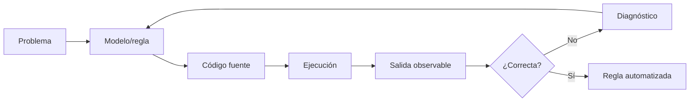
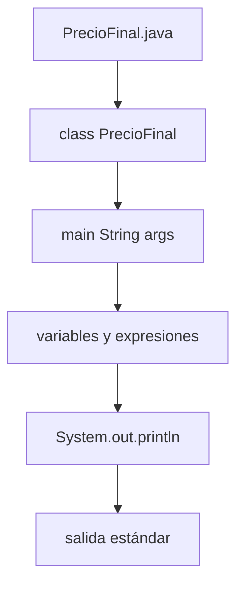
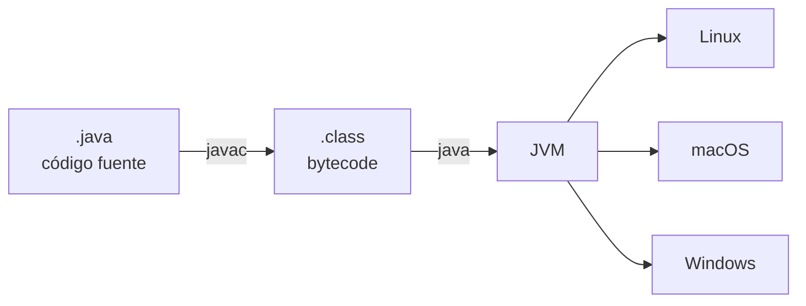
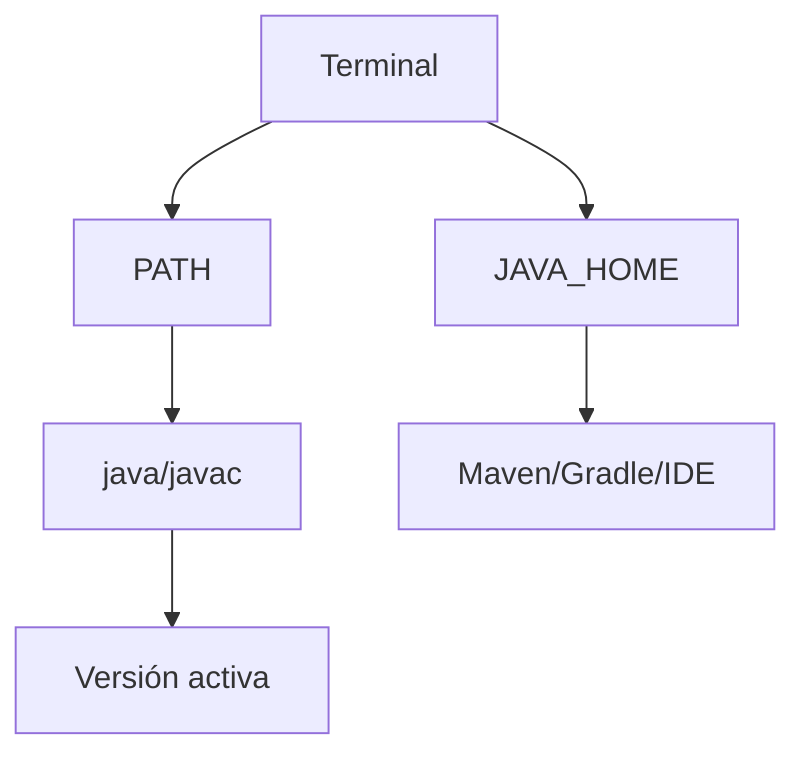
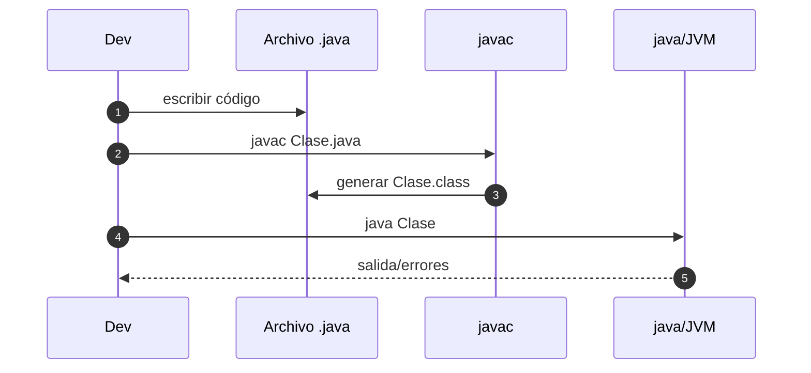
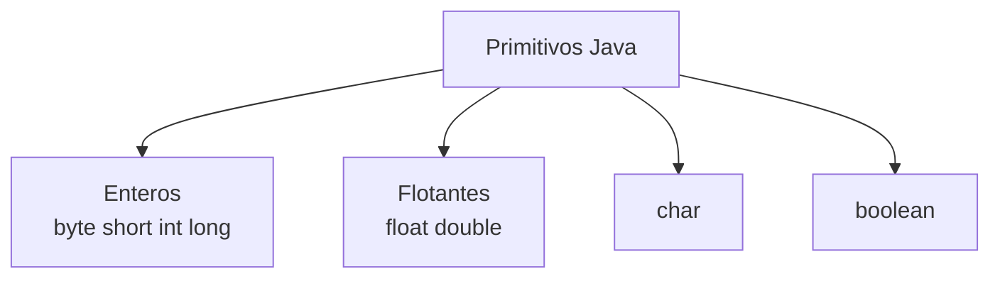
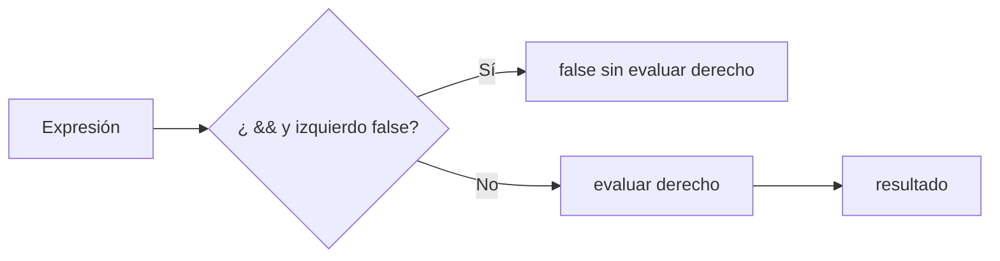
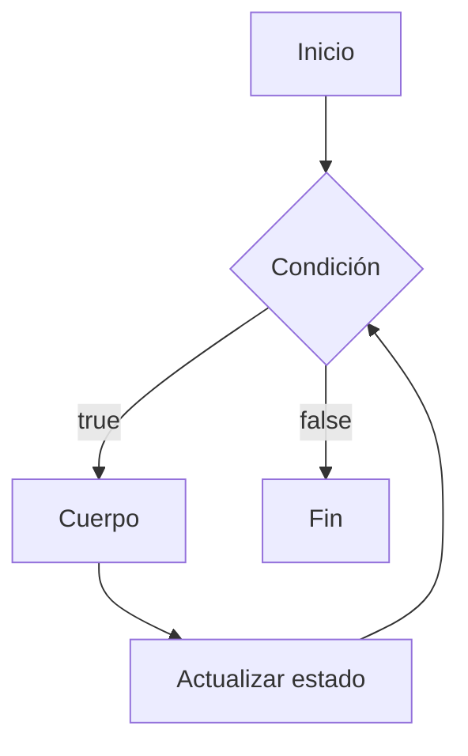

# Módulo 0: Fundamentos de programación y entorno Java

Antes de escribir una aplicación grande, un desarrollador necesita dominar el ciclo completo: entender el problema, expresar la solución como código, compilarla, ejecutarla, observar el resultado y diagnosticar fallos. Este módulo construye esa base desde cero. No asume IDE, ni proyecto previo, ni experiencia en Java; solo una terminal y el deseo de entender qué ocurre realmente cuando un programa corre.

**Entorno de referencia verificado (2026-11-22):**

```bash
java -version
javac -version
```

```text
openjdk version "27.0.1.0.2" 2026-09-15
OpenJDK Runtime Environment Temurin-27.0.1.0.2+1 (build 27+13-7460)
OpenJDK 64-Bit Server VM Temurin-27.0.1.0.2+1 (build 27+13-7460, mixed mode, sharing)
javac 27.0.1.0.2
```

## Aprende construyendo

### Tema 1: Qué es programar y qué problema resuelve Java · Básico · 25 min

**Caso guía.** necesitas calcular el precio final de un producto con IVA. La regla es pequeña, pero obliga a responder preguntas que aparecen en todo software: ¿cuál es la entrada?, ¿qué transformación aplica?, ¿qué salida es correcta?, ¿cómo lo verifico? Si no puedes responder eso, no hay programa confiable.

## Qué es un programa y qué significa programar

**Definición formal.** Un programa es una especificación finita y ejecutable de un cómputo: ante una entrada o estado inicial, produce una salida o un nuevo estado siguiendo reglas formales.

**Cómo funciona por dentro.** Programar no es "escribir código" solamente; es modelar una regla con precisión suficiente para que una máquina la ejecute sin ambigüedad. El ciclo mental es: problema → modelo → algoritmo → código → ejecución → verificación. Si el resultado no coincide con la regla esperada, el fallo puede estar en el modelo, en el código o en la verificación.



**Cuándo usarlo y cuándo no.** Úsalo cuando la regla sea repetible, verificable y valga la pena automatizar. No programes a ciegas cuando el criterio de corrección es ambiguo; primero define qué significa "correcto".

**Ejemplo mínimo enfocado (ejecutable).**

```bash
mkdir -p java-m0-prog
cd java-m0-prog
```

Crea el archivo `Regla.java`:

```java
public class Regla {
  public static void main(String[] args) {
    int entrada = 10;
    int salida = entrada * 2;
    System.out.println(salida);
  }
}
```

```bash
javac Regla.java
java Regla
```

**Caso de uso real.** Calcular IVA, comisiones, descuentos o impuestos sobre miles de transacciones con la misma regla.

**Error común.** Codificar sin criterio de corrección. Síntoma: el programa "corre" pero entrega un valor inválido. Causa: no se definió salida esperada. Corrección: escribir entrada, salida esperada y verificación antes o junto al código.

**Verificación (JDK 27, 2026-05-22).** Salida real: `20`.

## Por qué Java

**Definición formal.** Java es un lenguaje de propósito general, orientado a objetos, de tipado estático, compilado a bytecode y ejecutado sobre la Java Virtual Machine (JVM).

**Cómo funciona por dentro.** El compilador `javac` transforma código fuente `.java` en bytecode `.class`. La JVM carga y ejecuta ese bytecode. El tipado estático permite detectar ciertas clases de errores antes de ejecutar; el runtime gestiona memoria, carga de clases y seguridad.

**Cuándo usarlo y cuándo no.** Úsalo en backend, Android, herramientas empresariales, CLIs y sistemas donde importen mantenibilidad y ecosistema. No es la mejor opción para scripts ultracortos desechables o cuando el dominio exige control manual de memoria muy bajo nivel como objetivo principal.

**Ejemplo mínimo enfocado (ejecutable).**

```bash
mkdir -p java-m0-porque
cd java-m0-porque
```

Crea el archivo `Hola.java`:

```java
public class Hola {
  public static void main(String[] args) {
    System.out.println("Java OK");
  }
}
```

```bash
javac Hola.java
java Hola
```

**Caso de uso real.** Servicio backend que procesa pedidos con reglas de negocio, pruebas automatizadas y despliegue en servidores Linux.

**Error común.** Cambiar la firma de `main`. Síntoma: `Error: Main method not found in class Hola`. Causa: la JVM busca exactamente `public static void main(String[] args)`. Corrección: mantener la firma estándar.

**Verificación (JDK 27, 2026-05-22).** Salida real: `Java OK`.

## Estructura mínima de un programa Java

**Definición formal.** Una aplicación Java ejecutable mínima define una clase y un método `main` con firma estándar que la JVM usa como punto de entrada.

**Cómo funciona por dentro.** `public` permite acceso desde la JVM; `static` permite invocar el método sin instanciar la clase; `void` indica que no devuelve valor al runtime; `String[] args` recibe argumentos de CLI. El nombre de la clase pública debe coincidir con el nombre del archivo.



**Cuándo usarlo y cuándo no.** Úsalo para programas ejecutables, ejercicios y CLIs simples. No omitas `main` si esperas ejecución directa con `java Clase`.

**Ejemplo mínimo enfocado (ejecutable).**

```bash
mkdir -p java-m0-t1
cd java-m0-t1
```

Crea el archivo `PrecioFinal.java`:

```java
public class PrecioFinal {
  public static void main(String[] args) {
    double precioBase = 100.0;
    double iva = 0.21;
    double precioFinal = precioBase + (precioBase * iva);
    System.out.println("Precio base: " + precioBase);
    System.out.println("IVA: " + iva);
    System.out.println("Precio final: " + precioFinal);
  }
}
```


```bash
javac PrecioFinal.java
java PrecioFinal
```

**Caso de uso real.** Cálculo de total con impuestos antes de persistir una factura.

**Error común.** Archivo y clase pública con nombres distintos. Síntoma: `class PrecioFinal is public, should be declared in a file named PrecioFinal.java`. Corrección: alinear nombre de archivo y clase pública.

**Verificación (JDK 27, 2026-05-22).** Salida real:

```text
Precio base: 100.0
IVA: 0.21
Precio final: 121.0
```

### Tema 2: JDK, JRE, JVM y bytecode (WORA) · Básico · 30 min

**Caso guía.** compilas `HolaJVM.java`, obtienes `HolaJVM.class` y lo ejecutas. ¿Por qué no ejecutas el `.java` directamente? ¿Por qué el `.class` puede correr en otro sistema con JVM compatible? Esta distinción separa problemas de código, compilación y entorno.

## JDK, JRE, JVM, bytecode y WORA

**Definición formal.** El **JDK** (Java Development Kit) incluye herramientas de desarrollo como `javac`, `java`, `jar`, `javadoc`. La **JVM** (Java Virtual Machine) ejecuta bytecode. El **JRE** (Java Runtime Environment) es el concepto histórico de runtime; en distribuciones modernas suele hablarse de JDK/JRE/runtime según empaquetado. **Bytecode** es la instrucción intermedia contenida en `.class`. **WORA** (Write Once, Run Anywhere) expresa que el mismo bytecode puede ejecutarse en JVM compatibles.

**Cómo funciona por dentro.** `javac` analiza el código fuente y genera bytecode. `java` inicia una JVM, carga clases, verifica bytecode, interpreta/JIT-compila y ejecuta. La portabilidad es del bytecode respecto a la JVM, no magia absoluta: versión de Java, sistema operativo, librerías nativas y configuración pueden romperla.



**Cuándo usarlo y cuándo no.** Instala JDK para desarrollar/compilar. Usa runtimes compatibles para ejecutar. No asumas WORA si compilas con Java 27 y ejecutas en una JVM 17 sin configuración de release compatible.

**Ejemplo mínimo enfocado (ejecutable).**

```bash
mkdir -p java-m0-jvm
cd java-m0-jvm
```

Crea el archivo `HolaJVM.java`:

```java
public class HolaJVM {
  public static void main(String[] args) {
    System.out.println("Hola desde la JVM");
    System.out.println(System.getProperty("java.specification.version"));
    System.out.println(System.getProperty("os.name"));
  }
}
```


```bash
javac HolaJVM.java
java HolaJVM
javap -c HolaJVM | head -4
```

**Caso de uso real.** CI compila un artefacto y lo despliega en servidores Linux con runtime compatible.

**Error común.** Confundir JDK con JVM. Síntoma: `javac: command not found`. Causa: hay runtime pero no herramientas de desarrollo, o no están en PATH. Corrección: instalar JDK completo y verificar `javac -version`.

**Verificación (JDK 27, 2026-05-22).** Salida real observada (OS puede variar):

```text
Hola desde la JVM
27
Mac OS X
Compiled from "HolaJVM.java"
```

## Compilación y ejecución

**Definición formal.** Compilación es la transformación de fuente a bytecode; ejecución es la carga e interpretación/JIT del bytecode por la JVM.

**Ejemplo mínimo enfocado (ejecutable).**

```bash
mkdir -p java-m0-comp
cd java-m0-comp
```

Crea el archivo `Compila.java`:

```java
public class Compila { public static void main(String[] args){ System.out.println("ok"); } }
```


```bash
javac Compila.java
ls Compila.class
java Compila
```

**Error común.** Ejecutar `java Compila.class`. Síntoma: `Could not find or load main class Compila.class`. Corrección: usar el nombre de clase: `java Compila`.

**Verificación (JDK 27, 2026-05-22).** Se crea `Compila.class` y la ejecución imprime `ok`.

### Tema 3: Instalar JDK y verificar entorno · Básico · 30 min

**Caso guía.** un estudiante dice “Java no funciona”. Antes de tocar el código, hay que saber si el problema es de instalación, `PATH`, `JAVA_HOME`, versión o permisos. Un diagnóstico de entorno ahorra horas.

## Qué significa instalar y verificar el JDK

**Definición formal.** Instalar el JDK es disponer del compilador, runtime y herramientas; verificarlo es comprobar que los ejecutables correctos están en `PATH` y que `java`/`javac` apuntan a la instalación esperada.

**Cómo funciona por dentro.** El shell busca ejecutables en los directorios listados en `PATH`. `JAVA_HOME` es una convención usada por herramientas (Maven, Gradle, IDEs) para ubicar el JDK. Puedes tener múltiples JDKs instalados; el importante es saber cuál usa tu terminal.



**Ejemplo mínimo enfocado (ejecutable).**

```bash
java -version
javac -version
```

**Caso de uso real.** Validar runner de CI antes de compilar un proyecto.

**Error común.** `javac` no encontrado pero `java` sí. Causa: solo hay runtime o PATH incompleto. Corrección: instalar JDK y ajustar PATH/JAVA_HOME.

**Verificación (JDK 27, 2026-05-22).** Ambos comandos reportan 27.0.1.0.2.

## Diagnóstico del entorno

**Definición formal.** Diagnóstico de entorno es la inspección de versión, ruta y variables para confirmar qué instalación Java se está usando.

**Ejemplo mínimo enfocado (ejecutable).**

```bash
which java
which javac
echo "${JAVA_HOME:-JAVA_HOME_NO_DEFINIDA}"
```

**Error común.** `java` y `javac` vienen de rutas distintas. Síntoma: compila en una versión y ejecuta en otra. Corrección: alinear PATH/JAVA_HOME a la misma instalación.

**Verificación.** En un entorno sano, `java` y `javac` pertenecen al mismo JDK.

## Prueba mínima de compilación

**Definición formal.** Prueba de humo del entorno: compilar y ejecutar un programa trivial para validar la cadena completa.

**Ejemplo mínimo enfocado (ejecutable).**

```bash
mkdir -p java-m0-env
cd java-m0-env
```

Crea el archivo `EntornoOk.java`:

```java
public class EntornoOk {
  public static void main(String[] args) {
    System.out.println("JDK OK");
    System.out.println(System.getProperty("java.version"));
  }
}
```

```bash
javac EntornoOk.java
java EntornoOk
```

**Verificación (JDK 27, 2026-05-22).** Salida real:

```text
JDK OK
27.0.1.0.2
```

### Tema 4: Primer programa desde cero, sin IDE · Básico · 35 min

**Caso guía.** necesitas una utilidad CLI que salude por nombre. El IDE puede autocompletar y ocultar pasos; sin IDE ves el ciclo real: archivo, clase, `main`, compilación, ejecución, argumentos y errores.

## El ciclo mínimo: archivo, clase, `main`, compilación y ejecución

**Definición formal.** El ciclo mínimo es escribir un `.java` con una clase y `main`, compilar con `javac` para producir `.class`, y ejecutar con `java` indicando la clase.

**Cómo funciona por dentro.** El archivo fuente es texto. `javac` lo valida sintáctica y semánticamente y emite bytecode. `java` carga la clase, busca `main` y ejecuta desde ahí. Cambiar el `.java` no cambia el `.class` hasta recompilar.



**Ejemplo mínimo enfocado (ejecutable).**

```bash
mkdir -p java-m0-ciclo
cd java-m0-ciclo
```

Crea el archivo `Ciclo.java`:

```java
public class Ciclo { public static void main(String[] args){ System.out.println("ciclo"); } }
```

```bash
javac Ciclo.java
java Ciclo
```

**Error común.** Olvidar recompilar. Síntoma: ves salida vieja. Causa: ejecutas un `.class` anterior. Corrección: `javac` tras cada cambio.

**Verificación (JDK 27, 2026-05-22).** Salida real: `ciclo`.

## Argumentos de línea de comandos

**Definición formal.** `String[] args` contiene los argumentos pasados al proceso después del nombre de clase.

**Contrato/reglas.** `args.length` indica cantidad; los índices empiezan en 0; todos llegan como `String`; si no hay argumentos, el arreglo está vacío, no `null`.

**Ejemplo mínimo enfocado (ejecutable).**

```bash
mkdir -p java-m0-args
cd java-m0-args
```

Crea el archivo `Args.java`:

```java
public class Args {
  public static void main(String[] args) {
    System.out.println(args.length);
    System.out.println(args.length > 0 ? args[0] : "(vacio)");
  }
}
```


```bash
javac Args.java
java Args
java Args Ada
```

**Caso de uso real.** Pasar nombre de archivo, entorno o flag a una herramienta CLI.

**Error común.** Acceder `args[0]` sin validar. Síntoma: `ArrayIndexOutOfBoundsException`. Corrección: comprobar `args.length`.

**Verificación (JDK 27, 2026-05-22).** Salida real:

```text
0
(vacio)
1
Ada
```

## Ejemplo integrado: saludo con argumentos

```bash
mkdir -p java-m0-t4
cd java-m0-t4
```

Crea el archivo `SaludoArgs.java`:

```java
public class SaludoArgs {
  public static void main(String[] args) {
    if (args.length == 0) {
      System.out.println("Uso: java SaludoArgs <nombre>");
      return;
    }
    String nombre = args[0];
    System.out.println("Hola, " + nombre);
  }
}
```


```bash
javac SaludoArgs.java
java SaludoArgs
java SaludoArgs Ada
```

**Recorrido.** El guard clause maneja el caso sin argumentos. Si existe `args[0]`, se guarda en `nombre` y se imprime el saludo. Es un patrón CLI básico: validar entrada, ejecutar caso feliz, salir con mensaje útil.

**Verificación (JDK 27, 2026-05-22).**

```text
Uso: java SaludoArgs <nombre>
Hola, Ada
```

### Tema 5: Tipos primitivos, variables y conversiones · Básico · 45 min

**Caso guía.** un sistema calcula totales y contadores. Si usas el tipo equivocado, puedes perder decimales, desbordar enteros o truncar valores sin notarlo. Los tipos primitivos son la base del modelo de datos en Java.

## Tipos primitivos y variables

**Definición formal.** Una variable es un nombre asociado a un valor tipado. Los primitivos en Java son `byte`, `short`, `int`, `long`, `float`, `double`, `char`, `boolean`.

**Cómo funciona por dentro.** Los primitivos almacenan el valor directamente (no son objetos). El tipo determina tamaño, rango y operaciones válidas. `int` y `double` son los defaults prácticos para enteros y decimales; `long` para enteros grandes; `boolean` para condiciones.



**Ejemplo mínimo enfocado (ejecutable).**

```bash
mkdir -p java-m0-prims
cd java-m0-prims
```

Crea el archivo `Prims.java`:

```java
public class Prims {
  public static void main(String[] args) {
    int cantidad = 3;
    double precio = 19.99;
    boolean activo = true;
    char letra = 'A';
    System.out.println(cantidad);
    System.out.println(precio);
    System.out.println(activo);
    System.out.println(letra);
  }
}
```

```bash
javac Prims.java
java Prims
```

**Error común.** Usar `float`/`double` para dinero con expectativas de exactitud decimal. Síntoma: redondeos inesperados. Corrección: para dinero, usar `BigDecimal` o enteros en centavos; en este nivel, entender la limitación.

**Verificación (JDK 27, 2026-05-22).**

```text
3
19.99
true
A
```

## Conversiones, cast y overflow

**Definición formal.** Widening conversion es conversión implícita a un tipo con mayor capacidad compatible; narrowing conversion requiere cast explícito y puede perder información. Overflow ocurre cuando un cálculo excede el rango del tipo.

**Cómo funciona por dentro.** Java permite `int` → `long`/`double` implícitamente. De `double` a `int` exige cast porque se pierde la parte fraccionaria. Los enteros usan aritmética en complemento a dos; desbordar `int` no lanza excepción, produce un valor envuelto.

**Ejemplo mínimo enfocado (ejecutable).**

```bash
mkdir -p java-m0-cast
cd java-m0-cast
```

Crea el archivo `Cast.java`:

```java
public class Cast {
  public static void main(String[] args) {
    int a = 10;
    double b = a; // widening
    double d = 9.8;
    int e = (int) d; // narrowing
    int max = Integer.MAX_VALUE;
    System.out.println(b);
    System.out.println(e);
    System.out.println(max + 1);
  }
}
```

```bash
javac Cast.java
java Cast
```

**Caso de uso real.** Convertir milisegundos `long` a `int` sin validar rango puede corromper timeouts.

**Error común.** Hacer cast narrowing sin validar. Síntoma: datos truncados o negativos por overflow. Corrección: validar rango, usar `Math.toIntExact()` cuando corresponda, o mantener tipo más amplio.

**Verificación (JDK 27, 2026-05-22).**

```text
10.0
9
-2147483648
```

### Tema 6: String, entrada/salida y formato · Básico · 40 min

**Caso guía.** una CLI debe mostrar un reporte legible y aceptar un nombre. `String` parece simple, pero su inmutabilidad, comparación y formato son fuente constante de bugs.

## `String` como objeto inmutable

**Definición formal.** `String` es una clase que representa secuencias de caracteres UTF-16; sus instancias son inmutables.

**Cómo funciona por dentro.** Toda operación que "modifica" un string crea otro objeto. La comparación con `==` compara referencias; `equals` compara contenido. Para mucha concatenación en bucles, `StringBuilder` evita crear objetos intermedios.

```mermaid
flowchart LR
  A["String s = \"hola\""] --> B[objeto String]
  C[s.toUpperCase] --> D[nuevo String "HOLA"]
  B -.no muta.-> B
```

**Ejemplo mínimo enfocado (ejecutable).**

```bash
mkdir -p java-m0-str
cd java-m0-str
```

Crea el archivo `Str.java`:

```java
public class Str {
  public static void main(String[] args) {
    String a = "hola";
    String b = a.toUpperCase();
    System.out.println(a);
    System.out.println(b);
    System.out.println(a.equals("hola"));
  }
}
```

```bash
javac Str.java
java Str
```

**Error común.** Comparar strings con `==`. Síntoma: comparación falla aunque el texto sea igual. Corrección: `equals` o `Objects.equals`.

**Verificación (JDK 27, 2026-05-22).**

```text
hola
HOLA
true
```

## Entrada, salida y formato

**Definición formal.** Salida estándar se escribe con `System.out.println/printf`; entrada simple puede leerse con `Scanner` sobre `System.in`. Formato permite controlar representación textual.

**Ejemplo mínimo enfocado (ejecutable).**

```bash
mkdir -p java-m0-fmt
cd java-m0-fmt
```

Crea el archivo `Fmt.java`:

```java
public class Fmt {
  public static void main(String[] args) {
    String nombre = "Ada";
    double total = 1234.5;
    System.out.printf("Cliente: %s%n", nombre);
    System.out.printf("Total: %.2f%n", total);
  }
}
```

```bash
javac Fmt.java
java Fmt
```

**Error común.** Concatenar todo y perder legibilidad/formato numérico. Corrección: `printf`/`String.format` o formatted strings según caso.

**Verificación (JDK 27, 2026-05-22).** Salida real en locale es_ES:

```text
Cliente: Ada
Total: 1234,50
```

> Nota: el separador decimal depende del locale; en `en_US` sería `1234.50`.

### Tema 7: Operadores, expresiones y precedencia · Básico · 35 min

**Caso guía.** una regla de descuento aplica si el cliente es VIP y el total supera un umbral, o si hay cupón. Un paréntesis mal puesto cambia el negocio.

## Operadores aritméticos y de asignación

**Definición formal.** Operadores aritméticos (`+ - * / %`) calculan valores numéricos; asignación (`=`, `+=`, etc.) actualiza variables.

**Contrato/reglas.** División entre enteros trunca. `%` devuelve resto. `+=` combina operación y asignación.

**Ejemplo mínimo enfocado (ejecutable).**

```bash
mkdir -p java-m0-arit
cd java-m0-arit
```

Crea el archivo `Arit.java`:

```java
public class Arit {
  public static void main(String[] args) {
    int a = 7, b = 2;
    System.out.println(a / b);
    System.out.println(a % b);
    a += 3;
    System.out.println(a);
  }
}
```

```bash
javac Arit.java
java Arit
```

**Error común.** Esperar `3.5` de `7/2` con enteros. Corrección: usar `double` o castear.

**Verificación (JDK 27, 2026-05-22).** `3`, `1`, `10`.

## Operadores relacionales, lógicos y precedencia

**Definición formal.** Relacionales (`== != < > <= >=`) producen booleanos; lógicos (`&& || !`) combinan condiciones. La precedencia determina el orden de evaluación.

**Cómo funciona por dentro.** `&&` y `||` son short-circuit: si el resultado ya se conoce, no evalúan el lado derecho. Esto evita errores y ahorra trabajo.



**Ejemplo mínimo enfocado (ejecutable).**

```bash
mkdir -p java-m0-log
cd java-m0-log
```

Crea el archivo `Logica.java`:

```java
public class Logica {
  public static void main(String[] args) {
    boolean vip = true;
    double total = 120;
    boolean cupon = false;
    boolean descuento = (vip && total > 100) || cupon;
    System.out.println(descuento);
    System.out.println(true || (10 / 0 > 0));
  }
}
```

```bash
javac Logica.java
java Logica
```

**Error común.** Confiar en precedencia sin paréntesis en reglas de negocio. Corrección: usar paréntesis para intención explícita.

**Verificación (JDK 27, 2026-05-22).** `true`, `true` (short-circuit evita división por cero).

### Tema 8: Control de flujo: decisiones y repeticiones · Básico · 45 min

**Caso guía.** un sistema clasifica pedidos y procesa lotes. Sin control de flujo, solo ejecutarías instrucciones lineales.

## Decisiones: `if/else` y `switch`

**Definición formal.** `if/else` ejecuta ramas según condición booleana; `switch` selecciona rama por valor/expresión según variantes soportadas.

**Cuándo usarlo.** `if/else` para rangos y condiciones complejas; `switch` para conjuntos discretos conocidos.

**Ejemplo mínimo enfocado (ejecutable).**

```bash
mkdir -p java-m0-if
cd java-m0-if
```

Crea el archivo `Decision.java`:

```java
public class Decision {
  public static void main(String[] args) {
    int total = 120;
    if (total > 100) System.out.println("prioritario");
    else System.out.println("normal");
    String estado = "PAGADO";
    switch (estado) {
      case "PAGADO" -> System.out.println("enviar");
      case "PENDIENTE" -> System.out.println("esperar");
      default -> System.out.println("revisar");
    }
  }
}
```

```bash
javac Decision.java
java Decision
```

**Error común.** Olvidar el caso `default`/rama else en reglas de negocio. Corrección: definir comportamiento explícito para casos inesperados.

**Verificación (JDK 27, 2026-05-22).** `prioritario`, `enviar`.

## Repeticiones: `for`, `while`, `do-while`

**Definición formal.** `for` itera con control explícito/colección; `while` repite mientras condición sea verdadera; `do-while` ejecuta al menos una vez.

**Cómo funciona por dentro.** Un bucle necesita estado inicial, condición y progreso. Sin progreso, hay bucle infinito.



**Ejemplo mínimo enfocado (ejecutable).**

```bash
mkdir -p java-m0-loop
cd java-m0-loop
```

Crea el archivo `Loop.java`:

```java
public class Loop {
  public static void main(String[] args) {
    int suma = 0;
    for (int i = 1; i <= 3; i++) suma += i;
    System.out.println(suma);
    int n = 3;
    while (n > 0) { System.out.print(n); n--; }
    System.out.println();
  }
}
```

```bash
javac Loop.java
java Loop
```

**Error común.** Bucle infinito por no actualizar condición. Síntoma: programa no termina/CPU alta. Corrección: asegurar progreso y condición de salida.

**Verificación (JDK 27, 2026-05-22).** `6`, `321`.

### Tema 9: Arreglos y métodos básicos · Básico · 50 min

**Caso guía.** procesar una lista de precios. Necesitas agrupar datos y reutilizar lógica sin copiar/pegar.

## Arreglos

**Definición formal.** Un arreglo es una estructura de tamaño fijo que almacena elementos del mismo tipo en posiciones indexadas desde 0.

**Contrato/reglas.** `length` da el tamaño. Acceso fuera de rango lanza `ArrayIndexOutOfBoundsException`. El tamaño es fijo tras crear el arreglo.

**Ejemplo mínimo enfocado (ejecutable).**

```bash
mkdir -p java-m0-arr
cd java-m0-arr
```

Crea el archivo `Arr.java`:

```java
public class Arr {
  public static void main(String[] args) {
    int[] nums = {10, 20, 30};
    int suma = 0;
    for (int n : nums) suma += n;
    System.out.println(nums.length);
    System.out.println(suma);
  }
}
```

```bash
javac Arr.java
java Arr
```

**Error común.** Usar índice `length`. Síntoma: `ArrayIndexOutOfBoundsException`. Corrección: último índice válido es `length - 1`.

**Verificación (JDK 27, 2026-05-22).** `3`, `60`.

## Métodos básicos

**Definición formal.** Un método es una unidad nombrada de comportamiento con parámetros, cuerpo y tipo de retorno.

**Cómo funciona por dentro.** El método encapsula una regla. Quien llama conoce el contrato (nombre, parámetros, retorno), no los detalles internos. Esto reduce duplicación y facilita pruebas.

**Ejemplo mínimo enfocado (ejecutable).**

```bash
mkdir -p java-m0-met
cd java-m0-met
```

Crea el archivo `Met.java`:

```java
public class Met {
  static int sumar(int a, int b) { return a + b; }
  static double aplicarIva(double base, double iva) { return base + base * iva; }
  public static void main(String[] args) {
    System.out.println(sumar(2, 3));
    System.out.println(aplicarIva(100, 0.21));
  }
}
```

```bash
javac Met.java
java Met
```

**Caso de uso real.** Extraer cálculo de impuesto para reutilizarlo en checkout, factura y reporte.

**Error común.** Métodos que hacen demasiado y no tienen contrato claro. Corrección: nombre explícito, una responsabilidad principal, entrada/salida claras.

**Verificación (JDK 27, 2026-05-22).** `5`, `121.0`.

## Cierre del módulo

Dominaste el ciclo base de Java: problema → código → compilación → bytecode → JVM → salida → diagnóstico. Estos fundamentos son la base para POO, colecciones, errores, archivos, testing y todo lo demás.

## Checklist de verificación

- Puedo explicar la diferencia entre JDK, JVM, bytecode y WORA.
- Puedo compilar y ejecutar un `.java` desde terminal sin IDE.
- Entiendo primitivos, cast, overflow y la inmutabilidad de `String`.
- Puedo usar control de flujo, arreglos y métodos con casos de borde básicos.
- Puedo diagnosticar errores comunes de compilación, ejecución y lógica.
