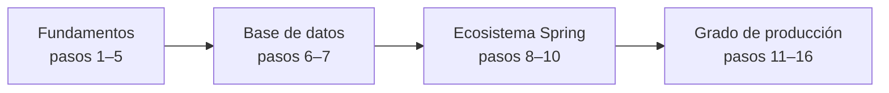
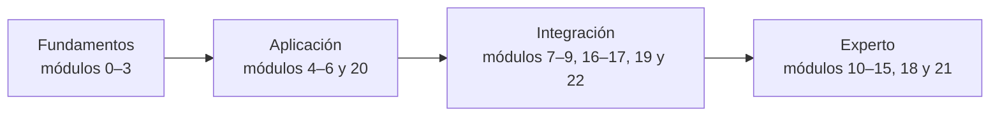

# Módulo 0: Sintaxis, tipos y el modelo de la JVM


## Antes de comenzar: instala Java correctamente

Necesitas un **JDK**, no solo “Java”. El JDK incluye el compilador `javac`, la JVM y herramientas de diagnóstico. Usaremos una versión LTS reciente (Java 25 o superior), Visual Studio Code con **Extension Pack for Java**, y Git.

| Sistema | Instalación | Nota importante |
|---|---|---|
| Windows | Instala Eclipse Temurin JDK y VS Code; marca la opción de configurar `JAVA_HOME` | Abre una terminal nueva después de instalar |
| macOS | `brew install --cask temurin` y `brew install git` | En Mac Apple Silicon usa el instalador ARM64 |
| Ubuntu/Debian | `sudo apt update && sudo apt install -y openjdk-25-jdk git` (Ubuntu 24.04 o posterior) | No instales únicamente `jre` |

Verifica con `java --version` y `javac --version`: ambas versiones deben coincidir. Crea una carpeta `hola-java`, abre allí VS Code y guarda:

```java
public class Hola {
    public static void main(String[] args) {
        System.out.println("Mi entorno Java funciona");
    }
}
```

Ejecuta `javac Hola.java` y luego `java Hola`. El primer comando produce `Hola.class`; el segundo lo ejecuta en la JVM. En Windows, si `javac` no se reconoce, revisa `JAVA_HOME` y que `%JAVA_HOME%\bin` esté en `Path`.

**Maven y Gradle (los necesitas desde el Módulo 8 y para `gradle init` del final de este módulo).** Instala Maven 3.9 o posterior y Gradle 9.1 o posterior, la primera versión de Gradle que funciona con Java 25. En macOS usa `brew install maven gradle`; en Windows y Ubuntu descarga los binarios de [maven.apache.org](https://maven.apache.org/download.cgi) y [gradle.org/install](https://gradle.org/install/), porque `apt` en Ubuntu 24.04 ofrece Maven 3.8.7 y Gradle 4.4.1, demasiado antiguos. Verifica con `mvn --version` y `gradle --version`: ambos deben mostrar Java 25.

## Ruta recomendada: recorrido del desarrollador Java en 16 pasos

Esta ruta ordena lo que un desarrollador Java aprende desde cero hasta llegar a producción. La idea central:
no hay atajos; cada paso hace más fácil el siguiente, así que no saltes a Kafka sin dominar los
fundamentos.



| Paso | Tema de la ruta | Etapa | Dónde lo aprendes en la academia |
|---|---|---|---|
| 01 | Fundamentos de Java | Fundamentos | [Del código fuente a la JVM](/curso/java/0#tema-1-del-codigo-fuente-a-la-jvm) |
| 02 | Conceptos de OOP | Fundamentos | [Clases, objetos, constructores y encapsulación](/curso/java/1#tema-1-clases-objetos-constructores-y-encapsulacion) |
| 03 | Marco de colecciones | Fundamentos | [List, Set, Map y sus implementaciones](/curso/java/2#tema-1-list-set-map-y-sus-implementaciones) |
| 04 | Manejo de excepciones | Fundamentos | [Excepciones personalizadas y no tragar excepciones](/curso/java/3#tema-3-excepciones-personalizadas-y-no-tragar-excepciones) |
| 05 | Multihilo | Fundamentos | [ExecutorService y gestión de hilos](/curso/java/5#tema-1-executorservice-y-gestion-de-hilos), [Virtual threads](/curso/java/5#tema-3-virtual-threads) y [Condiciones de carrera y sincronización](/curso/java/5#tema-4-condiciones-de-carrera-y-sincronizacion) |
| 06 | JDBC | Base de datos | [JDBC, PreparedStatement y DAO](/curso/java/17#tema-1-jdbc-preparedstatement-y-dao) |
| 07 | SQL | Base de datos | [SQL para definir, escribir, consultar y relacionar](/curso/foundations/4#tema-2-sql-para-definir-escribir-consultar-y-relacionar) |
| 08 | Spring Core | Ecosistema Spring | [Inversión de control y el contenedor de Spring](/curso/spring-boot/0#tema-1-inversion-de-control-y-el-contenedor-de-spring) |
| 09 | Spring Boot | Ecosistema Spring | [Estereotipos, autoconfiguración y scopes](/curso/spring-boot/0#tema-3-estereotipos-autoconfiguracion-y-scopes) |
| 10 | JPA / Hibernate | Ecosistema Spring | [Entidades y relaciones JPA](/curso/java/16#tema-1-entidades-y-relaciones-jpa) y [Persistencia con Spring Data JPA](/curso/spring-boot/4) |
| 11 | Microservicios | Grado de producción | [Curso Microservicios](/curso/microservices/0) y [Microservicios con Spring Cloud](/curso/spring-boot/16) |
| 12 | Kafka | Grado de producción | [Producers y consumers con Spring Kafka](/curso/spring-boot/10#tema-1-producers-y-consumers-con-spring-kafka) |
| 13 | Docker | Grado de producción | [Dockerfile multi-stage](/curso/devops/2#tema-1-dockerfile-multi-stage) |
| 14 | Kubernetes | Grado de producción | [Pod, ReplicaSet, Deployment](/curso/devops/6#tema-1-pod-replicaset-deployment) |
| 15 | AWS en la nube | Grado de producción | [Contenedores vs Lambda, y EKS](/curso/cloud/14#tema-3-contenedores-vs-lambda-y-eks) |
| 16 | Diseño de sistemas | Grado de producción | [Diseño de sistemas: de requisitos a estimación de capacidad y cuello de botella](/curso/foundations/10#tema-7-diseno-de-sistemas-de-requisitos-a-estimacion-de-capacidad-y-cuello-de-botella) |

## Mapa de la ruta

«Java: fundamentos y temas avanzados» tiene 23 módulos en 4 etapas. Cada etapa se apoya en la anterior; usa la tabla para saltar a un módulo concreto.



| Módulo | Etapa | Qué aprendes |
|---|---|---|
| 0 | Fundamentos | [Sintaxis, tipos y el modelo de la JVM](/curso/java/0) |
| 1 | Fundamentos | [Programación orientada a objetos, records y constructores flexibles](/curso/java/1) |
| 2 | Fundamentos | [Colecciones, igualdad, genéricos y colas](/curso/java/2) |
| 3 | Fundamentos | [Excepciones y manejo de recursos](/curso/java/3) |
| 4 | Aplicación | [Streams, programación funcional y Stream Gatherers](/curso/java/4) |
| 5 | Aplicación | [Concurrencia: hilos, virtual threads y structured concurrency](/curso/java/5) |
| 6 | Aplicación | [I/O, NIO.2 y serialización](/curso/java/6) |
| 7 | Integración | [Sealed classes, pattern matching y unnamed patterns](/curso/java/7) |
| 8 | Integración | [Build tools: Maven y Gradle](/curso/java/8) |
| 9 | Integración | [Testing con JUnit 6 (Jupiter) y Mockito](/curso/java/9) |
| 10 | Experto | [Módulos (JPMS) y proyectos grandes](/curso/java/10) |
| 11 | Experto | [JVM interna: GC, profiling, JIT y Foreign Function & Memory API](/curso/java/11) |
| 12 | Experto | [Buenas prácticas y patrones de diseño](/curso/java/12) |
| 13 | Experto | [Proyecto integrador](/curso/java/13) |
| 14 | Experto | [Java en producción: memoria, benchmarks y runtime seguro](/curso/java/14) |
| 15 | Experto | [Java Master: builds, testing y logging operacional](/curso/java/15) |
| 16 | Integración | [JPA, Hibernate, consultas y persistencia en producción](/curso/java/16) |
| 17 | Integración | [JDBC, DAO y transacciones](/curso/java/17) |
| 18 | Experto | [HTTP, seguridad y backend con Java](/curso/java/18) |
| 19 | Integración | [Java del día a día: reflexión, regex, dinero, contratos, plugins e i18n](/curso/java/19) |
| 20 | Aplicación | [Java funcional: interfaces que componen comportamiento](/curso/java/20) |
| 21 | Experto | [APIs públicas, compatibilidad y evolución](/curso/java/21) |
| 22 | Integración | [El objeto por dentro: copia, enums y tipos anidados](/curso/java/22) |

## Aprende construyendo


### Tema 1: Del código fuente a la JVM · Básico · 40 min

<details open>
<summary><strong>Capa 1 — Lectura</strong></summary>

#### ► DE QUÉ TRATA
Este tema te guía por del código fuente a la jvm con foco en comprensión antes de implementación.

#### ► LA IDEA EN UNA FRASE
**Entender del código fuente a la jvm te permite tomar mejores decisiones técnicas.**

#### ► POR QUÉ EXISTE ESTO
Resuelve un problema real de diseño o implementación y evita decisiones a ciegas.

#### ► LA ANALOGÍA
Piensa en del código fuente a la jvm como una herramienta de taller: útil cuando conoces su propósito y sus límites.
**Dónde se rompe la analogía:** en software, los efectos dependen del contexto, la escala y los trade-offs.

#### ► CÓMO FUNCIONA
1. Identifica el problema que del código fuente a la jvm resuelve.
2. Observa sus componentes y relaciones.
3. Aplica la opción más simple que funcione.
4. Verifica el resultado y los límites.

#### ► LO QUE PUEDE SALIR MAL
| Síntoma | Causa probable | Arreglo |
|---|---|---|
| Del código fuente a la JVM se aplica pero el resultado no mejora | Se usó sin medir el problema real | Mide antes y compara contra la alternativa simple |
| Aparece complejidad inesperada | Se adoptó la técnica sin comprender sus trade-offs | Vuelve a la sección de trade-offs y reduce el alcance |
| Falla en un caso límite | Se asumió un contexto que no se cumple | Prueba el caso límite y documenta cuándo NO usarlo |

#### ► TRADE-OFFS
| Opción | Cuándo usarla | Cuándo NO usarla |
|---|---|---|
| Usar Del código fuente a la JVM | Cuando el problema coincide con su propósito y el beneficio es observable | Cuando agrega complejidad sin resolver un problema real |
| Alternativa más simple | Cuando el contexto es pequeño, estable o fácil de razonar | Cuando ya demostró no escalar o no cumplir el requisito |
| Postergar la decisión | Cuando falta evidencia del problema | Cuando el costo de esperar es mayor que el costo de probar |

#### ► CUÁNDO NO USAR ESTO
No uses del código fuente a la jvm por defecto. Aplícalo cuando el problema lo justifique y puedas verificar el beneficio; si una alternativa más simple resuelve igual, prefiérela.

#### ► DE VUELTA A LA ANALOGÍA
Volviendo a la analogía: del código fuente a la jvm funciona como el modelo inicial, pero recuerda dónde se rompe: en producción importan la evidencia, la escala y el costo de equivocarte.

#### ► LO QUE DEBES RECORDAR
- Del código fuente a la JVM existe para resolver un problema específico.
- Mide antes de adoptar complejidad.
- Conoce el caso donde NO usarlo.
- Verifica con evidencia observable.

#### ► PREGUNTAS PARA PENSAR
1. ¿Qué problema concreto resuelve del código fuente a la jvm en tu contexto?
2. ¿Cómo sabrías que del código fuente a la jvm no está funcionando bien?
3. ¿Qué alternativa más simple considerarías antes de usar del código fuente a la jvm?

</details>

<details>
<summary><strong>Capa 2 — Construcción</strong></summary>

#### Código y verificación
```java
public final class Saludo {
    public static void main(String[] args) {
        System.out.println("Hola desde la JVM");
    }
}
```

```bash
javac -d out src/Saludo.java
java -cp out Saludo
```

```bash
javap -c -classpath out Saludo
```

```bash
java -cp out Saludo
java -cp src Saludo
```

```java
public final class Ayudante {
    void saludar() { System.out.println("ayudando"); }
}
```

```java
public final class Principal {
    public static void main(String[] args) {
        new Ayudante().saludar();
    }
}
```

</details>

### Tema 2: JDK, JRE y JVM · Básico · 30 min

<details open>
<summary><strong>Capa 1 — Lectura</strong></summary>

#### ► DE QUÉ TRATA
Este tema te guía por jdk, jre y jvm con foco en comprensión antes de implementación.

#### ► LA IDEA EN UNA FRASE
**Entender jdk, jre y jvm te permite tomar mejores decisiones técnicas.**

#### ► POR QUÉ EXISTE ESTO
Resuelve un problema real de diseño o implementación y evita decisiones a ciegas.

#### ► LA ANALOGÍA
Piensa en jdk, jre y jvm como una herramienta de taller: útil cuando conoces su propósito y sus límites.
**Dónde se rompe la analogía:** en software, los efectos dependen del contexto, la escala y los trade-offs.

#### ► CÓMO FUNCIONA
1. Identifica el problema que jdk, jre y jvm resuelve.
2. Observa sus componentes y relaciones.
3. Aplica la opción más simple que funcione.
4. Verifica el resultado y los límites.

#### ► LO QUE PUEDE SALIR MAL
| Síntoma | Causa probable | Arreglo |
|---|---|---|
| JDK, JRE y JVM se aplica pero el resultado no mejora | Se usó sin medir el problema real | Mide antes y compara contra la alternativa simple |
| Aparece complejidad inesperada | Se adoptó la técnica sin comprender sus trade-offs | Vuelve a la sección de trade-offs y reduce el alcance |
| Falla en un caso límite | Se asumió un contexto que no se cumple | Prueba el caso límite y documenta cuándo NO usarlo |

#### ► TRADE-OFFS
| Opción | Cuándo usarla | Cuándo NO usarla |
|---|---|---|
| Usar JDK, JRE y JVM | Cuando el problema coincide con su propósito y el beneficio es observable | Cuando agrega complejidad sin resolver un problema real |
| Alternativa más simple | Cuando el contexto es pequeño, estable o fácil de razonar | Cuando ya demostró no escalar o no cumplir el requisito |
| Postergar la decisión | Cuando falta evidencia del problema | Cuando el costo de esperar es mayor que el costo de probar |

#### ► CUÁNDO NO USAR ESTO
No uses jdk, jre y jvm por defecto. Aplícalo cuando el problema lo justifique y puedas verificar el beneficio; si una alternativa más simple resuelve igual, prefiérela.

#### ► DE VUELTA A LA ANALOGÍA
Volviendo a la analogía: jdk, jre y jvm funciona como el modelo inicial, pero recuerda dónde se rompe: en producción importan la evidencia, la escala y el costo de equivocarte.

#### ► LO QUE DEBES RECORDAR
- JDK, JRE y JVM existe para resolver un problema específico.
- Mide antes de adoptar complejidad.
- Conoce el caso donde NO usarlo.
- Verifica con evidencia observable.

#### ► PREGUNTAS PARA PENSAR
1. ¿Qué problema concreto resuelve jdk, jre y jvm en tu contexto?
2. ¿Cómo sabrías que jdk, jre y jvm no está funcionando bien?
3. ¿Qué alternativa más simple considerarías antes de usar jdk, jre y jvm?

</details>

<details>
<summary><strong>Capa 2 — Construcción</strong></summary>

#### Código y verificación
```bash
javac -d out src/Entorno.java
java -cp out Entorno
```

```bash
java --version
javac --version
```

```java
public class Entorno {
    public static void main(String[] args) {
        System.out.println(System.getProperty("java.vm.name"));
        System.out.println(System.getProperty("java.version"));
    }
}
```

```bash
javac -d out src/Entorno.java
java -cp out Entorno
```

```bash
javac -d out src/Entorno.java
java -cp out Entorno
```

</details>

### Tema 3: public static void main — qué significa cada palabra · Intermedio · 40 min

<details open>
<summary><strong>Capa 1 — Lectura</strong></summary>

#### ► DE QUÉ TRATA
Este tema te guía por public static void main — qué significa cada palabra con foco en comprensión antes de implementación.

#### ► LA IDEA EN UNA FRASE
**Entender public static void main — qué significa cada palabra te permite tomar mejores decisiones técnicas.**

#### ► POR QUÉ EXISTE ESTO
Resuelve un problema real de diseño o implementación y evita decisiones a ciegas.

#### ► LA ANALOGÍA
Piensa en public static void main — qué significa cada palabra como una herramienta de taller: útil cuando conoces su propósito y sus límites.
**Dónde se rompe la analogía:** en software, los efectos dependen del contexto, la escala y los trade-offs.

#### ► CÓMO FUNCIONA
1. Identifica el problema que public static void main — qué significa cada palabra resuelve.
2. Observa sus componentes y relaciones.
3. Aplica la opción más simple que funcione.
4. Verifica el resultado y los límites.

#### ► LO QUE PUEDE SALIR MAL
| Síntoma | Causa probable | Arreglo |
|---|---|---|
| public static void main — qué significa cada palabra se aplica pero el resultado no mejora | Se usó sin medir el problema real | Mide antes y compara contra la alternativa simple |
| Aparece complejidad inesperada | Se adoptó la técnica sin comprender sus trade-offs | Vuelve a la sección de trade-offs y reduce el alcance |
| Falla en un caso límite | Se asumió un contexto que no se cumple | Prueba el caso límite y documenta cuándo NO usarlo |

#### ► TRADE-OFFS
| Opción | Cuándo usarla | Cuándo NO usarla |
|---|---|---|
| Usar public static void main — qué significa cada palabra | Cuando el problema coincide con su propósito y el beneficio es observable | Cuando agrega complejidad sin resolver un problema real |
| Alternativa más simple | Cuando el contexto es pequeño, estable o fácil de razonar | Cuando ya demostró no escalar o no cumplir el requisito |
| Postergar la decisión | Cuando falta evidencia del problema | Cuando el costo de esperar es mayor que el costo de probar |

#### ► CUÁNDO NO USAR ESTO
No uses public static void main — qué significa cada palabra por defecto. Aplícalo cuando el problema lo justifique y puedas verificar el beneficio; si una alternativa más simple resuelve igual, prefiérela.

#### ► DE VUELTA A LA ANALOGÍA
Volviendo a la analogía: public static void main — qué significa cada palabra funciona como el modelo inicial, pero recuerda dónde se rompe: en producción importan la evidencia, la escala y el costo de equivocarte.

#### ► LO QUE DEBES RECORDAR
- public static void main — qué significa cada palabra existe para resolver un problema específico.
- Mide antes de adoptar complejidad.
- Conoce el caso donde NO usarlo.
- Verifica con evidencia observable.

#### ► PREGUNTAS PARA PENSAR
1. ¿Qué problema concreto resuelve public static void main — qué significa cada palabra en tu contexto?
2. ¿Cómo sabrías que public static void main — qué significa cada palabra no está funcionando bien?
3. ¿Qué alternativa más simple considerarías antes de usar public static void main — qué significa cada palabra?

</details>

<details>
<summary><strong>Capa 2 — Construcción</strong></summary>

#### Código y verificación
```java
public final class PuntoEntrada {
    public static void main(String[] args) {
        System.out.println("Motor de entregas listo");
        System.out.println("Argumentos recibidos: " + args.length);
    }
}
```

```bash
javac -d out src/PuntoEntrada.java
java -cp out PuntoEntrada
```

```java
public final class PuntoEntrada {
    public static void main(String[] args) {
        if (args.length < 2) {
            System.out.println("Uso: java PuntoEntrada <origen> <destino>");
            return;
        }

        String origen = args[0];
        String destino = args[1];
        System.out.printf("Ruta solicitada: %s -> %s%n", origen, destino);
    }
}
```

```bash
javac -d out src/PuntoEntrada.java
java -cp out PuntoEntrada Medellin Envigado
java -cp out PuntoEntrada Medellin
```

```java
void main() {
    System.out.println("Hola, Java 25");
}
```

```bash
java Hola25.java
```

</details>

### Tema 4: Tipos primitivos vs referencias · Intermedio · 40 min

<details open>
<summary><strong>Capa 1 — Lectura</strong></summary>

#### ► DE QUÉ TRATA
Este tema te guía por tipos primitivos vs referencias con foco en comprensión antes de implementación.

#### ► LA IDEA EN UNA FRASE
**Entender tipos primitivos vs referencias te permite tomar mejores decisiones técnicas.**

#### ► POR QUÉ EXISTE ESTO
1. Contexto El Subtema 4.3 mostró que == siempre da false entre dos String creados con new. Pero si alguien prueba == con dos literales de texto en vez de new String(...), puede obtener true por accidente y concluir —equivocadamente— que == sí sirve para comparar texto.

#### ► LA ANALOGÍA
Piensa en tipos primitivos vs referencias como una herramienta de taller: útil cuando conoces su propósito y sus límites.
**Dónde se rompe la analogía:** en software, los efectos dependen del contexto, la escala y los trade-offs.

#### ► CÓMO FUNCIONA
1. [ ] Distinguí un primitivo de una referencia y su valor por defecto (`null`).
2. [ ] Reproduje `NullPointerException` al usar una referencia sin objeto.
3. [ ] Comparé contenido con `equals` e identidad con `==` en objetos `new String(...)`.
4. [ ] Expliqué por qué dos literales de texto pueden dar `== true` sin que eso valide usar `==` para texto en general.

#### ► LO QUE PUEDE SALIR MAL
| Síntoma | Causa probable | Arreglo |
|---|---|---|
| Tipos primitivos vs referencias se aplica pero el resultado no mejora | Se usó sin medir el problema real | Mide antes y compara contra la alternativa simple |
| Aparece complejidad inesperada | Se adoptó la técnica sin comprender sus trade-offs | Vuelve a la sección de trade-offs y reduce el alcance |
| Falla en un caso límite | Se asumió un contexto que no se cumple | Prueba el caso límite y documenta cuándo NO usarlo |

#### ► TRADE-OFFS
| Opción | Cuándo usarla | Cuándo NO usarla |
|---|---|---|
| Usar Tipos primitivos vs referencias | Cuando el problema coincide con su propósito y el beneficio es observable | Cuando agrega complejidad sin resolver un problema real |
| Alternativa más simple | Cuando el contexto es pequeño, estable o fácil de razonar | Cuando ya demostró no escalar o no cumplir el requisito |
| Postergar la decisión | Cuando falta evidencia del problema | Cuando el costo de esperar es mayor que el costo de probar |

#### ► CUÁNDO NO USAR ESTO
No uses tipos primitivos vs referencias por defecto. Aplícalo cuando el problema lo justifique y puedas verificar el beneficio; si una alternativa más simple resuelve igual, prefiérela.

#### ► DE VUELTA A LA ANALOGÍA
Volviendo a la analogía: tipos primitivos vs referencias funciona como el modelo inicial, pero recuerda dónde se rompe: en producción importan la evidencia, la escala y el costo de equivocarte.

#### ► LO QUE DEBES RECORDAR
- [ ] Distinguí un primitivo de una referencia y su valor por defecto (`null`).
- [ ] Reproduje `NullPointerException` al usar una referencia sin objeto.
- [ ] Comparé contenido con `equals` e identidad con `==` en objetos `new String(...)`.
- [ ] Expliqué por qué dos literales de texto pueden dar `== true` sin que eso valide usar `==` para texto en general.

#### ► PREGUNTAS PARA PENSAR
1. ¿Qué problema concreto resuelve tipos primitivos vs referencias en tu contexto?
2. ¿Cómo sabrías que tipos primitivos vs referencias no está funcionando bien?
3. ¿Qué alternativa más simple considerarías antes de usar tipos primitivos vs referencias?

</details>

<details>
<summary><strong>Capa 2 — Construcción</strong></summary>

#### Código y verificación
```java
public class Tipos {
    public static void main(String[] args) {
        int entregas = 3;
        double distanciaKm = 12.5;
        System.out.println(entregas + " entregas, " + distanciaKm + " km");
    }
}
```

```bash
javac -d out src/Tipos.java
java -cp out Tipos
```

```java
public class Tipos {
    static class Envio {
        String guia;
        String destino;
    }

    public static void main(String[] args) {
        Envio envio = new Envio();
        envio.guia = "RT-8";
        envio.destino = "Cali";
        System.out.println(envio.guia + " -> " + envio.destino);
    }
}
```

```java
public class Tipos {
    public static void main(String[] args) {
        String a = new String("RT-8");
        String b = new String("RT-8");
        System.out.println(a.equals(b));
        System.out.println(a == b);
    }
}
```

```java
public class Tipos {
    public static void main(String[] args) {
        String literalA = "RT-8";
        String literalB = "RT-8";
        String nuevaA = new String("RT-8");
        System.out.println("literal == literal: " + (literalA == literalB));
        System.out.println("literal == new String: " + (literalA == nuevaA));
        System.out.println("new String().intern() == literal: " + (nuevaA.intern() == literalA));
    }
}
```

</details>

### Tema 5: Variables, conversiones y `String` · Intermedio · 35 min

<details open>
<summary><strong>Capa 1 — Lectura</strong></summary>

#### ► DE QUÉ TRATA
Este tema te guía por variables, conversiones y `string` con foco en comprensión antes de implementación.

#### ► LA IDEA EN UNA FRASE
**Entender variables, conversiones y `string` te permite tomar mejores decisiones técnicas.**

#### ► POR QUÉ EXISTE ESTO
Resuelve un problema real de diseño o implementación y evita decisiones a ciegas.

#### ► LA ANALOGÍA
Piensa en variables, conversiones y `string` como una herramienta de taller: útil cuando conoces su propósito y sus límites.
**Dónde se rompe la analogía:** en software, los efectos dependen del contexto, la escala y los trade-offs.

#### ► CÓMO FUNCIONA
1. Identifica el problema que variables, conversiones y `string` resuelve.
2. Observa sus componentes y relaciones.
3. Aplica la opción más simple que funcione.
4. Verifica el resultado y los límites.

#### ► LO QUE PUEDE SALIR MAL
| Síntoma | Causa probable | Arreglo |
|---|---|---|
| Variables, conversiones y `String` se aplica pero el resultado no mejora | Se usó sin medir el problema real | Mide antes y compara contra la alternativa simple |
| Aparece complejidad inesperada | Se adoptó la técnica sin comprender sus trade-offs | Vuelve a la sección de trade-offs y reduce el alcance |
| Falla en un caso límite | Se asumió un contexto que no se cumple | Prueba el caso límite y documenta cuándo NO usarlo |

#### ► TRADE-OFFS
| Opción | Cuándo usarla | Cuándo NO usarla |
|---|---|---|
| Usar Variables, conversiones y `String` | Cuando el problema coincide con su propósito y el beneficio es observable | Cuando agrega complejidad sin resolver un problema real |
| Alternativa más simple | Cuando el contexto es pequeño, estable o fácil de razonar | Cuando ya demostró no escalar o no cumplir el requisito |
| Postergar la decisión | Cuando falta evidencia del problema | Cuando el costo de esperar es mayor que el costo de probar |

#### ► CUÁNDO NO USAR ESTO
No uses variables, conversiones y `string` por defecto. Aplícalo cuando el problema lo justifique y puedas verificar el beneficio; si una alternativa más simple resuelve igual, prefiérela.

#### ► DE VUELTA A LA ANALOGÍA
Volviendo a la analogía: variables, conversiones y `string` funciona como el modelo inicial, pero recuerda dónde se rompe: en producción importan la evidencia, la escala y el costo de equivocarte.

#### ► LO QUE DEBES RECORDAR
- Variables, conversiones y `String` existe para resolver un problema específico.
- Mide antes de adoptar complejidad.
- Conoce el caso donde NO usarlo.
- Verifica con evidencia observable.

#### ► PREGUNTAS PARA PENSAR
1. ¿Qué problema concreto resuelve variables, conversiones y `string` en tu contexto?
2. ¿Cómo sabrías que variables, conversiones y `string` no está funcionando bien?
3. ¿Qué alternativa más simple considerarías antes de usar variables, conversiones y `string`?

</details>

<details>
<summary><strong>Capa 2 — Construcción</strong></summary>

#### Código y verificación
```bash
javac -d out src/LeerPeso.java
java -cp out LeerPeso 2.75
```

```java
public class Variables {
    public static void main(String[] args) {
        int paquetes = 2;
        paquetes = paquetes + 1;
        final String zona = "Norte";
        System.out.println(zona + ": " + paquetes);
    }
}
```

```java
public class Conversion {
    public static void main(String[] args) {
        double pesoKg = 2.75;
        int pesoEntero = (int) pesoKg;
        System.out.println(pesoKg);
        System.out.println(pesoEntero);
    }
}
```

```java
public class LeerPeso {
    public static void main(String[] args) {
        try {
            double peso = Double.parseDouble(args[0]);
            System.out.println("Peso: " + peso + " kg");
        } catch (NumberFormatException | ArrayIndexOutOfBoundsException error) {
            System.out.println("Uso: java LeerPeso <número>");
        }
    }
}
```

</details>

### Tema 6: Operadores, precedencia y control de flujo · Intermedio · 40 min

<details open>
<summary><strong>Capa 1 — Lectura</strong></summary>

#### ► DE QUÉ TRATA
Este tema te guía por operadores, precedencia y control de flujo con foco en comprensión antes de implementación.

#### ► LA IDEA EN UNA FRASE
**Entender operadores, precedencia y control de flujo te permite tomar mejores decisiones técnicas.**

#### ► POR QUÉ EXISTE ESTO
Resuelve un problema real de diseño o implementación y evita decisiones a ciegas.

#### ► LA ANALOGÍA
Piensa en operadores, precedencia y control de flujo como una herramienta de taller: útil cuando conoces su propósito y sus límites.
**Dónde se rompe la analogía:** en software, los efectos dependen del contexto, la escala y los trade-offs.

#### ► CÓMO FUNCIONA
1. Identifica el problema que operadores, precedencia y control de flujo resuelve.
2. Observa sus componentes y relaciones.
3. Aplica la opción más simple que funcione.
4. Verifica el resultado y los límites.

#### ► LO QUE PUEDE SALIR MAL
| Síntoma | Causa probable | Arreglo |
|---|---|---|
| Operadores, precedencia y control de flujo se aplica pero el resultado no mejora | Se usó sin medir el problema real | Mide antes y compara contra la alternativa simple |
| Aparece complejidad inesperada | Se adoptó la técnica sin comprender sus trade-offs | Vuelve a la sección de trade-offs y reduce el alcance |
| Falla en un caso límite | Se asumió un contexto que no se cumple | Prueba el caso límite y documenta cuándo NO usarlo |

#### ► TRADE-OFFS
| Opción | Cuándo usarla | Cuándo NO usarla |
|---|---|---|
| Usar Operadores, precedencia y control de flujo | Cuando el problema coincide con su propósito y el beneficio es observable | Cuando agrega complejidad sin resolver un problema real |
| Alternativa más simple | Cuando el contexto es pequeño, estable o fácil de razonar | Cuando ya demostró no escalar o no cumplir el requisito |
| Postergar la decisión | Cuando falta evidencia del problema | Cuando el costo de esperar es mayor que el costo de probar |

#### ► CUÁNDO NO USAR ESTO
No uses operadores, precedencia y control de flujo por defecto. Aplícalo cuando el problema lo justifique y puedas verificar el beneficio; si una alternativa más simple resuelve igual, prefiérela.

#### ► DE VUELTA A LA ANALOGÍA
Volviendo a la analogía: operadores, precedencia y control de flujo funciona como el modelo inicial, pero recuerda dónde se rompe: en producción importan la evidencia, la escala y el costo de equivocarte.

#### ► LO QUE DEBES RECORDAR
- Operadores, precedencia y control de flujo existe para resolver un problema específico.
- Mide antes de adoptar complejidad.
- Conoce el caso donde NO usarlo.
- Verifica con evidencia observable.

#### ► PREGUNTAS PARA PENSAR
1. ¿Qué problema concreto resuelve operadores, precedencia y control de flujo en tu contexto?
2. ¿Cómo sabrías que operadores, precedencia y control de flujo no está funcionando bien?
3. ¿Qué alternativa más simple considerarías antes de usar operadores, precedencia y control de flujo?

</details>

<details>
<summary><strong>Capa 2 — Construcción</strong></summary>

#### Código y verificación
```bash
javac -d out src/Condicion.java
java -cp out Condicion
```

```java
public class Condicion {
    static class Paquete {
        double pesoKg;
    }

    static boolean pesoValido(Paquete paquete) {
        return paquete != null && paquete.pesoKg > 0 && paquete.pesoKg <= 50;
    }

    public static void main(String[] args) {
        Paquete paquete = new Paquete();
        paquete.pesoKg = 12.5;
        System.out.println(pesoValido(null));
        System.out.println(pesoValido(paquete));
    }
}
```

```java
enum Estado { CREADO, EN_RUTA, ENTREGADO }

public class MensajeEstado {
    static String mensaje(Estado estado) {
        return switch (estado) {
            case CREADO -> "Guía registrada";
            case EN_RUTA -> "Conductor en recorrido";
            case ENTREGADO -> "Entrega confirmada";
        };
    }

    public static void main(String[] args) {
        System.out.println(mensaje(Estado.EN_RUTA));
    }
}
```

```java
public class Recorrido {
    public static void main(String[] args) {
        String[] guias = {"RT-1", "RT-2", "RT-3"};
        for (int i = 0; i < guias.length; i++) {
            System.out.println(i + ": " + guias[i]);
        }
    }
}
```

```java
public class Precedencia {
    static boolean sinParentesis(boolean esUrgente, boolean pesoExcedido, boolean clienteVip) {
        return esUrgente || pesoExcedido && clienteVip;
    }

    static boolean conParentesis(boolean esUrgente, boolean pesoExcedido, boolean clienteVip) {
        return (esUrgente || pesoExcedido) && clienteVip;
    }

    public static void main(String[] args) {
        System.out.println(sinParentesis(true, false, false));
        System.out.println(conParentesis(true, false, false));
    }
}
```

</details>

### Tema 7: Arreglos, wrappers y paso de argumentos · Intermedio · 35 min

<details open>
<summary><strong>Capa 1 — Lectura</strong></summary>

#### ► DE QUÉ TRATA
Este tema te guía por arreglos, wrappers y paso de argumentos con foco en comprensión antes de implementación.

#### ► LA IDEA EN UNA FRASE
**Entender arreglos, wrappers y paso de argumentos te permite tomar mejores decisiones técnicas.**

#### ► POR QUÉ EXISTE ESTO
Resuelve un problema real de diseño o implementación y evita decisiones a ciegas.

#### ► LA ANALOGÍA
Piensa en arreglos, wrappers y paso de argumentos como una herramienta de taller: útil cuando conoces su propósito y sus límites.
**Dónde se rompe la analogía:** en software, los efectos dependen del contexto, la escala y los trade-offs.

#### ► CÓMO FUNCIONA
1. Identifica el problema que arreglos, wrappers y paso de argumentos resuelve.
2. Observa sus componentes y relaciones.
3. Aplica la opción más simple que funcione.
4. Verifica el resultado y los límites.

#### ► LO QUE PUEDE SALIR MAL
| Síntoma | Causa probable | Arreglo |
|---|---|---|
| Arreglos, wrappers y paso de argumentos se aplica pero el resultado no mejora | Se usó sin medir el problema real | Mide antes y compara contra la alternativa simple |
| Aparece complejidad inesperada | Se adoptó la técnica sin comprender sus trade-offs | Vuelve a la sección de trade-offs y reduce el alcance |
| Falla en un caso límite | Se asumió un contexto que no se cumple | Prueba el caso límite y documenta cuándo NO usarlo |

#### ► TRADE-OFFS
| Opción | Cuándo usarla | Cuándo NO usarla |
|---|---|---|
| Usar Arreglos, wrappers y paso de argumentos | Cuando el problema coincide con su propósito y el beneficio es observable | Cuando agrega complejidad sin resolver un problema real |
| Alternativa más simple | Cuando el contexto es pequeño, estable o fácil de razonar | Cuando ya demostró no escalar o no cumplir el requisito |
| Postergar la decisión | Cuando falta evidencia del problema | Cuando el costo de esperar es mayor que el costo de probar |

#### ► CUÁNDO NO USAR ESTO
No uses arreglos, wrappers y paso de argumentos por defecto. Aplícalo cuando el problema lo justifique y puedas verificar el beneficio; si una alternativa más simple resuelve igual, prefiérela.

#### ► DE VUELTA A LA ANALOGÍA
Volviendo a la analogía: arreglos, wrappers y paso de argumentos funciona como el modelo inicial, pero recuerda dónde se rompe: en producción importan la evidencia, la escala y el costo de equivocarte.

#### ► LO QUE DEBES RECORDAR
- Arreglos, wrappers y paso de argumentos existe para resolver un problema específico.
- Mide antes de adoptar complejidad.
- Conoce el caso donde NO usarlo.
- Verifica con evidencia observable.

#### ► PREGUNTAS PARA PENSAR
1. ¿Qué problema concreto resuelve arreglos, wrappers y paso de argumentos en tu contexto?
2. ¿Cómo sabrías que arreglos, wrappers y paso de argumentos no está funcionando bien?
3. ¿Qué alternativa más simple considerarías antes de usar arreglos, wrappers y paso de argumentos?

</details>

<details>
<summary><strong>Capa 2 — Construcción</strong></summary>

#### Código y verificación
```java
public class Guias {
    public static void main(String[] args) {
        String[] guias = {"RT-1", "RT-2"};
        for (String guia : guias) System.out.println(guia);
        System.out.println("Total: " + guias.length);
    }
}
```

```java
public class Wrapper {
    public static void main(String[] args) {
        Integer cajas = Integer.valueOf(args[0]);
        int total = cajas + 1;
        System.out.println(total);
    }
}
```

```java
public class PasoValor {
    static void cambiar(StringBuilder texto) {
        texto.append(" listo");
        texto = new StringBuilder("otro");
    }

    public static void main(String[] args) {
        StringBuilder estado = new StringBuilder("pedido");
        cambiar(estado);
        System.out.println(estado);
    }
}
```

</details>

### Tema 8: Entrada, `java.time` y por qué evitar las APIs obsoletas (`Date`/`Calendar`) · Intermedio · 35 min

<details open>
<summary><strong>Capa 1 — Lectura</strong></summary>

#### ► DE QUÉ TRATA
Este tema te guía por entrada, `java.time` y por qué evitar las apis obsoletas (`date`/`calendar`) con foco en comprensión antes de implementación.

#### ► LA IDEA EN UNA FRASE
**Entender entrada, `java.time` y por qué evitar las apis obsoletas (`date`/`calendar`) te permite tomar mejores decisiones técnicas.**

#### ► POR QUÉ EXISTE ESTO
Resuelve un problema real de diseño o implementación y evita decisiones a ciegas.

#### ► LA ANALOGÍA
Piensa en entrada, `java.time` y por qué evitar las apis obsoletas (`date`/`calendar`) como una herramienta de taller: útil cuando conoces su propósito y sus límites.
**Dónde se rompe la analogía:** en software, los efectos dependen del contexto, la escala y los trade-offs.

#### ► CÓMO FUNCIONA
1. Identifica el problema que entrada, `java.time` y por qué evitar las apis obsoletas (`date`/`calendar`) resuelve.
2. Observa sus componentes y relaciones.
3. Aplica la opción más simple que funcione.
4. Verifica el resultado y los límites.

#### ► LO QUE PUEDE SALIR MAL
| Síntoma | Causa probable | Arreglo |
|---|---|---|
| Entrada, `java.time` y por qué evitar las APIs obsoletas (`Date`/`Calendar`) se aplica pero el resultado no mejora | Se usó sin medir el problema real | Mide antes y compara contra la alternativa simple |
| Aparece complejidad inesperada | Se adoptó la técnica sin comprender sus trade-offs | Vuelve a la sección de trade-offs y reduce el alcance |
| Falla en un caso límite | Se asumió un contexto que no se cumple | Prueba el caso límite y documenta cuándo NO usarlo |

#### ► TRADE-OFFS
| Opción | Cuándo usarla | Cuándo NO usarla |
|---|---|---|
| Usar Entrada, `java.time` y por qué evitar las APIs obsoletas (`Date`/`Calendar`) | Cuando el problema coincide con su propósito y el beneficio es observable | Cuando agrega complejidad sin resolver un problema real |
| Alternativa más simple | Cuando el contexto es pequeño, estable o fácil de razonar | Cuando ya demostró no escalar o no cumplir el requisito |
| Postergar la decisión | Cuando falta evidencia del problema | Cuando el costo de esperar es mayor que el costo de probar |

#### ► CUÁNDO NO USAR ESTO
No uses entrada, `java.time` y por qué evitar las apis obsoletas (`date`/`calendar`) por defecto. Aplícalo cuando el problema lo justifique y puedas verificar el beneficio; si una alternativa más simple resuelve igual, prefiérela.

#### ► DE VUELTA A LA ANALOGÍA
Volviendo a la analogía: entrada, `java.time` y por qué evitar las apis obsoletas (`date`/`calendar`) funciona como el modelo inicial, pero recuerda dónde se rompe: en producción importan la evidencia, la escala y el costo de equivocarte.

#### ► LO QUE DEBES RECORDAR
- Entrada, `java.time` y por qué evitar las APIs obsoletas (`Date`/`Calendar`) existe para resolver un problema específico.
- Mide antes de adoptar complejidad.
- Conoce el caso donde NO usarlo.
- Verifica con evidencia observable.

#### ► PREGUNTAS PARA PENSAR
1. ¿Qué problema concreto resuelve entrada, `java.time` y por qué evitar las apis obsoletas (`date`/`calendar`) en tu contexto?
2. ¿Cómo sabrías que entrada, `java.time` y por qué evitar las apis obsoletas (`date`/`calendar`) no está funcionando bien?
3. ¿Qué alternativa más simple considerarías antes de usar entrada, `java.time` y por qué evitar las apis obsoletas (`date`/`calendar`)?

</details>

<details>
<summary><strong>Capa 2 — Construcción</strong></summary>

#### Código y verificación
```bash
javac -d out src/FechaEntrega.java
java -cp out FechaEntrega 2026-11-03
```

```java
import java.util.Scanner;

public class Entrada {
    public static void main(String[] args) {
        try (Scanner entrada = new Scanner(System.in)) {
            System.out.print("Paquetes: ");
            if (!entrada.hasNextInt()) {
                System.out.println("Escribe un número entero");
                return;
            }
            System.out.println("Recibidos: " + entrada.nextInt());
        }
    }
}
```

```java
import java.time.LocalDate;

public class FechaEntrega {
    public static void main(String[] args) {
        LocalDate entrega = LocalDate.parse(args[0]);
        System.out.println(entrega.plusDays(1));
    }
}
```

```java
import java.time.Instant;
import java.time.ZoneId;
import java.time.ZonedDateTime;

public class Instantes {
    public static void main(String[] args) {
        Instant ahora = Instant.now();
        ZonedDateTime bogota = ahora.atZone(ZoneId.of("America/Bogota"));
        System.out.println(ahora);
        System.out.println(bogota);
    }
}
```

</details>

### Tema 9: Java 25 para programas pequeños: `IO`, archivos compactos e `import module` · Intermedio · 30 min

<details open>
<summary><strong>Capa 1 — Lectura</strong></summary>

#### ► DE QUÉ TRATA
Este tema te guía por java 25 para programas pequeños: `io`, archivos compactos e `import module` con foco en comprensión antes de implementación.

#### ► LA IDEA EN UNA FRASE
**Entender java 25 para programas pequeños: `io`, archivos compactos e `import module` te permite tomar mejores decisiones técnicas.**

#### ► POR QUÉ EXISTE ESTO
Resuelve un problema real de diseño o implementación y evita decisiones a ciegas.

#### ► LA ANALOGÍA
Piensa en java 25 para programas pequeños: `io`, archivos compactos e `import module` como una herramienta de taller: útil cuando conoces su propósito y sus límites.
**Dónde se rompe la analogía:** en software, los efectos dependen del contexto, la escala y los trade-offs.

#### ► CÓMO FUNCIONA
1. Identifica el problema que java 25 para programas pequeños: `io`, archivos compactos e `import module` resuelve.
2. Observa sus componentes y relaciones.
3. Aplica la opción más simple que funcione.
4. Verifica el resultado y los límites.

#### ► LO QUE PUEDE SALIR MAL
| Síntoma | Causa probable | Arreglo |
|---|---|---|
| Java 25 para programas pequeños: `IO`, archivos compactos e `import module` se aplica pero el resultado no mejora | Se usó sin medir el problema real | Mide antes y compara contra la alternativa simple |
| Aparece complejidad inesperada | Se adoptó la técnica sin comprender sus trade-offs | Vuelve a la sección de trade-offs y reduce el alcance |
| Falla en un caso límite | Se asumió un contexto que no se cumple | Prueba el caso límite y documenta cuándo NO usarlo |

#### ► TRADE-OFFS
| Opción | Cuándo usarla | Cuándo NO usarla |
|---|---|---|
| Usar Java 25 para programas pequeños: `IO`, archivos compactos e `import module` | Cuando el problema coincide con su propósito y el beneficio es observable | Cuando agrega complejidad sin resolver un problema real |
| Alternativa más simple | Cuando el contexto es pequeño, estable o fácil de razonar | Cuando ya demostró no escalar o no cumplir el requisito |
| Postergar la decisión | Cuando falta evidencia del problema | Cuando el costo de esperar es mayor que el costo de probar |

#### ► CUÁNDO NO USAR ESTO
No uses java 25 para programas pequeños: `io`, archivos compactos e `import module` por defecto. Aplícalo cuando el problema lo justifique y puedas verificar el beneficio; si una alternativa más simple resuelve igual, prefiérela.

#### ► DE VUELTA A LA ANALOGÍA
Volviendo a la analogía: java 25 para programas pequeños: `io`, archivos compactos e `import module` funciona como el modelo inicial, pero recuerda dónde se rompe: en producción importan la evidencia, la escala y el costo de equivocarte.

#### ► LO QUE DEBES RECORDAR
- Java 25 para programas pequeños: `IO`, archivos compactos e `import module` existe para resolver un problema específico.
- Mide antes de adoptar complejidad.
- Conoce el caso donde NO usarlo.
- Verifica con evidencia observable.

#### ► PREGUNTAS PARA PENSAR
1. ¿Qué problema concreto resuelve java 25 para programas pequeños: `io`, archivos compactos e `import module` en tu contexto?
2. ¿Cómo sabrías que java 25 para programas pequeños: `io`, archivos compactos e `import module` no está funcionando bien?
3. ¿Qué alternativa más simple considerarías antes de usar java 25 para programas pequeños: `io`, archivos compactos e `import module`?

</details>

<details>
<summary><strong>Capa 2 — Construcción</strong></summary>

#### Código y verificación
```java
void main() {
    String nombre = IO.readln("Conductor: ");
    IO.println("Hola, " + nombre + ". Hoy tienes " + List.of("RF-1", "RF-2").size() + " entregas.");
}
```

```bash
java Saludo.java
```

```java
import module java.base;

public class Modulos {
    public static void main(String[] args) {
        List<String> guias = new ArrayList<>(List.of("RF-2", "RF-1"));
        Collections.sort(guias);
        Map<String, LocalDate> entregas = new TreeMap<>();
        entregas.put(guias.get(0), LocalDate.of(2026, 11, 18));
        IO.println(guias + " " + entregas);
    }
}
```

```java
import module java.base;
import module java.desktop;

public class Ambiguo {
    public static void main(String[] args) {
        List<String> guias = List.of("RF-1");
        IO.println(guias);
    }
}
```

```text
error: reference to List is ambiguous
  both class java.awt.List in java.awt and interface java.util.List in java.util match
```

```java
void main() {
    double a = Double.parseDouble(IO.readln("Tramo 1 (km): "));
    double b = Double.parseDouble(IO.readln("Tramo 2 (km): "));
    IO.println("Total: %.1f km".formatted(a + b));
}
```

</details>
