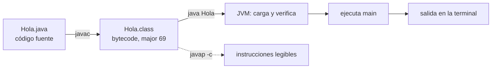
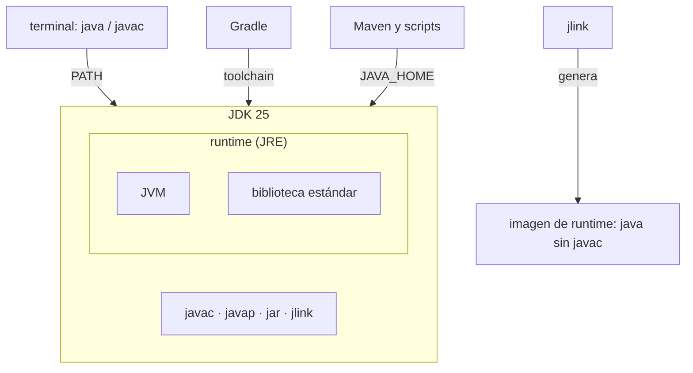
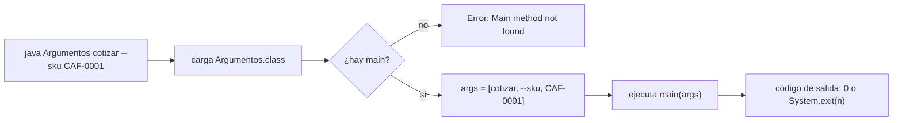
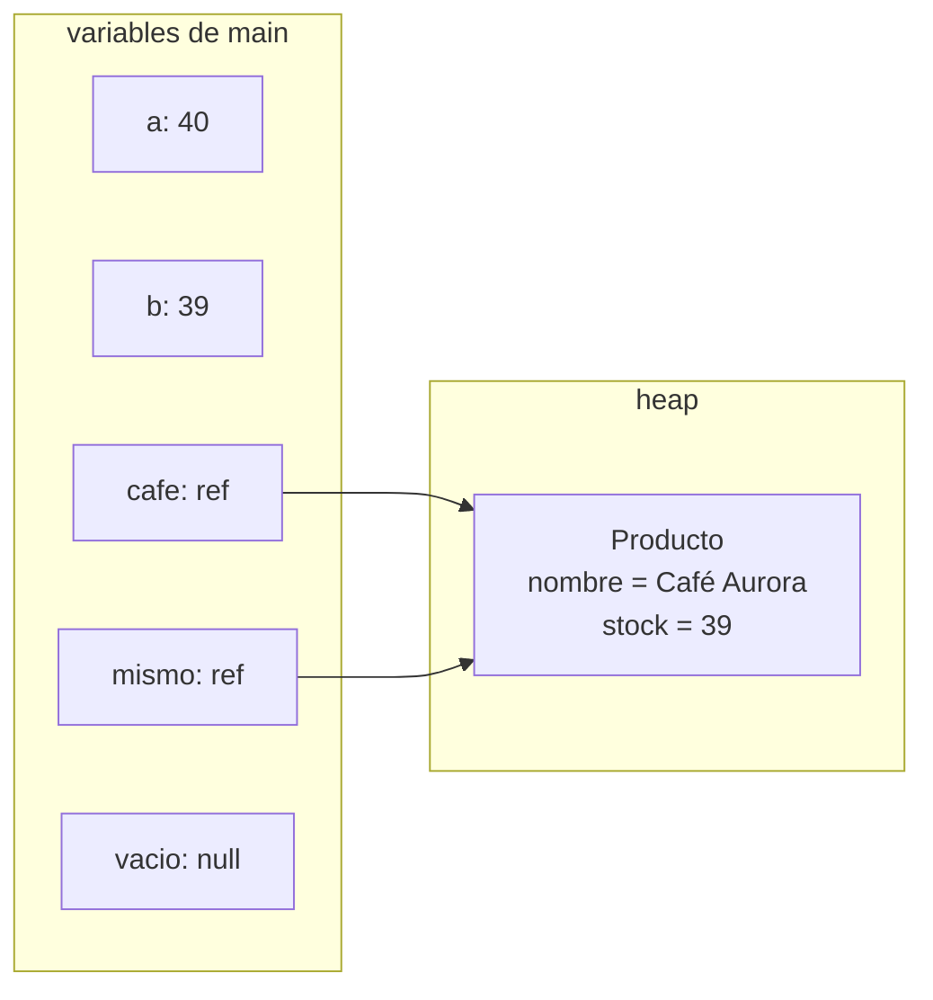
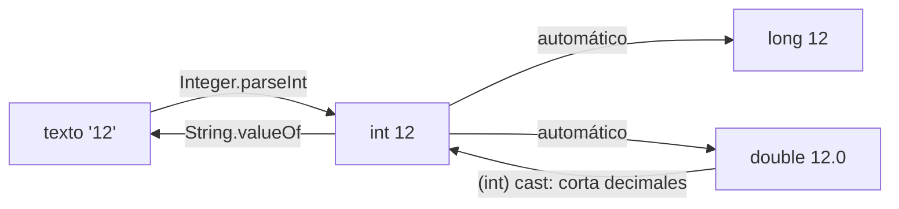
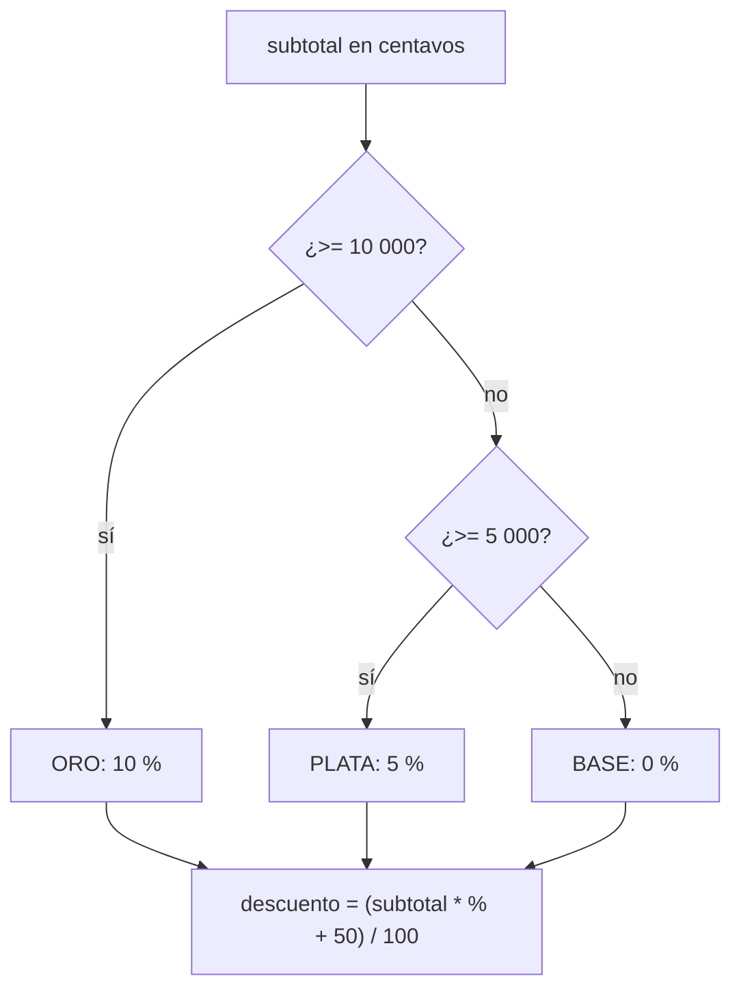
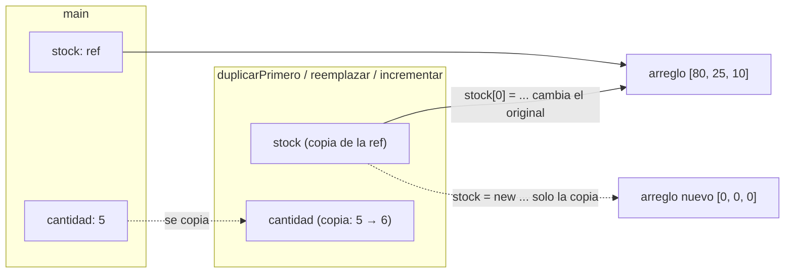
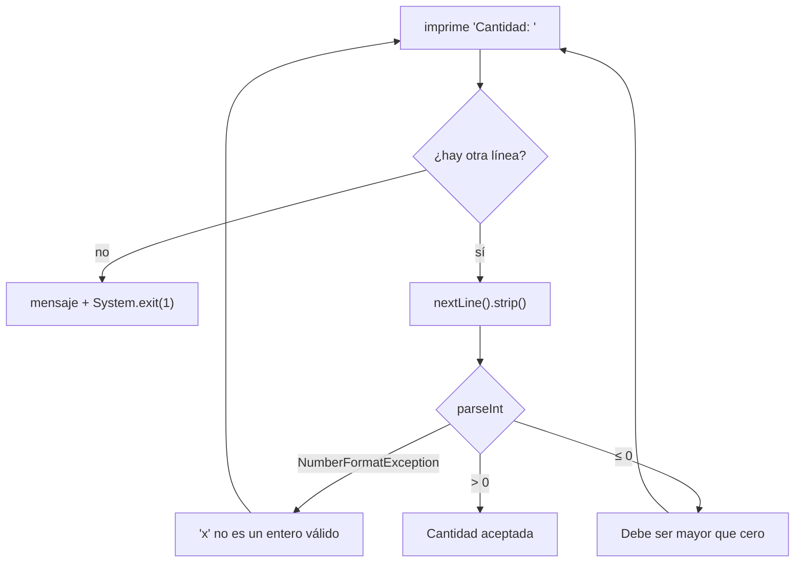
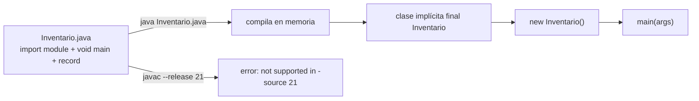

# Módulo 0: Sintaxis, tipos y el modelo de la JVM


## Visual del módulo

**Visual:** [De .java a ejecución en JVM: compilación a bytecode, carga, verificación y ejecución](/visuals/temas/java/modulo-0-jvm-pipeline.html)

Lectura: El bytecode es el puente portable entre el código fuente y la JVM.


Tienda Aurora arranca como una aplicación de consola que cotiza pedidos. No hay Spring todavía, no hay base de datos, no hay HTTP: solo Java. Esa restricción es deliberada. Antes de repartir responsabilidades entre frameworks conviene entender qué hace el lenguaje por sí mismo, porque los errores más caros de un sistema grande —un total que no cuadra por un céntimo, una fecha que se guarda un día antes, un `==` que compara direcciones en lugar de valores— nacen en estas primeras decisiones y se propagan sin ruido hasta producción.

La aplicación que construimos en este módulo se llama `tienda-aurora-fundamentos` y tiene cuatro comandos reales: `catalogo` lista los productos con su stock, `cotizar` arma un pedido y emite el recibo, `interactivo` atiende a un cliente por teclado y `diagnostico` ejecuta una batería de comprobaciones sobre supuestos del lenguaje que afectan al dinero y a las fechas. Cada tema de este capítulo añade una pieza a ese mismo proyecto; no hay ejemplos sueltos que se tiran después. Al terminar tendrás una aplicación que compila con Gradle, se ejecuta desde la terminal y produce exactamente la salida que verás aquí.

**Entorno de referencia verificado (2026-11-23):** JDK 27.0.1.0.2 (`javac 27.0.1.0.2`), Gradle 9.9.1, macOS arm64, toolchain Java 25; las compilaciones a mano usan `--release 25`. Las salidas etiquetadas como «salida real» son transcripciones literales de ejecuciones en ese entorno. Dos avisos: los comandos que lean reloj o midan tiempo muestran la hora o el resultado de esa corrida, y `./gradlew -q test` no imprime nada cuando pasa (el resumen se lee en `build/test-results/test/`).

**Entorno de las salidas nuevas (2026-11-24):** OpenJDK 25.0.5.1 (`javac 25.0.5.1`, paquete de Ubuntu 24.04, x86_64), con OpenJDK 21.0.13.1 instalado en la misma máquina para las comparaciones entre versiones. Los programas cortos de cada tema (`Hola.java`, `Primitivos.java`, `Fechas.java`, etc.) y sus salidas se capturaron ahí, en `~/labs/java-m0`; cada bloque muestra el comando con `$` y su salida literal. Los bloques que dicen «Mac de referencia» conservan las salidas del entorno anterior.

## Objetivos del módulo

Al terminar este módulo podrás:

- compilar con `javac`, ejecutar con `java` e inspeccionar el bytecode con `javap`;
- distinguir JDK, runtime y JVM, y diagnosticar versiones mezcladas en `PATH`, `JAVA_HOME` y el toolchain;
- explicar cada palabra de `public static void main(String[] args)` y usar argumentos y códigos de salida;
- elegir entre tipos primitivos y referencias, y representar dinero sin errores de redondeo;
- convertir tipos, normalizar `String` y compararlos con `equals`;
- escribir decisiones y bucles con `if`, `switch` exhaustivo, `while` y `for`;
- copiar y comparar arreglos, y usar wrappers sin caer en `==` ni en `null`;
- leer entrada validada con `Scanner`, calcular fechas con `java.time` y escribir scripts compactos de Java 25.

## Esquema del módulo

1. Del código fuente a la JVM
2. JDK, JRE y JVM
3. public static void main — qué significa cada palabra
4. Tipos primitivos vs referencias
5. Variables, conversiones y `String`
6. Operadores, precedencia y control de flujo
7. Arreglos, wrappers y paso de argumentos
8. Entrada, `java.time` y por qué evitar las APIs obsoletas (`Date`/`Calendar`)
9. Java 25 para programas pequeños: `IO`, archivos compactos e `import module`

Cada tema tiene una Capa 1 de lectura (glosario, ejemplos resueltos con salida real, checkpoint) y una Capa 2 de
construcción (pasos, resumen, ejercicios con respuesta y uso en el trabajo). El proyecto `tienda-aurora-fundamentos`,
completo en las secciones siguientes, es el caso guía: cada tema explica una parte de su código.

## Qué necesitas saber antes

Este módulo supone que terminaste el curso de Fundamentos (en Python): variables, condiciones, bucles, funciones,
excepciones y uso de la terminal. Todo lo específico de Java se explica aquí desde cero, comparándolo con Python
cuando ayuda. Si dudas con la terminal, repasa el Módulo 0 de Fundamentos («Cómo funciona tu entorno de desarrollo»).

## Proyecto desde cero: tienda-aurora-fundamentos

Antes de escribir la primera línea conviene decidir qué representa cada cosa. Tienda Aurora vende productos identificados por un SKU, con un precio y un stock. Un pedido agrupa líneas de producto, aplica una política comercial de descuentos por tramo y calcula IVA. El recibo se imprime en caja y promete una fecha de entrega en días laborables.

De ahí salen cinco decisiones que el código materializa:

- El dinero se guarda en centavos con un `long`, no con `double`. Un precio de 34,90 € son 3490 centavos; tres unidades son 10470 centavos y el total es exactamente 104,70 €.
- El SKU es un objeto de valor que normaliza y valida en el constructor. `" caf_0001 "` y `"CAF-0001"` producen la misma identidad.
- El catálogo encapsula un arreglo y entrega copias defensivas. Nadie de fuera puede alterar su estado interno.
- El carrito calcula subtotal, descuento, base imponible, IVA y total a partir de las líneas, sin guardar totales que puedan desincronizarse.
- Las fechas usan `java.time`. La entrega se calcula sumando días laborables, no días naturales.

El proyecto completo ocupa alrededor de ochocientas líneas, comentarios incluidos, y sin embargo toca todos los temas del módulo: compilación, tipos, cadenas, control de flujo, arreglos, entrada por teclado y fechas.

## Prerrequisitos de software

Necesitas un JDK 25 o superior y Gradle 9. El JDK incluye el compilador (`javac`) y la máquina virtual (`java`); Gradle orquesta el build.

```bash
java -version
javac -version
gradle --version
```

En el entorno de referencia, esas órdenes responden:

```text
openjdk version "27.0.1.0.2" 2026-10-21
OpenJDK Runtime Environment Temurin-27.0.1.0.2+1 (build 27.0.1.0.2+1)
OpenJDK 64-Bit Server VM Temurin-27.0.1.0.2+1 (build 27.0.1.0.2+1, mixed mode, sharing)
javac 27.0.1.0.2

------------------------------------------------------------
Gradle 9.9.1
------------------------------------------------------------
```

Si `javac` no existe pero `java` sí, tienes un runtime sin compilador: instala un JDK, no un JRE.

## Bootstrap

```bash
mkdir -p tienda-aurora-fundamentos/src/main/java/com/aurora/fundamentos/{catalogo,diagnostico,dominio,tiempo,venta}
mkdir -p tienda-aurora-fundamentos/scripts
cd tienda-aurora-fundamentos
gradle wrapper --gradle-version 9.9.1
```

El proyecto canónico usa Gradle wrapper. Más adelante, `scripts/Inventario.java` se ejecuta directamente con el lanzador de Java para mostrar compilación sin build tool.

## Estructura del proyecto

```text
tienda-aurora-fundamentos/
├── build.gradle.kts
├── settings.gradle.kts
├── scripts/
│   └── Inventario.java
└── src/
    └── main/
        └── java/
            └── com/aurora/fundamentos/
                ├── TiendaAuroraApp.java
                ├── catalogo/
                │   ├── Catalogo.java
                │   └── Sku.java
                ├── diagnostico/
                │   └── DiagnosticoTipos.java
                ├── dominio/
                │   ├── Dinero.java
                │   ├── LineaCarrito.java
                │   └── Producto.java
                ├── tiempo/
                │   └── CalendarioComercial.java
                └── venta/
                    ├── Carrito.java
                    ├── Pedido.java
                    └── Recibo.java
```

`src/main/java` es la raíz de fuentes que Gradle reconoce por convención. Los paquetes (`com.aurora.fundamentos.dominio`, etc.) se traducen a carpetas. `scripts/Inventario.java` queda fuera de esa raíz a propósito: es el archivo compacto del último tema y se ejecuta directamente con el lanzador de Java, sin pasar por Gradle. La versión verificada añade `src/test/java/com/aurora/fundamentos/FundamentosTest.java`, que se documenta completo en la sección `#### Test`.

## build.gradle.kts

```kotlin
plugins {
    java
    application
}

group = "com.aurora"
version = "1.0.0"

java {
    toolchain {
        languageVersion = JavaLanguageVersion.of(25)
    }
}

application {
    mainClass = "com.aurora.fundamentos.TiendaAuroraApp"
}

repositories {
    mavenCentral()
}

tasks.withType<JavaCompile>().configureEach {
    options.encoding = "UTF-8"
    options.compilerArgs.addAll(listOf("-Xlint:all", "-Werror"))
}

tasks.jar {
    manifest {
        attributes["Main-Class"] = application.mainClass.get()
    }
}

dependencies {
    testImplementation(platform("org.junit:junit-bom:5.13.4"))
    testImplementation("org.junit.jupiter:junit-jupiter")
    testRuntimeOnly("org.junit.platform:junit-platform-launcher")
}

tasks.test { useJUnitPlatform() }
```

El bloque `toolchain` fija Java 25 aunque tu `java` del sistema sea más nuevo. Gradle busca un JDK 25 instalado y, si no lo encuentra, lo descarga. Eso elimina la diferencia entre la máquina del estudiante y el CI. Los argumentos `-Xlint:all -Werror` convierten cualquier advertencia del compilador en un fallo del build: es incómodo al principio y evita clases de bugs enteras después. El plugin `application` genera el script de arranque y permite `gradle run`; el manifiesto del JAR permite ejecutar el artefacto con `java -jar`.

## settings.gradle.kts

```kotlin
rootProject.name = "tienda-aurora-fundamentos"
```

## Código completo

**Archivo:** `src/main/java/com/aurora/fundamentos/dominio/Dinero.java`

```java
package com.aurora.fundamentos.dominio;

import java.math.BigDecimal;
import java.util.Locale;

/**
 * Importe monetario inmutable.
 *
 * Se guarda como un long de centavos, nunca como double: así el total de un
 * pedido coincide siempre con la suma de sus líneas y no aparecen residuos
 * binarios como 104.69999999999999.
 */
public final class Dinero implements Comparable<Dinero> {

    public static final Dinero CERO = new Dinero(0L);

    private final long centavos;

    private Dinero(long centavos) {
        this.centavos = centavos;
    }

    /** Acepta texto decimal con punto, por ejemplo "12.50". */
    public static Dinero de(String texto) {
        BigDecimal valor = new BigDecimal(texto);
        return new Dinero(valor.movePointRight(2).longValueExact());
    }

    public static Dinero deCentavos(long centavos) {
        return new Dinero(centavos);
    }

    public Dinero mas(Dinero otro) {
        return new Dinero(Math.addExact(this.centavos, otro.centavos));
    }

    public Dinero menos(Dinero otro) {
        return new Dinero(Math.subtractExact(this.centavos, otro.centavos));
    }

    public Dinero negado() {
        return new Dinero(Math.negateExact(this.centavos));
    }

    public Dinero por(int cantidad) {
        if (cantidad < 0) {
            throw new IllegalArgumentException("cantidad negativa: " + cantidad);
        }
        return new Dinero(Math.multiplyExact(this.centavos, cantidad));
    }

    /** Porcentaje con redondeo half-up entero: no pasa por double. */
    public Dinero porcentaje(int porcentaje) {
        long bruto = Math.multiplyExact(this.centavos, porcentaje);
        return new Dinero(Math.floorDiv(bruto + 50, 100));
    }

    public boolean esCero() {
        return centavos == 0;
    }

    public long enCentavos() {
        return centavos;
    }

    public String formateado() {
        long absoluto = Math.abs(centavos);
        return String.format(Locale.ROOT, "%s%d.%02d",
                centavos < 0 ? "-" : "", absoluto / 100, absoluto % 100);
    }

    @Override
    public int compareTo(Dinero otro) {
        return Long.compare(this.centavos, otro.centavos);
    }

    @Override
    public boolean equals(Object otro) {
        return otro instanceof Dinero dinero && this.centavos == dinero.centavos;
    }

    @Override
    public int hashCode() {
        return Long.hashCode(centavos);
    }

    @Override
    public String toString() {
        long absoluto = Math.abs(centavos);
        return String.format(Locale.ROOT, "%s$%d.%02d",
                centavos < 0 ? "-" : "", absoluto / 100, absoluto % 100);
    }
}
```

**Archivo:** `src/main/java/com/aurora/fundamentos/catalogo/Sku.java`

```java
package com.aurora.fundamentos.catalogo;

import java.util.Locale;
import java.util.Objects;
import java.util.regex.Pattern;

/**
 * Código de producto de Tienda Aurora: tres letras, guion y cuatro dígitos.
 *
 * Normaliza la entrada del usuario (espacios, minúsculas) antes de validar,
 * de modo que " caf-0001 " y "CAF-0001" son el mismo producto.
 */
public final class Sku {

    private static final Pattern FORMATO = Pattern.compile("[A-Z]{3}-\\d{4}");

    private final String valor;

    private Sku(String valor) {
        this.valor = valor;
    }

    public static Sku de(String crudo) {
        Objects.requireNonNull(crudo, "sku");
        String limpio = crudo.strip()
                .toUpperCase(Locale.ROOT)
                .replace(" ", "")
                .replace("_", "-");
        if (!FORMATO.matcher(limpio).matches()) {
            throw new IllegalArgumentException("SKU inválido: '" + crudo + "' (formato AAA-0000)");
        }
        return new Sku(limpio);
    }

    public String valor() {
        return valor;
    }

    @Override
    public String toString() {
        return valor;
    }

    @Override
    public boolean equals(Object otro) {
        return otro instanceof Sku sku && valor.equals(sku.valor);
    }

    @Override
    public int hashCode() {
        return valor.hashCode();
    }
}
```

**Archivo:** `src/main/java/com/aurora/fundamentos/dominio/Producto.java`

```java
package com.aurora.fundamentos.dominio;

import com.aurora.fundamentos.catalogo.Sku;

import java.util.Locale;
import java.util.Objects;

/**
 * Producto del catálogo. La identidad (sku) y el precio son inmutables;
 * el stock cambia con cada venta, por eso es el único campo mutable.
 */
public final class Producto {

    private final Sku sku;
    private final String nombre;
    private final Dinero precio;
    private int stock;

    public Producto(Sku sku, String nombre, Dinero precio, int stock) {
        this.sku = Objects.requireNonNull(sku, "sku");
        Objects.requireNonNull(precio, "precio");
        if (nombre == null || nombre.isBlank()) {
            throw new IllegalArgumentException("nombre obligatorio");
        }
        if (precio.compareTo(Dinero.CERO) <= 0) {
            throw new IllegalArgumentException("precio debe ser mayor que cero");
        }
        if (stock < 0) {
            throw new IllegalArgumentException("stock no puede ser negativo");
        }
        this.nombre = nombre.strip();
        this.precio = precio;
        this.stock = stock;
    }

    public Sku sku() {
        return sku;
    }

    public String nombre() {
        return nombre;
    }

    public Dinero precio() {
        return precio;
    }

    public int stock() {
        return stock;
    }

    public boolean hayStock(int cantidad) {
        return cantidad > 0 && stock >= cantidad;
    }

    public void descontar(int cantidad) {
        if (!hayStock(cantidad)) {
            throw new IllegalStateException(
                    "stock insuficiente para " + sku + ": pedido " + cantidad + ", disponible " + stock);
        }
        stock -= cantidad;
    }

    @Override
    public String toString() {
        return String.format(Locale.ROOT, "%s %-16s %8s  stock=%3d", sku, nombre, precio, stock);
    }
}
```

**Archivo:** `src/main/java/com/aurora/fundamentos/dominio/LineaCarrito.java`

```java
package com.aurora.fundamentos.dominio;

/**
 * Una línea del carrito: un producto y una cantidad.
 * El subtotal se calcula, no se guarda: así nunca queda desincronizado.
 */
public final class LineaCarrito {

    private final Producto producto;
    private final int cantidad;

    public LineaCarrito(Producto producto, int cantidad) {
        if (producto == null) {
            throw new IllegalArgumentException("producto obligatorio");
        }
        if (cantidad <= 0) {
            throw new IllegalArgumentException("cantidad debe ser mayor que cero");
        }
        this.producto = producto;
        this.cantidad = cantidad;
    }

    public Producto producto() {
        return producto;
    }

    public int cantidad() {
        return cantidad;
    }

    public Dinero subtotal() {
        return producto.precio().por(cantidad);
    }
}
```

**Archivo:** `src/main/java/com/aurora/fundamentos/catalogo/Catalogo.java`

```java
package com.aurora.fundamentos.catalogo;

import com.aurora.fundamentos.dominio.Producto;

import java.util.Arrays;
import java.util.Objects;
import java.util.Optional;

/**
 * Catálogo inmutable respaldado por un arreglo.
 *
 * El constructor y el accesor copian el arreglo: quien recibe el catálogo no
 * puede modificar por accidente el estado interno del servicio.
 */
public final class Catalogo {

    private final Producto[] productos;

    public Catalogo(Producto[] productos) {
        Objects.requireNonNull(productos, "productos");
        this.productos = Arrays.copyOf(productos, productos.length);
    }

    public Producto[] productos() {
        return Arrays.copyOf(productos, productos.length);
    }

    public int tamano() {
        return productos.length;
    }

    /** Búsqueda lineal: adecuada para un catálogo pequeño en memoria. */
    public Optional<Producto> buscar(Sku sku) {
        for (Producto producto : productos) {
            if (producto.sku().equals(sku)) {
                return Optional.of(producto);
            }
        }
        return Optional.empty();
    }
}
```

**Archivo:** `src/main/java/com/aurora/fundamentos/venta/Carrito.java`

```java
package com.aurora.fundamentos.venta;

import com.aurora.fundamentos.dominio.Dinero;
import com.aurora.fundamentos.dominio.LineaCarrito;
import com.aurora.fundamentos.dominio.Producto;

import java.util.ArrayList;
import java.util.List;

/**
 * Carrito de la tienda. Aplica la política comercial de Tienda Aurora:
 *
 * <ul>
 *   <li>subtotal ≥ 50: 5 % de descuento</li>
 *   <li>subtotal ≥ 100: 10 % de descuento</li>
 *   <li>sobre la base con descuento se aplica un IVA del 21 %</li>
 * </ul>
 */
public final class Carrito {

    private static final Dinero UMBRAL_PLATA = Dinero.de("50.00");
    private static final Dinero UMBRAL_ORO = Dinero.de("100.00");

    private final List<LineaCarrito> lineas = new ArrayList<>();

    public void agregar(Producto producto, int cantidad) {
        if (!producto.hayStock(cantidad)) {
            throw new IllegalStateException("stock insuficiente para " + producto.sku());
        }
        lineas.add(new LineaCarrito(producto, cantidad));
    }

    public List<LineaCarrito> lineas() {
        return List.copyOf(lineas);
    }

    public int unidades() {
        int unidades = 0;
        for (LineaCarrito linea : lineas) {
            unidades += linea.cantidad();
        }
        return unidades;
    }

    public Dinero subtotal() {
        Dinero total = Dinero.CERO;
        for (LineaCarrito linea : lineas) {
            total = total.mas(linea.subtotal());
        }
        return total;
    }

    public Dinero descuento() {
        int porcentaje = switch (tramo(subtotal())) {
            case BASE -> 0;
            case PLATA -> 5;
            case ORO -> 10;
        };
        return subtotal().porcentaje(porcentaje);
    }

    public Dinero baseImponible() {
        return subtotal().menos(descuento());
    }

    public Dinero iva() {
        return baseImponible().porcentaje(21);
    }

    public Dinero total() {
        return baseImponible().mas(iva());
    }

    private Tramo tramo(Dinero importe) {
        if (importe.compareTo(UMBRAL_ORO) >= 0) {
            return Tramo.ORO;
        }
        if (importe.compareTo(UMBRAL_PLATA) >= 0) {
            return Tramo.PLATA;
        }
        return Tramo.BASE;
    }

    private enum Tramo {
        BASE, PLATA, ORO
    }
}
```

**Archivo:** `src/main/java/com/aurora/fundamentos/venta/Pedido.java`

```java
package com.aurora.fundamentos.venta;

import java.time.LocalDateTime;
import java.time.ZoneOffset;
import java.util.Objects;

/**
 * Pedido creado en una fecha concreta. Guarda la hora local de la tienda
 * y expone el instante UTC para integraciones (pagos, logística).
 */
public final class Pedido {

    private final String numero;
    private final LocalDateTime creadoEn;
    private final Carrito carrito;

    public Pedido(String numero, LocalDateTime creadoEn, Carrito carrito) {
        if (numero == null || numero.isBlank()) {
            throw new IllegalArgumentException("número de pedido obligatorio");
        }
        this.numero = numero;
        this.creadoEn = Objects.requireNonNull(creadoEn, "creadoEn");
        this.carrito = Objects.requireNonNull(carrito, "carrito");
    }

    public String numero() {
        return numero;
    }

    public LocalDateTime creadoEn() {
        return creadoEn;
    }

    public Carrito carrito() {
        return carrito;
    }

    public long timestampUtc() {
        return creadoEn.toInstant(ZoneOffset.UTC).toEpochMilli();
    }
}
```

**Archivo:** `src/main/java/com/aurora/fundamentos/tiempo/CalendarioComercial.java`

```java
package com.aurora.fundamentos.tiempo;

import java.time.DayOfWeek;
import java.time.LocalDate;
import java.time.format.DateTimeFormatter;
import java.util.Locale;

/**
 * Calendario comercial de Tienda Aurora: cuenta días laborables de lunes a
 * viernes y formatea fechas de forma estable, independiente del locale.
 */
public final class CalendarioComercial {

    private static final DateTimeFormatter FECHA =
            DateTimeFormatter.ofPattern("dd/MM/yyyy", Locale.ROOT);

    private CalendarioComercial() {
    }

    public static boolean esLaborable(LocalDate fecha) {
        DayOfWeek dia = fecha.getDayOfWeek();
        return dia != DayOfWeek.SATURDAY && dia != DayOfWeek.SUNDAY;
    }

    public static LocalDate sumarDiasLaborables(LocalDate desde, int dias) {
        if (dias < 0) {
            throw new IllegalArgumentException("días negativos: " + dias);
        }
        LocalDate fecha = desde;
        int restantes = dias;
        while (restantes > 0) {
            fecha = fecha.plusDays(1);
            if (esLaborable(fecha)) {
                restantes--;
            }
        }
        return fecha;
    }

    public static String formatear(LocalDate fecha) {
        return fecha.format(FECHA);
    }
}
```

**Archivo:** `src/main/java/com/aurora/fundamentos/venta/Recibo.java`

```java
package com.aurora.fundamentos.venta;

import com.aurora.fundamentos.dominio.Dinero;
import com.aurora.fundamentos.dominio.LineaCarrito;
import com.aurora.fundamentos.tiempo.CalendarioComercial;

import java.time.format.DateTimeFormatter;
import java.util.Locale;

/**
 * Genera el texto del recibo que se imprime en caja.
 *
 * Usa StringBuilder porque concatena decenas de fragmentos en un bucle; con
 * el operador + cada vuelta crearía un String nuevo.
 */
public final class Recibo {

    private static final DateTimeFormatter FECHA_HORA =
            DateTimeFormatter.ofPattern("dd/MM/yyyy HH:mm", Locale.ROOT);
    private static final String LINEA = "==========================================\n";

    public String generar(Pedido pedido) {
        Carrito carrito = pedido.carrito();
        StringBuilder texto = new StringBuilder(512);

        texto.append(LINEA);
        texto.append(" TIENDA AURORA - RECIBO ").append(pedido.numero()).append('\n');
        texto.append(" Fecha: ").append(pedido.creadoEn().format(FECHA_HORA)).append('\n');
        texto.append(LINEA);

        for (LineaCarrito linea : carrito.lineas()) {
            texto.append(String.format(Locale.ROOT, " %-7s %-14s %5d x %8s = %9s%n",
                    linea.producto().sku(),
                    linea.producto().nombre(),
                    linea.cantidad(),
                    linea.producto().precio(),
                    linea.subtotal()));
        }

        texto.append("------------------------------------------\n");
        alinear(texto, "Subtotal", carrito.subtotal());
        alinear(texto, "Descuento", carrito.descuento().negado());
        alinear(texto, "Base imponible", carrito.baseImponible());
        alinear(texto, "IVA 21%", carrito.iva());
        alinear(texto, "TOTAL", carrito.total());
        texto.append("------------------------------------------\n");
        texto.append(" Entrega estimada: ")
                .append(CalendarioComercial.formatear(
                        CalendarioComercial.sumarDiasLaborables(pedido.creadoEn().toLocalDate(), 3)))
                .append('\n');
        texto.append(LINEA);

        return texto.toString();
    }

    private void alinear(StringBuilder texto, String etiqueta, Dinero importe) {
        texto.append(String.format(Locale.ROOT, " %-18s %20s%n", etiqueta, importe));
    }
}
```

**Archivo:** `src/main/java/com/aurora/fundamentos/diagnostico/DiagnosticoTipos.java`

```java
package com.aurora.fundamentos.diagnostico;

import com.aurora.fundamentos.catalogo.Catalogo;
import com.aurora.fundamentos.catalogo.Sku;
import com.aurora.fundamentos.dominio.Dinero;
import com.aurora.fundamentos.dominio.Producto;

import java.util.Calendar;
import java.util.Date;
import java.util.Locale;
import java.util.Objects;

/**
 * Comprobaciones que Tienda Aurora ejecuta en CI para documentar supuestos
 * del lenguaje que afectan al dinero, a las comparaciones y a las fechas.
 *
 * Se invoca con `./gradlew -q run --args="diagnostico"`.
 */
public final class DiagnosticoTipos {

    public void ejecutar() {
        seccion("1. double frente a Dinero");
        doubleFrenteADinero();

        seccion("2. Desbordamiento de primitivos");
        desbordamiento();

        seccion("3. == frente a equals en objetos");
        igualdadDeReferencias();

        seccion("4. Caché de Integer y comparación de wrappers");
        cacheDeWrappers();

        seccion("5. Copia defensiva de arreglos");
        copiaDefensiva();

        seccion("6. Date y Calendar heredados");
        fechasHeredadas();
    }

    private void doubleFrenteADinero() {
        double precio = 34.90;
        int unidades = 3;
        double totalDouble = precio * unidades;
        Dinero totalDinero = Dinero.de("34.90").por(unidades);

        System.out.printf(Locale.ROOT, "  double : %.17f%n", totalDouble);
        System.out.println("  Dinero : " + totalDinero + " (" + totalDinero.enCentavos() + " centavos)");
        System.out.println("  totalDouble == 104.70 -> " + (totalDouble == 104.70));
        System.out.println("  totalDinero.equals(Dinero.de(\"104.70\")) -> "
                + totalDinero.equals(Dinero.de("104.70")));
    }

    private void desbordamiento() {
        int unidades = 1_000_000;
        int centavosUnitarios = 3_490;
        int totalInt = unidades * centavosUnitarios;
        long totalLong = (long) unidades * centavosUnitarios;

        System.out.println("  int  -> " + totalInt);
        System.out.println("  long -> " + totalLong);
        try {
            Dinero.deCentavos(Long.MAX_VALUE).por(2);
        } catch (ArithmeticException e) {
            System.out.println("  Dinero falla rápido -> " + e.getMessage());
        }
    }

    private void igualdadDeReferencias() {
        Dinero a = Dinero.de("10.00");
        Dinero b = Dinero.de("10.00");
        System.out.println("  a == b      -> " + (a == b));
        System.out.println("  a.equals(b) -> " + a.equals(b));

        String s1 = new String("CAF-0001");
        String s2 = new String("CAF-0001");
        System.out.println("  s1 == s2      -> " + (s1 == s2));
        System.out.println("  s1.equals(s2) -> " + s1.equals(s2));
    }

    private void cacheDeWrappers() {
        Integer pequeno1 = 127;
        Integer pequeno2 = 127;
        Integer grande1 = 128;
        Integer grande2 = 128;
        System.out.println("  127 == 127 -> " + (pequeno1 == pequeno2));
        System.out.println("  128 == 128 -> " + (grande1 == grande2));
        System.out.println("  Objects.equals(128, 128) -> " + Objects.equals(grande1, grande2));
    }

    private void copiaDefensiva() {
        Producto[] original = {
                new Producto(Sku.de("CAF-0001"), "Café Aurora", Dinero.de("12.50"), 40)
        };
        Catalogo catalogo = new Catalogo(original);

        original[0] = null;

        System.out.println("  catálogo sigue con " + catalogo.tamano() + " producto(s)");
        System.out.println("  primer SKU -> " + catalogo.productos()[0].sku());
        System.out.println("  arreglo original mutado -> " + (original[0] == null));
    }

    @SuppressWarnings("deprecation")
    private void fechasHeredadas() {
        System.out.println("  Calendar.JANUARY -> " + Calendar.JANUARY);

        Date fecha = new Date(0L);
        fecha.setTime(86_400_000L);
        System.out.println("  Date mutable -> " + fecha.getTime());
        System.out.println("  Date.getMonth() (0 = enero) -> " + fecha.getMonth());
    }

    private void seccion(String titulo) {
        System.out.println();
        System.out.println(titulo);
    }
}
```

**Archivo:** `src/main/java/com/aurora/fundamentos/TiendaAuroraApp.java`

```java
package com.aurora.fundamentos;

import com.aurora.fundamentos.catalogo.Catalogo;
import com.aurora.fundamentos.catalogo.Sku;
import com.aurora.fundamentos.diagnostico.DiagnosticoTipos;
import com.aurora.fundamentos.dominio.Dinero;
import com.aurora.fundamentos.dominio.Producto;
import com.aurora.fundamentos.venta.Carrito;
import com.aurora.fundamentos.venta.Pedido;
import com.aurora.fundamentos.venta.Recibo;

import java.time.LocalDateTime;
import java.time.ZoneId;
import java.util.Locale;
import java.util.Scanner;

/**
 * Punto de entrada de la aplicación de consola de Tienda Aurora.
 *
 * <pre>
 * ./gradlew -q run --args="catalogo"
 * ./gradlew -q run --args="cotizar --sku CAF-0001 --cantidad 3"
 * </pre>
 */
public final class TiendaAuroraApp {

    private static final ZoneId ZONA_TIENDA = ZoneId.of("Europe/Madrid");

    public static void main(String[] args) {
        Locale.setDefault(Locale.ROOT);
        if (args.length == 0) {
            imprimirAyuda();
            return;
        }

        String comando = args[0];
        switch (comando) {
            case "catalogo" -> imprimirCatalogo(construirCatalogo());
            case "cotizar" -> cotizar(args);
            case "interactivo" -> interactivo();
            case "diagnostico" -> new DiagnosticoTipos().ejecutar();
            default -> {
                System.err.println("Comando desconocido: " + comando);
                imprimirAyuda();
                System.exit(2);
            }
        }
    }

    private static void imprimirAyuda() {
        System.out.println("""
                Tienda Aurora - fundamentos de Java

                Uso:
                  catalogo
                  cotizar --sku CAF-0001 [--cantidad 2] [--fecha 2026-11-22T10:30]
                  interactivo
                  diagnostico
                """);
    }

    private static void imprimirCatalogo(Catalogo catalogo) {
        System.out.println("Catálogo Tienda Aurora (" + catalogo.tamano() + " productos)");
        for (Producto producto : catalogo.productos()) {
            System.out.println("  " + producto);
        }
    }

    private static void cotizar(String[] args) {
        String skuCrudo = valorDe(args, "--sku");
        if (skuCrudo == null || skuCrudo.isBlank()) {
            System.err.println("Falta --sku");
            System.exit(2);
            return;
        }

        int cantidad = enteroPositivo(valorDe(args, "--cantidad", "1"));
        String fechaIso = valorDe(args, "--fecha");

        Catalogo catalogo = construirCatalogo();
        Sku sku = Sku.de(skuCrudo);
        Producto producto = catalogo.buscar(sku)
                .orElseThrow(() -> new IllegalArgumentException("SKU no existe: " + sku));

        Carrito carrito = new Carrito();
        carrito.agregar(producto, cantidad);

        LocalDateTime creadoEn = fechaIso == null
                ? LocalDateTime.now(ZONA_TIENDA)
                : LocalDateTime.parse(fechaIso);
        Pedido pedido = new Pedido("AUR-2026-0001", creadoEn, carrito);

        System.out.print(new Recibo().generar(pedido));
        System.out.println(" timestampUtc=" + pedido.timestampUtc());
    }

    private static void interactivo() {
        Catalogo catalogo = construirCatalogo();
        Carrito carrito = new Carrito();

        try (Scanner scanner = new Scanner(System.in)) {
            while (true) {
                System.out.print("SKU (fin para terminar): ");
                if (!scanner.hasNextLine()) {
                    break;
                }
                String entrada = scanner.nextLine().strip();
                if (entrada.equalsIgnoreCase("fin")) {
                    break;
                }

                Producto producto;
                try {
                    producto = catalogo.buscar(Sku.de(entrada)).orElse(null);
                } catch (IllegalArgumentException e) {
                    System.out.println("  " + e.getMessage());
                    continue;
                }
                if (producto == null) {
                    System.out.println("  No existe el SKU " + entrada);
                    continue;
                }

                int cantidad = leerEntero(scanner, "Cantidad: ");
                if (!producto.hayStock(cantidad)) {
                    System.out.println("  Solo quedan " + producto.stock() + " unidades");
                    continue;
                }
                carrito.agregar(producto, cantidad);
                System.out.println("  Agregado: " + producto.nombre() + " x" + cantidad);
            }
        }

        if (carrito.lineas().isEmpty()) {
            System.out.println("Carrito vacío");
            return;
        }
        Pedido pedido = new Pedido("AUR-2026-0001", LocalDateTime.now(ZONA_TIENDA), carrito);
        System.out.print(new Recibo().generar(pedido));
    }

    private static int leerEntero(Scanner scanner, String mensaje) {
        while (true) {
            System.out.print(mensaje);
            String linea = scanner.nextLine().strip();
            try {
                int valor = Integer.parseInt(linea);
                if (valor <= 0) {
                    System.out.println("  Debe ser mayor que cero");
                    continue;
                }
                return valor;
            } catch (NumberFormatException e) {
                System.out.println("  '" + linea + "' no es un entero válido");
            }
        }
    }

    private static int enteroPositivo(String texto) {
        try {
            int valor = Integer.parseInt(texto);
            if (valor <= 0) {
                throw new IllegalArgumentException("cantidad debe ser mayor que cero: " + texto);
            }
            return valor;
        } catch (NumberFormatException e) {
            throw new IllegalArgumentException("cantidad no numérica: " + texto, e);
        }
    }

    private static String valorDe(String[] args, String nombre) {
        return valorDe(args, nombre, null);
    }

    private static String valorDe(String[] args, String nombre, String porDefecto) {
        for (int i = 1; i < args.length - 1; i++) {
            if (args[i].equals(nombre)) {
                return args[i + 1];
            }
        }
        return porDefecto;
    }

    static Catalogo construirCatalogo() {
        return new Catalogo(new Producto[] {
                new Producto(Sku.de("caf-0001"), "Café Aurora", Dinero.de("12.50"), 40),
                new Producto(Sku.de("taz-0002"), "Taza Aurora", Dinero.de("8.00"), 25),
                new Producto(Sku.de("mol-0003"), "Molino manual", Dinero.de("34.90"), 10),
                new Producto(Sku.de("fil-0004"), "Filtros x100", Dinero.de("4.75"), 120)
        });
    }
}
```

**Archivo:** `scripts/Inventario.java`

```java
import module java.base;

void main(String[] args) {
    var productos = List.of(
            new Producto("CAF-0001", "Café Aurora", 1250, 40),
            new Producto("TAZ-0002", "Taza Aurora", 800, 25),
            new Producto("MOL-0003", "Molino manual", 3490, 10));

    long valorCentavos = 0;
    for (Producto producto : productos) {
        valorCentavos += producto.centavos() * producto.stock();
    }

    IO.println("Productos en inventario: " + productos.size());
    for (Producto producto : productos) {
        IO.println("  " + producto.sku() + " " + producto.nombre()
                + " -> " + producto.stock() + " unidades");
    }
    IO.println("Valor total: "
            + (valorCentavos / 100) + "." + String.format("%02d", valorCentavos % 100));
}

record Producto(String sku, String nombre, long centavos, int stock) {
}
```

#### Test

**Archivo:** `src/test/java/com/aurora/fundamentos/FundamentosTest.java` (ruta real en `~/labs/aurora-m0`). Dependencias JUnit 5 en `build.gradle.kts` (`junit-bom:5.13.4`, `junit-jupiter` y `junit-platform-launcher`) y `tasks.test { useJUnitPlatform() }`. Siete casos sobre el dominio real del módulo.

```java
package com.aurora.fundamentos;

import com.aurora.fundamentos.catalogo.Catalogo;
import com.aurora.fundamentos.catalogo.Sku;
import com.aurora.fundamentos.dominio.Dinero;
import com.aurora.fundamentos.dominio.LineaCarrito;
import com.aurora.fundamentos.dominio.Producto;
import com.aurora.fundamentos.tiempo.CalendarioComercial;
import com.aurora.fundamentos.venta.Carrito;
import com.aurora.fundamentos.venta.Pedido;
import com.aurora.fundamentos.venta.Recibo;
import org.junit.jupiter.api.Test;

import java.time.LocalDate;
import java.time.LocalDateTime;

import static org.junit.jupiter.api.Assertions.assertAll;
import static org.junit.jupiter.api.Assertions.assertEquals;
import static org.junit.jupiter.api.Assertions.assertFalse;
import static org.junit.jupiter.api.Assertions.assertThrows;
import static org.junit.jupiter.api.Assertions.assertTrue;

class FundamentosTest {

    @Test
    void dineroEsExactoYSeFormateaSinDouble() {
        Dinero total = Dinero.de("34.90").por(3);
        assertAll(
                () -> assertEquals(10470L, total.enCentavos()),
                () -> assertEquals(Dinero.de("104.70"), total),
                () -> assertEquals("104.70", total.formateado()),
                () -> assertEquals("$104.70", total.toString()),
                () -> assertEquals(Dinero.de("104.70"), Dinero.de("100.00").mas(Dinero.de("4.70"))),
                () -> assertThrows(ArithmeticException.class,
                        () -> Dinero.deCentavos(Long.MAX_VALUE).por(2))
        );
    }

    @Test
    void skuNormalizaYSeComparaPorValor() {
        Sku sucio = Sku.de(" caf_0001 ");
        Sku limpio = Sku.de("CAF-0001");
        assertAll(
                () -> assertEquals("CAF-0001", sucio.valor()),
                () -> assertEquals(limpio, sucio),
                () -> assertEquals(limpio.hashCode(), sucio.hashCode()),
                () -> assertEquals("SKU inválido: 'cafe' (formato AAA-0000)",
                        assertThrows(IllegalArgumentException.class, () -> Sku.de("cafe")).getMessage())
        );
    }

    @Test
    void catalogoNoExponeSuArregloInterno() {
        Producto[] productos = {
                new Producto(Sku.de("CAF-0001"), "Café Aurora", Dinero.de("12.50"), 40)
        };
        Catalogo catalogo = new Catalogo(productos);
        productos[0] = null;
        Producto[] entregados = catalogo.productos();
        entregados[0] = null;

        assertAll(
                () -> assertEquals(1, catalogo.tamano()),
                () -> assertEquals(Sku.de("CAF-0001"), catalogo.productos()[0].sku()),
                () -> assertTrue(catalogo.buscar(Sku.de("CAF-0001")).isPresent()),
                () -> assertFalse(catalogo.buscar(Sku.de("NOE-0001")).isPresent())
        );
    }

    @Test
    void carritoAplicaDescuentosPorTramoEIva() {
        Producto cafe = new Producto(Sku.de("CAF-0001"), "Café Aurora", Dinero.de("12.50"), 40);
        Carrito plata = new Carrito();
        plata.agregar(cafe, 4);

        Producto molino = new Producto(Sku.de("MOL-0003"), "Molino manual", Dinero.de("34.90"), 10);
        Carrito oro = new Carrito();
        oro.agregar(molino, 3);

        assertAll(
                () -> assertEquals(4, plata.unidades()),
                () -> assertEquals(Dinero.de("50.00"), plata.subtotal()),
                () -> assertEquals(Dinero.de("2.50"), plata.descuento()),
                () -> assertEquals(Dinero.de("47.50"), plata.baseImponible()),
                () -> assertEquals(Dinero.de("9.98"), plata.iva()),
                () -> assertEquals(Dinero.de("57.48"), plata.total()),
                () -> assertEquals(Dinero.de("10.47"), oro.descuento()),
                () -> assertEquals(Dinero.de("114.02"), oro.total())
        );
    }

    @Test
    void calendarioComercialCuentaSoloDiasLaborables() {
        LocalDate viernes = LocalDate.of(2026, 11, 20);
        assertAll(
                () -> assertTrue(CalendarioComercial.esLaborable(viernes)),
                () -> assertFalse(CalendarioComercial.esLaborable(viernes.plusDays(1))),
                () -> assertEquals(LocalDate.of(2026, 11, 25),
                        CalendarioComercial.sumarDiasLaborables(viernes, 3)),
                () -> assertEquals("25/11/2026",
                        CalendarioComercial.formatear(LocalDate.of(2026, 11, 25))),
                () -> assertThrows(IllegalArgumentException.class,
                        () -> CalendarioComercial.sumarDiasLaborables(viernes, -1))
        );
    }

    @Test
    void pedidoYReciboUsanFechaFijaYTotalDerivado() {
        Carrito carrito = new Carrito();
        carrito.agregar(new Producto(Sku.de("CAF-0001"), "Café Aurora", Dinero.de("12.50"), 40), 2);
        Pedido pedido = new Pedido("AUR-2026-0001", LocalDateTime.of(2026, 11, 22, 10, 30), carrito);
        String recibo = new Recibo().generar(pedido);

        assertAll(
                () -> assertEquals(1795343400000L, pedido.timestampUtc()),
                () -> assertTrue(recibo.contains("22/11/2026 10:30")),
                () -> assertTrue(recibo.contains("$30.25")),
                () -> assertTrue(recibo.contains("Entrega estimada: 25/11/2026"))
        );
    }

    @Test
    void lineaCarritoRechazaCantidadesInvalidas() {
        Producto producto = new Producto(Sku.de("TAZ-0002"), "Taza Aurora", Dinero.de("8.00"), 25);
        assertAll(
                () -> assertEquals(Dinero.de("16.00"), new LineaCarrito(producto, 2).subtotal()),
                () -> assertThrows(IllegalArgumentException.class, () -> new LineaCarrito(producto, 0)),
                () -> assertThrows(IllegalStateException.class, () -> producto.descontar(26))
        );
    }
}
```

Salida observada: `./gradlew -q clean test` termina con código de salida 0 y no escribe nada en stdout; el resumen XML que Gradle deja en `build/test-results/test/` confirma los siete casos:

```text
<testsuite name="com.aurora.fundamentos.FundamentosTest" tests="7" skipped="0" failures="0" errors="0" timestamp="2026-11-23T08:27:29.814Z" hostname="MacBook-Pro-de-Nicolas.local" time="0.021">
```

El XML mostrado corresponde a la última corrida limpia.

## Ejecutar

La forma recomendada es generar el wrapper una vez y usarlo siempre. El wrapper fija la versión de Gradle del proyecto, de modo que dos personas con Gradle distinto compilan igual.

```bash
gradle wrapper --gradle-version 9.9.1
./gradlew -q run --args="catalogo"
```

Salida real:

```text
Catálogo Tienda Aurora (4 productos)
  CAF-0001 Café Aurora        $12.50  stock= 40
  TAZ-0002 Taza Aurora         $8.00  stock= 25
  MOL-0003 Molino manual      $34.90  stock= 10
  FIL-0004 Filtros x100        $4.75  stock=120
```

Una cotización con fecha fija, para que el recibo sea reproducible:

```bash
./gradlew -q run --args="cotizar --sku CAF-0001 --cantidad 2 --fecha 2026-11-22T10:30"
```

```text
==========================================
 TIENDA AURORA - RECIBO AUR-2026-0001
 Fecha: 22/11/2026 10:30
==========================================
 CAF-0001 Café Aurora        2 x   $12.50 =    $25.00
------------------------------------------
 Subtotal                         $25.00
 Descuento                         $0.00
 Base imponible                   $25.00
 IVA 21%                           $5.25
 TOTAL                            $30.25
------------------------------------------
 Entrega estimada: 25/11/2026
==========================================
 timestampUtc=1795343400000
```

Si prefieres compilar sin Gradle, el camino directo es:

```bash
mkdir -p out
javac --release 25 -encoding UTF-8 -d out $(find src/main/java -name '*.java')
java -cp out com.aurora.fundamentos.TiendaAuroraApp catalogo
```

Ambos caminos producen el mismo resultado porque el build de Gradle termina invocando a `javac`.

### Tema 1: Del código fuente a la JVM · Básico · 40 min

<details open>
<summary><strong>Capa 1 — Lectura</strong></summary>

#### Objetivos
Al terminar este tema podrás:
- compilar un archivo `.java` con `javac` y ejecutar el resultado con `java`;
- explicar qué es el bytecode y leer sus instrucciones básicas con `javap -c`;
- organizar una clase en un paquete y ejecutarla por su nombre completo con `-cp`;
- diagnosticar `ClassNotFoundException` y `UnsupportedClassVersionError` leyendo el mensaje literal.

**Conceptos clave:** código fuente, compilador javac, bytecode, archivo .class, JVM, javap, paquete, classpath, versión de class file

#### El problema
En el IDE aprietas «Run» y aparece la salida. No ves que se creó un archivo nuevo, ni dónde quedó, ni qué contiene.
Cuando el mismo programa falla en el servidor de integración, no tienes un modelo mental para diagnosticar. No sabes
si el problema es el código, el compilador, la versión del runtime o el classpath.

En Fundamentos ejecutabas `python3 archivo.py` y listo: el intérprete leía el texto directamente. Java no funciona
así. Antes de ejecutar Tienda Aurora tienes que entender qué archivo se ejecuta realmente y quién lo ejecuta.

#### Glosario del tema

**código fuente**
- **Definición técnica:** texto escrito en un lenguaje de programación, guardado en archivos `.java`, que un compilador traduce a otra forma ejecutable.
- **En palabras sencillas:** la receta que tú escribes y lees; la máquina no la ejecuta tal cual.
- **Dónde se rompe la comparación:** en Python el intérprete lee el `.py` directamente; en Java el `.java` siempre pasa antes por un compilador.
- **Ejemplo:** `Hola.java` (Problema resuelto 1.1) es código fuente; al compilarlo aparece `Hola.class`.
- **Error típico:** editar el `.java` y ejecutar con `java Hola` sin recompilar: la JVM corre el `.class` viejo y no ves tu cambio.

**compilador `javac`**
- **Definición técnica:** programa del JDK que verifica la sintaxis y los tipos del código fuente y genera bytecode en archivos `.class`.
- **En palabras sencillas:** un traductor estricto que revisa todo tu texto antes de dejarte ejecutarlo.
- **Dónde se rompe la comparación:** un traductor humano adivina lo que quisiste decir; `javac` rechaza el archivo completo ante un solo error.
- **Ejemplo:** `javac Hola.java` no imprime nada cuando todo va bien y deja `Hola.class` junto al fuente.
- **Error típico:** creer que el silencio de `javac` significa que no hizo nada; en Java, sin mensajes quiere decir éxito.

**bytecode**
- **Definición técnica:** conjunto de instrucciones de una máquina abstracta (la JVM), independiente del procesador y del sistema operativo.
- **En palabras sencillas:** un idioma intermedio que ninguna CPU habla, pero que cualquier JVM sabe ejecutar.
- **Dónde se rompe la comparación:** no es texto legible como el fuente ni código máquina como un `.exe`; necesitas `javap` para verlo.
- **Ejemplo:** `int productos = 4;` se convierte en las instrucciones `iconst_4` e `istore_2` (salida de `javap -c` abajo).
- **Error típico:** pensar que el bytecode es «Java compilado a la CPU»; sin una JVM instalada no se ejecuta.

**archivo `.class`**
- **Definición técnica:** archivo binario que guarda el bytecode de una clase, su tabla de constantes y metadatos como la versión de formato.
- **En palabras sencillas:** el resultado empaquetado de compilar una clase; es lo que la JVM carga.
- **Dónde se rompe la comparación:** un `.java` puede producir varios `.class`: cada clase interna genera el suyo, como `Carrito$Tramo.class`.
- **Ejemplo:** todo `.class` empieza con los bytes `ca fe ba be` (salida de `od` en el Problema resuelto 1.1).
- **Error típico:** escribir `java Hola.class`; el lanzador espera un nombre de clase, no un archivo.

**JVM (máquina virtual de Java)**
- **Definición técnica:** programa que carga archivos `.class`, verifica su bytecode y lo ejecuta, interpretándolo o compilándolo a código máquina mientras corre.
- **En palabras sencillas:** un computador simulado que entiende bytecode; existe una versión para cada sistema operativo.
- **Dónde se rompe la comparación:** no es una máquina virtual completa como VirtualBox; solo ejecuta programas Java, no un sistema operativo.
- **Ejemplo:** `java Hola` arranca la JVM, carga `Hola.class` e imprime `Hola desde Tienda Aurora`.
- **Error típico:** ejecutar bytecode nuevo en una JVM vieja; la JVM 21 rechaza un `.class` compilado para 25 con `UnsupportedClassVersionError`.

**`javap`**
- **Definición técnica:** desensamblador del JDK que muestra la estructura de un `.class`: firmas de métodos (`-p`), bytecode (`-c`) y metadatos (`-v`).
- **En palabras sencillas:** una lupa para mirar dentro del `.class` sin necesidad del código fuente.
- **Dónde se rompe la comparación:** no reconstruye tu código original; muestra instrucciones de la JVM, sin nombres de variables locales ni comentarios.
- **Ejemplo:** `javap -v Hola.class | grep 'major version'` imprime `major version: 69`.
- **Error típico:** buscar tu código Java en la salida: `javap -c` muestra instrucciones de la JVM, no las líneas que escribiste.

**paquete**
- **Definición técnica:** espacio de nombres que agrupa clases; se declara con `package` en la primera línea y debe coincidir con la ruta de carpetas.
- **En palabras sencillas:** un apellido para tus clases: `Saludo` de la familia `com.aurora.inicio`.
- **Dónde se rompe la comparación:** un apellido es opcional en una conversación; en Java el nombre completo es obligatorio para ejecutar o importar desde fuera.
- **Ejemplo:** `package com.aurora.inicio;` hace que la clase viva en `out/com/aurora/inicio/Saludo.class`.
- **Error típico:** ejecutar `java -cp out Saludo`; el nombre real es `com.aurora.inicio.Saludo` y la JVM responde `ClassNotFoundException`.

**classpath**
- **Definición técnica:** lista de carpetas y archivos JAR donde la JVM y `javac` buscan clases; se indica con `-cp` (o `-classpath`).
- **En palabras sencillas:** la lista de estantes donde Java busca los libros (clases) que le pides.
- **Dónde se rompe la comparación:** Java no busca en toda la biblioteca: si el estante no está en la lista, la clase «no existe».
- **Ejemplo:** `java -cp out com.aurora.inicio.Saludo` busca la clase a partir de la carpeta `out`.
- **Error típico:** apuntar `-cp` a la carpeta del paquete (`out/com/aurora/inicio`) en vez de a la raíz (`out`).

**versión de class file**
- **Definición técnica:** número (*major version*) grabado en cada `.class` que indica la versión mínima de JVM capaz de cargarlo: 65 es Java 21, 69 es Java 25.
- **En palabras sencillas:** una etiqueta de «requiere Java 25 o superior» pegada al archivo compilado.
- **Dónde se rompe la comparación:** la etiqueta no se puede ignorar: la JVM vieja se niega a cargar el archivo, aunque el código no use nada nuevo.
- **Ejemplo:** el mismo `Hola.java` compilado con `--release 21` muestra `major version: 65` y corre en la JVM 21.
- **Error típico:** «arreglar» `UnsupportedClassVersionError` recompilando al azar, en lugar de fijar `--release` o el toolchain.

#### ► CÓMO FUNCIONA
El ciclo real tiene tres pasos. `javac` lee los archivos `.java` y produce bytecode en archivos `.class`. Cada
clase genera un `.class` con su nombre. La JVM (`java`) carga ese bytecode, lo verifica y lo ejecuta. El IDE no
elimina ninguno de los pasos: los automatiza y los esconde.

El bytecode no es código máquina ni texto: es un lenguaje intermedio con instrucciones como `aload_0`, `getfield` o
`lreturn`. Por eso el mismo `.class` corre en macOS, Linux o Windows: lo que cambia es la JVM instalada en cada uno.



#### Problema resuelto 1.1
Escribe el primer programa de Tienda Aurora, compílalo a mano, ejecútalo y mira qué contiene el `.class`.

**Razonamiento:**
1. Java exige que el código viva dentro de una clase; el nombre de la clase pública coincide con el del archivo.
2. La JVM empieza por el método `main` (lo verás palabra por palabra en el Tema 3).
3. Primero compilas con `javac`, luego ejecutas con `java` usando el nombre de la clase, sin extensión.
4. Para comprobar qué generó el compilador usas `javap -c`.

**Archivo:** `Hola.java`

```java
public class Hola {
    public static void main(String[] args) {
        String tienda = "Tienda Aurora";
        int productos = 4;
        System.out.println("Hola desde " + tienda);
        System.out.println("Productos en catálogo: " + productos);
    }
}
```

```text
$ ls
Hola.java
$ javac Hola.java
$ ls
Hola.class
Hola.java
$ java Hola
Hola desde Tienda Aurora
Productos en catálogo: 4
```

**Explicación por partes.**
- Línea 1: la clase pública `Hola` vive en `Hola.java`; si los nombres no coinciden, `javac` se niega a compilar.
- Línea 2: el punto de entrada que busca la JVM.
- Líneas 3–4: dos variables con tipo declarado: `String` (texto) e `int` (entero).
- Líneas 5–6: `System.out.println` escribe una línea en la terminal; `+` une texto y valores.
- En la salida: el primer `ls` muestra solo el fuente; tras `javac` aparece `Hola.class`.

Ahora mira dentro del `.class`:

```text
$ javap -c Hola.class
Compiled from "Hola.java"
public class Hola {
  public Hola();
    Code:
         0: aload_0
         1: invokespecial #1                  // Method java/lang/Object."<init>":()V
         4: return

  public static void main(java.lang.String[]);
    Code:
         0: ldc           #7                  // String Tienda Aurora
         2: astore_1
         3: iconst_4
         4: istore_2
         5: getstatic     #9                  // Field java/lang/System.out:Ljava/io/PrintStream;
         8: aload_1
         9: invokedynamic #15,  0             // InvokeDynamic #0:makeConcatWithConstants:(Ljava/lang/String;)Ljava/lang/String;
        14: invokevirtual #19                 // Method java/io/PrintStream.println:(Ljava/lang/String;)V
        17: getstatic     #9                  // Field java/lang/System.out:Ljava/io/PrintStream;
        20: iload_2
        21: invokedynamic #25,  0             // InvokeDynamic #1:makeConcatWithConstants:(I)Ljava/lang/String;
        26: invokevirtual #19                 // Method java/io/PrintStream.println:(Ljava/lang/String;)V
        29: return
}
```

Lee el bloque de `main` de arriba abajo. `ldc` carga la constante `"Tienda Aurora"` y `astore_1` la guarda en la
variable 1. `iconst_4` e `istore_2` hacen lo mismo con el entero 4. `getstatic` obtiene `System.out` e
`invokevirtual` llama a `println`. El constructor `Hola()` no lo escribiste: `javac` lo agrega solo.

La versión de formato también está dentro del archivo:

```text
$ javap -v Hola.class | grep 'major version'
  major version: 69
$ od -A d -t x1 -N 8 Hola.class
0000000 ca fe ba be 00 00 00 45
0000008
```

Los cuatro primeros bytes, `ca fe ba be`, identifican cualquier `.class`. El octavo byte, `45` en hexadecimal, es
69: la versión de Java 25.

> **Error común.** Ejecutar el archivo en lugar de la clase. La JVM busca una clase llamada `Hola.class` y no existe:
>
> ```text
> $ java Hola.class
> Error: Could not find or load main class Hola.class
> Caused by: java.lang.ClassNotFoundException: Hola.class
> ```
>
> Quita la extensión: `java Hola`. Desde Java 11 también puedes escribir `java Hola.java`: el lanzador compila en
> memoria y ejecuta, sin dejar `.class` en disco.

> **Error común.** Compilar con un JDK más nuevo del que ejecuta. Aquí `Hola.class` se compiló con JDK 25 y se
> ejecuta con la JVM 21 instalada en la misma máquina:
>
> ```text
> $ /usr/lib/jvm/java-21-openjdk-amd64/bin/java -version 2>&1 | head -1
> openjdk version "21.0.13.1" 2026-11-17
> $ /usr/lib/jvm/java-21-openjdk-amd64/bin/java Hola; echo "código de salida: $?"
> Error: LinkageError occurred while loading main class Hola
> 	java.lang.UnsupportedClassVersionError: Hola has been compiled by a more recent version of the Java Runtime (class file version 69.0), this version of the Java Runtime only recognizes class file versions up to 65.0
> código de salida: 1
> $ javac --release 21 -d r21 Hola.java
> $ /usr/lib/jvm/java-21-openjdk-amd64/bin/java -cp r21 Hola
> Hola desde Tienda Aurora
> Productos en catálogo: 4
> $ javap -v r21/Hola.class | grep 'major version'
>   major version: 65
> ```
>
> Lee el mensaje: *class file version 69.0* es el bytecode; *up to 65.0* es lo máximo que entiende esa JVM. La
> corrección es fijar `--release` o el toolchain de Gradle, no «recompilar a ver si pasa». En Tienda Aurora,
> `build.gradle.kts` fija `JavaLanguageVersion.of(25)` para que bytecode y runtime coincidan en local y en CI.

#### Problema resuelto 1.2
Ubica una clase en un paquete, compílala a una carpeta de salida y ejecútala por su nombre completo. Después compila
el proyecto `tienda-aurora-fundamentos` entero de la misma forma.

**Razonamiento:**
1. La primera línea `package com.aurora.inicio;` fija el nombre completo de la clase.
2. `javac -d out` crea las carpetas del paquete dentro de `out`.
3. `java -cp out` indica dónde empieza la búsqueda; luego se escribe el nombre completo de la clase.

**Archivo:** `src/com/aurora/inicio/Saludo.java`

```java
package com.aurora.inicio;

public class Saludo {
    public static void main(String[] args) {
        System.out.println("Paquete: " + Saludo.class.getPackageName());
        System.out.println("Clase completa: " + Saludo.class.getName());
    }
}
```

```text
$ javac -d out src/com/aurora/inicio/Saludo.java
$ find out -name '*.class'
out/com/aurora/inicio/Saludo.class
$ java -cp out com.aurora.inicio.Saludo
Paquete: com.aurora.inicio
Clase completa: com.aurora.inicio.Saludo
```

**Explicación por partes.**
- Línea 1: `package` declara el paquete; debe ser la primera instrucción del archivo.
- Líneas 5–6: `Saludo.class` es la propia clase en tiempo de ejecución; `getName()` devuelve su nombre completo.
- En la salida: el paquete `com.aurora.inicio` se convirtió en las carpetas `out/com/aurora/inicio`.

El proyecto completo se compila igual, con todos sus archivos a la vez:

```bash
mkdir -p out
javac --release 25 -encoding UTF-8 -d out $(find src/main/java -name '*.java')
```

La opción `-d out` indica el directorio de salida. `--release 25` compila contra la API de Java 25 aunque tu JDK
sea 27: el bytecode resultante declara la versión 69 y corre en cualquier JVM 25 o superior. `-encoding UTF-8`
evita que los acentos de «Café» dependan del locale de la máquina.

Mira lo que se generó:

```bash
find out -name '*.class' | sort
```

```text
out/com/aurora/fundamentos/TiendaAuroraApp.class
out/com/aurora/fundamentos/catalogo/Catalogo.class
out/com/aurora/fundamentos/catalogo/Sku.class
out/com/aurora/fundamentos/diagnostico/DiagnosticoTipos.class
out/com/aurora/fundamentos/dominio/Dinero.class
out/com/aurora/fundamentos/dominio/LineaCarrito.class
out/com/aurora/fundamentos/dominio/Producto.class
out/com/aurora/fundamentos/tiempo/CalendarioComercial.class
out/com/aurora/fundamentos/venta/Carrito$Tramo.class
out/com/aurora/fundamentos/venta/Carrito.class
out/com/aurora/fundamentos/venta/Pedido.class
out/com/aurora/fundamentos/venta/Recibo.class
```

Hay dos detalles que conviene leer. El paquete se convirtió en carpetas: `com.aurora.fundamentos.dominio` vive en
`out/com/aurora/fundamentos/dominio`. Y el enum anidado `Tramo` produjo `Carrito$Tramo.class`: el símbolo `$`
separa la clase externa de la interna.

`javap -p` muestra las firmas de una clase del proyecto:

```bash
javap -p out/com/aurora/fundamentos/catalogo/Sku.class
```

```text
Compiled from "Sku.java"
public final class com.aurora.fundamentos.catalogo.Sku {
  private static final java.util.regex.Pattern FORMATO;
  private final java.lang.String valor;
  private com.aurora.fundamentos.catalogo.Sku(java.lang.String);
  public static com.aurora.fundamentos.catalogo.Sku de(java.lang.String);
  public java.lang.String valor();
  public java.lang.String toString();
  public boolean equals(java.lang.Object);
  public int hashCode();
  static {};
}
```

Y `javap -c` muestra el cuerpo de un método pequeño, `Dinero.enCentavos()`:

```bash
javap -c -p out/com/aurora/fundamentos/dominio/Dinero.class | grep -A8 'public long enCentavos'
```

```text
  public long enCentavos();
    Code:
         0: aload_0
         1: getfield      #7                  // Field centavos:J
         4: lreturn
```

`aload_0` carga `this`; `getfield` lee el campo `centavos` de tipo `long` (`J`); `lreturn` devuelve ese `long`. No
hay magia: el método que escribiste como `return centavos;` se convirtió en tres instrucciones.

> **Error común.** Olvidar el paquete al ejecutar, o entrar a la carpeta del paquete:
>
> ```text
> $ java -cp out Saludo
> Error: Could not find or load main class Saludo
> Caused by: java.lang.ClassNotFoundException: Saludo
> $ cd out/com/aurora/inicio && java Saludo
> Error: Could not find or load main class Saludo
> Caused by: java.lang.NoClassDefFoundError: Saludo (wrong name: com/aurora/inicio/Saludo)
> ```
>
> El primer mensaje dice que no hay ninguna clase `Saludo` en la raíz de `out`. El segundo, *wrong name*, dice que
> encontró el archivo pero su nombre real es `com/aurora/inicio/Saludo`. En ambos casos: `-cp out` y nombre completo.

> **Buena práctica.** Compila siempre con `--release N` (o con el toolchain de Gradle) igual a la versión de Java de
> producción. Así el compilador también te avisa si usas una API que esa versión no tiene.

#### Checkpoint 1.1
Compilas `Hola.java` con `javac --release 21`. ¿Qué *major version* tendrá el `.class` y en qué JVM correrá?

Respuesta: `major version: 65`. Corre en la JVM 21 y en cualquier versión posterior, incluida la 25 (la salida del
segundo recuadro de error lo muestra ejecutándose en la JVM 21).

</details>

<details>
<summary><strong>Capa 2 — Construcción</strong></summary>

#### Paso 1 · Prepara la carpeta
Crea `~/labs/java-m0/hola` y entra con `cd ~/labs/java-m0/hola`. Comprueba que `javac -version` responde.

#### Paso 2 · Escribe y compila Hola.java
Copia `Hola.java` del Problema resuelto 1.1. Ejecuta `ls`, `javac Hola.java` y otra vez `ls`. Debe aparecer
`Hola.class`.

#### Paso 3 · Ejecuta e inspecciona el bytecode
Ejecuta `java Hola` y luego `javap -c Hola.class`. Busca en la salida las instrucciones `iconst_4` e `invokevirtual`.

#### Paso 4 · Usa un paquete
Crea `src/com/aurora/inicio/Saludo.java`, compílalo con `javac -d out` y ejecútalo con
`java -cp out com.aurora.inicio.Saludo`. Luego prueba `java -cp out Saludo` para ver el error real.

#### Resumen
- El **código fuente** (`.java`) se traduce con el **compilador `javac`** a **bytecode** guardado en **archivos `.class`**.
- La **JVM** carga y ejecuta el bytecode; `java Hola` recibe un nombre de clase, no un archivo.
- **`javap`** muestra firmas (`-p`), instrucciones (`-c`) y metadatos (`-v`) de un `.class`.
- Un **paquete** se refleja en carpetas; el **classpath** (`-cp`) indica la raíz donde empieza la búsqueda.
- La **versión de class file** (65 = Java 21, 69 = Java 25) decide qué JVM puede cargar el archivo.

#### Ejercicio verificable 1
Básico. Cambia `int productos = 4;` por `40` en `Hola.java` y ejecuta `java Hola` **sin** recompilar. ¿Qué imprime?

Respuesta esperada: sigue imprimiendo `Productos en catálogo: 4`. La JVM ejecuta el `Hola.class` viejo; el cambio
solo aparece después de `javac Hola.java`.

#### Ejercicio verificable 2
Intermedio. Recompila con `productos = 40` y busca en `javap -c Hola.class` la instrucción que carga el número.

Respuesta esperada: `bipush        40`. `iconst_N` solo existe para valores pequeños (−1 a 5); para 40 el compilador
usa `bipush`, que carga un byte.

#### Ejercicio verificable 3
Reto. Compila `Hola.java` con `javac --release 17 -d r17 Hola.java` y lee su versión con `javap -v`.

Respuesta esperada: `major version: 61`. Cada versión de Java suma uno: 17 → 61, 21 → 65, 25 → 69.

#### En el trabajo
En una empresa nadie compila a mano: lo hacen Gradle o Maven en un servidor de integración continua. Pero cuando
el despliegue falla con `UnsupportedClassVersionError` o `ClassNotFoundException`, el diagnóstico es exactamente
el de este tema: qué versión generó el bytecode, qué JVM lo ejecuta y qué hay en el classpath.

</details>

### Tema 2: JDK, JRE y JVM · Básico · 30 min

<details open>
<summary><strong>Capa 1 — Lectura</strong></summary>

#### Objetivos
Al terminar este tema podrás:
- distinguir qué trae un JDK, qué trae un runtime (JRE) y qué parte es la JVM;
- comprobar con comandos y con un programa qué Java ejecuta tu terminal y dónde está instalado;
- detectar cuando `PATH`, `JAVA_HOME` y el toolchain de Gradle apuntan a versiones distintas;
- generar un runtime mínimo con `jlink` y explicar por qué no puede compilar.

**Conceptos clave:** JDK, JRE, PATH, JAVA_HOME, propiedad del sistema, toolchain, jlink

Ya conoces y no se repiten: *JVM*, *compilador `javac`*, *bytecode* y *versión de class file* (Tema 1).

#### El problema
«Instalé Java» es una frase ambigua. Un compañero de Tienda Aurora compila sin problemas, pero en su terminal
`javac` responde `command not found`. Otro tiene dos versiones instaladas y Gradle compila con una mientras la
terminal ejecuta con otra. Antes de culpar al código necesitas saber qué Java tienes y cuál se está usando.

#### Glosario del tema

**JDK**
- **Definición técnica:** *Java Development Kit*: distribución que incluye la JVM, la biblioteca estándar y las herramientas de desarrollo (`javac`, `javap`, `jar`, `jlink`, `jshell`).
- **En palabras sencillas:** la caja de herramientas completa: sirve para escribir, compilar y ejecutar.
- **Dónde se rompe la comparación:** no existe «un» JDK: hay varios proveedores (Temurin, Oracle, el paquete de Ubuntu) con el mismo estándar.
- **Ejemplo:** el JDK 25 de este módulo trae `jar`, `java`, `javac`, `javap`, `jlink` y `jshell` en su carpeta `bin` (Problema resuelto 2.1).
- **Error típico:** instalar solo un runtime y esperar que `javac` exista.

**JRE**
- **Definición técnica:** *Java Runtime Environment*: JVM más biblioteca estándar, sin compilador; desde Java 11 no se distribuye aparte y se genera con `jlink`.
- **En palabras sencillas:** lo justo para ejecutar programas ya compilados, como un reproductor que no graba.
- **Dónde se rompe la comparación:** hoy no se «descarga un JRE»: se construye una imagen de runtime a la medida de la aplicación.
- **Ejemplo:** el runtime `runtime-aurora` del Problema resuelto 2.2 ejecuta `VersionJava` pero no trae `javac`.
- **Error típico:** usar una imagen de runtime para compilar en CI; el build falla porque no hay compilador.

**`PATH`**
- **Definición técnica:** variable de entorno con la lista de carpetas donde la terminal busca los comandos que escribes, en orden.
- **En palabras sencillas:** la lista de cajones que la terminal revisa cuando escribes `java`; usa el primero que encuentra.
- **Dónde se rompe la comparación:** si dos cajones tienen un `java`, gana el primero, aunque no sea el que querías.
- **Ejemplo:** con `PATH=/usr/local/bin`, `javac -version` termina en `javac: command not found` (Error común abajo).
- **Error típico:** reinstalar Java cuando el problema es el orden del `PATH`.

**`JAVA_HOME`**
- **Definición técnica:** variable de entorno, por convención, con la carpeta raíz de un JDK; la leen Gradle, Maven y muchos scripts.
- **En palabras sencillas:** una nota que dice «mi Java está aquí» para las herramientas que no usan el `PATH`.
- **Dónde se rompe la comparación:** la terminal no la consulta: `java` sale del `PATH`, aunque `JAVA_HOME` diga otra cosa.
- **Ejemplo:** en la máquina de captura, `JAVA_HOME` apunta al JDK 21 mientras `java` del `PATH` es el 25.
- **Error típico:** cambiar `JAVA_HOME` y esperar que `java -version` cambie.

**propiedad del sistema**
- **Definición técnica:** par clave-valor que la JVM expone al programa con `System.getProperty`, como `java.version`, `java.home` u `os.arch`.
- **En palabras sencillas:** la ficha técnica que la JVM le entrega a tu programa: qué versión es y dónde vive.
- **Dónde se rompe la comparación:** `java.home` describe la JVM que corre ahora, no la variable `JAVA_HOME` de la terminal.
- **Ejemplo:** `System.getProperty("java.version")` devuelve `25.0.5.1` en el Problema resuelto 2.1.
- **Error típico:** escribir mal la clave: `System.getProperty("java.versión")` devuelve `null` en vez de fallar.

**toolchain**
- **Definición técnica:** declaración en el build (Gradle) de la versión de Java con que se compila, prueba y ejecuta, independiente del `java` del `PATH`.
- **En palabras sencillas:** el proyecto dice «necesito Java 25» y Gradle busca o descarga ese JDK.
- **Dónde se rompe la comparación:** el toolchain solo afecta lo que corre Gradle; tu terminal sigue usando su propio `java`.
- **Ejemplo:** `JavaLanguageVersion.of(25)` en `build.gradle.kts` hace que Gradle use el JDK 25 aunque el sistema tenga el 27.
- **Error típico:** fijar el toolchain y ejecutar después el JAR con un `java` 21 de la terminal.

**`jlink`**
- **Definición técnica:** herramienta del JDK que construye una imagen de runtime con solo los módulos indicados.
- **En palabras sencillas:** un empacador que arma un Java pequeño con únicamente las piezas que tu programa usa.
- **Dónde se rompe la comparación:** la imagen resultante no es un JDK: no puede compilar ni desensamblar.
- **Ejemplo:** `jlink --add-modules java.base --output runtime-aurora` deja en `bin` solo `java` y `keytool`.
- **Error típico:** olvidar un módulo que la aplicación usa; el programa falla al arrancar en producción.

#### ► CÓMO FUNCIONA
Un JDK contiene el compilador, las herramientas y el runtime. Un JRE contiene solo lo necesario para ejecutar. La JVM
es el motor dentro de ambos. Si tienes un runtime sin compilador y ejecutas `javac`, el sistema responde
`command not found`. Si tienes dos JDK instalados, `java` y `javac` pueden apuntar a versiones distintas.

Hay tres caminos para elegir un Java, y cada herramienta usa uno distinto:



Gradle añade una capa útil: los toolchains. En lugar de depender del `java` del `PATH`, el build declara qué
versión de lenguaje necesita y Gradle busca un JDK que la cumpla. En el Mac de referencia (JDK 27 en el `PATH`):

```bash
gradle -q javaToolchains
```

```text
 + Options
     | Auto-detection:     Enabled
     | Auto-download:      Enabled

 + Eclipse Temurin JDK 25 (25.0.5.1+2-LTS)
     | Location:           /Users/nicolasruiz/.gradle/jdks/eclipse_adoptium-25-aarch64-os_x.2/jdk-25.0.5.1+2/Contents/Home
     | Language Version:   25
     | Vendor:             Eclipse Temurin
     | Architecture:       aarch64
     | Is JDK:             true
     | Detected by:        Auto-provisioned by Gradle
```

En esa máquina hay JDK 25, 26 y 27 instalados. El build usa el 25 porque el toolchain lo pide, aunque el `java` del
`PATH` sea el 27. Esa separación entre «lo que ejecuta mi terminal» y «lo que usa el build» hace reproducibles los
pipelines. (La salida completa de `javaToolchains` lista también los JDK 26 y 27; aquí se reproduce el bloque del
JDK que el build selecciona.)

#### Problema resuelto 2.1
Averigua qué Java usa la terminal, dónde está instalado y qué herramientas trae. Confírmalo desde un programa.

**Razonamiento:**
1. `java -version` y `javac -version` deben dar el mismo número; si no, el `PATH` mezcla instalaciones.
2. `which` dice qué archivo ejecuta la terminal; `readlink -f` sigue los enlaces hasta el JDK real.
3. Un programa puede preguntarle a la JVM por sus propiedades del sistema.

```text
$ java -version
openjdk version "25.0.5.1" 2026-11-17
OpenJDK Runtime Environment (build 25.0.5.1+2-1-24.04.1-Ubuntu)
OpenJDK 64-Bit Server VM (build 25.0.5.1+2-1-24.04.1-Ubuntu, mixed mode, sharing)
$ javac -version
javac 25.0.5.1
$ which java javac
/usr/bin/java
/usr/bin/javac
$ readlink -f $(which javac)
/usr/lib/jvm/java-25-openjdk-amd64/bin/javac
```

`/usr/bin/java` es un enlace; la ruta real está dentro de `/usr/lib/jvm/java-25-openjdk-amd64`. Esa carpeta es el
JDK. Sus herramientas:

```text
$ ls /usr/lib/jvm/java-25-openjdk-amd64/bin | grep -E '^(jar|java|javac|javap|jlink|jshell)$'
jar
java
javac
javap
jlink
jshell
```

**Archivo:** `VersionJava.java`

```java
public class VersionJava {
    public static void main(String[] args) {
        System.out.println("java.version = " + System.getProperty("java.version"));
        System.out.println("java.home    = " + System.getProperty("java.home"));
        System.out.println("java.vm.name = " + System.getProperty("java.vm.name"));
        System.out.println("feature      = " + Runtime.version().feature());
        System.out.println("os.arch      = " + System.getProperty("os.arch"));
    }
}
```

```text
$ javac VersionJava.java
$ java VersionJava
java.version = 25.0.5.1
java.home    = /usr/lib/jvm/java-25-openjdk-amd64
java.vm.name = OpenJDK 64-Bit Server VM
feature      = 25
os.arch      = amd64
```

**Explicación por partes.**
- Línea 3: `System.getProperty("java.version")` devuelve la versión exacta de la JVM que ejecuta el programa.
- Línea 4: `java.home` es la raíz de la instalación que corre ahora.
- Línea 6: `Runtime.version().feature()` da solo el número principal (25), útil para comparar.
- Línea 7: `os.arch` muestra la arquitectura: `amd64` aquí, `aarch64` en un Mac con chip Apple.

En el Mac de referencia, la misma información sale sin escribir código:

```bash
java -XshowSettings:properties -version 2>&1 | grep -E 'java.home|java.version|java.vendor.version'
```

```text
    java.home = /Users/nicolasruiz/Library/Java/JavaVirtualMachines/temurin-27.jdk/Contents/Home
    java.vendor.version = Temurin-27.0.1.0.2+1
    java.version = 27.0.1.0.2
```

`java.home` resuelve la mitad de los problemas de «funciona en mi máquina»: permite comparar la instalación local
con la del servidor.

> **Error común.** `JAVA_HOME` apunta a un JDK y el `PATH` a otro. En la máquina de captura conviven el JDK 21 y el 25:
>
> ```text
> $ echo $JAVA_HOME
> /usr/lib/jvm/java-21-openjdk-amd64
> $ $JAVA_HOME/bin/java -version 2>&1 | head -1
> openjdk version "21.0.13.1" 2026-11-17
> $ java -version 2>&1 | head -1
> openjdk version "25.0.5.1" 2026-11-17
> $ $JAVA_HOME/bin/javac -version
> javac 21.0.13.1
> ```
>
> La terminal ejecuta Java 25, pero Gradle o Maven, que leen `JAVA_HOME`, compilarían con Java 21. La señal es que
> las versiones discrepan. La corrección es alinear `JAVA_HOME`, `PATH` y el toolchain del build; no basta con
> reinstalar.

> **Error común.** El comando no está en ninguna carpeta del `PATH`:
>
> ```text
> $ PATH=/usr/local/bin javac -version
> bash: javac: command not found
> ```
>
> Si `java` responde pero `javac` no, tienes un runtime sin compilador o un `PATH` incompleto: instala un JDK o
> agrega su carpeta `bin` al `PATH`.

#### Problema resuelto 2.2
Construye un runtime mínimo para Tienda Aurora y comprueba qué puede y qué no puede hacer.

**Razonamiento:**
1. Desde Java 11 no se distribuye un JRE separado. La imagen de runtime se genera con `jlink` a partir del JDK.
2. `java.base` es el módulo mínimo: contiene `String`, `System` y las colecciones básicas.
3. Si la imagen es un runtime, debe ejecutar `VersionJava` (ya compilado) pero no compilar nada.

```text
$ jlink --add-modules java.base --output runtime-aurora
$ ls runtime-aurora/bin
java
keytool
$ ./runtime-aurora/bin/java VersionJava
java.version = 25.0.5.1
java.home    = /labs/java-m0/t2/runtime-aurora
java.vm.name = OpenJDK 64-Bit Server VM
feature      = 25
os.arch      = amd64
$ ./runtime-aurora/bin/javac -version
bash: ./runtime-aurora/bin/javac: No such file or directory
```

**Explicación por partes.**
- `jlink` no imprime nada cuando termina bien; crea la carpeta `runtime-aurora`.
- `ls runtime-aurora/bin` muestra solo `java` y `keytool`: no hay `javac`.
- La propiedad `java.home` cambió: ahora la JVM vive en `runtime-aurora`.
- El último comando confirma que esta imagen no puede compilar.

El JDK completo, en cambio, conoce todos sus módulos:

```text
$ java --list-modules | head -3
java.base@25.0.5.1
java.compiler@25.0.5.1
java.datatransfer@25.0.5.1
$ java --list-modules | wc -l
69
```

> **Buena práctica.** En producción ejecuta con una imagen de runtime construida con `jlink` o con una imagen de
> contenedor «solo runtime». Es más pequeña y no deja un compilador disponible en el servidor.

> **Prevenir errores.** Al empezar en una máquina nueva, ejecuta siempre `java -version`, `javac -version` y
> `echo $JAVA_HOME`. Si los tres no cuentan la misma historia, corrígelo antes de compilar nada.

#### Checkpoint 2.1
`java -version` dice 25 y `javac -version` dice 21. Compilas y ejecutas `Hola.java`. ¿Funciona?

Respuesta: sí. `javac` 21 genera bytecode versión 65 y la JVM 25 lo carga. Al revés (compilar con 25 y ejecutar con
21) fallaría con `UnsupportedClassVersionError`, como viste en el Tema 1.

</details>

<details>
<summary><strong>Capa 2 — Construcción</strong></summary>

#### Paso 1 · Inventario de tu instalación
Ejecuta `java -version`, `javac -version`, `which java javac` y `echo $JAVA_HOME`. Anota las cuatro respuestas.

#### Paso 2 · Pregúntale a la JVM
Escribe `VersionJava.java`, compílalo y ejecútalo. Compara `java.home` con lo que respondió `readlink -f $(which java)`.

#### Paso 3 · Construye un runtime
Ejecuta `jlink --add-modules java.base --output runtime-aurora` y luego `./runtime-aurora/bin/java VersionJava`.

#### Paso 4 · Documenta qué necesitas
En un archivo `notas.md` escribe qué instalas para desarrollar (JDK) y qué basta para solo ejecutar (runtime).

#### Resumen
- El **JDK** trae compilador, herramientas y runtime; un **JRE** (runtime) solo ejecuta.
- La **JVM** es el motor dentro de ambos; `jlink` arma una imagen de runtime con los módulos que elijas.
- La terminal elige `java` por el **`PATH`**; Gradle y Maven suelen leer **`JAVA_HOME`**.
- Un **toolchain** fija la versión de Java del build, independiente del `java` de la terminal.
- Las **propiedades del sistema** (`java.version`, `java.home`) dicen desde el programa qué JVM corre.

#### Ejercicio verificable 1
Básico. ¿Qué necesitas instalar para desarrollar Tienda Aurora y qué para ejecutar su JAR en un servidor?

Respuesta esperada: para desarrollar, un JDK (necesitas `javac`). Para ejecutar, basta un runtime de Java 25 o
superior, por ejemplo una imagen generada con `jlink`.

#### Ejercicio verificable 2
Intermedio. Agrega a `VersionJava` una línea que imprima `System.getProperty("java.vendor")`.

Respuesta esperada: una línea nueva con el proveedor del JDK. En la máquina de captura (paquete de Ubuntu) dice
`Ubuntu`; un JDK Temurin dice `Eclipse Adoptium`. El valor depende de quién construyó tu JDK.

#### Ejercicio verificable 3
Reto. Ejecuta `./runtime-aurora/bin/java --list-modules`. ¿Cuántos módulos aparecen y por qué?

Respuesta esperada: uno solo, `java.base@25.0.5.1` (con tu número de versión), porque `jlink` recibió solo
`--add-modules java.base`.

#### En el trabajo
Los equipos fijan la versión de Java en tres lugares que deben coincidir: el toolchain del build, la imagen del
servidor de integración y la imagen de producción. Cuando un despliegue falla por versión, la primera pregunta en la
revisión es «¿qué `java.home` y qué `java.version` tenía cada uno?».

</details>

### Tema 3: public static void main — qué significa cada palabra · Básico · 40 min

<details open>
<summary><strong>Capa 1 — Lectura</strong></summary>

#### Objetivos
Al terminar este tema podrás:
- explicar qué aporta cada palabra de `public static void main(String[] args)`;
- distinguir un método de clase (`static`) de uno de instancia y crear objetos con `new`;
- leer los argumentos de la línea de comandos y terminar con un código de salida;
- corregir los errores de compilación y de arranque más frecuentes alrededor de `main`.

**Conceptos clave:** clase, objeto, método, constructor, main, public, static, void, String[] args, código de salida, System.out

Ya conoces y no se repiten: *JVM*, *paquete* y *classpath* (Tema 1).

#### El problema
`public static void main(String[] args)` se memoriza el primer día y se entiende mucho después. Tienda Aurora
necesita que su programa reciba un comando (`catalogo`, `cotizar`…), lo interprete y avise a los scripts si algo
salió mal. Para eso tienes que saber qué hace cada palabra de esa línea y qué pasa si falta una.

#### Glosario del tema

**clase**
- **Definición técnica:** plantilla que declara campos (datos) y métodos (comportamiento); en Java todo método vive dentro de una clase.
- **En palabras sencillas:** el plano de algo: dice qué datos tiene y qué sabe hacer.
- **Dónde se rompe la comparación:** en Python puedes escribir funciones sueltas en un archivo; en un programa Java clásico no.
- **Ejemplo:** `public class Contador { ... }` en el Problema resuelto 3.2.
- **Error típico:** llamar distinto a la clase pública y al archivo: `javac` responde `class Recibo is public, should be declared in a file named Recibo.java`.

**objeto**
- **Definición técnica:** instancia concreta de una clase, creada en memoria con `new`, con sus propios valores de campos.
- **En palabras sencillas:** la casa construida a partir del plano; puedes construir muchas.
- **Dónde se rompe la comparación:** varias variables pueden señalar al mismo objeto (lo verás en el Tema 4).
- **Ejemplo:** `new Contador("caja")` y `new Contador("web")` son dos objetos de la misma clase.
- **Error típico:** llamar a un método de instancia sin objeto, desde `main`: `non-static method saludar() cannot be referenced from a static context`.

**método**
- **Definición técnica:** bloque de código con nombre, parámetros y tipo de retorno, declarado dentro de una clase.
- **En palabras sencillas:** una función de Python que pertenece a una clase.
- **Dónde se rompe la comparación:** en Java debes declarar el tipo de cada parámetro y el de lo que devuelve.
- **Ejemplo:** `static int sumar(int a, int b)` recibe dos `int` y devuelve un `int`; `sumar(2, 3)` da `5`.
- **Error típico:** devolver un valor desde un método `void`: `incompatible types: unexpected return value`.

**constructor**
- **Definición técnica:** bloque especial con el mismo nombre de la clase y sin tipo de retorno, que se ejecuta al crear el objeto con `new`.
- **En palabras sencillas:** las instrucciones de montaje que se siguen una vez, al construir cada objeto.
- **Dónde se rompe la comparación:** equivale al `__init__` de Python, pero no recibe `self` explícito: usa `this`.
- **Ejemplo:** `Contador(String nombre)` guarda el nombre en `this.nombre` y suma uno a `creados`.
- **Error típico:** ponerle tipo de retorno (`void Contador(...)`): deja de ser constructor y pasa a ser un método común.

**`main`**
- **Definición técnica:** método que el lanzador `java` busca en la clase indicada para empezar la ejecución.
- **En palabras sencillas:** la puerta de entrada del programa.
- **Dónde se rompe la comparación:** en Python el archivo se ejecuta de arriba abajo; en Java solo corre lo que `main` llama.
- **Ejemplo:** `java Argumentos cotizar` ejecuta `Argumentos.main` con `args = ["cotizar"]`.
- **Error típico:** ejecutar una clase sin `main`: `Error: Main method not found in class SinMain`.

**`public`**
- **Definición técnica:** modificador de acceso que permite usar la clase o el miembro desde cualquier otra clase o paquete.
- **En palabras sencillas:** una puerta sin llave: cualquiera puede entrar.
- **Dónde se rompe la comparación:** «público» no significa visible en internet; solo en el código Java.
- **Ejemplo:** `public static void main` permite que el lanzador, que está fuera de tu clase, lo invoque.
- **Error típico:** marcar todo como `public` por costumbre; en el Módulo 1 verás por qué los campos van `private`.

**`static`**
- **Definición técnica:** modificador que hace que un campo o método pertenezca a la clase y no a cada objeto.
- **En palabras sencillas:** algo compartido por todas las casas del plano, como el número total de casas construidas.
- **Dónde se rompe la comparación:** un método `static` no tiene `this`: no puede tocar campos de instancia sin un objeto.
- **Ejemplo:** `Contador.creados` vale `2` después de crear dos contadores: es un solo valor para la clase.
- **Error típico:** quitar `static` de `main` y ejecutar con Java 21: `Error: Main method is not static in class SinStatic`.

**`void`**
- **Definición técnica:** tipo de retorno que indica que el método no devuelve ningún valor.
- **En palabras sencillas:** el método hace algo, pero no te entrega nada de vuelta.
- **Dónde se rompe la comparación:** `main` es `void`, pero el programa sí comunica éxito o fallo con el código de salida.
- **Ejemplo:** `void saludar()` imprime y termina; no se puede escribir `int x = caja.saludar();`.
- **Error típico:** escribir `return 10;` dentro de un método `void`.

**`String[] args`**
- **Definición técnica:** parámetro de `main`: arreglo de textos con las palabras escritas después del nombre de la clase.
- **En palabras sencillas:** la lista de instrucciones que el usuario le pasa al programa al arrancarlo.
- **Dónde se rompe la comparación:** a diferencia de `sys.argv` de Python, `args[0]` no es el nombre del programa sino el primer argumento.
- **Ejemplo:** `java Argumentos 'Café Aurora' 3` da `args.length = 2` y `args[0] = Café Aurora`.
- **Error típico:** leer `args[0]` sin comprobar `args.length`; si no hay argumentos, el programa falla con `ArrayIndexOutOfBoundsException`.

**código de salida**
- **Definición técnica:** número entero que un proceso entrega al sistema operativo al terminar; 0 indica éxito y cualquier otro valor, fallo.
- **En palabras sencillas:** un pulgar arriba o abajo que el programa le muestra a quien lo lanzó.
- **Dónde se rompe la comparación:** la terminal no lo muestra solo; lo lees con `echo $?` justo después.
- **Ejemplo:** `java Argumentos` sin argumentos termina con `código de salida: 2` por `System.exit(2)`.
- **Error típico:** imprimir «error» pero terminar con 0; el pipeline de CI cree que todo salió bien.

**`System.out` y `System.err`**
- **Definición técnica:** flujos de salida estándar y de error estándar del proceso, objetos `PrintStream` con métodos `print` y `println`.
- **En palabras sencillas:** dos canales hacia la terminal: uno para resultados y otro para avisos de error.
- **Dónde se rompe la comparación:** en la terminal se ven mezclados, pero un script puede separarlos (`2>errores.txt`).
- **Ejemplo:** `System.err.println("Uso: ...")` escribe el aviso de uso por el canal de error.
- **Error típico:** escribir los errores en `System.out`; quien redirige la salida a un archivo los mezcla con los datos.

#### ► CÓMO FUNCIONA
Cuando escribes `java Argumentos cotizar --sku CAF-0001`, el lanzador sigue siempre el mismo camino. Carga la
clase, busca un método llamado `main`, arma el arreglo `args` con las palabras restantes y lo invoca. Cada palabra
de la firma resuelve una parte de ese camino.

`public` significa que la JVM puede invocarlo desde fuera de la clase. `static` significa que no necesita una
instancia: la JVM llama al método antes de que exista ningún objeto. `void` significa que no devuelve un valor;
para comunicar éxito o fallo se usa el código de salida (`System.exit`). `main` es el nombre que el lanzador busca.
`String[] args` es un arreglo con las palabras que escribiste después del nombre de la clase.



Desde Java 25, el lanzador también acepta un `main` sin `static` y sin parámetros: crea un objeto y lo llama. La
firma clásica sigue siendo la que ves en todo el código existente y la única que entiende Java 21. El Tema 9
retoma la forma corta.

#### Problema resuelto 3.1
Escribe un programa que muestre los argumentos recibidos y termine con código 2 si no recibe ninguno.

**Razonamiento:**
1. `args.length` dice cuántas palabras llegaron; un `for` con índice las recorre.
2. Si no hay argumentos, el aviso de uso va por `System.err`, el canal de errores.
3. `System.exit(2)` termina el proceso con un código distinto de 0 para que un script lo detecte.

**Archivo:** `Argumentos.java`

```java
public class Argumentos {
    public static void main(String[] args) {
        System.out.println("Recibí " + args.length + " argumento(s)");
        for (int i = 0; i < args.length; i++) {
            System.out.println("  args[" + i + "] = " + args[i]);
        }
        if (args.length == 0) {
            System.err.println("Uso: java Argumentos <comando> [opciones]");
            System.exit(2);
        }
    }
}
```

```text
$ javac Argumentos.java
$ java Argumentos cotizar --sku CAF-0001 --cantidad 2; echo "código de salida: $?"
Recibí 5 argumento(s)
  args[0] = cotizar
  args[1] = --sku
  args[2] = CAF-0001
  args[3] = --cantidad
  args[4] = 2
código de salida: 0
$ java Argumentos 'Café Aurora' 3; echo "código de salida: $?"
Recibí 2 argumento(s)
  args[0] = Café Aurora
  args[1] = 3
código de salida: 0
$ java Argumentos; echo "código de salida: $?"
Recibí 0 argumento(s)
Uso: java Argumentos <comando> [opciones]
código de salida: 2
```

**Explicación por partes.**
- Línea 3: `args.length` es el tamaño del arreglo; con cinco palabras vale 5.
- Líneas 4–6: el `for` recorre los índices de 0 a `length - 1` (la sintaxis del `for` se detalla en el Tema 6).
- Segunda ejecución: las comillas agrupan `'Café Aurora'` en un solo argumento.
- Líneas 7–10: sin argumentos, imprime el uso por `System.err` y termina con código 2.

En Tienda Aurora, el punto de entrada real usa la misma idea para elegir el comando. Este es el método `main` de
`TiendaAuroraApp.java` (archivo completo en la sección «Código completo»):

```java
public static void main(String[] args) {
    Locale.setDefault(Locale.ROOT);
    if (args.length == 0) {
        imprimirAyuda();
        return;
    }

    String comando = args[0];
    switch (comando) {
        case "catalogo" -> imprimirCatalogo(construirCatalogo());
        case "cotizar" -> cotizar(args);
        case "interactivo" -> interactivo();
        case "diagnostico" -> new DiagnosticoTipos().ejecutar();
        default -> {
            System.err.println("Comando desconocido: " + comando);
            imprimirAyuda();
            System.exit(2);
        }
    }
}
```

`args[0]` selecciona el comando. Si el comando es `cotizar`, el arreglo completo es
`["cotizar", "--sku", "CAF-0001", "--cantidad", "2"]`, y el método `valorDe` lo recorre buscando pares
clave-valor. Es la forma más simple de leer argumentos sin dependencias; en módulos posteriores se reemplaza por
una librería, pero el modelo mental es el mismo. Un comando desconocido imprime la ayuda y termina con código 2
(salida real del Mac de referencia):

```bash
java -cp out com.aurora.fundamentos.TiendaAuroraApp desconocido
echo $?
```

```text
Comando desconocido: desconocido
Tienda Aurora - fundamentos de Java

Uso:
  catalogo
  cotizar --sku CAF-0001 [--cantidad 2] [--fecha 2026-11-22T10:30]
  interactivo
  diagnostico

2
```

> **Error común.** Llamar a un método de instancia desde `main` sin crear un objeto:
>
> ```java
> public class ErrorStatic {
>     void saludar() {
>         System.out.println("hola");
>     }
>
>     public static void main(String[] args) {
>         saludar();
>     }
> }
> ```
>
> ```text
> $ javac ErrorStatic.java
> ErrorStatic.java:7: error: non-static method saludar() cannot be referenced from a static context
>         saludar();
>         ^
> 1 error
> ```
>
> `main` es `static`: no tiene un objeto propio. Crea uno (`new ErrorStatic().saludar();`) o marca el método como
> `static` si no usa datos de instancia.

> **Error común.** El nombre del archivo no coincide con la clase pública. `Archivo.java` declara `public class Recibo`:
>
> ```text
> $ javac Archivo.java
> Archivo.java:1: error: class Recibo is public, should be declared in a file named Recibo.java
> public class Recibo {
>        ^
> 1 error
> ```
>
> Renombra el archivo a `Recibo.java` o la clase a `Archivo`.

#### Problema resuelto 3.2
Distingue en un mismo programa un campo y un método `static` de un campo y un método de instancia.

**Razonamiento:**
1. Un contador global de objetos creados pertenece a la clase: va `static`.
2. El nombre de cada contador pertenece a cada objeto: va sin `static`.
3. `main` es `static`, así que para llamar a `saludar()` necesita objetos creados con `new`.

**Archivo:** `Contador.java`

```java
public class Contador {
    static int creados = 0;
    private final String nombre;

    Contador(String nombre) {
        this.nombre = nombre;
        creados = creados + 1;
    }

    static int sumar(int a, int b) {
        return a + b;
    }

    void saludar() {
        System.out.println("Soy el contador " + nombre);
    }

    public static void main(String[] args) {
        System.out.println("sumar(2, 3) = " + sumar(2, 3));
        Contador caja = new Contador("caja");
        Contador web = new Contador("web");
        caja.saludar();
        web.saludar();
        System.out.println("Contadores creados: " + Contador.creados);
    }
}
```

```text
$ javac Contador.java
$ java Contador
sumar(2, 3) = 5
Soy el contador caja
Soy el contador web
Contadores creados: 2
```

**Explicación por partes.**
- Línea 2: `creados` es `static`: existe una sola vez, aunque haya muchos objetos.
- Línea 3: `nombre` es de instancia: cada objeto guarda el suyo.
- Líneas 5–8: el constructor recibe el nombre, lo guarda con `this.nombre` y suma uno al contador global.
- Líneas 10–12: `sumar` es `static` y devuelve `int`: se llama sin objeto.
- Líneas 14–16: `saludar` es de instancia y `void`: necesita un objeto y no devuelve nada.
- Líneas 20–23: `new` crea dos objetos; cada uno saluda con su propio nombre.
- Línea 24: `Contador.creados` vale 2: el campo compartido contó las dos construcciones.

> **Error común.** Devolver un valor en un método `void`:
>
> ```text
> $ javac ErrorVoid.java
> ErrorVoid.java:3: error: incompatible types: unexpected return value
>         return 10;
>                ^
> 1 error
> ```
>
> Si el método debe entregar un número, cambia `void` por `int`.

> **Error común.** Ejecutar una clase que no tiene `main`:
>
> ```text
> $ javac SinMain.java
> $ java SinMain
> Error: Main method not found in class SinMain, please define the main method as:
>    public static void main(String[] args)
> or a JavaFX application class must extend javafx.application.Application
> ```
>
> La JVM busca un método llamado `main`; `saludar` no le sirve como punto de entrada. Con el proyecto de Tienda
> Aurora pasa lo mismo al escribir `java -cp out com.aurora.fundamentos.dominio.Dinero`.

> **Prevenir errores.** Quitar `static` de `main` compila y corre en Java 25, pero no en Java 21. El mismo archivo,
> compilado para cada versión:
>
> ```text
> $ javac SinStatic.java
> $ java SinStatic
> main de instancia: la JVM creó un objeto SinStatic
> $ javac --release 21 -d r21 SinStatic.java
> $ /usr/lib/jvm/java-21-openjdk-amd64/bin/java -cp r21 SinStatic
> Error: Main method is not static in class SinStatic, please define the main method as:
>    public static void main(String[] args)
> ```
>
> Si tu código debe correr en servidores con Java 21, mantén la firma completa `public static void main(String[] args)`.

> **Buena práctica.** Usa códigos de salida distintos para casos distintos: 0 éxito, 1 fallo inesperado, 2 uso
> incorrecto. Tienda Aurora sigue esa convención con `System.exit(2)` para un comando desconocido.

#### Checkpoint 3.1
Ejecutas `java Argumentos cotizar "CAF 0001"`. ¿Cuánto vale `args.length` y qué hay en `args[1]`?

Respuesta: `args.length` vale 2 y `args[1]` es `CAF 0001`: las comillas hacen que el espacio no separe argumentos.

</details>

<details>
<summary><strong>Capa 2 — Construcción</strong></summary>

#### Paso 1 · Prepara la carpeta
Crea `~/labs/java-m0/main` y entra en ella.

#### Paso 2 · Lee argumentos
Escribe `Argumentos.java`, compílalo y ejecútalo con tres argumentos y sin ninguno. Después de cada ejecución,
escribe `echo $?`.

#### Paso 3 · Separa clase e instancia
Escribe `Contador.java`. Crea un tercer contador `"bodega"` y comprueba que `Contadores creados` sube a 3.

#### Paso 4 · Provoca los errores
Quita `static` de `sumar` y compila: lee el mensaje. Después renombra la clase pública sin renombrar el archivo.

#### Resumen
- Una **clase** es la plantilla; un **objeto** es una instancia creada con `new`, que ejecuta el **constructor**.
- Un **método** declara el tipo de sus parámetros y de su retorno; **`void`** indica que no devuelve nada.
- **`public`** permite que el lanzador invoque `main`; **`static`** hace que no haga falta un objeto.
- **`String[] args`** contiene las palabras escritas después del nombre de la clase.
- El **código de salida** (`System.exit`) le dice a los scripts si el programa tuvo éxito.
- **`System.out`** es para resultados y **`System.err`** para errores.

#### Ejercicio verificable 1
Básico. ¿Qué imprime `java Argumentos fin`, y con qué código de salida termina?

Respuesta esperada: `Recibí 1 argumento(s)` y `  args[0] = fin`; código de salida 0, porque `args.length` no es 0.

#### Ejercicio verificable 2
Intermedio. Agrega a `Contador` un método `static int doble(int n)` que devuelva `n * 2` y muestra `doble(21)` desde `main`.

Respuesta esperada: imprime `42`. Si olvidas `static`, `javac` responde
`non-static method doble(int) cannot be referenced from a static context`.

#### Ejercicio verificable 3
Reto. Cambia `Argumentos` para que termine con código 3 si el primer argumento no es `catalogo` ni `cotizar`.

Respuesta esperada: después del `for`, una condición
`if (args.length > 0 && !args[0].equals("catalogo") && !args[0].equals("cotizar")) System.exit(3);`.
`java Argumentos borrar; echo $?` muestra `3`.

#### En el trabajo
Los pipelines de CI, los contenedores y los programadores de tareas (cron) deciden qué hacer según el código de
salida. Un proceso Java que falla pero termina con 0 deja pasar un despliegue roto. Por eso los comandos de
consola de una empresa validan `args`, escriben errores en `System.err` y salen con un código distinto de 0.

</details>

### Tema 4: Tipos primitivos vs referencias · Básico · 50 min

<details open>
<summary><strong>Capa 1 — Lectura</strong></summary>

#### Objetivos
Al terminar este tema podrás:
- declarar variables de los ocho tipos primitivos y elegir el adecuado según el dato;
- explicar qué se copia al asignar un primitivo y qué se copia al asignar una referencia;
- reconocer el desbordamiento de `int` y el error de redondeo de `double`, y evitarlos con `long` de centavos;
- leer `NullPointerException` y el error de compilación `integer number too large`.

**Conceptos clave:** tipo primitivo, tipo referencia, null, literal, desbordamiento, punto flotante, NullPointerException

Ya conoces y no se repiten: *clase*, *objeto* y *constructor* (Tema 3).

#### El problema
El molino de Tienda Aurora cuesta 34,90 € y un cliente compra tres. En Python escribirías `34.90 * 3` y no
pensarías en el tipo. En Java cada variable declara su tipo, y esa elección decide si el total cuadra al céntimo,
si un pedido grande se vuelve negativo o si dos variables cambian a la vez sin que lo notes.

#### Glosario del tema

**tipo primitivo**
- **Definición técnica:** uno de los ocho tipos básicos de Java (`byte`, `short`, `int`, `long`, `float`, `double`, `char`, `boolean`), cuya variable guarda directamente el valor.
- **En palabras sencillas:** una caja que contiene el número mismo, no una indicación de dónde buscarlo.
- **Dónde se rompe la comparación:** en Python todo es objeto; en Java los primitivos no tienen métodos: `stock.length()` no compila.
- **Ejemplo:** `int stock = 40;` guarda 40; su máximo es `2147483647` (salida del Problema resuelto 4.1).
- **Error típico:** elegir `int` para un dato que puede superar 2 147 483 647, como un total en centavos de muchos pedidos.

**tipo referencia**
- **Definición técnica:** tipo de clase, interfaz o arreglo; su variable guarda una referencia (dirección) a un objeto que vive en el heap, la zona de memoria de los objetos.
- **En palabras sencillas:** una caja con la dirección de una casa, no con la casa.
- **Dónde se rompe la comparación:** copiar la dirección no copia la casa: dos variables pueden apuntar al mismo objeto.
- **Ejemplo:** tras `Producto mismo = cafe;`, cambiar `mismo.stock` cambia `cafe.stock` (ambos muestran `39`).
- **Error típico:** comparar objetos con `==`, que compara direcciones y no contenido.

**`null`**
- **Definición técnica:** valor especial que solo pueden tener las variables de tipo referencia; indica que no apuntan a ningún objeto.
- **En palabras sencillas:** una caja de direcciones vacía.
- **Dónde se rompe la comparación:** se parece a `None` de Python, pero un primitivo nunca puede valer `null`: `int x = null;` no compila.
- **Ejemplo:** `Producto vacio = null;` se imprime como `vacio = null`.
- **Error típico:** usar un campo o método de una variable `null`; la JVM lanza `NullPointerException`.

**literal**
- **Definición técnica:** valor escrito directamente en el código; su forma decide el tipo: `40` es `int`, `3_490L` es `long`, `0.25f` es `float`, `18.5` es `double`, `'C'` es `char`.
- **En palabras sencillas:** un dato escrito a mano en el programa, con una marca que dice de qué tipo es.
- **Dónde se rompe la comparación:** el guion bajo `_` solo ayuda a leer: `1_000_000` vale lo mismo que `1000000`.
- **Ejemplo:** `long centavos = 3_490L;` imprime `3490`.
- **Error típico:** escribir un entero enorme sin `L`: `int centavos = 3000000000;` falla con `integer number too large`.

**desbordamiento**
- **Definición técnica:** resultado de una operación entera que no cabe en el tipo; Java descarta los bits sobrantes y el valor «da la vuelta» sin avisar.
- **En palabras sencillas:** un cuentakilómetros que pasa de 999 999 a 000 000.
- **Dónde se rompe la comparación:** el cuentakilómetros vuelve a cero; un `int` salta al número negativo más grande.
- **Ejemplo:** `Integer.MAX_VALUE + 1` imprime `-2147483648`.
- **Error típico:** confiar en que Java lanzará un error; solo `Math.multiplyExact` y similares lo hacen.

**punto flotante**
- **Definición técnica:** representación binaria aproximada de números reales usada por `float` (32 bits) y `double` (64 bits), estándar IEEE 754.
- **En palabras sencillas:** decimales guardados con una precisión limitada, como 1/3 escrito en papel.
- **Dónde se rompe la comparación:** en papel 0,1 es exacto; en binario 0,1 no tiene representación exacta.
- **Ejemplo:** `0.1 + 0.2` imprime `0.30000000000000004`.
- **Error típico:** guardar dinero en `double` y compararlo con `==`.

**`NullPointerException`**
- **Definición técnica:** excepción que lanza la JVM al usar una referencia `null` como si apuntara a un objeto.
- **En palabras sencillas:** intentas abrir la puerta de una dirección que no existe.
- **Dónde se rompe la comparación:** el mensaje moderno dice qué variable era `null`, pero solo con su nombre si compilaste con `javac -g`.
- **Ejemplo:** `vacio.nombre` produce `Cannot read field "nombre" because "vacio" is null`.
- **Error típico:** leer solo la primera línea del error; la segunda (`at Referencias.main(Referencias.java:26)`) dice la línea exacta.

#### ► CÓMO FUNCIONA
Java tiene ocho tipos primitivos y todos los demás son referencias a objetos. La diferencia no es cosmética: los
primitivos guardan el valor en la variable; las referencias guardan la dirección de un objeto en el heap. Esa
distinción decide qué se copia al pasar un argumento, qué puede ser `null` y dónde aparecen los errores de precisión.

| Tipo | Tamaño | Rango o uso | En Tienda Aurora |
| --- | --- | --- | --- |
| `byte` | 8 bits | −128 a 127 | banderas compactas |
| `short` | 16 bits | −32 768 a 32 767 | poco usado |
| `int` | 32 bits | ±2 147 483 647 | stock, cantidades |
| `long` | 64 bits | ±9,22 × 10¹⁸ | centavos de dinero |
| `float` | 32 bits | decimal aproximado | nunca para dinero |
| `double` | 64 bits | decimal aproximado | medidas, no importes |
| `char` | 16 bits | un carácter Unicode | iniciales, separadores |
| `boolean` | JVM-dependiente | `true` / `false` | condiciones |



Asignar `int b = a` copia el número: cambiar `b` no toca `a`. Asignar `Producto mismo = cafe` copia la dirección:
ambos nombres llegan al mismo objeto. Esa diferencia explica por qué `Catalogo` necesita copias defensivas (Tema 7)
y por qué comparar objetos con `==` casi nunca es lo que quieres.

Las conversiones siguen una regla simple. De un tipo más pequeño a uno más grande (`int` a `long`, `int` a
`double`) hay *widening* y el compilador lo acepta sin ceremonia. Al revés hay *narrowing* y exige un cast
explícito, porque puede perder información: `(int) 3.9` da `3`, no `4`. El Tema 5 lo practica con código.

#### Problema resuelto 4.1
Declara una variable de cada tipo primitivo y un `String`, y muestra su valor y su rango.

**Razonamiento:**
1. Cada tipo necesita un literal con la marca correcta: `L` para `long`, `f` para `float`, comillas simples para `char`.
2. Las clases `Byte`, `Short`, `Integer` y `Long` exponen `MIN_VALUE` y `MAX_VALUE`.
3. Un `char` es un número Unicode: convertirlo a `int` muestra su código.

**Archivo:** `Primitivos.java`

```java
public class Primitivos {
    public static void main(String[] args) {
        byte prioridad = 3;
        short pasillo = 12;
        int stock = 40;
        long centavos = 3_490L;
        float pesoKg = 0.25f;
        double temperatura = 18.5;
        char categoria = 'C';
        boolean disponible = true;
        String nombre = "Café Aurora";

        System.out.println("byte    " + prioridad + "  rango " + Byte.MIN_VALUE + " a " + Byte.MAX_VALUE);
        System.out.println("short   " + pasillo + "  rango " + Short.MIN_VALUE + " a " + Short.MAX_VALUE);
        System.out.println("int     " + stock + "  máximo " + Integer.MAX_VALUE);
        System.out.println("long    " + centavos + "  máximo " + Long.MAX_VALUE);
        System.out.println("float   " + pesoKg);
        System.out.println("double  " + temperatura);
        System.out.println("char    " + categoria + "  código " + (int) categoria);
        System.out.println("boolean " + disponible);
        System.out.println("String  " + nombre + "  longitud " + nombre.length());
    }
}
```

```text
$ javac Primitivos.java
$ java Primitivos
byte    3  rango -128 a 127
short   12  rango -32768 a 32767
int     40  máximo 2147483647
long    3490  máximo 9223372036854775807
float   0.25
double  18.5
char    C  código 67
boolean true
String  Café Aurora  longitud 11
```

**Explicación por partes.**
- Líneas 3–10: los ocho primitivos, cada uno con un literal de su tipo.
- Línea 6: `3_490L`; sin la `L` sería `int` (en este caso cabe, pero el hábito evita errores con números grandes).
- Línea 7: `0.25f`; sin la `f`, `0.25` es `double` y no se puede guardar en `float` sin cast.
- Línea 11: `String` no está en la lista: es un tipo referencia (Tema 5).
- Línea 19: `(int) categoria` muestra que `'C'` es el código 67.

> **Error común.** Un literal entero que no cabe en `int`:
>
> ```java
> public class Grande {
>     public static void main(String[] args) {
>         int centavos = 3000000000;
>         System.out.println(centavos);
>     }
> }
> ```
>
> ```text
> $ javac Grande.java
> Grande.java:3: error: integer number too large
>         int centavos = 3000000000;
>                        ^
> 1 error
> ```
>
> El error es de compilación, no de ejecución. Declara la variable como `long` y escribe el literal `3_000_000_000L`.

#### Problema resuelto 4.2
Comprueba qué se copia al asignar primitivos y referencias, y qué pasa al usar `null`.

**Razonamiento:**
1. Con `int`, copiar y modificar la copia no debe tocar el original.
2. Con un objeto, la segunda variable apunta al mismo objeto: el cambio se ve por ambas.
3. Usar un campo de una referencia `null` debe terminar en `NullPointerException`.

**Archivo:** `Referencias.java`

```java
public class Referencias {
    static class Producto {
        String nombre;
        int stock;

        Producto(String nombre, int stock) {
            this.nombre = nombre;
            this.stock = stock;
        }
    }

    public static void main(String[] args) {
        int a = 40;
        int b = a;
        b = b - 1;
        System.out.println("primitivos: a=" + a + " b=" + b);

        Producto cafe = new Producto("Café Aurora", 40);
        Producto mismo = cafe;
        mismo.stock = mismo.stock - 1;
        System.out.println("referencias: cafe.stock=" + cafe.stock + " mismo.stock=" + mismo.stock);
        System.out.println("¿mismo objeto? " + (cafe == mismo));

        Producto vacio = null;
        System.out.println("vacio = " + vacio);
        System.out.println(vacio.nombre);
    }
}
```

```text
$ javac Referencias.java
$ java Referencias
primitivos: a=40 b=39
referencias: cafe.stock=39 mismo.stock=39
¿mismo objeto? true
vacio = null
Exception in thread "main" java.lang.NullPointerException: Cannot read field "nombre" because "<local5>" is null
	at Referencias.main(Referencias.java:26)
```

**Explicación por partes.**
- Líneas 2–10: una clase `Producto` declarada dentro de `Referencias` (clase anidada) para tener todo en un archivo.
- Líneas 13–16: `b` recibe una copia de 40; restarle 1 deja `a` intacto.
- Líneas 18–21: `mismo` recibe la referencia de `cafe`; el cambio de stock se ve por las dos.
- Línea 22: `==` entre referencias responde `true` porque es el mismo objeto.
- Línea 26: `vacio` es `null`; leer `vacio.nombre` lanza la excepción en esa línea.

El mensaje dice `"<local5>"` porque `javac`, por defecto, no guarda los nombres de las variables locales. Con la
opción `-g` el mensaje nombra la variable:

```text
$ javac -g Referencias.java
$ java Referencias 2>&1 | tail -2
Exception in thread "main" java.lang.NullPointerException: Cannot read field "nombre" because "vacio" is null
	at Referencias.main(Referencias.java:26)
```

> **Error común.** `NullPointerException` por usar una referencia sin objeto. Lee el mensaje entero: *Cannot read
> field "nombre"* dice qué intentaste, *because "vacio" is null* dice quién era `null` y la línea `Referencias.java:26`
> dice dónde. Corrige asignando un objeto antes de usarlo o comprobando `if (vacio != null)`.

#### Problema resuelto 4.3
Calcula el total de tres molinos de 34,90 € con `double` y con `long` de centavos, y provoca un desbordamiento.

**Razonamiento:**
1. `double` guarda la fracción binaria más cercana a 34,90; multiplicarla puede dejar un residuo.
2. `long` en centavos es aritmética entera: 3490 × 3 es exactamente 10470.
3. Un millón de unidades a 3490 centavos supera el máximo de `int`.

**Archivo:** `Precision.java`

```java
public class Precision {
    public static void main(String[] args) {
        double total = 34.90 * 3;
        System.out.println("34.90 * 3      = " + total);
        System.out.println("total == 104.7 -> " + (total == 104.7));
        System.out.println("0.1 + 0.2      = " + (0.1 + 0.2));

        long centavos = 3490L * 3;
        System.out.println("3490 * 3       = " + centavos + " centavos");

        int maximo = Integer.MAX_VALUE;
        System.out.println("MAX_VALUE + 1  = " + (maximo + 1));
        System.out.println("1_000_000 * 3490 (int)  = " + (1_000_000 * 3490));
        System.out.println("1_000_000 * 3490 (long) = " + (1_000_000L * 3490));
        System.out.println(Math.multiplyExact(1_000_000, 3490));
    }
}
```

```text
$ javac Precision.java
$ java Precision
34.90 * 3      = 104.69999999999999
total == 104.7 -> false
0.1 + 0.2      = 0.30000000000000004
3490 * 3       = 10470 centavos
MAX_VALUE + 1  = -2147483648
1_000_000 * 3490 (int)  = -804967296
1_000_000 * 3490 (long) = 3490000000
Exception in thread "main" java.lang.ArithmeticException: integer overflow
	at java.base/java.lang.Math.multiplyExact(Math.java:996)
	at Precision.main(Precision.java:15)
```

**Explicación por partes.**
- Líneas 3–5: el `double` imprime `104.69999999999999` y no es igual a `104.7`.
- Línea 6: hasta `0.1 + 0.2` deja un residuo binario.
- Línea 8: con centavos en `long`, el resultado es exacto.
- Líneas 12–13: el `int` desborda en silencio y da números negativos.
- Línea 15: `Math.multiplyExact` detecta el desbordamiento y lanza `ArithmeticException`.

La decisión más importante de Tienda Aurora es representar el dinero con `long` de centavos. El método
`DiagnosticoTipos.doubleFrenteADinero` (sección «Código completo») lo demuestra con el precio real del molino:

```java
double precio = 34.90;
int unidades = 3;
double totalDouble = precio * unidades;
Dinero totalDinero = Dinero.de("34.90").por(unidades);

System.out.printf(Locale.ROOT, "  double : %.17f%n", totalDouble);
System.out.println("  Dinero : " + totalDinero + " (" + totalDinero.enCentavos() + " centavos)");
System.out.println("  totalDouble == 104.70 -> " + (totalDouble == 104.70));
System.out.println("  totalDinero.equals(Dinero.de(\"104.70\")) -> "
        + totalDinero.equals(Dinero.de("104.70")));
```

Al ejecutar `./gradlew -q run --args="diagnostico"`, las dos primeras secciones imprimen:

```text
1. double frente a Dinero
  double : 104.69999999999999000
  Dinero : $104.70 (10470 centavos)
  totalDouble == 104.70 -> false
  totalDinero.equals(Dinero.de("104.70")) -> true

2. Desbordamiento de primitivos
  int  -> -804967296
  long -> 3490000000
  Dinero falla rápido -> long overflow
```

El total «correcto» en pantalla es una ilusión del formateo. En un carrito con cientos de líneas, ese residuo se
acumula y aparece como un céntimo de diferencia en la contabilidad. `Dinero` evita el problema porque nunca pasa por
punto flotante: `Dinero.de("34.90")` produce `3490`, y `por(3)` produce `10470` con `Math.multiplyExact`. `int`
tiene 32 bits y 3 490 000 000 supera su máximo; `long` sí lo contiene. La diferencia entre `Dinero` y un `int` es la
que hay entre un fallo inmediato y localizable y un bug silencioso.

> **Error común.** Comparar `double` con `==`. `totalDouble == 104.70` da `false` aunque `printf("%.2f")` muestre
> `104.70`. Para dinero usa enteros; para medidas, compara con una tolerancia: `Math.abs(a - b) < 0.0001`.

> **Buena práctica.** Para dinero usa un entero (`long` de centavos), nunca `float`/`double`. Para cualquier otro
> dato, elige primitivo si necesitas copia por valor y referencia si varios nombres deben ver el mismo objeto cambiar.

#### Checkpoint 4.1
Después de `int a = 5; int b = a; b++;` y de `Producto x = cafe; x.stock = 0;`, ¿cuánto valen `a` y `cafe.stock`?

Respuesta: `a` sigue en 5 porque `b` era una copia del valor. `cafe.stock` vale 0 porque `x` y `cafe` apuntan al
mismo objeto.

</details>

<details>
<summary><strong>Capa 2 — Construcción</strong></summary>

#### Paso 1 · Prepara la carpeta
Crea `~/labs/java-m0/tipos` y entra en ella.

#### Paso 2 · Declara los ocho primitivos
Escribe `Primitivos.java`, compílalo y ejecútalo. Cambia `0.25f` por `0.25` y lee el error del compilador.

#### Paso 3 · Copia valores y referencias
Escribe `Referencias.java`. Compílalo primero sin `-g` y después con `javac -g`; compara los dos mensajes de error.

#### Paso 4 · Mide la precisión
Escribe `Precision.java` y confirma las salidas `104.69999999999999`, `-2147483648` y `integer overflow`.

#### Resumen
- Un **tipo primitivo** guarda el valor; un **tipo referencia** guarda la dirección de un objeto en el heap.
- Solo las referencias pueden valer **`null`**; usar una referencia `null` lanza **`NullPointerException`**.
- Un **literal** lleva su tipo en la forma: `L` para `long`, `f` para `float`, comillas simples para `char`.
- El **desbordamiento** de enteros es silencioso; `Math.multiplyExact` lo convierte en `ArithmeticException`.
- El **punto flotante** es aproximado: el dinero se guarda en `long` de centavos.

#### Ejercicio verificable 1
Básico. ¿Qué imprime `System.out.println(Long.MAX_VALUE + 1);`?

Respuesta esperada: `-9223372036854775808`. `long` también desborda en silencio, solo que mucho más lejos.

#### Ejercicio verificable 2
Intermedio. Calcula en centavos el valor de 40 cafés a 12,50 € y 25 tazas a 8,00 €, usando `long`.

Respuesta esperada: `1250L * 40 + 800L * 25` da `70000` centavos, es decir, 700,00 €.

#### Ejercicio verificable 3
Reto. En la línea 15 de `Precision.java`, cambia los argumentos por `1_000_000L, 3490L`. ¿Lanza excepción?

Respuesta esperada: no. Con dos `long` el resultado `3490000000` cabe y se imprime. La excepción solo aparece cuando
el resultado no cabe en el tipo de los operandos.

#### En el trabajo
Los sistemas de pago, facturación y contabilidad guardan importes como enteros en la unidad mínima (centavos) o
como `BigDecimal`, nunca como `double`. Las `NullPointerException` siguen entre los fallos más reportados en
producción; por eso los equipos validan al recibir datos y, desde el Módulo 4, usan `Optional`.

</details>

### Tema 5: Variables, conversiones y `String` · Básico · 45 min

<details open>
<summary><strong>Capa 1 — Lectura</strong></summary>

#### Objetivos
Al terminar este tema podrás:
- declarar e inicializar variables con tipo explícito o con `var`;
- convertir entre tipos numéricos con y sin cast, y de texto a número con `parseInt`;
- normalizar y comparar cadenas con los métodos de `String` y con `equals`;
- construir texto largo con `StringBuilder` y con text blocks.

**Conceptos clave:** variable, var, widening, cast, parseInt, String, inmutable, equals, Locale, StringBuilder, text block

Ya conoces y no se repiten: *tipo primitivo*, *tipo referencia*, *literal* y *null* (Tema 4).

#### El problema
Un SKU llega del usuario con espacios, mayúsculas mezcladas y guiones bajos: `"  caf_0001 "`. Si el catálogo
compara cadenas sin normalizar, el mismo producto se comporta como dos. Además, la cantidad llega como texto
(`"12"`) y hay que convertirla a número sin perder información ni aceptar basura.

#### Glosario del tema

**variable con tipo declarado**
- **Definición técnica:** nombre asociado a un valor cuyo tipo se fija al declararla (`int stock;`) y no puede cambiar durante su vida.
- **En palabras sencillas:** una caja con etiqueta de contenido: «solo enteros».
- **Dónde se rompe la comparación:** en Python el mismo nombre puede pasar de número a texto; en Java `stock = "cuarenta";` no compila.
- **Ejemplo:** `int stock = 40;` declara e inicializa en una línea.
- **Error típico:** usarla antes de darle valor: `variable stock might not have been initialized`.

**`var`**
- **Definición técnica:** palabra que pide al compilador deducir el tipo de una variable local a partir de su valor inicial; el tipo sigue siendo fijo.
- **En palabras sencillas:** «pon tú la etiqueta, compilador, mirando lo que meto en la caja».
- **Dónde se rompe la comparación:** no convierte a Java en Python: después de `var stock = 40;`, `stock` es `int` para siempre.
- **Ejemplo:** `var stock = 40; stock = stock + 5;` imprime `stock = 45`.
- **Error típico:** escribir `var x;` sin valor inicial; el compilador no tiene de dónde deducir el tipo.

**widening**
- **Definición técnica:** conversión automática de un tipo numérico a otro de mayor rango (`int` → `long`, `int` → `double`) sin pérdida de magnitud.
- **En palabras sencillas:** pasar el contenido de un vaso a una jarra: siempre cabe.
- **Dónde se rompe la comparación:** de `long` a `double` cabe la magnitud, pero pueden perderse dígitos de precisión en números muy grandes.
- **Ejemplo:** `double promedio = unidades;` con `unidades = 3` imprime `3.0`.
- **Error típico:** esperar que funcione al revés: `int entero = precio;` (con `precio` `double`) no compila.

**cast**
- **Definición técnica:** conversión explícita escrita como `(tipo) valor`; obligatoria para *narrowing*, cuando el destino tiene menor rango.
- **En palabras sencillas:** firmar que aceptas perder parte del contenido al pasar de la jarra al vaso.
- **Dónde se rompe la comparación:** no redondea: `(int) 3.9` corta los decimales y da `3`.
- **Ejemplo:** `(byte) 300` da `44`, porque 300 no cabe en un `byte` y se conservan solo sus 8 bits bajos.
- **Error típico:** usar cast para dinero esperando redondeo; usa `Math.round` o, mejor, centavos enteros.

**`parseInt`**
- **Definición técnica:** método estático `Integer.parseInt(String)` que convierte un texto con dígitos en un `int`, o lanza `NumberFormatException`.
- **En palabras sencillas:** leer un número escrito en un papel y convertirlo en un número de verdad.
- **Dónde se rompe la comparación:** no ignora el texto extra como haría una persona: `"3 unidades"` falla.
- **Ejemplo:** `Integer.parseInt("12") + 1` da `13`; `Double.parseDouble("2.5") * 2` da `5.0`.
- **Error típico:** no capturar la excepción al leer datos del usuario: `NumberFormatException: For input string: "3 unidades"`.

**`String`**
- **Definición técnica:** clase de `java.lang` que representa una secuencia inmutable de caracteres; es un tipo referencia con literal propio entre comillas dobles.
- **En palabras sencillas:** el texto de Java; parece primitivo porque se escribe fácil, pero es un objeto.
- **Dónde se rompe la comparación:** las comillas simples son para `char`: `'CAF'` no compila.
- **Ejemplo:** `"CAF-0001".length()` da `8` y `charAt(0)` da `C`.
- **Error típico:** comparar con `==`; dos `String` con el mismo texto pueden ser objetos distintos.

**inmutable**
- **Definición técnica:** propiedad de un objeto cuyo estado no puede cambiar después de crearse; los métodos que «modifican» devuelven un objeto nuevo.
- **En palabras sencillas:** una placa grabada: para cambiar el texto hay que grabar otra.
- **Dónde se rompe la comparación:** la variable sí puede apuntar a otra placa: `s = s.strip()` cambia la referencia, no el objeto.
- **Ejemplo:** después de `crudo.toUpperCase(Locale.ROOT);`, `crudo` sigue siendo `"  caf_0001 "`.
- **Error típico:** llamar al método sin guardar el resultado y creer que la cadena cambió.

**`equals`**
- **Definición técnica:** método que compara el contenido de dos objetos; `==` entre referencias compara si son el mismo objeto.
- **En palabras sencillas:** `equals` pregunta «¿dicen lo mismo?»; `==` pregunta «¿son la misma hoja de papel?».
- **Dónde se rompe la comparación:** en Python `==` compara contenido; en Java hay que pedirlo con `equals`.
- **Ejemplo:** `a.equals(b)` da `true` y `a == b` da `false` para dos `new String("CAF-0001")`.
- **Error típico:** llamar `equals` sobre una variable `null`; escribe `"CAF-0001".equals(sku)` o usa `Objects.equals`.

**`Locale`**
- **Definición técnica:** objeto de `java.util` que identifica un idioma y una región; cambia el resultado de mayúsculas, formatos de número y fechas.
- **En palabras sencillas:** las reglas locales de escritura: en turco la «i» mayúscula lleva punto.
- **Dónde se rompe la comparación:** el código es el mismo, pero el resultado cambia según la configuración de la máquina.
- **Ejemplo:** `"fil-0004".toUpperCase(Locale.forLanguageTag("tr"))` da `FİL-0004`, que no es igual a `FIL-0004`.
- **Error típico:** llamar `toUpperCase()` sin `Locale`; usa `Locale.ROOT` para identificadores.

**`StringBuilder`**
- **Definición técnica:** clase con un búfer de caracteres mutable; `append` agrega al final sin crear un `String` nuevo en cada paso.
- **En palabras sencillas:** un cuaderno donde vas escribiendo; al final arrancas la hoja con `toString()`.
- **Dónde se rompe la comparación:** no es seguro compartirlo entre hilos; para eso existe `StringBuffer`.
- **Ejemplo:** tres `append` en un bucle producen `línea 1`, `línea 2`, `línea 3`.
- **Error típico:** usar `s = s + "x"` dentro de un bucle largo; cada vuelta copia todo el texto anterior.

**text block**
- **Definición técnica:** literal `String` multilínea delimitado por `"""`; conserva los saltos de línea y quita la indentación común.
- **En palabras sencillas:** pegar un párrafo tal cual se ve, sin escribir `\n` ni `+`.
- **Dónde se rompe la comparación:** la indentación que comparten todas las líneas desaparece; solo queda la relativa.
- **Ejemplo:** el bloque de ayuda imprime `Uso:` sin espacios delante y `  catalogo` con dos.
- **Error típico:** escribir texto en la misma línea de las `"""` de apertura: `illegal text block open delimiter sequence, missing line terminator`.

#### ► CÓMO FUNCIONA
Una variable Java tiene un tipo fijo desde que se declara. Cuando el valor viene de otro tipo, el compilador decide:
si la conversión no puede perder información, la hace sola (*widening*); si puede perder, exige un cast. Los textos
nunca se convierten solos en números: hay que leerlos con `parseInt` o `parseDouble`.



Con `String` el modelo es otro: es un objeto inmutable. `strip()`, `toUpperCase()` o `replace()` devuelven un
`String` nuevo y dejan el original intacto. Por eso las transformaciones se encadenan.

#### Problema resuelto 5.1
Convierte valores entre tipos numéricos y desde texto, y observa cuándo se pierde información.

**Razonamiento:**
1. `int` a `long` y a `double` es *widening*: no necesita nada.
2. `double` a `int` y `int` a `byte` es *narrowing*: exige cast y puede perder.
3. Para leer números escritos en texto se usan `Integer.parseInt` y `Double.parseDouble`.
4. El operador `+` con un `String` concatena; el orden de evaluación importa.

**Archivo:** `Conversiones.java`

```java
public class Conversiones {
    public static void main(String[] args) {
        int unidades = 3;
        long centavos = unidades;          // widening: int cabe en long
        double promedio = unidades;        // widening: int a double
        System.out.println("long " + centavos + ", double " + promedio);

        double precio = 3.9;
        int truncado = (int) precio;       // narrowing: exige cast y corta decimales
        long redondeado = Math.round(precio);
        System.out.println("(int) 3.9 = " + truncado + ", Math.round(3.9) = " + redondeado);

        int grande = 300;
        byte pequeno = (byte) grande;      // narrowing con pérdida: 300 no cabe en byte
        System.out.println("(byte) 300 = " + pequeno);

        var stock = 40;                    // var: el compilador deduce int
        stock = stock + 5;
        System.out.println("stock = " + stock);

        int cantidad = Integer.parseInt("12");
        double peso = Double.parseDouble("2.5");
        String texto = String.valueOf(cantidad * 2);
        System.out.println("parseInt + 1 = " + (cantidad + 1) + ", peso * 2 = " + (peso * 2) + ", texto = \"" + texto + "\"");

        System.out.println("\"1\" + 2 + 3 = " + ("1" + 2 + 3));
        System.out.println("1 + 2 + \"3\" = " + (1 + 2 + "3"));
    }
}
```

```text
$ javac Conversiones.java
$ java Conversiones
long 3, double 3.0
(int) 3.9 = 3, Math.round(3.9) = 4
(byte) 300 = 44
stock = 45
parseInt + 1 = 13, peso * 2 = 5.0, texto = "24"
"1" + 2 + 3 = 123
1 + 2 + "3" = 33
```

**Explicación por partes.**
- Líneas 4–5: *widening*: el `3` cabe en `long` y en `double` (se imprime `3.0`).
- Líneas 9–10: el cast corta (`3`); `Math.round` redondea (`4`).
- Línea 14: 300 no cabe en un `byte` (máximo 127); el cast conserva los 8 bits bajos y da `44`.
- Líneas 17–18: `var` deduce `int`; la variable sigue siendo entera.
- Líneas 21–23: de texto a número con `parseInt` y `parseDouble`; de número a texto con `String.valueOf`.
- Líneas 26–27: Java evalúa `+` de izquierda a derecha. `"1" + 2` ya es texto; `1 + 2` se suma antes de ver `"3"`.

> **Error común.** Asignar un `double` a un `int` sin cast:
>
> ```text
> $ javac Perdida.java
> Perdida.java:4: error: incompatible types: possible lossy conversion from double to int
>         int entero = precio;
>                      ^
> 1 error
> ```
>
> *possible lossy conversion* significa «puedes perder información». Si de verdad quieres el entero, escribe el cast
> `(int) precio` o usa `Math.round(precio)`.

> **Error común.** Usar una variable local antes de darle valor:
>
> ```text
> $ javac SinIniciar.java
> SinIniciar.java:4: error: variable stock might not have been initialized
>         System.out.println(stock);
>                            ^
> 1 error
> ```
>
> A diferencia de los campos de una clase, las variables locales no reciben un valor por defecto.

> **Error común.** Convertir texto que no es un número:
>
> ```text
> $ javac ParseMal.java
> $ java ParseMal
> Exception in thread "main" java.lang.NumberFormatException: For input string: "3 unidades"
> 	at java.base/java.lang.NumberFormatException.forInputString(NumberFormatException.java:67)
> 	at java.base/java.lang.Integer.parseInt(Integer.java:565)
> 	at java.base/java.lang.Integer.parseInt(Integer.java:662)
> 	at ParseMal.main(ParseMal.java:3)
> ```
>
> El mensaje muestra el texto exacto entre comillas. Al leer datos del usuario, captura la excepción (Tema 8).

#### Problema resuelto 5.2
Normaliza un SKU sucio, compáralo correctamente y construye texto con `StringBuilder` y un text block.

**Razonamiento:**
1. `strip()` quita espacios, `toUpperCase(Locale.ROOT)` pasa a mayúsculas sin depender del idioma de la máquina y `replace` cambia `_` por `-`.
2. Como `String` es inmutable, hay que guardar el resultado en otra variable.
3. Para comparar contenido se usa `equals`.

**Archivo:** `Cadenas.java`

```java
import java.util.Locale;

public class Cadenas {
    public static void main(String[] args) {
        String crudo = "  caf_0001 ";
        String limpio = crudo.strip().toUpperCase(Locale.ROOT).replace("_", "-");
        System.out.println("crudo  = [" + crudo + "]");
        System.out.println("limpio = [" + limpio + "]");
        System.out.println("longitud: " + limpio.length() + ", primera letra: " + limpio.charAt(0));
        System.out.println("¿empieza con CAF? " + limpio.startsWith("CAF"));

        crudo.toUpperCase(Locale.ROOT);
        System.out.println("crudo no cambió: [" + crudo + "]");

        String a = new String("CAF-0001");
        String b = new String("CAF-0001");
        System.out.println("a == b      -> " + (a == b));
        System.out.println("a.equals(b) -> " + a.equals(b));

        StringBuilder recibo = new StringBuilder();
        for (int linea = 1; linea <= 3; linea++) {
            recibo.append("línea ").append(linea).append('\n');
        }
        System.out.print(recibo.toString());

        String ayuda = """
                Uso:
                  catalogo
                  cotizar --sku CAF-0001
                """;
        System.out.print(ayuda);
        System.out.println(String.format(Locale.ROOT, "Total: %d.%02d", 104, 7));
    }
}
```

```text
$ javac Cadenas.java
$ java Cadenas
crudo  = [  caf_0001 ]
limpio = [CAF-0001]
longitud: 8, primera letra: C
¿empieza con CAF? true
crudo no cambió: [  caf_0001 ]
a == b      -> false
a.equals(b) -> true
línea 1
línea 2
línea 3
Uso:
  catalogo
  cotizar --sku CAF-0001
Total: 104.07
```

**Explicación por partes.**
- Línea 6: tres transformaciones encadenadas; cada una devuelve un `String` nuevo.
- Líneas 9–10: `length`, `charAt` y `startsWith` consultan el texto sin cambiarlo.
- Líneas 12–13: el resultado de `toUpperCase` se descarta; `crudo` no cambió.
- Líneas 15–18: dos objetos distintos con el mismo texto: `==` da `false`, `equals` da `true`.
- Líneas 20–24: `StringBuilder` acumula en un búfer; `toString()` entrega el `String` final.
- Líneas 26–31: el text block conserva saltos y la indentación relativa.
- Línea 32: `String.format` con `%02d` rellena con ceros: `7` se muestra `07`.

`Sku` resuelve el mismo problema en un único punto de Tienda Aurora:

```java
public static Sku de(String crudo) {
    Objects.requireNonNull(crudo, "sku");
    String limpio = crudo.strip()
            .toUpperCase(Locale.ROOT)
            .replace(" ", "")
            .replace("_", "-");
    if (!FORMATO.matcher(limpio).matches()) {
        throw new IllegalArgumentException("SKU inválido: '" + crudo + "' (formato AAA-0000)");
    }
    return new Sku(limpio);
}
```

`strip()` elimina espacios al inicio y al final, incluidos los Unicode que `trim()` no cubre.
`toUpperCase(Locale.ROOT)` evita el bug clásico del turco: en ese idioma, la «i» minúscula se convierte en «İ» con
punto y el SKU deja de coincidir:

```text
$ javac Turco.java
$ java Turco
turco:  FİL-0004 -> ¿igual a FIL-0004? false
neutro: FIL-0004 -> ¿igual a FIL-0004? true
```

La normalización se puede comprobar desde la terminal con una entrada deliberadamente sucia (salida real del Mac de
referencia, primeras líneas del recibo):

```bash
java -cp out com.aurora.fundamentos.TiendaAuroraApp cotizar --sku ' caf_0001 ' --cantidad 1 --fecha 2026-11-22T10:30
```

```text
==========================================
 TIENDA AURORA - RECIBO AUR-2026-0001
 Fecha: 22/11/2026 10:30
==========================================
 CAF-0001 Café Aurora        1 x   $12.50 =    $12.50
------------------------------------------
 Subtotal                         $12.50
 Descuento                         $0.00
```

El recibo muestra `CAF-0001`, no la entrada original. La normalización ocurrió una vez, en el constructor del objeto
de valor, y el resto del sistema ya trabaja con la forma canónica.

La inmutabilidad tiene una consecuencia de rendimiento. `s = s + "x"` dentro de un bucle crea un objeto nuevo por
vuelta y copia el contenido anterior. Para tres iteraciones da igual; para cincuenta mil líneas de recibo, no.
`Recibo` usa `StringBuilder`, que mantiene un búfer mutable y crece cuando hace falta:

```java
StringBuilder texto = new StringBuilder(512);
texto.append(LINEA);
texto.append(" TIENDA AURORA - RECIBO ").append(pedido.numero()).append('\n');
```

La capacidad inicial de 512 es una estimación, no un límite: si el recibo crece, el búfer se amplía. Los textos
largos de ayuda de `TiendaAuroraApp` usan un text block: es útil para mensajes de ayuda, SQL y JSON de prueba, y no
cambia la semántica de `String`.

> **Error común.** Comparar cadenas con `==`. El diagnóstico del proyecto lo hace explícito:
>
> ```text
> 3. == frente a equals en objetos
>   a == b      -> false
>   a.equals(b) -> true
>   s1 == s2      -> false
>   s1.equals(s2) -> true
> ```
>
> Dos `String` con el mismo texto pueden ser objetos distintos. Por eso `Catalogo.buscar` usa
> `producto.sku().equals(sku)` y `Sku.equals` compara `valor`, nunca `==`.

> **Buena práctica.** Normaliza la entrada una sola vez, en la frontera (el constructor o la fábrica del objeto), y
> trabaja después con la forma canónica. Así ninguna otra parte del sistema repite `strip` ni `toUpperCase`.

> **Rendimiento.** En un bucle que construye texto, usa `StringBuilder`. Fuera de bucles, `+` es suficiente: el
> compilador ya lo optimiza (en el Tema 1 viste la instrucción `makeConcatWithConstants`).

#### Checkpoint 5.1
¿Qué imprime `System.out.println(10 + 5 + " unidades" + 10 + 5);`?

Respuesta: `15 unidades105`. Primero `10 + 5` suma 15; después todo es texto y se concatena `10` y luego `5`.

</details>

<details>
<summary><strong>Capa 2 — Construcción</strong></summary>

#### Paso 1 · Prepara la carpeta
Crea `~/labs/java-m0/cadenas` y entra en ella.

#### Paso 2 · Convierte tipos
Escribe `Conversiones.java` y ejecútalo. Cambia `(byte) grande` por `(byte) 200` y anota el resultado antes de ejecutar.

#### Paso 3 · Normaliza un SKU
Escribe `Cadenas.java`. Cambia `crudo` por `" taz_0002"` y comprueba que `limpio` es `TAZ-0002`.

#### Paso 4 · Provoca los errores
Quita el valor inicial de una variable local y úsala; después llama `Integer.parseInt("doce")`. Lee ambos mensajes.

#### Resumen
- Una **variable** tiene un tipo fijo; **`var`** lo deduce, pero no lo vuelve dinámico.
- El **widening** es automático; el **cast** es obligatorio al reducir y corta sin redondear.
- **`parseInt`** convierte texto en número y lanza `NumberFormatException` si el texto no es válido.
- **`String`** es un objeto **inmutable**: sus métodos devuelven cadenas nuevas.
- Compara contenido con **`equals`**; transforma identificadores con **`Locale`** `ROOT`.
- **`StringBuilder`** construye texto en bucles; el **text block** escribe texto multilínea.

#### Ejercicio verificable 1
Básico. ¿Qué imprime `System.out.println((int) 9.99 + " y " + Math.round(9.99));`?

Respuesta esperada: `9 y 10`. El cast corta los decimales; `Math.round` redondea al entero más cercano.

#### Ejercicio verificable 2
Intermedio. Escribe una línea que convierta `" 7 "` (con espacios) en el `int` 7 sin lanzar excepción.

Respuesta esperada: `int n = Integer.parseInt(" 7 ".strip());`. Sin `strip()`, `parseInt` lanza
`NumberFormatException: For input string: " 7 "`.

#### Ejercicio verificable 3
Reto. Construye con `StringBuilder` la línea `CAF-0001|TAZ-0002|MOL-0003` a partir de un arreglo de tres SKU, sin
dejar `|` al final.

Respuesta esperada: recorrer con un índice y agregar `|` solo si `i > 0` antes de cada SKU. La salida es exactamente
`CAF-0001|TAZ-0002|MOL-0003`. (`String.join("|", skus)` da el mismo resultado en una línea.)

#### En el trabajo
La mayoría de los datos de un backend llegan como texto: formularios, JSON, CSV, parámetros de URL. Normalizar en
la frontera, convertir con validación y comparar con `equals` evita duplicados en la base de datos y cobros mal
calculados. Y fijar `Locale.ROOT` al comparar identificadores evita que el mismo código falle solo en las máquinas configuradas en otro idioma.

</details>

### Tema 6: Operadores, precedencia y control de flujo · Básico · 40 min

<details open>
<summary><strong>Capa 1 — Lectura</strong></summary>

#### Objetivos
Al terminar este tema podrás:
- calcular con operadores aritméticos y predecir el resultado de la división entera y del módulo;
- aplicar la precedencia de operadores y usar paréntesis para fijar el orden;
- escribir decisiones con `if`, `switch` con flechas y el operador ternario;
- repetir con `while` y `for`, y explicar el cortocircuito de `&&`.

**Conceptos clave:** operador aritmético, división entera, precedencia, asignación compuesta, operador relacional, operador lógico, cortocircuito, if, operador ternario, switch, enum, while, for

Ya conoces y no se repiten: *tipo primitivo* y *desbordamiento* (Tema 4); *cast* y *String* (Tema 5).

#### El problema
La política comercial de Tienda Aurora tiene dos umbrales: a partir de 50 € se aplica un 5 % de descuento y a
partir de 100 € un 10 %. Además, la entrega se promete en tres días laborables, sin contar sábados ni domingos.
Necesitas expresar esas reglas sin que un paréntesis mal puesto o un caso olvidado cambie el precio.

#### Glosario del tema

**operador aritmético**
- **Definición técnica:** símbolo que calcula un valor numérico a partir de dos operandos: `+`, `-`, `*`, `/` y `%` (resto).
- **En palabras sencillas:** las operaciones de la calculadora, más una para el residuo de dividir.
- **Dónde se rompe la comparación:** la calculadora siempre da decimales; en Java el tipo de los operandos decide el tipo del resultado.
- **Ejemplo:** `7 % 2` da `1`: el resto de dividir 7 entre 2.
- **Error típico:** dividir por una variable que vale 0 con enteros: `ArithmeticException: / by zero`.

**división entera**
- **Definición técnica:** división `/` entre dos enteros; el resultado es entero y se descarta la parte decimal (trunca hacia cero).
- **En palabras sencillas:** repartir 7 caramelos entre 2 personas: a cada una le tocan 3 y sobra 1.
- **Dónde se rompe la comparación:** con números negativos trunca hacia cero (`-7 / 2` da `-3`), no hacia abajo.
- **Ejemplo:** `7 / 2` da `3`; `7.0 / 2` da `3.5`.
- **Error típico:** calcular un porcentaje como `5 / 100 * precio`, que da 0 porque `5 / 100` ya es 0.

**precedencia**
- **Definición técnica:** reglas que fijan qué operador se evalúa primero cuando no hay paréntesis: `*`, `/` y `%` antes que `+` y `-`.
- **En palabras sencillas:** el orden de las operaciones del colegio, aplicado por el compilador.
- **Dónde se rompe la comparación:** el compilador no avisa si el orden no es el que querías: ambas expresiones son válidas.
- **Ejemplo:** `2 + 3 * 4` da `14` y `(2 + 3) * 4` da `20`.
- **Error típico:** escribir `bruto + 50 / 100` queriendo `(bruto + 50) / 100`.

**asignación compuesta**
- **Definición técnica:** operadores que combinan una operación con la asignación: `+=`, `-=`, `*=`, y los de incremento `++` y decremento `--`.
- **En palabras sencillas:** «súmale 5 a lo que ya tiene», escrito más corto.
- **Dónde se rompe la comparación:** `x += 1.5` sobre un `int` compila y corta el decimal sin avisar, porque incluye un cast oculto.
- **Ejemplo:** `stock = 10; stock += 5; stock--;` deja `stock = 14`.
- **Error típico:** confiar en `++` dentro de expresiones complejas; úsalo solo como instrucción propia.

**operador relacional**
- **Definición técnica:** operador que compara dos valores y produce un `boolean`: `==`, `!=`, `<`, `<=`, `>`, `>=`.
- **En palabras sencillas:** una pregunta de sí o no sobre dos números.
- **Dónde se rompe la comparación:** con objetos, `==` compara referencias, no contenido (Tema 5).
- **Ejemplo:** `subtotalCentavos >= 10_000` es `true` para 10470.
- **Error típico:** escribir `=` (asignación) en una condición: `incompatible types: int cannot be converted to boolean`.

**operador lógico**
- **Definición técnica:** operador que combina valores `boolean`: `&&` (y), `||` (o) y `!` (no).
- **En palabras sencillas:** unir preguntas de sí o no: «¿hay cantidad y hay stock?».
- **Dónde se rompe la comparación:** en Python se escriben `and`, `or` y `not`; en Java son símbolos.
- **Ejemplo:** `dia % 7 != 6 && dia % 7 != 0` es `true` solo de lunes a viernes.
- **Error típico:** usar `&` o `|` (de bits) en condiciones: evalúan los dos lados siempre.

**cortocircuito**
- **Definición técnica:** evaluación en la que `&&` no evalúa el lado derecho si el izquierdo es `false`, y `||` no lo evalúa si el izquierdo es `true`.
- **En palabras sencillas:** si la primera condición ya decide, la segunda ni se mira.
- **Dónde se rompe la comparación:** con `&` el lado derecho sí se evalúa, aunque no haga falta.
- **Ejemplo:** `cantidad > 0 && stock / cantidad >= 1` da `false` sin dividir por cero.
- **Error típico:** cambiar `&&` por `&` y obtener `ArithmeticException: / by zero`.

**`if`**
- **Definición técnica:** instrucción que ejecuta un bloque si una condición `boolean` es verdadera; `else if` y `else` cubren los demás casos.
- **En palabras sencillas:** «si pasa esto, haz aquello; si no, lo otro».
- **Dónde se rompe la comparación:** en Java la condición va entre paréntesis y el bloque entre llaves; la indentación no define el bloque.
- **Ejemplo:** `if (subtotalCentavos >= 10_000) { return Tramo.ORO; }`.
- **Error típico:** poner la condición más amplia primero (`>= 5_000` antes de `>= 10_000`); el tramo ORO nunca se alcanza.

**operador ternario**
- **Definición técnica:** expresión `condición ? valorSiVerdadero : valorSiFalso` que devuelve uno de dos valores.
- **En palabras sencillas:** un `if` en miniatura que produce un valor en lugar de ejecutar bloques.
- **Dónde se rompe la comparación:** es una expresión, no una instrucción: no sirve para ejecutar dos acciones.
- **Ejemplo:** `laborable ? " laborable" : " fin de semana"` en el Problema resuelto 6.2.
- **Error típico:** anidar ternarios; si hay más de dos casos, usa `if` o `switch`.

**`switch`**
- **Definición técnica:** selección entre varios casos según un valor; la forma con flechas (`case X ->`) no cae al siguiente caso y puede devolver un valor.
- **En palabras sencillas:** un menú: según la opción, se ejecuta una sola respuesta.
- **Dónde se rompe la comparación:** en el `switch` clásico con `:`, olvidar `break` hace que se ejecute también el caso siguiente.
- **Ejemplo:** `case PLATA -> 5;` devuelve 5 para el tramo PLATA.
- **Error típico:** dejar un caso sin cubrir en una expresión `switch`: `the switch expression does not cover all possible input values`.

**`enum`**
- **Definición técnica:** tipo con una lista fija de constantes con nombre, declarado con `enum`.
- **En palabras sencillas:** un conjunto cerrado de opciones, como las tallas S, M y L.
- **Dónde se rompe la comparación:** cada constante es un objeto: puede tener campos y métodos (Módulo 1).
- **Ejemplo:** `enum Tramo { BASE, PLATA, ORO }`; imprimir `Tramo.ORO` muestra `ORO`.
- **Error típico:** representar los tramos con números sueltos (0, 1, 2); el compilador no puede avisarte si falta uno.

**`while`**
- **Definición técnica:** bucle que repite un bloque mientras una condición sea verdadera; la condición se evalúa antes de cada vuelta.
- **En palabras sencillas:** «sigue mientras falten días».
- **Dónde se rompe la comparación:** no sabe cuántas vueltas dará: depende de lo que pase dentro.
- **Ejemplo:** `while (restantes > 0)` avanza día a día hasta completar tres laborables.
- **Error típico:** no modificar la condición dentro del bucle; el programa no termina nunca.

**`for`**
- **Definición técnica:** bucle con inicialización, condición y actualización en una línea (`for (int i = 0; i < n; i++)`), o forma mejorada `for (T x : arreglo)`.
- **En palabras sencillas:** repetir un número conocido de veces, o una vez por cada elemento.
- **Dónde se rompe la comparación:** el `for` de Python siempre recorre elementos; el `for` clásico de Java recorre índices.
- **Ejemplo:** `for (long subtotal : subtotales)` procesa 1600, 5600 y 10470.
- **Error típico:** escribir `i <= arreglo.length`; la última vuelta lee una posición que no existe.

#### ► CÓMO FUNCIONA
Una expresión se evalúa según la precedencia y, a igual precedencia, de izquierda a derecha. El tipo de los
operandos decide el del resultado: dos `int` dan `int`, aunque la cuenta tenga decimales. Las condiciones son
expresiones `boolean` que deciden qué rama se ejecuta o si un bucle da otra vuelta.



El `+ 50` antes de dividir entre 100 implementa el redondeo *half-up* para valores positivos: 2555 centavos al 5 %
dan 127,75, que debe redondear a 128. Sin el 50, la división entera truncaría a 127.

#### Problema resuelto 6.1
Comprueba cómo calculan los operadores aritméticos, la precedencia y el cortocircuito.

**Razonamiento:**
1. Con dos enteros, `/` trunca y `%` da el resto; con un `double`, el resultado tiene decimales.
2. La multiplicación va antes que la suma; los paréntesis cambian el orden.
3. `&&` debe evitar la división por cero; `&` no la evita.

**Archivo:** `Operadores.java`

```java
public class Operadores {
    public static void main(String[] args) {
        System.out.println("7 / 2   = " + (7 / 2));
        System.out.println("7 % 2   = " + (7 % 2));
        System.out.println("7.0 / 2 = " + (7.0 / 2));
        System.out.println("2 + 3 * 4   = " + (2 + 3 * 4));
        System.out.println("(2 + 3) * 4 = " + ((2 + 3) * 4));

        long bruto = 2555L * 5;
        System.out.println("(bruto + 50) / 100 = " + ((bruto + 50) / 100));
        System.out.println("bruto + 50 / 100   = " + (bruto + 50 / 100));

        int stock = 10;
        stock += 5;
        stock--;
        System.out.println("stock = " + stock);

        int cantidad = 0;
        boolean hay = cantidad > 0 && stock / cantidad >= 1;
        System.out.println("cortocircuito con && -> " + hay);
        System.out.println(cantidad > 0 & stock / cantidad >= 1);
    }
}
```

```text
$ javac Operadores.java
$ java Operadores
7 / 2   = 3
7 % 2   = 1
7.0 / 2 = 3.5
2 + 3 * 4   = 14
(2 + 3) * 4 = 20
(bruto + 50) / 100 = 128
bruto + 50 / 100   = 12775
stock = 14
cortocircuito con && -> false
Exception in thread "main" java.lang.ArithmeticException: / by zero
	at Operadores.main(Operadores.java:21)
```

**Explicación por partes.**
- Líneas 3–5: `7 / 2` trunca a 3; `7 % 2` es el resto; con `7.0` la división da 3.5.
- Líneas 6–7: la multiplicación se evalúa antes; los paréntesis invierten el orden.
- Líneas 10–11: `(bruto + 50) / 100` redondea 12 775 a 128; sin paréntesis, `50 / 100` es 0 y queda 12 775.
- Líneas 14–15: `+=` suma 5 y `--` resta 1: 10 + 5 − 1 = 14.
- Línea 19: `cantidad > 0` es `false`; `&&` no evalúa la división.
- Línea 21: `&` evalúa los dos lados y divide por cero.

Tienda Aurora usa esa misma precedencia en `Dinero.porcentaje`:

```java
public Dinero porcentaje(int porcentaje) {
    long bruto = Math.multiplyExact(this.centavos, porcentaje);
    return new Dinero(Math.floorDiv(bruto + 50, 100));
}
```

Y el cortocircuito en `Producto.hayStock`:

```java
public boolean hayStock(int cantidad) {
    return cantidad > 0 && stock >= cantidad;
}
```

Si `cantidad` es cero o negativa, la segunda comparación no se evalúa. La regla práctica es usar `&&` y `||` para
lógica booleana y reservar `&`/`|` para máscaras de bits.

> **Error común.** Asignar en lugar de comparar dentro de un `if`:
>
> ```java
> public class IfAsignacion {
>     public static void main(String[] args) {
>         int stock = 0;
>         if (stock = 0) {
>             System.out.println("agotado");
>         }
>     }
> }
> ```
>
> ```text
> $ javac IfAsignacion.java
> IfAsignacion.java:4: error: incompatible types: int cannot be converted to boolean
>         if (stock = 0) {
>                   ^
> 1 error
> ```
>
> `stock = 0` es una asignación que produce un `int`, y `if` exige `boolean`. Escribe `stock == 0`.

#### Problema resuelto 6.2
Clasifica tres subtotales en sus tramos de descuento y calcula una entrega a tres días laborables.

**Razonamiento:**
1. Los tramos son un conjunto cerrado: un `enum` con tres constantes.
2. `if`/`else if` revisa del umbral mayor al menor; un `switch` con flechas traduce cada tramo a su porcentaje.
3. Los días se numeran de 1 (lunes) a 7 (domingo); con `% 7`, el 6 es sábado y el 0 es domingo.
4. Como los fines de semana no cuentan, no se sabe cuántas vueltas habrá: se usa `while`.

**Archivo:** `Tramos.java`

```java
public class Tramos {
    enum Tramo { BASE, PLATA, ORO }

    static Tramo tramo(long subtotalCentavos) {
        if (subtotalCentavos >= 10_000) {
            return Tramo.ORO;
        } else if (subtotalCentavos >= 5_000) {
            return Tramo.PLATA;
        } else {
            return Tramo.BASE;
        }
    }

    static int porcentaje(Tramo tramo) {
        return switch (tramo) {
            case BASE -> 0;
            case PLATA -> 5;
            case ORO -> 10;
        };
    }

    public static void main(String[] args) {
        long[] subtotales = {1_600, 5_600, 10_470};
        for (long subtotal : subtotales) {
            Tramo t = tramo(subtotal);
            long descuento = (subtotal * porcentaje(t) + 50) / 100;
            System.out.println(subtotal + " centavos -> " + t + " (" + porcentaje(t) + " %), descuento " + descuento);
        }

        int restantes = 3;
        int dia = 5;
        while (restantes > 0) {
            dia = dia + 1;
            boolean laborable = dia % 7 != 6 && dia % 7 != 0;
            if (laborable) {
                restantes--;
            }
            System.out.println("día " + dia + (laborable ? " laborable" : " fin de semana") + ", faltan " + restantes);
        }
    }
}
```

```text
$ javac Tramos.java
$ java Tramos
1600 centavos -> BASE (0 %), descuento 0
5600 centavos -> PLATA (5 %), descuento 280
10470 centavos -> ORO (10 %), descuento 1047
día 6 fin de semana, faltan 3
día 7 fin de semana, faltan 3
día 8 laborable, faltan 2
día 9 laborable, faltan 1
día 10 laborable, faltan 0
```

**Explicación por partes.**
- Línea 2: el `enum` declara los tres tramos posibles.
- Líneas 5–11: el umbral mayor se pregunta primero; si no, ORO nunca se alcanzaría.
- Líneas 15–19: la expresión `switch` devuelve el porcentaje; el compilador comprueba que cubre los tres casos.
- Líneas 23–28: el `for` mejorado recorre el arreglo; la línea 26 aplica el redondeo con `+ 50`.
- Líneas 30–39: el `while` empieza el viernes (día 5) y solo descuenta los días laborables.
- Línea 38: el operador ternario elige el texto que se imprime.

En Tienda Aurora, `Carrito.descuento` usa el mismo `switch` sobre un `enum`:

```java
public Dinero descuento() {
    int porcentaje = switch (tramo(subtotal())) {
        case BASE -> 0;
        case PLATA -> 5;
        case ORO -> 10;
    };
    return subtotal().porcentaje(porcentaje);
}

private Tramo tramo(Dinero importe) {
    if (importe.compareTo(UMBRAL_ORO) >= 0) {
        return Tramo.ORO;
    }
    if (importe.compareTo(UMBRAL_PLATA) >= 0) {
        return Tramo.PLATA;
    }
    return Tramo.BASE;
}
```

Los tres tramos se ven ejecutando la misma cotización con cantidades distintas (salidas reales del Mac de
referencia, líneas de totales):

```bash
./gradlew -q run --args="cotizar --sku TAZ-0002 --cantidad 2 --fecha 2026-11-22T10:30"
```

```text
 Subtotal                         $16.00
 Descuento                         $0.00
 Base imponible                   $16.00
 IVA 21%                           $3.36
 TOTAL                            $19.36
```

```bash
./gradlew -q run --args="cotizar --sku TAZ-0002 --cantidad 7 --fecha 2026-11-22T10:30"
```

```text
 Subtotal                         $56.00
 Descuento                        -$2.80
 Base imponible                   $53.20
 IVA 21%                          $11.17
 TOTAL                            $64.37
```

```bash
./gradlew -q run --args="cotizar --sku MOL-0003 --cantidad 3 --fecha 2026-11-22T10:30"
```

```text
 Subtotal                        $104.70
 Descuento                       -$10.47
 Base imponible                   $94.23
 IVA 21%                          $19.79
 TOTAL                          $114.02
```

Dieciséis euros no alcanzan el umbral; cincuenta y seis cruzan el 5 %; ciento cuatro con setenta cruzan el 10 %. El
IVA se calcula sobre la base ya descontada, no sobre el subtotal. `CalendarioComercial.sumarDiasLaborables` repite
el patrón del `while`, con `LocalDate` en lugar de números (Tema 8).

> **Error común.** Una expresión `switch` que no cubre todos los valores del `enum`:
>
> ```text
> $ javac SwitchIncompleto.java
> SwitchIncompleto.java:6: error: the switch expression does not cover all possible input values
>         int porcentaje = switch (t) {
>                          ^
> 1 error
> ```
>
> Agrega el caso que falta (`case ORO -> 10;`). Esta comprobación es la razón para usar `enum` y `switch` con
> flechas: si mañana aparece un tramo nuevo, el compilador señala cada `switch` que hay que actualizar.

> **Prevenir errores.** Los errores típicos de los bucles son el *off-by-one* (contar el día de inicio o el de
> llegada) y el bucle infinito (olvidar decrementar `restantes`). Ambos se detectan con una prueba de borde, como
> empezar un viernes, no leyendo el código.

> **Buena práctica.** Pon paréntesis en toda expresión con más de dos operadores distintos, aunque la precedencia
> ya dé el resultado correcto. Quien lea el código no tiene que recordar la tabla.

#### Checkpoint 6.1
¿Qué valor tiene `descuento` para un subtotal de 9999 centavos según `Tramos.java`?

Respuesta: `500`. 9999 es PLATA (≥ 5000 y < 10 000); `(9999 * 5 + 50) / 100` = `50045 / 100` = 500 con división
entera.

</details>

<details>
<summary><strong>Capa 2 — Construcción</strong></summary>

#### Paso 1 · Prepara la carpeta
Crea `~/labs/java-m0/flujo` y entra en ella.

#### Paso 2 · Calcula con operadores
Escribe `Operadores.java` y ejecútalo. Comenta la línea 21 y vuelve a ejecutar: el programa termina sin excepción.

#### Paso 3 · Clasifica tramos
Escribe `Tramos.java`. Agrega `9_999` y `10_000` al arreglo de subtotales y comprueba en qué tramo cae cada uno.

#### Paso 4 · Provoca los errores
Borra `case ORO -> 10;` y compila. Después cambia `int dia = 5;` por `int dia = 6;` y predice la salida antes de ejecutar.

#### Resumen
- Los **operadores aritméticos** con dos enteros dan entero: la **división entera** trunca y `%` da el resto.
- La **precedencia** decide el orden; los paréntesis lo fijan sin ambigüedad.
- La **asignación compuesta** (`+=`, `++`) abrevia actualizar una variable.
- Los **operadores relacionales** comparan; los **operadores lógicos** combinan, con **cortocircuito** en `&&` y `||`.
- **`if`** y el **operador ternario** deciden; **`switch`** con flechas sobre un **`enum`** obliga a cubrir todos los casos.
- **`while`** repite mientras se cumpla una condición; **`for`** recorre índices o elementos.

#### Ejercicio verificable 1
Básico. ¿Qué imprimen `System.out.println(17 / 5);` y `System.out.println(17 % 5);`?

Respuesta esperada: `3` y `2`. 17 entre 5 cabe 3 veces y sobran 2.

#### Ejercicio verificable 2
Intermedio. Agrega a `Tramos` un tramo `PLATINO` con 15 % desde 20 000 centavos. ¿Qué descuento da 25 000?

Respuesta esperada: `3750`. Hay que agregar la constante al `enum`, la condición `>= 20_000` antes de la de ORO y el
caso `case PLATINO -> 15;` (si falta, el `switch` no compila).

#### Ejercicio verificable 3
Reto. Cambia `int dia = 5;` por `int dia = 6;` (sábado). ¿En qué día termina el bucle?

Respuesta esperada: en el día 10 (miércoles). El 7 es domingo; 8, 9 y 10 son laborables. El bucle imprime cuatro
líneas y la última es `día 10 laborable, faltan 0`.

#### En el trabajo
Las reglas de precios, impuestos y descuentos son el código que más cambia en un comercio. Un `switch` exhaustivo
sobre un `enum` convierte «olvidé el tramo nuevo» en un error de compilación, no en un reclamo de un cliente. Y un
paréntesis mal puesto en un cálculo de dinero es un bug que las pruebas con casos de borde detectan antes que nadie.

</details>

### Tema 7: Arreglos, wrappers y paso de argumentos · Básico · 55 min

<details open>
<summary><strong>Capa 1 — Lectura</strong></summary>

#### Objetivos
Al terminar este tema podrás:
- crear, recorrer, copiar y comparar arreglos con la clase `Arrays`;
- predecir qué cambios hechos dentro de un método se ven fuera y cuáles no;
- usar wrappers como `Integer` y explicar el autoboxing, el unboxing y la caché de valores pequeños;
- leer `ArrayIndexOutOfBoundsException` y la `NullPointerException` de un unboxing.

**Conceptos clave:** arreglo, índice, ArrayIndexOutOfBoundsException, Arrays, paso por valor, copia defensiva, wrapper, autoboxing, unboxing, caché de Integer, List

Ya conoces y no se repiten: *tipo referencia*, *null* y *NullPointerException* (Tema 4); *equals* (Tema 5); *for* (Tema 6).

#### El problema
El catálogo de Tienda Aurora se guarda en un arreglo de productos. Un compañero recibe ese arreglo, reemplaza un
producto por `null` para una prueba, y el catálogo del servicio queda roto. Otro compara dos cantidades `Integer`
con `==` y la condición funciona con 100 unidades pero falla con 200. Los dos problemas tienen la misma raíz: qué
se copia y qué se comparte.

#### Glosario del tema

**arreglo**
- **Definición técnica:** objeto que guarda un número fijo de elementos del mismo tipo en posiciones contiguas; su tipo se escribe `T[]`.
- **En palabras sencillas:** una fila de casilleros numerados, todos del mismo tamaño, que no se puede alargar.
- **Dónde se rompe la comparación:** una lista de Python crece con `append`; un arreglo Java tiene longitud fija desde que se crea.
- **Ejemplo:** `int[] stock = {40, 25, 10};` tiene `stock.length` igual a 3.
- **Error típico:** imprimir el arreglo directamente: muestra algo como `[I@1b6d3586`; usa `Arrays.toString`.

**índice**
- **Definición técnica:** posición entera de un elemento en un arreglo, desde 0 hasta `length - 1`; también se usa `length` para saber cuántos hay.
- **En palabras sencillas:** el número del casillero, empezando a contar en cero.
- **Dónde se rompe la comparación:** Java no acepta índices negativos como Python: `stock[-1]` no es el último.
- **Ejemplo:** `stock[0]` es `40` y `stock[2]` es `10`.
- **Error típico:** usar `stock[stock.length]`; el último índice válido es `length - 1`.

**`ArrayIndexOutOfBoundsException`**
- **Definición técnica:** excepción que lanza la JVM al acceder a un índice menor que 0 o mayor o igual que la longitud del arreglo.
- **En palabras sencillas:** pediste el casillero 4 de una fila de 3.
- **Dónde se rompe la comparación:** Java siempre comprueba el índice; no lee memoria ajena como harían lenguajes como C.
- **Ejemplo:** `stock[3]` produce `Index 3 out of bounds for length 3`.
- **Error típico:** escribir `i <= arreglo.length` en la condición del `for`.

**`Arrays`**
- **Definición técnica:** clase utilitaria de `java.util` con métodos estáticos para arreglos: `toString`, `copyOf`, `equals`, `sort`.
- **En palabras sencillas:** la caja de herramientas para arreglos, porque el arreglo casi no tiene métodos propios.
- **Dónde se rompe la comparación:** los métodos no se llaman sobre el arreglo (`stock.sort()`), sino pasándolo (`Arrays.sort(stock)`).
- **Ejemplo:** `Arrays.equals(stock, otro)` da `true` cuando ambos contienen `80, 25, 10`.
- **Error típico:** comparar arreglos con `==` o con `stock.equals(otro)`; ambos comparan referencias.

**paso por valor**
- **Definición técnica:** regla de Java según la cual un método recibe una copia de cada argumento; si el argumento es una referencia, se copia la referencia, no el objeto.
- **En palabras sencillas:** le das al método una fotocopia de la dirección; puede entrar a la casa, pero no cambiar tu papel.
- **Dónde se rompe la comparación:** a veces se dice que «los objetos se pasan por referencia»; no es así: reasignar el parámetro no afecta al llamador.
- **Ejemplo:** `duplicarPrimero(stock)` cambia `stock[0]` a 80; `reemplazar(stock)` no cambia nada afuera.
- **Error típico:** esperar que `incrementar(cantidad)` cambie la variable `cantidad` del llamador.

**copia defensiva**
- **Definición técnica:** técnica de copiar un objeto mutable al recibirlo o al entregarlo, para que nadie fuera de la clase comparta su estado interno.
- **En palabras sencillas:** entregar una fotocopia del documento original, no el original.
- **Dónde se rompe la comparación:** copiar un arreglo de objetos no copia los objetos: ambos arreglos señalan a los mismos productos.
- **Ejemplo:** tras `Arrays.copyOf(stock, stock.length)`, cambiar `copia[1]` deja `stock[1]` en 25.
- **Error típico:** guardar en un campo el arreglo recibido sin copiarlo.

**wrapper**
- **Definición técnica:** clase que envuelve un primitivo en un objeto: `Integer`, `Long`, `Double`, `Boolean`, `Character`, `Byte`, `Short`, `Float`.
- **En palabras sencillas:** una caja de cartón alrededor de un número, para que viaje donde solo aceptan cajas.
- **Dónde se rompe la comparación:** la caja puede estar vacía (`null`); un `int` nunca.
- **Ejemplo:** `Integer.MAX_VALUE` imprime `2147483647`; `Integer.parseInt` vive en la misma clase.
- **Error típico:** comparar dos `Integer` con `==`.

**autoboxing**
- **Definición técnica:** conversión automática que hace el compilador de un primitivo a su wrapper, por ejemplo con `Integer.valueOf`.
- **En palabras sencillas:** Java mete el número en la caja sin que lo pidas.
- **Dónde se rompe la comparación:** cada conversión puede crear un objeto nuevo; en bucles enormes tiene costo.
- **Ejemplo:** `Integer stock = 40;` y `cantidades.add(3);`.
- **Error típico:** creer que `Integer` y `int` son el mismo tipo; solo se parecen en el código.

**unboxing**
- **Definición técnica:** conversión automática de un wrapper a su primitivo, por ejemplo con `intValue()`.
- **En palabras sencillas:** Java saca el número de la caja.
- **Dónde se rompe la comparación:** si la caja está vacía (`null`), no hay número que sacar.
- **Ejemplo:** `int copia = stock;` imprime `copia = 40`.
- **Error típico:** hacer aritmética con un `Integer` `null`: `Cannot invoke "java.lang.Integer.intValue()" because "sinDato" is null`.

**caché de `Integer`**
- **Definición técnica:** optimización de `Integer.valueOf` que reutiliza los mismos objetos para valores de −128 a 127.
- **En palabras sencillas:** los números pequeños ya vienen en cajas preparadas y compartidas; los grandes se empacan nuevos cada vez.
- **Dónde se rompe la comparación:** no es una regla del lenguaje sobre igualdad, es un detalle de implementación.
- **Ejemplo:** `127 == 127` da `true` y `128 == 128` da `false` con `Integer`.
- **Error típico:** concluir que `==` «funciona» porque las pruebas usaban cantidades pequeñas.

**`List`**
- **Definición técnica:** interfaz de colección ordenada y de tamaño variable; `ArrayList` es su implementación más usada y `<Integer>` indica el tipo de elementos.
- **En palabras sencillas:** la versión de Java de la lista de Python: crece cuando agregas.
- **Dónde se rompe la comparación:** solo guarda objetos: `List<int>` no compila, por eso existen los wrappers.
- **Ejemplo:** `List<Integer> cantidades = new ArrayList<>();` con dos `add` imprime `[3, 7]`.
- **Error típico:** confundir `length` (arreglos) con `size()` (listas). El Módulo 2 trata las colecciones a fondo.

#### ► CÓMO FUNCIONA
Un arreglo es un objeto: la variable guarda su referencia. Pasarlo a un método copia la referencia, así que el
método puede cambiar sus elementos, pero no puede hacer que tu variable apunte a otro arreglo. Con primitivos, el
método recibe una copia del número y nada de lo que haga sale de él.



Los wrappers existen porque muchas partes de Java (las colecciones, `Optional`) solo aceptan objetos. El compilador
convierte entre `int` e `Integer` sin que lo pidas, y esa comodidad tiene dos trampas: `null` y `==`.

#### Problema resuelto 7.1
Crea arreglos, pásalos a métodos, cópialos, compáralos y ordénalos.

**Razonamiento:**
1. Un arreglo de `int` nuevo empieza con ceros; uno de `String`, con `null`.
2. Un método que escribe en una posición modifica el arreglo original; uno que reasigna el parámetro, no.
3. Para copiar, comparar y ordenar se usa `java.util.Arrays`.
4. Leer una posición fuera de rango debe terminar en `ArrayIndexOutOfBoundsException`.

**Archivo:** `Arreglos.java`

```java
import java.util.Arrays;

public class Arreglos {
    static void duplicarPrimero(int[] stock) {
        stock[0] = stock[0] * 2;          // modifica el arreglo original
    }

    static void reemplazar(int[] stock) {
        stock = new int[] {0, 0, 0};      // solo cambia la copia local de la referencia
    }

    static void incrementar(int cantidad) {
        cantidad = cantidad + 1;          // solo cambia la copia local del valor
    }

    public static void main(String[] args) {
        int[] stock = {40, 25, 10};
        String[] skus = new String[3];
        System.out.println("stock = " + Arrays.toString(stock) + ", length = " + stock.length);
        System.out.println("skus  = " + Arrays.toString(skus));

        duplicarPrimero(stock);
        reemplazar(stock);
        int cantidad = 5;
        incrementar(cantidad);
        System.out.println("tras los métodos: " + Arrays.toString(stock) + ", cantidad = " + cantidad);

        int[] copia = Arrays.copyOf(stock, stock.length);
        copia[1] = 0;
        System.out.println("original " + Arrays.toString(stock) + " / copia " + Arrays.toString(copia));

        int[] otro = {80, 25, 10};
        System.out.println("stock == otro            -> " + (stock == otro));
        System.out.println("Arrays.equals(stock, otro) -> " + Arrays.equals(stock, otro));

        Arrays.sort(otro);
        System.out.println("ordenado = " + Arrays.toString(otro));
        System.out.println(stock[3]);
    }
}
```

```text
$ javac Arreglos.java
$ java Arreglos
stock = [40, 25, 10], length = 3
skus  = [null, null, null]
tras los métodos: [80, 25, 10], cantidad = 5
original [80, 25, 10] / copia [80, 0, 10]
stock == otro            -> false
Arrays.equals(stock, otro) -> true
ordenado = [10, 25, 80]
Exception in thread "main" java.lang.ArrayIndexOutOfBoundsException: Index 3 out of bounds for length 3
	at Arreglos.main(Arreglos.java:38)
```

**Explicación por partes.**
- Líneas 4–6: escribir `stock[0]` llega al arreglo original: 40 pasa a 80.
- Líneas 8–10: reasignar el parámetro solo cambia la copia local de la referencia.
- Líneas 12–14: con un `int`, el método trabaja sobre su propia copia; `cantidad` sigue en 5.
- Línea 18: `new String[3]` crea tres casilleros con `null`.
- Líneas 28–30: la copia es independiente: cambiar `copia[1]` no toca `stock`.
- Líneas 33–34: `==` compara referencias (`false`); `Arrays.equals` compara contenido (`true`).
- Línea 38: el índice 3 no existe en un arreglo de longitud 3.

En Tienda Aurora, `Catalogo` usa un arreglo y lo protege con copias defensivas en la frontera:

```java
public Catalogo(Producto[] productos) {
    Objects.requireNonNull(productos, "productos");
    this.productos = Arrays.copyOf(productos, productos.length);
}

public Producto[] productos() {
    return Arrays.copyOf(productos, productos.length);
}
```

El constructor copia y el accesor también. Sin la primera copia, quien construye el catálogo conserva una
referencia al arreglo interno y puede reemplazar un producto por `null`. Sin la segunda, cualquiera que lea
`productos()` puede mutar el estado del servicio. La copia cuesta memoria y se acepta porque el catálogo es pequeño.
El diagnóstico del proyecto lo comprueba con un arreglo de un solo producto:

```text
5. Copia defensiva de arreglos
  catálogo sigue con 1 producto(s)
  primer SKU -> CAF-0001
  arreglo original mutado -> true
```

El arreglo original quedó con `null`, pero el catálogo sigue apuntando a su propia copia. Esa es la diferencia entre
compartir estado y compartir una instantánea.

> **Error común.** Leer fuera del arreglo. El mensaje da el índice pedido y la longitud real:
> `ArrayIndexOutOfBoundsException: Index 3 out of bounds for length 3`, y la línea `Arreglos.java:38`. Revisa la
> condición del bucle o el cálculo del índice.

> **Ingeniería de software.** Decide en cada frontera si un arreglo se comparte o se copia, y documéntalo. El error
> más caro de este tema es mutar un arreglo compartido y descubrirlo tres capas más arriba. En Tienda Aurora la
> frontera es explícita: `Catalogo` copia en ambos sentidos.

#### Problema resuelto 7.2
Usa `Integer` en una lista, compara wrappers y provoca el fallo de un unboxing con `null`.

**Razonamiento:**
1. Asignar un `int` a un `Integer` es autoboxing; al revés, unboxing.
2. Una `List` no acepta primitivos: guarda `Integer`.
3. `==` entre wrappers compara referencias; el resultado depende de la caché.
4. Sumar 1 a un `Integer` `null` obliga a hacer unboxing de nada.

**Archivo:** `Wrappers.java`

```java
import java.util.ArrayList;
import java.util.List;
import java.util.Objects;

public class Wrappers {
    public static void main(String[] args) {
        Integer stock = 40;                 // autoboxing: int -> Integer
        int copia = stock;                  // unboxing: Integer -> int
        System.out.println("stock = " + stock + ", copia = " + copia);

        List<Integer> cantidades = new ArrayList<>();
        cantidades.add(3);                  // una lista solo guarda objetos
        cantidades.add(7);
        System.out.println("cantidades = " + cantidades);

        Integer a = 127, b = 127, c = 128, d = 128;
        System.out.println("127 == 127 -> " + (a == b));
        System.out.println("128 == 128 -> " + (c == d));
        System.out.println("Objects.equals(128, 128) -> " + Objects.equals(c, d));
        System.out.println("Integer.MAX_VALUE = " + Integer.MAX_VALUE);

        Integer sinDato = null;
        int total = sinDato + 1;
        System.out.println(total);
    }
}
```

```text
$ javac -g Wrappers.java
$ java Wrappers
stock = 40, copia = 40
cantidades = [3, 7]
127 == 127 -> true
128 == 128 -> false
Objects.equals(128, 128) -> true
Integer.MAX_VALUE = 2147483647
Exception in thread "main" java.lang.NullPointerException: Cannot invoke "java.lang.Integer.intValue()" because "sinDato" is null
	at Wrappers.main(Wrappers.java:23)
```

**Explicación por partes.**
- Líneas 7–8: autoboxing al guardar 40 en `Integer`; unboxing al copiarlo a `int`.
- Líneas 11–14: la lista crece con `add`; los `int` 3 y 7 se convierten en `Integer`.
- Líneas 16–18: 127 sale de la caché (mismo objeto); 128 crea dos objetos distintos.
- Línea 19: `Objects.equals` compara contenido y tolera `null`.
- Línea 23: el compilador traduce `sinDato + 1` a `sinDato.intValue() + 1`, y `sinDato` es `null`.

El diagnóstico de Tienda Aurora muestra lo mismo:

```text
4. Caché de Integer y comparación de wrappers
  127 == 127 -> true
  128 == 128 -> false
  Objects.equals(128, 128) -> true
```

> **Error común.** `NullPointerException` en una línea sin ningún punto visible, como `int total = sinDato + 1;`.
> El mensaje revela el unboxing oculto: `Cannot invoke "java.lang.Integer.intValue()" because "sinDato" is null`.
> Comprueba `null` antes de operar, o usa `int` si el dato nunca puede faltar.

> **Buena práctica.** Para wrappers, usa `equals` u `Objects.equals`, nunca `==`. Para arreglos, `Arrays.equals`.
> `==` solo cuando de verdad preguntas «¿es el mismo objeto?».

#### Checkpoint 7.1
Un método recibe `int[] a` y ejecuta `a = Arrays.copyOf(a, a.length); a[0] = 0;`. ¿Cambia el arreglo del llamador?

Respuesta: no. Primero `a` pasa a apuntar a una copia nueva; después se modifica esa copia. El original no se toca.

</details>

<details>
<summary><strong>Capa 2 — Construcción</strong></summary>

#### Paso 1 · Prepara la carpeta
Crea `~/labs/java-m0/arreglos` y entra en ella.

#### Paso 2 · Recorre y copia
Escribe `Arreglos.java`. Antes de ejecutarlo, escribe en papel lo que esperas en la línea `tras los métodos`.

#### Paso 3 · Compara wrappers
Escribe `Wrappers.java` y compílalo con `javac -g`. Cambia 128 por 100 en `c` y `d` y observa cómo cambia `==`.

#### Paso 4 · Corrige los fallos
Elimina la línea 38 de `Arreglos.java` y cambia `Integer sinDato = null;` por `Integer sinDato = 0;`. Ambos programas
deben terminar sin excepción.

#### Resumen
- Un **arreglo** tiene longitud fija; su **índice** va de 0 a `length - 1`, y salirse lanza **`ArrayIndexOutOfBoundsException`**.
- La clase **`Arrays`** copia, compara, ordena y convierte arreglos a texto.
- Java usa **paso por valor**: con objetos se copia la referencia, no el objeto.
- La **copia defensiva** protege el estado interno de una clase.
- Un **wrapper** envuelve un primitivo; **autoboxing** y **unboxing** convierten solos, y el unboxing de `null` falla.
- La **caché de `Integer`** hace que `==` parezca funcionar con valores pequeños; una **`List`** solo guarda objetos.

#### Ejercicio verificable 1
Básico. ¿Qué imprime `System.out.println(Arrays.toString(new boolean[2]));`?

Respuesta esperada: `[false, false]`. Un arreglo nuevo de `boolean` empieza con `false`, como uno de `int` con `0`.

#### Ejercicio verificable 2
Intermedio. Escribe un método `static int total(int[] stock)` que sume todos los elementos con un `for` mejorado.

Respuesta esperada: `int suma = 0; for (int s : stock) { suma += s; } return suma;`. Con `{40, 25, 10}` devuelve `75`.

#### Ejercicio verificable 3
Reto. ¿Qué imprime `Integer x = 1000; Integer y = 1000; System.out.println(x.equals(y) + " " + (x == y));`?

Respuesta esperada: `true false`. Mismo contenido, distinto objeto: 1000 está fuera de la caché de −128 a 127.

#### En el trabajo
Las copias defensivas aparecen en toda API que entrega colecciones: un servicio que devuelve su lista interna
permite que otro equipo la modifique sin querer. Y `Integer == Integer` es un bug clásico de revisión de código:
pasa todas las pruebas con datos pequeños y falla en producción con identificadores o cantidades grandes.

</details>

### Tema 8: Entrada, `java.time` y por qué evitar las APIs obsoletas (`Date`/`Calendar`) · Básico · 55 min

<details open>
<summary><strong>Capa 1 — Lectura</strong></summary>

#### Objetivos
Al terminar este tema podrás:
- leer líneas del teclado con `Scanner` y validar un entero con `try` y `catch`;
- representar fechas, fechas con hora e instantes con `LocalDate`, `LocalDateTime`, `ZonedDateTime` e `Instant`;
- formatear y leer fechas con `DateTimeFormatter` y un `Locale` explícito;
- explicar por qué `Date` y `Calendar` producen errores y reemplazarlos por `java.time`.

**Conceptos clave:** entrada estándar, Scanner, try y catch, LocalDate, LocalDateTime, Instant, ZonedDateTime, DateTimeFormatter, Date y Calendar

Ya conoces y no se repiten: *parseInt* e *inmutable* (Tema 5); *while* (Tema 6); *código de salida* (Tema 3).

#### El problema
El comando `interactivo` de Tienda Aurora atiende a un cliente por teclado. El cliente puede escribir «tres» en vez
de 3, o un número negativo, y el programa no debe caerse. Después, el recibo promete una fecha de entrega en días
laborables y guarda la hora del pedido para la pasarela de pagos, que vive en otra zona horaria.

#### Glosario del tema

**entrada estándar**
- **Definición técnica:** flujo de bytes que el proceso recibe del exterior, disponible en Java como `System.in`; por defecto viene del teclado.
- **En palabras sencillas:** el canal por el que el programa escucha lo que escribes.
- **Dónde se rompe la comparación:** no siempre es un teclado: con una tubería (`printf ... |`) llega desde otro programa.
- **Ejemplo:** `printf 'tres\n-2\n4\n' | java LeerCantidad` alimenta tres líneas sin teclear.
- **Error típico:** suponer que siempre habrá otra línea; cuando la entrada se acaba, `nextLine()` lanza `NoSuchElementException`.

**`Scanner`**
- **Definición técnica:** clase de `java.util` que lee texto de una fuente (como `System.in`) y lo separa en líneas o en piezas.
- **En palabras sencillas:** un lector que toma lo que llega por la entrada y te lo entrega línea a línea.
- **Dónde se rompe la comparación:** se parece a `input()` de Python, pero no muestra mensaje: el aviso se imprime aparte.
- **Ejemplo:** `teclado.nextLine().strip()` devuelve `"tres"` en la primera vuelta de `LeerCantidad`.
- **Error típico:** mezclar `nextInt()` con `nextLine()`; el salto de línea pendiente se lee como una línea vacía.

**`try` y `catch`**
- **Definición técnica:** bloque `try` que ejecuta código que puede lanzar una excepción, seguido de `catch (Tipo e)` que la atrapa si ocurre.
- **En palabras sencillas:** «intenta esto; si sale esta alarma concreta, haz esto otro en vez de detenerte».
- **Dónde se rompe la comparación:** es el `try`/`except` de Python, pero en Java se nombra la clase exacta de la excepción.
- **Ejemplo:** `catch (NumberFormatException e)` muestra `'tres' no es un entero válido` y el bucle sigue.
- **Error típico:** un `catch` vacío que se traga el error sin avisar (lo verás en el Módulo 3).

**`LocalDate`**
- **Definición técnica:** clase inmutable de `java.time` que representa una fecha del calendario (año, mes, día) sin hora ni zona.
- **En palabras sencillas:** un día del calendario de pared, como «20 de noviembre de 2026».
- **Dónde se rompe la comparación:** no dice a qué hora empieza ese día en cada país: no tiene zona.
- **Ejemplo:** `LocalDate.of(2026, 11, 20).getDayOfWeek()` da `FRIDAY`.
- **Error típico:** crear una fecha imposible: `LocalDate.of(2026, 2, 30)` lanza `DateTimeException: Invalid date 'FEBRUARY 30'`.

**`LocalDateTime`**
- **Definición técnica:** fecha y hora locales sin zona horaria ni desplazamiento.
- **En palabras sencillas:** lo que marca el reloj de la tienda, sin decir en qué ciudad está.
- **Dónde se rompe la comparación:** las 10:30 en Madrid y las 10:30 en Bogotá son el mismo valor para el tipo, pero no para el negocio.
- **Ejemplo:** `LocalDateTime.of(2026, 11, 22, 10, 30)` se imprime `2026-11-22T10:30`.
- **Error típico:** usarlo para un momento que viaja entre sistemas; usa `Instant` o `ZonedDateTime`.

**`Instant`**
- **Definición técnica:** punto exacto en la línea de tiempo, medido en UTC desde el 1 de enero de 1970 (epoch).
- **En palabras sencillas:** un sello de tiempo universal, igual para todo el planeta.
- **Dónde se rompe la comparación:** no sabe de calendarios locales: no responde «¿qué día de la semana es?» sin una zona.
- **Ejemplo:** `2026-11-22T10:30:00Z` equivale a `1795343400000` milisegundos desde el epoch.
- **Error típico:** convertir una hora local a `Instant` con `ZoneOffset.UTC` sin que esa hora sea UTC.

**`ZonedDateTime`**
- **Definición técnica:** fecha y hora con una zona horaria (`ZoneId`, como `Europe/Madrid`), que incluye reglas de horario de verano.
- **En palabras sencillas:** la hora del reloj más la ciudad donde está el reloj.
- **Dónde se rompe la comparación:** el desplazamiento cambia en el año: Madrid es `+01:00` en noviembre y `+02:00` en verano.
- **Ejemplo:** las 10:30 de Madrid son las 04:30 de Bogotá el mismo día.
- **Error típico:** escribir la zona como abreviatura (`"CET"`); usa nombres de región como `Europe/Madrid`.

**`DateTimeFormatter`**
- **Definición técnica:** clase que convierte fechas en texto y texto en fechas según un patrón, como `dd/MM/yyyy HH:mm`.
- **En palabras sencillas:** la plantilla que dice cómo se escribe una fecha.
- **Dónde se rompe la comparación:** `MM` es mes y `mm` es minuto: una letra en mayúscula cambia el significado.
- **Ejemplo:** con `dd/MM/yyyy HH:mm` la fecha del pedido se imprime `22/11/2026 10:30`.
- **Error típico:** leer `"25/11/2026"` con `LocalDate.parse` sin formateador: `DateTimeParseException: Text '25/11/2026' could not be parsed at index 0`.

**`Date` y `Calendar`**
- **Definición técnica:** clases heredadas de `java.util` para fechas, anteriores a Java 8: `Date` es mutable y `Calendar` numera los meses desde 0.
- **En palabras sencillas:** las herramientas viejas: funcionan, pero tienen trampas que `java.time` eliminó.
- **Dónde se rompe la comparación:** «enero es el mes 1» en todas partes, salvo en `Calendar.JANUARY`, que vale 0.
- **Ejemplo:** un método que recibe un `Date` puede cambiarlo: la entrega pasa del 1 al 2 de enero sin que el llamador lo pida.
- **Error típico:** compartir un `SimpleDateFormat` entre hilos; no es seguro y produce fechas corruptas.

#### ► CÓMO FUNCIONA
La entrada nunca es confiable. El patrón es un bucle: pedir, leer una línea, intentar convertir y repetir hasta
obtener un valor válido. Si la entrada se acaba, el programa termina con un código de salida distinto de 0.



`java.time` separa tres conceptos que `Date` mezclaba. `LocalDate` es una fecha sin hora ni zona; `LocalDateTime`
es fecha y hora locales; `Instant` es un punto absoluto en UTC. `ZonedDateTime` une una hora local con su zona y
permite pasar de una a otro. Todas son inmutables: `plusDays` devuelve una fecha nueva y la original no cambia.

#### Problema resuelto 8.1
Lee una cantidad por teclado y no avances hasta recibir un entero positivo.

**Razonamiento:**
1. Leer líneas completas con `nextLine()` y convertir con `parseInt` evita los problemas de `nextInt()`.
2. `parseInt` lanza `NumberFormatException` con texto inválido: se atrapa con `catch`.
3. Un número válido pero no positivo se rechaza con un `if`.
4. Si la entrada se termina antes de una respuesta válida, se sale con código 1.

**Archivo:** `LeerCantidad.java`

```java
import java.util.Scanner;

public class LeerCantidad {
    public static void main(String[] args) {
        Scanner teclado = new Scanner(System.in);
        int cantidad = 0;
        while (cantidad <= 0) {
            System.out.print("Cantidad: ");
            if (!teclado.hasNextLine()) {
                System.out.println();
                System.out.println("Entrada terminada sin una cantidad válida");
                System.exit(1);
            }
            String linea = teclado.nextLine().strip();
            try {
                cantidad = Integer.parseInt(linea);
                if (cantidad <= 0) {
                    System.out.println("  Debe ser mayor que cero");
                }
            } catch (NumberFormatException e) {
                System.out.println("  '" + linea + "' no es un entero válido");
            }
        }
        System.out.println("Cantidad aceptada: " + cantidad);
    }
}
```

```text
$ javac LeerCantidad.java
$ printf 'tres\n-2\n4\n' | java LeerCantidad
Cantidad:   'tres' no es un entero válido
Cantidad:   Debe ser mayor que cero
Cantidad: Cantidad aceptada: 4
$ printf 'abc\n' | java LeerCantidad; echo "código de salida: $?"
Cantidad:   'abc' no es un entero válido
Cantidad: 
Entrada terminada sin una cantidad válida
código de salida: 1
```

**Explicación por partes.**
- Línea 5: el `Scanner` lee de `System.in`, la entrada estándar.
- Línea 7: el bucle sigue mientras no haya una cantidad positiva.
- Líneas 9–13: `hasNextLine()` detecta que la entrada terminó; el programa avisa y sale con código 1.
- Líneas 15–22: `parseInt` dentro de `try`; el `catch` atrapa solo `NumberFormatException`.
- En la salida, los mensajes aparecen en la misma línea que `Cantidad: ` porque `print` no agrega salto y la tubería no muestra lo que «tecleaste».

El comando `interactivo` de Tienda Aurora aplica el mismo patrón en `leerEntero`:

```java
private static int leerEntero(Scanner scanner, String mensaje) {
    while (true) {
        System.out.print(mensaje);
        String linea = scanner.nextLine().strip();
        try {
            int valor = Integer.parseInt(linea);
            if (valor <= 0) {
                System.out.println("  Debe ser mayor que cero");
                continue;
            }
            return valor;
        } catch (NumberFormatException e) {
            System.out.println("  '" + linea + "' no es un entero válido");
        }
    }
}
```

Una sesión real en el Mac de referencia, alimentada por tubería para que sea reproducible:

```bash
printf 'caf-0001\n3\nxxx\n2\nfil-0004\n0\n2\nfin\n' \
  | java -cp out com.aurora.fundamentos.TiendaAuroraApp interactivo
```

```text
SKU (fin para terminar): Cantidad:   Agregado: Café Aurora x3
SKU (fin para terminar):   SKU inválido: 'xxx' (formato AAA-0000)
SKU (fin para terminar):   SKU inválido: '2' (formato AAA-0000)
SKU (fin para terminar): Cantidad:   Debe ser mayor que cero
Cantidad:   Agregado: Filtros x100 x2
SKU (fin para terminar): ==========================================
 TIENDA AURORA - RECIBO AUR-2026-0001
 Fecha: 23/11/2026 09:23
==========================================
 CAF-0001 Café Aurora        3 x   $12.50 =    $37.50
 FIL-0004 Filtros x100       2 x    $4.75 =     $9.50
------------------------------------------
 Subtotal                         $47.00
 Descuento                         $0.00
 Base imponible                   $47.00
 IVA 21%                           $9.87
 TOTAL                            $56.87
------------------------------------------
 Entrega estimada: 26/11/2026
==========================================
```

La fecha del recibo sale del reloj de la máquina porque el modo interactivo no recibe `--fecha`. La transcripción
corresponde a la corrida de las 09:23 del 2026-11-23; en tu máquina aparecerá otra hora. Para las pruebas
automatizadas se usa la variante con fecha fija, que sí es determinista.

> **Error común.** Convertir sin capturar. Sin `try`, `Integer.parseInt("tres")` termina el programa con
> `java.lang.NumberFormatException: For input string: "tres"`. Toda entrada que escribe una persona pasa por `try`
> y `catch` antes de usarse.

#### Problema resuelto 8.2
Calcula fechas de pedido y entrega, convierte una hora local a instante y a otra zona, y formatea el resultado.

**Razonamiento:**
1. La fecha de entrega es una fecha de calendario: `LocalDate`.
2. La hora del pedido en la tienda es `LocalDateTime`; para compararla entre sistemas se necesita un `Instant`.
3. Con una zona (`ZoneId`) se obtiene un `ZonedDateTime` y se puede expresar en otra zona.
4. Para mostrar y leer fechas se usa `DateTimeFormatter` con `Locale.ROOT`.

**Archivo:** `Fechas.java`

```java
import java.time.DayOfWeek;
import java.time.Instant;
import java.time.LocalDate;
import java.time.LocalDateTime;
import java.time.ZoneId;
import java.time.ZoneOffset;
import java.time.ZonedDateTime;
import java.time.format.DateTimeFormatter;
import java.util.Locale;

public class Fechas {
    public static void main(String[] args) {
        LocalDate pedido = LocalDate.of(2026, 11, 20);
        LocalDate manana = pedido.plusDays(1);
        System.out.println("pedido " + pedido + " (" + pedido.getDayOfWeek() + "), mañana " + manana + " (" + manana.getDayOfWeek() + ")");
        System.out.println("pedido no cambió: " + pedido);
        System.out.println("¿sábado? " + (manana.getDayOfWeek() == DayOfWeek.SATURDAY));

        LocalDateTime creado = LocalDateTime.of(2026, 11, 22, 10, 30);
        Instant instante = creado.toInstant(ZoneOffset.UTC);
        System.out.println("LocalDateTime " + creado + " -> Instant " + instante + " -> epoch ms " + instante.toEpochMilli());

        ZonedDateTime madrid = creado.atZone(ZoneId.of("Europe/Madrid"));
        ZonedDateTime bogota = madrid.withZoneSameInstant(ZoneId.of("America/Bogota"));
        System.out.println("Madrid " + madrid);
        System.out.println("Bogotá " + bogota);

        DateTimeFormatter formato = DateTimeFormatter.ofPattern("dd/MM/yyyy HH:mm", Locale.ROOT);
        System.out.println("formateado: " + creado.format(formato));
        System.out.println("leído: " + LocalDate.parse("2026-11-25"));
        System.out.println(LocalDate.parse("25/11/2026"));
    }
}
```

```text
$ javac Fechas.java
$ java Fechas
pedido 2026-11-20 (FRIDAY), mañana 2026-11-21 (SATURDAY)
pedido no cambió: 2026-11-20
¿sábado? true
LocalDateTime 2026-11-22T10:30 -> Instant 2026-11-22T10:30:00Z -> epoch ms 1795343400000
Madrid 2026-11-22T10:30+01:00[Europe/Madrid]
Bogotá 2026-11-22T04:30-05:00[America/Bogota]
formateado: 22/11/2026 10:30
leído: 2026-11-25
Exception in thread "main" java.time.format.DateTimeParseException: Text '25/11/2026' could not be parsed at index 0
	at java.base/java.time.format.DateTimeFormatter.parseResolved0(DateTimeFormatter.java:2108)
	at java.base/java.time.format.DateTimeFormatter.parse(DateTimeFormatter.java:2010)
	at java.base/java.time.LocalDate.parse(LocalDate.java:437)
	at java.base/java.time.LocalDate.parse(LocalDate.java:422)
	at Fechas.main(Fechas.java:31)
```

**Explicación por partes.**
- Líneas 13–16: `plusDays` devuelve una fecha nueva; `pedido` sigue siendo el viernes 20.
- Línea 17: `getDayOfWeek()` permite saber si una fecha es fin de semana.
- Líneas 19–21: `toInstant(ZoneOffset.UTC)` interpreta las 10:30 como hora UTC.
- Líneas 23–26: la misma hora en Madrid (`+01:00`) corresponde a las 04:30 en Bogotá (`-05:00`).
- Líneas 28–29: el patrón `dd/MM/yyyy HH:mm` produce `22/11/2026 10:30`.
- Línea 30: `LocalDate.parse` sin formateador entiende el formato ISO `2026-11-25`.
- Línea 31: `25/11/2026` no es ISO: falla en el índice 0.

En Tienda Aurora, `Pedido` guarda la hora local y expone un instante para integraciones:

```java
public long timestampUtc() {
    return creadoEn.toInstant(ZoneOffset.UTC).toEpochMilli();
}
```

La entrega se calcula con `CalendarioComercial`. Para un pedido del viernes 20/11/2026, tres días laborables son el
miércoles 25/11/2026: el sábado y el domingo no cuentan. La salida real de una cotización con esa fecha lo confirma:

```text
 Entrega estimada: 25/11/2026
```

> **Prevenir errores.** `toInstant(ZoneOffset.UTC)` solo es correcto si la hora local ya está en UTC. La misma hora,
> interpretada en tres zonas, da tres instantes distintos:
>
> ```text
> $ javac Zonas.java
> $ java Zonas
> tratado como UTC:    2026-11-22T10:30:00Z
> tratado como Madrid: 2026-11-22T09:30:00Z
> tratado como Bogotá: 2026-11-22T15:30:00Z
> ```
>
> `Pedido.timestampUtc()` usa `ZoneOffset.UTC` aunque la tienda declara `ZONA_TIENDA = Europe/Madrid`. Es una
> simplificación del proyecto: el sello que envía queda una hora por delante del instante real del pedido. La forma
> correcta es `creadoEn.atZone(ZONA_TIENDA).toInstant()`.

> **Error común.** Crear una fecha que no existe:
>
> ```text
> $ javac FechaInvalida.java
> $ java FechaInvalida
> Exception in thread "main" java.time.DateTimeException: Invalid date 'FEBRUARY 30'
> 	at java.base/java.time.LocalDate.create(LocalDate.java:461)
> 	at java.base/java.time.LocalDate.of(LocalDate.java:277)
> 	at FechaInvalida.main(FechaInvalida.java:5)
> ```
>
> `java.time` valida al construir: un 30 de febrero no llega nunca a guardarse. Con `Calendar`, en cambio, `set(2026, Calendar.FEBRUARY, 30)`
> no falla: la fecha pasa en silencio al 2 de marzo.

#### Problema resuelto 8.3
Comprueba las dos trampas principales de `Date` y `Calendar`: meses desde 0 y mutabilidad.

**Razonamiento:**
1. `Calendar.JANUARY` debería valer 1 si los meses se contaran como en el calendario.
2. Un método que recibe un `Date` puede cambiarlo, y el cambio se ve fuera (paso por valor de una referencia, Tema 7).
3. Se fija la zona en UTC para que la salida no dependa de la máquina.

**Archivo:** `Heredadas.java`

```java
import java.util.Calendar;
import java.util.Date;
import java.util.TimeZone;

public class Heredadas {
    static void reprogramar(Date entrega) {
        entrega.setTime(entrega.getTime() + 86_400_000L);   // el método cambia la fecha de quien llamó
    }

    @SuppressWarnings("deprecation")
    public static void main(String[] args) {
        TimeZone.setDefault(TimeZone.getTimeZone("UTC"));
        System.out.println("Calendar.JANUARY = " + Calendar.JANUARY);
        Date entrega = new Date(0L);
        System.out.println("antes:   " + entrega + " getMonth() = " + entrega.getMonth());
        reprogramar(entrega);
        System.out.println("después: " + entrega);
    }
}
```

```text
$ javac Heredadas.java
$ java Heredadas
Calendar.JANUARY = 0
antes:   Thu Jan 01 00:00:00 UTC 1970 getMonth() = 0
después: Fri Jan 02 00:00:00 UTC 1970
```

**Explicación por partes.**
- Líneas 6–8: `reprogramar` suma un día con `setTime`; el objeto del llamador cambia.
- Línea 10: `@SuppressWarnings("deprecation")` silencia el aviso de `getMonth()`, marcado como obsoleto.
- Línea 13: `Calendar.JANUARY` vale 0.
- Líneas 14–17: el mismo objeto `entrega` pasa del jueves 1 al viernes 2 de enero de 1970.

El diagnóstico de Tienda Aurora lo resume:

```text
6. Date y Calendar heredados
  Calendar.JANUARY -> 0
  Date mutable -> 86400000
  Date.getMonth() (0 = enero) -> 0
```

No es que `Date` esté roto: su modelo (un instante con meses base cero y mutabilidad) no coincide con el modelo
mental de una fecha comercial. `java.time` lo reemplaza con tipos explícitos e inmutables.

> **Error común.** Usar `LocalDateTime` para representar un instante global. Si el dato viaja entre sistemas, usa
> `Instant` o `OffsetDateTime`. Si es una fecha de calendario local (una entrega, un feriado), usa `LocalDate`.

> **Buena práctica.** Formatea siempre con un `Locale` explícito: `DateTimeFormatter.ofPattern("dd/MM/yyyy", Locale.ROOT)`
> evita que el formato cambie según la configuración de la máquina.

#### Checkpoint 8.1
¿Qué imprime `LocalDate.of(2026, 11, 20).plusDays(3).getDayOfWeek()`? ¿Coincide con «tres días laborables»?

Respuesta: `MONDAY`. `plusDays` cuenta días naturales (sábado, domingo, lunes). Tres días laborables desde el viernes
llegan al miércoles 25, por eso `CalendarioComercial` usa un `while` que salta los fines de semana.

</details>

<details>
<summary><strong>Capa 2 — Construcción</strong></summary>

#### Paso 1 · Prepara la carpeta
Crea `~/labs/java-m0/fechas` y entra en ella.

#### Paso 2 · Valida la entrada
Escribe `LeerCantidad.java`. Ejecútalo con el teclado (escribe `cero`, `0` y `5`) y después con `printf '7\n' |`.

#### Paso 3 · Calcula fechas
Escribe `Fechas.java`. Cambia la zona `America/Bogota` por `Asia/Tokyo` y comprueba que la hora pasa a `18:30`.

#### Paso 4 · Corrige la lectura de fecha
Cambia la línea 31 por `LocalDate.parse("25/11/2026", DateTimeFormatter.ofPattern("dd/MM/yyyy", Locale.ROOT))`. Debe
imprimir `2026-11-25`.

#### Resumen
- La **entrada estándar** llega por `System.in`; **`Scanner`** la lee línea a línea.
- **`try` y `catch`** atrapan `NumberFormatException` para pedir el dato otra vez en lugar de terminar.
- **`LocalDate`** es una fecha de calendario; **`LocalDateTime`**, fecha y hora sin zona.
- **`Instant`** es un punto universal en UTC; **`ZonedDateTime`** une hora local y zona.
- **`DateTimeFormatter`** escribe y lee fechas con un patrón y un `Locale` explícito.
- **`Date` y `Calendar`** son mutables y cuentan meses desde 0: en código nuevo, usa `java.time`.

#### Ejercicio verificable 1
Básico. ¿Qué imprime `printf '0\n12\n' | java LeerCantidad`?

Respuesta esperada: `Cantidad:   Debe ser mayor que cero` en la primera línea y `Cantidad: Cantidad aceptada: 12` en la segunda.

#### Ejercicio verificable 2
Intermedio. Calcula cuántos días naturales hay entre el 20/11/2026 y el 25/11/2026 con
`java.time.temporal.ChronoUnit.DAYS.between`.

Respuesta esperada: `5`. `ChronoUnit.DAYS.between(LocalDate.of(2026, 11, 20), LocalDate.of(2026, 11, 25))` cuenta
días naturales: incluye el sábado y el domingo.

#### Ejercicio verificable 3
Reto. ¿Qué instante corresponde a las 10:30 del 22/07/2026 en Madrid? Compáralo con el de noviembre.

Respuesta esperada: `2026-07-22T08:30:00Z`. En julio Madrid usa horario de verano (`+02:00`); en noviembre, `+01:00`
(`09:30Z`). Por eso se usa `ZoneId` y no un desplazamiento fijo.

#### En el trabajo
Las fechas son una fuente constante de incidentes: entregas prometidas en fin de semana, pagos registrados con una
hora de diferencia, reportes que pierden un día al cambiar el horario de verano. Los equipos guardan instantes en
UTC, convierten a la zona del usuario solo al mostrar y prohíben `Date` en código nuevo.

</details>

### Tema 9: Java 25 para programas pequeños: `IO`, archivos compactos e `import module` · Básico · 35 min

<details open>
<summary><strong>Capa 1 — Lectura</strong></summary>

#### Objetivos
Al terminar este tema podrás:
- escribir y ejecutar un archivo compacto con `void main()` sin declarar una clase;
- usar `IO.println`, `IO.readln` e `import module java.base` en un script;
- modelar datos simples con un `record` dentro de un archivo compacto;
- explicar por qué el mismo archivo falla con Java 21 y leer sus errores literales.

**Conceptos clave:** archivo compacto, clase implícita, main de instancia, IO, import module, record, lanzador de código fuente, --release

Ya conoces y no se repiten: *compilador `javac`*, *versión de class file* y *`javap`* (Tema 1); *`main`* y *`static`* (Tema 3).

#### El problema
No todo programa Java es una aplicación de varios paquetes. Un script de inventario, una migración puntual o una
utilidad de línea de comandos no debería exigir una clase pública, un `package` y cinco imports. Tienda Aurora
necesita calcular el valor de su inventario con un archivo que quepa en una pantalla y se ejecute con un solo comando.

#### Glosario del tema

**archivo compacto**
- **Definición técnica:** archivo fuente (*compact source file*, Java 25) que declara métodos y campos en el nivel superior, sin una declaración de clase que los envuelva.
- **En palabras sencillas:** un archivo Java que se escribe casi como un script de Python.
- **Dónde se rompe la comparación:** sigue siendo Java compilado y con tipos: no hay ejecución línea a línea como en Python.
- **Ejemplo:** `Saludo.java` tiene solo `void main() { ... }` e imprime `Hola desde un archivo compacto`.
- **Error típico:** ejecutarlo con un JDK anterior a 25; Java 21 responde `unnamed classes are a preview feature and are disabled by default`.

**clase implícita**
- **Definición técnica:** clase `final` que el compilador crea para un archivo compacto, con el nombre del archivo y un constructor sin parámetros.
- **En palabras sencillas:** la clase existe; solo que la escribe el compilador por ti.
- **Dónde se rompe la comparación:** no puedes nombrarla desde otro archivo: está pensada para programas de un solo archivo.
- **Ejemplo:** `getClass().getName()` dentro de `Saludo.java` imprime `Saludo`.
- **Error típico:** intentar usarla como librería desde otra clase; para eso, escribe una clase normal.

**`main` de instancia**
- **Definición técnica:** método `main` sin `static` (y opcionalmente sin parámetros); el lanzador crea un objeto de la clase y lo invoca.
- **En palabras sencillas:** la puerta de entrada sin la palabra `static`: Java construye el objeto antes de llamar.
- **Dónde se rompe la comparación:** en Java 21 la misma firma produce `Main method is not static` (Tema 3).
- **Ejemplo:** `javap` sobre `Inventario.class` muestra `void main(java.lang.String[]);` sin `static`.
- **Error típico:** pensar que el `main` de instancia elimina la firma clásica: ambas formas siguen siendo válidas en Java 25.

**`IO`**
- **Definición técnica:** clase `java.lang.IO` (Java 25) con métodos estáticos para consola: `println`, `print` y `readln`.
- **En palabras sencillas:** atajos para imprimir y leer sin `System.out` ni `Scanner`.
- **Dónde se rompe la comparación:** `IO.readln("mensaje")` se parece a `input("mensaje")` de Python, pero devuelve `null` si la entrada terminó.
- **Ejemplo:** `IO.readln("Tu nombre: ")` con la entrada `Aurora` imprime `Tu nombre: Hola, Aurora`.
- **Error típico:** usar `IO` en código que debe compilar con Java 21; esa clase no existe ahí.

**`import module`**
- **Definición técnica:** declaración (Java 25) que importa de una vez todos los paquetes exportados por un módulo, como `java.base`.
- **En palabras sencillas:** en lugar de pedir cada herramienta por su nombre, traes la caja entera.
- **Dónde se rompe la comparación:** solo importa módulos del JDK o de tu proyecto: no descarga dependencias como Maven o Gradle.
- **Ejemplo:** `import module java.base;` permite usar `List` sin `import java.util.List;`.
- **Error típico:** compilar con `--release 21`: `module imports are not supported in -source 21`.

**`record`**
- **Definición técnica:** declaración de clase inmutable cuyos componentes se escriben en la cabecera; el compilador genera constructor, accesores, `equals`, `hashCode` y `toString`.
- **En palabras sencillas:** una ficha de datos que Java completa sola.
- **Dónde se rompe la comparación:** los accesores no llevan `get`: el componente `stock` se lee con `stock()`.
- **Ejemplo:** `record Producto(String sku, String nombre, long centavos, int stock)` y luego `producto.stock()` da `40`.
- **Error típico:** intentar cambiar un componente (`producto.stock = 0`); los campos son `final`. El Módulo 1 profundiza en `record`.

**lanzador de código fuente**
- **Definición técnica:** modo del comando `java` que recibe un archivo `.java`, lo compila en memoria y ejecuta su `main` sin dejar `.class` en disco.
- **En palabras sencillas:** compilar y ejecutar en un solo paso, como `python3 archivo.py`.
- **Dónde se rompe la comparación:** compila en cada ejecución; para un programa grande es más lento que ejecutar un `.class` ya compilado.
- **Ejemplo:** `java scripts/Inventario.java` imprime el inventario sin `javac` previo.
- **Error típico:** buscar el `.class` después de ejecutar; este modo no lo guarda.

**`--release`**
- **Definición técnica:** opción de `javac` que fija la versión de lenguaje, la API visible y la versión de class file de destino.
- **En palabras sencillas:** le dices al compilador «compila como si fueras Java 21».
- **Dónde se rompe la comparación:** no solo cambia la etiqueta del `.class`: también rechaza la sintaxis que esa versión no tenía.
- **Ejemplo:** `javac --release 21` sobre `LeerNombre.java` falla con dos errores y código de salida 1.
- **Error típico:** usar `-source` y `-target` sueltos; `--release` además restringe la API a la de esa versión.

#### ► CÓMO FUNCIONA
Java 25 incorpora tres piezas que reducen la ceremonia: archivos compactos con métodos `main` de instancia,
`import module` y la clase `java.lang.IO`. El lanzador reconoce un archivo sin declaración de clase, crea la clase
implícita, construye un objeto y llama a `main`.



Esta forma es ideal para utilidades pequeñas y para aprender, pero no reemplaza la estructura de una aplicación. Un
proyecto con pruebas, dependencias y varios paquetes sigue necesitando `src/main/java`, un build y clases explícitas.

#### Problema resuelto 9.1
Escribe el programa más corto posible en Java 25 y compruébalo con Java 21.

**Razonamiento:**
1. Sin clase, sin `static` y sin parámetros: solo `void main()`.
2. `IO.println` está en `java.lang`, que siempre está importado.
3. `getClass()` muestra que hay una clase, aunque no la escribiste.

**Archivo:** `scripts/Saludo.java`

```java
void main() {
    IO.println("Hola desde un archivo compacto");
    IO.println("Clase implícita: " + getClass().getName());
}
```

```text
$ java scripts/Saludo.java
Hola desde un archivo compacto
Clase implícita: Saludo
```

**Explicación por partes.**
- Línea 1: `main` sin `static` y sin `String[] args`; el lanzador crea un objeto y lo llama.
- Línea 2: `IO.println` reemplaza a `System.out.println`.
- Línea 3: la clase implícita se llama como el archivo: `Saludo`.

> **Error común.** Ejecutar un archivo compacto con un JDK anterior a 25. Con la JVM 21 de la misma máquina:
>
> ```text
> $ /usr/lib/jvm/java-21-openjdk-amd64/bin/java scripts/Saludo.java
> scripts/Saludo.java:1: error: unnamed classes are a preview feature and are disabled by default.
> void main() {
> ^
>   (use --enable-preview to enable unnamed classes)
> 1 error
> error: compilation failed
> ```
>
> En Java 21 la característica existía solo como vista previa, con otro nombre (*unnamed classes*). La corrección es
> verificar `java -version` y, si el entorno es antiguo, convertir el archivo a la forma clásica con `public class`
> y `public static void main`.

#### Problema resuelto 9.2
Calcula el valor del inventario de Tienda Aurora con un archivo compacto, sin `double`.

**Razonamiento:**
1. Cada producto tiene SKU, nombre, precio en centavos y stock: un `record` lo modela en una línea.
2. `List.of` crea una lista fija; `import module java.base` la trae sin imports sueltos.
3. El valor total es la suma de precio por stock, en `long` de centavos (Tema 4).

**Archivo:** `scripts/Inventario.java`

```java
import module java.base;

void main(String[] args) {
    var productos = List.of(
            new Producto("CAF-0001", "Café Aurora", 1250, 40),
            new Producto("TAZ-0002", "Taza Aurora", 800, 25),
            new Producto("MOL-0003", "Molino manual", 3490, 10));

    long valorCentavos = 0;
    for (Producto producto : productos) {
        valorCentavos += producto.centavos() * producto.stock();
    }

    IO.println("Productos en inventario: " + productos.size());
    for (Producto producto : productos) {
        IO.println("  " + producto.sku() + " " + producto.nombre()
                + " -> " + producto.stock() + " unidades");
    }
    IO.println("Valor total: "
            + (valorCentavos / 100) + "." + String.format("%02d", valorCentavos % 100));
}

record Producto(String sku, String nombre, long centavos, int stock) {
}
```

```text
$ java scripts/Inventario.java
Productos en inventario: 3
  CAF-0001 Café Aurora -> 40 unidades
  TAZ-0002 Taza Aurora -> 25 unidades
  MOL-0003 Molino manual -> 10 unidades
Valor total: 1049.00
```

**Explicación por partes.**
- Línea 1: `import module java.base` importa `List` y el resto de `java.util`, `java.io`, `java.time`…
- Línea 3: `main` de instancia que recibe argumentos.
- Líneas 4–7: `var` deduce `List<Producto>`; `List.of` crea una lista que no se puede modificar.
- Líneas 9–12: acumula en `long`: 1250 × 40 + 800 × 25 + 3490 × 10 = 104 900 centavos.
- Líneas 19–20: `/ 100` da los euros y `% 100` los centavos, con `%02d` para rellenar con cero.
- Líneas 23–24: el `record` genera constructor y los accesores `sku()`, `nombre()`, `centavos()` y `stock()`.

El resultado es exacto porque no hay `double` en la cadena: 104 900 centavos son 1049,00 €. El archivo también se
puede compilar a disco:

```text
$ javac -d out scripts/Inventario.java
$ ls out
Inventario$Producto.class
Inventario.class
$ javap -p -cp out Inventario
Compiled from "Inventario.java"
final class Inventario {
  Inventario();
  void main(java.lang.String[]);
}
```

`javac` genera `Inventario.class` y `Inventario$Producto.class`: el `record` quedó como clase anidada de la clase
implícita. Esta es `final` y su `main` es de instancia, sin `static`.

> **Buena práctica.** Si el archivo cabe en una pantalla y no se va a importar desde otro código, un archivo compacto
> es razonable. Si va a crecer, empieza con la estructura normal: paquete, clase pública y build.

#### Problema resuelto 9.3
Lee un nombre con `IO.readln` y provoca, a propósito, el error de compilar con `--release 21`.

**Razonamiento:**
1. `IO.readln("Tu nombre: ")` muestra el mensaje y lee una línea.
2. Con `--release 25` el archivo compila; con `--release 21` el compilador debe rechazar la sintaxis nueva.
3. Hay que leer los dos errores y explicar por qué no menciona `IO`.

**Archivo:** `scripts/LeerNombre.java`

```java
import module java.base;

void main(String[] args) {
    String nombre = IO.readln("Tu nombre: ");
    IO.println("Hola, " + nombre);
}
```

Compilación y ejecución con Java 25 (salida real del Mac de referencia; la máquina de captura da la misma):

```bash
mkdir -p out-readln
javac --release 25 -encoding UTF-8 -d out-readln scripts/LeerNombre.java
printf 'Aurora\n' | java -cp out-readln LeerNombre
```

```text
Tu nombre: Hola, Aurora
```

Ahora el ejercicio pide provocar el fallo con `--release 21`:

```bash
javac --release 21 -encoding UTF-8 -d out-readln scripts/LeerNombre.java
```

Salida literal, con código de salida 1:

```text
scripts/LeerNombre.java:1: error: module imports are not supported in -source 21
import module java.base;
       ^
  (use -source 25 or higher to enable module imports)
scripts/LeerNombre.java:3: error: implicitly declared classes are not supported in -source 21
void main(String[] args) {
^
  (use -source 25 or higher to enable implicitly declared classes)
2 errors
```

**Explicación por partes.**
- Línea 1 del error: `import module` no existe en el lenguaje Java 21.
- Línea 3 del error: tampoco existen las clases implícitas (*implicitly declared classes*).
- El compilador no llega a quejarse de `IO.readln`: se detiene antes, en las dos construcciones de Java 25.
- `--release 21` no solo cambia la API visible: también fija `-source 21`, por eso rechaza la sintaxis compacta.

> **Error común.** Creer que `import module` importa dependencias de Maven o Gradle. Solo importa módulos del propio
> JDK o de tu proyecto modular; una librería externa sigue declarándose en `build.gradle.kts`.

> **Prevenir errores.** Para un script que deba correr en Java 21, escribe `public class LeerNombre` con
> `public static void main(String[] args)` y reemplaza `IO` por `Scanner` o `System.console()`.

#### Checkpoint 9.1
¿Cuántos archivos `.class` genera `javac` para `Inventario.java` y por qué?

Respuesta: dos. `Inventario.class` es la clase implícita del archivo y `Inventario$Producto.class` es el `record`,
que quedó anidado dentro de ella.

</details>

<details>
<summary><strong>Capa 2 — Construcción</strong></summary>

#### Paso 1 · Comprueba tu versión
Ejecuta `java -version`. Si no es 25 o superior, instala un JDK 25 antes de seguir.

#### Paso 2 · Escribe el archivo compacto
Crea `scripts/Saludo.java` y ejecútalo con `java scripts/Saludo.java`. No uses `javac`.

#### Paso 3 · Calcula el inventario
Crea `scripts/Inventario.java`, ejecútalo y agrega el producto `FIL-0004`, «Filtros x100», 475 centavos, 120 unidades.

#### Paso 4 · Provoca el error de versión
Crea `scripts/LeerNombre.java`. Compílalo con `--release 25` y después con `--release 21`, y guarda los mensajes.

#### Resumen
- Un **archivo compacto** declara `main` sin clase; el compilador crea una **clase implícita** `final`.
- El **`main` de instancia** no lleva `static`: el lanzador crea el objeto y lo llama.
- **`IO`** imprime y lee en consola; **`import module java.base`** trae todos los paquetes básicos.
- Un **`record`** modela datos inmutables con accesores generados.
- El **lanzador de código fuente** (`java Archivo.java`) compila en memoria y ejecuta.
- **`--release 21`** rechaza la sintaxis de Java 25 con errores claros.

#### Ejercicio verificable 1
Básico. Después del Paso 3, ¿qué imprime la última línea de `Inventario.java`?

Respuesta esperada: `Valor total: 1619.00`. Los filtros suman 475 × 120 = 57 000 centavos a los 104 900 anteriores.

#### Ejercicio verificable 2
Intermedio. Escribe un archivo compacto `Doble.java` que lea un número con `IO.readln` y muestre su doble.

Respuesta esperada: `void main() { int n = Integer.parseInt(IO.readln("Número: ").strip()); IO.println(n * 2); }`.
`printf '21\n' | java Doble.java` imprime `Número: 42`.

#### Ejercicio verificable 3
Reto. Reescribe `Saludo.java` para que compile con `--release 21` y explica qué cambió.

Respuesta esperada: `public class Saludo { public static void main(String[] args) { System.out.println(...); } }`.
Sin `IO` (no existe en 21), con clase explícita y `main` estático. `getClass()` ya no sirve dentro de un método
`static`: se usa `Saludo.class.getName()`.

#### En el trabajo
En una empresa, los archivos compactos sirven para utilidades internas: migrar un CSV, revisar un archivo de
configuración o probar una API sin crear un proyecto. El código que va a producción sigue la estructura completa
con paquetes, pruebas y un build de Gradle, como Tienda Aurora.

</details>

## Verificación real

Re-verificado el 2026-11-23 en `~/labs/aurora-m0` (macOS arm64, JDK 27.0.1.0.2, Gradle 9.9.1, toolchain Java 25).

```bash
./gradlew -q clean test
./gradlew -q run --args="catalogo"
./gradlew -q run --args="cotizar --sku CAF-0001 --cantidad 3 --fecha 2026-11-22T10:30"
./gradlew -q run --args="diagnostico"
javac --release 25 -encoding UTF-8 -d out-readln scripts/LeerNombre.java
javac --release 21 -encoding UTF-8 -d out-readln scripts/LeerNombre.java
```

`./gradlew -q clean test` termina con código 0 y sin salida. El resumen real de la última corrida limpia es:

```text
<testsuite name="com.aurora.fundamentos.FundamentosTest" tests="7" skipped="0" failures="0" errors="0" timestamp="2026-11-23T08:27:29.814Z" hostname="MacBook-Pro-de-Nicolas.local" time="0.021">
```

Los siete casos cubren dinero exacto, normalización de SKU, copia defensiva, tramos e IVA del carrito, días laborables, recibo con fecha fija y validación de líneas. El resto de comandos se ejecutó el 2026-11-23:

- `catalogo`: lista 4 productos con SKU, nombre, precio y stock.
- `cotizar`: genera recibo `AUR-2026-0001`, total `$45.38`, entrega `25/11/2026`, `timestampUtc=1795343400000`.
- `diagnostico`: confirma diferencias `double` vs `Dinero`, desbordamiento `int`/`long`/`Math.multiplyExact`, `==` vs `equals`, caché `Integer`, copia defensiva de arreglos y comportamiento heredado de `Date/Calendar`.
- `javac --release 25` sobre `LeerNombre.java`: código 0. `javac --release 21`: los dos errores literales transcritos en el Tema 9, código 1.

Los programas cortos de los temas se re-ejecutaron el 2026-11-24 con OpenJDK 25.0.5.1 y OpenJDK 21.0.13.1 (Ubuntu 24.04, x86_64). En esa máquina también se compiló el proyecto completo con `javac --release 25 -Xlint:all -Werror` y se repitieron `cotizar --cantidad 3` (total `$45.38`) y `diagnostico`, con las mismas salidas que en el Mac de referencia.

## Errores comunes y diagnóstico

| Síntoma | Causa probable | Diagnóstico | Corrección |
|---|---|---|---|
| `javac`/`java` no encontrados | JDK no instalado o PATH mal | `java -version` falla | Instalar JDK y configurar PATH/JAVA_HOME |
| `class X is public, should be declared in a file named X.java` | Nombre archivo/clase no coincide | Error de compilación | Renombrar archivo o clase |
| `Error: Main method not found in class X` | La clase ejecutada no declara `main` | `java` falla al arrancar | Ejecutar la clase que tiene `main` o declararlo (Tema 3) |
| `UnsupportedClassVersionError` | Bytecode más nuevo que la JVM | El mensaje compara *class file version* | Fijar `--release` o el toolchain (Tema 1) |
| `Could not find or load main class` | Nombre sin paquete, extensión `.class` o `-cp` incorrecto | `ClassNotFoundException` en la segunda línea | `java -cp out paquete.Clase` (Tema 1) |
| Error de encoding/caracteres raros | Encoding distinto | Salida ilegible | Compilar/guardar en UTF-8 |
| Dependencias no resuelven | Build mal configurado | Gradle falla al resolver | Revisar `build.gradle.kts`, repos, wrapper |

## Cierre

Tienda Aurora ya tiene una aplicación real que compila, se ejecuta y produce recibos correctos. El recorrido no fue una lista de características del lenguaje: cada tema resolvió un problema del mismo producto. El dinero se volvió un `long` de centavos porque `double` no cuadra. El SKU se volvió un objeto de valor porque la entrada del usuario es sucia. El catálogo copia sus arreglos porque compartir estado interno termina en bugs. El carrito expresa los tramos con un `switch` exhaustivo porque las reglas comerciales cambian y el compilador debe avisar si falta un caso. Las fechas usan `java.time` porque `Date` mezcla instantes, zonas y meses base cero.

Los hábitos que quedan son más valiosos que la sintaxis. Compilar a mano al menos una vez para saber qué genera el IDE. Verificar `java` y `javac` antes de culpar al código. Elegir el tipo por lo que representa, no por lo que ocupa. Comparar contenido con `equals` y referencias solo cuando la identidad sea el objetivo. Formatear con un `Locale` explícito. Y ejecutar lo que se escribe: una salida que no se vio correr es una hipótesis, no un resultado.

El siguiente módulo convierte estas piezas sueltas en un modelo orientado a objetos. `Producto` dejará de ser un contenedor de datos y ganará comportamiento; aparecerán interfaces, clases abstractas, `record` y constructores flexibles. La aplicación de consola seguirá siendo el mismo proyecto, ahora con un diseño que soporta cambios sin reescribir todo.

## Resumen por tema

- **Tema 1.** `javac` traduce el **código fuente** a **bytecode** en archivos `.class`; la **JVM** lo carga por nombre de clase y el **classpath**.
- **Tema 2.** El **JDK** compila y ejecuta; un **runtime** solo ejecuta. **`PATH`**, **`JAVA_HOME`** y el **toolchain** deben coincidir.
- **Tema 3.** `public` deja entrar al lanzador, `static` evita crear un objeto, `void` no devuelve nada y **`args`** trae los argumentos.
- **Tema 4.** Los **primitivos** guardan valores y las **referencias**, direcciones. El dinero va en `long` de centavos.
- **Tema 5.** El **cast** reduce tipos y corta; **`String`** es inmutable y se compara con **`equals`**.
- **Tema 6.** La **precedencia** y la **división entera** deciden los cálculos; `switch` sobre `enum` obliga a cubrir los casos.
- **Tema 7.** Java pasa todo **por valor**; los arreglos se protegen con **copias defensivas** y los **wrappers** se comparan con `equals`.
- **Tema 8.** **`Scanner`** con `try`/`catch` valida la entrada; **`java.time`** reemplaza a `Date` y `Calendar`.
- **Tema 9.** Un **archivo compacto** con `IO` e `import module` es un script Java 25; con `--release 21` no compila.

## Autoevaluación

1. ¿Por qué Java compila a bytecode en vez de a código máquina nativo?
   Respuesta: para que el mismo `.class` corra en cualquier sistema con una JVM. La JVM traduce a código máquina
   mientras ejecuta y puede optimizar según cómo se usa el programa.
2. ¿Qué significa cada palabra de `public static void main(String[] args)`?
   Respuesta: `public`, accesible para el lanzador; `static`, no necesita un objeto; `void`, no devuelve valor;
   `main`, el nombre que se busca; `String[] args`, los argumentos de la línea de comandos.
3. ¿Qué imprime `System.out.println(1_000_000 * 3490);`?
   Respuesta: `-804967296`: el resultado no cabe en `int` y desborda en silencio.
4. ¿Por qué `"CAF-0001" == sku` puede dar `false` aunque `sku` contenga `CAF-0001`?
   Respuesta: `==` compara referencias; dos `String` con el mismo texto pueden ser objetos distintos. Se usa `equals`.
5. ¿Qué tipo de `java.time` usarías para la fecha de entrega y cuál para el momento del pago?
   Respuesta: `LocalDate` para la entrega (fecha de calendario) e `Instant` para el pago (punto universal en el tiempo).

## Ejercicios graduados del módulo

1. Básico. Escribe `Hola.java`, compílalo, ejecútalo y muestra su bytecode con `javap -c` (Tema 1).
   Respuesta esperada: la salida de `java Hola` y un bloque `main` con `ldc`, `getstatic` e `invokevirtual`.
2. Intermedio. Escribe un programa que pida una cantidad con `Scanner`, rechace texto y números no positivos, y
   muestre el total en centavos de esa cantidad de molinos a 3490 centavos (Temas 4 y 8).
   Respuesta esperada: con la entrada `x`, `0` y `3`, rechaza dos veces y muestra `10470`.
3. Reto. Convierte `scripts/Inventario.java` en una aplicación clásica que compile con `--release 21` (Temas 3 y 9).
   Respuesta esperada: clase pública `Inventario`, `public static void main`, `import java.util.List`,
   `System.out.println` en lugar de `IO.println` y el mismo `Valor total: 1049.00`.

## En el trabajo

Este módulo es la base de todo lo que viene. En una empresa, los fallos más caros de Java no suelen estar en el
framework sino aquí: una JVM de versión distinta en producción, un total en `double`, una comparación con `==`, una
fecha sin zona. Saber leer el mensaje literal de cada error y relacionarlo con su causa es lo que separa un
diagnóstico de cinco minutos de una tarde perdida.

## Checklist

- Compilé el proyecto con `javac` y localicé los `.class` generados.
- Inspeccioné bytecode con `javap` y reconocí instrucciones básicas.
- Verifiqué que `java` y `javac` pertenecen al mismo JDK.
- Entiendo qué significa cada palabra de `public static void main`.
- Representé dinero con `long` de centavos y evité `double`.
- Detecté desbordamiento de `int` y usé `Math.*Exact` para fallar rápido.
- Normalicé cadenas de entrada con `strip`, `toUpperCase(Locale.ROOT)` y validación.
- Usé `StringBuilder` para construir texto en bucles.
- Comparé cadenas y objetos con `equals`, no con `==`.
- Expresé reglas de negocio con `switch` exhaustivo y cortocircuito con `&&`.
- Copié arreglos en las fronteras del catálogo.
- Leí entrada con `Scanner` validando el caso inválido.
- Calculé fechas con `java.time` y días laborables.
- Ejecuté un archivo compacto con `java Archivo.java` en JDK 25+.
- Usé `IO.readln` y confirmé con `javac --release 21` que `import module` y las clases implícitas no existen en Java 21.
- Ejecuté `./gradlew -q clean test` y leí el resumen de `build/test-results/test/`.
