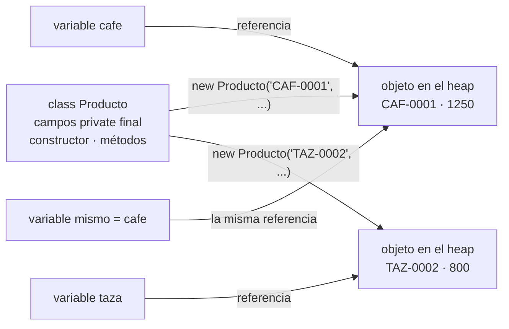
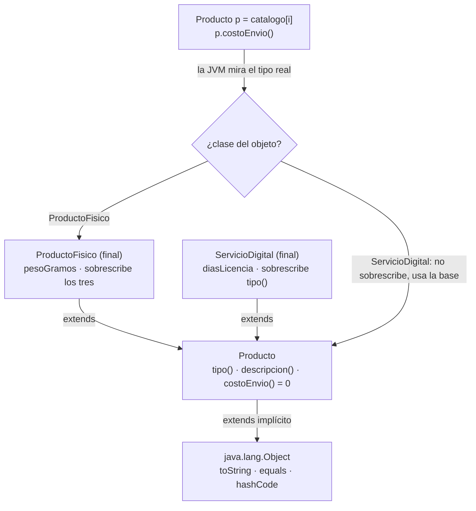
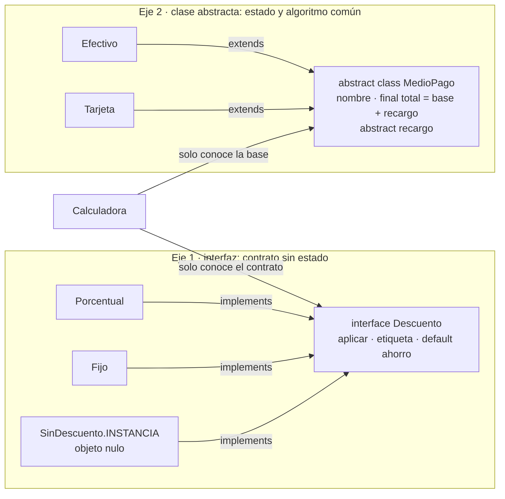
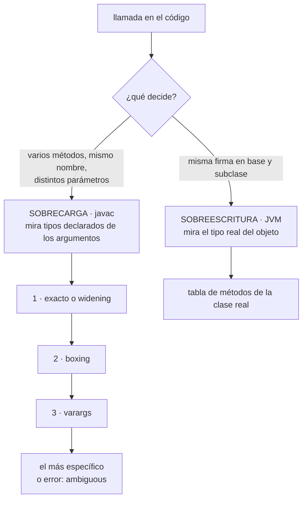
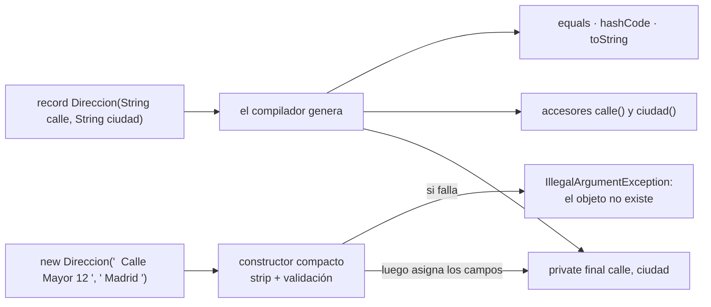
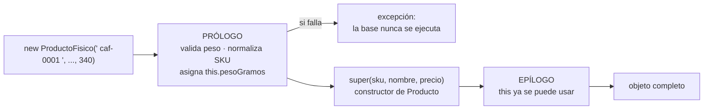

# Módulo 1: Programación orientada a objetos


## Visual del módulo

**Visual:** [Mapa de POO: clase base, herencia, records, interfaces y clases abstractas](/visuals/temas/java/modulo-1-poo.html)

Lectura: Objetos para dominio, interfaces para contratos, records para valores y validación antes de construir.


La aplicación de Tienda Aurora del módulo anterior funciona, pero su diseño es procedural. Un producto es un contenedor de datos y toda la lógica vive en métodos que preguntan de qué tipo es cada cosa. Mientras solo hay productos físicos, el `if` es manejable. Cuando la tienda empieza a vender cursos digitales, tarjetas regalo y suscripciones, cada nueva variante obliga a tocar el catálogo, el carrito, el recibo y la factura. Ese es el síntoma clásico de un modelo que no representa el dominio: el código sabe demasiado y cambia en todos lados a la vez.

La programación orientada a objetos no es “usar clases”. Es distribuir responsabilidades para que cada pieza proteja sus invariantes y el sistema pueda crecer agregando tipos, no reescribiendo condicionales. En este módulo construimos `tienda-aurora-poo`, una evolución del proyecto anterior donde `Producto` encapsula su estado, `ProductoFisico` y `ServicioDigital` especializan el comportamiento, `Descuento` y `MedioPago` representan dos formas distintas de variación, y `Direccion`, `LineaPedido` y `ResultadoPrecio` se modelan como `record`.

El proyecto tiene cinco comandos reales: `catalogo` lista productos con su tipo y costo de envío, `reglas` muestra las reglas de descuento y los medios de pago, `diagnostico` comprueba invariantes y la semántica de los records, `cotizar` calcula un pedido completo y `comparar` enfrenta los medios de pago para el mismo pedido. Cada tema añade o explica una pieza de ese mismo código.

**Entorno de referencia verificado (2026-11-23):** JDK 27.0.1.0.2 (`javac 27.0.1.0.2`), Gradle 9.9.1, macOS arm64. El proyecto se compiló con `--release 25` y se ejecutó; las salidas son transcripciones reales. La comprobación de constructores flexibles se hizo además con `--release 21`, que rechaza el código, y con `--release 25`, que lo acepta.

**Entorno de las salidas nuevas (2026-11-24):** OpenJDK 25.0.5.1 (`javac 25.0.5.1`), Ubuntu 24.04 x86_64. Los programas de un solo archivo de los Temas 1 a 6 (problemas resueltos, mensajes de los recuadros y respuestas de los ejercicios) se ejecutaron con `java Archivo.java` y `javac`; sus salidas son transcripciones literales. Las salidas del proyecto `tienda-aurora-poo` son las del entorno de referencia; con JDK 25.0.5.1 y `--release 25` el proyecto se recompiló y `catalogo`, `reglas`, `diagnostico`, `cotizar` y `comparar` produjeron el mismo texto.

## Proyecto desde cero: tienda-aurora-poo

El punto de partida es una decisión de diseño: ¿qué varía y por qué? En Tienda Aurora varían los productos (físicos, digitales, y mañana suscripciones) y varían las reglas comerciales (descuentos, medios de pago). Son dos ejes distintos y conviene modelarlos con herramientas distintas.

- `Producto` es una clase con estado encapsulado y comportamiento común. Las subclases añaden datos y sobrescriben lo que cambia: la descripción y el costo de envío.
- `Descuento` es una interfaz: un contrato sin estado que distintas reglas implementan. El carrito no necesita saber si el descuento es un porcentaje, un importe fijo o ninguno.
- `MedioPago` es una clase abstracta: comparte el nombre y el algoritmo `total = base + recargo`, y deja a cada subclase decidir el recargo.
- `Direccion`, `LineaPedido` y `ResultadoPrecio` son `record`: valores inmutables con igualdad por contenido, sin getters, `equals`, `hashCode` ni `toString` escritos a mano.
- Los constructores de `ProductoFisico` y `ServicioDigital` usan constructores flexibles de Java 25 para normalizar y validar antes de llamar a `super(...)`.

El resultado es un motor de cotización pequeño pero realista: subtotal, descuento, envío, recargo del pago y total, con cada regla aislada en su tipo.

Si vienes del módulo 0, el salto no es de sintaxis sino de organización. Antes tenías funciones y estructuras de datos; ahora decides qué objeto es dueño de cada dato, qué operaciones expone y qué invariantes protege. Cada término nuevo aparece en el momento en que hace falta: *clase* y *objeto* cuando definimos `Producto`, *interfaz* y *clase abstracta* cuando separamos descuentos y pagos, *record* cuando modelamos valores inmutables, y *constructor flexible* cuando Java 25 nos deja validar antes de `super(...)`. La idea es que puedas leer el código y entender por qué cada pieza está escrita así, no solo copiarla.

## Prerrequisitos

Necesitas un JDK 25 o superior (por los constructores flexibles) y Gradle 9.

```bash
java -version
javac -version
gradle --version
```

En el entorno de referencia:

```text
openjdk version "27.0.1.0.2" 2026-10-21
OpenJDK Runtime Environment Temurin-27.0.1.0.2+1 (build 27.0.1.0.2+1)
OpenJDK 64-Bit Server VM Temurin-27.0.1.0.2+1 (build 27.0.1.0.2+1, mixed mode, sharing)
javac 27.0.1.0.2

------------------------------------------------------------
Gradle 9.9.1
------------------------------------------------------------
```

## Bootstrap

```bash
mkdir -p tienda-aurora-poo/src/main/java/com/aurora/poo/{dominio,catalogo,descuento,pago,servicio}
cd tienda-aurora-poo
gradle wrapper --gradle-version 9.9.1
```

## Estructura del proyecto

```text
tienda-aurora-poo/
├── build.gradle.kts
├── settings.gradle.kts
└── src/
    └── main/
        └── java/
            └── com/aurora/poo/
                ├── TiendaAuroraPooApp.java
                ├── catalogo/
                │   ├── Catalogo.java
                │   ├── ReglasDescuento.java
                │   ├── ReglasPago.java
                │   └── Sku.java
                ├── descuento/
                │   ├── Descuento.java
                │   ├── DescuentoFijo.java
                │   ├── DescuentoPorcentual.java
                │   └── SinDescuento.java
                ├── dominio/
                │   ├── Dinero.java
                │   ├── Direccion.java
                │   ├── LineaPedido.java
                │   ├── Producto.java
                │   ├── ProductoFisico.java
                │   ├── ResultadoPrecio.java
                │   └── ServicioDigital.java
                ├── pago/
                │   ├── ContraReembolso.java
                │   ├── Efectivo.java
                │   ├── MedioPago.java
                │   ├── TarjetaCredito.java
                │   └── Transferencia.java
                └── servicio/
                    ├── CalculadoraPrecio.java
                    └── Pedido.java
```

La versión verificada añade `src/test/java/com/aurora/poo/PooDomainTest.java`; está documentado completo en `#### Test`.

## build.gradle.kts

```kotlin
plugins {
    java
    application
}

group = "com.aurora"
version = "1.0.0"

java {
    toolchain {
        languageVersion = JavaLanguageVersion.of(25)
    }
}

application {
    mainClass = "com.aurora.poo.TiendaAuroraPooApp"
}

repositories {
    mavenCentral()
}

tasks.withType<JavaCompile>().configureEach {
    options.encoding = "UTF-8"
    options.compilerArgs.addAll(listOf("-Xlint:all", "-Werror"))
}

dependencies {
    testImplementation(platform("org.junit:junit-bom:5.13.4"))
    testImplementation("org.junit.jupiter:junit-jupiter")
    testRuntimeOnly("org.junit.platform:junit-platform-launcher")
}

tasks.test { useJUnitPlatform() }
```

El toolchain fija Java 25. Ese detalle no es decorativo en este módulo: los constructores flexibles son una característica de Java 25 y el build debe compilar con esa versión aunque la terminal ejecute un JDK más nuevo. `-Xlint:all -Werror` obliga a resolver advertencias como métodos que sobrescriben sin `@Override` o accesos que reducen visibilidad.

## settings.gradle.kts

```kotlin
rootProject.name = "tienda-aurora-poo"
```

## Código completo

Los archivos están agrupados por paquete y por responsabilidad. El paquete `dominio` contiene los valores y entidades que representan el negocio: dinero, SKU, productos, dirección, líneas y resultados. `descuento` y `pago` modelan las dos variaciones de precio como contratos separados. `catalogo` define los datos y las reglas de la tienda, `servicio` orquesta el cálculo del pedido, y `TiendaAuroraPooApp` es el punto de entrada de la aplicación de consola.

Puedes copiar los archivos tal cual, respetando la ruta de cada uno. El orden de lectura recomendado es el mismo en el que aparecen: primero los tipos base (`Dinero`, `Sku`), después la jerarquía de productos, luego los records, después los contratos de descuento y pago, y al final las reglas, servicios y la aplicación. Así cada archivo usa conceptos que ya viste en el anterior. Si prefieres escribirlo a mano, sigue ese orden y compila con `./gradlew classes` cuando tengas el dominio base para detectar errores temprano.

#### Dominio base: dinero y códigos

`Dinero` es un *value object*: un objeto que se identifica por su valor, no por una identidad propia. Dos importes de $12.50 son el mismo dinero aunque sean objetos distintos. Por eso es inmutable (`final`, sin setters) y tiene `equals`/`hashCode` por contenido. Internamente guarda centavos en un `long` para evitar los errores de redondeo de `double`; `BigDecimal` solo se usa en la fábrica `de(String)` para parsear texto con precisión. `Comparable<Dinero>` permite ordenar importes y compararlos con `compareTo`.

**Archivo:** `src/main/java/com/aurora/poo/dominio/Dinero.java`

```java
package com.aurora.poo.dominio;

import java.math.BigDecimal;
import java.util.Locale;

/**
 * Importe monetario inmutable en centavos.
 *
 * Es la misma pieza que Tienda Aurora usa desde el módulo 0: nunca pasa por
 * double, de modo que los totales cuadran al céntimo.
 */
public final class Dinero implements Comparable<Dinero> {

    public static final Dinero CERO = new Dinero(0L);

    private final long centavos;

    private Dinero(long centavos) {
        this.centavos = centavos;
    }

    public static Dinero de(String texto) {
        BigDecimal valor = new BigDecimal(texto);
        return new Dinero(valor.movePointRight(2).longValueExact());
    }

    public static Dinero deCentavos(long centavos) {
        return new Dinero(centavos);
    }

    public Dinero mas(Dinero otro) {
        return new Dinero(Math.addExact(this.centavos, otro.centavos));
    }

    public Dinero menos(Dinero otro) {
        return new Dinero(Math.subtractExact(this.centavos, otro.centavos));
    }

    public Dinero negado() {
        return new Dinero(Math.negateExact(this.centavos));
    }

    public Dinero por(int cantidad) {
        if (cantidad < 0) {
            throw new IllegalArgumentException("cantidad negativa: " + cantidad);
        }
        return new Dinero(Math.multiplyExact(this.centavos, cantidad));
    }

    public Dinero porcentaje(int porcentaje) {
        long bruto = Math.multiplyExact(this.centavos, porcentaje);
        return new Dinero(Math.floorDiv(bruto + 50, 100));
    }

    public boolean esCero() {
        return centavos == 0;
    }

    public long enCentavos() {
        return centavos;
    }

    public String formateado() {
        long absoluto = Math.abs(centavos);
        return String.format(Locale.ROOT, "%s%d.%02d",
                centavos < 0 ? "-" : "", absoluto / 100, absoluto % 100);
    }

    @Override
    public int compareTo(Dinero otro) {
        return Long.compare(this.centavos, otro.centavos);
    }

    @Override
    public boolean equals(Object otro) {
        return otro instanceof Dinero dinero && this.centavos == dinero.centavos;
    }

    @Override
    public int hashCode() {
        return Long.hashCode(centavos);
    }

    @Override
    public String toString() {
        long absoluto = Math.abs(centavos);
        return String.format(Locale.ROOT, "%s$%d.%02d",
                centavos < 0 ? "-" : "", absoluto / 100, absoluto % 100);
    }
}
```

`Sku` es otro value object, pero con una regla de formato: tres letras, guion y cuatro dígitos (`AAA-0000`). La fábrica estática `de(String)` normaliza la entrada (recorta, pasa a mayúsculas, corrige espacios/guiones bajos) antes de validar con una expresión regular. Si el formato no coincide, lanza `IllegalArgumentException`. El constructor es privado para que nadie pueda crear un SKU sin pasar por la validación. Como `Dinero`, implementa `equals`/`hashCode` por valor para que pueda usarse como clave en mapas.

**Archivo:** `src/main/java/com/aurora/poo/catalogo/Sku.java`

```java
package com.aurora.poo.catalogo;

import java.util.Locale;
import java.util.Objects;
import java.util.regex.Pattern;

/**
 * Código de producto: tres letras, guion y cuatro dígitos.
 * Normaliza la entrada antes de validar.
 */
public final class Sku {

    private static final Pattern FORMATO = Pattern.compile("[A-Z]{3}-\\d{4}");

    private final String valor;

    private Sku(String valor) {
        this.valor = valor;
    }

    public static Sku de(String crudo) {
        Objects.requireNonNull(crudo, "sku");
        String limpio = crudo.strip()
                .toUpperCase(Locale.ROOT)
                .replace(" ", "")
                .replace("_", "-");
        if (!FORMATO.matcher(limpio).matches()) {
            throw new IllegalArgumentException("SKU inválido: '" + crudo + "' (formato AAA-0000)");
        }
        return new Sku(limpio);
    }

    public String valor() {
        return valor;
    }

    @Override
    public String toString() {
        return valor;
    }

    @Override
    public boolean equals(Object otro) {
        return otro instanceof Sku sku && valor.equals(sku.valor);
    }

    @Override
    public int hashCode() {
        return valor.hashCode();
    }
}
```

#### Jerarquía de productos

`Producto` es la clase base. Sus campos son `private final`: la encapsulación impide que el exterior o incluso una subclase los modifique directamente. Las subclases acceden por getters (`sku()`, `nombre()`, `precioBase()`) y pueden reutilizar `normalizarNombre`, que es `protected static` porque es una utilidad de construcción, no un comportamiento de instancia. El constructor valida el invariante completo antes de asignar; si algo falla, el objeto no llega a existir.

Los métodos `tipo()`, `descripcion()` y `costoEnvio()` son los puntos de extensión: una subclase los sobrescribe para especializar el comportamiento. `precioCon(int)` y `precioCon(int, Descuento)` son una sobrecarga: misma operación, distinta firma. Observa que `precioCon` con descuento delega en la versión simple y luego aplica el descuento; así no hay dos implementaciones del mismo cálculo.

**Archivo:** `src/main/java/com/aurora/poo/dominio/Producto.java`

```java
package com.aurora.poo.dominio;

import com.aurora.poo.catalogo.Sku;
import com.aurora.poo.descuento.Descuento;

import java.util.Locale;
import java.util.Objects;

/**
 * Producto vendible de Tienda Aurora.
 *
 * Encapsula su estado: el SKU, el nombre y el precio base solo se leen; las
 * subclases añaden datos propios sin exponer los campos internos.
 */
public class Producto {

    private final Sku sku;
    private final String nombre;
    private final Dinero precioBase;

    public Producto(Sku sku, String nombre, Dinero precioBase) {
        this.sku = Objects.requireNonNull(sku, "sku");
        this.nombre = normalizarNombre(nombre);
        this.precioBase = Objects.requireNonNull(precioBase, "precioBase");
        if (precioBase.compareTo(Dinero.CERO) <= 0) {
            throw new IllegalArgumentException("el precio base debe ser positivo");
        }
    }

    /** Reutilizable por las subclases antes de llamar a super(...). */
    protected static String normalizarNombre(String nombre) {
        if (nombre == null || nombre.isBlank()) {
            throw new IllegalArgumentException("el nombre es obligatorio");
        }
        return nombre.strip();
    }

    public Sku sku() {
        return sku;
    }

    public String nombre() {
        return nombre;
    }

    public Dinero precioBase() {
        return precioBase;
    }

    /** Cada subclase declara su naturaleza; el base es un producto genérico. */
    public String tipo() {
        return "genérico";
    }

    public String descripcion() {
        return nombre + " (" + tipo() + ")";
    }

    /** Un producto genérico no genera envío; las subclases deciden. */
    public Dinero costoEnvio() {
        return Dinero.CERO;
    }

    public Dinero precioCon(int cantidad) {
        return precioBase.por(cantidad);
    }

    /** Sobrecarga: la misma operación con una regla de descuento opcional. */
    public Dinero precioCon(int cantidad, Descuento descuento) {
        return descuento.aplicar(precioCon(cantidad));
    }

    @Override
    public String toString() {
        return String.format(Locale.ROOT, "%s %-18s %8s", sku, nombre, precioBase);
    }
}
```

`ProductoFisico` extiende `Producto` y añade un dato propio: `pesoGramos`. Su constructor es el ejemplo de constructor flexible de Java 25: antes de llamar a `super(...)` convierte el SKU de texto a `Sku`, normaliza el nombre y parsea el precio. Eso permite validar y preparar datos sin fábricas estáticas auxiliares. Sobrescribe `tipo()`, `descripcion()` y `costoEnvio()`; el costo de envío usa una regla simple por tramos de peso.

**Archivo:** `src/main/java/com/aurora/poo/dominio/ProductoFisico.java`

```java
package com.aurora.poo.dominio;

import com.aurora.poo.catalogo.Sku;

/**
 * Producto que se envía: añade peso y calcula el costo de envío.
 *
 * El constructor demuestra las constructoras flexibles de Java 25: normaliza
 * y valida antes de llamar a super(...), algo que antes era imposible.
 */
public final class ProductoFisico extends Producto {

    private final int pesoGramos;

    public ProductoFisico(String skuCrudo, String nombreCrudo, String precioCrudo, int pesoGramos) {
        var sku = Sku.de(skuCrudo);
        var nombre = normalizarNombre(nombreCrudo);
        var precio = Dinero.de(precioCrudo);
        if (pesoGramos <= 0) {
            throw new IllegalArgumentException("el peso debe ser mayor que cero");
        }
        super(sku, nombre, precio);
        this.pesoGramos = pesoGramos;
    }

    public int pesoGramos() {
        return pesoGramos;
    }

    @Override
    public String tipo() {
        return "físico";
    }

    @Override
    public String descripcion() {
        return super.descripcion() + ", " + pesoGramos + " g";
    }

    @Override
    public Dinero costoEnvio() {
        if (pesoGramos <= 500) {
            return Dinero.de("4.95");
        }
        if (pesoGramos <= 2000) {
            return Dinero.de("7.95");
        }
        return Dinero.de("12.95");
    }
}
```

`ServicioDigital` es la otra rama de la jerarquía. No tiene peso ni envío físico; su dato propio es `diasLicencia`. También usa constructor flexible para normalizar antes de `super(...)`. Sobrescribe `costoEnvio()` devolviendo `Dinero.CERO`, lo que hace que el polimorfismo sea visible en el recibo: el mismo método produce resultados distintos según el tipo real del producto.

**Archivo:** `src/main/java/com/aurora/poo/dominio/ServicioDigital.java`

```java
package com.aurora.poo.dominio;

import com.aurora.poo.catalogo.Sku;

/**
 * Servicio con licencia temporal: no se envía y no cobra envío.
 */
public final class ServicioDigital extends Producto {

    private final int diasLicencia;

    public ServicioDigital(String skuCrudo, String nombreCrudo, String precioCrudo, int diasLicencia) {
        var sku = Sku.de(skuCrudo);
        var nombre = normalizarNombre(nombreCrudo);
        var precio = Dinero.de(precioCrudo);
        if (diasLicencia <= 0) {
            throw new IllegalArgumentException("la licencia debe durar al menos un día");
        }
        super(sku, nombre, precio);
        this.diasLicencia = diasLicencia;
    }

    public int diasLicencia() {
        return diasLicencia;
    }

    @Override
    public String tipo() {
        return "digital";
    }

    @Override
    public String descripcion() {
        return super.descripcion() + ", licencia de " + diasLicencia + " días";
    }
}
```

#### Records: valores inmutables

Los siguientes tipos no son entidades con identidad propia; son datos que se reemplazan completos. Por eso se modelan como `record`: el compilador genera constructor, accesores, `equals`, `hashCode` y `toString`.

`Direccion` normaliza sus tres componentes en un constructor compacto. Ese constructor se ejecuta antes de que el compilador asigne los campos, así que puede limpiar espacios y validar el formato del código postal.

**Archivo:** `src/main/java/com/aurora/poo/dominio/Direccion.java`

```java
package com.aurora.poo.dominio;

/**
 * Dirección de entrega inmutable.
 *
 * El constructor compacto normaliza los componentes y valida el código postal
 * antes de que el record exista, de modo que un valor inválido nunca se
 * construye.
 */
public record Direccion(String calle, String ciudad, String codigoPostal) {

    public Direccion {
        calle = calle == null ? "" : calle.strip();
        ciudad = ciudad == null ? "" : ciudad.strip();
        codigoPostal = codigoPostal == null ? "" : codigoPostal.strip();
        if (calle.isBlank() || ciudad.isBlank()) {
            throw new IllegalArgumentException("la dirección necesita calle y ciudad");
        }
        if (!codigoPostal.matches("\\d{4,5}")) {
            throw new IllegalArgumentException("código postal inválido: " + codigoPostal);
        }
    }

    public String formateada() {
        return calle + ", " + ciudad + " " + codigoPostal;
    }
}
```

`LineaPedido` combina un `Producto` y una cantidad. Es un record porque una línea no cambia: si cambia la cantidad, se crea otra línea. El método `subtotal()` es derivado; no se almacena, se calcula a partir de los componentes. `toString()` se sobrescribe para que el recibo sea legible.

**Archivo:** `src/main/java/com/aurora/poo/dominio/LineaPedido.java`

```java
package com.aurora.poo.dominio;

/**
 * Línea de un pedido. El subtotal y el envío se derivan del producto; no se
 * almacenan para que no puedan quedar desincronizados.
 */
public record LineaPedido(Producto producto, int cantidad) {

    public LineaPedido {
        if (producto == null) {
            throw new IllegalArgumentException("la línea necesita un producto");
        }
        if (cantidad <= 0) {
            throw new IllegalArgumentException("la cantidad debe ser mayor que cero");
        }
    }

    public Dinero subtotal() {
        return producto.precioCon(cantidad);
    }

    public Dinero envio() {
        return producto.costoEnvio();
    }
}
```

`ResultadoPrecio` es el valor que devuelve la calculadora. Agrupa los importes del cálculo: subtotal, descuento aplicado, envío, recargo del medio de pago y total. Sus métodos `baseConDescuento()` y `baseConEnvio()` son cálculos derivados: no guardan estado extra, solo combinan componentes. Al ser un record, el objeto es una foto inmutable del resultado; si el cálculo cambia, se crea otro `ResultadoPrecio`.

**Archivo:** `src/main/java/com/aurora/poo/dominio/ResultadoPrecio.java`

```java
package com.aurora.poo.dominio;

import java.util.Objects;

/**
 * Resultado completo de una cotización. Al ser un record, es inmutable y sus
 * componentes se leen con accesores generados: subtotal(), descuento(), etc.
 */
public record ResultadoPrecio(
        Dinero subtotal,
        Dinero descuento,
        Dinero envio,
        Dinero recargoPago,
        Dinero total) {

    public ResultadoPrecio {
        Objects.requireNonNull(subtotal, "subtotal");
        Objects.requireNonNull(descuento, "descuento");
        Objects.requireNonNull(envio, "envio");
        Objects.requireNonNull(recargoPago, "recargoPago");
        Objects.requireNonNull(total, "total");
    }

    public Dinero baseConDescuento() {
        return subtotal.menos(descuento);
    }

    public Dinero baseConEnvio() {
        return baseConDescuento().mas(envio);
    }
}
```

#### Contratos de variación: descuentos y pagos

Aquí está la decisión de diseño central del módulo. Hay dos ejes que cambian: la regla de descuento y el medio de pago. Si metes ambos en `if/switch` dentro del pedido, cada regla nueva obliga a tocar el pedido. La alternativa es modelar cada eje como un tipo con comportamiento propio.

`Descuento` es una interfaz porque define solo un contrato: `aplicar(Dinero)` y `etiqueta()`. No tiene estado compartido ni algoritmo común. Cada implementación guarda lo que necesita (un porcentaje, un monto fijo, nada) y el llamador solo depende de la interfaz.

**Archivo:** `src/main/java/com/aurora/poo/descuento/Descuento.java`

```java
package com.aurora.poo.descuento;

import com.aurora.poo.dominio.Dinero;

/**
 * Regla de descuento: un contrato sin estado compartido.
 *
 * Cada implementación decide cómo transformar el importe. El carrito no
 * necesita saber si el descuento es porcentual, fijo o nulo.
 */
public interface Descuento {

    /** Devuelve el importe final después de aplicar la regla. */
    Dinero aplicar(Dinero base);

    /** Texto legible para el recibo. */
    String etiqueta();
}
```

`DescuentoPorcentual` implementa el contrato con un porcentaje validado en el constructor. `aplicar` calcula el descuento sobre la base y lo resta; el resultado es un nuevo `Dinero` porque `Dinero` es inmutable. Guardar `nombre` y `porcentaje` como `private final` mantiene el objeto autocontenido.

**Archivo:** `src/main/java/com/aurora/poo/descuento/DescuentoPorcentual.java`

```java
package com.aurora.poo.descuento;

import com.aurora.poo.dominio.Dinero;

import java.util.Objects;

/**
 * Descuento de un porcentaje sobre el importe base.
 */
public final class DescuentoPorcentual implements Descuento {

    private final String nombre;
    private final int porcentaje;

    public DescuentoPorcentual(String nombre, int porcentaje) {
        if (porcentaje < 0 || porcentaje > 100) {
            throw new IllegalArgumentException("porcentaje fuera de rango: " + porcentaje);
        }
        this.nombre = Objects.requireNonNull(nombre, "nombre").strip();
        this.porcentaje = porcentaje;
    }

    public int porcentaje() {
        return porcentaje;
    }

    @Override
    public Dinero aplicar(Dinero base) {
        return base.menos(base.porcentaje(porcentaje));
    }

    @Override
    public String etiqueta() {
        return nombre + " (-" + porcentaje + "%)";
    }
}
```

`DescuentoFijo` tiene la misma forma pero distinta regla: resta un monto fijo y protege el caso borde donde el descuento supera la base, evitando totales negativos. Ese caso borde está en el código, no en un comentario.

**Archivo:** `src/main/java/com/aurora/poo/descuento/DescuentoFijo.java`

```java
package com.aurora.poo.descuento;

import com.aurora.poo.dominio.Dinero;

import java.util.Objects;

/**
 * Descuento de un importe fijo. Nunca deja el precio por debajo de cero.
 */
public final class DescuentoFijo implements Descuento {

    private final String nombre;
    private final Dinero monto;

    public DescuentoFijo(String nombre, Dinero monto) {
        Objects.requireNonNull(monto, "monto");
        if (monto.compareTo(Dinero.CERO) <= 0) {
            throw new IllegalArgumentException("el descuento debe ser positivo");
        }
        this.nombre = Objects.requireNonNull(nombre, "nombre").strip();
        this.monto = monto;
    }

    public Dinero monto() {
        return monto;
    }

    @Override
    public Dinero aplicar(Dinero base) {
        Dinero resultado = base.menos(monto);
        return resultado.compareTo(Dinero.CERO) < 0 ? Dinero.CERO : resultado;
    }

    @Override
    public String etiqueta() {
        return nombre + " (-" + monto + ")";
    }
}
```

`SinDescuento` implementa el patrón *null object*: en vez de devolver `null` y obligar a cada llamador a preguntar `if (descuento != null)`, hay un objeto real que representa “no aplicar descuento”. Su constructor es privado y expone una única instancia `INSTANCIA` porque no tiene estado; compartirla es seguro.

**Archivo:** `src/main/java/com/aurora/poo/descuento/SinDescuento.java`

```java
package com.aurora.poo.descuento;

import com.aurora.poo.dominio.Dinero;

/**
 * Implementación nula del contrato: no cambia el importe.
 *
 * Existe para que el carrito nunca tenga que comprobar si hay descuento con
 * un if; siempre hay un objeto Descuento con el que trabajar.
 */
public final class SinDescuento implements Descuento {

    public static final SinDescuento INSTANCIA = new SinDescuento();

    private SinDescuento() {
    }

    @Override
    public Dinero aplicar(Dinero base) {
        return base;
    }

    @Override
    public String etiqueta() {
        return "Sin descuento";
    }
}
```

`MedioPago` es el otro eje, pero aquí sí hay estado compartido (`nombre`) y un algoritmo común (`total = base + recargo`). Por eso es una clase abstracta, no una interfaz. `total` es `final`: define el esqueleto y no permite que una subclase lo rompa. `recargo` es abstracto: cada medio define su regla. El constructor es `protected` porque solo las subclases concretas deben instanciar medios de pago.

**Archivo:** `src/main/java/com/aurora/poo/pago/MedioPago.java`

```java
package com.aurora.poo.pago;

import com.aurora.poo.dominio.Dinero;

import java.util.Objects;

/**
 * Forma de pago. Es una clase abstracta, no una interfaz, porque comparte
 * estado (el nombre) y un algoritmo fijo (total = base + recargo).
 */
public abstract class MedioPago {

    private final String nombre;

    protected MedioPago(String nombre) {
        this.nombre = Objects.requireNonNull(nombre, "nombre").strip();
    }

    public final String nombre() {
        return nombre;
    }

    /** Cada medio decide su recargo. */
    public abstract Dinero recargo(Dinero base);

    /** Plantilla común: el recargo siempre se suma igual. */
    public final Dinero total(Dinero base) {
        return base.mas(recargo(base));
    }

    @Override
    public String toString() {
        return nombre;
    }
}
```

Las cuatro implementaciones son pequeñas a propósito: cada una expresa solo lo que varía. `Efectivo` y `Transferencia` no cobran recargo; `TarjetaCredito` cobra 2%; `ContraReembolso` combina porcentaje más cargo fijo. El método `total` no se repite en ninguna de ellas porque está en la base.

**Archivo:** `src/main/java/com/aurora/poo/pago/Efectivo.java`

```java
package com.aurora.poo.pago;

import com.aurora.poo.dominio.Dinero;

/**
 * Pago en efectivo en tienda: sin recargo.
 */
public final class Efectivo extends MedioPago {

    public Efectivo() {
        super("Efectivo");
    }

    @Override
    public Dinero recargo(Dinero base) {
        return Dinero.CERO;
    }
}
```

**Archivo:** `src/main/java/com/aurora/poo/pago/Transferencia.java`

```java
package com.aurora.poo.pago;

import com.aurora.poo.dominio.Dinero;

/**
 * Transferencia bancaria: sin recargo.
 */
public final class Transferencia extends MedioPago {

    public Transferencia() {
        super("Transferencia");
    }

    @Override
    public Dinero recargo(Dinero base) {
        return Dinero.CERO;
    }
}
```

**Archivo:** `src/main/java/com/aurora/poo/pago/TarjetaCredito.java`

```java
package com.aurora.poo.pago;

import com.aurora.poo.dominio.Dinero;

/**
 * Tarjeta de crédito: recargo del 2 % por comisión de la pasarela.
 */
public final class TarjetaCredito extends MedioPago {

    public TarjetaCredito() {
        super("Tarjeta");
    }

    @Override
    public Dinero recargo(Dinero base) {
        return base.porcentaje(2);
    }
}
```

**Archivo:** `src/main/java/com/aurora/poo/pago/ContraReembolso.java`

```java
package com.aurora.poo.pago;

import com.aurora.poo.dominio.Dinero;

/**
 * Contra reembolso: 3 % más un cargo fijo de gestión.
 */
public final class ContraReembolso extends MedioPago {

    public ContraReembolso() {
        super("Contra reembolso");
    }

    @Override
    public Dinero recargo(Dinero base) {
        return base.porcentaje(3).mas(Dinero.de("1.50"));
    }
}
```

#### Catálogo, reglas y servicios

`Catalogo` guarda los productos disponibles en un arreglo. El constructor y `productos()` hacen copias defensivas con `Arrays.copyOf`, para que ningún llamador pueda agregar o quitar productos por accidente. `buscar` devuelve un `Optional<Producto>` (un contenedor que puede venir vacío): si el SKU no existe, quien llama decide qué error lanzar.

**Archivo:** `src/main/java/com/aurora/poo/catalogo/Catalogo.java`

```java
package com.aurora.poo.catalogo;

import com.aurora.poo.dominio.Producto;

import java.util.Arrays;
import java.util.Objects;
import java.util.Optional;

/**
 * Catálogo de productos respaldado por un arreglo con copia defensiva.
 */
public final class Catalogo {

    private final Producto[] productos;

    public Catalogo(Producto... productos) {
        Objects.requireNonNull(productos, "productos");
        this.productos = Arrays.copyOf(productos, productos.length);
    }

    public Producto[] productos() {
        return Arrays.copyOf(productos, productos.length);
    }

    public int tamano() {
        return productos.length;
    }

    public Optional<Producto> buscar(Sku sku) {
        for (Producto producto : productos) {
            if (producto.sku().equals(sku)) {
                return Optional.of(producto);
            }
        }
        return Optional.empty();
    }
}
```

`ReglasDescuento` concentra la política de descuentos. `buscar` traduce un código de texto a una implementación de `Descuento`; si el código es `NINGUNO` o viene vacío, devuelve `SinDescuento.INSTANCIA`. `codigos()` y `reglas()` entregan copias de las reglas disponibles para el comando `reglas`. La traducción de códigos a reglas está aquí, en la capa de configuración, no dispersa por el dominio.

**Archivo:** `src/main/java/com/aurora/poo/catalogo/ReglasDescuento.java`

```java
package com.aurora.poo.catalogo;

import com.aurora.poo.descuento.Descuento;
import com.aurora.poo.descuento.DescuentoFijo;
import com.aurora.poo.descuento.DescuentoPorcentual;
import com.aurora.poo.descuento.SinDescuento;
import com.aurora.poo.dominio.Dinero;

/**
 * Registro de reglas de descuento disponibles en la tienda.
 *
 * El arreglo permite recorrerlas sin conocer sus clases concretas: todas son
 * Descuento y responden a aplicar/etiqueta.
 */
public final class ReglasDescuento {

    private final String[] codigos;
    private final Descuento[] reglas;

    public ReglasDescuento() {
        this.codigos = new String[] {"NINGUNO", "BIENVENIDA", "CAFE5"};
        this.reglas = new Descuento[] {
                SinDescuento.INSTANCIA,
                new DescuentoPorcentual("Bienvenida", 10),
                new DescuentoFijo("Café de bienvenida", Dinero.de("5.00"))
        };
    }

    public Descuento buscar(String codigo) {
        if (codigo == null || codigo.isBlank()) {
            return SinDescuento.INSTANCIA;
        }
        for (int i = 0; i < codigos.length; i++) {
            if (codigos[i].equalsIgnoreCase(codigo.strip())) {
                return reglas[i];
            }
        }
        throw new IllegalArgumentException("descuento desconocido: " + codigo);
    }

    public String[] codigos() {
        return codigos.clone();
    }

    public Descuento[] reglas() {
        return reglas.clone();
    }
}
```

`ReglasPago` hace lo mismo para medios de pago: convierte un nombre escrito en la línea de comandos (por ejemplo `TARJETA` o `EFECTIVO`) en un objeto `MedioPago`. Separar estas reglas del servicio de cálculo permite agregar un medio nuevo creando la clase y registrándola aquí, sin tocar la calculadora.

**Archivo:** `src/main/java/com/aurora/poo/catalogo/ReglasPago.java`

```java
package com.aurora.poo.catalogo;

import com.aurora.poo.pago.ContraReembolso;
import com.aurora.poo.pago.Efectivo;
import com.aurora.poo.pago.MedioPago;
import com.aurora.poo.pago.TarjetaCredito;
import com.aurora.poo.pago.Transferencia;

/**
 * Registro de medios de pago. Todos comparten la clase abstracta MedioPago,
 * así que el código de la tienda los trata de forma uniforme.
 */
public final class ReglasPago {

    private final String[] codigos;
    private final MedioPago[] medios;

    public ReglasPago() {
        this.codigos = new String[] {"EFECTIVO", "TRANSFERENCIA", "TARJETA", "CONTRA"};
        this.medios = new MedioPago[] {
                new Efectivo(),
                new Transferencia(),
                new TarjetaCredito(),
                new ContraReembolso()
        };
    }

    public MedioPago buscar(String codigo) {
        if (codigo == null || codigo.isBlank()) {
            return new Transferencia();
        }
        for (int i = 0; i < codigos.length; i++) {
            if (codigos[i].equalsIgnoreCase(codigo.strip())) {
                return medios[i];
            }
        }
        throw new IllegalArgumentException("medio de pago desconocido: " + codigo);
    }

    public String[] codigos() {
        return codigos.clone();
    }

    public MedioPago[] medios() {
        return medios.clone();
    }
}
```

`CalculadoraPrecio` es el servicio que orquesta el cálculo. Recibe líneas, un `Descuento` y un `MedioPago`; no sabe qué implementación concreta llegó. Calcula subtotal, aplica descuento, suma envío, calcula recargo y arma el `ResultadoPrecio`. Las sobrecargas con menos parámetros delegan en la versión completa, usando `SinDescuento` y `Transferencia` como valores por defecto. `sumarSubtotales` es *package-private* (sin modificador de acceso): lo puede usar `Pedido` porque vive en el mismo paquete, pero no forma parte de la interfaz pública de la calculadora.

**Archivo:** `src/main/java/com/aurora/poo/servicio/CalculadoraPrecio.java`

```java
package com.aurora.poo.servicio;

import com.aurora.poo.descuento.Descuento;
import com.aurora.poo.descuento.SinDescuento;
import com.aurora.poo.dominio.Dinero;
import com.aurora.poo.dominio.LineaPedido;
import com.aurora.poo.dominio.ResultadoPrecio;
import com.aurora.poo.pago.MedioPago;
import com.aurora.poo.pago.Transferencia;

import java.util.List;

/**
 * Calcula el precio final de un pedido aplicando, en orden:
 * subtotal, descuento, envío y recargo del medio de pago.
 */
public final class CalculadoraPrecio {

    public ResultadoPrecio calcular(List<LineaPedido> lineas) {
        return calcular(lineas, SinDescuento.INSTANCIA, new Transferencia());
    }

    public ResultadoPrecio calcular(List<LineaPedido> lineas, Descuento descuento) {
        return calcular(lineas, descuento, new Transferencia());
    }

    public ResultadoPrecio calcular(List<LineaPedido> lineas, Descuento descuento, MedioPago medioPago) {
        if (lineas == null || lineas.isEmpty()) {
            throw new IllegalArgumentException("el pedido no tiene líneas");
        }
        if (descuento == null) {
            throw new IllegalArgumentException("descuento obligatorio");
        }
        if (medioPago == null) {
            throw new IllegalArgumentException("medio de pago obligatorio");
        }

        Dinero subtotal = sumarSubtotales(lineas);
        Dinero conDescuento = descuento.aplicar(subtotal);
        Dinero descuentoAplicado = subtotal.menos(conDescuento);
        Dinero envio = mayorEnvio(lineas);
        Dinero base = conDescuento.mas(envio);
        Dinero recargo = medioPago.recargo(base);

        return new ResultadoPrecio(subtotal, descuentoAplicado, envio, recargo, base.mas(recargo));
    }

    /**
     * Visible solo dentro del paquete servicio: es un detalle de cálculo, no
     * parte de la interfaz pública de la calculadora.
     */
    static Dinero sumarSubtotales(List<LineaPedido> lineas) {
        Dinero total = Dinero.CERO;
        for (LineaPedido linea : lineas) {
            total = total.mas(linea.subtotal());
        }
        return total;
    }

    private Dinero mayorEnvio(List<LineaPedido> lineas) {
        Dinero mayor = Dinero.CERO;
        for (LineaPedido linea : lineas) {
            Dinero envio = linea.envio();
            if (envio.compareTo(mayor) > 0) {
                mayor = envio;
            }
        }
        return mayor;
    }
}
```

`Pedido` representa la operación de compra con identidad propia: número, dirección, líneas y medio de pago. A diferencia de los records, es una entidad mutable en un sentido controlado —se le pueden agregar líneas— y tiene identidad por `numero`. `agregar` valida y devuelve `this` para permitir encadenamiento. `total()` delega en la calculadora; el pedido no duplica la lógica de precio.

**Archivo:** `src/main/java/com/aurora/poo/servicio/Pedido.java`

```java
package com.aurora.poo.servicio;

import com.aurora.poo.dominio.Dinero;
import com.aurora.poo.dominio.Direccion;
import com.aurora.poo.dominio.LineaPedido;

import java.util.List;
import java.util.Objects;

/**
 * Pedido de Tienda Aurora: número, dirección y líneas.
 *
 * Usa el método package-private de CalculadoraPrecio para sumar subtotales:
 * ambos viven en el mismo paquete y comparten ese detalle.
 */
public final class Pedido {

    private final String numero;
    private final Direccion direccion;
    private final List<LineaPedido> lineas;

    public Pedido(String numero, Direccion direccion, List<LineaPedido> lineas) {
        if (numero == null || numero.isBlank()) {
            throw new IllegalArgumentException("el número de pedido es obligatorio");
        }
        if (lineas == null || lineas.isEmpty()) {
            throw new IllegalArgumentException("el pedido no tiene líneas");
        }
        this.numero = numero.strip();
        this.direccion = Objects.requireNonNull(direccion, "direccion");
        this.lineas = List.copyOf(lineas);
    }

    public String numero() {
        return numero;
    }

    public Direccion direccion() {
        return direccion;
    }

    public List<LineaPedido> lineas() {
        return lineas;
    }

    public int unidades() {
        int total = 0;
        for (LineaPedido linea : lineas) {
            total += linea.cantidad();
        }
        return total;
    }

    public Dinero subtotal() {
        return CalculadoraPrecio.sumarSubtotales(lineas);
    }
}
```

`TiendaAuroraPooApp` es la clase con el método `main`: el punto de entrada que ejecutas desde la terminal. No contiene reglas de negocio; lee los argumentos, resuelve objetos con las reglas del catálogo y delega en los servicios y el dominio. El `switch` sobre el comando solo selecciona el flujo. Los métodos privados como `imprimirCotizacion`, `diagnostico` y `comparar` formatean la salida para que los temas del módulo muestren comportamiento real sin meter lógica de negocio en `main`.

**Archivo:** `src/main/java/com/aurora/poo/TiendaAuroraPooApp.java`

```java
package com.aurora.poo;

import com.aurora.poo.catalogo.Catalogo;
import com.aurora.poo.catalogo.ReglasDescuento;
import com.aurora.poo.catalogo.ReglasPago;
import com.aurora.poo.catalogo.Sku;
import com.aurora.poo.descuento.Descuento;
import com.aurora.poo.dominio.Dinero;
import com.aurora.poo.dominio.Direccion;
import com.aurora.poo.dominio.LineaPedido;
import com.aurora.poo.dominio.Producto;
import com.aurora.poo.dominio.ProductoFisico;
import com.aurora.poo.dominio.ResultadoPrecio;
import com.aurora.poo.dominio.ServicioDigital;
import com.aurora.poo.pago.MedioPago;
import com.aurora.poo.servicio.CalculadoraPrecio;
import com.aurora.poo.servicio.Pedido;

import java.util.List;
import java.util.Locale;

/**
 * Aplicación de consola de Tienda Aurora para el módulo de POO.
 */
public final class TiendaAuroraPooApp {

    private static final Direccion DIRECCION_TIENDA =
            new Direccion("Calle Mayor 12", "Madrid", "28013");

    public static void main(String[] args) {
        Locale.setDefault(Locale.ROOT);
        if (args.length == 0) {
            ayuda();
            return;
        }
        switch (args[0]) {
            case "catalogo" -> catalogo();
            case "reglas" -> reglas();
            case "diagnostico" -> diagnostico();
            case "cotizar" -> cotizar(args);
            case "comparar" -> comparar(args);
            default -> {
                System.err.println("Comando desconocido: " + args[0]);
                ayuda();
                System.exit(2);
            }
        }
    }

    private static void ayuda() {
        System.out.println("""
                Tienda Aurora - programación orientada a objetos

                Uso:
                  catalogo
                  reglas
                  diagnostico
                  cotizar --sku CAF-0001 [--cantidad 3] [--descuento BIENVENIDA] [--pago TARJETA]
                  comparar --sku CAF-0001 [--cantidad 3] [--descuento BIENVENIDA]
                """);
    }

    private static void catalogo() {
        Catalogo catalogo = catalogoTienda();
        System.out.println("Catálogo Tienda Aurora (" + catalogo.tamano() + " productos)");
        for (Producto producto : catalogo.productos()) {
            System.out.printf(Locale.ROOT, "  %-52s %8s  envío %s%n",
                    producto.descripcion(), producto.precioBase(), producto.costoEnvio());
        }
    }

    private static void reglas() {
        ReglasDescuento descuentos = new ReglasDescuento();
        System.out.println("Descuentos:");
        String[] codigosDescuento = descuentos.codigos();
        Descuento[] reglas = descuentos.reglas();
        for (int i = 0; i < codigosDescuento.length; i++) {
            System.out.printf(Locale.ROOT, "  %-12s %s%n", codigosDescuento[i], reglas[i].etiqueta());
        }

        System.out.println();
        System.out.println("Medios de pago (recargo sobre $100.00):");
        ReglasPago pagos = new ReglasPago();
        String[] codigosPago = pagos.codigos();
        MedioPago[] medios = pagos.medios();
        for (int i = 0; i < codigosPago.length; i++) {
            System.out.printf(Locale.ROOT, "  %-14s %-18s %8s%n",
                    codigosPago[i], medios[i].nombre(), medios[i].recargo(Dinero.de("100.00")));
        }
    }

    private static void diagnostico() {
        System.out.println("1. Invariantes de construcción");
        intentar("precio negativo", () -> new ProductoFisico("caf-0001", "Café", "-1.00", 100));
        intentar("peso cero", () -> new ProductoFisico("caf-0001", "Café", "10.00", 0));
        intentar("sku inválido", () -> new ProductoFisico("cafe", "Café", "10.00", 100));
        intentar("dirección sin ciudad", () -> new Direccion("Calle 1", " ", "28013"));
        intentar("línea con cantidad cero",
                () -> new LineaPedido(new ProductoFisico("caf-0001", "Café", "10.00", 100), 0));

        System.out.println();
        System.out.println("2. Records: normalización e igualdad");
        Direccion a = new Direccion("  Calle Mayor 12  ", " Madrid ", " 28013 ");
        Direccion b = new Direccion("Calle Mayor 12", "Madrid", "28013");
        System.out.println("  normalizada -> " + a.formateada());
        System.out.println("  equals -> " + a.equals(b));
        System.out.println("  hashCode igual -> " + (a.hashCode() == b.hashCode()));
    }

    private static void intentar(String caso, Runnable accion) {
        try {
            accion.run();
            System.out.println("  " + caso + " -> no falló");
        } catch (RuntimeException e) {
            System.out.println("  " + caso + " -> " + e.getClass().getSimpleName()
                    + ": " + e.getMessage());
        }
    }

    private static void cotizar(String[] args) {
        String skuCrudo = valorDe(args, "--sku");
        if (skuCrudo == null || skuCrudo.isBlank()) {
            System.err.println("Falta --sku");
            System.exit(2);
            return;
        }

        int cantidad = enteroPositivo(valorDe(args, "--cantidad", "1"));
        Descuento descuento = new ReglasDescuento().buscar(valorDe(args, "--descuento", "NINGUNO"));
        MedioPago medioPago = new ReglasPago().buscar(valorDe(args, "--pago", "TRANSFERENCIA"));

        Producto producto = catalogoTienda().buscar(Sku.de(skuCrudo))
                .orElseThrow(() -> new IllegalArgumentException("SKU no existe: " + skuCrudo));

        LineaPedido linea = new LineaPedido(producto, cantidad);
        Pedido pedido = new Pedido("AUR-2026-0001", DIRECCION_TIENDA, List.of(linea));
        ResultadoPrecio resultado = new CalculadoraPrecio().calcular(pedido.lineas(), descuento, medioPago);

        imprimirCotizacion(pedido, linea, resultado, descuento, medioPago);
    }

    private static void comparar(String[] args) {
        String skuCrudo = valorDe(args, "--sku");
        if (skuCrudo == null || skuCrudo.isBlank()) {
            System.err.println("Falta --sku");
            System.exit(2);
            return;
        }

        int cantidad = enteroPositivo(valorDe(args, "--cantidad", "1"));
        Descuento descuento = new ReglasDescuento().buscar(valorDe(args, "--descuento", "NINGUNO"));
        Producto producto = catalogoTienda().buscar(Sku.de(skuCrudo))
                .orElseThrow(() -> new IllegalArgumentException("SKU no existe: " + skuCrudo));

        LineaPedido linea = new LineaPedido(producto, cantidad);
        Pedido pedido = new Pedido("AUR-2026-0001", DIRECCION_TIENDA, List.of(linea));

        System.out.printf(Locale.ROOT, "Comparativa de pago para %d x %s (%s)%n",
                cantidad, producto.nombre(), descuento.etiqueta());
        for (MedioPago medio : new ReglasPago().medios()) {
            ResultadoPrecio resultado = new CalculadoraPrecio()
                    .calcular(pedido.lineas(), descuento, medio);
            System.out.printf(Locale.ROOT, "  %-18s %12s%n", medio.nombre(), resultado.total());
        }
    }

    private static void imprimirCotizacion(Pedido pedido, LineaPedido linea,
                                           ResultadoPrecio resultado,
                                           Descuento descuento, MedioPago medioPago) {
        StringBuilder texto = new StringBuilder(512);
        texto.append("==========================================\n");
        texto.append(" TIENDA AURORA - COTIZACION ").append(pedido.numero()).append('\n');
        texto.append("==========================================\n");
        texto.append(' ').append(linea.producto().descripcion()).append('\n');
        texto.append(String.format(Locale.ROOT, "   %d x %s = %s%n",
                linea.cantidad(), linea.producto().precioBase(), linea.subtotal()));
        texto.append(String.format(Locale.ROOT, "   envío: %s%n", linea.envio()));
        texto.append("------------------------------------------\n");
        alinear(texto, "Subtotal", resultado.subtotal(), "");
        alinear(texto, "Descuento", resultado.descuento().negado(), descuento.etiqueta());
        alinear(texto, "Envío", resultado.envio(), "");
        alinear(texto, "Recargo pago", resultado.recargoPago(), medioPago.nombre());
        alinear(texto, "TOTAL", resultado.total(), "");
        texto.append("==========================================\n");
        texto.append(" Entrega: ").append(pedido.direccion().formateada()).append('\n');
        System.out.print(texto);
    }

    private static void alinear(StringBuilder texto, String etiqueta, Dinero importe, String nota) {
        if (nota == null || nota.isBlank()) {
            texto.append(String.format(Locale.ROOT, " %-18s %12s%n", etiqueta, importe));
        } else {
            texto.append(String.format(Locale.ROOT, " %-18s %12s  %s%n", etiqueta, importe, nota));
        }
    }

    private static int enteroPositivo(String texto) {
        try {
            int valor = Integer.parseInt(texto);
            if (valor <= 0) {
                throw new IllegalArgumentException("cantidad debe ser mayor que cero: " + texto);
            }
            return valor;
        } catch (NumberFormatException e) {
            throw new IllegalArgumentException("cantidad no numérica: " + texto, e);
        }
    }

    private static String valorDe(String[] args, String nombre, String porDefecto) {
        for (int i = 1; i < args.length - 1; i++) {
            if (args[i].equals(nombre)) {
                return args[i + 1];
            }
        }
        return porDefecto;
    }

    private static String valorDe(String[] args, String nombre) {
        return valorDe(args, nombre, null);
    }

    private static Catalogo catalogoTienda() {
        return new Catalogo(
                new ProductoFisico("caf-0001", "Café Aurora", "12.50", 340),
                new ProductoFisico("mol-0003", "Molino manual", "34.90", 1200),
                new ProductoFisico("taz-0002", "Taza Aurora", "8.00", 450),
                new ServicioDigital("cur-0100", "Curso de barismo", "49.00", 365)
        );
    }
}
```

#### Test

**Archivo:** `src/test/java/com/aurora/poo/PooDomainTest.java`. Dependencias JUnit 5 en `build.gradle.kts` (`junit-bom:5.13.4`, `junit-jupiter` y `junit-platform-launcher`) y `tasks.test { useJUnitPlatform() }`. Siete casos sobre el dominio real del módulo.

```java
package com.aurora.poo;

import com.aurora.poo.catalogo.ReglasDescuento;
import com.aurora.poo.catalogo.ReglasPago;
import com.aurora.poo.descuento.DescuentoFijo;
import com.aurora.poo.descuento.DescuentoPorcentual;
import com.aurora.poo.dominio.Dinero;
import com.aurora.poo.dominio.Direccion;
import com.aurora.poo.dominio.LineaPedido;
import com.aurora.poo.dominio.Producto;
import com.aurora.poo.dominio.ProductoFisico;
import com.aurora.poo.dominio.ServicioDigital;
import com.aurora.poo.pago.ContraReembolso;
import com.aurora.poo.pago.Efectivo;
import com.aurora.poo.pago.TarjetaCredito;
import com.aurora.poo.pago.Transferencia;
import com.aurora.poo.servicio.CalculadoraPrecio;
import com.aurora.poo.servicio.Pedido;
import org.junit.jupiter.api.Test;

import java.util.List;

import static org.junit.jupiter.api.Assertions.assertAll;
import static org.junit.jupiter.api.Assertions.assertEquals;
import static org.junit.jupiter.api.Assertions.assertInstanceOf;
import static org.junit.jupiter.api.Assertions.assertThrows;
import static org.junit.jupiter.api.Assertions.assertTrue;

class PooDomainTest {

    @Test
    void lasSubclasesDecidenTipoYCostoDeEnvio() {
        Producto fisico = new ProductoFisico("caf-0001", " Café Aurora ", "12.50", 340);
        Producto digital = new ServicioDigital("cur-0100", "Curso de barismo", "49.00", 365);

        assertAll(
                () -> assertEquals("físico", fisico.tipo()),
                () -> assertEquals("Café Aurora", fisico.nombre()),
                () -> assertEquals("Café Aurora (físico), 340 g", fisico.descripcion()),
                () -> assertEquals(Dinero.de("4.95"), fisico.costoEnvio()),
                () -> assertEquals("digital", digital.tipo()),
                () -> assertEquals(Dinero.CERO, digital.costoEnvio()),
                () -> assertEquals(365, ((ServicioDigital) digital).diasLicencia())
        );
    }

    @Test
    void lasConstructorasFlexiblesValidanAntesDeSuper() {
        assertAll(
                () -> assertThrows(IllegalArgumentException.class,
                        () -> new ProductoFisico("caf-0001", "Café", "-1.00", 100)),
                () -> assertThrows(IllegalArgumentException.class,
                        () -> new ProductoFisico("caf-0001", "Café", "10.00", 0)),
                () -> assertThrows(IllegalArgumentException.class,
                        () -> new ServicioDigital("curso", "Curso", "10.00", 1))
        );
    }

    @Test
    void losDescuentosSonIntercambiablesYRespetanElPisoCero() {
        ReglasDescuento reglas = new ReglasDescuento();
        DescuentoPorcentual bienvenida =
                assertInstanceOf(DescuentoPorcentual.class, reglas.buscar("bienvenida"));
        DescuentoFijo cafe5 = assertInstanceOf(DescuentoFijo.class, reglas.buscar("CAFE5"));

        assertAll(
                () -> assertEquals(Dinero.de("90.00"), bienvenida.aplicar(Dinero.de("100.00"))),
                () -> assertEquals("Bienvenida (-10%)", bienvenida.etiqueta()),
                () -> assertEquals(Dinero.de("95.00"), cafe5.aplicar(Dinero.de("100.00"))),
                () -> assertEquals(Dinero.CERO,
                        new DescuentoFijo("Excesivo", Dinero.de("5.00")).aplicar(Dinero.de("3.00"))),
                () -> assertEquals(Dinero.de("100.00"), reglas.buscar("NINGUNO").aplicar(Dinero.de("100.00"))),
                () -> assertThrows(IllegalArgumentException.class, () -> reglas.buscar("NOPE"))
        );
    }

    @Test
    void losMediosDePagoCompartenLaPlantillaDeTotal() {
        ReglasPago reglas = new ReglasPago();
        assertAll(
                () -> assertEquals(Dinero.de("2.00"), new TarjetaCredito().recargo(Dinero.de("100.00"))),
                () -> assertEquals(Dinero.de("102.00"), new TarjetaCredito().total(Dinero.de("100.00"))),
                () -> assertEquals(Dinero.de("4.50"), new ContraReembolso().recargo(Dinero.de("100.00"))),
                () -> assertEquals(Dinero.CERO, new Efectivo().total(Dinero.de("100.00")).menos(Dinero.de("100.00"))),
                () -> assertEquals("Transferencia", reglas.buscar("transferencia").nombre()),
                () -> assertEquals(Dinero.CERO, new Transferencia().recargo(Dinero.de("100.00"))),
                () -> assertThrows(IllegalArgumentException.class, () -> reglas.buscar("CRYPTO"))
        );
    }

    @Test
    void direccionEsRecordNormalizadoYValidado() {
        Direccion sucia = new Direccion("  Calle Mayor 12 ", " Madrid ", " 28013 ");
        Direccion limpia = new Direccion("Calle Mayor 12", "Madrid", "28013");
        assertAll(
                () -> assertEquals(limpia, sucia),
                () -> assertEquals(limpia.hashCode(), sucia.hashCode()),
                () -> assertEquals("Calle Mayor 12, Madrid 28013", sucia.formateada()),
                () -> assertThrows(IllegalArgumentException.class,
                        () -> new Direccion("Calle 1", " ", "28013")),
                () -> assertThrows(IllegalArgumentException.class,
                        () -> new Direccion("Calle 1", "Madrid", "ABC"))
        );
    }

    @Test
    void calculadoraAplicaSubtotalDescuentoEnvioYRecargoEnOrden() {
        LineaPedido cafe = new LineaPedido(
                new ProductoFisico("caf-0001", "Café Aurora", "12.50", 340), 3);
        LineaPedido taza = new LineaPedido(
                new ProductoFisico("taz-0002", "Taza Aurora", "8.00", 450), 1);
        var resultado = new CalculadoraPrecio().calcular(
                List.of(cafe, taza), new ReglasDescuento().buscar("BIENVENIDA"), new TarjetaCredito());

        assertAll(
                () -> assertEquals(Dinero.de("45.50"), resultado.subtotal()),
                () -> assertEquals(Dinero.de("4.55"), resultado.descuento()),
                () -> assertEquals(Dinero.de("4.95"), resultado.envio()),
                () -> assertEquals(Dinero.de("0.92"), resultado.recargoPago()),
                () -> assertEquals(Dinero.de("40.95"), resultado.baseConDescuento()),
                () -> assertEquals(Dinero.de("45.90"), resultado.baseConEnvio()),
                () -> assertEquals(Dinero.de("46.82"), resultado.total())
        );
    }

    @Test
    void pedidoCopiaSusLineasYRechazaPedidosVacios() {
        LineaPedido linea = new LineaPedido(
                new ServicioDigital("cur-0100", "Curso de barismo", "49.00", 365), 2);
        Pedido pedido = new Pedido("AUR-2026-0001",
                new Direccion("Calle Mayor 12", "Madrid", "28013"), List.of(linea));

        assertAll(
                () -> assertEquals(2, pedido.unidades()),
                () -> assertEquals(Dinero.de("98.00"), pedido.subtotal()),
                () -> assertThrows(UnsupportedOperationException.class,
                        () -> pedido.lineas().add(linea)),
                () -> assertThrows(IllegalArgumentException.class,
                        () -> new Pedido("AUR-2", pedido.direccion(), List.of())),
                () -> assertTrue(pedido.direccion().formateada().contains("Madrid"))
        );
    }
}
```

Salida observada: `./gradlew -q clean test` termina con código de salida 0 y no escribe nada en stdout; el resumen XML que Gradle deja en `build/test-results/test/` confirma los siete casos:

```text
<testsuite name="com.aurora.poo.PooDomainTest" tests="7" skipped="0" failures="0" errors="0" timestamp="2026-11-23T08:27:34.272Z" hostname="MacBook-Pro-de-Nicolas.local" time="0.024">
```

El XML mostrado corresponde a la última corrida limpia.

## Ejecutar

Genera el wrapper una vez y ejecuta el catálogo:

```bash
gradle wrapper --gradle-version 9.9.1
./gradlew -q run --args="catalogo"
```

```text
Catálogo Tienda Aurora (4 productos)
  Café Aurora (físico), 340 g                            $12.50  envío $4.95
  Molino manual (físico), 1200 g                         $34.90  envío $7.95
  Taza Aurora (físico), 450 g                             $8.00  envío $4.95
  Curso de barismo (digital), licencia de 365 días       $49.00  envío $0.00
```

Una cotización con descuento y pago con tarjeta:

```bash
./gradlew -q run --args="cotizar --sku CAF-0001 --cantidad 3 --descuento BIENVENIDA --pago TARJETA"
```

```text
==========================================
 TIENDA AURORA - COTIZACION AUR-2026-0001
==========================================
 Café Aurora (físico), 340 g
   3 x $12.50 = $37.50
   envío: $4.95
------------------------------------------
 Subtotal                 $37.50
 Descuento                -$3.75  Bienvenida (-10%)
 Envío                     $4.95
 Recargo pago              $0.77  Tarjeta
 TOTAL                    $39.47
==========================================
 Entrega: Calle Mayor 12, Madrid 28013
```

El resto de comandos se usa en los temas: `reglas` para ver las implementaciones de los dos contratos, `diagnostico` para comprobar invariantes y records, y `comparar` para ver el polimorfismo de los medios de pago en una sola tabla.

### Tema 1: Clases, objetos, constructores y encapsulación · Básico · 40 min

<details open>
<summary><strong>Capa 1 — Lectura</strong></summary>

#### Objetivos
Al terminar este tema podrás:
- declarar una clase Java con campos, constructor y métodos, y crear objetos con `new`;
- distinguir clase, objeto y referencia, y predecir qué compara `==`;
- encapsular el estado con `private final` y proteger un invariante desde el constructor;
- leer y corregir los errores `has private access`, `cannot assign a value to final variable` y `cannot be applied to given types`.

**Conceptos clave:** clase, objeto, referencia, `new`, campo, constructor, `this`, método de instancia, `private`, `public`, encapsulación, invariante, `final`, accesor, `static`, `toString`, identidad, igualdad

Ya los conoces y no se repiten: la idea de *clase*, *objeto*, *atributo*, *método*, `__init__` y `__str__` en Python
(Fundamentos, Módulo 1, Tema 6); *excepción* (Fundamentos, Módulo 1, Tema 1); `main`, *tipos primitivos*, `String`,
arreglos y `try`/`catch` (Java, Módulo 0). Aquí solo se explica lo que cambia en Java.

#### El problema
El primer diseño de un producto de Tienda Aurora suele ser una clase con campos públicos: `public String sku;`,
`public String nombre;`, `public double precio;`. Funciona hasta que alguien escribe `producto.precio = -10` o
`producto.nombre = null`. En ese momento el objeto deja de representar un producto y pasa a representar un error que
se propaga hasta la factura. ¿Cómo haces que un producto **no pueda existir** en un estado inválido?

#### Glosario del tema

**clase**
- **Definición técnica:** declaración con `class` de un tipo nuevo; fija en compilación qué campos tiene cada objeto, qué constructores lo crean y qué métodos admite.
- **En palabras sencillas:** el mismo molde de Fundamentos (Módulo 1, Tema 6), pero con las casillas impresas: no se agregan después.
- **Dónde se rompe la comparación:** en Python puedes añadir un atributo a un objeto cuando quieras; en Java la clase declara todos los campos y el compilador rechaza cualquier otro.
- **Ejemplo:** `class Producto { ... }` en `ProductosBasicos.java` (Problema resuelto 1.1, líneas 16–34) declara el tipo `Producto`.
- **Error típico:** marcar `public` una segunda clase del archivo: `error: class Producto is public, should be declared in a file named Producto.java`.

**objeto**
- **Definición técnica:** instancia de una clase creada en tiempo de ejecución, con su propio valor para cada campo, guardada en el *heap* (la memoria de objetos de la JVM).
- **En palabras sencillas:** cada producto concreto en memoria: el café y la taza son dos objetos de la misma clase.
- **Dónde se rompe la comparación:** el objeto no vive dentro de la variable; la variable solo guarda cómo llegar a él (ver *referencia*).
- **Ejemplo:** la línea 4 del Problema resuelto 1.1 crea el café; `System.out.println(cafe)` muestra `CAF-0001 Café Aurora 1250 centavos`.
- **Error típico:** usar una variable que no apunta a ningún objeto: `vacio.precioPor(1)` con `vacio = null` termina con `NullPointerException: Cannot invoke "Producto.precioPor(int)" because "<local4>" is null`.

**referencia**
- **Definición técnica:** valor que identifica a un objeto en el heap; es lo que guarda una variable de tipo clase y lo que se copia al asignar o al pasar un argumento.
- **En palabras sencillas:** la dirección de una casa, no la casa.
- **Dónde se rompe la comparación:** no puedes leer ni sumar la dirección como en C; Java solo te deja seguirla hasta el objeto o compararla con `==`.
- **Ejemplo:** `Producto mismo = cafe;` (línea 6 del Problema resuelto 1.1) copia la referencia; `cafe == mismo` imprime `true`.
- **Error típico:** creer que `mismo = cafe` copia el producto: los dos nombres llevan al mismo objeto.

**`new`**
- **Definición técnica:** operador que reserva memoria para un objeto de la clase indicada, pone sus campos en valores por defecto, ejecuta el constructor y devuelve la referencia.
- **En palabras sencillas:** la orden «fabrica uno con este molde y dame su dirección».
- **Dónde se rompe la comparación:** en Python escribes `Producto(...)`; en Java, sin `new`, el compilador busca un método llamado `Producto`.
- **Ejemplo:** `new Producto("TAZ-0002", "Taza Aurora", 800)` (línea 5 del Problema resuelto 1.1).
- **Error típico:** olvidarlo: `Producto("TAZ-0002", "Taza Aurora", 800)` produce `error: cannot find symbol` con `symbol: method Producto(String,String,int)`.

**campo**
- **Definición técnica:** variable declarada en el cuerpo de la clase, fuera de los métodos, con su tipo; cada objeto tiene su propia copia salvo que sea `static`.
- **En palabras sencillas:** el atributo de Python, pero declarado con su tipo antes de usarse.
- **Dónde se rompe la comparación:** un campo que nadie asigna no falla al leerlo: vale `0`, `false` o `null` según su tipo.
- **Ejemplo:** `private final long precioCentavos;` (línea 19 del Problema resuelto 1.1).
- **Error típico:** escribir `long precioCentavos = precio;` dentro del constructor: crea una variable local nueva y el campo queda sin valor.

**constructor**
- **Definición técnica:** bloque con el mismo nombre de la clase y sin tipo de retorno que inicializa el objeto recién creado; se ejecuta una vez por cada `new`.
- **En palabras sencillas:** el `__init__` de Python con otro nombre: llena el formulario en el momento de crearlo.
- **Dónde se rompe la comparación:** una clase Java puede tener varios constructores con distintos parámetros; si no escribes ninguno, el compilador agrega uno vacío.
- **Ejemplo:** las líneas 21–25 del Problema resuelto 1.1 asignan los tres campos del producto.
- **Error típico:** pasar menos argumentos: `error: constructor Producto in class Producto cannot be applied to given types;`.

**`this`**
- **Definición técnica:** referencia al objeto sobre el que se ejecuta el constructor o el método de instancia.
- **En palabras sencillas:** el `self` de Python, pero no se declara como parámetro: Java lo pone solo.
- **Dónde se rompe la comparación:** puedes omitirlo si no hay confusión; es obligatorio cuando un parámetro se llama igual que un campo.
- **Ejemplo:** `this.sku = sku;` (línea 22 del Problema resuelto 1.1) copia el parámetro `sku` en el campo `sku`.
- **Error típico:** escribir `sku = sku;`: asigna el parámetro a sí mismo y, como el campo es `final`, javac responde `error: variable sku might not have been initialized`.

**método de instancia**
- **Definición técnica:** método declarado sin `static`; se invoca sobre un objeto y lee los campos de ese objeto a través de `this`.
- **En palabras sencillas:** una acción que cada producto sabe hacer con sus propios datos.
- **Dónde se rompe la comparación:** a diferencia de Python, declara el tipo que devuelve (`long`, `String`) o `void` si no devuelve nada.
- **Ejemplo:** `cafe.precioPor(3)` (línea 10 del Problema resuelto 1.1) devuelve `3750`.
- **Error típico:** llamarlo sobre la clase: `Producto.precioPor(3)` produce `error: non-static method precioPor(int) cannot be referenced from a static context`.

**`private` y `public`**
- **Definición técnica:** modificadores de acceso; `private` limita el uso de un miembro a su propia clase y `public` lo abre a cualquier clase.
- **En palabras sencillas:** `private` es el cajón con llave; `public` es el mostrador.
- **Dónde se rompe la comparación:** en Python el guion bajo es solo una convención; en Java el compilador hace cumplir la llave. Los otros dos niveles llegan en el Tema 4.
- **Ejemplo:** `private final long precioCentavos;` junto a `public long precioPor(int cantidad)`.
- **Error típico:** escribir `cafe.precioCentavos = -10;` desde otra clase: `error: precioCentavos has private access in Producto`.

**encapsulación**
- **Definición técnica:** principio de diseño por el que un objeto oculta su estado y solo deja leerlo o cambiarlo mediante operaciones que respetan sus reglas.
- **En palabras sencillas:** no tocas el motor; usas los pedales.
- **Dónde se rompe la comparación:** no es «poner getters y setters»: un setter que no valida abre el mismo agujero que un campo público.
- **Ejemplo:** el `Producto` del Problema resuelto 1.2 rechaza un precio de `-10` porque nadie puede saltarse su constructor.
- **Error típico:** validar en el constructor y luego agregar un `setPrecio` que acepta cualquier valor.

**invariante**
- **Definición técnica:** condición sobre el estado de un objeto que se cumple desde que termina el constructor hasta que el objeto deja de usarse.
- **En palabras sencillas:** una promesa del objeto: «mi precio siempre es positivo».
- **Dónde se rompe la comparación:** el compilador no conoce la promesa; la cumples tú, validando en el constructor y en cada método que cambie el estado.
- **Ejemplo:** líneas 33–38 del Problema resuelto 1.2: nombre no vacío y precio mayor que cero.
- **Error típico:** repetir `if (producto.precioCentavos() <= 0)` por toda la aplicación: señal de que el invariante no vive en el constructor.

**`final`**
- **Definición técnica:** en un campo, indica que se asigna exactamente una vez, en su declaración o en el constructor; el compilador rechaza cualquier otra asignación.
- **En palabras sencillas:** tinta permanente: se escribe una vez y no se borra.
- **Dónde se rompe la comparación:** fija la referencia, no el objeto: un campo `final` que apunta a una lista deja cambiar la lista. En clases y métodos significa otra cosa (Tema 2).
- **Ejemplo:** `private final String nombre;` (línea 29 del Problema resuelto 1.2).
- **Error típico:** reasignarlo en un método: `error: cannot assign a value to final variable precioCentavos`.

**accesor**
- **Definición técnica:** método público que devuelve el valor de un campo privado sin permitir cambiarlo; en este curso se nombra igual que el campo (`nombre()`), como en los records.
- **En palabras sencillas:** la ventanilla por la que preguntas el precio sin abrir el cajón.
- **Dónde se rompe la comparación:** muchos proyectos usan el prefijo `get` (`getNombre()`); ambos estilos son válidos si el proyecto elige uno.
- **Ejemplo:** `cafe.nombre()` (línea 5 del Problema resuelto 1.2) devuelve `Café Aurora` ya sin espacios.
- **Error típico:** devolver un arreglo interno: quien lo recibe puede cambiar el estado sin pasar por las reglas.

**`static`**
- **Definición técnica:** modificador que hace que un campo o un método pertenezca a la clase y no a cada objeto; hay una sola copia y se usa con `Clase.miembro`.
- **En palabras sencillas:** el contador en la pared de la fábrica, no una etiqueta en cada producto.
- **Dónde se rompe la comparación:** un método `static` no tiene `this`, así que no puede leer campos de instancia.
- **Ejemplo:** `Producto.creados()` (línea 13 del Problema resuelto 1.2) imprime `productos creados: 2`.
- **Error típico:** leer un campo de instancia dentro de un método `static`: `error: non-static variable precioCentavos cannot be referenced from a static context`.

**`toString`**
- **Definición técnica:** método que toda clase hereda de `java.lang.Object` y que devuelve el objeto como texto; `println` y la concatenación con `+` lo llaman solos.
- **En palabras sencillas:** el `__str__` de Python: cómo se presenta el producto en pantalla.
- **Dónde se rompe la comparación:** si no lo redefines, Java muestra el nombre de la clase y un código hash, por ejemplo `Producto@4c40b76e`, distinto en cada ejecución.
- **Ejemplo:** líneas 31–33 del Problema resuelto 1.1; `println(cafe)` muestra `CAF-0001 Café Aurora 1250 centavos`.
- **Error típico:** usar su texto para comparar objetos o extraer datos; para eso existen los accesores y `equals`.

**identidad e igualdad**
- **Definición técnica:** identidad es ser el mismo objeto (`a == b` compara referencias); igualdad es representar el mismo valor (`a.equals(b)`), según defina la clase.
- **En palabras sencillas:** dos billetes de 10 000 valen lo mismo, pero no son el mismo billete.
- **Dónde se rompe la comparación:** si la clase no redefine `equals`, usa el de `Object`, que compara identidad: dos productos con los mismos datos dan `false`.
- **Ejemplo:** líneas 11–12 del Problema resuelto 1.2 imprimen `== -> false` y `equals -> false`.
- **Error típico:** comparar dos `String` con `==`; puede dar `false` con el mismo contenido. Usa `equals`.

#### ► CÓMO FUNCIONA
Conviene separar tres ideas que el lenguaje esconde bajo la misma palabra. Una clase es un tipo: declara qué estado y qué operaciones existen. Un objeto es una instancia concreta de ese tipo, con su propio estado en el heap. Una referencia es el valor que permite llegar a ese objeto; vive en una variable o en un campo y se copia al pasar de un método a otro. Cuando escribes `new Producto(...)`, la JVM reserva memoria para el objeto, ejecuta el constructor y devuelve la referencia. La variable no contiene el producto: contiene la dirección donde está. Por eso dos variables pueden apuntar al mismo objeto y por eso `==` entre objetos compara direcciones, no contenidos.



El constructor es el único punto de entrada legítimo a ese estado. Si el objeto nace válido y ningún método lo puede romper, el resto del sistema puede confiar en él sin repetir comprobaciones. Esa confianza es lo que se llama un invariante: una condición que se cumple desde que el objeto nace hasta que desaparece. En `Producto`, el invariante es que el SKU no es nulo, el nombre no está en blanco y el precio es estrictamente positivo. La comprobación se escribe una vez, en el constructor, y se asume en todos los demás métodos. Un `if (producto.precio() <= 0)` repartido por la aplicación es la señal de que el invariante no está donde debería.

`final` en los campos no es decorativo. Le dice al compilador que la asignación ocurre exactamente una vez, en el constructor, y le permite garantizar que ningún método de la clase puede cambiar la referencia después. En un objeto compartido entre hilos, un campo `final` correctamente construido además tiene garantías de visibilidad: cualquier hilo que vea la referencia ve los valores asignados en el constructor. Los campos mutables no tienen esa garantía y necesitan sincronización.

La diferencia entre clase y objeto es la misma que entre plano y edificio. La clase describe qué datos y comportamientos tendrá un producto; el objeto es cada producto concreto en memoria. Dos productos con el mismo SKU son dos objetos distintos; si quieres compararlos por identidad de negocio, implementas `equals` y `hashCode`, como hace `Sku`.

Hay una tercera distinción que suele morder al principio: identidad e igualdad no son lo mismo. `producto == otroProducto` pregunta si ambas referencias apuntan al mismo objeto. `producto.equals(otroProducto)` pregunta si representan el mismo valor. Para una entidad como un pedido, la identidad importa: dos pedidos con las mismas líneas siguen siendo pedidos distintos porque tienen número distinto. Para un objeto de valor como `Dinero`, la identidad no importa: dos instancias con 10470 centavos son el mismo importe. `Producto` cae en un terreno intermedio; en este módulo se compara por referencia porque no se guarda en colecciones, pero en el siguiente se convertirá en clave de mapa y necesitará una igualdad explícita.

`toString()` tampoco es un método de lógica. Su contrato dice que devuelve una representación legible, y por eso `Producto` lo usa para el catálogo y `Dinero` para el recibo. Nunca conviene parsear su salida ni comparar dos objetos a través de ella; para eso están `equals` y los accesores. Si un `toString` necesita formato estable, se le pasa un `Locale` explícito, como hace `Dinero` con `Locale.ROOT`.

Los métodos `static` pertenecen a la clase, no al objeto. `Producto.normalizarNombre` es `protected static` por dos razones: no necesita leer estado de la instancia y las subclases lo necesitan antes de llamar a `super(...)`. Un método `static` no puede usar `this` ni acceder a campos de instancia, y no participa del polimorfismo: si lo llamas a través de una referencia, el compilador decide con el tipo declarado, no con el objeto real. Esa diferencia se retoma en el tema de sobrecarga y sobreescritura.

#### Problema resuelto 1.1
Declara la clase `Producto` con SKU, nombre y precio en centavos. Crea dos productos, calcula el precio de tres cafés y
comprueba qué compara `==` cuando dos variables apuntan al mismo objeto.

**Razonamiento:**
1. Los tres datos son campos `private final`: nadie de fuera los toca y no cambian después de crear el producto.
2. El constructor recibe los tres valores y los copia en los campos con `this`.
3. `precioPor` es un método de instancia: usa el precio de **ese** producto.
4. `toString` decide cómo se ve el producto en `println`.
5. `mismo = cafe` copia la referencia; `==` debe dar `true` con `mismo` y `false` con `taza`.

```java
// ProductosBasicos.java — una clase, dos objetos y una referencia compartida
public class ProductosBasicos {
    public static void main(String[] args) {
        Producto cafe = new Producto("CAF-0001", "Café Aurora", 1250);
        Producto taza = new Producto("TAZ-0002", "Taza Aurora", 800);
        Producto mismo = cafe;

        System.out.println(cafe);
        System.out.println(taza);
        System.out.println("3 cafés cuestan " + cafe.precioPor(3) + " centavos");
        System.out.println("cafe == mismo -> " + (cafe == mismo));
        System.out.println("cafe == taza  -> " + (cafe == taza));
    }
}

class Producto {
    private final String sku;
    private final String nombre;
    private final long precioCentavos;

    public Producto(String sku, String nombre, long precioCentavos) {
        this.sku = sku;
        this.nombre = nombre;
        this.precioCentavos = precioCentavos;
    }

    public long precioPor(int cantidad) {
        return precioCentavos * cantidad;
    }

    public String toString() {
        return sku + " " + nombre + " " + precioCentavos + " centavos";
    }
}
```

```text
$ java ProductosBasicos.java
CAF-0001 Café Aurora 1250 centavos
TAZ-0002 Taza Aurora 800 centavos
3 cafés cuestan 3750 centavos
cafe == mismo -> true
cafe == taza  -> false
```

**Explicación por partes.**
- Líneas 2–14: la clase pública lleva el nombre del archivo y contiene `main`. `java Archivo.java` compila y ejecuta en un paso.
- Líneas 4–5: dos `new`, dos objetos. Línea 6: ningún `new`, así que `mismo` no crea nada: copia la referencia de `cafe`.
- Líneas 8–9: `println` llama a `toString` (líneas 31–33) de cada objeto.
- Línea 10: `precioPor` usa el `precioCentavos` del café: `1250 * 3 = 3750`.
- Líneas 11–12: `==` compara referencias: `true` con `mismo`, `false` con `taza`.
- Líneas 16–19: segunda clase del archivo, sin `public` (el Tema 4 explica qué significa). Sus campos son `private final`.
- Líneas 21–25: el constructor no tiene tipo de retorno; `this.sku` es el campo y `sku` el parámetro.

> **Error común.** Olvidar `new`. `Producto taza = Producto("TAZ-0002", "Taza Aurora", 800);` produce
> `error: cannot find symbol` seguido de `symbol: method Producto(String,String,int)`. Léelo así: el compilador buscó
> un **método** llamado `Producto`, porque sin `new` eso parece una llamada a método.

> **Error común.** Pasar menos argumentos de los que pide el constructor. `new Producto("TAZ-0002")` produce
> `error: constructor Producto in class Producto cannot be applied to given types;` con las líneas
> `required: String,String,long` y `found: String`. El compilador te dice qué esperaba y qué recibió.

> **Buena práctica.** Guarda el dinero en centavos con `long`, nunca en `double`. Es la misma decisión que toma
> `Dinero` en Tienda Aurora desde el módulo 0: los totales cuadran al céntimo.

#### Problema resuelto 1.2
Haz que el producto proteja su invariante: nombre obligatorio y precio positivo. Expón los datos solo para lectura,
cuenta cuántos productos válidos se crearon y comprueba qué hace `equals` si la clase no lo redefine.

**Razonamiento:**
1. La validación va al principio del constructor: si algo falla, se lanza la excepción y el objeto no llega a existir.
2. Los datos se leen con accesores; no hay métodos que los cambien.
3. El contador es uno para toda la clase: campo y método `static`.
4. `Producto` no redefine `equals`, así que debería comportarse como `==`.

```java
// ProductoSeguro.java — el constructor protege el invariante del producto
public class ProductoSeguro {
    public static void main(String[] args) {
        Producto cafe = new Producto("CAF-0001", "  Café Aurora ", 1250);
        System.out.println("[" + cafe.nombre() + "] " + cafe.precioCentavos());

        intentar(" ", 1250);
        intentar("Taza", -10);

        Producto otroCafe = new Producto("CAF-0001", "Café Aurora", 1250);
        System.out.println("== -> " + (cafe == otroCafe));
        System.out.println("equals -> " + cafe.equals(otroCafe));
        System.out.println("productos creados: " + Producto.creados());
    }

    static void intentar(String nombre, long precio) {
        try {
            new Producto("TAZ-0002", nombre, precio);
        } catch (IllegalArgumentException e) {
            System.out.println("rechazado: " + e.getMessage());
        }
    }
}

class Producto {
    private static int creados = 0;

    private final String sku;
    private final String nombre;
    private final long precioCentavos;

    public Producto(String sku, String nombre, long precioCentavos) {
        if (nombre == null || nombre.isBlank()) {
            throw new IllegalArgumentException("el nombre es obligatorio");
        }
        if (precioCentavos <= 0) {
            throw new IllegalArgumentException("el precio debe ser positivo: " + precioCentavos);
        }
        this.sku = sku;
        this.nombre = nombre.strip();
        this.precioCentavos = precioCentavos;
        creados++;
    }

    public String sku() {
        return sku;
    }

    public String nombre() {
        return nombre;
    }

    public long precioCentavos() {
        return precioCentavos;
    }

    public static int creados() {
        return creados;
    }
}
```

```text
$ java ProductoSeguro.java
[Café Aurora] 1250
rechazado: el nombre es obligatorio
rechazado: el precio debe ser positivo: -10
== -> false
equals -> false
productos creados: 2
```

**Explicación por partes.**
- Línea 4: el nombre llega con espacios; la línea 40 los quita con `strip()`. Línea 5 lo confirma entre corchetes.
- Líneas 7–8 y 16–22: `intentar` crea productos inválidos y atrapa la excepción para mostrar su mensaje.
- Líneas 33–38: la validación ocurre **antes** de asignar. Si falla, `creados++` (línea 42) nunca se ejecuta.
- Líneas 11–12: dos objetos con los mismos datos. `==` da `false`, y `equals` también, porque `Producto` usa el `equals` heredado de `Object`, que compara identidad.
- Línea 13 y líneas 26 y 57–59: el contador es `static`; solo cuenta los dos productos válidos.
- Líneas 45–55: tres accesores y ningún método que cambie los campos.

> **Error común.** Intentar saltarse la encapsulación. Si cambias la línea 5 por `cafe.precioCentavos = -10;`, javac
> responde `ProductoSeguro.java:5: error: precioCentavos has private access in Producto`. El campo existe, pero la
> llave la tiene `Producto`: la única entrada es su constructor.

> **Error común.** Reasignar un campo `final`. Un método `rebajar()` con `this.precioCentavos = 0;` produce
> `error: cannot assign a value to final variable precioCentavos`. Si el precio debe cambiar, crea otro producto.

> **Error común.** Leer un campo de instancia desde un método `static`. Con `return creados + precioCentavos;` en
> `creados()`, javac dice `error: non-static variable precioCentavos cannot be referenced from a static context`:
> un método de la clase no sabe de **qué** producto hablas.

> **Ingeniería de software.** El error más común de este tema es crear el objeto validado y luego abrirlo con setters que no validan. La señal es un `Producto` con precio cero que llegó a la base de datos. La corrección es decidir qué campos son inmutables y no exponer mutadores para ellos; si un campo debe cambiar (el stock, por ejemplo), el mutador debe validar y el objeto debe asumir esa responsabilidad.

#### Problema resuelto 1.3
Comprueba en el proyecto `tienda-aurora-poo` que la encapsulación de `Producto` es real y que los invariantes rechazan
datos inválidos con mensajes de dominio.

**Razonamiento:**
1. `Producto` (archivo completo en «Código completo») tiene campos `private final` y valida en el constructor.
2. `javap -p` muestra los miembros que el compilador generó, incluidos los privados.
3. El comando `diagnostico` intenta construir objetos inválidos y muestra cada mensaje.

En Tienda Aurora, `Producto` protege sus tres datos y valida en el constructor:

```java
public class Producto {

    private final Sku sku;
    private final String nombre;
    private final Dinero precioBase;

    public Producto(Sku sku, String nombre, Dinero precioBase) {
        this.sku = Objects.requireNonNull(sku, "sku");
        this.nombre = normalizarNombre(nombre);
        this.precioBase = Objects.requireNonNull(precioBase, "precioBase");
        if (precioBase.compareTo(Dinero.CERO) <= 0) {
            throw new IllegalArgumentException("el precio base debe ser positivo");
        }
    }

    protected static String normalizarNombre(String nombre) {
        if (nombre == null || nombre.isBlank()) {
            throw new IllegalArgumentException("el nombre es obligatorio");
        }
        return nombre.strip();
    }

    public Sku sku() {
        return sku;
    }

    public String nombre() {
        return nombre;
    }

    public Dinero precioBase() {
        return precioBase;
    }
}
```

Los campos son `private final`: nadie de fuera los lee directamente y nadie los reasigna después de construir el objeto. Los accesores (`sku()`, `nombre()`, `precioBase()`) son la API de lectura. No hay setters porque el SKU, el nombre y el precio base no deberían cambiar en la vida de un producto; si cambian, se crea otro objeto. Esa inmutabilidad elimina una clase entera de errores: no hay forma de que un pedido vea un precio distinto del que se validó al agregarlo.

El compilador confirma que la encapsulación es real. En este proyecto no existe un directorio `out`: las clases las genera Gradle en `build/classes/java/main`. Primero se compila y luego se inspecciona esa ruta real:

```bash
./gradlew -q classes
javap -p build/classes/java/main/com/aurora/poo/dominio/Producto.class
```

```text
Compiled from "Producto.java"
public class com.aurora.poo.dominio.Producto {
  private final com.aurora.poo.catalogo.Sku sku;
  private final java.lang.String nombre;
  private final com.aurora.poo.dominio.Dinero precioBase;
  public com.aurora.poo.dominio.Producto(com.aurora.poo.catalogo.Sku, java.lang.String, com.aurora.poo.dominio.Dinero);
  protected static java.lang.String normalizarNombre(java.lang.String);
  public com.aurora.poo.catalogo.Sku sku();
  public java.lang.String nombre();
  public com.aurora.poo.dominio.Dinero precioBase();
  public java.lang.String tipo();
  public java.lang.String descripcion();
  public com.aurora.poo.dominio.Dinero costoEnvio();
  public com.aurora.poo.dominio.Dinero precioCon(int);
  public com.aurora.poo.dominio.Dinero precioCon(int, com.aurora.poo.descuento.Descuento);
  public java.lang.String toString();
}
```

Los tres campos aparecen como `private final`. No hay un `setPrecio` ni un `setSku`. Esa es la garantía que el resto del sistema puede asumir.

La validación no se queda en la teoría. El comando `diagnostico` intenta construir objetos inválidos y muestra el mensaje de dominio:

```bash
./gradlew -q run --args="diagnostico"
```

```text
1. Invariantes de construcción
  precio negativo -> IllegalArgumentException: el precio base debe ser positivo
  peso cero -> IllegalArgumentException: el peso debe ser mayor que cero
  sku inválido -> IllegalArgumentException: SKU inválido: 'cafe' (formato AAA-0000)
  dirección sin ciudad -> IllegalArgumentException: la dirección necesita calle y ciudad
  línea con cantidad cero -> IllegalArgumentException: la cantidad debe ser mayor que cero
```

La salida muestra solo la primera parte del diagnóstico; la segunda se estudia en el Tema 5.

> **Buena práctica.** Cada mensaje dice qué regla se rompió, no “error de validación”. Esa diferencia ahorra horas de depuración cuando el fallo llega desde una importación de datos o una API.

#### Checkpoint 1.1
En `ProductosBasicos.java`, después de la línea 6 agregas `mismo = new Producto("CAF-0001", "Café Aurora", 1250);`.
¿Qué imprime ahora `cafe == mismo`?

Respuesta: `cafe == mismo -> false`. `mismo` apunta ahora a un objeto nuevo. Tiene los mismos datos, pero `==` compara
referencias, no contenidos.

</details>

<details>
<summary><strong>Capa 2 — Construcción</strong></summary>

#### Paso 1 · Prepara la carpeta
Crea `~/labs/java-poo/tema1`, entra con `cd` y confirma con `java -version` que tienes JDK 25 o superior.

#### Paso 2 · Crea objetos y compara referencias
Escribe `ProductosBasicos.java` (Problema resuelto 1.1) y ejecútalo con `java ProductosBasicos.java`. Borra el método
`toString` y vuelve a ejecutar: verás algo como `Producto@4c40b76e`, con un número distinto en cada ejecución.

#### Paso 3 · Protege el invariante
Escribe `ProductoSeguro.java` (Problema resuelto 1.2) y ejecútalo. Cambia `-10` por `10` en la línea 8 y comprueba
que el contador sube a `3`.

#### Paso 4 · Provoca los errores
Compila con `javac -d build ProductoSeguro.java` (así los `.class` quedan en `build/` y no interfieren con
`java Archivo.java`). Prueba `cafe.precioCentavos = -10;` en la línea 5 y lee el mensaje `has private access`.

#### Paso 5 · Inspecciona el proyecto
En `tienda-aurora-poo`, ejecuta `./gradlew -q classes`, luego `javap -p` sobre `Producto.class` y
`./gradlew -q run --args="diagnostico"`. Compara con las salidas del Problema resuelto 1.3.

#### Resumen
- Una **clase** declara en compilación los **campos**, **constructores** y **métodos** de un tipo; no se le agregan campos después.
- `new` crea un **objeto** en el heap y devuelve una **referencia**; la variable guarda la referencia, no el objeto.
- El **constructor** inicializa el objeto; `this` es el objeto que se está construyendo o usando.
- La **encapsulación** combina campos `private final`, **accesores** y un constructor que protege el **invariante**.
- `static` pertenece a la clase: una sola copia y sin `this`.
- `==` compara **identidad**; `equals` compara **igualdad** solo si la clase lo redefine. `toString` decide cómo se ve el objeto.

#### Ejercicio verificable 1
Básico. En `ProductosBasicos.java`, crea `new Producto("MOL-0003", "Molino manual", 3490)`, imprímelo y muestra su
precio para dos unidades.

Respuesta esperada: `MOL-0003 Molino manual 3490 centavos` y `6980`.

#### Ejercicio verificable 2
Intermedio. Agrega a `Producto` el método `public Producto conDescuento(int porcentaje)`, que devuelve un producto
**nuevo** con el precio rebajado. Imprime `cafe.conDescuento(10)` y luego `cafe`.

Respuesta esperada: `CAF-0001 Café Aurora 1125 centavos` y después `CAF-0001 Café Aurora 1250 centavos`. El cuerpo es
`return new Producto(sku, nombre, precioCentavos - precioCentavos * porcentaje / 100);`; el original no cambia porque
sus campos son `final`.

#### Ejercicio verificable 3
Reto. En `ProductoSeguro.java`, valida que el SKU cumpla `sku.matches("[A-Z]{3}-\\d{4}")` y prueba
`new Producto("cafe", "Café", 100)` dentro de un `try`. ¿Qué imprime el contador al final?

Respuesta esperada: `rechazado: SKU inválido: cafe` y `productos creados: 2`. La validación va antes de `creados++`, así
que un producto rechazado nunca se cuenta.

#### En el trabajo
En un backend con Spring, cada entidad del negocio es una clase como `Producto`. Los datos llegan de peticiones HTTP y
de la base de datos; si los campos son públicos o hay setters sin validar, un formulario mal llenado basta para
guardar un precio negativo. Los equipos maduros validan en el constructor o en fábricas, y revisan en el código que
ninguna clase de dominio exponga su estado sin control.

</details>

### Tema 2: Herencia y sobreescritura · Básico · 40 min

<details open>
<summary><strong>Capa 1 — Lectura</strong></summary>

#### Objetivos
Al terminar este tema podrás:
- declarar una subclase con `extends` y construir su parte base con `super(...)`;
- sobrescribir métodos con `@Override` y reutilizar la versión de la base con `super.metodo()`;
- predecir qué implementación ejecuta la JVM según el tipo real del objeto;
- decidir entre herencia y composición, y leer los errores `does not override`, `cannot be applied to given types` y `cannot inherit from final`.

**Conceptos clave:** herencia, `extends`, superclase, subclase, `super(...)`, `super.metodo()`, sobreescritura, `@Override`, `Object`, tipo declarado, tipo real, polimorfismo, despacho dinámico, `final` en clases y métodos, composición, principio de sustitución de Liskov

Ya los conoces y no se repiten: *clase*, *objeto*, *referencia*, *constructor*, `this`, `private`/`public`, `final` en
campos, `static` y `toString` (Tema 1). La idea de herencia, `super()`, sobrescritura, composición y polimorfismo en
Python está en Fundamentos, Módulo 1, Tema 7: aquí solo ves lo que cambia en Java.

#### El problema
Cuando la tienda solo vendía café, el catálogo tenía un `tipo` y un `if` en cada método. Al añadir cursos digitales, el cálculo de envío necesitó otro `if`; al añadir suscripciones, otro más. ¿Cómo agregas un tipo de producto
nuevo sin tocar el catálogo, el carrito ni la factura?

#### Glosario del tema

**herencia y `extends`**
- **Definición técnica:** mecanismo por el que una clase declara, con `extends`, ser subtipo de otra y recibe sus miembros accesibles; en Java cada clase extiende exactamente una.
- **En palabras sencillas:** un producto físico es un producto con algo más: hereda lo común y agrega lo suyo.
- **Dónde se rompe la comparación:** Python admite varias superclases (`class C(A, B)`); Java solo una. Para combinar capacidades usa interfaces (Tema 3).
- **Ejemplo:** `final class ProductoFisico extends Producto` (línea 46 del Problema resuelto 2.1).
- **Error típico:** heredar solo para reutilizar un método cuando la frase «X es un Y» no se sostiene: un descuento no es un producto.

**superclase y subclase**
- **Definición técnica:** la superclase es la clase que aparece después de `extends`; la subclase es la que la extiende y hereda de ella.
- **En palabras sencillas:** la superclase es el molde general; la subclase, el molde especial que parte de él.
- **Dónde se rompe la comparación:** la subclase no ve los campos `private` de la superclase, aunque cada objeto los contiene; los usa a través de métodos públicos.
- **Ejemplo:** `Producto` es superclase de `ProductoFisico` y de `ServicioDigital`.
- **Error típico:** escribir `this.nombre` en la subclase cuando `nombre` es `private` en la base: `error: nombre has private access in Producto`.

**`super(...)` y `super.metodo()`**
- **Definición técnica:** `super(...)` invoca un constructor de la superclase para inicializar la parte base del objeto; `super.metodo()` ejecuta la versión de la superclase de un método sobrescrito.
- **En palabras sencillas:** «construye primero lo general» y «haz lo que hacía el molde general y después sigo yo».
- **Dónde se rompe la comparación:** en Python `super().__init__` es una llamada más; en Java, si la base no tiene constructor sin parámetros, `super(...)` es obligatorio.
- **Ejemplo:** `super(sku, nombre, precioCentavos);` (línea 50) y `super.descripcion() + ", " + pesoGramos + " g"` (línea 61) del Problema resuelto 2.1.
- **Error típico:** omitir `super(...)` cuando la base exige argumentos: `error: constructor Producto in class Producto cannot be applied to given types;` con `found: no arguments`.

**sobreescritura**
- **Definición técnica:** declarar en la subclase un método de instancia con la misma firma (nombre y tipos de parámetros) que uno heredado; para los objetos de la subclase se usa la versión nueva.
- **En palabras sencillas:** el producto físico se describe a su manera, aunque el producto general ya sabía hacerlo.
- **Dónde se rompe la comparación:** la versión vieja no desaparece: sigue disponible con `super.metodo()` desde la subclase.
- **Ejemplo:** `ProductoFisico.costoEnvio()` devuelve `495` o `795`; `Producto.costoEnvio()` devuelve `0`.
- **Error típico:** cambiar un tipo de parámetro sin darte cuenta: creas otro método y el original se sigue ejecutando.

**`@Override`**
- **Definición técnica:** anotación que pide al compilador comprobar que el método sobrescribe o implementa uno de un supertipo; si no es así, la compilación falla.
- **En palabras sencillas:** un sello que dice «esto reemplaza algo heredado»; el compilador revisa que sea verdad.
- **Dónde se rompe la comparación:** Python no tiene esta comprobación; un nombre mal escrito pasa en silencio. En Java la anotación es opcional, pero conviene ponerla siempre.
- **Ejemplo:** líneas 54, 59 y 64 del Problema resuelto 2.1.
- **Error típico:** anotar un método con otra firma: `error: method does not override or implement a method from a supertype`.

**`Object`**
- **Definición técnica:** `java.lang.Object`, la raíz de toda jerarquía; una clase sin `extends` extiende `Object` y hereda `toString`, `equals` y `hashCode`.
- **En palabras sencillas:** el antepasado común de todos los objetos de Java.
- **Dónde se rompe la comparación:** sus versiones son genéricas: `toString` muestra `Producto@4c40b76e` y `equals` compara identidad (Tema 1).
- **Ejemplo:** el `toString` del Tema 1 sobrescribía el de `Object`; desde ahora se escribe con `@Override`.
- **Error típico:** escribir `public String tostring()` (minúscula): sin `@Override` compila y `println` sigue mostrando algo como `ProductoFisico@1139b2f3`.

**tipo declarado y tipo real**
- **Definición técnica:** el tipo declarado es el de la variable o expresión en el código fuente; el tipo real es la clase con la que se creó el objeto con `new`.
- **En palabras sencillas:** la etiqueta de la caja dice «producto»; dentro hay un producto físico.
- **Dónde se rompe la comparación:** el compilador solo conoce el tipo declarado; el tipo real se descubre al ejecutar, con `getClass()` o `instanceof`.
- **Ejemplo:** en `Producto cualquiera = catalogo[0];` el tipo declarado es `Producto` y `getClass().getSimpleName()` imprime `ProductoFisico`.
- **Error típico:** llamar desde una variable `Producto` a un método que solo existe en la subclase (`cualquiera.pesoGramos()`): `error: cannot find symbol`.

**polimorfismo y despacho dinámico**
- **Definición técnica:** polimorfismo es usar objetos de clases distintas a través de un mismo tipo; despacho dinámico es elegir en ejecución el método según el tipo real del objeto.
- **En palabras sencillas:** le dices «descríbete» a cualquier producto y cada uno responde a su manera.
- **Dónde se rompe la comparación:** los métodos `static`, `private` y `final` no participan: se resuelven al compilar.
- **Ejemplo:** el bucle de las líneas 9–11 del Problema resuelto 2.1 imprime tres descripciones distintas sin un solo `if`.
- **Error típico:** escribir `if (p instanceof ProductoFisico) ... else if ...` en lugar de llamar al método común.

**`final` en clases y métodos**
- **Definición técnica:** una clase `final` no admite subclases; un método `final` no admite sobreescritura. El compilador lo hace cumplir.
- **En palabras sencillas:** un cartel de «no modificar» sobre el molde o sobre una pieza del molde.
- **Dónde se rompe la comparación:** en un campo, `final` significa «una sola asignación» (Tema 1); el mismo nombre protege cosas distintas.
- **Ejemplo:** `final class ProductoFisico` (línea 46 del Problema resuelto 2.1).
- **Error típico:** extender una clase final: `error: cannot inherit from final ProductoFisico`.

**composición**
- **Definición técnica:** diseño en el que un objeto guarda otro en un campo y le delega trabajo, en lugar de heredar de él.
- **En palabras sencillas:** el producto no **es** dinero; **tiene** un precio que es dinero.
- **Dónde se rompe la comparación:** igual que en Python, la pieza se puede cambiar sin tocar la jerarquía; en Java el campo declara el tipo que acepta.
- **Ejemplo:** el `Producto` de Tienda Aurora tiene `private final Dinero precioBase;`, no `extends Dinero`.
- **Error típico:** heredar de una clase solo para usar uno de sus métodos.

**principio de sustitución de Liskov**
- **Definición técnica:** regla de diseño: un objeto de la subclase debe poder usarse donde se espera la superclase sin romper lo que la superclase promete.
- **En palabras sencillas:** si prometes que todo producto tiene precio positivo, ningún producto especial puede tener precio negativo.
- **Dónde se rompe la comparación:** el compilador revisa firmas, no promesas; la sustitución se comprueba con pruebas.
- **Ejemplo:** `ProductoFisico` valida su peso y deja que `Producto` valide el precio: ninguna subclase relaja una regla de la base.
- **Error típico:** sobrescribir un método para que lance `UnsupportedOperationException`: quien usa la base no lo espera.

#### ► CÓMO FUNCIONA
Herencia significa que una clase declara ser un subtipo de otra y hereda sus miembros accesibles. `ProductoFisico` recibe de `Producto` el SKU, el nombre, el precio y los métodos que los leen; añade el peso y decide cómo se describe y cuánto cuesta enviarlo. `ServicioDigital` recibe lo mismo y añade la duración de la licencia. En ambos casos la relación es “es un”: un producto físico es un producto, un servicio digital es un producto. Si la frase no se sostiene —un descuento no es un producto— la herencia es la herramienta equivocada.



`super(...)` no es una llamada opcional ni un detalle de estilo: es la construcción de la parte base del objeto. La JVM no crea dos objetos, crea uno solo que contiene los campos de la base y los de la subclase. El orden de inicialización es fijo. Primero los campos toman su valor por defecto (cero, `false`, `null`). Después se ejecuta el constructor de la base, que asigna los campos heredados y valida sus invariantes. Luego se asignan los campos declarados en la subclase y se ejecuta el resto de su constructor. Por eso, cuando el constructor de la base termina, los campos propios de la subclase todavía valen cero: si la base llamara a un método sobrescrito desde su constructor, ese método vería el peso o la licencia sin inicializar. Es una de las razones por las que un constructor no debería invocar métodos que las subclases puedan sobrescribir.

Vale la pena entender cómo se elige el método en tiempo de ejecución, porque de ahí salen casi todas las sorpresas. Cada clase tiene una tabla de métodos virtuales; cuando la JVM ve `producto.descripcion()`, mira el tipo real del objeto, busca la entrada `descripcion` en su tabla y llama a la implementación de la clase más específica. El tipo declarado de la variable solo sirve para que el compilador valide que el método existe. Por eso una variable de tipo `Producto` puede ejecutar el código de `ProductoFisico` sin un cast. Y por eso los métodos `private`, `static` y `final` no son polimórficos: no entran en esa tabla, se resuelven en compilación.

Esa resolución dinámica es la que permite que el catálogo no sepa qué tipos existen. El bucle llama a `descripcion()` y `costoEnvio()` y obtiene la respuesta correcta para cada objeto. El acoplamiento va en una sola dirección: la subclase conoce la base, la base no conoce a sus subclases. Si mañana aparece `SuscripcionMensual`, se agrega una clase nueva y el bucle sigue igual; lo único que hay que revisar es si la nueva subclase respeta el contrato de la base.

La herencia tiene reglas. Una subclase debe poder sustituir a su base sin romper el programa (principio de sustitución de Liskov): si `Producto` promete un precio positivo, `ProductoFisico` no puede aceptar uno negativo. Por eso los constructores validan antes de llamar a `super`. También conviene marcar las subclases como `final` si no están diseñadas para ser extendidas: `ProductoFisico` y `ServicioDigital` lo son, porque nadie debería especializar un producto físico concreto.

También conviene distinguir herencia de composición. `Producto` no hereda de `Dinero`: contiene un `Dinero`. Esa composición es más flexible porque el precio se puede reemplazar sin arrastrar toda la jerarquía de `Dinero`, y evita el error clásico de “extender solo para reutilizar un método”. La regla práctica es preguntarse si la subclase puede sustituir a la base en cualquier lugar donde la base se use. Si la respuesta es no, la relación no es de herencia.

#### Problema resuelto 2.1
Crea una jerarquía con `Producto`, `ProductoFisico` y `ServicioDigital`. Recorre un catálogo mixto e imprime la
descripción y el envío de cada producto sin preguntar de qué tipo es.

**Razonamiento:**
1. Lo común (SKU, nombre, precio, descripción) va en `Producto`, con un envío por defecto de `0`.
2. Cada subclase llama primero a `super(...)` y después asigna su dato propio.
3. `ProductoFisico` sobrescribe `tipo`, `descripcion` y `costoEnvio`; `ServicioDigital` solo `tipo`.
4. El catálogo es un arreglo de `Producto`: el tipo declarado es la base y el bucle llama a los métodos comunes.

```java
// JerarquiaProductos.java — una base, dos subclases y un bucle sin if
public class JerarquiaProductos {
    public static void main(String[] args) {
        Producto[] catalogo = {
            new ProductoFisico("CAF-0001", "Café Aurora", 1250, 340),
            new ProductoFisico("MOL-0003", "Molino manual", 3490, 1200),
            new ServicioDigital("CUR-0100", "Curso de barismo", 4900, 365)
        };
        for (Producto p : catalogo) {
            System.out.println(p.descripcion() + " | envío " + p.costoEnvio());
        }
        Producto cualquiera = catalogo[0];
        System.out.println(cualquiera.getClass().getSimpleName());
        System.out.println(cualquiera instanceof Producto);
    }
}

class Producto {
    private final String sku;
    private final String nombre;
    private final long precioCentavos;

    public Producto(String sku, String nombre, long precioCentavos) {
        this.sku = sku;
        this.nombre = nombre;
        this.precioCentavos = precioCentavos;
    }

    public String nombre() {
        return nombre;
    }

    public String tipo() {
        return "genérico";
    }

    public String descripcion() {
        return nombre + " (" + tipo() + ")";
    }

    public long costoEnvio() {
        return 0;
    }
}

final class ProductoFisico extends Producto {
    private final int pesoGramos;

    public ProductoFisico(String sku, String nombre, long precioCentavos, int pesoGramos) {
        super(sku, nombre, precioCentavos);
        this.pesoGramos = pesoGramos;
    }

    @Override
    public String tipo() {
        return "físico";
    }

    @Override
    public String descripcion() {
        return super.descripcion() + ", " + pesoGramos + " g";
    }

    @Override
    public long costoEnvio() {
        return pesoGramos <= 500 ? 495 : 795;
    }
}

final class ServicioDigital extends Producto {
    private final int diasLicencia;

    public ServicioDigital(String sku, String nombre, long precioCentavos, int diasLicencia) {
        super(sku, nombre, precioCentavos);
        this.diasLicencia = diasLicencia;
    }

    @Override
    public String tipo() {
        return "digital";
    }
}
```

```text
$ java JerarquiaProductos.java
Café Aurora (físico), 340 g | envío 495
Molino manual (físico), 1200 g | envío 795
Curso de barismo (digital) | envío 0
ProductoFisico
true
```

**Explicación por partes.**
- Líneas 4–8: el arreglo se declara de tipo `Producto`, pero guarda objetos de las dos subclases.
- Líneas 9–11: el bucle no tiene `if`; la JVM elige `descripcion()` y `costoEnvio()` según el tipo real.
- Líneas 12–14: el tipo declarado es `Producto`; el real, `ProductoFisico`. `instanceof Producto` da `true` porque todo producto físico es un producto.
- Líneas 37–39: `descripcion()` de la base llama a `tipo()`; como `tipo()` está sobrescrito, cada objeto pone su palabra.
- Líneas 49–52: `super(...)` construye la parte base; después se asigna `pesoGramos`.
- Líneas 59–62: `super.descripcion()` reutiliza la versión de la base y le agrega el peso.
- Líneas 70–82: `ServicioDigital` no sobrescribe `costoEnvio()`: hereda el `0` de la línea 42.

> **Error común.** Anotar con `@Override` un método que no sobrescribe nada. Si en la línea 60 escribes
> `public String descripcion(boolean conPeso)`, javac responde
> `JerarquiaProductos.java:59: error: method does not override or implement a method from a supertype`. Sin la
> anotación, habrías creado un método nuevo y el catálogo seguiría usando la versión de la base.

> **Error común.** Olvidar `super(...)`. Si borras la línea 50, javac dice
> `error: constructor Producto in class Producto cannot be applied to given types;` con `required: String,String,long`
> y `found: no arguments`. Sin `super(...)` explícito, Java intenta `super()` sin argumentos, y `Producto` no lo tiene.

> **Error común.** Extender una clase `final`. `class CafeEspecial extends ProductoFisico` produce
> `error: cannot inherit from final ProductoFisico`. Si de verdad necesitas otra variante, extiende `Producto`.

> **Buena práctica.** La anotación `@Override` no es obligatoria para que Java sobrescriba, pero sí para que el compilador verifique que estás sobrescribiendo algo. Si escribes `descripcion()` con un parámetro distinto por error, sin `@Override` crearías una sobrecarga silenciosa y el método original seguiría ejecutándose. Con `@Override`, el compilador falla y el bug no llega a producción.

#### Problema resuelto 2.2
Comprueba qué ve un método sobrescrito si el constructor de la base lo llama antes de que la subclase asigne sus
campos.

**Razonamiento:**
1. `Base()` imprime `resumen()`, un método que `Fisico` sobrescribe.
2. Por el orden de inicialización, la parte base se construye antes de asignar `pesoGramos`.
3. El despacho dinámico ya apunta a `Fisico.resumen()`, que leerá el valor por defecto del campo.

```java
// ConstructorTramposo.java — la base llama a un método que la subclase sobrescribe
public class ConstructorTramposo {
    public static void main(String[] args) {
        Fisico taza = new Fisico(450);
        System.out.println("después de construir: " + taza.resumen());
    }
}

class Base {
    public Base() {
        System.out.println("dentro de Base(): " + resumen());
    }

    public String resumen() {
        return "base";
    }
}

class Fisico extends Base {
    private final int pesoGramos;

    public Fisico(int pesoGramos) {
        super();
        this.pesoGramos = pesoGramos;
    }

    @Override
    public String resumen() {
        return pesoGramos + " g";
    }
}
```

```text
$ java ConstructorTramposo.java
dentro de Base(): 0 g
después de construir: 450 g
```

**Explicación por partes.**
- Línea 4: `new Fisico(450)` entra al constructor de la línea 22.
- Línea 23: `super()` ejecuta `Base()` antes de la línea 24.
- Línea 11: `resumen()` se despacha a `Fisico.resumen()` (línea 28), aunque el objeto está a medio construir.
- Línea 29: `pesoGramos` todavía vale `0`, su valor por defecto. Por eso la primera línea dice `0 g`.
- Línea 5: con el objeto completo, el mismo método devuelve `450 g`.

> **Prevenir errores.** No llames desde un constructor a métodos que una subclase pueda sobrescribir. Si la base
> necesita un dato calculado, márcalo `private` o `final`, o pásalo como parámetro. El Tema 6 muestra cómo Java 25
> permite asignar el campo antes de `super(...)` y evitar este `0 g`.

#### Problema resuelto 2.3
Comprueba el polimorfismo en `tienda-aurora-poo`: el catálogo y una cotización digital deben funcionar sin ningún `if`
por tipo de producto.

**Razonamiento:**
1. `ProductoFisico` y `ServicioDigital` (archivos completos en «Código completo») extienden `Producto`.
2. `catalogo` recorre un arreglo de `Producto`; `cotizar` usa `costoEnvio()` sin saber qué producto recibe.
3. Las líneas antes de `super(...)` en estos constructores son constructores flexibles de Java 25: se explican en el Tema 6.

`ProductoFisico` extiende `Producto` y añade el peso:

```java
public final class ProductoFisico extends Producto {

    private final int pesoGramos;

    public ProductoFisico(String skuCrudo, String nombreCrudo, String precioCrudo, int pesoGramos) {
        var sku = Sku.de(skuCrudo);
        var nombre = normalizarNombre(nombreCrudo);
        var precio = Dinero.de(precioCrudo);
        if (pesoGramos <= 0) {
            throw new IllegalArgumentException("el peso debe ser mayor que cero");
        }
        super(sku, nombre, precio);
        this.pesoGramos = pesoGramos;
    }

    @Override
    public String tipo() {
        return "físico";
    }

    @Override
    public String descripcion() {
        return super.descripcion() + ", " + pesoGramos + " g";
    }

    @Override
    public Dinero costoEnvio() {
        if (pesoGramos <= 500) {
            return Dinero.de("4.95");
        }
        if (pesoGramos <= 2000) {
            return Dinero.de("7.95");
        }
        return Dinero.de("12.95");
    }
}
```

`ServicioDigital` también extiende `Producto`, pero no cobra envío:

```java
public final class ServicioDigital extends Producto {

    private final int diasLicencia;

    public ServicioDigital(String skuCrudo, String nombreCrudo, String precioCrudo, int diasLicencia) {
        var sku = Sku.de(skuCrudo);
        var nombre = normalizarNombre(nombreCrudo);
        var precio = Dinero.de(precioCrudo);
        if (diasLicencia <= 0) {
            throw new IllegalArgumentException("la licencia debe durar al menos un día");
        }
        super(sku, nombre, precio);
        this.diasLicencia = diasLicencia;
    }

    @Override
    public String tipo() {
        return "digital";
    }

    @Override
    public String descripcion() {
        return super.descripcion() + ", licencia de " + diasLicencia + " días";
    }
}
```

`ServicioDigital` no sobrescribe `costoEnvio()`: hereda la implementación de `Producto`, que devuelve `Dinero.CERO`. Esa es la primera ventaja de la herencia bien usada: el comportamiento por defecto vive en la base y solo se especializa lo que realmente cambia.

El polimorfismo se ve en el catálogo, que trata todos los productos igual:

```bash
./gradlew -q run --args="catalogo"
```

```text
Catálogo Tienda Aurora (4 productos)
  Café Aurora (físico), 340 g                            $12.50  envío $4.95
  Molino manual (físico), 1200 g                         $34.90  envío $7.95
  Taza Aurora (físico), 450 g                             $8.00  envío $4.95
  Curso de barismo (digital), licencia de 365 días       $49.00  envío $0.00
```

El bucle de `catalogo()` no tiene ningún `if`. Llama a `descripcion()` y `costoEnvio()` sobre una variable de tipo `Producto`; la JVM decide en tiempo de ejecución qué implementación corresponde. Si mañana se agrega `SuscripcionMensual`, el bucle no cambia.

La diferencia también aparece en una cotización digital:

```bash
./gradlew -q run --args="cotizar --sku CUR-0100 --cantidad 1 --pago TARJETA"
```

```text
==========================================
 TIENDA AURORA - COTIZACION AUR-2026-0001
==========================================
 Curso de barismo (digital), licencia de 365 días
   1 x $49.00 = $49.00
   envío: $0.00
------------------------------------------
 Subtotal                 $49.00
 Descuento                 $0.00  Sin descuento
 Envío                     $0.00
 Recargo pago              $0.98  Tarjeta
 TOTAL                    $49.98
==========================================
 Entrega: Calle Mayor 12, Madrid 28013
```

El envío es cero porque `Producto.costoEnvio()` devuelve cero y `ServicioDigital` no lo sobrescribe. No hay un `if (tipo == DIGITAL)` en la calculadora.

> **Error común.** El error más común es usar herencia para reutilizar código que no representa una relación “es un”. `ProductoFisico` es un `Producto`; un `Descuento` no es un `Producto`. Cuando la relación es “usa” o “implementa un contrato”, la herramienta correcta es la composición o la interfaz, que es el siguiente tema.

> **Ingeniería de software.** La herencia tiene un costo que no aparece en los ejemplos pequeños: acopla la subclase a los detalles de la base. Si mañana `Producto` cambia el orden en que valida o agrega un campo obligatorio, todas las subclases se ven afectadas. Es lo que se conoce como clase base frágil. Por eso conviene mantener la base pequeña, documentar qué métodos están pensados para sobrescribirse y marcar `final` los que no. `ProductoFisico` y `ServicioDigital` son `final` porque no hay ninguna razón de negocio para especializarlos más; si alguien necesita otra variante, que cree otra clase.

#### Checkpoint 2.1
En `JerarquiaProductos.java`, si `ServicioDigital` sobrescribiera `costoEnvio()` devolviendo `150`, ¿qué tendrías que
cambiar en el bucle de las líneas 9–11 para que la tercera línea muestre `envío 150`?

Respuesta: nada. El bucle llama a `p.costoEnvio()` y la JVM elige la versión del tipo real del objeto. Ese es el
beneficio del despacho dinámico: el código que usa la base no cambia cuando cambia una subclase.

</details>

<details>
<summary><strong>Capa 2 — Construcción</strong></summary>

#### Paso 1 · Prepara la carpeta
Crea `~/labs/java-poo/tema2` y entra con `cd`.

#### Paso 2 · Construye la jerarquía
Escribe `JerarquiaProductos.java` (Problema resuelto 2.1) y ejecútalo con `java JerarquiaProductos.java`. Agrega
`System.out.println(cualquiera.costoEnvio());` al final de `main` y comprueba que imprime `495`.

#### Paso 3 · Observa el orden de construcción
Escribe `ConstructorTramposo.java` (Problema resuelto 2.2). Ejecútalo y explica en voz alta por qué aparece `0 g`.

#### Paso 4 · Provoca los errores
Con `javac -d build JerarquiaProductos.java`, prueba por separado: cambiar la firma de `descripcion()` en la línea 60,
borrar la línea 50 y extender `ProductoFisico`. Lee los tres mensajes.

#### Paso 5 · Compara con el proyecto
En `tienda-aurora-poo`, ejecuta `catalogo` y la cotización de `CUR-0100`. Busca en `CalculadoraPrecio` cualquier `if`
por tipo de producto: no hay ninguno.

#### Resumen
- La **herencia** se declara con `extends`; cada clase Java tiene exactamente una **superclase**, y en la raíz está `Object`.
- `super(...)` construye la parte base del objeto; `super.metodo()` reutiliza la versión de la base.
- La **sobreescritura** reemplaza un método heredado con la misma firma; `@Override` hace que el compilador lo compruebe.
- El compilador valida con el **tipo declarado**; la JVM ejecuta según el **tipo real** (**despacho dinámico**).
- El **polimorfismo** elimina las escaleras de `if` por tipo: el código usa la base y cada subclase responde a su manera.
- `final` en clases y métodos cierra la jerarquía; la **composición** («tiene un») suele ser más flexible que la herencia.

#### Ejercicio verificable 1
Básico. En `JerarquiaProductos.java`, sobrescribe `descripcion()` en `ServicioDigital` para agregar
`", licencia de " + diasLicencia + " días"`.

Respuesta esperada: la tercera línea pasa a ser `Curso de barismo (digital), licencia de 365 días | envío 0`.

#### Ejercicio verificable 2
Intermedio. Crea una clase `Animal` con `public String hablar()` que devuelve `"..."` y una subclase `Perro` que lo
sobrescribe con `@Override` para devolver `"Guau"`. Imprime `a.hablar()` con `Animal a = new Perro();` y
`new Animal().hablar()`.

Respuesta esperada: `Guau` y `...`. La variable es de tipo `Animal`, pero el objeto es un `Perro`, y la JVM elige por el
tipo real.

#### Ejercicio verificable 3
Reto. Agrega `final class Suscripcion extends Producto` que sobrescribe solo `tipo()` con `"suscripción"`, y añade
`new Suscripcion("SUS-0001", "Café mensual", 2990)` al catálogo sin tocar el bucle.

Respuesta esperada: una línea nueva `Café mensual (suscripción) | envío 0`. El constructor es
`super(sku, nombre, precioCentavos);` y el envío sale de la base.

#### En el trabajo
Las jerarquías aparecen en todo framework Java: tus controladores, excepciones y pruebas extienden clases base y
sobrescriben métodos marcados con `@Override`. En revisiones de código, un `@Override` faltante o un `instanceof` en
cadena son comentarios frecuentes. Muchos equipos marcan `final` por defecto las clases de dominio y solo abren la
herencia cuando hay una razón de negocio.

</details>

### Tema 3: Interfaces, clases abstractas y cuándo usar cada una · Intermedio · 45 min

<details open>
<summary><strong>Capa 1 — Lectura</strong></summary>

#### Objetivos
Al terminar este tema podrás:
- declarar una interfaz, implementarla con `implements` y agregarle un método `default`;
- declarar una clase abstracta con métodos abstractos y un método plantilla `final`;
- elegir entre interfaz y clase abstracta con un criterio concreto;
- leer los errores `is abstract; cannot be instantiated`, `does not override abstract method` y `attempting to assign weaker access privileges`.

**Conceptos clave:** interfaz, `implements`, método `default`, clase abstracta, método abstracto, método plantilla, objeto nulo

Ya los conoces y no se repiten: *herencia*, `extends`, `super(...)`, *sobreescritura*, `@Override`, *polimorfismo*,
`final` en clases y métodos, *composición* (Tema 2); `private`, `public`, `static` y `final` en campos (Tema 1). La
idea de clase abstracta con `abc` en Python está en Fundamentos, Módulo 1, Tema 7. El modificador `protected` aparece
aquí en un constructor: por ahora basta saber que lo usan las subclases; su ficha completa está en el Tema 4.

#### El problema
En Tienda Aurora hay dos ejes de variación que se parecen pero no son iguales. Los descuentos son reglas sin estado: un porcentaje, un importe fijo, ninguno. Los medios de pago comparten estado (el nombre) y un algoritmo común (`total = base + recargo`). Modelar ambos con la misma herramienta sería forzar el diseño. ¿Qué herramienta de Java usas para cada
eje, y cómo consigues que la calculadora no tenga un `switch` por cada regla?

#### Glosario del tema

**interfaz**
- **Definición técnica:** tipo declarado con `interface` que lista métodos que una clase promete implementar; no tiene campos de instancia ni constructor, y sus métodos son `public`.
- **En palabras sencillas:** un contrato: «todo descuento sabe aplicarse y sabe ponerse una etiqueta».
- **Dónde se rompe la comparación:** un contrato en papel no impone nada; el compilador de Java sí rechaza la clase que no cumple las firmas.
- **Ejemplo:** `interface Descuento` en las líneas 19–27 del Problema resuelto 3.1.
- **Error típico:** querer crear un objeto de la interfaz: `new Descuento()` produce `error: Descuento is abstract; cannot be instantiated`.

**`implements`**
- **Definición técnica:** palabra con la que una clase declara que cumple una o varias interfaces; el compilador exige que implemente todos sus métodos abstractos.
- **En palabras sencillas:** la firma al pie del contrato.
- **Dónde se rompe la comparación:** una clase solo puede extender una clase, pero puede implementar varias interfaces: `class X extends A implements B, C`.
- **Ejemplo:** `final class Porcentual implements Descuento` (línea 29 del Problema resuelto 3.1).
- **Error típico:** implementar el método sin `public`: `error: aplicar(long) in Porcentual cannot implement aplicar(long) in Descuento` y `attempting to assign weaker access privileges; was public`.

**método `default`**
- **Definición técnica:** método de una interfaz con cuerpo, marcado `default`; las clases que implementan la interfaz lo heredan y pueden sobrescribirlo.
- **En palabras sencillas:** una cláusula del contrato que ya viene redactada.
- **Dónde se rompe la comparación:** no puede guardar estado propio: solo combina los otros métodos del contrato.
- **Ejemplo:** `default long ahorro(long base)` (líneas 24–26); `new Fijo(500).ahorro(3750)` devuelve `500`.
- **Error típico:** agregar `default` a un contrato para no romper implementaciones viejas, cuando el comportamiento correcto depende de cada una.

**clase abstracta**
- **Definición técnica:** clase marcada `abstract` que no se puede instanciar; puede tener campos, constructores, métodos concretos y métodos abstractos.
- **En palabras sencillas:** un molde a medio terminar: trae piezas hechas y huecos que cada subclase debe llenar.
- **Dónde se rompe la comparación:** en Python el control ocurre al crear el objeto (`TypeError`); en Java ocurre al compilar.
- **Ejemplo:** `abstract class MedioPago` (líneas 82–98 del Problema resuelto 3.1).
- **Error típico:** instanciarla: `new MedioPago("Cripto")` produce `error: MedioPago is abstract; cannot be instantiated`.

**método abstracto**
- **Definición técnica:** método declarado con `abstract`, sin cuerpo, terminado en `;`; toda subclase concreta debe sobrescribirlo.
- **En palabras sencillas:** el hueco del molde: «aquí cada medio de pago pone su recargo».
- **Dónde se rompe la comparación:** en una interfaz los métodos sin cuerpo ya son abstractos; en una clase hay que escribir `abstract`.
- **Ejemplo:** `public abstract long recargo(long base);` (línea 93).
- **Error típico:** olvidar implementarlo: `error: Cripto is not abstract and does not override abstract method recargo(long) in MedioPago`.

**método plantilla**
- **Definición técnica:** patrón de diseño (*template method*): un método `final` de la clase base fija los pasos de un algoritmo y delega un paso variable en un método abstracto.
- **En palabras sencillas:** la receta es la misma para todos; solo cambia un ingrediente.
- **Dónde se rompe la comparación:** la subclase no puede cambiar el orden de los pasos: `final` lo impide.
- **Ejemplo:** `public final long total(long base) { return base + recargo(base); }` (líneas 95–97).
- **Error típico:** dejar `total` sin `final`: una subclase puede sobrescribirlo y saltarse el recargo.

**objeto nulo**
- **Definición técnica:** patrón de diseño (*null object*): una implementación real del contrato que no hace nada, usada en lugar de `null`.
- **En palabras sencillas:** en vez de un hueco vacío, una pieza que dice «sin descuento».
- **Dónde se rompe la comparación:** no es `null`: se puede llamar a sus métodos sin riesgo de `NullPointerException`.
- **Ejemplo:** `SinDescuento.INSTANCIA` (líneas 65–80); `aplicar(3750)` devuelve `3750`.
- **Error típico:** devolver `null` cuando no hay descuento y obligar a cada llamador a escribir `if (descuento != null)`.

#### ► CÓMO FUNCIONA
Una interfaz es un contrato de comportamiento. Declara métodos que un tipo promete implementar, pero no dice cómo. `Descuento` afirma que cualquier descuento sabe aplicarse a un importe y sabe etiquetarse; no afirma nada sobre su estado interno. Esa separación permite que `DescuentoPorcentual` guarde un porcentaje y `DescuentoFijo` guarde un importe sin que el carrito lo sepa. El carrito solo tiene una variable de tipo `Descuento` y llama a `aplicar`. El tipo de la variable es el contrato; el objeto real es la implementación.



Desde Java 8 una interfaz puede tener métodos `default` con implementación y métodos `static`; desde Java 9, métodos `private` para compartir código entre los `default`. Eso difumina un poco la frontera con las clases abstractas, pero no la elimina: una interfaz no tiene campos de instancia ni constructor, así que no puede guardar estado. Sus campos, si los hay, son constantes implícitas (`public static final`). Y una clase puede implementar varias interfaces, mientras que solo puede extender una clase. Esa es la razón por la que las capacidades transversales —`Comparable`, `Runnable`, `Descuento`— se modelan como interfaces.

`MedioPago` es un ejemplo del patrón *template method*: `total` define el esqueleto del cálculo —sumar el recargo a la base— y deja un paso variable, `recargo`, en manos de la subclase. El método `total` es `final` para que nadie pueda romper el esqueleto; `recargo` es abstracto porque cada medio tiene su propia regla. El constructor es `protected` porque solo las subclases deben poder construir un medio de pago con nombre; no tiene sentido instanciar `MedioPago` directamente, y el compilador lo impide porque es abstracta.

Esa combinación de estado compartido más algoritmo fijo es exactamente lo que una interfaz no puede ofrecer. Si `MedioPago` fuera una interfaz, cada implementación tendría que repetir el campo `nombre` y la suma final, o delegar en una clase auxiliar. La clase abstracta concentra lo común y obliga a implementar solo lo que varía.

`SinDescuento` merece una nota aparte porque suele generar dudas. Es una implementación sin estado, por eso puede existir una única instancia (`INSTANCIA`) y compartirse entre hilos sin sincronización: no hay campos que cambien. El constructor es `private` para que nadie cree otra. Ese patrón se llama *null object* y evita repartir `if (descuento != null)` por toda la aplicación. La alternativa —devolver `null`— obliga a cada llamador a recordar la comprobación, y el día que uno la olvida aparece un `NullPointerException` en el recibo.

La regla de decisión es concreta. Usa una interfaz cuando quieras definir una capacidad que varias clases no relacionadas pueden implementar (`Comparable`, `Descuento`, `Runnable`). Usa una clase abstracta cuando varias clases comparten estado o un esqueleto de algoritmo y quieres evitar duplicarlo (`MedioPago`). Y puedes combinar: una clase abstracta puede implementar una interfaz y dejar métodos abstractos para las subclases.

#### Problema resuelto 3.1
Modela los descuentos con una interfaz y los medios de pago con una clase abstracta. Combina tres descuentos con dos
medios de pago sobre una base de 3750 centavos, sin un solo `if` por tipo.

**Razonamiento:**
1. Los descuentos no comparten estado ni algoritmo: interfaz `Descuento` con `aplicar` y `etiqueta`.
2. El ahorro se calcula igual para todos a partir de `aplicar`: método `default`.
3. «Sin descuento» es un objeto real con una sola instancia: objeto nulo.
4. Los medios de pago comparten `nombre` y la fórmula del total: clase abstracta con `recargo` abstracto y `total` `final`.
5. Dos bucles anidados recorren los arreglos y solo llaman a métodos de los contratos.

```java
// ContratosDePrecio.java — una interfaz para descuentos y una clase abstracta para pagos
public class ContratosDePrecio {
    public static void main(String[] args) {
        Descuento[] descuentos = {
            SinDescuento.INSTANCIA, new Porcentual(10), new Fijo(500)
        };
        MedioPago[] medios = { new Efectivo(), new Tarjeta() };
        long base = 3750;
        for (Descuento d : descuentos) {
            for (MedioPago m : medios) {
                System.out.println(d.etiqueta() + " + " + m.nombre()
                        + " -> " + m.total(d.aplicar(base)));
            }
        }
        System.out.println("ahorro con Fijo(500): " + new Fijo(500).ahorro(base));
    }
}

interface Descuento {
    long aplicar(long base);

    String etiqueta();

    default long ahorro(long base) {
        return base - aplicar(base);
    }
}

final class Porcentual implements Descuento {
    private final int porcentaje;

    public Porcentual(int porcentaje) {
        this.porcentaje = porcentaje;
    }

    @Override
    public long aplicar(long base) {
        return base - base * porcentaje / 100;
    }

    @Override
    public String etiqueta() {
        return "-" + porcentaje + "%";
    }
}

final class Fijo implements Descuento {
    private final long monto;

    public Fijo(long monto) {
        this.monto = monto;
    }

    @Override
    public long aplicar(long base) {
        return Math.max(0, base - monto);
    }

    @Override
    public String etiqueta() {
        return "-" + monto;
    }
}

final class SinDescuento implements Descuento {
    public static final SinDescuento INSTANCIA = new SinDescuento();

    private SinDescuento() {
    }

    @Override
    public long aplicar(long base) {
        return base;
    }

    @Override
    public String etiqueta() {
        return "sin descuento";
    }
}

abstract class MedioPago {
    private final String nombre;

    protected MedioPago(String nombre) {
        this.nombre = nombre;
    }

    public final String nombre() {
        return nombre;
    }

    public abstract long recargo(long base);

    public final long total(long base) {
        return base + recargo(base);
    }
}

final class Efectivo extends MedioPago {
    public Efectivo() {
        super("Efectivo");
    }

    @Override
    public long recargo(long base) {
        return 0;
    }
}

final class Tarjeta extends MedioPago {
    public Tarjeta() {
        super("Tarjeta");
    }

    @Override
    public long recargo(long base) {
        return base * 2 / 100;
    }
}
```

```text
$ java ContratosDePrecio.java
sin descuento + Efectivo -> 3750
sin descuento + Tarjeta -> 3825
-10% + Efectivo -> 3375
-10% + Tarjeta -> 3442
-500 + Efectivo -> 3250
-500 + Tarjeta -> 3315
ahorro con Fijo(500): 500
```

**Explicación por partes.**
- Líneas 4–7: un arreglo del tipo interfaz y otro del tipo clase abstracta; cada uno guarda objetos concretos distintos.
- Líneas 9–14: seis combinaciones sin un `if`. `m.total(d.aplicar(base))` aplica primero el descuento y luego el recargo.
- Líneas 19–27: `aplicar` y `etiqueta` no tienen cuerpo: son abstractos e implícitamente `public`. `ahorro` es `default` y usa `aplicar`.
- Líneas 37 y 55: cada implementación declara su método `public`, igual que en la interfaz.
- Línea 56: `Math.max(0, ...)` impide totales negativos con un descuento mayor que la base.
- Líneas 65–69: una única instancia y un constructor `private`: nadie puede crear otro `SinDescuento`.
- Líneas 85–87: el constructor `protected` solo se usa desde `super("Efectivo")` y `super("Tarjeta")` (líneas 102 y 113).
- Líneas 93–97: `recargo` es el hueco; `total` es la plantilla `final`. `3375 + 3375 * 2 / 100 = 3442` en la cuarta línea.

> **Error común.** Instanciar la clase abstracta. `new MedioPago("Cripto")` en la línea 7 produce
> `ContratosDePrecio.java:7: error: MedioPago is abstract; cannot be instantiated`. Crea una subclase concreta.

> **Error común.** Olvidar un método abstracto. `final class Cripto extends MedioPago` con solo su constructor produce
> `error: Cripto is not abstract and does not override abstract method recargo(long) in MedioPago`. Léelo así: o la
> clase es abstracta, o implementa `recargo`.

> **Error común.** Quitar `public` al implementar. Con `long aplicar(long base)` en la línea 37, javac responde
> `error: aplicar(long) in Porcentual cannot implement aplicar(long) in Descuento` y debajo
> `attempting to assign weaker access privileges; was public`. Los métodos de una interfaz son públicos; la
> implementación no puede ser más cerrada.

> **Prevenir errores.** Un contrato también tiene obligaciones no escritas. `Descuento.aplicar` no debería devolver un importe negativo, ni modificar el importe recibido, ni depender del orden en que se llame. Si una implementación lo hace, el carrito produce totales absurdos aunque el compilador no diga nada. Ese tipo de regla se documenta en el javadoc y se prueba; el compilador solo puede comprobar las firmas.

#### Problema resuelto 3.2
Comprueba en `tienda-aurora-poo` las dos familias de variación: las reglas de descuento y los medios de pago, y la
comparativa de un mismo pedido con los cuatro medios.

**Razonamiento:**
1. `Descuento` y sus tres implementaciones viven en el paquete `descuento`; `MedioPago` y sus cuatro subclases, en `pago`.
2. El comando `reglas` recorre arreglos de los dos tipos sin conocer las clases concretas.
3. El comando `comparar` calcula el mismo pedido con cada `MedioPago`.

`Descuento` es una interfaz porque solo define un contrato:

```java
public interface Descuento {

    Dinero aplicar(Dinero base);

    String etiqueta();
}
```

No tiene campos, no tiene constructor, no tiene estado. Cualquier clase puede implementarlo sin heredar de nada más. `DescuentoPorcentual` y `DescuentoFijo` son implementaciones concretas:

```java
public final class DescuentoPorcentual implements Descuento {

    private final String nombre;
    private final int porcentaje;

    public DescuentoPorcentual(String nombre, int porcentaje) {
        if (porcentaje < 0 || porcentaje > 100) {
            throw new IllegalArgumentException("porcentaje fuera de rango: " + porcentaje);
        }
        this.nombre = Objects.requireNonNull(nombre, "nombre").strip();
        this.porcentaje = porcentaje;
    }

    @Override
    public Dinero aplicar(Dinero base) {
        return base.menos(base.porcentaje(porcentaje));
    }

    @Override
    public String etiqueta() {
        return nombre + " (-" + porcentaje + "%)";
    }
}
```

```java
public final class DescuentoFijo implements Descuento {

    private final String nombre;
    private final Dinero monto;

    public DescuentoFijo(String nombre, Dinero monto) {
        Objects.requireNonNull(monto, "monto");
        if (monto.compareTo(Dinero.CERO) <= 0) {
            throw new IllegalArgumentException("el descuento debe ser positivo");
        }
        this.nombre = Objects.requireNonNull(nombre, "nombre").strip();
        this.monto = monto;
    }

    @Override
    public Dinero aplicar(Dinero base) {
        Dinero resultado = base.menos(monto);
        return resultado.compareTo(Dinero.CERO) < 0 ? Dinero.CERO : resultado;
    }

    @Override
    public String etiqueta() {
        return nombre + " (-" + monto + ")";
    }
}
```

`SinDescuento` completa el conjunto con el patrón *null object*: en lugar de devolver `null` y obligar a cada llamador a comprobar si hay descuento, existe un objeto que no cambia el importe.

```java
public final class SinDescuento implements Descuento {

    public static final SinDescuento INSTANCIA = new SinDescuento();

    private SinDescuento() {
    }

    @Override
    public Dinero aplicar(Dinero base) {
        return base;
    }

    @Override
    public String etiqueta() {
        return "Sin descuento";
    }
}
```

`MedioPago` es una clase abstracta porque comparte estado y algoritmo:

```java
public abstract class MedioPago {

    private final String nombre;

    protected MedioPago(String nombre) {
        this.nombre = Objects.requireNonNull(nombre, "nombre").strip();
    }

    public final String nombre() {
        return nombre;
    }

    public abstract Dinero recargo(Dinero base);

    public final Dinero total(Dinero base) {
        return base.mas(recargo(base));
    }
}
```

Las subclases solo implementan `recargo`; el nombre y la suma final se heredan. `TarjetaCredito` cobra un 2 %, `ContraReembolso` un 3 % más un cargo fijo, y `Efectivo`/`Transferencia` no cobran:

```java
public final class TarjetaCredito extends MedioPago {

    public TarjetaCredito() {
        super("Tarjeta");
    }

    @Override
    public Dinero recargo(Dinero base) {
        return base.porcentaje(2);
    }
}
```

El comando `reglas` muestra las dos familias juntas:

```bash
./gradlew -q run --args="reglas"
```

```text
Descuentos:
  NINGUNO      Sin descuento
  BIENVENIDA   Bienvenida (-10%)
  CAFE5        Café de bienvenida (-$5.00)

Medios de pago (recargo sobre $100.00):
  EFECTIVO       Efectivo              $0.00
  TRANSFERENCIA  Transferencia         $0.00
  TARJETA        Tarjeta               $2.00
  CONTRA         Contra reembolso      $4.50
```

El código que imprime esa tabla recorre un arreglo de `Descuento` y otro de `MedioPago`. No conoce las clases concretas; solo llama a `etiqueta()`, `nombre()` y `recargo()`.

El polimorfismo se vuelve evidente en `comparar`:

```bash
./gradlew -q run --args="comparar --sku CAF-0001 --cantidad 3 --descuento BIENVENIDA"
```

```text
Comparativa de pago para 3 x Café Aurora (Bienvenida (-10%))
  Efectivo                 $38.70
  Transferencia            $38.70
  Tarjeta                  $39.47
  Contra reembolso         $41.36
```

La misma base (`$38.70`) produce cuatro totales distintos porque cada `MedioPago` calcula su recargo. La calculadora no tiene un `switch` por medio de pago.

> **Error común.** El error más común es crear una clase abstracta sin estado ni código compartido: si todos los métodos son abstractos, probablemente sea una interfaz. El error opuesto es crear una interfaz “gorda” con diez métodos que obligan a implementar cosas que no aplican. La señal es una implementación con métodos vacíos o que lanzan `UnsupportedOperationException`; la corrección es dividir el contrato.

> **Ingeniería de software.** Hay una prueba de evolución que ayuda a elegir. Si mañana hay que agregar un método al contrato, una interfaz abstracta rompe todas las implementaciones existentes; un método `default` las deja compilar, pero puede esconder un comportamiento incorrecto. En una clase abstracta el nuevo método puede tener una implementación por defecto o quedar abstracto, y el compilador obliga a las subclases a decidir. Cuanto más estable sea el contrato, más apropiada es la interfaz; cuanto más compartido sea el algoritmo, más apropiada es la clase abstracta.

#### Checkpoint 3.1
Quieres agregar el medio de pago `Cripto` con un recargo del 1 %. ¿Qué archivos del Problema resuelto 3.1 tienes que
modificar, aparte de crear la clase nueva y agregarla al arreglo de la línea 7?

Respuesta: ninguno. `Cripto extends MedioPago` implementa solo `recargo`; el nombre y `total` se heredan, y los bucles
llaman a los métodos de la base. Si olvidas `recargo`, el compilador te avisa.

</details>

<details>
<summary><strong>Capa 2 — Construcción</strong></summary>

#### Paso 1 · Prepara la carpeta
Crea `~/labs/java-poo/tema3` y entra con `cd`.

#### Paso 2 · Escribe los dos contratos
Escribe `ContratosDePrecio.java` (Problema resuelto 3.1) y ejecútalo con `java ContratosDePrecio.java`. Comprueba a
mano una línea: `3750 - 500 = 3250`, más el 2 % de tarjeta, da `3315`.

#### Paso 3 · Provoca los errores
Con `javac -d build ContratosDePrecio.java`, prueba por separado `new MedioPago("Cripto")`, una subclase sin `recargo`
y un `aplicar` sin `public`. Lee los tres mensajes.

#### Paso 4 · Recorre el proyecto
En `tienda-aurora-poo`, ejecuta `reglas` y `comparar`. Abre `ReglasPago.java` y localiza el único lugar donde se
nombran las clases concretas de pago.

#### Resumen
- Una **interfaz** es un contrato sin estado; una clase la cumple con `implements` y puede cumplir varias.
- Un **método `default`** trae implementación dentro de la interfaz, pero no puede usar campos de instancia.
- Una **clase abstracta** no se instancia; comparte estado y código, y deja **métodos abstractos** para las subclases.
- El **método plantilla** es un método `final` que fija el algoritmo y delega un paso en un método abstracto.
- El **objeto nulo** reemplaza a `null` con una implementación que no hace nada.
- Regla: capacidad sin estado → interfaz; estado o algoritmo compartido → clase abstracta.

#### Ejercicio verificable 1
Básico. Define la interfaz `Volador` con `String volar()` e impleméntala en `Pajaro`, que devuelve
`"El pájaro vuela"`. Imprime `v.volar()` con `Volador v = new Pajaro();`.

Respuesta esperada: `El pájaro vuela`. La variable es del tipo interfaz y el objeto es de la clase que la implementa.

#### Ejercicio verificable 2
Intermedio. Crea la clase abstracta `Forma` con `public abstract double area()` y las subclases `Circulo` (radio) y
`Cuadrado` (lado). Imprime el área de `new Circulo(1)` y `new Cuadrado(2)` con
`String.format(Locale.ROOT, "%.2f", f.area())`.

Respuesta esperada: `3.14` y `4.00`. `Circulo` devuelve `Math.PI * radio * radio`; `Cuadrado`, `lado * lado`.

#### Ejercicio verificable 3
Reto. Agrega a `ContratosDePrecio.java` la clase `ContraReembolso` con recargo de `base * 3 / 100 + 150` y súmala al
arreglo de medios. ¿Qué total muestra la combinación `-10% + Contra reembolso`?

Respuesta esperada: `-10% + Contra reembolso -> 3626`. La base con descuento es `3375`; el recargo es `101 + 150`
(la división entera descarta el `.25`), y `3375 + 251 = 3626`.

#### En el trabajo
En Spring casi todo se programa contra interfaces: un servicio recibe un `RepositorioPedidos` o un `PasarelaPago` y el
framework le entrega la implementación real (o una de prueba). Las clases abstractas aparecen en las bibliotecas como
plantillas con un algoritmo fijo y un paso que tú completas. Elegir bien entre ambas evita refactorizaciones costosas
cuando llega el quinto medio de pago.

</details>

### Tema 4: Sobrecarga vs sobreescritura, y modificadores de acceso · Intermedio · 40 min

<details open>
<summary><strong>Capa 1 — Lectura</strong></summary>

#### Objetivos
Al terminar este tema podrás:
- escribir métodos sobrecargados y predecir cuál elige el compilador según los argumentos;
- explicar por qué la sobrecarga se decide al compilar y la sobreescritura al ejecutar;
- aplicar `private`, package-private, `protected` y `public` según quién debe ver cada miembro;
- leer los errores `reference to f is ambiguous`, `is already defined`, `is not public in` y `has protected access in`.

**Conceptos clave:** firma, sobrecarga, resolución de sobrecarga, ligadura estática, ligadura dinámica, paquete, modificador de acceso, package-private, `protected`, ocultación de métodos

Ya los conoces y no se repiten: `private` y `public` (Tema 1); *sobreescritura*, `@Override`, *tipo declarado*, *tipo
real*, *despacho dinámico* y `final` en clases y métodos (Tema 2); *interfaz* y *clase abstracta* (Tema 3). *Boxing* y
las clases envoltorio como `Integer` están en Java, Módulo 0, Tema 7.

#### El problema
Estas dos ideas se confunden porque ambas usan el mismo nombre de método. La diferencia está en dónde se resuelve la llamada y qué firma se compara. En Tienda Aurora, `CalculadoraPrecio` ofrece `calcular` con uno, dos o tres
parámetros, y `ProductoFisico` redefine `costoEnvio`. Además, `Pedido` necesita un método de la calculadora que ningún
otro paquete debería usar. ¿Quién elige qué método se ejecuta, y cómo escondes un método sin hacerlo `private`?

#### Glosario del tema

**firma**
- **Definición técnica:** nombre de un método más la lista ordenada de los tipos de sus parámetros; el tipo de retorno y los nombres de los parámetros no forman parte de ella.
- **En palabras sencillas:** la huella con la que el compilador distingue un método de otro con el mismo nombre.
- **Dónde se rompe la comparación:** dos huellas iguales con distinto retorno no se distinguen: para Java son el mismo método repetido.
- **Ejemplo:** `sumar(int, int)` y `sumar(double, double)` (líneas 17 y 21 del Problema resuelto 4.1) son firmas distintas.
- **Error típico:** cambiar solo el retorno (`int calcular()` y `long calcular()`): `error: method calcular() is already defined in class Retorno`.

**sobrecarga**
- **Definición técnica:** declarar en una misma clase (o heredar) varios métodos con el mismo nombre y distinta lista de parámetros.
- **En palabras sencillas:** el mismo verbo con distintos complementos: «calcular el pedido», «calcular el pedido con descuento».
- **Dónde se rompe la comparación:** Python no la tiene: allí se usan valores por defecto. En Java cada variante es un método separado.
- **Ejemplo:** `precioCon(int)` y `precioCon(int, Descuento)` en el `Producto` de Tienda Aurora.
- **Error típico:** confundirla con sobreescritura y esperar que la elija el tipo real del objeto.

**resolución de sobrecarga**
- **Definición técnica:** proceso del compilador para elegir una sobrecarga: primero sin conversiones de caja (con *widening* de primitivos), luego con *boxing*, luego con *varargs*; gana la más específica.
- **En palabras sencillas:** el compilador prueba primero lo más directo y solo si no encaja prueba lo más rebuscado.
- **Dónde se rompe la comparación:** «más directo» no siempre es lo que esperas: un `int` prefiere `long` antes que `Integer`.
- **Ejemplo:** `cantidad(10)` imprime `cantidad(long)`, no `cantidad(Integer)` (líneas 7 y 25 del Problema resuelto 4.1).
- **Error típico:** dos candidatos igual de buenos: `error: reference to f is ambiguous`.

**ligadura estática y ligadura dinámica**
- **Definición técnica:** ligadura estática es decidir qué método llamar al compilar, con tipos declarados; ligadura dinámica es decidirlo al ejecutar, con el tipo real del objeto.
- **En palabras sencillas:** la sobrecarga la elige el compilador mirando la etiqueta de la caja; la sobreescritura la elige la JVM mirando lo que hay dentro.
- **Dónde se rompe la comparación:** un cast cambia el tipo declarado y, con él, la sobrecarga elegida, aunque el objeto sea el mismo.
- **Ejemplo:** con `Producto p = new ProductoFisico();`, `etiquetar(p)` elige `etiquetar(Producto)` y `p.tipo()` ejecuta `ProductoFisico.tipo()`.
- **Error típico:** esperar que `etiquetar(p)` elija la versión de `ProductoFisico` porque «el objeto es un producto físico».

**paquete**
- **Definición técnica:** espacio de nombres declarado con `package` al inicio del archivo; agrupa clases y es la unidad de visibilidad del acceso por defecto.
- **En palabras sencillas:** un departamento de la empresa: lo de adentro se comparte entre sus miembros.
- **Dónde se rompe la comparación:** los paquetes no se anidan para el acceso: `com.aurora` y `com.aurora.base` son paquetes distintos.
- **Ejemplo:** `package com.aurora.base;` en `Producto.java` del Problema resuelto 4.2.
- **Error típico:** que el `package` no coincida con las carpetas (`com/aurora/base/`): la clase no se encuentra al compilar o ejecutar.

**modificador de acceso**
- **Definición técnica:** palabra que fija desde dónde se puede usar una clase o un miembro: `private`, sin modificador (package-private), `protected` o `public`.
- **En palabras sencillas:** quién tiene la llave de cada cajón.
- **Dónde se rompe la comparación:** no es seguridad contra ataques: es una frontera de diseño que el compilador hace cumplir.
- **Ejemplo:** los cuatro niveles en los campos y métodos de `Producto` del Problema resuelto 4.2.
- **Error típico:** hacer todo `public` por comodidad: cualquier cliente queda atado a detalles que querías cambiar.

**package-private**
- **Definición técnica:** acceso por defecto de un miembro declarado sin modificador; lo ven solo las clases del mismo paquete.
- **En palabras sencillas:** información interna del departamento.
- **Dónde se rompe la comparación:** una subclase en otro paquete **no** lo ve, aunque herede de la clase.
- **Ejemplo:** `long margenCentavos = 350;` lo lee `Inventario`, del mismo paquete.
- **Error típico:** usarlo desde otro paquete: `error: margenCentavos is not public in Producto; cannot be accessed from outside package`.

**`protected`**
- **Definición técnica:** acceso para la propia clase, todo su paquete y las subclases de otros paquetes (estas, a través de la herencia).
- **En palabras sencillas:** el departamento más los herederos.
- **Dónde se rompe la comparación:** no significa «solo subclases»: también lo ve cualquier clase del mismo paquete.
- **Ejemplo:** `CafeEspecial`, en otro paquete, usa `nombre` dentro de su método `etiqueta()`.
- **Error típico:** leerlo desde una clase de otro paquete que no es subclase: `error: nombre has protected access in Producto`.

**ocultación de métodos**
- **Definición técnica:** un método `static` de la subclase con la misma firma que uno `static` de la base no lo sobrescribe: lo oculta, y la llamada se resuelve con el tipo declarado.
- **En palabras sencillas:** dos letreros con el mismo texto; ves el que está en la puerta por la que entras.
- **Dónde se rompe la comparación:** con métodos de instancia manda el objeto; con métodos `static` manda la variable.
- **Ejemplo:** con `A x = new B();`, `x.f()` imprime `A.f` y `B.f()` imprime `B.f`.
- **Error típico:** anotarlo con `@Override`: `error: static methods cannot be annotated with @Override`.

#### ► CÓMO FUNCIONA
La **sobrecarga** ocurre en la misma clase (o en una jerarquía) cuando hay varios métodos con el mismo nombre y distinta lista de parámetros. El compilador elige cuál llamar según los argumentos. La **sobreescritura** ocurre entre una clase base y una subclase, con la misma firma exacta. La llamada se resuelve en tiempo de ejecución según el objeto real.



La elección de sobrecarga ocurre en compilación y sigue un orden preciso. Primero se buscan métodos aplicables sin conversiones implícitas (coincidencia exacta o widening de primitivos). Si no hay, se permite boxing y unboxing. Si tampoco, se permiten varargs. Finalmente se elige el más específico: entre `f(int)` y `f(long)`, una llamada con `10` prefiere `f(int)` porque es más específico. Si dos candidatos quedan empatados, el compilador falla con “reference to f is ambiguous” en lugar de elegir uno al azar. Esa es una diferencia importante con la sobreescritura: aquí no hay objeto real que consultar, solo tipos declarados.

El tipo de retorno no participa de la sobrecarga. No puedes declarar `int calcular()` y `Dinero calcular()` en la misma clase: para el compilador ambas firmas son `calcular()`, y el cuerpo no se puede elegir por lo que el llamador espera recibir. Tampoco alcanza con cambiar los nombres de los parámetros: la firma son los tipos, no los nombres.

La diferencia práctica: si llamas a un método sobrecargado, el compilador decide con el tipo declarado del argumento; si llamas a uno sobrescrito, la JVM decide con el tipo real del objeto. Un error típico es creer que una sobrecarga “gana” por el tipo en tiempo de ejecución; no es así. Otra confusión es cambiar solo el tipo de retorno: eso no es sobrecarga ni sobreescritura, es un error de compilación.

Hay una consecuencia de esta distinción que aparece en cuanto se usan genéricos. Cuando una subclase especializa un tipo genérico, el compilador puede generar un método *bridge*: una versión con la firma borrada que delega en la implementación real. `javap -p` los muestra como métodos extra con nombres como `compareTo(Object)`. No son código tuyo y no deberías llamarlos; existen para que el despacho dinámico siga funcionando después del borrado de tipos. En el módulo de colecciones se ve el mecanismo completo.

Los **modificadores de acceso** controlan quién puede ver cada miembro. La tabla completa aclara una confusión frecuente: `protected` no significa “solo subclases”, sino “subclases y mismo paquete”.

| Modificador | Misma clase | Mismo paquete | Subclase en otro paquete | Cualquier paquete |
| --- | --- | --- | --- | --- |
| `private` | sí | no | no | no |
| sin modificador | sí | sí | no | no |
| `protected` | sí | sí | sí | no |
| `public` | sí | sí | sí | sí |

Elegir visibilidad es diseñar la superficie del módulo. Un paquete no es solo una carpeta: es una unidad de encapsulación. `servicio` expone `CalculadoraPrecio` y `Pedido`, pero esconde cómo suma los subtotales. Si mañana ese cálculo cambia —por ejemplo, para aplicar redondeo por línea—, el cambio queda dentro del paquete y ningún cliente se entera. Esa libertad es la que se pierde cuando todo es `public` por comodidad.

`final` completa el control. `MedioPago.total` es `final` para que ninguna subclase altere la fórmula; `ProductoFisico` y `ServicioDigital` son `final` para que no se especialicen más. `final` en un método o clase es una promesa de estabilidad que el compilador hace cumplir. En un campo, `final` garantiza una única asignación; en un parámetro o variable local, permite usarlo dentro de una lambda sin que el compilador se queje de que “no es efectivamente final”.

No todo lo que parece sobrescritura lo es. Un método `private` no se hereda, así que una subclase que declara otro con el mismo nombre lo está ocultando, no sobrescribiendo: si alguien llama a través de la base, ejecuta el de la base. Un método `static` tampoco participa del despacho dinámico; se resuelve con el tipo declarado. La anotación `@Override` en cualquiera de esos casos produce un error de compilación, y esa es justamente su utilidad: convierte una falsa sobrescritura en un aviso inmediato.

#### Problema resuelto 4.1
Escribe un programa que muestre, en la misma ejecución, una sobrecarga elegida por el compilador y una sobreescritura
elegida por la JVM, y que deje ver el orden widening → boxing → varargs.

**Razonamiento:**
1. `sumar` con `int` y con `double`: el compilador elige por los tipos de los argumentos.
2. `cantidad` con `long`, `Integer` e `int...`: la llamada con `10` (un `int`) revela qué fase gana.
3. `etiquetar(Producto)` y `etiquetar(ProductoFisico)` son sobrecargas; `tipo()` está sobrescrito.
4. Una variable de tipo `Producto` que apunta a un `ProductoFisico` separa ambos mecanismos.

```java
// SobrecargaVsSobreescritura.java — quién elige: el compilador o la JVM
public class SobrecargaVsSobreescritura {
    public static void main(String[] args) {
        System.out.println(sumar(2, 3));
        System.out.println(sumar(2.5, 3.0));

        cantidad(10);
        cantidad(10L);
        cantidad(Integer.valueOf(10));
        cantidad();

        Producto p = new ProductoFisico();
        System.out.println(etiquetar(p));
        System.out.println(p.tipo());
    }

    static int sumar(int a, int b) {
        return a + b;
    }

    static double sumar(double a, double b) {
        return a + b;
    }

    static void cantidad(long n) {
        System.out.println("cantidad(long)");
    }

    static void cantidad(Integer n) {
        System.out.println("cantidad(Integer)");
    }

    static void cantidad(int... n) {
        System.out.println("cantidad(int...)");
    }

    static String etiquetar(Producto p) {
        return "sobrecarga elegida: etiquetar(Producto)";
    }

    static String etiquetar(ProductoFisico p) {
        return "sobrecarga elegida: etiquetar(ProductoFisico)";
    }
}

class Producto {
    public String tipo() {
        return "sobreescritura elegida: Producto.tipo()";
    }
}

class ProductoFisico extends Producto {
    @Override
    public String tipo() {
        return "sobreescritura elegida: ProductoFisico.tipo()";
    }
}
```

```text
$ java SobrecargaVsSobreescritura.java
5
5.5
cantidad(long)
cantidad(long)
cantidad(Integer)
cantidad(int...)
sobrecarga elegida: etiquetar(Producto)
sobreescritura elegida: ProductoFisico.tipo()
```

**Explicación por partes.**
- Líneas 4–5: dos `int` eligen `sumar(int, int)` (línea 17); dos `double` eligen `sumar(double, double)` (línea 21).
- Línea 7: no hay `cantidad(int)`. En la fase 1, `int` se ensancha a `long`, así que gana la línea 25 sin llegar a `Integer`.
- Línea 9: un `Integer` encaja exacto con la línea 29. Línea 10: sin argumentos, solo sirve la versión *varargs* (línea 33).
- Líneas 12–13: el tipo declarado de `p` es `Producto`, así que el compilador fija `etiquetar(Producto)` (línea 37).
- Línea 14: `tipo()` está sobrescrito en la línea 54; la JVM mira el objeto real y ejecuta la versión de `ProductoFisico`.

> **Error común.** Dejar dos sobrecargas igual de buenas. Con `f(Integer, long)` y `f(long, Integer)`, la llamada
> `f(1, 2)` produce `error: reference to f is ambiguous` y la línea
> `both method f(Integer,long) in Ambigua and method f(long,Integer) in Ambigua match`. Cada candidato necesita un
> *boxing*; ninguno es más específico.

> **Error común.** Cambiar solo el tipo de retorno. `int calcular()` y `long calcular()` en la misma clase producen
> `error: method calcular() is already defined in class Retorno`. Para el compilador es el mismo método dos veces.

> **Error común.** Reducir la visibilidad al sobrescribir. Si en la línea 54 escribes `protected String tipo()`, javac
> responde `error: tipo() in ProductoFisico cannot override tipo() in Producto` y
> `attempting to assign weaker access privileges; was public`. Quien usa un `Producto` espera poder llamar a `tipo()`.

#### Problema resuelto 4.2
Comprueba los cuatro niveles de acceso con dos paquetes: `com.aurora.base` (el producto y un inventario) y
`com.aurora.otro` (una subclase y la aplicación).

**Razonamiento:**
1. `Producto` tiene un miembro de cada nivel: costo `private`, margen package-private, nombre `protected`, precio `public`.
2. `Inventario`, en el mismo paquete, puede leer el margen y el nombre, pero no el costo.
3. `CafeEspecial`, subclase en otro paquete, puede usar `nombre` por herencia.
4. `App`, en otro paquete y sin heredar, solo puede usar lo `public`.

```text
acceso/
└── src/com/aurora/
    ├── base/Producto.java
    ├── base/Inventario.java
    ├── otro/CafeEspecial.java
    └── otro/App.java
```

**Archivo:** `src/com/aurora/base/Producto.java`

```java
package com.aurora.base;

public class Producto {
    private long costoCentavos = 900;
    long margenCentavos = 350;
    protected String nombre = "Café Aurora";

    public long precioCentavos() {
        return costoCentavos + margenCentavos;
    }
}
```

**Archivo:** `src/com/aurora/base/Inventario.java`

```java
package com.aurora.base;

public class Inventario {
    public static String revisar(Producto p) {
        return p.nombre + " margen " + p.margenCentavos;
    }
}
```

**Archivo:** `src/com/aurora/otro/CafeEspecial.java`

```java
package com.aurora.otro;

import com.aurora.base.Producto;

public class CafeEspecial extends Producto {
    public String etiqueta() {
        return nombre + " especial";
    }
}
```

**Archivo:** `src/com/aurora/otro/App.java`

```java
package com.aurora.otro;

import com.aurora.base.Inventario;
import com.aurora.base.Producto;

public class App {
    public static void main(String[] args) {
        Producto p = new Producto();
        System.out.println("public    -> " + p.precioCentavos());
        System.out.println("paquete   -> " + Inventario.revisar(p));
        System.out.println("protected -> " + new CafeEspecial().etiqueta());
    }
}
```

```text
$ javac -d out $(find src -name '*.java')
$ java -cp out com.aurora.otro.App
public    -> 1250
paquete   -> Café Aurora margen 350
protected -> Café Aurora especial
```

**Explicación por partes.**
- `Producto.java`, líneas 4–6: un miembro por nivel; la línea 5 no tiene modificador, así que es package-private.
- `Producto.java`, líneas 8–10: el método `public` usa el costo `private` desde dentro de la propia clase.
- `Inventario.java`, línea 5: lee `nombre` y `margenCentavos` porque está en el mismo paquete.
- `CafeEspecial.java`, línea 7: usa `nombre`, `protected`, porque es subclase, aunque esté en otro paquete.
- `App.java`, líneas 9–11: solo llama a lo `public` y deja que `Inventario` y `CafeEspecial` hagan el resto.

> **Error común.** Usar desde `App` lo que no es público. Si agregas `p.margenCentavos`, `p.nombre` y `p.costoCentavos`
> a `main`, javac da tres errores distintos:
> `error: margenCentavos is not public in Producto; cannot be accessed from outside package`,
> `error: nombre has protected access in Producto` y `error: costoCentavos has private access in Producto`.
> El texto del mensaje te dice qué nivel tiene el miembro.

> **Buena práctica.** Empieza por `private` y abre solo lo necesario. Un campo casi nunca debería ser `protected` o
> `public`: expón métodos. Así puedes cambiar la representación sin romper a las subclases ni a los clientes.

#### Problema resuelto 4.3
Localiza en `tienda-aurora-poo` las sobrecargas, las sobreescrituras y la frontera package-private de la calculadora.

**Razonamiento:**
1. `Producto.precioCon` y `CalculadoraPrecio.calcular` son sobrecargas que delegan en la versión más completa.
2. `javap -p` muestra las firmas tal como las ve la JVM.
3. `sumarSubtotales` es package-private: `Pedido` lo usa y otro paquete no.

En `Producto`:

```java
public Dinero precioCon(int cantidad) {
    return precioBase.por(cantidad);
}

public Dinero precioCon(int cantidad, Descuento descuento) {
    return descuento.aplicar(precioCon(cantidad));
}
```

Y en `CalculadoraPrecio` hay tres versiones de `calcular`:

```java
public ResultadoPrecio calcular(List<LineaPedido> lineas) {
    return calcular(lineas, SinDescuento.INSTANCIA, new Transferencia());
}

public ResultadoPrecio calcular(List<LineaPedido> lineas, Descuento descuento) {
    return calcular(lineas, descuento, new Transferencia());
}

public ResultadoPrecio calcular(List<LineaPedido> lineas, Descuento descuento, MedioPago medioPago) {
    if (lineas == null || lineas.isEmpty()) {
        throw new IllegalArgumentException("el pedido no tiene líneas");
    }
    if (descuento == null) {
        throw new IllegalArgumentException("descuento obligatorio");
    }
    if (medioPago == null) {
        throw new IllegalArgumentException("medio de pago obligatorio");
    }

    Dinero subtotal = sumarSubtotales(lineas);
    Dinero conDescuento = descuento.aplicar(subtotal);
    Dinero descuentoAplicado = subtotal.menos(conDescuento);
    Dinero envio = mayorEnvio(lineas);
    Dinero base = conDescuento.mas(envio);
    Dinero recargo = medioPago.recargo(base);

    return new ResultadoPrecio(subtotal, descuentoAplicado, envio, recargo, base.mas(recargo));
}
```

Las tres delegan en la más completa. El llamador elige el nivel de detalle que necesita y no repite la lógica. `javap -p` muestra las dos firmas de `precioCon` en el mismo `.class`:

```text
  public com.aurora.poo.dominio.Dinero precioCon(int);
  public com.aurora.poo.dominio.Dinero precioCon(int, com.aurora.poo.descuento.Descuento);
```

`ProductoFisico` sobrescribe `descripcion()` y `costoEnvio()`; `javap -p` sobre su `.class` muestra:

```text
Compiled from "ProductoFisico.java"
public final class com.aurora.poo.dominio.ProductoFisico extends com.aurora.poo.dominio.Producto {
  private final int pesoGramos;
  public com.aurora.poo.dominio.ProductoFisico(java.lang.String, java.lang.String, java.lang.String, int);
  public int pesoGramos();
  public java.lang.String tipo();
  public java.lang.String descripcion();
  public com.aurora.poo.dominio.Dinero costoEnvio();
}
```

`javap` no dice qué métodos son `@Override`, pero la lista coincide con la base salvo por los métodos nuevos (`pesoGramos`). Esa es la firma de una especialización correcta: mismos contratos, datos adicionales.

El proyecto usa los cuatro modificadores:

- `private`: los campos de `Producto`, `Sku`, `Dinero`. Solo la propia clase los ve.
- `protected`: `Producto.normalizarNombre` y el constructor de `MedioPago`. Lo ven la clase, sus subclases y el paquete.
- `package-private` (sin modificador): `CalculadoraPrecio.sumarSubtotales`. Lo ve solo el paquete `servicio`, donde vive `Pedido`.
- `public`: la API que usa la aplicación (`precioBase()`, `calcular()`, `buscar()`).

El caso package-private es deliberado. `Pedido` necesita sumar subtotales, pero ese cálculo no debería formar parte de la API pública de la calculadora. Si otro paquete intenta usarlo, el compilador lo rechaza:

**Archivo:** `src/main/java/com/aurora/poo/otro/PruebaAcceso.java` (solo para la prueba; bórralo después)

```java
package com.aurora.poo.otro;

import com.aurora.poo.dominio.LineaPedido;
import com.aurora.poo.servicio.CalculadoraPrecio;
import java.util.List;

public final class PruebaAcceso {
    public static void main(String[] args) {
        System.out.println(CalculadoraPrecio.sumarSubtotales(List.<LineaPedido>of()));
    }
}
```

```text
src/main/java/com/aurora/poo/otro/PruebaAcceso.java:9: error: sumarSubtotales(List<LineaPedido>) is not public in CalculadoraPrecio; cannot be accessed from outside package
        System.out.println(CalculadoraPrecio.sumarSubtotales(List.<LineaPedido>of()));
                                            ^
1 error
```

Ese error es una frontera de diseño, no un obstáculo. Si el método fuera público, cualquier cliente podría usarlo y quedaría atado a él; al mantenerlo package-private, la calculadora puede cambiarlo sin romper a nadie.

> **Error común.** El error más común es reducir la visibilidad al sobrescribir (por ejemplo, `protected` en la base y `private` en la subclase): el compilador lo rechaza porque rompe el contrato. El otro es exponer campos con getters que devuelven referencias mutables; en este proyecto, `Catalogo.productos()` devuelve una copia y `ReglasDescuento.codigos()` clona el arreglo por la misma razón.

> **Buena práctica.** **Regla práctica:** si el tipo de retorno es lo único que cambia, no es sobrecarga ni sobreescritura, es un error de compilación; si dudas cuál aplica, pregunta si hay una subclase real con la misma firma exacta (sobreescritura, decide la JVM) o varias firmas distintas en la misma clase (sobrecarga, decide el compilador).

#### Checkpoint 4.1
En el Problema resuelto 4.1 borras el método `cantidad(long)` de las líneas 25–27 y la llamada `cantidad(10L)` de la
línea 8. ¿Qué imprime ahora `cantidad(10)`? ¿Por qué hubo que borrar también la línea 8?

Respuesta: `cantidad(Integer)`. Sin `long`, la fase 1 no encuentra candidato; en la fase 2 el `int` se convierte en
`Integer` por *boxing*. La línea 8 no compilaría: un `long` no se convierte en `Integer` ni cabe en `int...`, y javac
diría `error: no suitable method found for cantidad(long)`.

</details>

<details>
<summary><strong>Capa 2 — Construcción</strong></summary>

#### Paso 1 · Prepara la carpeta
Crea `~/labs/java-poo/tema4` y entra con `cd`.

#### Paso 2 · Separa compilador y JVM
Escribe `SobrecargaVsSobreescritura.java` (Problema resuelto 4.1) y ejecútalo. Luego borra `cantidad(long)`, compila
con `javac -d build` para ver el error de la línea 8, bórrala y comprueba la respuesta del Checkpoint 4.1.

#### Paso 3 · Construye los dos paquetes
Crea la estructura `acceso/src/com/aurora/...` del Problema resuelto 4.2, compila con
`javac -d out $(find src -name '*.java')` y ejecuta `java -cp out com.aurora.otro.App`.

#### Paso 4 · Provoca los errores de acceso
Agrega en `App.main` las tres lecturas del recuadro y compila. Después muévelas a `Inventario` y observa cuál deja de
fallar.

#### Paso 5 · Prueba la frontera del proyecto
En `tienda-aurora-poo`, crea `PruebaAcceso.java`, ejecuta `./gradlew -q classes`, lee el error y borra el archivo.

#### Resumen
- La **firma** es nombre más tipos de parámetros; el retorno no cuenta.
- La **sobrecarga** se resuelve al compilar (**ligadura estática**): widening, luego boxing, luego varargs, y gana la más específica.
- La sobreescritura se resuelve al ejecutar (**ligadura dinámica**) según el tipo real del objeto.
- Los métodos `static` no se sobrescriben: se ocultan (**ocultación de métodos**) y mandan los tipos declarados.
- Un **paquete** es una unidad de encapsulación; el acceso **package-private** lo usa como frontera.
- `protected` abre a subclases **y** al mismo paquete; empieza siempre por `private`.

#### Ejercicio verificable 1
Básico. Con `sumar(int, int)` y `sumar(double, double)`, ¿qué imprime `System.out.println(sumar(2, 3.0));`?

Respuesta esperada: `5.0`. No hay `sumar(int, double)`; el `2` se ensancha a `double` y se elige `sumar(double, double)`.

#### Ejercicio verificable 2
Intermedio. En `Inventario.revisar`, agrega `+ p.costoCentavos` al texto devuelto. ¿Compila?

Respuesta esperada: no. `error: costoCentavos has private access in Producto`. Estar en el mismo paquete no alcanza para
un miembro `private`: solo lo ve `Producto`.

#### Ejercicio verificable 3
Reto. En el Problema resuelto 4.1 agrega `System.out.println(etiquetar((ProductoFisico) p));`. ¿Qué imprime y por qué
el resultado difiere de la línea 13?

Respuesta esperada: `sobrecarga elegida: etiquetar(ProductoFisico)`. El cast cambia el tipo declarado de la expresión,
y la sobrecarga se decide con ese tipo; el objeto es el mismo en ambas llamadas.

#### En el trabajo
Las bibliotecas Java usan sobrecarga para ofrecer variantes cómodas (`List.of` tiene versiones con 0 a 10 elementos y
una con *varargs*). En equipos grandes, la visibilidad es un acuerdo: lo package-private puede cambiar en cualquier
versión, lo `public` no. Herramientas como ArchUnit y el sistema de módulos de Java comprueban esas fronteras en la
integración continua.

</details>

### Tema 5: record — modelos inmutables sin boilerplate · Intermedio · 40 min

<details open>
<summary><strong>Capa 1 — Lectura</strong></summary>

#### Objetivos
Al terminar este tema podrás:
- declarar un `record` y explicar qué genera el compilador por ti;
- validar y normalizar componentes en un constructor compacto;
- comparar records por contenido y proteger un componente mutable con una copia defensiva;
- desempaquetar un record con un patrón y leer los errores `field declaration must be static` y `cannot assign a value to final variable`.

**Conceptos clave:** record, componente, constructor canónico, constructor compacto, objeto de valor, `equals` y `hashCode` generados, inmutabilidad superficial, copia defensiva, patrón de record

Ya los conoces y no se repiten: *campo*, *constructor*, `final`, *accesor*, `toString`, *identidad* e *igualdad*
(Tema 1); `Object` y `@Override` (Tema 2); *interfaz* (Tema 3). `List`, `ArrayList` y `List.of` se estudian a fondo
en el módulo 2; aquí basta saber que `List` es una lista de elementos y `ArrayList` una lista que se puede modificar.

#### El problema
Antes de los records, una clase de valor exigía constructor, getters, `equals`, `hashCode` y `toString`. Treinta líneas para transportar tres datos, y una invitación constante a olvidar uno de los métodos. En Tienda Aurora, `Direccion`, `LineaPedido` y `ResultadoPrecio` son exactamente eso: datos que se reemplazan completos. ¿Cómo los declaras sin
escribir ese código a mano y sin perder la validación?

#### Glosario del tema

**record**
- **Definición técnica:** declaración `record Nombre(componentes) { ... }` de una clase `final` que extiende `java.lang.Record`, con campos `private final` y métodos generados por el compilador.
- **En palabras sencillas:** una ficha con casillas fijas que, una vez llena, no se puede tachar.
- **Dónde se rompe la comparación:** sí admite métodos propios, campos `static` e interfaces; no admite campos de instancia extra ni `extends`.
- **Ejemplo:** `record Direccion(String calle, String ciudad)` (línea 40 del Problema resuelto 5.1).
- **Error típico:** agregar un campo de instancia: `error: field declaration must be static` con la pista `(consider replacing field with record component)`.

**componente**
- **Definición técnica:** cada elemento de la cabecera del record; por cada uno el compilador genera un campo `private final` y un accesor público con el mismo nombre.
- **En palabras sencillas:** cada casilla de la ficha.
- **Dónde se rompe la comparación:** el accesor se llama como el componente (`ciudad()`), sin `get`.
- **Ejemplo:** `r1.ciudad()` (línea 16) devuelve `Madrid`.
- **Error típico:** asignarlo desde fuera: `r1.ciudad = "Toledo";` produce `error: ciudad has private access in Direccion`.

**constructor canónico**
- **Definición técnica:** constructor cuyos parámetros coinciden en orden y tipo con los componentes; es el único que asigna los campos y el compilador lo genera si no lo escribes.
- **En palabras sencillas:** la única puerta por la que se llena la ficha.
- **Dónde se rompe la comparación:** puedes agregar otros constructores, pero cada uno debe delegar en el canónico con `this(...)`.
- **Ejemplo:** `new Direccion("Calle Mayor 12", "Madrid")` (línea 12) usa el canónico.
- **Error típico:** escribir un constructor extra que asigna campos sin llamar a `this(...)`: el compilador lo rechaza.

**constructor compacto**
- **Definición técnica:** forma del constructor canónico sin lista de parámetros; su cuerpo se ejecuta antes de que el compilador asigne los campos con los valores de los parámetros.
- **En palabras sencillas:** el revisor que limpia y comprueba la ficha antes de archivarla.
- **Dónde se rompe la comparación:** puedes reasignar los **parámetros** (`calle = calle.strip()`), pero no escribir `this.calle`.
- **Ejemplo:** líneas 41–47 del Problema resuelto 5.1 quitan espacios y rechazan una calle vacía.
- **Error típico:** asignar el campo dentro de un método del record (`this.ciudad = nueva;`): `error: cannot assign a value to final variable ciudad`.

**objeto de valor**
- **Definición técnica:** objeto que se identifica por su contenido y no por su identidad; dos instancias con los mismos datos son intercambiables y no cambian tras crearse.
- **En palabras sencillas:** un billete de 10 000: te da igual cuál de ellos tengas.
- **Dónde se rompe la comparación:** un pedido no es un objeto de valor: dos pedidos con las mismas líneas siguen siendo pedidos distintos.
- **Ejemplo:** `Dinero`, `Direccion` y `ResultadoPrecio` en Tienda Aurora.
- **Error típico:** modelar como record una entidad que cambia con el tiempo, como el stock de un producto.

**`equals` y `hashCode` generados**
- **Definición técnica:** implementaciones que el compilador escribe para todo record: `equals` compara todos los componentes y `hashCode` los combina, de modo que objetos iguales tienen el mismo hash.
- **En palabras sencillas:** la regla «dos fichas son iguales si todas sus casillas coinciden», ya escrita.
- **Dónde se rompe la comparación:** si un componente es un arreglo, se compara la referencia del arreglo, no su contenido.
- **Ejemplo:** líneas 13–14 imprimen `record: equals -> true` y `record: hashCode igual -> true`; la clase de la línea 9 da `false`.
- **Error típico:** escribir a mano solo `equals` en una clase y olvidar `hashCode`: los mapas y conjuntos fallan en silencio.

**inmutabilidad superficial**
- **Definición técnica:** el record impide reasignar sus campos, pero si un componente apunta a un objeto mutable, ese objeto puede cambiar.
- **En palabras sencillas:** la casilla está sellada, pero dentro hay una caja que alguien más puede abrir.
- **Dónde se rompe la comparación:** con `String`, `Integer` o `Dinero` no hay caja que abrir: ya son inmutables.
- **Ejemplo:** sin copia, `Carrito` mostraría `[CAF-0001, TAZ-0002]` después de cambiar la lista original.
- **Error típico:** usar como clave de un mapa un record con una lista mutable y luego cambiar la lista.

**copia defensiva**
- **Definición técnica:** copia de un objeto mutable recibido o entregado, hecha para que el exterior no pueda cambiar el estado interno.
- **En palabras sencillas:** fotocopias el documento y archivas la fotocopia; el original puede seguir cambiando.
- **Dónde se rompe la comparación:** `List.copyOf` no copia los elementos, solo la lista; si los elementos son mutables, también hay que protegerlos.
- **Ejemplo:** `skus = List.copyOf(skus);` (línea 52) hace que el carrito siga mostrando `[CAF-0001]`.
- **Error típico:** copiar en el constructor y devolver después la referencia interna mutable en un accesor.

**patrón de record**
- **Definición técnica:** patrón de `instanceof` o `switch` que comprueba el tipo de un record y extrae sus componentes en variables, disponible desde Java 21.
- **En palabras sencillas:** abrir la ficha y sacar sus casillas en un solo gesto.
- **Dónde se rompe la comparación:** las variables del patrón solo existen dentro del bloque donde el patrón coincidió.
- **Ejemplo:** `algo instanceof Direccion(String calle, String ciudad)` (línea 24) imprime `patrón -> Madrid / Calle Mayor 12`.
- **Error típico:** poner los componentes en otro orden o con otro tipo: el patrón deja de coincidir con la cabecera del record.

#### ► CÓMO FUNCIONA
Un record no es azúcar sobre una clase cualquiera. El compilador genera una clase `final` que extiende `java.lang.Record`, con un campo privado y final por componente, un constructor canónico con la lista completa de componentes, un accesor por componente y las implementaciones de `equals`, `hashCode` y `toString`. No puedes agregar campos de instancia: si necesitas estado adicional, no es un record. Sí puedes agregar campos `static`, métodos, constructores adicionales y implementar interfaces. Un constructor adicional está obligado a delegar en el canónico con `this(...)`, porque es el único que asigna los componentes.



El constructor compacto es una forma del canónico, no un constructor distinto. Su cuerpo se inserta al principio del constructor generado: primero se ejecuta tu validación y normalización, y después el compilador asigna los componentes ya transformados. Por eso `Direccion` puede rechazar un código postal inválido antes de que exista un objeto a medio construir. Si declaras un constructor canónico completo —con la lista de parámetros— pierdes la forma compacta, pero puedes hacer lo mismo escribiendo las asignaciones a mano.

La igualdad que genera el compilador es la que espera un objeto de valor: dos records del mismo tipo son iguales si todos sus componentes son iguales, usando `Objects.equals` para las referencias y `==` para los primitivos. `hashCode` combina los mismos componentes, de modo que se cumple el contrato que los mapas y conjuntos necesitan: si dos objetos son iguales, tienen el mismo hash. `toString` incluye el nombre del record y cada componente con su nombre, lo que hace legible un log sin escribir un método extra.

Un record es inmutable en su capa superficial, no en profundidad. Si un componente es una lista mutable, el record guarda la referencia y la lista puede cambiar por fuera. Para valores realmente inmutables, el constructor compacto debe copiar los componentes mutables (`List.copyOf`, `Arrays.copyOf`) y el accesor debe devolver otra copia. En este proyecto, `Dinero` y `Producto` ya son inmutables en lo que importa, así que los records pueden compartirlos sin defensas adicionales.

Los records tienen otra ventaja que se aprecia cuando el código crece: la deconstrucción por patrones. Desde Java 21, un `record` se puede desempaquetar en un `instanceof` o en un `switch` sin llamar a cada accesor. El compilador comprueba el tipo y extrae los componentes en una sola expresión. Esa forma de trabajar reemplaza muchos `instanceof` seguidos de casts y getters, y encaja con la idea de que el record es una estructura de datos con forma conocida.

#### Problema resuelto 5.1
Compara una clase de valor escrita a mano con un record equivalente. El record debe normalizar espacios, rechazar
datos vacíos, proteger una lista recibida y poder desempaquetarse con un patrón.

**Razonamiento:**
1. `DireccionClase` no redefine `equals`: dos direcciones iguales darán `false`.
2. `Direccion` como record trae `equals`, `hashCode`, `toString` y accesores sin escribirlos.
3. El constructor compacto limpia los parámetros antes de que se asignen los campos.
4. `Carrito` recibe una lista mutable: la copia con `List.copyOf` en su constructor compacto.
5. Un `instanceof` con patrón de record extrae calle y ciudad.

```java
// RecordsDemo.java — un record frente a una clase normal
import java.util.ArrayList;
import java.util.List;

public class RecordsDemo {
    public static void main(String[] args) {
        DireccionClase c1 = new DireccionClase("Calle Mayor 12", "Madrid");
        DireccionClase c2 = new DireccionClase("Calle Mayor 12", "Madrid");
        System.out.println("clase:  equals -> " + c1.equals(c2));

        Direccion r1 = new Direccion("  Calle Mayor 12 ", " Madrid ");
        Direccion r2 = new Direccion("Calle Mayor 12", "Madrid");
        System.out.println("record: equals -> " + r1.equals(r2));
        System.out.println("record: hashCode igual -> " + (r1.hashCode() == r2.hashCode()));
        System.out.println("record: toString -> " + r1);
        System.out.println("record: accesor -> " + r1.ciudad());

        List<String> productos = new ArrayList<>(List.of("CAF-0001"));
        Carrito carrito = new Carrito("AUR-1", productos);
        productos.add("TAZ-0002");
        System.out.println("carrito tras cambiar la lista original -> " + carrito.skus());

        Object algo = r2;
        if (algo instanceof Direccion(String calle, String ciudad)) {
            System.out.println("patrón -> " + ciudad + " / " + calle);
        }
    }
}

final class DireccionClase {
    private final String calle;
    private final String ciudad;

    DireccionClase(String calle, String ciudad) {
        this.calle = calle;
        this.ciudad = ciudad;
    }
}

record Direccion(String calle, String ciudad) {
    Direccion {
        calle = calle.strip();
        ciudad = ciudad.strip();
        if (calle.isBlank() || ciudad.isBlank()) {
            throw new IllegalArgumentException("la dirección necesita calle y ciudad");
        }
    }
}

record Carrito(String numero, List<String> skus) {
    Carrito {
        skus = List.copyOf(skus);
    }
}
```

```text
$ java RecordsDemo.java
clase:  equals -> false
record: equals -> true
record: hashCode igual -> true
record: toString -> Direccion[calle=Calle Mayor 12, ciudad=Madrid]
record: accesor -> Madrid
carrito tras cambiar la lista original -> [CAF-0001]
patrón -> Madrid / Calle Mayor 12
```

**Explicación por partes.**
- Líneas 7–9 y 30–38: la clase escrita a mano usa el `equals` de `Object`; con los mismos datos da `false`.
- Líneas 11–14: `r1` llega con espacios, pero el constructor compacto (líneas 41–47) los quita; por eso `equals` y `hashCode` coinciden.
- Línea 15: el `toString` generado muestra el nombre del record y cada componente con su nombre.
- Línea 16: el accesor generado se llama `ciudad()`, sin `get`.
- Líneas 18–21 y 50–54: el carrito guarda una copia inmodificable; agregar `TAZ-0002` a la lista original no lo afecta.
- Líneas 23–26: el patrón comprueba que `algo` es una `Direccion` y crea las variables `calle` y `ciudad`.

> **Error común.** Agregar un campo de instancia. `private int visitas;` dentro de `Direccion` produce
> `RecordsDemo.java:41: error: field declaration must be static` y la pista
> `(consider replacing field with record component)`. Si es un dato del valor, agrégalo a la cabecera.

> **Error común.** Intentar «cambiar» un record. Un método `void mudar(String nueva) { this.ciudad = nueva; }` produce
> `error: cannot assign a value to final variable ciudad`. Devuelve un record nuevo: `return new Direccion(calle, nueva);`.

> **Error común.** Intentar que un record extienda una clase. `record Carrito(...) extends Object {` produce
> `error: '{' expected`: la gramática del record no admite `extends`, porque ya extiende `java.lang.Record`.

> **Prevenir errores.** Esa igualdad tiene un límite que conviene conocer antes de usar records como claves. Si un componente es un arreglo, `equals` compara la referencia del arreglo, no su contenido, y dos records con arreglos equivalentes resultan distintos. Lo mismo pasa con cualquier componente mutable: el hash puede cambiar después de insertar el objeto en un `HashMap`, y la entrada se vuelve inencontrable. Por eso los componentes de un record que se usa como clave deben ser inmutables o, como mínimo, no cambiar mientras el objeto vive en la colección. Sin la línea 52, el carrito habría mostrado `[CAF-0001, TAZ-0002]`.

#### Problema resuelto 5.2
Revisa los tres records de `tienda-aurora-poo` y comprueba con `javap -p` y con el comando `diagnostico` lo que genera
el compilador y cómo se comporta la igualdad.

**Razonamiento:**
1. `Direccion` valida y normaliza en el constructor compacto.
2. `LineaPedido` y `ResultadoPrecio` agregan métodos derivados que no son componentes.
3. `javap -p` lista los miembros generados; `diagnostico` compara dos direcciones escritas distinto.

`Direccion` es un record con validación en el constructor compacto:

```java
public record Direccion(String calle, String ciudad, String codigoPostal) {

    public Direccion {
        calle = calle == null ? "" : calle.strip();
        ciudad = ciudad == null ? "" : ciudad.strip();
        codigoPostal = codigoPostal == null ? "" : codigoPostal.strip();
        if (calle.isBlank() || ciudad.isBlank()) {
            throw new IllegalArgumentException("la dirección necesita calle y ciudad");
        }
        if (!codigoPostal.matches("\\d{4,5}")) {
            throw new IllegalArgumentException("código postal inválido: " + codigoPostal);
        }
    }

    public String formateada() {
        return calle + ", " + ciudad + " " + codigoPostal;
    }
}
```

El constructor compacto no repite la lista de parámetros. Puede reasignar los parámetros antes de que el compilador los asigne a los campos; por eso `new Direccion("  Calle Mayor 12  ", ...)` guarda el valor normalizado. Los componentes son `private final` y solo se leen con `calle()`, `ciudad()` y `codigoPostal()`.

`LineaPedido` muestra que un record puede tener métodos derivados:

```java
public record LineaPedido(Producto producto, int cantidad) {

    public LineaPedido {
        if (producto == null) {
            throw new IllegalArgumentException("la línea necesita un producto");
        }
        if (cantidad <= 0) {
            throw new IllegalArgumentException("la cantidad debe ser mayor que cero");
        }
    }

    public Dinero subtotal() {
        return producto.precioCon(cantidad);
    }

    public Dinero envio() {
        return producto.costoEnvio();
    }
}
```

`subtotal()` y `envio()` no son componentes: no participan en `equals` ni en `toString`, y no se guardan. Se calculan cada vez, de modo que no pueden quedar desincronizados con el producto o la cantidad.

`ResultadoPrecio` agrupa el resultado completo de una cotización:

```java
public record ResultadoPrecio(
        Dinero subtotal,
        Dinero descuento,
        Dinero envio,
        Dinero recargoPago,
        Dinero total) {

    public ResultadoPrecio {
        Objects.requireNonNull(subtotal, "subtotal");
        Objects.requireNonNull(descuento, "descuento");
        Objects.requireNonNull(envio, "envio");
        Objects.requireNonNull(recargoPago, "recargoPago");
        Objects.requireNonNull(total, "total");
    }

    public Dinero baseConDescuento() {
        return subtotal.menos(descuento);
    }

    public Dinero baseConEnvio() {
        return baseConDescuento().mas(envio);
    }
}
```

El compilador genera `subtotal()`, `descuento()`, etc., además de `equals`, `hashCode` y `toString`. `javap -p` sobre `Direccion.class` lo confirma:

```text
Compiled from "Direccion.java"
public final class com.aurora.poo.dominio.Direccion extends java.lang.Record {
  private final java.lang.String calle;
  private final java.lang.String ciudad;
  private final java.lang.String codigoPostal;
  public com.aurora.poo.dominio.Direccion(java.lang.String, java.lang.String, java.lang.String);
  public java.lang.String formateada();
  public final java.lang.String toString();
  public final int hashCode();
  public final boolean equals(java.lang.Object);
  public java.lang.String calle();
  public java.lang.String ciudad();
  public java.lang.String codigoPostal();
}
```

La línea `extends java.lang.Record` y los métodos `final` no los escribiste tú: los generó el compilador. La igualdad por contenido se ve en la segunda parte de `./gradlew -q run --args="diagnostico"`:

```text
2. Records: normalización e igualdad
  normalizada -> Calle Mayor 12, Madrid 28013
  equals -> true
  hashCode igual -> true
```

Dos direcciones creadas con espacios distintos son iguales porque el constructor compacto las normalizó. Sin esa normalización, `equals` compararía `"  Calle Mayor 12  "` con `"Calle Mayor 12"` y daría `false`.

> **Error común.** El error más común es usar un record para una entidad mutable y luego intentar “cambiar” un componente con un setter que no existe. La señal es un `record` con campos auxiliares mutables o con métodos que reconstruyen el objeto a mano. La corrección es elegir: si el valor cambia, usa una clase; si se reemplaza, usa un record y crea uno nuevo con el cambio.

> **Buena práctica.** Un record puede implementar interfaces, y eso incluye `Comparable`. Si el orden natural está bien definido, declararlo en el record evita comparadores repetidos: `Sku` podría implementar `Comparable<Sku>` y ordenar por su valor. La decisión de si el orden natural va en el tipo o en un comparador externo depende de si ese orden es una propiedad esencial del valor o una necesidad de una vista concreta.

> **Ingeniería de software.** Los records no sirven para todo. No pueden extender otra clase (sí implementar interfaces), no tienen setters y sus componentes son finales. Una entidad que cambia con el tiempo —un `Producto` cuyo stock baja con cada venta— no debería ser un record. Un objeto de valor que se reemplaza completo —una dirección, una línea, un resultado de precio— sí. El costo de un record está en su rigidez. Agregar un componente cambia el constructor canónico y rompe a todos los llamadores; no hay forma de darle un valor por defecto sin escribir otro constructor que delegue. Si el tipo va a evolucionar con frecuencia, una clase con constructor privado y fábricas estáticas puede ser más misericordiosa. Para valores pequeños y estables, el record gana por claridad y por igualdad correcta.

#### Checkpoint 5.1
Con el `Direccion` del Problema resuelto 5.1, ¿qué pasa con `new Direccion("Calle 1", "   ")`? ¿Y qué devuelve
`new Direccion("A", "B").equals(new Direccion("A ", " B"))`?

Respuesta: la primera lanza `IllegalArgumentException: la dirección necesita calle y ciudad`, porque tras `strip()` la
ciudad queda vacía. La segunda devuelve `true`: el constructor compacto normaliza ambos antes de comparar.

</details>

<details>
<summary><strong>Capa 2 — Construcción</strong></summary>

#### Paso 1 · Prepara la carpeta
Crea `~/labs/java-poo/tema5` y entra con `cd`.

#### Paso 2 · Compara clase y record
Escribe `RecordsDemo.java` (Problema resuelto 5.1) y ejecútalo con `java RecordsDemo.java`.

#### Paso 3 · Quita la copia defensiva
Borra la línea 52 y ejecuta de nuevo: el carrito muestra `[CAF-0001, TAZ-0002]`. Vuelve a ponerla.

#### Paso 4 · Provoca los errores
Con `javac -d build RecordsDemo.java`, agrega un campo `private int visitas;` al record y, por separado, un método que
asigne `this.ciudad`. Lee los dos mensajes.

#### Paso 5 · Inspecciona el proyecto
En `tienda-aurora-poo`, ejecuta `./gradlew -q classes` y
`javap -p build/classes/java/main/com/aurora/poo/dominio/Direccion.class`. Compara con la salida del Problema resuelto 5.2.

#### Resumen
- Un **record** es una clase `final` de datos: el compilador genera campos, **constructor canónico**, accesores, `equals`, `hashCode` y `toString`.
- Cada **componente** produce un campo `private final` y un accesor con su mismo nombre.
- El **constructor compacto** valida y normaliza los parámetros antes de que se asignen los campos.
- `equals` y `hashCode` generados comparan contenido: el record es un **objeto de valor**.
- La **inmutabilidad** es **superficial**: los componentes mutables necesitan **copia defensiva**.
- El **patrón de record** desempaqueta componentes en `instanceof` y `switch`.

#### Ejercicio verificable 1
Básico. Declara `record Punto(int x, int y) { }` e imprime `new Punto(1, 2)` y
`new Punto(1, 2).equals(new Punto(1, 2))`.

Respuesta esperada: `Punto[x=1, y=2]` y `true`. No escribiste `toString` ni `equals`.

#### Ejercicio verificable 2
Intermedio. Convierte `DireccionClase` en `record DireccionClase(String calle, String ciudad) { }` sin cambiar `main`.
¿Qué imprime ahora la línea 9?

Respuesta esperada: `clase:  equals -> true`. La llamada `new DireccionClase(...)` sigue funcionando porque coincide con
el constructor canónico, y `equals` pasa a comparar contenido.

#### Ejercicio verificable 3
Reto. Agrega a `Direccion` el método `Direccion conCiudad(String nueva)`, que devuelve una dirección nueva. Imprime
`r2.conCiudad("Toledo")` y luego `r2`.

Respuesta esperada: `Direccion[calle=Calle Mayor 12, ciudad=Toledo]` y `Direccion[calle=Calle Mayor 12, ciudad=Madrid]`.
El cuerpo es `return new Direccion(calle, nueva);`; el original no cambia.

#### En el trabajo
Los records son la forma habitual de escribir los DTO de una API REST: el cuerpo de una petición y el de una respuesta.
Spring y Jackson los convierten a JSON y desde JSON usando los accesores y el constructor canónico. La validación en el
constructor compacto garantiza que un DTO inválido no llegue al servicio, y la igualdad por contenido simplifica las
pruebas.

</details>

### Tema 6: Constructores flexibles (Java 25): validar y preparar antes de super(...) · Avanzado · 45 min

<details open>
<summary><strong>Capa 1 — Lectura</strong></summary>

#### Objetivos
Al terminar este tema podrás:
- escribir sentencias antes de `super(...)` o `this(...)` para validar y preparar argumentos;
- distinguir qué se permite en el prólogo de un constructor y qué no;
- encadenar constructores con `this(...)` sin duplicar la validación;
- comprobar con `--release 21` que el código depende de Java 25 y leer los errores `cannot reference ... before supertype constructor has been called`.

**Conceptos clave:** constructor flexible, prólogo del constructor, epílogo del constructor, `this(...)`, fábrica estática, `--release`

Ya los conoces y no se repiten: *constructor*, `this`, `static` e *invariante* (Tema 1); `super(...)`, *sobreescritura*
y el orden de construcción con el `0 g` del Problema resuelto 2.2 (Tema 2); *constructor compacto* (Tema 5).

#### El problema
Antes de Java 25, el constructor de una subclase tenía que empezar obligatoriamente con `super(...)` o `this(...)`. No podías normalizar un argumento, validarlo ni calcular nada antes de entregárselo a la clase base. Las soluciones eran incómodas: un método estático de fábrica, un constructor privado con parámetros ya normalizados o duplicar la validación en cada subclase.

El problema no era solo estético. Si querías que `ProductoFisico` recibiera un SKU en texto y lo convirtiera a `Sku`, tenías tres caminos, y los tres tenían costo. El primero era pedirle al llamador que construyera el `Sku`, con lo que la validación se escapaba de la clase. El segundo era un constructor privado que recibía el `Sku` ya validado y una fábrica estática que hacía la conversión; funcionaba, pero duplicaba la superficie de construcción y complicaba el uso desde frameworks. El tercero era aceptar el `String` en la base y validarlo allí, con lo que la base aprendía detalles de todas sus subclases. ¿Cómo validas y preparas los datos en el propio constructor de la subclase, antes de construir la base?

#### Glosario del tema

**constructor flexible**
- **Definición técnica:** constructor que, desde Java 25, tiene sentencias antes de la invocación explícita `super(...)` o `this(...)`; esa invocación ya no tiene que ser la primera línea.
- **En palabras sencillas:** revisas los papeles en la puerta antes de dejar pasar al cliente.
- **Dónde se rompe la comparación:** lo que pasa en la puerta no puede tocar al objeto: solo usa parámetros, variables locales y miembros `static`.
- **Ejemplo:** las líneas 39–44 del Problema resuelto 6.1 validan el peso y normalizan el SKU antes de `super(...)`.
- **Error típico:** compilarlo para Java 21: `error: flexible constructors is not supported in -source 21` con la pista `(use -source 25 or higher to enable flexible constructors)`.

**prólogo del constructor**
- **Definición técnica:** sentencias antes de `super(...)` o `this(...)`; forman un contexto de construcción temprana donde el objeto aún no existe como valor utilizable.
- **En palabras sencillas:** la sala de espera: puedes preparar todo, pero todavía no puedes usar el producto.
- **Dónde se rompe la comparación:** sí puedes **asignar** campos propios sin inicializador; no puedes **leerlos** ni usar `this` como valor.
- **Ejemplo:** `this.pesoGramos = pesoGramos;` antes de `super(...)` (línea 43) hace que la base vea `340 g`, no `0 g`.
- **Error típico:** leer un campo o llamar a un método de instancia: `error: cannot reference this before supertype constructor has been called`.

**epílogo del constructor**
- **Definición técnica:** sentencias después de `super(...)` o `this(...)`; el objeto ya está construido hasta la base y se puede usar `this` sin restricciones.
- **En palabras sencillas:** la parte del trámite que ocurre con el cliente ya adentro.
- **Dónde se rompe la comparación:** un campo asignado en el epílogo todavía no tenía valor cuando corrió el constructor de la base.
- **Ejemplo:** en el Ejercicio verificable 2, mover la asignación al epílogo hace reaparecer `0 g`.
- **Error típico:** dejar en el epílogo una asignación que la base necesita leer durante su construcción.

**`this(...)`**
- **Definición técnica:** invocación a otro constructor de la misma clase; la cadena termina en un constructor que llama a `super(...)`.
- **En palabras sencillas:** «para esto, usa el otro formulario de la misma ventanilla».
- **Dónde se rompe la comparación:** como `super(...)`, se ejecuta una sola vez por constructor y, desde Java 25, puede ir después de un prólogo.
- **Ejemplo:** `this(sku, nombre, centavos, diasLicencia);` (línea 38 del Problema resuelto 6.2) tras convertir el precio de texto a centavos.
- **Error típico:** duplicar la validación en los dos constructores en lugar de dejarla en el que todos usan.

**fábrica estática**
- **Definición técnica:** método `static` que crea y devuelve una instancia, a menudo validando o convirtiendo los argumentos antes de llamar a un constructor `private`.
- **En palabras sencillas:** una ventanilla con nombre propio (`Sku.de`) que revisa todo antes de fabricar.
- **Dónde se rompe la comparación:** sigue siendo válida en Java 25; los constructores flexibles solo la vuelven innecesaria para preparar argumentos de `super(...)`.
- **Ejemplo:** `Sku.de("caf-0001")` normaliza y valida; con `"cafe"` lanza `SKU inválido: 'cafe' (formato AAA-0000)`.
- **Error típico:** dejar público el constructor que la fábrica protege: cualquiera puede saltarse la validación.

**`--release`**
- **Definición técnica:** opción de `javac` que compila contra el lenguaje y las APIs de una versión concreta de Java, aunque el JDK instalado sea más nuevo.
- **En palabras sencillas:** le dices al compilador «escribe para la versión que tiene el servidor».
- **Dónde se rompe la comparación:** en Gradle el equivalente es el *toolchain* (`JavaLanguageVersion.of(25)`), que fija la versión para todo el equipo.
- **Ejemplo:** `javac --release 21 ConstructorFlexible.java` rechaza el prólogo; con JDK 25 sin `--release`, compila.
- **Error típico:** probar solo con el JDK local más nuevo y descubrir el fallo en un servidor con Java 21.

#### ► CÓMO FUNCIONA
Java 25 permite sentencias antes de la invocación explícita al constructor, tanto en `super(...)` como en `this(...)`. El constructor queda dividido en dos zonas: el prólogo, antes de la invocación, y el epílogo, después.



La zona previa a `super` se llama contexto de construcción temprana y tiene reglas precisas. Puedes leer y escribir parámetros, declarar variables locales, usar métodos y campos `static` de la clase, crear objetos y lanzar excepciones. También puedes asignar los campos propios de la clase que no tengan inicializador. No puedes leer campos de instancia, llamar a métodos de instancia, usar `this` como valor —ni siquiera para pasarlo a un método— ni referirte a clases internas que capturen la instancia. La razón es que la parte base del objeto todavía no está construida: cualquier lectura de un campo vería el valor por defecto, y cualquier llamada a un método virtual podría ejecutar código de la subclase con el estado a medio inicializar.

Esa restricción convierte al compilador en un aliado. Un constructor que intenta leer `this.pesoGramos` antes de `super` no compila, en lugar de producir un objeto con peso cero y un bug intermitente. La regla es simple: antes de `super` solo existe lo que vino por parámetros y lo que es estático, más los campos propios que asignes ahí. Si necesitas más, es una señal de que la lógica debería vivir en un método estático de apoyo o en un objeto de valor que se construye primero.

La misma libertad existe en el encadenamiento con `this(...)`. Un constructor puede calcular o validar antes de delegar en otro constructor de la misma clase, y ese otro puede a su vez delegar en `super(...)`. La regla se mantiene: la cadena termina en una invocación a la base, cada constructor de la cadena se ejecuta una sola vez y ningún campo de la instancia se lee antes de que la base esté construida. Eso permite tener un constructor público que recibe texto y delega en otro que recibe objetos de valor, sin duplicar la validación ni exponer la representación interna.

La interacción con records es natural. Un constructor compacto ya permitía validar y normalizar; los constructores flexibles extienden esa comodidad a las clases con herencia. Juntos cubren los dos casos: valores inmutables con `record` y jerarquías con estado compartido y validación previa.

#### Problema resuelto 6.1
Haz que `ProductoFisico` valide el peso y normalice el SKU antes de construir la base. Comprueba que un peso inválido
no llega a ejecutar el constructor de `Producto` y que la base ve el peso real.

**Razonamiento:**
1. La validación del peso va en el prólogo: si falla, `Producto(...)` nunca corre.
2. El SKU se limpia con métodos de `String`, sin tocar `this`.
3. `pesoGramos` no tiene inicializador, así que se puede asignar en el prólogo.
4. Para observarlo, la base imprime `resumen()`, sobrescrito por la subclase. Es el mismo montaje del Problema resuelto 2.2, hecho a propósito para comparar.
5. Un contador `static` en `Producto` cuenta cuántas veces corrió su constructor.

```java
// ConstructorFlexible.java — validar y preparar antes de super(...) (Java 25)
public class ConstructorFlexible {
    public static void main(String[] args) {
        Producto cafe = new ProductoFisico(" caf-0001 ", "Café Aurora", 1250, 340);
        System.out.println("creado: " + cafe.resumen());
        try {
            new ProductoFisico("CAF-0002", "Café molido", 1300, 0);
        } catch (IllegalArgumentException e) {
            System.out.println("rechazado: " + e.getMessage());
        }
        System.out.println("constructores de Producto ejecutados: " + Producto.construidos);
    }
}

class Producto {
    static int construidos = 0;

    private final String sku;
    private final String nombre;
    private final long precioCentavos;

    Producto(String sku, String nombre, long precioCentavos) {
        construidos++;
        this.sku = sku;
        this.nombre = nombre;
        this.precioCentavos = precioCentavos;
        System.out.println("Producto(...) recibe " + resumen());
    }

    String resumen() {
        return sku + " " + nombre + " " + precioCentavos;
    }
}

class ProductoFisico extends Producto {
    private final int pesoGramos;

    ProductoFisico(String skuCrudo, String nombre, long precioCentavos, int pesoGramos) {
        if (pesoGramos <= 0) {
            throw new IllegalArgumentException("el peso debe ser mayor que cero");
        }
        String sku = skuCrudo.strip().toUpperCase();
        this.pesoGramos = pesoGramos;
        super(sku, nombre, precioCentavos);
    }

    @Override
    String resumen() {
        return super.resumen() + " (" + pesoGramos + " g)";
    }
}
```

```text
$ java ConstructorFlexible.java
Producto(...) recibe CAF-0001 Café Aurora 1250 (340 g)
creado: CAF-0001 Café Aurora 1250 (340 g)
rechazado: el peso debe ser mayor que cero
constructores de Producto ejecutados: 1
```

**Explicación por partes.**
- Líneas 39–41: el prólogo valida el peso. Con `0` (línea 7) se lanza la excepción antes de `super(...)`.
- Línea 42: una variable local prepara el SKU: `" caf-0001 "` pasa a `CAF-0001`.
- Línea 43: asignar un campo propio sin inicializador está permitido en el prólogo.
- Línea 44: `super(...)` recibe datos ya limpios. Desde aquí empieza el epílogo, vacío en este caso.
- Línea 27: la base llama a `resumen()`, que se despacha a la línea 48 y ya ve `340 g`.
- Línea 11: el contador vale `1`: el producto rechazado nunca ejecutó el constructor de `Producto` (línea 23).

> **Error común.** Leer un campo en el prólogo. Agregar `System.out.println(this.pesoGramos);` antes de `super(...)`
> produce `error: cannot reference this before supertype constructor has been called`. Asignar sí; leer no.

> **Error común.** Preparar argumentos con un método de instancia. Si la línea 42 llama a un método `normalizar(...)`
> que no es `static`, javac responde
> `error: cannot reference normalizar(String) before supertype constructor has been called`. Márcalo `static`.

> **Error común.** Asignar en el prólogo un campo que ya tiene inicializador. Con `private int pesoGramos = 1;`, la
> línea 43 produce `error: cannot assign initialized field 'pesoGramos' before supertype constructor has been called`.

> **Prevenir errores.** El segundo error es olvidar que la validación debe cubrir también los parámetros que no se pasan a `super` (el peso, la licencia): si no se validan antes, el objeto puede construirse con datos incoherentes aunque la base sea válida.

#### Problema resuelto 6.2
Da a `ServicioDigital` dos constructores: uno recibe el precio como texto y otro en centavos. El de texto debe
convertir y delegar sin duplicar la validación de la licencia.

**Razonamiento:**
1. La validación de la licencia vive en un solo constructor: el que recibe centavos.
2. El constructor de texto prepara SKU y centavos en su prólogo y delega con `this(...)`.
3. `BigDecimal` convierte `"49.00"` a `4900` sin errores de redondeo, como `Dinero.de` en el proyecto.

```java
// EncadenarConThis.java — preparar datos antes de this(...) (Java 25)
import java.math.BigDecimal;

public class EncadenarConThis {
    public static void main(String[] args) {
        ServicioDigital curso = new ServicioDigital(" cur-0100", "Curso de barismo", "49.00", 365);
        System.out.println(curso.resumen());
        try {
            new ServicioDigital("cur-0200", "Curso de latte art", "29.90", 0);
        } catch (IllegalArgumentException e) {
            System.out.println("rechazado: " + e.getMessage());
        }
    }
}

class Producto {
    private final String sku;
    private final String nombre;
    private final long precioCentavos;

    Producto(String sku, String nombre, long precioCentavos) {
        this.sku = sku;
        this.nombre = nombre;
        this.precioCentavos = precioCentavos;
    }

    String resumen() {
        return sku + " " + nombre + " " + precioCentavos;
    }
}

class ServicioDigital extends Producto {
    private final int diasLicencia;

    ServicioDigital(String skuCrudo, String nombre, String precioTexto, int diasLicencia) {
        String sku = skuCrudo.strip().toUpperCase();
        long centavos = new BigDecimal(precioTexto).movePointRight(2).longValueExact();
        this(sku, nombre, centavos, diasLicencia);
    }

    ServicioDigital(String sku, String nombre, long precioCentavos, int diasLicencia) {
        if (diasLicencia <= 0) {
            throw new IllegalArgumentException("la licencia debe durar al menos un día");
        }
        this.diasLicencia = diasLicencia;
        super(sku, nombre, precioCentavos);
    }

    @Override
    String resumen() {
        return super.resumen() + " (" + diasLicencia + " días)";
    }
}
```

```text
$ java EncadenarConThis.java
CUR-0100 Curso de barismo 4900 (365 días)
rechazado: la licencia debe durar al menos un día
```

**Explicación por partes.**
- Línea 6: llama al constructor de texto (línea 35), elegido por sobrecarga: el tercer argumento es `String`.
- Líneas 36–37: el prólogo prepara el SKU y convierte `"49.00"` en `4900` centavos.
- Línea 38: `this(...)` delega en el constructor de la línea 41; `diasLicencia` no se asigna dos veces.
- Líneas 42–46: el segundo constructor valida, asigna su campo y termina la cadena en `super(...)`.
- Línea 9: la licencia de `0` días se rechaza en la línea 43, aunque la llamada entró por el constructor de texto.

> **Buena práctica.** Deja la validación en el constructor al que todos terminan llegando y haz que los demás solo
> conviertan y deleguen. Si mañana cambia la regla de la licencia, cambias un `if`, no dos.

#### Problema resuelto 6.3
Comprueba que los constructores de `ProductoFisico` y `ServicioDigital` en `tienda-aurora-poo` dependen de Java 25.

**Razonamiento:**
1. Ambos convierten texto en `Sku` y `Dinero` con fábricas estáticas antes de `super(...)`.
2. El *toolchain* del proyecto fija Java 25; `javac --release 21` debe rechazar ese código.

`ProductoFisico` necesita tres cosas antes de llamar a `super`: convertir el SKU crudo en un `Sku` válido, normalizar el nombre y convertir el precio de texto a `Dinero`. Con Java 25 puede hacerlo en el propio constructor:

```java
public ProductoFisico(String skuCrudo, String nombreCrudo, String precioCrudo, int pesoGramos) {
    var sku = Sku.de(skuCrudo);
    var nombre = normalizarNombre(nombreCrudo);
    var precio = Dinero.de(precioCrudo);
    if (pesoGramos <= 0) {
        throw new IllegalArgumentException("el peso debe ser mayor que cero");
    }
    super(sku, nombre, precio);
    this.pesoGramos = pesoGramos;
}
```

Las sentencias antes de `super` son válidas siempre que no lean `this`. Se permiten variables locales, llamadas a métodos estáticos, validaciones y creación de objetos auxiliares; `normalizarNombre` se puede usar porque es `static`. El compilador comprueba que `super` se llame exactamente una vez y que todos los campos queden asignados al final.

La ventaja no es cosmética. Si `skuCrudo` es inválido, el constructor falla con `SKU inválido: ...` antes de que la clase base reciba un `null` o un objeto a medio construir. El mensaje es de dominio y aparece en el punto donde se cometió el error, no tres capas después.

`ServicioDigital` usa la misma técnica:

```java
public ServicioDigital(String skuCrudo, String nombreCrudo, String precioCrudo, int diasLicencia) {
    var sku = Sku.de(skuCrudo);
    var nombre = normalizarNombre(nombreCrudo);
    var precio = Dinero.de(precioCrudo);
    if (diasLicencia <= 0) {
        throw new IllegalArgumentException("la licencia debe durar al menos un día");
    }
    super(sku, nombre, precio);
    this.diasLicencia = diasLicencia;
}
```

La característica es de Java 25 y el build lo hace explícito. Si compilas el mismo código con `--release 21`, el compilador lo rechaza:

```bash
javac --release 21 -encoding UTF-8 -d out21 $(find src/main/java -name '*.java')
```

```text
src/main/java/com/aurora/poo/dominio/ServicioDigital.java:19: error: flexible constructors is not supported in -source 21
        super(sku, nombre, precio);
             ^
  (use -source 25 or higher to enable flexible constructors)
src/main/java/com/aurora/poo/dominio/ProductoFisico.java:22: error: flexible constructors is not supported in -source 21
        super(sku, nombre, precio);
             ^
  (use -source 25 or higher to enable flexible constructors)
2 errors
```

Con `--release 25` o el toolchain del proyecto, compila sin advertencias. Esa diferencia es la prueba de que el código no está usando una característica antigua disfrazada: depende de una regla nueva del lenguaje.

> **Error común.** El error más común es usar un método de instancia (no estático) para preparar los argumentos antes de `super`. Ese método necesitaría `this`, y `this` todavía no es utilizable. La corrección es mover la lógica a un método `static` o a una clase auxiliar.

> **Ingeniería de software.** Esa comprobación también define la estrategia de migración. Un proyecto que debe correr en Java 21 no puede adoptar estos constructores todavía, por más que el JDK local sea 25: el bytecode tiene que ser compatible con el runtime de producción. `--release` y el toolchain existen para que esa restricción se detecte en el build y no en el servidor. Si el proyecto puede subir a 25, la característica elimina una capa de fábricas y constructores auxiliares; si no, se sigue usando el patrón de fábrica estática, que sigue siendo válido.

#### Checkpoint 6.1
En el Problema resuelto 6.1, ¿cuántas veces imprime `Producto(...) recibe` el programa? ¿Por qué no aparece para
`CAF-0002`?

Respuesta: una sola vez, para `CAF-0001`. `CAF-0002` tiene peso `0` y el prólogo lanza la excepción en la línea 40,
antes de `super(...)`: el constructor de `Producto` nunca se ejecuta, y por eso el contador final vale `1`.

</details>

<details>
<summary><strong>Capa 2 — Construcción</strong></summary>

#### Paso 1 · Prepara la carpeta
Crea `~/labs/java-poo/tema6`, entra con `cd` y confirma con `java -version` que usas JDK 25 o superior.

#### Paso 2 · Valida antes de `super(...)`
Escribe `ConstructorFlexible.java` (Problema resuelto 6.1) y ejecútalo con `java ConstructorFlexible.java`.

#### Paso 3 · Comprueba la versión
Ejecuta `javac --release 21 -d build ConstructorFlexible.java`. Debes ver
`ConstructorFlexible.java:43: error: flexible constructors is not supported in -source 21`.

#### Paso 4 · Encadena constructores
Escribe `EncadenarConThis.java` (Problema resuelto 6.2), ejecútalo y prueba un precio `"abc"`: la excepción sale del
prólogo, en `new BigDecimal(...)`, antes de cualquier constructor de la base.

#### Paso 5 · Compara con el proyecto
En `tienda-aurora-poo`, ejecuta la línea `javac --release 21 ...` del Problema resuelto 6.3 y luego `./gradlew -q classes`,
que compila sin errores con el toolchain de Java 25.

#### Resumen
- Un **constructor flexible** (Java 25) admite sentencias antes de `super(...)` o `this(...)`.
- En el **prólogo del constructor** usas parámetros, variables locales y miembros `static`, y puedes asignar campos propios sin inicializador.
- En el prólogo no puedes leer campos, llamar métodos de instancia ni usar `this` como valor.
- El **epílogo del constructor** empieza tras la invocación; ahí el objeto ya se puede usar.
- `this(...)` encadena constructores: la validación vive en uno y los demás convierten y delegan.
- La **fábrica estática** sigue siendo válida; `--release` y el toolchain detectan en el build si el servidor no tiene Java 25.

#### Ejercicio verificable 1
Básico. En `ConstructorFlexible.java`, cambia el peso del segundo producto de `0` a `250`. ¿Qué imprime el programa
desde la línea del segundo producto?

Respuesta esperada: `Producto(...) recibe CAF-0002 Café molido 1300 (250 g)` y luego
`constructores de Producto ejecutados: 2`. Ya no hay línea `rechazado`.

#### Ejercicio verificable 2
Intermedio. Mueve `this.pesoGramos = pesoGramos;` después de `super(...)`, como se escribía antes de Java 25. ¿Qué
imprime la primera línea?

Respuesta esperada: `Producto(...) recibe CAF-0001 Café Aurora 1250 (0 g)`. La asignación queda en el epílogo y la
base lee el valor por defecto, igual que en el Problema resuelto 2.2. La línea `creado:` sigue mostrando `340 g`.

#### Ejercicio verificable 3
Reto. Agrega `System.out.println(this.pesoGramos);` justo antes de `super(...)` y compila. Después corrige el
constructor para mostrar el peso en ese punto sin violar las reglas del prólogo.

Respuesta esperada: `error: cannot reference this before supertype constructor has been called`. La corrección es
imprimir el **parámetro**: `System.out.println(pesoGramos);`, que es una variable local del constructor y no el campo.

#### En el trabajo
Los equipos que ya usan Java 25 eliminan fábricas estáticas que solo existían para preparar argumentos de `super(...)`.
Los que siguen en Java 21 mantienen el patrón de fábrica y fijan `--release 21` o el toolchain en el build, para que
nadie suba por accidente código que el servidor no puede ejecutar. Revisar la versión objetivo del build es parte de
cualquier actualización de dependencias.

</details>

## Verificación real

Re-verificado el 2026-11-23 (macOS arm64, JDK 27.0.1.0.2, Gradle 9.9.1, toolchain Java 25).

```bash
./gradlew -q clean test
./gradlew -q classes
javap -p build/classes/java/main/com/aurora/poo/dominio/Producto.class
./gradlew -q run --args="catalogo"
./gradlew -q run --args="cotizar --sku CAF-0001 --cantidad 3 --descuento BIENVENIDA --pago TARJETA"
./gradlew -q run --args="comparar --sku CAF-0001 --cantidad 3 --descuento BIENVENIDA"
./gradlew -q run --args="reglas"
./gradlew -q run --args="diagnostico"
```

Resultados observados: `./gradlew -q clean test` termina con código 0 y sin salida; el resumen real de la última corrida limpia es:

```text
<testsuite name="com.aurora.poo.PooDomainTest" tests="7" skipped="0" failures="0" errors="0" timestamp="2026-11-23T08:27:34.272Z" hostname="MacBook-Pro-de-Nicolas.local" time="0.024">
```

Los siete casos cubren polimorfismo y envío, validación de constructores flexibles, descuentos, medios de pago, records, cálculo completo y copia defensiva del pedido. `javap -p` sobre `build/classes/java/main/.../Producto.class` devuelve la lista de campos y métodos transcrita en el Tema 1.

- `catalogo`: 4 productos (físicos/digital) con precio y envío.
- `cotizar`: total `$39.47` con descuento Bienvenida, envío y recargo de tarjeta; `comparar` muestra `$38.70` con efectivo/transferencia y `$41.36` con contra reembolso.
- `reglas` y `diagnostico`: ejecutan sin error; diagnostico confirma invariantes de construcción, normalización e igualdad de records.

## Errores comunes y diagnóstico

| Síntoma | Causa probable | Diagnóstico | Corrección |
|---|---|---|---|
| `NullPointerException` por campo no inicializado | Constructor no valida invariantes | NPE en métodos | Validar en constructor/factory |
| Estado inconsistente | Campos mutables expuestos | Cambia desde afuera | Encapsular, devolver copias/inmutables |
| `equals/hashCode` inconsistente | Se sobreescribe uno solo | Fallos en `HashSet/Map` | Implementar contrato completo o usar `record` |
| Jerarquía rígida | Herencia por conveniencia | Cambios rompen subclases | Preferir composición/interfaces |
| `instanceof` por todos lados | Polimorfismo ausente | Switches repetidos | Mover comportamiento a tipo/polimorfismo |

## Cierre

Tienda Aurora pasó de un montón de datos y condicionales a un modelo donde cada tipo protege sus reglas. `Producto` encapsula y valida; `ProductoFisico` y `ServicioDigital` especializan sin duplicar; `Descuento` y `MedioPago` representan dos formas de variación con la herramienta adecuada; los records eliminan el boilerplate de los valores; y los constructores flexibles permiten que la validación ocurra antes de construir la base.

Las decisiones importantes no fueron de sintaxis sino de diseño. Cuándo usar herencia y cuándo composición. Cuándo una interfaz y cuándo una clase abstracta. Qué debe ser inmutable y qué puede cambiar. Dónde poner la frontera de acceso para que el resto del sistema no dependa de detalles internos. Esas decisiones son las que permiten agregar una suscripción mensual o un nuevo medio de pago sin tocar la calculadora.

El siguiente módulo entra en las colecciones y los genéricos. El catálogo dejará de ser un arreglo fijo y aparecerán `List`, `Set` y `Map`, junto con el contrato de `equals`/`hashCode` que este módulo ya empezó a usar en `Sku` y en los records.

## Checklist

- Encapsulé el estado de `Producto` con campos `private final` y validación en el constructor.
- Diferencié clase, objeto y referencia.
- Usé herencia solo cuando existe una relación “es un”.
- Sobrescribí métodos con `@Override` y llamé a `super` cuando hacía falta.
- Elegí interfaz para `Descuento` y clase abstracta para `MedioPago` con criterio.
- Implementé el patrón null object con `SinDescuento`.
- Distinguí sobrecarga (compilación) de sobreescritura (ejecución).
- Apliqué `private`, `protected`, package-private y `public` deliberadamente.
- Modelé valores con `record` y validé en el constructor compacto.
- Entendí la inmutabilidad superficial de un record.
- Escribí constructores flexibles de Java 25 que validan antes de `super(...)`.
- Comprobé el rechazo del código con `--release 21`.
- Ejecuté `./gradlew -q clean test` y contrasté las siete pruebas con el XML de Gradle.
- Inspeccioné el bytecode desde `build/classes/java/main`, no desde un `out` inexistente.
