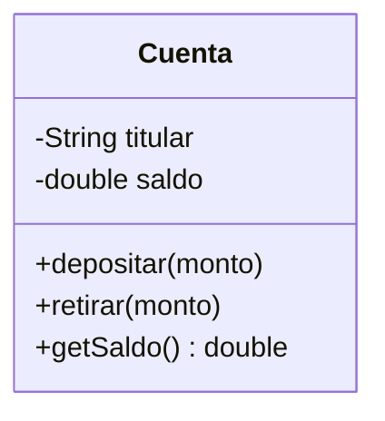
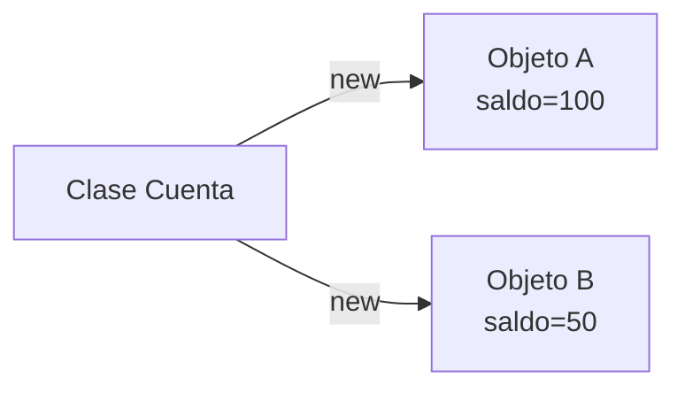
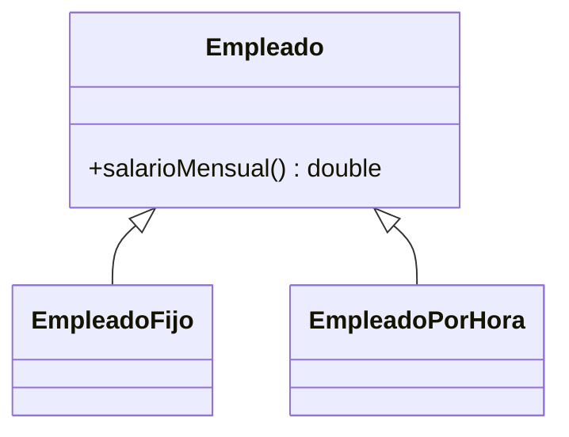
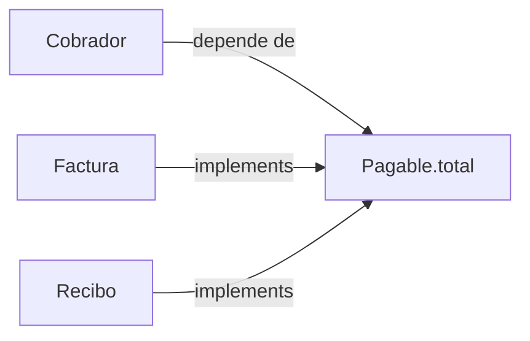
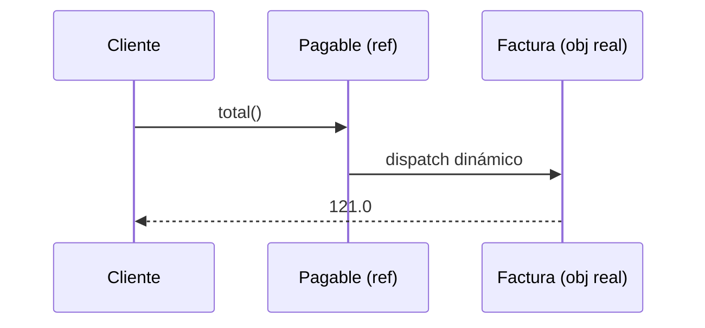
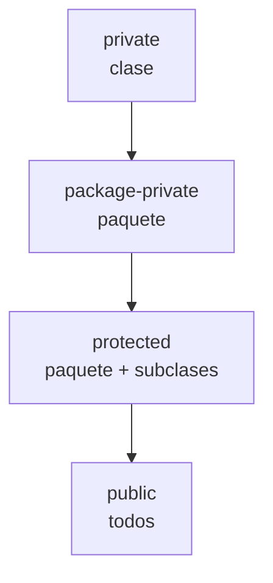

# Módulo 1: Programación orientada a objetos

Cuando un programa crece, variables sueltas y funciones dispersas dejan de ser suficientes: los datos quedan separados de las reglas que los protegen y cualquier parte del sistema puede romper invariantes. La Programación Orientada a Objetos (POO) organiza el código alrededor de tipos que modelan conceptos del dominio, combinan estado y comportamiento, y exponen contratos claros. Este módulo va desde clases/objetos hasta records y constructores flexibles de Java moderno, con el enfoque de cero a experto: primero el modelo mental, luego el contrato, luego código ejecutable y diagnóstico.

**Entorno de referencia verificado (2026-05-22):** JDK 27.0.1.0.2, `javac 27.0.1.0.2`, macOS/Linux shell compatible. Los ejemplos son Java puro, sin Maven/Gradle.

## Aprende construyendo

### Tema 1: Clases, objetos, constructores y encapsulación · Básico · 40 min

Caso guía: modelar una cuenta bancaria. Un `double saldo` suelto no basta: hay titular, saldo, depósitos, retiros y reglas que impiden estados inválidos. Si cualquiera puede escribir `cuenta.saldo = -999`, el modelo ya no representa el dominio.

#### Clases

**Definición formal.** Una clase es un tipo de referencia que define la estructura (campos) y el comportamiento (métodos/constructores) de sus instancias.

**Cómo funciona por dentro.** La clase es la plantilla/tipo en tiempo de compilación y de carga. Define qué campos tendrá cada objeto, qué métodos puede invocar y qué invariantes debe preservar. La JVM usa la definición cargada para crear instancias con el layout esperado.



**Cuándo usarla / cuándo no.** Úsala cuando datos y reglas estén cohesionados. No crees clases “Dios” con responsabilidades no relacionadas.

**Ejemplo mínimo enfocado (ejecutable).**

```bash
mkdir -p /tmp/j1-clase && cd /tmp/j1-clase
cat > DemoClase.java << 'JAVA'
class CuentaMin {
  double saldo;
  void depositar(double m) { saldo += m; }
}
public class DemoClase {
  public static void main(String[] args) {
    CuentaMin c = new CuentaMin();
    c.depositar(10);
    System.out.println(c.saldo);
  }
}
JAVA
javac DemoClase.java && java DemoClase
```

**Caso de uso real.** `Cuenta`, `Pedido`, `Reserva`, `Factura`.

**Error común.** Clase con demasiadas responsabilidades. Síntoma: cambiar un requisito rompe otro. Causa: baja cohesión. Corrección: separar responsabilidades por tipo.

**Verificación (JDK 27, 2026-05-22).** Salida: `10.0`.

#### Objetos

**Definición formal.** Un objeto es una instancia concreta de una clase, creada con `new`, con identidad, estado y comportamiento.

**Cómo funciona por dentro.** `new` asigna memoria para la instancia, inicializa campos, ejecuta el constructor y devuelve una referencia. Dos objetos de la misma clase pueden tener el mismo estado pero distinta identidad.



**Ejemplo mínimo enfocado (ejecutable).**

```bash
mkdir -p /tmp/j1-obj && cd /tmp/j1-obj
cat > DemoObj.java << 'JAVA'
class Caja { int v; Caja(int v){ this.v = v; } }
public class DemoObj {
  public static void main(String[] args) {
    Caja a = new Caja(1);
    Caja b = new Caja(2);
    System.out.println(a == b);
    System.out.println(a.v + " " + b.v);
  }
}
JAVA
javac DemoObj.java && java DemoObj
```

**Error común.** Confundir clase con objeto. Síntoma: esperar estado compartido o usar campos de instancia como si fueran globales. Corrección: instanciar con `new`; usar `static` solo para estado/comportamiento verdaderamente de clase.

**Verificación (JDK 27, 2026-05-22).** Salida: `false`, `1 2`.

#### Constructores

**Definición formal.** Un constructor es una rutina especial con el nombre de la clase, sin tipo de retorno, que inicializa una instancia durante la creación.

**Contrato/reglas.** Debe dejar el objeto en estado válido. Puede validar argumentos, asignar campos y delegar con `this(...)` o `super(...)`. No debe hacer I/O pesado innecesario.

**Ejemplo mínimo enfocado (ejecutable).**

```bash
mkdir -p /tmp/j1-ctor && cd /tmp/j1-ctor
cat > DemoCtor.java << 'JAVA'
class CuentaC {
  final String titular;
  CuentaC(String titular) {
    if (titular == null || titular.isBlank()) throw new IllegalArgumentException("titular");
    this.titular = titular;
  }
}
public class DemoCtor {
  public static void main(String[] args) {
    System.out.println(new CuentaC("Ada").titular);
    try { new CuentaC(""); } catch (IllegalArgumentException e) { System.out.println("error"); }
  }
}
JAVA
javac DemoCtor.java && java DemoCtor
```

**Error común.** Permitir objetos inválidos al nacer. Síntoma: fallos tardíos alejados de la causa. Corrección: validar invariantes en el constructor.

**Verificación (JDK 27, 2026-05-22).** Salida: `Ada`, `error`.

#### Encapsulación

**Definición formal.** Encapsulación es ocultar la representación interna (`private`) y exponer operaciones controladas que preservan invariantes.

**Cómo funciona por dentro.** Los campos privados no son accesibles desde fuera de la clase. Los métodos públicos actúan como frontera: validan entradas y cambian estado de forma coherente. Esto permite cambiar la representación interna sin romper clientes.

**Ejemplo mínimo enfocado (ejecutable).**

```bash
mkdir -p /tmp/j1-enc && cd /tmp/j1-enc
cat > DemoEnc.java << 'JAVA'
class CajaE {
  private int v;
  void set(int v) { if (v < 0) throw new IllegalArgumentException("negativo"); this.v = v; }
  int get() { return v; }
}
public class DemoEnc {
  public static void main(String[] args) {
    CajaE c = new CajaE();
    c.set(5);
    System.out.println(c.get());
    try { c.set(-1); } catch (IllegalArgumentException e) { System.out.println("bloqueado"); }
  }
}
JAVA
javac DemoEnc.java && java DemoEnc
```

**Error común.** Getters/setters ciegos para todo. Síntoma: encapsulación nominal, estado inválido posible. Corrección: exponer operaciones de dominio (`depositar`, `retirar`) y validar invariantes.

**Verificación (JDK 27, 2026-05-22).** Salida: `5`, `bloqueado`.

#### Ejemplo integrado: Cuenta

```bash
mkdir -p /tmp/java-m1-t1 && cd /tmp/java-m1-t1
cat > Cuenta.java << 'JAVA'
public class Cuenta {
  private final String titular;
  private double saldo;

  public Cuenta(String titular, double saldoInicial) {
    if (titular == null || titular.isBlank()) throw new IllegalArgumentException("Titular inválido");
    if (saldoInicial < 0) throw new IllegalArgumentException("Saldo inicial inválido");
    this.titular = titular;
    this.saldo = saldoInicial;
  }

  public String getTitular() { return titular; }
  public double getSaldo() { return saldo; }

  public void depositar(double monto) {
    if (monto <= 0) throw new IllegalArgumentException("Monto inválido");
    saldo += monto;
  }

  public void retirar(double monto) {
    if (monto <= 0) throw new IllegalArgumentException("Monto inválido");
    if (monto > saldo) throw new IllegalStateException("Saldo insuficiente");
    saldo -= monto;
  }

  public static void main(String[] args) {
    Cuenta c = new Cuenta("Ada", 100);
    c.depositar(50);
    c.retirar(30);
    System.out.println(c.getTitular());
    System.out.println(c.getSaldo());
    try { c.retirar(500); } catch (IllegalStateException e) { System.out.println(e.getMessage()); }
  }
}
JAVA
javac Cuenta.java && java Cuenta
```

**Recorrido.** `titular` y `saldo` son privados; no hay escritura directa. El constructor establece invariantes iniciales. `depositar` y `retirar` validan entrada y estado. `IllegalArgumentException` señala dato inválido; `IllegalStateException` señala operación inválida para el estado actual.

**Verificación (JDK 27, 2026-05-22).**

```text
Ada
120.0
Saldo insuficiente
```

### Tema 2: Herencia y sobreescritura · Básico · 40 min

Caso guía: empleados fijos y por hora comparten identidad y API común, pero calculan salario distinto. Copiar/pegar duplica reglas; herencia y sobreescritura permiten compartir contrato base y especializar comportamiento.

#### Herencia

**Definición formal.** Herencia es el mecanismo por el cual una subclase (`extends`) reutiliza y especializa miembros accesibles de una superclase, modelando una relación “es un”.

**Cómo funciona por dentro.** La subclase contiene la parte de la superclase y su propia especialización. La JVM resuelve métodos sobrescritos por dispatch dinámico según el objeto real.



**Cuándo usarla / cuándo no.** Úsala solo si la relación es realmente “es un”. Si solo quieres reutilizar código, prefiere composición.

**Ejemplo mínimo enfocado (ejecutable).**

```bash
mkdir -p /tmp/j1-her && cd /tmp/j1-her
cat > DemoHer.java << 'JAVA'
class Animal { String tipo(){ return "animal"; } }
class Perro extends Animal { String ladrar(){ return "guau"; } }
public class DemoHer {
  public static void main(String[] args){ System.out.println(new Perro().tipo()); }
}
JAVA
javac DemoHer.java && java DemoHer
```

**Error común.** Heredar por conveniencia. Síntoma: subclase recibe comportamiento que no tiene sentido. Corrección: composición/delegación.

**Verificación (JDK 27, 2026-05-22).** `animal`.

#### Sobreescritura

**Definición formal.** Sobreescritura es redefinir en una subclase un método con la misma firma y contrato compatible que uno visible de la superclase.

**Contrato/reglas.** Usa `@Override`. Misma firma; tipo de retorno covariante permitido; no puedes reducir visibilidad; no debes romper el contrato del método base.

**Ejemplo mínimo enfocado (ejecutable).**

```bash
mkdir -p /tmp/j1-ov && cd /tmp/j1-ov
cat > DemoOv.java << 'JAVA'
class A { String f(){ return "A"; } }
class B extends A { @Override String f(){ return "B"; } }
public class DemoOv {
  public static void main(String[] args){ A x = new B(); System.out.println(x.f()); }
}
JAVA
javac DemoOv.java && java DemoOv
```

**Error común.** Cambiar firma y creer que sobrescribiste. Síntoma: se ejecuta el método base. Corrección: `@Override` hace fallar compilación si no hay override real.

**Verificación (JDK 27, 2026-05-22).** `B`.

#### Ejemplo integrado

```bash
mkdir -p /tmp/j1-t2 && cd /tmp/j1-t2
cat > Herencia.java << 'JAVA'
class Empleado {
  protected final String nombre;
  Empleado(String nombre) { this.nombre = nombre; }
  double salarioMensual() { return 0; }
  String descripcion() { return nombre + ": " + salarioMensual(); }
}
class EmpleadoFijo extends Empleado {
  private final double mensual;
  EmpleadoFijo(String nombre, double mensual) { super(nombre); this.mensual = mensual; }
  @Override double salarioMensual() { return mensual; }
}
class EmpleadoPorHora extends Empleado {
  private final double horas;
  private final double tarifa;
  EmpleadoPorHora(String nombre, double horas, double tarifa) { super(nombre); this.horas = horas; this.tarifa = tarifa; }
  @Override double salarioMensual() { return horas * tarifa; }
}
public class Herencia {
  public static void main(String[] args) {
    Empleado e1 = new EmpleadoFijo("Ada", 2000);
    Empleado e2 = new EmpleadoPorHora("Grace", 80, 20);
    System.out.println(e1.descripcion());
    System.out.println(e2.descripcion());
  }
}
JAVA
javac Herencia.java && java Herencia
```

**Verificación (JDK 27, 2026-05-22).**

```text
Ada: 2000.0
Grace: 1600.0
```

### Tema 3: Interfaces, clases abstractas y polimorfismo · Intermedio · 45 min

Caso guía: un sistema de cobros procesa facturas, recibos y notas de crédito. El cobrador no debe conocer cada clase concreta; y algunos documentos comparten estado común, pero “documento genérico” no debe instanciarse.

#### Interfaz

**Definición formal.** Una interfaz declara un contrato de comportamiento (`interface`); las clases lo implementan con `implements`.

**Cómo funciona por dentro.** El cliente depende del tipo contrato, no de la implementación. La JVM despacha al método de la implementación real en tiempo de ejecución.



**Cuándo usarla / cuándo no.** Úsala para capacidades transversales o desacoplar clientes. No fuerces interfaz si lo que necesitas es compartir estado/base común fuerte.

**Ejemplo mínimo enfocado (ejecutable).**

```bash
mkdir -p /tmp/j1-int && cd /tmp/j1-int
cat > DemoInt.java << 'JAVA'
interface Pagable { double total(); }
class Factura implements Pagable { public double total(){ return 121.0; } }
public class DemoInt {
  static void cobrar(Pagable p){ System.out.println(p.total()); }
  public static void main(String[] args){ cobrar(new Factura()); }
}
JAVA
javac DemoInt.java && java DemoInt
```

**Error común.** Programar contra la clase concreta. Síntoma: cada nuevo tipo obliga a modificar el cliente. Corrección: depender de la interfaz.

**Verificación (JDK 27, 2026-05-22).** `121.0`.

#### Clase abstracta

**Definición formal.** Clase declarada `abstract` que no puede instanciarse; puede tener estado, métodos concretos y métodos abstractos.

**Cuándo usarla.** Cuando hay relación “es un” y base común real con partes incompletas.

**Ejemplo mínimo enfocado (ejecutable).**

```bash
mkdir -p /tmp/j1-abs && cd /tmp/j1-abs
cat > DemoAbs.java << 'JAVA'
abstract class Documento {
  protected final String id;
  Documento(String id){ this.id = id; }
  abstract double total();
  String etiqueta(){ return id + ":" + total(); }
}
class Recibo extends Documento {
  private final double monto;
  Recibo(String id, double monto){ super(id); this.monto = monto; }
  @Override double total(){ return monto; }
}
public class DemoAbs {
  public static void main(String[] args){ System.out.println(new Recibo("R1",100).etiqueta()); }
}
JAVA
javac DemoAbs.java && java DemoAbs
```

**Error común.** Base abstracta gigante. Síntoma: subclases heredan basura. Corrección: mantener solo lo común estable.

**Verificación (JDK 27, 2026-05-22).** `R1:100.0`.

#### Polimorfismo

**Definición formal.** Capacidad de tratar objetos de tipos concretos distintos a través de un tipo común, ejecutando la implementación real en runtime.

**Cómo funciona por dentro.** La variable es de tipo base/interfaz, el objeto real es concreto. La llamada a método virtual se resuelve por el tipo real del objeto.



**Ejemplo mínimo enfocado (ejecutable).**

```bash
mkdir -p /tmp/j1-poly && cd /tmp/j1-poly
cat > DemoPoly.java << 'JAVA'
interface PagableP { double total(); }
class FacturaP implements PagableP { public double total(){ return 121.0; } }
class ReciboP implements PagableP { public double total(){ return 100.0; } }
public class DemoPoly {
  static void imprimir(PagableP p){ System.out.println(p.total()); }
  public static void main(String[] args){ imprimir(new FacturaP()); imprimir(new ReciboP()); }
}
JAVA
javac DemoPoly.java && java DemoPoly
```

**Error común.** Cadena de `instanceof` en el cliente. Síntoma: cada nuevo tipo rompe el cliente. Corrección: mover comportamiento al contrato polimórfico.

**Verificación (JDK 27, 2026-05-22).** `121.0`, `100.0`.

#### Ejemplo integrado

```bash
mkdir -p /tmp/j1-t3 && cd /tmp/j1-t3
cat > Polimorfismo.java << 'JAVA'
interface Pagable { double total(); }
abstract class Documento implements Pagable {
  protected final String id;
  Documento(String id){ this.id = id; }
  String etiqueta(){ return id + ":" + total(); }
}
class Factura extends Documento {
  private final double base;
  Factura(String id, double base){ super(id); this.base = base; }
  @Override public double total(){ return base * 1.21; }
}
class Recibo extends Documento {
  private final double monto;
  Recibo(String id, double monto){ super(id); this.monto = monto; }
  @Override public double total(){ return monto; }
}
public class Polimorfismo {
  static void imprimir(Pagable p){ System.out.println(p.total()); }
  public static void main(String[] args) {
    Documento f = new Factura("F1", 100);
    Documento r = new Recibo("R1", 100);
    imprimir(f);
    imprimir(r);
    System.out.println(f.etiqueta());
  }
}
JAVA
javac Polimorfismo.java && java Polimorfismo
```

**Verificación (JDK 27, 2026-05-22).** `121.0`, `100.0`, `F1:121.0`.

### Tema 4: Sobrecarga, sobreescritura y modificadores de acceso · Intermedio · 35 min

Caso guía: una API necesita variantes de `pagar` con distintos parámetros, subclases que especializan comportamiento, y control estricto de visibilidad para no exponer estado interno.

#### Sobrecarga

**Definición formal.** Sobrecarga (overload) es definir varios métodos con el mismo nombre pero distinta lista de parámetros en el mismo ámbito.

**Contrato.** Se resuelve en compilación por tipos/aritidad. No se diferencia solo por tipo de retorno.

**Ejemplo mínimo enfocado (ejecutable).**

```bash
mkdir -p /tmp/j1-over && cd /tmp/j1-over
cat > DemoOver.java << 'JAVA'
class Calc {
  int sum(int a,int b){ return a+b; }
  double sum(double a,double b){ return a+b; }
}
public class DemoOver {
  public static void main(String[] args){ Calc c=new Calc(); System.out.println(c.sum(1,2)); System.out.println(c.sum(1.5,2.5)); }
}
JAVA
javac DemoOver.java && java DemoOver
```

**Error común.** Sobrecargas ambiguas/confusas. Corrección: nombres o parámetros claros.

**Verificación (JDK 27, 2026-05-22).** `3`, `4.0`.

#### Sobreescritura

**Definición formal.** Sobreescritura (override) redefine en runtime el comportamiento de un método heredado con la misma firma.

**Ejemplo mínimo enfocado (ejecutable).**

```bash
mkdir -p /tmp/j1-overr && cd /tmp/j1-overr
cat > DemoOverr.java << 'JAVA'
class Base { String who(){ return "base"; } }
class Sub extends Base { @Override String who(){ return "sub"; } }
public class DemoOverr { public static void main(String[] args){ Base b=new Sub(); System.out.println(b.who()); } }
JAVA
javac DemoOverr.java && java DemoOverr
```

**Error común.** Olvidar `@Override`. Corrección: anotarlo siempre.

**Verificación (JDK 27, 2026-05-22).** `sub`.

#### Modificadores de acceso

**Definición formal.** `private`, package-private (sin modificador), `protected`, `public` controlan visibilidad de miembros/tipos.

**Cómo funciona.** `private`: solo clase. package-private: mismo paquete. `protected`: paquete y subclases. `public`: todos.



**Ejemplo mínimo enfocado (ejecutable).**

```bash
mkdir -p /tmp/j1-mod && cd /tmp/j1-mod
cat > DemoMod.java << 'JAVA'
class BaseM { private int x=1; protected int y=2; public int z=3; int p=4; int sum(){ return x+y+z+p; } }
public class DemoMod { public static void main(String[] args){ System.out.println(new BaseM().sum()); } }
JAVA
javac DemoMod.java && java DemoMod
```

**Error común.** Hacer todo `public`. Síntoma: acoplamiento y ruptura de invariantes. Corrección: mínima visibilidad necesaria.

**Verificación (JDK 27, 2026-05-22).** `10`.

### Tema 5: `record` — modelos inmutables sin boilerplate · Intermedio · 35 min

Caso guía: necesitas transportar datos de respuesta (`id`, `codigo`) sin lógica mutable. Con clases tradicionales escribes constructor, getters, `equals`, `hashCode`, `toString`; un record lo declara de forma compacta.

#### Record

**Definición formal.** Un `record` es una clase especial para portadores de datos inmutables cuyos componentes definen su API y estado.

**Cómo funciona por dentro.** El compilador genera constructor canónico, accesores, `equals`, `hashCode` y `toString` basados en componentes.

**Ejemplo mínimo enfocado (ejecutable).**

```bash
mkdir -p /tmp/j1-rec && cd /tmp/j1-rec
cat > DemoRec.java << 'JAVA'
record Punto(int x, int y) {}
public class DemoRec { public static void main(String[] args){ System.out.println(new Punto(1,2)); } }
JAVA
javac DemoRec.java && java DemoRec
```

**Cuándo usarlo / cuándo no.** Úsalo para DTOs/value objects inmutables. No para entidades JPA mutables o con identidad compleja.

**Error común.** Intentar mutar componentes. Corrección: crear nuevo record.

**Verificación (JDK 27, 2026-05-22).** `Punto[x=1, y=2]`.

#### Constructor compacto y validación

**Definición formal.** El constructor compacto permite validar/normalizar componentes sin reescribir la asignación canónica.

**Ejemplo mínimo enfocado (ejecutable).**

```bash
mkdir -p /tmp/j1-recv && cd /tmp/j1-recv
cat > DemoRecV.java << 'JAVA'
record Email(String value) {
  Email { if (value == null || !value.contains("@")) throw new IllegalArgumentException("email"); }
}
public class DemoRecV {
  public static void main(String[] args) {
    System.out.println(new Email("a@b.com").value());
    try { new Email("bad"); } catch (IllegalArgumentException e) { System.out.println("error"); }
  }
}
JAVA
javac DemoRecV.java && java DemoRecV
```

**Verificación (JDK 27, 2026-05-22).** `a@b.com`, `error`.

### Tema 6: Constructores flexibles (Java 25) · Avanzado · 30 min

Caso guía: antes de llamar a `super(...)` quieres normalizar/validar argumentos. Históricamente Java obligaba a que `super(...)`/`this(...)` fuera la primera sentencia.

#### Regla clásica de `super(...)` / `this(...)`

**Definición formal.** Antes de constructores flexibles, la invocación a otro constructor debía ser la primera sentencia del constructor.

**Error común.** Poner validación antes de `super(...)` en versiones/estilos antiguos causa error de compilación.

**Verificación.** El ejemplo siguiente demuestra el enfoque moderno.

#### Constructores flexibles

**Definición formal.** Java permite prologar con lógica antes de `super(...)`/`this(...)` en el modelo de constructores flexibles (JEP 513, Java 25), con reglas que preservan inicialización segura.

**Ejemplo mínimo enfocado (ejecutable, JDK 27).**

```bash
mkdir -p /tmp/j1-flex && cd /tmp/j1-flex
cat > DemoFlex.java << 'JAVA'
class Base {
  final String id;
  Base(String id){ this.id = id; }
}
class User extends Base {
  User(String raw) {
    String normalizado = raw == null ? "" : raw.trim().toUpperCase();
    if (normalizado.isBlank()) throw new IllegalArgumentException("id");
    super(normalizado);
  }
}
public class DemoFlex {
  public static void main(String[] args) { System.out.println(new User(" ab ").id); }
}
JAVA
javac DemoFlex.java && java DemoFlex
```

**Error común.** Usar `this` antes de inicializar la superclase. Corrección: respetar reglas de inicialización segura; hacer solo validación/normalización local.

**Verificación (JDK 27, 2026-05-22).** Salida: `AB`.

## Cierre

POO en Java no es solo sintaxis: es diseño de invariantes, contratos y colaboración entre objetos. Usar clases/encapsulación protege estado; herencia/polimorfismo habilita extensibilidad cuando hay relación real; records simplifican datos inmutables; constructores flexibles permiten validación temprana limpia.

## Checklist

- Puedo modelar una clase con invariantes y encapsulación real.
- Distingo overload de override y uso `@Override`.
- Elijo interfaz vs clase abstracta por contrato vs base común.
- Uso records para DTO/value objects inmutables.
- Conozco la regla moderna de constructores y valido antes de `super(...)` cuando corresponde.
