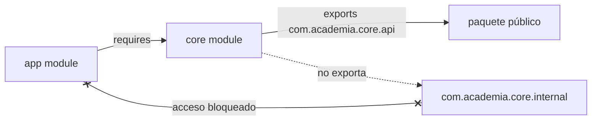
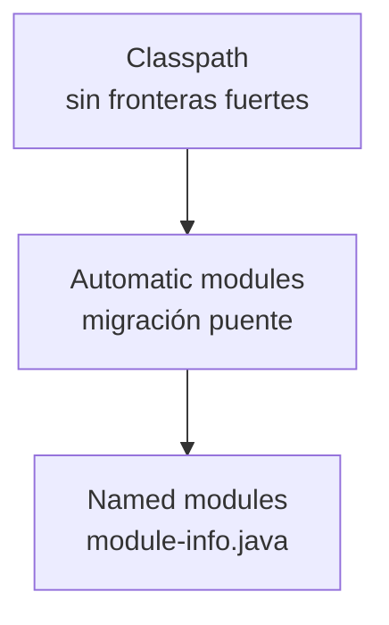

# Módulo 10: Java Platform Module System (JPMS)

Cuando un proyecto crece, la visibilidad por paquetes y classpath deja de ser suficiente: todo queda “abierto” a todo, y las dependencias internas se vuelven accidentales. JPMS (Java 9+) introduce módulos para declarar dependencias y encapsulación fuerte. No todo proyecto lo necesita; su valor aparece en bases grandes, librerías y runtimes controlados.

**Contexto Tienda Aurora.** Este módulo aporta bases para Tienda Aurora: los conceptos aquí se aplican en el monolito modular y luego en los microservicios.

**Entorno de referencia verificado (2026-05-22):** JDK 27.0.1.0.2.

## Aprende construyendo

## Proyecto desde cero: tienda-aurora-java-m10

## Prerrequisitos

```bash
java -version    # JDK 25+
gradle --version # Gradle 9.x
```

## Estructura del proyecto

```text
tienda-aurora-java-m10/
├── build.gradle.kts
├── settings.gradle.kts
└── src/
    └── main/
        └── java/com/aurora/java/
            └── Main.java
```

## build.gradle.kts

```kotlin
plugins {
    java
    application
}

group = "com.aurora"
version = "1.0.0"

java {
    toolchain {
        languageVersion = JavaLanguageVersion.of(25)
    }
}

application {
    mainClass.set("com.aurora.java.Main")
}

repositories {
    mavenCentral()
}
```

## settings.gradle.kts

```kotlin
rootProject.name = "tienda-aurora-java-m10"
```

## Ejecutar

```bash
./gradlew run
# O directamente:
mkdir -p out
javac -d out src/main/java/com/aurora/java/**/*.java
java -cp out com.aurora.java.Main
```

### Tema 1: module-info.java y encapsulación fuerte · Intermedio · 40 min

**Caso guía.** una librería `com.academia.core` expone API pública pero oculta implementación interna.

`module-info.java`, `exports`, `requires`

**Definición.** Un módulo es una unidad nombrada de código con `module-info.java` que declara dependencias (`requires`) y paquetes exportados (`exports`).

 El compilador y la JVM aplican accesibilidad fuerte de módulo: un paquete no exportado no es accesible desde otros módulos, aunque sea `public`. Esto es más fuerte que package-private/classpath.



**Ejemplo mínimo enfocado (ejecutable).**

```bash
mkdir -p java-m10/src/com.academia.core/com/academia/core/api
mkdir -p java-m10/src/com.academia.core/com/academia/core/internal
mkdir -p java-m10/src/com.academia.app/com/academia/app
cd java-m10
```

Crea el archivo `src/com.academia.core/module-info.java`:

```java
module com.academia.core {
  exports com.academia.core.api;
}
```

Crea el archivo `src/com.academia.core/com/academia/core/api/Saludo.java`:

```java
package com.academia.core.api;
public class Saludo { public static String hola() { return "hola"; } }
```

Crea el archivo `src/com.academia.core/com/academia/core/internal/Oculto.java`:

```java
package com.academia.core.internal;
public class Oculto { public static String secreto() { return "x"; } }
```

Crea el archivo `src/com.academia.app/module-info.java`:

```java
module com.academia.app {
  requires com.academia.core;
}
```

Crea el archivo `src/com.academia.app/com/academia/app/Main.java`:

```java
package com.academia.app;
import com.academia.core.api.Saludo;
public class Main { public static void main(String[] args){ System.out.println(Saludo.hola()); } }
```

```bash
javac -d out --module-source-path src $(find src -name "*.java")
java --module-path out -m com.academia.app/com.academia.app.Main
```

**Error común.** Asumir que `public` basta. En JPMS, `public` no exportado es inaccesible para otros módulos. Síntoma: error de compilación “package is not visible”.

**Verificación (JDK 27, 2026-05-22).** `hola`.

### Tema 2: Migración incremental y cuándo JPMS aporta valor · Intermedio · 35 min

**Caso guía.** un monolito en classpath quiere modularizarse gradualmente.

Classpath, module path y módulos automáticos

**Definición.** El classpath es el modelo clásico sin encapsulación fuerte. El module path habilita módulos. Un jar no modular en module path puede convertirse en módulo automático (nombre derivado).

**Cuándo usar JPMS.** Aporta en librerías/plataformas grandes, JDK/runtime custom (jlink), y encapsulación interna fuerte. No es obligatorio para toda app; el costo de migración puede superar el beneficio en apps pequeñas.



**Ejemplo mínimo enfocado.** El ejemplo del Tema 1 ya usa module path. Un jar sin `module-info` en `--module-path` se trata como automático.

**Error común.** Modularizar todo de golpe. Corrección: bottom-up, empezar por librerías estables, usar `jar --describe-module`.

**Verificación.** `jar --describe-module --file=algún.jar` o `java --describe-module java.sql` muestra descriptor.

### Tema 3: opens para acceso reflexivo controlado de frameworks · Avanzado · 35 min

**Caso guía.** un framework como Jackson/Hibernate necesita reflexión sobre campos privados. JPMS lo bloquea salvo que se abra.

`opens` y `opens ... to`

**Definición.** `exports` permite acceso en compilación/runtime a tipos públicos. `opens` permite acceso reflexivo profundo (incluyendo no públicos) en runtime; `opens ... to` lo limita a módulos específicos.

**Ejemplo mínimo enfocado (ejecutable).**

```bash
mkdir -p java-m10-ref/src/com.academia.model/com/academia/model
mkdir -p java-m10-ref/src/com.academia.app/com/academia/app
cd java-m10-ref
```

Crea el archivo `src/com.academia.model/module-info.java`:

```java
module com.academia.model {
  exports com.academia.model;
  opens com.academia.model to com.academia.app;
}
```

Crea el archivo `src/com.academia.model/com/academia/model/User.java`:

```java
package com.academia.model;
public class User { private String name = "Ada"; }
```

Crea el archivo `src/com.academia.app/module-info.java`:

```java
module com.academia.app {
  requires com.academia.model;
}
```

Crea el archivo `src/com.academia.app/com/academia/app/Main.java`:

```java
package com.academia.app;
import com.academia.model.User;
import java.lang.reflect.Field;
public class Main {
  public static void main(String[] args) throws Exception {
    Field f = User.class.getDeclaredField("name");
    f.setAccessible(true);
    System.out.println(f.get(new User()));
  }
}
```

```bash
javac -d out --module-source-path src $(find src -name "*.java")
java --module-path out -m com.academia.app/com.academia.app.Main
```

**Error común.** Usar `open module` sin necesidad. Abre todo el módulo a reflexión. Corrección: `opens paquete to modulo` puntual.

**Verificación (JDK 27, 2026-05-22).** `Ada`.

## Cierre

JPMS aporta encapsulación fuerte y dependencias explícitas. Úsalo donde el beneficio supere el costo de migración.

## Checklist

- Entiendo `module-info.java`, `requires`, `exports`.
- Distingo `exports` (acceso API) de `opens` (reflexión).
- Sé cuándo JPMS vale la pena y cuándo no.
