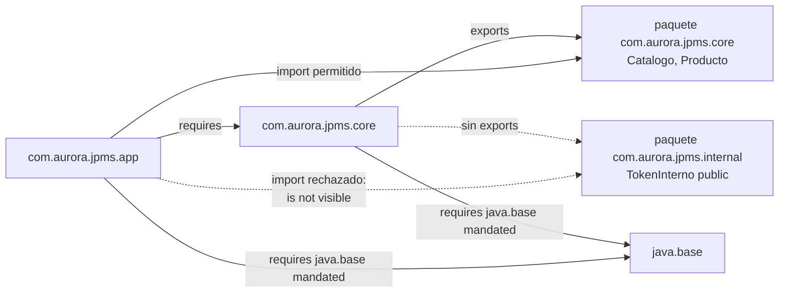
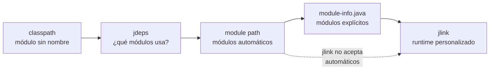
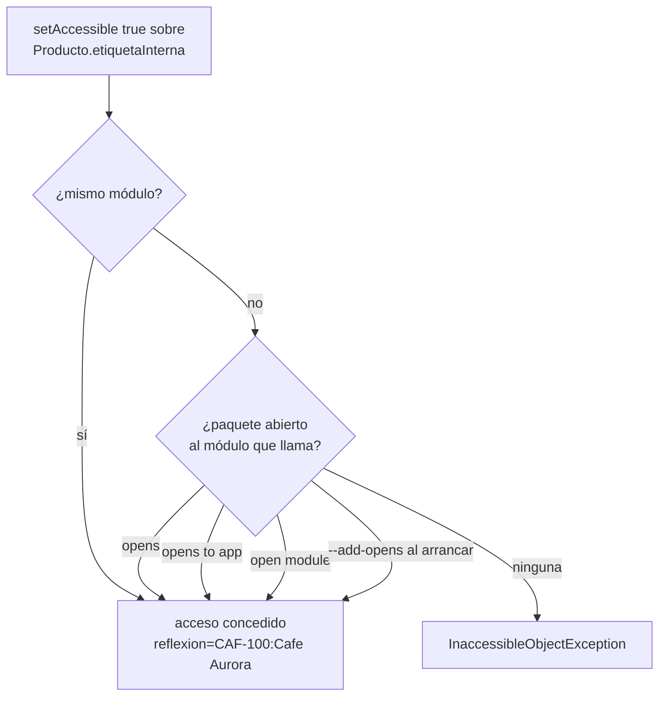

# Módulo 10: Módulos (JPMS) y empaquetado con jlink

**Entorno de las salidas.** Las salidas originales del módulo se capturaron el 2026-11-23 en `~/labs/aurora-m10` con macOS
arm64, JDK 27.0.1.0.2 (Temurin), Gradle 9.9.1 y toolchain Java 25. Las salidas nuevas de esta edición se capturaron el
2026-11-24 con OpenJDK 25.0.5.1 en Linux x86_64, usando `javac`, `java`, `jar`, `jdeps` y `jlink` sin Gradle. Cada
salida nueva lo indica con la frase «captura con JDK 25». Las rutas personales se muestran como `tu-usuario`.

JPMS añade una capa de límites al classpath. El mecanismo es un descriptor, `module-info.java`, que declara el nombre del módulo, qué módulos lee (`requires`), qué paquetes publica (`exports`) y qué paquetes abre a reflexión (`opens`). En tiempo de compilación y ejecución, la JVM construye un grafo de módulos y solo permite acceso a los paquetes exportados por ese grafo; un tipo `public` en un paquete no exportado sigue siendo inaccesible desde fuera.

Este mecanismo existe porque en un classpath plano cualquier clase pública puede ser importada por cualquier otra clase, y las dependencias reales quedan implícitas. JPMS convierte esas relaciones en declaraciones verificables y permite además construir una imagen de ejecución reducida con `jlink`. La implicación es doble: ganas encapsulación fuerte y una forma de empaquetado que solo incluye los módulos necesarios, a cambio de tener que mantener los descriptores y lidiar con dependencias no modularizadas. La confusión frecuente es creer que JPMS sustituye a `public`/`private`: no los sustituye, los complementa con un límite entre módulos.

El proyecto verificado es `tienda-aurora-jpms` en `~/labs/aurora-m10`, con módulos `core` y `app`. Además se compilaron módulos pequeños con `javac` para demostrar `requires transitive`, `ServiceLoader` y automatic modules; ese código se muestra por separado y no forma parte del build Gradle.

## Apertura del módulo

**Al terminar este módulo podrás:**
- declarar un `module-info.java` con `requires`, `exports`, `opens`, `uses` y `provides`;
- demostrar que un paquete no exportado es inaccesible aunque contenga clases `public`;
- leer y corregir los errores `is not visible`, `does not read it`, `module not found` e `InaccessibleObjectException`;
- planear una migración incremental con el módulo sin nombre, módulos automáticos y `jdeps`;
- generar con `jlink` un runtime personalizado que arranca la aplicación con un launcher propio;
- decidir cuándo JPMS aporta valor y cuándo es complejidad innecesaria.

**Esquema del módulo:**
1. Tema 1: `module-info.java` y encapsulación fuerte.
2. Tema 2: migración incremental, `jdeps` y `jlink`.
3. Tema 3: `opens` para reflexión controlada.
4. Laboratorio integrador: `tienda-aurora-jpms` con Gradle y una imagen `jlink`.

**Qué necesitas saber antes:** paquetes, `import` y modificadores de acceso (Módulo 1), el JDK y sus herramientas
(Módulo 0) y proyectos Gradle multi-módulo (Módulo 8). La reflexión con `Method` aparece aquí por primera vez y se
explica en el Tema 3.

## Visual del módulo

**Visual:** [JPMS con exports, opens y paquete interno no exportado](/visuals/temas/java/modulo-10-jpms.html)

Lectura: exports publica API, opens habilita reflexión controlada, y lo no exportado queda encapsulado.

### Tema 1: module-info.java y encapsulación fuerte · Intermedio · 60 min

<details open>
<summary><strong>Capa 1 — Lectura</strong></summary>

#### Objetivos
Al terminar este tema podrás:
- escribir el `module-info.java` de un módulo proveedor y de uno consumidor;
- comprobar con `jar --describe-module` qué publica un módulo;
- explicar por qué una clase `public` de un paquete no exportado no se puede importar;
- usar `requires transitive` y el par `provides`/`uses` de `ServiceLoader`.

**Conceptos clave:** módulo JPMS, `module-info.java`, module path, grafo de módulos, `requires`, `exports`, encapsulación fuerte, `requires transitive`, ServiceLoader

#### El problema
Tienda Aurora separa su código en `core` (catálogo y productos) y `app` (el programa que lo usa). En `core` hay una
clase `TokenInterno` con un secreto. Es `public` porque otras clases de `core` la usan. Con el classpath de siempre,
cualquier jar podría importarla. ¿Cómo publicas el catálogo y escondes `TokenInterno` sin quitarle el `public`?

#### Glosario del tema

**módulo JPMS**
- **Definición técnica:** unidad con nombre formada por paquetes y un descriptor que declara qué módulos lee y qué paquetes publica; lo introdujo el Java Platform Module System en Java 9.
- **En palabras sencillas:** una caja con nombre y con puertas: de la caja solo sale lo que tiene puerta.
- **Dónde se rompe la comparación:** una caja física esconde todo por igual; un módulo puede abrir un paquete solo para reflexión (`opens`, Tema 3).
- **Ejemplo:** `java --list-modules | wc -l` imprime `69` y la primera línea es `java.base@25.0.5.1` (captura con JDK 25): el propio JDK está hecho de módulos.
- **Error típico:** confundir un módulo JPMS con un subproyecto de Gradle (`include("core")`): Gradle organiza el build; JPMS controla el acceso al compilar y al ejecutar.

**`module-info.java`**
- **Definición técnica:** archivo fuente en la raíz de las fuentes del módulo; se compila a `module-info.class` y declara nombre, `requires`, `exports`, `opens`, `uses` y `provides`.
- **En palabras sencillas:** la cédula del módulo: cómo se llama, a quién necesita y qué muestra.
- **Dónde se rompe la comparación:** una cédula solo identifica; este archivo además obliga: `javac` hace cumplir cada línea.
- **Ejemplo:** `module com.aurora.jpms.app { requires com.aurora.jpms.core; }` declara el módulo de la aplicación.
- **Error típico:** escribir mal el nombre de un módulo requerido. `requires com.aurora.jpms.nucleo;` produce `error: module not found: com.aurora.jpms.nucleo` (captura con JDK 25).

**module path**
- **Definición técnica:** lista de jars o carpetas donde `javac`, `java` y `jlink` buscan módulos; se pasa con `--module-path` o `-p` y reemplaza al classpath para código modular.
- **En palabras sencillas:** el estante donde la JVM busca las cajas con nombre.
- **Dónde se rompe la comparación:** en el estante también cabe un jar sin descriptor: la JVM le inventa un nombre (módulo automático, Tema 2).
- **Ejemplo:** `java --module-path out -m com.aurora.jpms.app/com.aurora.jpms.app.TiendaAuroraJpmsApp` imprime `productos=2` (captura con JDK 25).
- **Error típico:** dejar un módulo fuera del path. `jlink` responde `Error: Module com.aurora.jpms.core not found, required by com.aurora.jpms.app`.

**grafo de módulos**
- **Definición técnica:** conjunto de módulos resueltos al compilar o arrancar, unidos por aristas «lee a» que salen de cada `requires`; el acceso se comprueba sobre ese grafo.
- **En palabras sencillas:** el mapa de quién puede hablar con quién, dibujado antes de que el programa empiece.
- **Dónde se rompe la comparación:** un mapa se puede corregir en el camino; el grafo queda fijo al arrancar, salvo con APIs avanzadas como `ModuleLayer`.
- **Ejemplo:** dentro de la imagen `jlink`, `java --list-modules` muestra el grafo completo: `com.aurora.jpms.app`, `com.aurora.jpms.core` y `java.base`.
- **Error típico:** confundir «not in the module graph» (falta `requires` o `--add-modules`) con «does not export it» (falta `exports`).

**`requires`**
- **Definición técnica:** directiva del descriptor que declara que este módulo lee a otro; sin ella, ningún paquete del otro módulo es visible.
- **En palabras sencillas:** «para trabajar necesito a este módulo».
- **Dónde se rompe la comparación:** necesitar a alguien no te da acceso a todo lo suyo: solo ves lo que ese módulo exporta.
- **Ejemplo:** `requires com.aurora.jpms.core;` permite a `app` importar `Catalogo` y `Producto`.
- **Error típico:** olvidarlo. `javac` responde `(package com.aurora.jpms.core is declared in module com.aurora.jpms.core, but module com.aurora.jpms.app does not read it)`.

**`exports`**
- **Definición técnica:** directiva que publica un paquete: otros módulos pueden compilar y ejecutar contra sus tipos `public` y sus miembros `public` y `protected`.
- **En palabras sencillas:** la puerta del módulo, abierta paquete por paquete.
- **Dónde se rompe la comparación:** la puerta es por paquete, no por clase: exportar un paquete publica todas sus clases públicas.
- **Ejemplo:** `jar --describe-module` del jar de `core` imprime `exports com.aurora.jpms.core` y no menciona `com.aurora.jpms.internal` en sus exports.
- **Error típico:** creer que `exports` permite leer métodos privados por reflexión: eso exige `opens` (Tema 3).

**encapsulación fuerte**
- **Definición técnica:** garantía de JPMS de que los tipos de un paquete no exportado son inaccesibles desde otro módulo, aunque sean `public`, tanto al compilar como en reflexión.
- **En palabras sencillas:** `public` deja de significar «para todo el mundo» y pasa a significar «para quien tenga la puerta».
- **Dónde se rompe la comparación:** dentro del mismo módulo `public` funciona como siempre; la frontera está entre módulos, no entre clases.
- **Ejemplo:** importar `TokenInterno` desde fuera produce `package com.aurora.jpms.internal is not visible`.
- **Error típico:** esperar la protección con el jar en el classpath: ahí el código corre en el módulo sin nombre y no se comprueban los exports del descriptor.

**`requires transitive`**
- **Definición técnica:** variante de `requires` que concede también la lectura a todo módulo que lea a este; se usa cuando la API pública expone tipos de la dependencia.
- **En palabras sencillas:** «quien me use a mí recibe también a mi dependencia».
- **Dónde se rompe la comparación:** no copia código ni exporta paquetes ajenos: solo agrega una arista de lectura en el grafo.
- **Ejemplo:** `java --describe-module java.sql` imprime `requires java.logging transitive` (captura con JDK 25): quien usa JDBC recibe el logging.
- **Error típico:** quitar `transitive` de una fachada. El consumidor falla con `(package demo.api is declared in module demo.api, but module demo.app does not read it)`.

**ServiceLoader, `provides` y `uses`**
- **Definición técnica:** `java.util.ServiceLoader` descubre en runtime implementaciones de una interfaz; `provides I with C` registra a `C` como proveedor e `uses I` declara que el módulo las busca.
- **En palabras sencillas:** un tablón de anuncios: unos módulos se ofrecen para un trabajo y otros buscan quién lo haga.
- **Dónde se rompe la comparación:** si nadie se ofrece, no hay error al compilar: el consumidor recibe un resultado vacío al ejecutar.
- **Ejemplo:** `Fachada.cargar()` encuentra `SaludoAurora` y el programa imprime `hola desde ServiceLoader`.
- **Error típico:** olvidar `uses`. Al ejecutar aparece `` java.util.ServiceConfigurationError: demo.api.Saludo: module demo.fachada does not declare `uses` `` (captura con JDK 25).

#### ► CÓMO FUNCIONA

##### 1. La idea en lenguaje sencillo

Una bodega de envíos tiene áreas con puertas. El mostrador de atención está abierto al público. La oficina donde se guardan las claves de las cajas fuertes también tiene empleados «públicos» dentro, pero su puerta no da a la calle. Ser empleado no te da acceso a cualquier oficina: depende de qué puertas tiene el edificio.

En Java, `public` siempre significó «cualquiera puede usarme». Con el classpath, si `TokenInterno` es `public`, cualquier jar puede importarlo. El Java Platform Module System, JPMS, añade un nivel por encima de la clase: el módulo decide qué paquetes tienen puerta hacia afuera.

Así, `core` publica el paquete del catálogo y deja `com.aurora.jpms.internal` sin puerta. Las clases de `core` siguen usando `TokenInterno` entre ellas, pero ningún otro módulo puede importarlo.

##### 2. Definición formal y vocabulario

Un **módulo JPMS** es un conjunto de paquetes con nombre y un descriptor. Lo introdujo Java 9, con la especificación JSR 376 y la JEP 261. El descriptor es **`module-info.java`**, que se compila a `module-info.class` en la raíz del jar.

El descriptor usa directivas. **`requires`** declara que el módulo lee a otro. **`exports`** publica un paquete. **`requires transitive`** pasa la lectura a quien lea a este módulo. **`provides … with`** y **`uses`** conectan proveedores y consumidores de **ServiceLoader**. `opens` se estudia en el Tema 3.

Los módulos se buscan en el **module path**, el equivalente modular del classpath. Al compilar o arrancar, el sistema arma el **grafo de módulos**: los módulos resueltos y sus aristas de lectura. Sobre ese grafo se aplica la **encapsulación fuerte**: un tipo `public` de un paquete no exportado es inaccesible fuera de su módulo.

##### 3. Cómo funciona por dentro, paso a paso

Cuando ejecutas `java --module-path out -m com.aurora.jpms.app/…`, la JVM hace esto antes de correr tu `main`:

1. Toma como **módulo raíz** el que indicaste con `-m`.
2. Lee su descriptor y busca cada `requires` en el module path y en los módulos del JDK.
3. Repite con cada módulo encontrado, hasta que no queden dependencias sin resolver. Si falta uno, falla con `module not found`.
4. Agrega las aristas implícitas: todo módulo lee `java.base`, y cada `requires transitive` añade lecturas indirectas.
5. Verifica que dos módulos del grafo no contengan el mismo paquete. Ese conflicto se llama **paquete dividido** y es un error.
6. Fija el grafo. Desde ahí, cada acceso de un módulo a otro se comprueba contra las aristas y los exports.

Para cada `import` entre módulos, el compilador hace dos preguntas en orden. Primero: ¿mi módulo **lee** al módulo dueño del paquete? Después: ¿ese módulo **exporta** el paquete? Si falla la primera, el mensaje dice `does not read it` o `not in the module graph`. Si falla la segunda, dice `does not export it`.



El grafo también se puede consultar desde el código, con la clase `java.lang.Module`:

```java
Module base = String.class.getModule();
System.out.println("String vive en: " + base.getName());
System.out.println("exporta java.lang: " + base.isExported("java.lang"));
System.out.println("exporta jdk.internal.misc: " + base.isExported("jdk.internal.misc"));
System.out.println("Fronteras tiene nombre de módulo: " + Fronteras.class.getModule().isNamed());
```

Dentro de una clase `Fronteras` ejecutada con `java Fronteras.java`, imprime:

```text
String vive en: java.base
exporta java.lang: true
exporta jdk.internal.misc: false
Fronteras tiene nombre de módulo: false
```

El JDK aplica a sí mismo la regla que aplicas a `core`: `jdk.internal.misc` tiene clases `public`, pero `java.base` no lo exporta. La última línea muestra que una clase sin descriptor vive en el **módulo sin nombre**, que el Tema 2 explica.

Con `requires transitive`, el paso 4 hace el trabajo. `demo.fachada` lee `demo.api` y lo marca como transitivo. Entonces `demo.app`, que lee `demo.fachada`, recibe también la arista hacia `demo.api`, sin escribir ningún `requires`.

ServiceLoader funciona sobre el grafo ya resuelto. `ServiceLoader.load(Saludo.class)` recorre los módulos que declaran `provides demo.api.Saludo with …` y crea una instancia de cada proveedor. Solo puede llamarlo un módulo que declare `uses`.

##### 4. Reglas, variantes y casos límite

El nombre de un módulo sigue las reglas de los nombres de paquete: identificadores separados por puntos. Se recomienda el dominio invertido, como `com.aurora.jpms.core`. No se admiten guiones.

`exports` trabaja por paquete, nunca por clase. No incluye subpaquetes: exportar `com.aurora.jpms` no exporta `com.aurora.jpms.core`.

`exports paquete to módulo` es una exportación **calificada**: solo los módulos nombrados pueden acceder. El JDK la usa para compartir paquetes internos entre sus propios módulos.

`requires static` declara una dependencia obligatoria al compilar y opcional al ejecutar. Sirve para anotaciones o integraciones que no siempre están presentes.

Las dependencias entre módulos no pueden formar ciclos: `javac` rechaza un descriptor que cierre un ciclo de `requires`. Es la misma regla que viste con los proyectos multi-módulo de Gradle y Maven.

Un proveedor de ServiceLoader debe tener un constructor público sin parámetros o un método `public static provider()`. Si ningún módulo provee el servicio, no hay error de compilación: `findFirst()` devuelve un `Optional` vacío.

La encapsulación del propio JDK se endureció por etapas. Java 16 negó por defecto el acceso reflexivo a sus internos (JEP 396), y Java 17 retiró la opción `--illegal-access` (JEP 403).

##### 5. Relación con lo que ya sabes y lo que viene

En el Módulo 1 viste paquetes y modificadores de acceso. JPMS no los reemplaza: añade una frontera más. Dentro de un módulo, `public`, `protected` y `private` funcionan igual que siempre.

En el Módulo 8, Tema 3, los módulos de Gradle impedían importar lo que no estaba en el classpath. JPMS va más allá: aunque el jar esté presente, sus paquetes no exportados siguen cerrados. Las dos herramientas se combinan, y no son lo mismo.

La configuración `api` de Gradle y `requires transitive` resuelven el mismo problema en capas distintas: ambas declaran que tu contrato expone tipos de otra dependencia.

El Tema 2 explica qué pasa con los jars que no tienen descriptor y cómo `jlink` usa el grafo para armar un runtime a medida. El Tema 3 estudia `opens`, la directiva que deja entrar a la reflexión.

#### Problema resuelto 1.1
Publica el catálogo de Tienda Aurora desde `core` y úsalo desde `app`, sin publicar `com.aurora.jpms.internal`.

**Razonamiento:**
1. `core` tiene dos paquetes. Solo `com.aurora.jpms.core` debe salir: va en `exports`. El paquete `internal` no se menciona.
2. `app` necesita `Catalogo`: declara `requires com.aurora.jpms.core`.
3. Se compila, se ejecuta y se comprueba el descriptor con `jar --describe-module`, sin confiar en la memoria.

**`core/src/main/java/module-info.java`**

```java
module com.aurora.jpms.core {
    exports com.aurora.jpms.core;
    opens com.aurora.jpms.core;
}
```

`exports` publica el paquete de API. `opens` habilita reflexión profunda en runtime sobre ese mismo paquete. `com.aurora.jpms.internal` no aparece en el descriptor: queda fuera del grafo de módulos para consumidores.

**`core/src/main/java/com/aurora/jpms/core/Producto.java`**

```java
package com.aurora.jpms.core;

import java.math.BigDecimal;

public record Producto(String sku, String nombre, BigDecimal precio) {
    private String etiquetaInterna() {
        return sku + ":" + nombre;
    }
}
```

**`core/src/main/java/com/aurora/jpms/core/Catalogo.java`**

```java
package com.aurora.jpms.core;

import java.math.BigDecimal;
import java.util.List;

public final class Catalogo {
    public Catalogo() {
    }

    public List<Producto> productos() {
        return List.of(
                new Producto("CAF-100", "Cafe Aurora", new BigDecimal("14.90")),
                new Producto("MOL-200", "Molino Manual", new BigDecimal("79.90"))
        );
    }
}
```

**`core/src/main/java/com/aurora/jpms/internal/TokenInterno.java`**

```java
package com.aurora.jpms.internal;

public final class TokenInterno {
    public static String valor() {
        return "secreto";
    }
}
```

**`app/src/main/java/module-info.java`**

```java
module com.aurora.jpms.app {
    requires com.aurora.jpms.core;
}
```

**`app/src/main/java/com/aurora/jpms/app/TiendaAuroraJpmsApp.java`**

```java
package com.aurora.jpms.app;

import com.aurora.jpms.core.Catalogo;
import com.aurora.jpms.core.Producto;

import java.lang.reflect.Method;

public final class TiendaAuroraJpmsApp {

    public static void main(String[] args) throws Exception {
        Catalogo catalogo = new Catalogo();
        Producto primero = catalogo.productos().getFirst();
        System.out.println("productos=" + catalogo.productos().size());
        System.out.println("primero=" + primero.sku());

        Method m = Producto.class.getDeclaredMethod("etiquetaInterna");
        m.setAccessible(true);
        System.out.println("reflexion=" + m.invoke(primero));
    }
}
```

El proyecto se construye con Gradle (archivos completos en el Laboratorio integrador):

```bash
cd ~/labs/aurora-m10
./gradlew -q :app:run
```

```text
productos=2
primero=CAF-100
reflexion=CAF-100:Cafe Aurora
```

El descriptor del jar de `core` muestra exactamente qué se exporta y qué se abre:

```bash
cd ~/labs/aurora-m10
jar --describe-module --file core/build/libs/core-1.0.0.jar
```

```text
com.aurora.jpms.core jar:file:///Users/tu-usuario/labs/aurora-m10/core/build/libs/core-1.0.0.jar!/module-info.class
exports com.aurora.jpms.core
requires java.base mandated
opens com.aurora.jpms.core
```

**Explicación por partes.**
- Descriptor de `core`, línea 2: `exports` publica solo el paquete de API. El paquete `internal` no aparece en ninguna línea.
- Descriptor de `core`, línea 3: `opens` permite la reflexión de las líneas 16–18 de la aplicación; lo estudias en el Tema 3.
- Descriptor de `app`, línea 2: `requires` crea la arista `app → core` del grafo.
- Aplicación, líneas 11–14: usa `Catalogo` y `Producto`, que viven en el paquete exportado.
- Salida de `jar`: `requires java.base mandated` aparece aunque no lo escribiste. `java.base` es obligatorio para todo módulo.

#### Problema resuelto 1.2
Comprueba que la encapsulación es real: intenta usar `TokenInterno`, que es `public`, desde fuera de `core`.

**Razonamiento:**
1. Si `public` bastara, el import compilaría. La predicción de JPMS es lo contrario.
2. Hay que poner `core` en el grafo con `--add-modules`. Así el fallo solo puede deberse a la falta de `exports`.

Se creó `~/labs/aurora-m10/build/intruder-src/Intruder.java`:

```java
import com.aurora.jpms.internal.TokenInterno;

public class Intruder {
    public static void main(String[] args) {
        System.out.println(TokenInterno.valor());
    }
}
```

```bash
cd ~/labs/aurora-m10
javac --module-path core/build/libs/core-1.0.0.jar \
  --add-modules com.aurora.jpms.core \
  -d build/intruder-out build/intruder-src/Intruder.java
```

```text
build/intruder-src/Intruder.java:1: error: package com.aurora.jpms.internal is not visible
import com.aurora.jpms.internal.TokenInterno;
                      ^
  (package com.aurora.jpms.internal is declared in module com.aurora.jpms.core, which does not export it)
1 error
```

Sin `--add-modules` el error previo es distinto —`which is not in the module graph`— porque el módulo ni siquiera estaba en el grafo. Con el módulo en el grafo, el fallo se debe exclusivamente a la falta de `exports`. `TokenInterno` es `public`, y aun así no puede importarse: esa es la encapsulación fuerte.

**Explicación por partes.**
- `Intruder.java:1`: el error apunta a la línea del `import`, antes de llegar a usar la clase.
- La línea entre paréntesis dice quién es el dueño del paquete y qué falta: `which does not export it`.

> **Error común.** Creer que `public` basta para acceder a una clase. Fuera del módulo, `public` solo es visible si el
> paquete está exportado. El compilador lo dice literal: `package com.aurora.jpms.internal is not visible` y, entre
> paréntesis, `which does not export it`. La solución no es exportar el paquete interno: es usar la API pública.

> **Error común.** Olvidar `requires` en el consumidor. Con un `module-info.java` vacío en `app`, `javac` imprime
> dos veces `package com.aurora.jpms.core is not visible` seguido de
> `(package com.aurora.jpms.core is declared in module com.aurora.jpms.core, but module com.aurora.jpms.app does not read it)`
> y termina con `2 errors` (captura con JDK 25). «does not read it» significa «falta un `requires`».

> **Buena práctica.** Exporta solo los paquetes que forman tu API y deja la implementación en paquetes como
> `internal` o `impl`. Así puedes cambiar la implementación sin romper a nadie que dependa de ti.

#### Problema resuelto 1.3
Construye una fachada que devuelva un `Saludo` cuya implementación no conoce nadie más que su proveedor.

**Razonamiento:**
1. `demo.api` define la interfaz. `demo.impl` la implementa y se registra con `provides ... with ...`.
2. `demo.fachada` llama a `ServiceLoader.load`, así que declara `uses`.
3. La fachada devuelve un `Saludo`, tipo de `demo.api`: debe usar `requires transitive demo.api` para que su cliente lo lea.

Estos archivos se crearon solo bajo `~/labs/aurora-m10/build/jpms-demo/` para ejecutar las demostraciones de `requires transitive` y `ServiceLoader`. No se añadieron al build Gradle del proyecto.

**`src/demo.api/module-info.java`**

```java
module demo.api {
    exports demo.api;
    uses demo.api.Saludo;
}
```

**`src/demo.api/demo/api/Saludo.java`**

```java
package demo.api;
public interface Saludo { String mensaje(); }
```

**`src/demo.impl/module-info.java`**

```java
module demo.impl {
    requires demo.api;
    provides demo.api.Saludo with demo.impl.SaludoAurora;
}
```

**`src/demo.impl/demo/impl/SaludoAurora.java`**

```java
package demo.impl;
public final class SaludoAurora implements demo.api.Saludo {
    @Override public String mensaje() { return "hola desde ServiceLoader"; }
}
```

**`src/demo.fachada/module-info.java`**

```java
module demo.fachada {
    requires transitive demo.api;
    exports demo.fachada;
    uses demo.api.Saludo;
}
```

**`src/demo.fachada/demo/fachada/Fachada.java`**

```java
package demo.fachada;
import demo.api.Saludo;
import java.util.ServiceLoader;
public final class Fachada {
    public static Saludo cargar() {
        return ServiceLoader.load(Saludo.class).findFirst().orElseThrow();
    }
}
```

**`src/demo.app/module-info.java`**

```java
module demo.app {
    requires demo.fachada;
}
```

**`src/demo.app/demo/app/App.java`**

```java
package demo.app;
import demo.api.Saludo;
import demo.fachada.Fachada;
public final class App {
    public static void main(String[] args) {
        Saludo saludo = Fachada.cargar();
        System.out.println(saludo.mensaje());
    }
}
```

`demo.app` importa `demo.api.Saludo` sin declarar `requires demo.api`: solo declara `requires demo.fachada`. Eso compila porque `demo.fachada` usa `requires transitive demo.api`. El módulo `demo.fachada` también declara `uses` porque es quien llama a `ServiceLoader.load`.

```bash
cd ~/labs/aurora-m10
D=build/jpms-demo
JH=$JAVA_HOME/bin   # JDK 27 de Temurin en la máquina de verificación
MP=$D/out/demo.api:$D/out/demo.impl:$D/out/demo.fachada:$D/out/demo.app
for m in demo.api demo.impl demo.fachada demo.app; do
  $JH/javac --module-path "$MP" -d $D/out/$m $(find $D/src/$m -name '*.java')
done
$JH/java --module-path "$MP" --module demo.app/demo.app.App
```

```text
hola desde ServiceLoader
```

Para comprobar el efecto de `transitive`, se recompiló `demo.fachada` con `requires demo.api;` (sin `transitive`) y se compiló `demo.app` contra esa versión:

```text
build/jpms-demo/plain-src/demo.app/demo/app/App.java:2: error: package demo.api is not visible
import demo.api.Saludo;
           ^
  (package demo.api is declared in module demo.api, but module demo.app does not read it)
1 error
```

`app` no declara `requires demo.api`, pero con `requires transitive` sí puede usar `Saludo`; sin esa palabra clave, la compilación falla. En paralelo, `provides ... with ...` en `demo.impl` registró el proveedor y `uses` en `demo.fachada` permitió descubrirlo mediante `ServiceLoader`.

**Explicación por partes.**
- `Fachada.java`, línea 6: `findFirst()` devuelve un `Optional`; `orElseThrow()` falla si ningún módulo se ofreció.
- `App.java`, línea 2: este import solo compila gracias a la arista transitiva `demo.fachada → demo.api`.
- `demo.app` nunca nombra a `SaludoAurora`: puedes cambiar de proveedor sin recompilar la aplicación.

> **Error común.** Pensar que `uses` registra proveedores. `provides ... with ...` los registra; `uses` declara que el
> módulo consumidor los busca. Si quitas `uses` de `demo.fachada`, todo compila, pero al ejecutar aparece
> `` java.util.ServiceConfigurationError: demo.api.Saludo: module demo.fachada does not declare `uses` ``
> (captura con JDK 25).

> **Prevenir errores.** Si quitas `demo.impl` del module path, el programa falla con
> `java.util.NoSuchElementException: No value present` en `Fachada.java:6` (captura con JDK 25). Cuando el
> proveedor es opcional, reemplaza `orElseThrow()` por un valor por defecto o un mensaje claro.

**Implicaciones verificadas.** El jar de `core` declara `exports com.aurora.jpms.core` y no menciona `com.aurora.jpms.internal`. El compilador rechaza `Intruder.java` con “which does not export it” aunque `TokenInterno` sea `public`. En la demostración aislada, `hola desde ServiceLoader` se imprimió con `provides`/`uses`, y quitar `transitive` produjo un error de compilación en `demo.app`.

#### Checkpoint 1.1
Mueves `TokenInterno` al paquete `com.aurora.jpms.core` sin tocar el descriptor. ¿Compila ahora `Intruder.java`
cambiando solo el `import`?

Respuesta: sí. El paquete `com.aurora.jpms.core` está exportado y la clase es `public`. Por eso los secretos se dejan
en paquetes que no se exportan.

</details>

<details>
<summary><strong>Capa 2 — Construcción</strong></summary>

#### Paso 1 · Crea la estructura
Crea las carpetas con los comandos de Bootstrap del Laboratorio integrador y copia los seis archivos del Problema
resuelto 1.1 en sus rutas.

#### Paso 2 · Ejecuta y describe
Ejecuta `./gradlew -q :app:run` y luego `jar --describe-module --file core/build/libs/core-1.0.0.jar`. Compara con las
salidas del Problema resuelto 1.1.

#### Paso 3 · Provoca la encapsulación
Crea `build/intruder-src/Intruder.java` y compílalo con `--add-modules`. Repite sin `--add-modules` y anota la
diferencia entre `which does not export it` y `not in the module graph`.

#### Paso 4 · Rompe y repara el grafo
Borra la línea `requires` de `app/src/main/java/module-info.java` y ejecuta `./gradlew :app:compileJava`. Lee el
mensaje `does not read it` y restaura la línea.

#### Paso 5 · Servicios y transitividad
Compila la demostración de `build/jpms-demo` con el bucle `for` del Problema resuelto 1.3. Quita `transitive` y
después `uses`, y observa los dos errores distintos.

#### Resumen
- Un **módulo JPMS** tiene nombre y un **`module-info.java`** que declara qué lee y qué publica.
- `java` y `javac` buscan módulos en el **module path** y arman un **grafo de módulos** antes de ejecutar.
- **`requires`** crea la arista «lee a»; **`exports`** abre un paquete a otros módulos.
- La **encapsulación fuerte** hace invisible una clase `public` si su paquete no está exportado.
- **`requires transitive`** pasa la lectura a los clientes de una fachada.
- **ServiceLoader** une proveedores (`provides ... with`) y consumidores (`uses`) sin que se conozcan.

#### Ejercicio verificable 1
Básico. Ejecuta `java --describe-module java.sql`. ¿Qué módulos recibe por transitividad quien declara
`requires java.sql`?

Respuesta esperada: `java.transaction.xa`, `java.logging` y `java.xml`, las tres líneas que terminan en `transitive`
(captura con JDK 25). `java.base` aparece como `mandated`, no como transitivo.

#### Ejercicio verificable 2
Intermedio. Crea en `core` el paquete `com.aurora.jpms.precios` con una clase pública `Descuento` y úsala desde
`app`. ¿Qué línea debes añadir y en qué archivo?

Respuesta esperada: `exports com.aurora.jpms.precios;` en `core/src/main/java/module-info.java`. Sin ella, `javac`
responde `package com.aurora.jpms.precios is not visible` con `which does not export it`.

#### Ejercicio verificable 3
Reto. Agrega a `build/jpms-demo` un módulo `demo.impl2` con otra implementación de `Saludo`. ¿Qué cambia si recorres
`ServiceLoader.load(Saludo.class)` con un `for` en lugar de `findFirst()`?

Respuesta esperada: `demo.impl2` declara `requires demo.api;` y `provides demo.api.Saludo with demo.impl2.OtroSaludo;`.
El `for` imprime un mensaje por proveedor; `findFirst()` solo devuelve uno. No conviene depender de cuál es el primero.

#### En el trabajo
Las librerías que publican API estable (clientes HTTP, drivers JDBC, el propio JDK) usan `exports` para separar API de
implementación. El JDK mismo lo hace: desde Java 17 (JEP 403), paquetes internos como `sun.nio.ch` están
fuertemente encapsulados. `ServiceLoader` es como JDBC encuentra drivers: `java.sql` declara `uses java.sql.Driver`.

</details>

### Tema 2: Migración incremental y cuándo JPMS aporta valor · Intermedio · 50 min

<details open>
<summary><strong>Capa 1 — Lectura</strong></summary>

#### Objetivos
Al terminar este tema podrás:
- distinguir el módulo sin nombre, un módulo automático y un módulo explícito;
- fijar el nombre de un módulo automático con `Automatic-Module-Name`;
- usar `jdeps` para saber qué módulos del JDK necesita un jar;
- generar y ejecutar con `jlink` un runtime personalizado con launcher propio.

**Conceptos clave:** módulo sin nombre (unnamed module), módulo automático, `Automatic-Module-Name`, jdeps, jlink, runtime personalizado

#### El problema
Tienda Aurora tiene un jar heredado, `aurora-util-1.2.3.jar`, que nadie ha modularizado. El equipo quiere módulos
en `core` y `app` sin esperar a reescribir ese jar. Además, el servidor de despliegue no debería cargar un JDK
completo para un programa que solo usa `java.base`. ¿Cómo migras por partes y cómo reduces el runtime?

#### Glosario del tema

**módulo sin nombre (unnamed module)**
- **Definición técnica:** módulo implícito donde la JVM coloca todo lo cargado desde el classpath; lee a todos los módulos resueltos y no tiene descriptor.
- **En palabras sencillas:** el cajón de sastre: todo lo que no tiene caja propia va ahí.
- **Dónde se rompe la comparación:** del cajón puedes sacar cosas, pero un módulo con nombre no puede declarar `requires` hacia él.
- **Ejemplo:** ejecutado desde el classpath, `Formato.class.getModule().isNamed()` imprime `nombrado=false` y `getName()` imprime `nombre=null` (captura con JDK 25).
- **Error típico:** esperar encapsulación fuerte en el classpath: el módulo sin nombre no tiene `exports` que hacer cumplir.

**módulo automático**
- **Definición técnica:** módulo con nombre que la JVM deriva de un jar sin `module-info.class` puesto en el module path; exporta y abre todos sus paquetes y lee a todos los módulos.
- **En palabras sencillas:** una caja con nombre provisional para un jar viejo, sin puertas cerradas.
- **Dónde se rompe la comparación:** parece un módulo real, pero no protege nada: todos sus paquetes quedan expuestos.
- **Ejemplo:** `jar --describe-module` sobre `aurora-util-1.2.3.jar` imprime `aurora.util@1.2.3 automatic`.
- **Error típico:** depender del nombre derivado del archivo. Si alguien renombra el jar, cambia el nombre del módulo y los `requires` dejan de resolver.

**`Automatic-Module-Name`**
- **Definición técnica:** atributo del `MANIFEST.MF` de un jar que fija el nombre de su módulo automático, en vez de derivarlo del nombre del archivo.
- **En palabras sencillas:** una etiqueta permanente pegada al jar, que no depende de cómo se llame el archivo.
- **Dónde se rompe la comparación:** fija solo el nombre; el jar sigue siendo automático y sigue exportándolo todo.
- **Ejemplo:** con `Automatic-Module-Name: com.ejemplo.util`, el mismo jar se describe como `com.ejemplo.util@1.2.3 automatic` (captura con JDK 25).
- **Error típico:** olvidar el salto de línea final del manifiesto: `jar` ignora la última línea si no termina en salto de línea.

**jdeps**
- **Definición técnica:** herramienta del JDK que analiza clases compiladas y lista los paquetes y módulos de los que dependen.
- **En palabras sencillas:** un inventario automático de lo que un jar necesita para funcionar.
- **Dónde se rompe la comparación:** solo ve dependencias estáticas; lo cargado por reflexión o `ServiceLoader` no aparece.
- **Ejemplo:** `jdeps --print-module-deps aurora-util-1.2.3.jar` imprime `java.base,java.logging` (captura con JDK 25).
- **Error típico:** confiar en `jdeps` cuando el código carga clases por nombre con `Class.forName`: esas dependencias faltarán en la lista.

**jlink**
- **Definición técnica:** herramienta del JDK que enlaza un conjunto de módulos y sus dependencias transitivas en una imagen de ejecución autónoma.
- **En palabras sencillas:** un empacador que arma un Java a la medida, solo con las piezas que tu programa usa.
- **Dónde se rompe la comparación:** solo empaca módulos con nombre; un jar en el classpath o un módulo automático no se pueden enlazar.
- **Ejemplo:** `jlink --add-modules com.aurora.jpms.app ... --launcher aurora=...` genera `build/jlink-aurora`; su `bin/aurora` imprime `productos=2`.
- **Error típico:** dejar un módulo fuera del module path: `Error: Module com.aurora.jpms.core not found, required by com.aurora.jpms.app`.

**runtime personalizado**
- **Definición técnica:** imagen creada por `jlink` con su propia JVM, solo los módulos resueltos desde `--add-modules` y, opcionalmente, launchers que arrancan la aplicación.
- **En palabras sencillas:** un Java de bolsillo que viaja con tu aplicación y no necesita un JDK instalado.
- **Dónde se rompe la comparación:** al viajar contigo, también viajan sus fallas de seguridad: tú debes regenerarlo cuando sale un parche del JDK.
- **Ejemplo:** la imagen de Tienda Aurora ocupó `32M` con JDK 27 en macOS y `42M` con JDK 25 en Linux (captura con JDK 25).
- **Error típico:** usar el runtime para otra aplicación que necesita `java.sql`: la imagen no lo contiene y la clase no se encuentra.

#### ► CÓMO FUNCIONA

##### 1. La idea en lenguaje sencillo

Una empresa de envíos que cambia a bodegas con áreas cerradas no puede detener la operación un mes. Ordena primero las áreas nuevas y deja funcionando las viejas, con un letrero provisional en la puerta. Las va cerrando una por una, cuando ya sabe qué entra y qué sale de cada una.

Tienda Aurora vive lo mismo. `core` y `app` ya pueden tener descriptor, pero `aurora-util-1.2.3.jar` no lo tiene y nadie lo va a reescribir pronto. JPMS ofrece dos lugares de transición para ese código: el módulo sin nombre y los módulos automáticos.

Al final del camino hay un premio concreto. Cuando todo el programa está en módulos con nombre, `jlink` puede armar un Java a medida que solo contiene lo que el programa usa. El servidor ya no necesita un JDK completo.

##### 2. Definición formal y vocabulario

Todo lo que la JVM carga desde el classpath va al **módulo sin nombre** (*unnamed module*). Ese módulo lee a todos los demás módulos del grafo y expone todos sus paquetes. Un módulo con nombre, en cambio, no puede declarar `requires` hacia él.

Un jar sin descriptor colocado en el module path se convierte en un **módulo automático**. Recibe un nombre, lee a todos los módulos y exporta y abre todos sus paquetes. El atributo **`Automatic-Module-Name`** del manifiesto fija ese nombre de forma estable.

**jdeps** analiza clases compiladas y reporta de qué módulos dependen. **jlink**, introducido en Java 9 con la JEP 282, enlaza módulos con nombre en una imagen de ejecución. El resultado es un **runtime personalizado**: una carpeta con su propia JVM y solo los módulos necesarios.

##### 3. Cómo funciona por dentro, paso a paso

Cuando pones un jar sin descriptor en el module path, el buscador de módulos le asigna un nombre así:

1. Si el manifiesto tiene `Automatic-Module-Name`, usa ese valor y no mira el nombre del archivo.
2. Si no, toma el nombre del archivo y le quita la extensión `.jar`.
3. Busca un guion seguido de un dígito. Lo que sigue es la versión: `1.2.3`.
4. En lo que queda, reemplaza cada carácter que no sea letra ni dígito por un punto y colapsa los puntos repetidos.

La API `java.lang.module.ModuleFinder` aplica exactamente esas reglas. Este fragmento lista los módulos que encontraría en la carpeta `lib`:

```java
ModuleFinder.of(Path.of("lib")).findAll().stream()
    .map(ref -> ref.descriptor())
    .sorted((a, b) -> a.name().compareTo(b.name()))
    .forEach(d -> System.out.println(d.toNameAndVersion() + " automatic=" + d.isAutomatic()));
```

Con `aurora-util-1.2.3.jar` y `mi_lib-core-2.0.jar` en `lib`, dentro de un `main`, imprime:

```text
aurora.util@1.2.3 automatic=true
mi.lib.core@2.0 automatic=true
```

El guion y el guion bajo se volvieron puntos. Por eso renombrar el archivo cambia el nombre del módulo, y por eso conviene fijarlo en el manifiesto.

La migración incremental sigue un orden de abajo arriba:

1. `jdeps` dice qué módulos del JDK y qué jars necesita cada componente.
2. Los jars ajenos sin descriptor pasan del classpath al module path, como automáticos.
3. Cada componente propio recibe su `module-info.java`, empezando por los que no dependen de nadie.
4. Cuando todo el grafo tiene descriptores explícitos, `jlink` puede enlazarlo.



Para el último paso, `jlink` hace esto:

1. Toma los módulos de `--add-modules` como raíces y resuelve el grafo con las mismas reglas que la JVM al arrancar.
2. Busca cada módulo del JDK en el propio JDK y los tuyos en `--module-path`.
3. Copia en `--output` una JVM y solo los módulos resueltos.
4. Aplica los complementos pedidos: quitar información de depuración, comprimir, crear el launcher.

Por eso la imagen de Tienda Aurora lista tres módulos y no los 69 del JDK completo.

##### 4. Reglas, variantes y casos límite

Un módulo automático lee también al módulo sin nombre. Gracias a eso, un jar automático puede usar clases que siguen en el classpath. Un módulo explícito no tiene ese permiso.

Un módulo automático no tiene descriptor real, así que no declara qué necesita. Por eso `jlink` lo rechaza con `automatic module cannot be used with jlink`. Es la razón de que el diagrama tenga una flecha punteada.

Cuando el `main` vive en el classpath, la JVM elige raíces por defecto: los módulos del sistema que exportan alguna API. Por eso el código de siempre sigue funcionando sin cambios en un JDK modular.

`jdeps` solo ve dependencias estáticas, escritas en el bytecode. Lo que el código carga con `Class.forName` o con `ServiceLoader` no aparece. Revisa esos casos a mano o agrega el módulo a `jlink` con `--add-modules`.

`jlink` produce una imagen para una plataforma concreta. Una imagen generada en Linux x86_64 no corre en macOS arm64. Desde JDK 21, `--compress` admite niveles `zip-0` a `zip-9`; los valores numéricos antiguos quedaron obsoletos.

La imagen no se actualiza sola. Cada parche de seguridad del JDK exige regenerarla y volver a desplegarla.

##### 5. Relación con lo que ya sabes y lo que viene

El Tema 1 mostró módulos explícitos con todas sus fronteras. Este tema muestra las dos zonas grises que permiten llegar a ellos. El modelo `Formato` del Problema resuelto 2.1 prueba los dos casos: `nombrado=false` en el classpath y `nombrado=true` en el module path.

En el Módulo 8, Tema 1, el classpath se armaba a partir de coordenadas. JPMS no reemplaza al build tool: Gradle y Maven siguen resolviendo jars, y solo cambia si los pasan como classpath o como module path.

No confundas `jlink` con `installDist` del Módulo 8, Tema 4. `installDist` copia tus jars y usa el Java instalado; `jlink` incluye su propia JVM. Con `jlink` desaparece el `UnsupportedClassVersionError` por un Java viejo en el servidor.

El Tema 3 completa el módulo con `opens`. Los automáticos ya abren todo; un módulo explícito tiene que decidir qué paquetes abre a la reflexión.

#### Problema resuelto 2.1
Pon el jar heredado `aurora-util-1.2.3.jar` a convivir con módulos, sin reescribirlo.

**Razonamiento:**
1. Primero hay que saber qué necesita el jar: `jdeps`.
2. Luego se compara dónde corre la clase en el classpath y en el module path, preguntándole a la propia clase.
3. Por último se fija un nombre estable con `Automatic-Module-Name`, para que los `requires` no dependan del archivo.

**`legacy/src/com/ejemplo/util/Formato.java`**

```java
package com.ejemplo.util;

import java.util.logging.Logger;

public final class Formato {
    private static final Logger LOG = Logger.getLogger("formato");

    public static String precio(String sku, double valor) {
        LOG.fine("formateando " + sku);
        return sku + " $" + String.format("%.2f", valor);
    }

    public static void main(String[] args) {
        Module modulo = Formato.class.getModule();
        System.out.println(precio("CAF-100", 14.9));
        System.out.println("nombrado=" + modulo.isNamed());
        System.out.println("nombre=" + modulo.getName());
        System.out.println("String vive en " + String.class.getModule());
    }
}
```

```bash
cd ~/labs/aurora-m10
javac -d legacy/out legacy/src/com/ejemplo/util/Formato.java
jar --create --file legacy/aurora-util-1.2.3.jar -C legacy/out .
java -cp legacy/aurora-util-1.2.3.jar com.ejemplo.util.Formato
java -p legacy/aurora-util-1.2.3.jar -m aurora.util/com.ejemplo.util.Formato
jdeps --print-module-deps legacy/aurora-util-1.2.3.jar
```

Salida (captura con JDK 25). Primero en el classpath, después en el module path y al final `jdeps`:

```text
CAF-100 $14.90
nombrado=false
nombre=null
String vive en module java.base
CAF-100 $14.90
nombrado=true
nombre=aurora.util
String vive en module java.base
java.base,java.logging
```

En la verificación original con JDK 27, un jar equivalente guardado en `build/jpms-demo/auto/` se describió con `jar`:

```bash
cd ~/labs/aurora-m10
JH=$JAVA_HOME/bin   # JDK 27 de Temurin en la máquina de verificación
$JH/jar --describe-module --file build/jpms-demo/auto/aurora-util-1.2.3.jar
```

```text
No module descriptor found. Derived automatic module.

aurora.util@1.2.3 automatic
requires java.base mandated
contains com.ejemplo.util
```

El nombre deriva del nombre del archivo (`aurora-util-1.2.3.jar` → `aurora.util`). Es un puente para dependencias no modularizadas, no un descriptor real.

Para fijar el nombre se añadió un manifiesto con una sola línea, `Automatic-Module-Name: com.ejemplo.util`:

```bash
cd ~/labs/aurora-m10
printf 'Automatic-Module-Name: com.ejemplo.util\n' > legacy/manifest.txt
jar --create --file legacy/named/aurora-util-1.2.3.jar --manifest legacy/manifest.txt -C legacy/out .
jar --describe-module --file legacy/named/aurora-util-1.2.3.jar
```

```text
No module descriptor found. Derived automatic module.

com.ejemplo.util@1.2.3 automatic
requires java.base mandated
contains com.ejemplo.util
```

**Explicación por partes.**
- Línea 14: `getModule()` devuelve el módulo donde la JVM cargó la clase.
- Líneas 16–17: en el classpath la clase está en el módulo sin nombre (`false`, `null`); en el module path, en `aurora.util`.
- Línea 18: `String` siempre vive en `java.base`, uses o no módulos.
- Línea 6: `Logger` viene de `java.logging`; por eso `jdeps` lista `java.base,java.logging`.
- La versión `1.2.3` sale del nombre del archivo en los dos casos; el manifiesto solo cambió el nombre del módulo.

> **Error común.** Pensar que hay que modularizar todo el ecosistema antes de empezar. El unnamed module permite mezclar código no modular, y un automatic module permite poner un jar heredado en el module path. La consecuencia es que la encapsulación es gradual: mientras haya automatic modules, esos paquetes siguen abiertos. Si además olvidas que `jlink` no los acepta, verás `Error: automatic module cannot be used with jlink: aurora.util from file:///...` al intentar enlazar (captura con JDK 25).

> **Buena práctica.** Si publicas una librería que aún no tiene `module-info.java`, añade `Automatic-Module-Name` a su
> manifiesto. Tus usuarios podrán escribir `requires` con un nombre que no cambiará cuando llegue el descriptor real.

#### Problema resuelto 2.2
Empaqueta la aplicación modular de Tienda Aurora en un runtime que no dependa de un JDK instalado.

**Razonamiento:**
1. `jlink` necesita todos los módulos de la aplicación en el module path: el jar de `core` y las clases de `app`.
2. `--add-modules com.aurora.jpms.app` basta: `jlink` sigue los `requires` y añade `core` y `java.base`.
3. Las opciones `--strip-debug`, `--no-man-pages`, `--no-header-files` y `--compress=zip-9` reducen tamaño.
4. `--launcher` crea un script `bin/aurora` para no escribir la clase principal a mano.

```bash
cd ~/labs/aurora-m10
JH=$JAVA_HOME/bin   # JDK 27 de Temurin en la máquina de verificación
$JH/jlink \
  --module-path "core/build/libs/core-1.0.0.jar:app/build/classes/java/main" \
  --add-modules com.aurora.jpms.app \
  --output build/jlink-aurora \
  --strip-debug --no-man-pages --no-header-files --compress=zip-9 \
  --launcher aurora=com.aurora.jpms.app/com.aurora.jpms.app.TiendaAuroraJpmsApp
build/jlink-aurora/bin/aurora
build/jlink-aurora/bin/java --list-modules
du -sh build/jlink-aurora
```

Salida de `build/jlink-aurora/bin/aurora`:

```text
productos=2
primero=CAF-100
reflexion=CAF-100:Cafe Aurora
```

Salida de `build/jlink-aurora/bin/java --list-modules`:

```text
com.aurora.jpms.app
com.aurora.jpms.core
java.base@27.0.1.0.2
```

`du -sh build/jlink-aurora` devolvió `32M`. La imagen contiene el launcher `aurora`, `java` y `keytool` en `bin/`. El tamaño depende del JDK y de la plataforma; no es una constante del proyecto.

El mismo comando, repetido con JDK 25 en Linux x86_64 sobre las mismas clases, dio `java.base@25.0.5.1` en la lista
de módulos y `42M` en `du -sh` (captura con JDK 25). La diferencia confirma que el tamaño es del entorno.

**Explicación por partes.**
- `--module-path`: une el jar de `core` y la carpeta de clases de `app` con `:` (en Windows se usa `;`).
- `--add-modules`: es la raíz del grafo; el resto lo resuelve `jlink` siguiendo los `requires`.
- `--launcher aurora=módulo/clase`: genera el script que ejecuta esa clase principal.
- `java --list-modules` dentro de la imagen prueba qué entró: tres módulos, no los 69 del JDK completo.

> **Error común.** Dejar `core` fuera del module path. `jlink` se detiene con
> `Error: Module com.aurora.jpms.core not found, required by com.aurora.jpms.app` seguido de un stack trace de
> `java.lang.module.FindException` (captura con JDK 25). Lee solo la primera línea: dice qué módulo falta y quién lo pidió.

> **Ingeniería de software.** Un runtime de `jlink` es parte del artefacto. Cuando salga un parche de seguridad del
> JDK, tu imagen no se actualiza sola: debes regenerarla y volver a desplegarla.

**Implicaciones.** Aquí la migración se demostró en dos niveles: el proyecto Gradle usa descriptores reales en `core` y `app`, y un jar común se transformó en automatic module por su nombre. La decisión de adopción debe basarse en beneficio concreto: límites entre componentes, protección de internals o una imagen `jlink` reducida. En aplicaciones Spring Boot típicas, el costo de mantener descriptores suele ser alto; en librerías o plataformas, puede compensar.

#### Checkpoint 2.1
Compilas y ejecutas `Intruder` con `-cp libs/core-1.0.0.jar` (classpath) en lugar del module path. ¿Puede ahora `Intruder` usar
`TokenInterno`?

Respuesta: sí. Compilado y ejecutado con `-cp libs/core-1.0.0.jar`, `Intruder` imprime `secreto` (captura con JDK 25).
En el classpath todo cae en el módulo sin nombre y el descriptor no se aplica. La encapsulación fuerte
solo existe cuando el código corre como módulo con nombre.

</details>

<details>
<summary><strong>Capa 2 — Construcción</strong></summary>

#### Paso 1 · Crea el jar heredado
Escribe `legacy/src/com/ejemplo/util/Formato.java`, compílalo y empaquétalo como `legacy/aurora-util-1.2.3.jar`.

#### Paso 2 · Compara classpath y module path
Ejecuta la clase con `-cp` y con `-p ... -m aurora.util/...`. Comprueba que `nombrado` cambia de `false` a `true`.

#### Paso 3 · Inventario con jdeps
Ejecuta `jdeps --print-module-deps legacy/aurora-util-1.2.3.jar` y explica por qué aparece `java.logging`.

#### Paso 4 · Fija el nombre
Crea el manifiesto con `Automatic-Module-Name` y comprueba con `jar --describe-module` que el nombre cambió.

#### Paso 5 · Genera el runtime
Ejecuta el `jlink` del Problema resuelto 2.2, arranca `build/jlink-aurora/bin/aurora` y mide la imagen con `du -sh`.

#### Resumen
- El código del classpath corre en el **módulo sin nombre**, que lo lee todo y no protege nada.
- Un jar sin descriptor en el module path se vuelve **módulo automático**, con nombre derivado del archivo.
- **`Automatic-Module-Name`** fija ese nombre en el manifiesto.
- **jdeps** lista los módulos que un jar necesita, salvo los cargados por reflexión.
- **jlink** enlaza módulos con nombre en un **runtime personalizado** con launcher propio.
- La migración va de abajo arriba y solo vale la pena si da un beneficio concreto.

#### Ejercicio verificable 1
Básico. ¿Qué nombre de módulo automático derivará la JVM de un jar llamado `aurora-pagos-2.0.1.jar`?

Respuesta esperada: `aurora.pagos`, versión `2.0.1`. Los guiones pasan a puntos y la versión final se separa del nombre.

#### Ejercicio verificable 2
Intermedio. Agrega a `Formato.java` un método que use `java.sql.Date`. ¿Qué imprime ahora
`jdeps --print-module-deps`?

Respuesta esperada: `java.base,java.sql` (captura con JDK 25). `java.logging` desaparece porque `java.sql` lo declara
con `requires transitive`: `--print-module-deps` entrega el conjunto mínimo que basta para `jlink`.

#### Ejercicio verificable 3
Reto. Escribe los pasos para migrar un sistema legado de 30 jars sin módulos a JPMS de forma incremental.

Respuesta esperada: 1) `jdeps` sobre todos los jars para ver dependencias y usos de APIs internas; 2) correr todo en el
module path como automáticos, con `Automatic-Module-Name` en los propios; 3) añadir `module-info.java` desde las hojas
del grafo hacia la aplicación; 4) cerrar `exports` y `opens` al mínimo; 5) usar `jlink` solo cuando todo tenga
descriptor explícito.

#### En el trabajo
JPMS se adopta sobre todo en librerías y plataformas, y en herramientas de escritorio que se distribuyen con su propio
runtime. En servicios web típicos se usa más `jdeps` que `module-info.java`: sirve para detectar dependencias de APIs
internas del JDK antes de subir de versión. Las imágenes de contenedor pequeñas suelen empezar con un runtime de `jlink`.

</details>

### Tema 3: opens para acceso reflexivo controlado de frameworks · Avanzado · 40 min

<details open>
<summary><strong>Capa 1 — Lectura</strong></summary>

#### Objetivos
Al terminar este tema podrás:
- explicar qué es la reflexión profunda y por qué `exports` no la permite;
- leer una `InaccessibleObjectException` e identificar el `opens` que falta;
- elegir entre `opens`, `opens ... to`, `open module` y `--add-opens` según el caso.

**Conceptos clave:** reflexión profunda, `opens`, `opens ... to` (apertura calificada), `open module`, `InaccessibleObjectException`, `--add-opens`

#### El problema
La aplicación de Tienda Aurora lee el método privado `etiquetaInterna()` de `Producto` por reflexión, como hacen
Jackson, Hibernate o Spring con tus clases. El paquete está exportado, pero al quitar una línea del descriptor la
aplicación revienta en ejecución. ¿Qué permiso falta y cómo lo das sin abrir más de la cuenta?

#### Glosario del tema

**reflexión profunda**
- **Definición técnica:** uso de `java.lang.reflect` para acceder a miembros no públicos (campos, métodos, constructores privados) tras llamar a `setAccessible(true)`.
- **En palabras sencillas:** abrir una clase con llave maestra para tocar lo que su autor dejó privado.
- **Dónde se rompe la comparación:** la llave maestra no siempre funciona: el módulo dueño decide si la acepta.
- **Ejemplo:** `Producto.class.getDeclaredMethod("etiquetaInterna")` seguido de `setAccessible(true)` imprime `reflexion=CAF-100:Cafe Aurora`.
- **Error típico:** usarla para lógica propia; si el método privado cambia de nombre, el programa falla en ejecución, no al compilar.

**`opens`**
- **Definición técnica:** directiva que permite, en tiempo de ejecución, la reflexión profunda sobre todos los tipos de un paquete, desde cualquier módulo.
- **En palabras sencillas:** permiso para que otros miren adentro del paquete con la llave maestra.
- **Dónde se rompe la comparación:** abrir no publica: un paquete solo abierto no se puede importar al compilar.
- **Ejemplo:** el jar de `core` se describe con `opens com.aurora.jpms.core` junto a `exports com.aurora.jpms.core`.
- **Error típico:** abrir todos los paquetes «por si acaso»: se pierde la encapsulación que motivó usar módulos.

**`opens ... to` (apertura calificada)**
- **Definición técnica:** forma de `opens` que limita la reflexión profunda a los módulos nombrados tras `to`.
- **En palabras sencillas:** prestar la llave maestra solo a una persona, no a todo el edificio.
- **Dónde se rompe la comparación:** debes saber el nombre exacto del módulo que reflexiona, que a veces es un framework y no tu código.
- **Ejemplo:** con `opens com.aurora.jpms.core to com.aurora.jpms.app;`, `jar --describe-module` imprime `qualified opens com.aurora.jpms.core to com.aurora.jpms.app` (captura con JDK 25).
- **Error típico:** abrir al módulo equivocado (por ejemplo a tu app cuando quien reflexiona es Jackson): la excepción persiste.

**`open module`**
- **Definición técnica:** modificador del descriptor que abre a reflexión profunda todos los paquetes del módulo; los `exports` siguen controlando el acceso al compilar.
- **En palabras sencillas:** dejar todas las puertas interiores sin llave, pero la puerta de la calle sigue igual.
- **Dónde se rompe la comparación:** abre incluso los paquetes que no exportas, como `internal`.
- **Ejemplo:** con `open module com.aurora.jpms.core`, `java --describe-module com.aurora.jpms.core` imprime la palabra `open` al final de la primera línea (captura con JDK 25).
- **Error típico:** usarlo como solución rápida en una librería pública: cualquier módulo podrá leer sus internals por reflexión.

**`InaccessibleObjectException`**
- **Definición técnica:** excepción no comprobada de `java.lang.reflect` que lanza `setAccessible(true)` cuando el paquete del miembro no está abierto al módulo que llama.
- **En palabras sencillas:** el aviso de que la llave maestra fue rechazada.
- **Dónde se rompe la comparación:** no aparece al compilar: el código compila bien y falla solo al ejecutar esa línea.
- **Ejemplo:** sin `opens`, la aplicación imprime `productos=2` y `primero=CAF-100` y luego lanza la excepción (captura con JDK 25).
- **Error típico:** atraparla y seguir con un valor vacío; el problema de configuración queda escondido.

**`--add-opens`**
- **Definición técnica:** opción de `java` con forma `--add-opens módulo/paquete=módulo-destino` que añade un `opens` calificado al arrancar, sin cambiar el descriptor.
- **En palabras sencillas:** un permiso temporal escrito en la orden de arranque, no en el código.
- **Dónde se rompe la comparación:** el permiso vive en un script de despliegue, lejos del código; es fácil olvidarlo o copiarlo sin entenderlo.
- **Ejemplo:** `--add-opens com.aurora.jpms.core/com.aurora.jpms.core=com.aurora.jpms.app` hace que la versión sin `opens` imprima `reflexion=CAF-100:Cafe Aurora` (captura con JDK 25).
- **Error típico:** usar `ALL-UNNAMED` como destino cuando la app corre como módulo con nombre: la excepción se repite igual (captura con JDK 25).

#### ► CÓMO FUNCIONA

##### 1. La idea en lenguaje sencillo

En una bodega, el mostrador atiende al público por la ventanilla. Un auditor, en cambio, necesita entrar a la trastienda y revisar cajones cerrados. Dejarlo pasar no significa abrir la trastienda al público: es un permiso distinto, para una persona y un propósito concretos.

En JPMS, `exports` es la ventanilla: deja usar los tipos y miembros `public` de un paquete. Pero frameworks como Jackson, Hibernate o Spring hacen de auditor: leen campos privados, llaman constructores privados y crean objetos sin pasar por tu API. Eso se llama reflexión profunda, y necesita otro permiso.

En Tienda Aurora, la aplicación llama por reflexión al método privado `etiquetaInterna()` de `Producto`. El paquete está exportado, pero si quitas `opens`, la aplicación compila y luego falla al ejecutar esa línea.

##### 2. Definición formal y vocabulario

La **reflexión profunda** es el uso de `java.lang.reflect` para acceder a miembros no públicos, tras llamar a `setAccessible(true)`. Antes de Java 9 bastaba esa llamada. Con módulos, el dueño del paquete tiene que autorizarla.

La directiva **`opens`** autoriza, en tiempo de ejecución, la reflexión profunda sobre todos los tipos de un paquete. La **apertura calificada**, **`opens … to`**, la limita a los módulos nombrados. **`open module`** abre todos los paquetes del módulo. La opción **`--add-opens`** añade una apertura calificada al arrancar, sin tocar el descriptor.

Si ningún permiso aplica, `setAccessible(true)` lanza **`InaccessibleObjectException`**, una excepción no comprobada del paquete `java.lang.reflect`.

##### 3. Cómo funciona por dentro, paso a paso

Cuando `TiendaAuroraJpmsApp` ejecuta `m.setAccessible(true)`, la JVM decide así, según la documentación de `AccessibleObject`:

1. Identifica dos módulos: el de la clase que llama (`app`) y el de la clase dueña del miembro (`core`).
2. Si son el mismo módulo, concede el acceso.
3. Si el miembro es `public`, su clase es `public` y el paquete está exportado al módulo que llama, concede el acceso.
4. Si el paquete está abierto al módulo que llama, concede el acceso. Esta es la regla que cubre los miembros privados.
5. Si ninguna regla aplica, lanza `InaccessibleObjectException`. El mensaje nombra el miembro y el `opens` que falta.



El JDK aplica la misma regla a sus propios paquetes. `java.base` exporta `java.lang`, pero no lo abre. Mira este programa, que intenta abrir el campo privado `value` de `String`:

```java
Field valor = String.class.getDeclaredField("value");
System.out.println("java.base abre java.lang a mi módulo: "
        + String.class.getModule().isOpen("java.lang", Llave.class.getModule()));
System.out.println("trySetAccessible: " + valor.trySetAccessible());
```

`Module.isOpen` pregunta si un paquete está abierto a cierto módulo. `trySetAccessible` hace lo mismo que `setAccessible(true)`, pero devuelve `false` en vez de lanzar la excepción. Ejecutado con `java Llave.java`, imprime:

```text
java.base abre java.lang a mi módulo: false
trySetAccessible: false
```

Con `java --add-opens java.base/java.lang=ALL-UNNAMED Llave.java`, las dos líneas cambian a `true`. `ALL-UNNAMED` significa «el módulo sin nombre», donde vive esta clase. La aplicación de Tienda Aurora, en cambio, es un módulo con nombre: por eso necesita `=com.aurora.jpms.app`.

##### 4. Reglas, variantes y casos límite

`opens` actúa solo en tiempo de ejecución. Un paquete abierto pero no exportado no se puede importar al compilar. Por eso `core` declara las dos directivas para el mismo paquete.

Dentro de un `open module` no se permite escribir directivas `opens`: sería redundante, y `javac` lo rechaza. Las directivas `exports` sí siguen funcionando y controlan lo que se compila.

Todos los paquetes del módulo sin nombre y de los módulos automáticos están abiertos. Por eso un programa en el classpath nunca ve esta excepción con sus propias clases.

La misma regla vale para `MethodHandles.privateLookupIn`, la otra puerta de entrada a miembros privados desde Java 9.

Elige la apertura más estrecha que funcione. En orden, de más estrecha a más amplia: `opens … to` un módulo, `opens` a todos, `open module`. `--add-opens` sirve como parche temporal mientras cambias el descriptor, sobre todo con librerías que no controlas.

La protección del JDK se endureció por versiones. De Java 9 a Java 15, el acceso reflexivo a los internos que ya existían en JDK 8 se permitía con una advertencia. Java 16 lo negó por defecto (JEP 396) y Java 17 eliminó la opción `--illegal-access` (JEP 403). Desde entonces, `--add-opens` es la única salida.

##### 5. Relación con lo que ya sabes y lo que viene

El Tema 1 explicó `exports` y la encapsulación fuerte. `opens` es su pareja: `exports` controla el acceso público al compilar y al ejecutar; `opens` controla la reflexión profunda solo al ejecutar.

En el Módulo 9, Tema 1, viste que JUnit encuentra tus pruebas por reflexión. En el Tema 2 viste que Mockito crea dobles en tiempo de ejecución. En un proyecto modular, esas herramientas necesitan acceso reflexivo a las clases que prueban, con las mismas reglas de este tema.

No confundas `opens` con hacer público un miembro. `opens` no cambia ningún modificador: `etiquetaInterna()` sigue siendo `private`, y solo la reflexión autorizada puede llamarlo.

El Módulo 11, Tema 4, vuelve a los permisos de arranque: la Foreign Function & Memory API necesita que habilites el acceso nativo de forma explícita.

#### Problema resuelto 3.1
Comprueba qué pasa si quitas `opens` del descriptor de `core` y la aplicación sigue usando reflexión.

**Razonamiento:**
1. El paquete sigue exportado, así que todo compila: `exports` cubre los imports.
2. La predicción es un fallo en ejecución, justo en `setAccessible(true)`.
3. Para comparar variantes rápido se usó `javac --module-source-path`, con cada módulo en `src/<nombre-del-módulo>/`.

**`src-sin-opens/com.aurora.jpms.core/module-info.java`**

```java
module com.aurora.jpms.core {
    exports com.aurora.jpms.core;
}
```

Las demás clases son las del Problema resuelto 1.1, sin cambios.

```bash
cd ~/labs/aurora-m10
javac -d out-sin --module-source-path src-sin-opens -m com.aurora.jpms.core,com.aurora.jpms.app
java --module-path out-sin -m com.aurora.jpms.app/com.aurora.jpms.app.TiendaAuroraJpmsApp
```

Salida (captura con JDK 25):

```text
productos=2
primero=CAF-100
Exception in thread "main" java.lang.reflect.InaccessibleObjectException: Unable to make private java.lang.String com.aurora.jpms.core.Producto.etiquetaInterna() accessible: module com.aurora.jpms.core does not "opens com.aurora.jpms.core" to module com.aurora.jpms.app
	at java.base/java.lang.reflect.AccessibleObject.throwInaccessibleObjectException(AccessibleObject.java:353)
	at java.base/java.lang.reflect.AccessibleObject.checkCanSetAccessible(AccessibleObject.java:329)
	at java.base/java.lang.reflect.AccessibleObject.checkCanSetAccessible(AccessibleObject.java:277)
	at java.base/java.lang.reflect.Method.checkCanSetAccessible(Method.java:182)
	at java.base/java.lang.reflect.Method.setAccessible(Method.java:176)
	at com.aurora.jpms.app/com.aurora.jpms.app.TiendaAuroraJpmsApp.main(TiendaAuroraJpmsApp.java:17)
```

**Explicación por partes.**
- Las dos primeras líneas prueban que `exports` funciona: `Catalogo` y `Producto` se usaron sin problema.
- El mensaje nombra el miembro (`etiquetaInterna()`), el módulo dueño y la directiva exacta que falta: `"opens com.aurora.jpms.core"`.
- La última línea del stack trace, `TiendaAuroraJpmsApp.java:17`, es `m.setAccessible(true);` en el archivo del Problema resuelto 1.1.

> **Error común.** Tratar `exports` y `opens` como sinónimos. No lo son: uno habilita acceso en compilación y ejecución al API pública; el otro habilita reflexión en runtime. Puede bastar uno, otro o hacer falta ambos, como en este paquete. El síntoma de confundirlos es literal: `module com.aurora.jpms.core does not "opens com.aurora.jpms.core" to module com.aurora.jpms.app`.

#### Problema resuelto 3.2
Da el permiso de reflexión solo al módulo que lo necesita, y compáralo con las otras tres formas de abrir.

**Razonamiento:**
1. Solo `com.aurora.jpms.app` reflexiona: basta `opens ... to com.aurora.jpms.app`.
2. Para comparar, se prueba `--add-opens` sobre la versión sin `opens`, y `open module`.
3. Cada variante se comprueba ejecutando la aplicación y describiendo el módulo.

**`src-to/com.aurora.jpms.core/module-info.java`**

```java
module com.aurora.jpms.core {
    exports com.aurora.jpms.core;
    opens com.aurora.jpms.core to com.aurora.jpms.app;
}
```

```bash
cd ~/labs/aurora-m10
javac -d out-to --module-source-path src-to -m com.aurora.jpms.core,com.aurora.jpms.app
java --module-path out-to -m com.aurora.jpms.app/com.aurora.jpms.app.TiendaAuroraJpmsApp
jar --create --file libs/core-to.jar -C out-to/com.aurora.jpms.core .
jar --describe-module --file libs/core-to.jar
```

Salida (captura con JDK 25):

```text
productos=2
primero=CAF-100
reflexion=CAF-100:Cafe Aurora
com.aurora.jpms.core jar:file:///home/tu-usuario/labs/aurora-m10/libs/core-to.jar!/module-info.class
exports com.aurora.jpms.core
requires java.base mandated
qualified opens com.aurora.jpms.core to com.aurora.jpms.app
contains com.aurora.jpms.internal
```

La misma versión sin `opens` del Problema resuelto 3.1 también funciona si el permiso se da al arrancar:

```bash
cd ~/labs/aurora-m10
java --module-path out-sin \
  --add-opens com.aurora.jpms.core/com.aurora.jpms.core=com.aurora.jpms.app \
  -m com.aurora.jpms.app/com.aurora.jpms.app.TiendaAuroraJpmsApp
```

```text
productos=2
primero=CAF-100
reflexion=CAF-100:Cafe Aurora
```

Y con `open module` en el descriptor (**`src-open/com.aurora.jpms.core/module-info.java`**):

```java
open module com.aurora.jpms.core {
    exports com.aurora.jpms.core;
}
```

```bash
cd ~/labs/aurora-m10
javac -d out-open --module-source-path src-open -m com.aurora.jpms.core,com.aurora.jpms.app
java -p out-open -m com.aurora.jpms.app/com.aurora.jpms.app.TiendaAuroraJpmsApp
java -p out-open --describe-module com.aurora.jpms.core
```

```text
productos=2
primero=CAF-100
reflexion=CAF-100:Cafe Aurora
com.aurora.jpms.core file:///home/tu-usuario/labs/aurora-m10/out-open/com.aurora.jpms.core/ open
exports com.aurora.jpms.core
requires java.base mandated
contains com.aurora.jpms.internal
```

**Explicación por partes.**
- `qualified opens ... to com.aurora.jpms.app`: el permiso existe solo para ese módulo. Es la opción más estrecha.
- `--add-opens`: mismo efecto, pero el permiso vive en la línea de comandos, no en el descriptor.
- `open` al final de la línea de `--describe-module`: todo el módulo está abierto, incluido `com.aurora.jpms.internal`.
- En las tres variantes `exports` no cambió: abrir y publicar son decisiones separadas.

**Implicaciones observables.** `core` declara `opens com.aurora.jpms.core` y la app invoca `Producto.class.getDeclaredMethod("etiquetaInterna")` seguido de `setAccessible(true)`. La salida `reflexion=CAF-100:Cafe Aurora` confirma que la reflexión profunda funcionó. El descriptor del jar muestra `opens com.aurora.jpms.core` junto al `exports`. Abrir menos paquetes preserva más encapsulación; preferir APIs públicas o records evita depender de nombres privados que cambian en un refactor.

> **Buena práctica.** Prefiere `opens paquete to modulo.del.framework` en el descriptor antes que `--add-opens` en
> scripts. El permiso queda junto al código, se revisa en cada cambio y no se pierde al mover el despliegue.

> **Prevenir errores.** Cuando un framework necesita reflexión sobre tus modelos, pon esos modelos en un paquete propio
> y abre solo ese paquete. Así `internal` sigue cerrado aunque uses frameworks reflexivos.

#### Checkpoint 3.1
`core` declara `opens com.aurora.jpms.core;` pero **no** `exports com.aurora.jpms.core;`. ¿Compila `app`?

Respuesta: no. `opens` solo actúa en ejecución sobre reflexión; el `import com.aurora.jpms.core.Catalogo` necesita
`exports` y `javac` lo rechaza con `is not visible`.

</details>

<details>
<summary><strong>Capa 2 — Construcción</strong></summary>

#### Paso 1 · Prepara las variantes
Crea `src/`, `src-sin-opens/`, `src-to/` y `src-open/`, cada una con `com.aurora.jpms.core` y `com.aurora.jpms.app`
dentro. Solo cambia el `module-info.java` de `core`.

#### Paso 2 · Provoca la excepción
Compila y ejecuta `src-sin-opens`. Busca en el mensaje la directiva que falta y la línea 17 del stack trace.

#### Paso 3 · Abre con precisión
Compila `src-to` y confirma `qualified opens` con `jar --describe-module`.

#### Paso 4 · Compara las otras formas
Ejecuta la versión sin `opens` con `--add-opens` y luego la versión `open module`. Anota qué paquete queda abierto
en cada caso.

#### Resumen
- La **reflexión profunda** usa `setAccessible(true)` para llegar a miembros privados.
- **`opens`** la permite sobre un paquete; **`exports`** no la permite.
- **`opens ... to`** limita el permiso a los módulos nombrados: es la forma más estrecha.
- **`open module`** abre todos los paquetes, incluidos los internos.
- Sin permiso, `setAccessible` lanza **`InaccessibleObjectException`** en ejecución, no al compilar.
- **`--add-opens`** da el permiso al arrancar, sin tocar el descriptor.

#### Ejercicio verificable 1
Básico. Escribe la línea del descriptor de `core` que abre `com.aurora.jpms.core` solo a un módulo llamado
`com.fasterxml.jackson.databind`.

Respuesta esperada: `opens com.aurora.jpms.core to com.fasterxml.jackson.databind;`.

#### Ejercicio verificable 2
Intermedio. Con `open module com.aurora.jpms.core`, ¿puede `app` hacer reflexión profunda sobre `TokenInterno`? ¿Y
importarlo?

Respuesta esperada: reflexión sí, porque `open module` abre también `com.aurora.jpms.internal`. Importarlo no, porque
el paquete sigue sin `exports` y `javac` responde `is not visible`.

#### Ejercicio verificable 3
Reto. Cambia la aplicación para no necesitar `opens`: obtén la etiqueta sin reflexión. ¿Qué cambia en `Producto` y
en el descriptor?

Respuesta esperada: añade a `Producto` un método `public String etiqueta()` que devuelva `sku + ":" + nombre`, y llámalo
directo. El descriptor de `core` puede quedarse solo con `exports com.aurora.jpms.core;`, y la salida no cambia.

#### En el trabajo
Al subir de versión de Java, los equipos suelen encontrar `InaccessibleObjectException` en frameworks antiguos. La
solución rápida es `--add-opens` en el script de arranque; la definitiva es actualizar el framework o declarar
`opens ... to` en el descriptor. Revisar esa lista en cada auditoría muestra qué tan abierta está la aplicación.

</details>

## Laboratorio integrador: tienda-aurora-jpms con Gradle

El laboratorio reúne los tres temas en un build Gradle de dos módulos y termina con una imagen `jlink`.

**Proyecto verificado**

```text
~/labs/aurora-m10/
├── settings.gradle.kts
├── build.gradle.kts
├── core/
│   ├── build.gradle.kts
│   └── src/main/java/
│       ├── module-info.java
│       ├── com/aurora/jpms/core/{Producto,Catalogo}.java
│       └── com/aurora/jpms/internal/TokenInterno.java
└── app/
    ├── build.gradle.kts
    └── src/main/java/
        ├── module-info.java
        └── com/aurora/jpms/app/TiendaAuroraJpmsApp.java
```

**Prerrequisitos**

```bash
java -version
gradle --version
jlink --version
```

Las herramientas `jlink`, `jar`, `javac` y `java` usadas en la verificación original son las del JDK 27 de Temurin
(`$JAVA_HOME/bin`). Entorno observado: JDK 27.0.1.0.2 (Temurin), Gradle 9.9.1, toolchain Java 25, macOS arm64. `jlink`
se ejecutó con la toolchain JDK 27 sobre clases compiladas para Java 25.

**Bootstrap**

```bash
mkdir -p tienda-aurora-jpms/core/src/main/java/com/aurora/jpms/{core,internal}
mkdir -p tienda-aurora-jpms/app/src/main/java/com/aurora/jpms/app
cd tienda-aurora-jpms
gradle wrapper --gradle-version 9.9.1
```

**Archivos Java.** Los seis archivos de `core` y `app` son los del Problema resuelto 1.1.

**`settings.gradle.kts`**

```kotlin
rootProject.name = "tienda-aurora-jpms"
include("core", "app")
```

**`build.gradle.kts`**

```kotlin
plugins { base }
allprojects {
    group = "com.aurora"
    version = "1.0.0"
    repositories { mavenCentral() }
}
subprojects {
    apply(plugin = "java-library")
    extensions.configure<JavaPluginExtension> {
        toolchain { languageVersion = JavaLanguageVersion.of(25) }
    }
    tasks.withType<JavaCompile>().configureEach {
        options.encoding = "UTF-8"
        options.compilerArgs.addAll(listOf("-Xlint:all", "-Werror"))
    }
}
```

**`core/build.gradle.kts`**

```kotlin
// El módulo core no necesita dependencias externas en esta demo.
```

**`app/build.gradle.kts`**

```kotlin
plugins { application }
dependencies { implementation(project(":core")) }
application { mainClass = "com.aurora.jpms.app.TiendaAuroraJpmsApp" }
```

Gradle detecta los `module-info.java` y compila con el module path sin configuración extra. La secuencia completa es:
`./gradlew -q :app:run` (Problema resuelto 1.1), `jar --describe-module` sobre el jar de `core`, la compilación de
`Intruder.java` (Problema resuelto 1.2) y el `jlink` del Problema resuelto 2.2.

## Verificación real

Ejecutado el 2026-11-23 en `~/labs/aurora-m10` (macOS arm64, JDK 27.0.1.0.2, Gradle 9.9.1, toolchain Java 25). `jlink`, `javac`, `jar` y `java` se invocaron desde el JDK de Temurin indicado en Prerrequisitos.

| Comando | Resultado observado |
|---|---|
| `./gradlew -q :app:run` | `productos=2`, `primero=CAF-100`, `reflexion=CAF-100:Cafe Aurora` |
| `jar --describe-module --file core/build/libs/core-1.0.0.jar` | `exports com.aurora.jpms.core`, `opens com.aurora.jpms.core` |
| `javac` sobre `Intruder.java` con el módulo en el grafo | error: paquete no exportado; `TokenInterno` resulta inaccesible |
| `jlink ... --compress=zip-9` | imagen en `build/jlink-aurora` de 32M; launcher ejecuta la app sin errores |
| `java --list-modules` en la imagen | `com.aurora.jpms.app`, `com.aurora.jpms.core`, `java.base@27.0.1.0.2` |
| Compilación y ejecución de `demo.api`/`demo.impl`/`demo.fachada`/`demo.app` | `hola desde ServiceLoader` |
| Recompilación de `demo.fachada` sin `transitive` | `demo.app` no compila: “module demo.app does not read it” |
| `jar --describe-module` sobre `aurora-util-1.2.3.jar` | `aurora.util@1.2.3 automatic` |

El empaquetado con `jlink` sí se pudo ejecutar en este entorno; no hay una limitación de JDK 27 que impida generar la imagen. El tamaño y la lista de módulos corresponden a esta máquina y a esta versión del JDK.

Ejecutado el 2026-11-24 con OpenJDK 25.0.5.1 en Linux x86_64, con `javac --module-source-path` en lugar de Gradle:

| Comando | Resultado observado |
|---|---|
| `java --list-modules` / `java --describe-module java.sql` | 69 módulos; `requires java.logging transitive` |
| `javac` con `requires com.aurora.jpms.nucleo` | `error: module not found: com.aurora.jpms.nucleo` |
| `javac` con `app` sin `requires` | `does not read it`, `2 errors` |
| `demo.fachada` sin `uses` / sin `demo.impl` | `ServiceConfigurationError` / `NoSuchElementException: No value present` |
| `Formato` en classpath y module path; `jdeps` | `nombrado=false` / `nombre=aurora.util`; `java.base,java.logging` |
| Jar con `Automatic-Module-Name` | `com.ejemplo.util@1.2.3 automatic` |
| `jlink` sin `core` / con `core` | `Module com.aurora.jpms.core not found` / imagen de `42M` con `java.base@25.0.5.1` |
| `core` sin `opens`, con `opens ... to`, `--add-opens` y `open module` | `InaccessibleObjectException` / tres variantes con `reflexion=CAF-100:Cafe Aurora` |

## Cierre del módulo

**Resumen por tema.**
- Tema 1: un **módulo JPMS** declara en **`module-info.java`** lo que lee (**`requires`**) y lo que publica
  (**`exports`**); la **encapsulación fuerte** oculta paquetes no exportados aunque sus clases sean `public`.
- Tema 2: la migración es gradual con el **módulo sin nombre** y los **módulos automáticos**; **jdeps** hace el
  inventario y **jlink** produce un **runtime personalizado**.
- Tema 3: **`opens`** autoriza la **reflexión profunda**; sin él, `setAccessible` lanza **`InaccessibleObjectException`**.

**Autoevaluación con respuestas.**
1. ¿Qué encapsulación adicional da JPMS que `public`/`private` no daban antes?
   Respuesta: un límite entre módulos. Una clase `public` de un paquete no exportado es inaccesible desde otros
   módulos, al compilar y por reflexión. Antes, `public` significaba accesible para cualquier jar del classpath.
2. ¿En qué tipo de proyecto JPMS aporta valor y en cuál es complejidad innecesaria?
   Respuesta: aporta en librerías y plataformas con API estable, y donde se quiere un runtime `jlink` reducido. En
   un servicio Spring Boot típico, el costo de mantener descriptores y `opens` para frameworks suele superar el beneficio.
3. ¿Por qué `jlink` no acepta un módulo automático?
   Respuesta: porque un automático no declara sus dependencias; `jlink` necesita un grafo explícito para saber qué enlazar.

**Errores comunes y diagnóstico**

| Síntoma | Causa probable | Diagnóstico | Corrección |
|---|---|---|---|
| `package ... is not visible` con “does not export it” | Paquete ausente en `exports` | Error de `javac` al importar | Exportar el paquete o usar una API pública |
| `package ... is not visible` con “not in the module graph” | Falta `requires` o `--add-modules` | Error previo a la comprobación de exports | Añadir `requires` o `--add-modules` |
| `InaccessibleObjectException` | Reflexión profunda sin `opens` | Stack trace en runtime | `opens ... to Modulo` o usar API pública |
| `module X does not read it` | Falta `requires` o dependencia indirecta sin `requires transitive` | Error de compilación en el consumidor | Añadir `requires` o declarar `requires transitive` en la fachada |
| `ServiceConfigurationError` | `uses`/`provides` ausentes o proveedor sin constructor accesible | Falla al cargar ServiceLoader | Declarar ambos lados y revisar el archivo de servicios |
| `jlink` no incluye una dependencia | Módulo ausente en `--add-modules` o en el module path | `java --list-modules` dentro de la imagen | Añadir el módulo al module path y a `--add-modules` |
| Automatic module con nombre inesperado | Nombre de jar con guiones o versión | `jar --describe-module` | Usar `Automatic-Module-Name` en el manifiesto |

**En el trabajo.** JPMS no es obligatorio para todo proyecto Java, pero sí es el modelo nativo de encapsulación de la
plataforma. `exports`, `requires`, `opens`, `requires transitive` y `provides`/`uses` explican tanto los límites del
código como la composición de una imagen `jlink`. La evidencia de este módulo muestra cada una de esas declaraciones
con una salida ejecutada.

**Checklist**

- Declaro `module-info.java` con `requires` y `exports`.
- Distingo `exports` de `opens` y sé por qué la reflexión profunda necesita el segundo.
- Puedo demostrar que un paquete no exportado es inaccesible aunque contenga una clase pública.
- Entiendo `requires transitive` y el par `provides`/`uses` de ServiceLoader.
- Sé cuándo JPMS aporta valor y cómo usar un jar heredado como automatic module.
- Genero y ejecuto una imagen `jlink` con un launcher explícito.
