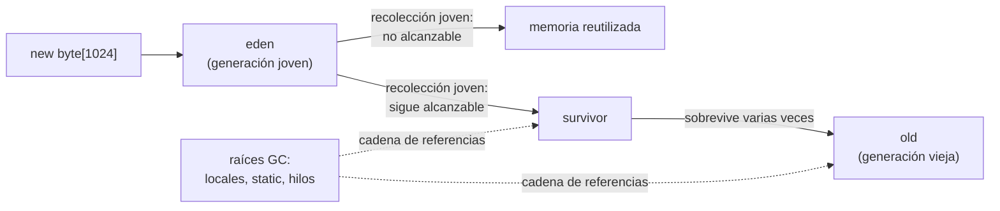
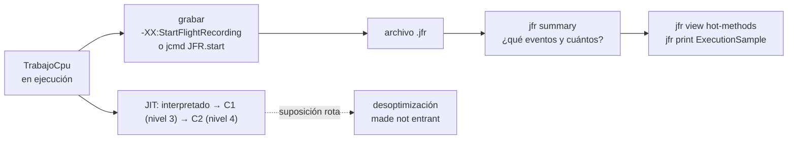
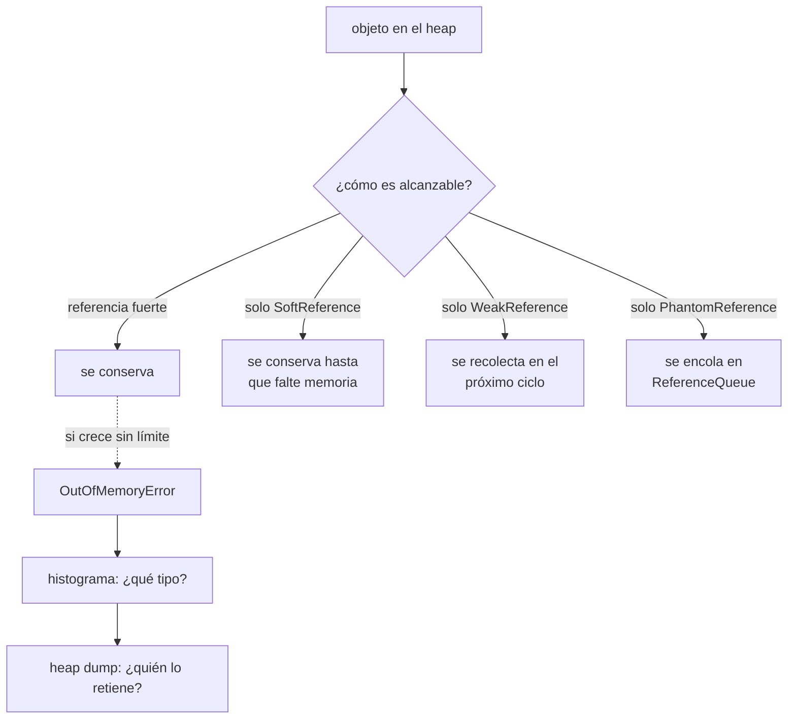
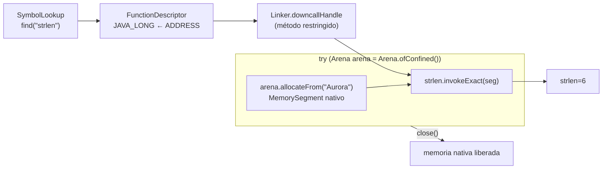

# Módulo 11: JVM interna — GC, profiling y memoria

**Entorno de las salidas.** Las salidas originales se capturaron el 2026-11-23 en `~/labs/aurora-m11` con macOS arm64,
JDK 27.0.1.0.2 (Temurin), Gradle 9.9.1 y toolchain Java 25. Las salidas nuevas de esta edición se capturaron el
2026-11-24 con OpenJDK 25.0.5.1 en Linux x86_64, compilando con `javac -Xlint:all -Xlint:-restricted -Werror` sin
Gradle. Cada salida nueva lo indica con la frase «captura con JDK 25». Tiempos, pids, direcciones y tamaños cambian en
cada máquina y en cada corrida.

Cuando una aplicación Java se vuelve lenta o consume demasiada memoria, el código fuente rara vez explica el síntoma por sí solo. El mecanismo de diagnóstico consiste en observar al runtime mientras trabaja: `-Xlog:gc` registra recolecciones y pausas, Java Flight Recorder (JFR) acumula eventos de la JVM, un heap dump captura la gráfica de objetos y las referencias que los retienen, y la Foreign Function & Memory API (FFM) gestiona memoria nativa con un dueño explícito.

Estas herramientas existen porque el comportamiento de la JVM —cuándo recolecta, qué método compila el JIT, qué objeto mantiene vivo otro— no está determinado únicamente por el código fuente: depende del heap, del recolector, de la carga y de la versión de JDK. La implicación es que toda afirmación de rendimiento necesita evidencia obtenida en el entorno y con el workload que se quiere explicar. La confusión habitual es tunear flags sin medir, o extraer de una microcarga una conclusión válida para producción.

El proyecto verificado es `tienda-aurora-jvm` en `~/labs/aurora-m11`.

## Apertura del módulo

**Al terminar este módulo podrás:**
- distinguir heap y stack y explicar cuándo un objeto deja de ser alcanzable;
- leer logs de `-Xlog:gc` y comparar G1 y ZGC con la misma carga;
- grabar una sesión de JFR e identificar el método que más CPU consume;
- observar al compilador JIT trabajar y explicar por qué existe el calentamiento;
- provocar un `OutOfMemoryError`, generar un heap dump y señalar qué retiene la memoria;
- llamar a una función nativa con FFM y explicar por qué un `Arena` necesita dueño.

**Esquema del módulo:**
1. Tema 1: heap, stack y recolectores (G1 y ZGC).
2. Tema 2: JFR, `jcmd` y el compilador JIT.
3. Tema 3: referencias especiales, fugas de memoria y heap dumps.
4. Tema 4: memoria nativa con la Foreign Function & Memory API.
5. Laboratorio integrador: reporte de profiling de `tienda-aurora-jvm`.

**Qué necesitas saber antes:** qué es la JVM y el bytecode (Módulo 0), colecciones como `List` (Módulo 2),
`try-with-resources` (Módulo 3), hilos (Módulo 5) y `--enable-native-access` como opción de arranque, que se apoya en
los módulos del Módulo 10.

## Visual del módulo

**Visual:** [Mapa visual de JVM: heap y GC, JFR/JIT, referencias y heap dump, FFM y memoria nativa](/visuals/temas/java/modulo-11-jvm.html)

Lectura: Mapa visual: cada herramienta de diagnóstico responde una pregunta distinta. La evidencia debe tomarse en tu workload y entorno.

## Proyecto del módulo: tienda-aurora-jvm

Los cuatro temas usan este proyecto. Los archivos pequeños que se añadieron en esta edición (`MemoriaBasica`,
`RetencionViva` y `ArenaMensajes`) se muestran completos en el tema que los usa.

```text
~/labs/aurora-m11/
├── build.gradle.kts
├── settings.gradle.kts
└── src/main/java/com/aurora/jvm/
    ├── TiendaAuroraJvmApp.java
    ├── TrabajoCpu.java
    ├── MemoriaBasica.java      (Tema 1)
    ├── RetencionViva.java      (Tema 3)
    └── ArenaMensajes.java      (Tema 4)
```

No existe `src/test` en este proyecto. La tarea `test` de Gradle se ejecutó y terminó con `NO-SOURCE`; por eso no se afirma en este módulo que haya tests unitarios.

**Prerrequisitos**

```bash
java -version
gradle --version
```

Las herramientas del JDK usadas son `java`, `jfr`, `jcmd` y `javap`, del JDK 27 de Temurin en la verificación original
(`$JAVA_HOME/bin`). Entorno observado: JDK 27.0.1.0.2 (Temurin), Gradle 9.9.1, toolchain Java 25, macOS arm64.

**Bootstrap**

```bash
mkdir -p tienda-aurora-jvm/src/main/java/com/aurora/jvm
cd tienda-aurora-jvm
gradle wrapper --gradle-version 9.9.1
```

Ruta base: `~/labs/aurora-m11/`.

**`settings.gradle.kts`**

```kotlin
rootProject.name = "tienda-aurora-jvm"
```

**`build.gradle.kts`**

```kotlin
plugins {
    java
    application
}

group = "com.aurora"
version = "1.0.0"

java {
    toolchain {
        languageVersion = JavaLanguageVersion.of(25)
    }
}

application {
    mainClass = "com.aurora.jvm.TiendaAuroraJvmApp"
}

repositories {
    mavenCentral()
}

tasks.withType<JavaCompile>().configureEach {
    options.encoding = "UTF-8"
    options.compilerArgs.addAll(listOf("-Xlint:all", "-Xlint:-restricted", "-Werror"))
}
```

`-Xlint:-restricted` evita el aviso de compilación por usar métodos restringidos de FFM. La habilitación real de native access se decide en ejecución con `--enable-native-access=ALL-UNNAMED`.

**`src/main/java/com/aurora/jvm/TrabajoCpu.java`**

```java
package com.aurora.jvm;

public final class TrabajoCpu {

    private TrabajoCpu() {
    }

    public static long carga(int iteraciones) {
        long acc = 0;
        for (int i = 1; i <= iteraciones; i++) {
            acc += (long) i * i;
        }
        return acc;
    }

    public static void main(String[] args) {
        int iteraciones = args.length > 0 ? Integer.parseInt(args[0]) : 5_000_000;
        int rondas = args.length > 1 ? Integer.parseInt(args[1]) : 20;
        long total = 0;
        for (int i = 0; i < rondas; i++) {
            total += carga(iteraciones);
            if (i % 5 == 0) {
                System.out.println("ronda=" + i + " total=" + total);
            }
        }
        System.out.println("final=" + total);
    }
}
```

Es una carga CPU determinista para grabar JFR. El Tema 2 explica a qué líneas de este archivo apuntan las muestras de JFR.

**`src/main/java/com/aurora/jvm/TiendaAuroraJvmApp.java`**

```java
package com.aurora.jvm;

import java.lang.foreign.Arena;
import java.lang.foreign.FunctionDescriptor;
import java.lang.foreign.Linker;
import java.lang.foreign.MemorySegment;
import java.lang.foreign.SymbolLookup;
import java.lang.foreign.ValueLayout;
import java.lang.invoke.MethodHandle;
import java.lang.ref.PhantomReference;
import java.lang.ref.Reference;
import java.lang.ref.ReferenceQueue;
import java.lang.ref.SoftReference;
import java.lang.ref.WeakReference;
import java.nio.file.Files;
import java.nio.file.Path;
import java.time.Duration;
import java.util.ArrayList;
import java.util.List;

public final class TiendaAuroraJvmApp {

    private TiendaAuroraJvmApp() {
    }

    public static void main(String[] args) throws Exception {
        String cmd = args.length == 0 ? "demo" : args[0];
        try {
            switch (cmd) {
            case "demo" -> demo();
            case "alloc" -> allocaciones(Integer.parseInt(arg(args, 1, "200000")));
            case "refs" -> referencias();
            case "ffm" -> ffm();
            case "ffm-closed" -> ffmClosed();
            case "leak" -> leak(Integer.parseInt(arg(args, 1, "200")));
            default -> {
                System.err.println("Comando desconocido: " + cmd);
                System.exit(2);
            }
            }
        } catch (Throwable t) {
            t.printStackTrace(System.err);
            System.exit(1);
        }
    }

    private static String arg(String[] args, int index, String def) {
        return args.length > index ? args[index] : def;
    }

    private static void demo() throws Throwable {
        System.out.println("== refs ==");
        referencias();
        System.out.println("== ffm ==");
        ffm();
    }

    private static void allocaciones(int cantidad) {
        long inicio = System.nanoTime();
        long checksum = 0;
        for (int i = 0; i < cantidad; i++) {
            byte[] b = new byte[1024];
            b[0] = (byte) i;
            checksum += b[0];
        }
        long ms = Duration.ofNanos(System.nanoTime() - inicio).toMillis();
        System.out.println("allocaciones=" + cantidad);
        System.out.println("checksum=" + checksum);
        System.out.println("ms=" + ms);
    }

    private static void referencias() throws Exception {
        Object fuerte = new byte[1024 * 32];
        WeakReference<Object> weak = new WeakReference<>(new byte[1024 * 32]);
        SoftReference<Object> soft = new SoftReference<>(new byte[1024 * 32]);

        ReferenceQueue<Object> queue = new ReferenceQueue<>();
        Object phantomTarget = new byte[1024 * 32];
        PhantomReference<Object> phantom = new PhantomReference<>(phantomTarget, queue);

        pedirGc();
        System.out.println("fuertePresente=" + (fuerte != null));
        System.out.println("weakAntesDeLiberar=" + (weak.get() != null));
        System.out.println("softPresente=" + (soft.get() != null));

        phantomTarget = null;
        pedirGc();
        Reference<?> encolada = queue.poll();
        System.out.println("phantomEncolada=" + (encolada == phantom));

        if (fuerte.hashCode() == Integer.MIN_VALUE) {
            System.out.println("imposible");
        }
    }

    private static void pedirGc() throws InterruptedException {
        for (int i = 0; i < 3; i++) {
            System.gc();
            Thread.sleep(50);
        }
    }

    private static void ffm() throws Throwable {
        Linker linker = Linker.nativeLinker();
        SymbolLookup stdlib = linker.defaultLookup();
        MemorySegment strlenAddr = stdlib.find("strlen")
                .orElseThrow(() -> new IllegalStateException("No se encontró strlen"));
        MethodHandle strlen = linker.downcallHandle(strlenAddr,
                FunctionDescriptor.of(ValueLayout.JAVA_LONG, ValueLayout.ADDRESS));

        try (Arena arena = Arena.ofConfined()) {
            MemorySegment cString = arena.allocateFrom("Aurora");
            long len = (long) strlen.invokeExact(cString);
            System.out.println("strlen=" + len);
        }
    }

    private static void ffmClosed() throws Throwable {
        Linker linker = Linker.nativeLinker();
        MemorySegment strlenAddr = linker.defaultLookup().find("strlen")
                .orElseThrow(() -> new IllegalStateException("No se encontró strlen"));
        MethodHandle strlen = linker.downcallHandle(strlenAddr,
                FunctionDescriptor.of(ValueLayout.JAVA_LONG, ValueLayout.ADDRESS));

        Arena arena = Arena.ofConfined();
        MemorySegment cString = arena.allocateFrom("Aurora");
        arena.close();
        try {
            long len = (long) strlen.invokeExact(cString);
            System.out.println("strlen=" + len);
        } catch (IllegalStateException e) {
            System.out.println("error=" + e.getClass().getSimpleName());
        }
    }

    private static void leak(int mb) throws Exception {
        List<byte[]> retencion = new ArrayList<>();
        for (int i = 0; i < mb; i++) {
            retencion.add(new byte[1024 * 1024]);
            if (i % 20 == 0) {
                System.out.println("mb=" + i);
            }
        }
        System.out.println("totalMb=" + retencion.size());
        Files.writeString(Path.of("build/leak.txt"), "mb=" + retencion.size());
    }
}
```

Cada subcomando corresponde a un tema: `alloc` (Tema 1), `refs` y `leak` (Tema 3), `ffm` y `ffm-closed` (Tema 4).

**Build y CLI**

```bash
cd ~/labs/aurora-m11
./gradlew -q build
./gradlew -q run --args="demo"
```

Salida de `./gradlew -q run --args="demo"`:

```text
== refs ==
fuertePresente=true
weakAntesDeLiberar=false
softPresente=true
phantomEncolada=true
== ffm ==
WARNING: A restricted method in java.lang.foreign.Linker has been called
WARNING: java.lang.foreign.Linker::downcallHandle has been called by com.aurora.jvm.TiendaAuroraJvmApp in an unnamed module (file:/Users/tu-usuario/labs/aurora-m11/build/classes/java/main/)
WARNING: Use --enable-native-access=ALL-UNNAMED to avoid a warning for callers in this module
WARNING: Restricted methods will be blocked in a future release unless native access is enabled

strlen=6
```

La tarea `test` se ejecutó para comprobar el estado del proyecto:

```bash
cd ~/labs/aurora-m11
./gradlew test
```

```text
> Task :compileTestJava NO-SOURCE
> Task :processTestResources NO-SOURCE
> Task :testClasses UP-TO-DATE
> Task :test NO-SOURCE
```

No hay tests en `src/test`; no se reporta “0 fallas en tests” porque no se ejecutó ninguno.

### Tema 1: Generaciones de memoria y recolectores · Avanzado · 60 min

<details open>
<summary><strong>Capa 1 — Lectura</strong></summary>

#### Objetivos
Al terminar este tema podrás:
- distinguir el heap del stack y provocar el error propio de cada uno;
- explicar qué hace alcanzable a un objeto y por qué salir de un scope no libera memoria;
- leer una línea de `-Xlog:gc` e identificar la pausa, el antes y el después del heap;
- comparar G1 y ZGC con la misma carga sin sacar conclusiones de una sola corrida.

**Conceptos clave:** heap, stack (pila de llamadas), raíz GC, recolector de basura, generación, pausa, G1, ZGC, `-Xlog:gc`

#### El problema
El servicio de pedidos de Tienda Aurora crea miles de objetos por segundo: carritos, líneas de pedido y arreglos de
bytes para respuestas. Nadie los libera a mano, y aun así el proceso no se queda sin memoria. A veces, sin embargo,
las respuestas se detienen unos milisegundos. ¿Quién libera esos objetos, cuándo lo hace y cuánto detiene al programa?

#### Glosario del tema

**heap**
- **Definición técnica:** zona de memoria administrada por la JVM donde viven todos los objetos y arreglos creados con `new`; su tamaño máximo se fija con `-Xmx`.
- **En palabras sencillas:** la bodega común donde se guardan todos los objetos del programa.
- **Dónde se rompe la comparación:** en una bodega tú sacas las cajas; en el heap las saca el recolector cuando quiere, no cuando tú dejas de usarlas.
- **Ejemplo:** con `-Xmx32m`, `Runtime.getRuntime().maxMemory()` informa `heapMaximoMb=32` (captura con JDK 25).
- **Error típico:** llenarlo con objetos que siguen referenciados: la JVM termina con `java.lang.OutOfMemoryError: Java heap space` (Tema 3).

**stack (pila de llamadas)**
- **Definición técnica:** memoria propia de cada hilo con un marco por cada método en ejecución; guarda variables locales, parámetros y la dirección de regreso. Su tamaño se fija con `-Xss`.
- **En palabras sencillas:** una pila de hojas: cada llamada pone una hoja encima y cada retorno la quita.
- **Dónde se rompe la comparación:** la hoja solo guarda primitivos y referencias; el objeto al que apunta una referencia vive en el heap.
- **Ejemplo:** con `-Xss512k`, una recursión sin fin imprime `StackOverflowError tras 10198 llamadas` (captura con JDK 25; el número cambia entre corridas).
- **Error típico:** olvidar el caso base de una recursión: el hilo termina con `StackOverflowError`, aunque el heap esté casi vacío.

**raíz GC**
- **Definición técnica:** referencia que la JVM considera viva por definición: variables locales de stacks activos, campos `static` de clases cargadas, referencias JNI e hilos vivos. Un objeto es **alcanzable** si existe una cadena de referencias desde una raíz.
- **En palabras sencillas:** los puntos de partida desde donde el recolector sigue los hilos; lo que no cuelga de ningún hilo es basura.
- **Dónde se rompe la comparación:** que un objeto no se use más no lo hace basura: basta con que una raíz lo siga apuntando.
- **Ejemplo:** en `referencias()`, la variable local `fuerte` es una raíz; tras tres `System.gc()` el programa imprime `fuertePresente=true`.
- **Error típico:** guardar objetos en un campo `static` «temporalmente»: el campo es raíz y los retiene hasta que el programa termina.

**recolector de basura**
- **Definición técnica:** componente de la JVM (garbage collector, GC) que encuentra los objetos no alcanzables y reutiliza su memoria, según sus propias heurísticas de cuándo y cuánto recolectar.
- **En palabras sencillas:** un servicio de aseo que pasa por la bodega y retira lo que nadie usa.
- **Dónde se rompe la comparación:** el aseo no pasa cuando tú quieres: `System.gc()` es una sugerencia, no una orden.
- **Ejemplo:** `alloc 200000` crea 200000 arreglos de 1 KB (unos 195 MB) en un heap de 32 MB y termina bien: el log muestra `18M->1M(32M)` en cada recolección.
- **Error típico:** creer que salir de un bloque o poner `null` libera la memoria en ese instante; solo la hace recuperable.

**generación (joven y vieja)**
- **Definición técnica:** partición del heap según la edad de los objetos. Los nuevos nacen en la generación joven (*eden*); los que sobreviven pasan por *survivor* y, tras varias recolecciones, se promueven a la vieja (*old*).
- **En palabras sencillas:** la bodega separa lo recién llegado de lo que lleva tiempo, porque casi todo lo nuevo se bota pronto.
- **Dónde se rompe la comparación:** en G1 las generaciones no son zonas fijas: son conjuntos de regiones que cambian de papel en cada ciclo.
- **Ejemplo:** con `-Xlog:gc,gc+heap=info`, G1 imprime `Eden regions: 14->0(13)`, `Survivor regions: 0->1(2)` y `Old regions: 2->2` (captura con JDK 25).
- **Error típico:** crear objetos de vida larga sin necesidad (cachés sin límite): sobreviven, se promueven y llenan la generación vieja, cuya limpieza cuesta más.

**pausa**
- **Definición técnica:** intervalo en el que el recolector detiene todos los hilos de la aplicación (*stop-the-world*) para hacer una parte de su trabajo de forma segura.
- **En palabras sencillas:** el aseo cierra la bodega un momento y nadie puede entrar.
- **Dónde se rompe la comparación:** no todo el trabajo del GC detiene la aplicación: G1 y ZGC hacen parte de él en paralelo con tus hilos.
- **Ejemplo:** `GC(0) Pause Young (Normal) (G1 Evacuation Pause) 18M->1M(32M) 0.310ms` es una pausa de 0.310 ms.
- **Error típico:** medir solo el promedio: un usuario sufre la pausa más larga, por eso se miran percentiles como p99.

**G1**
- **Definición técnica:** Garbage-First, recolector por defecto de la JVM para servidores; divide el heap en regiones de igual tamaño y prioriza las que tienen más basura, buscando un objetivo de pausa (`-XX:MaxGCPauseMillis`, 200 ms por defecto).
- **En palabras sencillas:** un aseador que limpia primero los cuartos más sucios para terminar rápido.
- **Dónde se rompe la comparación:** «más sucio» lo estima G1 con estadísticas; puede equivocarse y pausar más de lo previsto.
- **Ejemplo:** sin opciones, el log empieza con `Using G1`.
- **Error típico:** fijar `-XX:MaxGCPauseMillis` muy bajo esperando milagros: G1 recolecta más seguido y baja el throughput.

**ZGC**
- **Definición técnica:** recolector concurrente de baja latencia (`-XX:+UseZGC`); hace casi todo su trabajo mientras la aplicación corre, usando barreras de carga, y desde JDK 23 es generacional por defecto.
- **En palabras sencillas:** un aseador que limpia mientras la tienda sigue abierta.
- **Dónde se rompe la comparación:** si la aplicación ensucia más rápido de lo que limpia, la frena igual: el log lo llama `Allocation Stall`.
- **Ejemplo:** con `-XX:+UseZGC` el log empieza con `Using The Z Garbage Collector` y muestra fases `Minor Collection` y `Major Collection`.
- **Error típico:** copiar `-XX:-ZGenerational` de una guía vieja. JDK 25 avisa `OpenJDK 64-Bit Server VM warning: Ignoring option ZGenerational; support was removed in 24.0` (captura con JDK 25).

**`-Xlog:gc`**
- **Definición técnica:** opción del logging unificado de la JVM que imprime una línea por recolección con tipo, causa, heap antes, después y total, y duración. Admite etiquetas como `gc+heap` y destinos de archivo.
- **En palabras sencillas:** la bitácora del aseo: cuándo pasó, cuánto retiró y cuánto tardó.
- **Dónde se rompe la comparación:** la bitácora se escribe en la salida de la JVM, no en la del programa; las dos se mezclan en la terminal.
- **Ejemplo:** `[0.018s][info][gc] GC(0) Pause Young (Normal) (G1 Evacuation Pause) 18M->1M(32M) 0.310ms`.
- **Error típico:** escribir mal la etiqueta. `-Xlog:gcc` impide arrancar: `Invalid tag 'gcc' in log selection.` y `Error: Could not create the Java Virtual Machine.` (captura con JDK 25).

#### ► CÓMO FUNCIONA

**Mecanismo.** Un objeto es alcanzable si existe una cadena de referencias desde una raíz GC: variables de stacks activos, campos estáticos, referencias JNI o hilos vivos. El recolector reclama objetos no alcanzables, pero decide cuándo hacerlo según sus heurísticas: salir de un scope no libera memoria de inmediato. La hipótesis generacional observa que la mayoría de los objetos muere joven; por eso el heap se divide en regiones jóvenes y viejas y los objetos que sobreviven varias colecciones pueden promoverse. G1 divide el heap en regiones y prioriza las que contienen más basura; ZGC realiza trabajo concurrente con pausas breves y barreras de lectura.

**Por qué existe.** La asignación y la liberación manuales son propensas a errores; el GC automatiza esa gestión. Los distintos recolectores existen porque no todos los workloads optimizan lo mismo: algunos prefieren throughput y otros latencia p99.

Sigue la vida de un `byte[]` creado en `allocaciones`. Nace en eden. En la siguiente recolección joven ya nadie lo
apunta: no se copia y su región queda libre. Si siguiera apuntado, se copiaría a survivor y, tras varias
recolecciones, a old.



#### Problema resuelto 1.1
Muestra en un solo programa la diferencia entre heap y stack: cuánto heap tienes y cuántas llamadas caben en el stack.

**Razonamiento:**
1. `Runtime.maxMemory()` informa el techo del heap; con `-Xmx32m` debe dar 32.
2. Un arreglo de 1 MB vive en el heap; la variable `pedido` que lo apunta vive en el stack de `main`.
3. Una recursión sin caso base agota el stack, no el heap: se atrapa `StackOverflowError` y se cuenta la profundidad.

**`src/main/java/com/aurora/jvm/MemoriaBasica.java`**

```java
package com.aurora.jvm;

public final class MemoriaBasica {

    private static int profundidad = 0;

    private MemoriaBasica() {
    }

    private static void bajar() {
        profundidad++;
        bajar();
    }

    public static void main(String[] args) {
        Runtime rt = Runtime.getRuntime();
        System.out.println("heapMaximoMb=" + rt.maxMemory() / (1024 * 1024));
        byte[] pedido = new byte[1024 * 1024];
        System.out.println("pedidoBytes=" + pedido.length);
        try {
            bajar();
        } catch (StackOverflowError e) {
            System.out.println("StackOverflowError tras " + profundidad + " llamadas");
        }
    }
}
```

```bash
cd ~/labs/aurora-m11
java -Xmx32m -Xss512k -cp build/classes/java/main com.aurora.jvm.MemoriaBasica
```

Salida (captura con JDK 25):

```text
heapMaximoMb=32
pedidoBytes=1048576
StackOverflowError tras 10198 llamadas
```

**Explicación por partes.**
- Línea 17: `maxMemory()` devuelve bytes; al dividir por `1024 * 1024` obtienes megabytes.
- Línea 18: el arreglo de 1 MB va al heap; `pedido` es una referencia en el marco de `main`.
- Líneas 10–13: cada llamada a `bajar()` agrega un marco al stack y nunca retorna.
- Líneas 22–23: `StackOverflowError` es un `Error`, no una `Exception`; aquí se atrapa solo para medir. El número depende de `-Xss` y del JIT.

> **Error común.** Confundir los dos errores de memoria. `StackOverflowError` significa «demasiadas llamadas
> anidadas» y se arregla con un caso base o un bucle. `java.lang.OutOfMemoryError: Java heap space` significa
> «demasiados objetos vivos» y se estudia en el Tema 3. Subir `-Xmx` no arregla un `StackOverflowError`.

#### Problema resuelto 1.2
Asigna mucha más memoria de la que cabe en el heap y observa al recolector trabajar.

**Razonamiento:**
1. `alloc 200000` crea 200000 arreglos de 1 KB: unos 195 MB en total, en un heap de 32 MB.
2. Cada arreglo deja de ser alcanzable en la siguiente vuelta del bucle (líneas 61–65 de `TiendaAuroraJvmApp`).
3. Si el GC funciona, el heap baja casi a cero en cada recolección y el programa termina.

```bash
cd ~/labs/aurora-m11
java -Xms32m -Xmx32m -Xlog:gc -cp build/classes/java/main \
  com.aurora.jvm.TiendaAuroraJvmApp alloc 200000
```

```text
[0.005s][info][gc] Using G1
[0.018s][info][gc] GC(0) Pause Young (Normal) (G1 Evacuation Pause) 18M->1M(32M) 0.310ms
[0.019s][info][gc] GC(1) Pause Young (Normal) (G1 Evacuation Pause) 14M->1M(32M) 0.159ms
[0.020s][info][gc] GC(2) Pause Young (Normal) (G1 Evacuation Pause) 18M->1M(32M) 0.155ms
[0.020s][info][gc] GC(3) Pause Young (Normal) (G1 Evacuation Pause) 19M->1M(32M) 0.146ms
[0.022s][info][gc] GC(4) Pause Young (Normal) (G1 Evacuation Pause) 19M->1M(32M) 0.121ms
[0.023s][info][gc] GC(5) Pause Young (Normal) (G1 Evacuation Pause) 19M->1M(32M) 0.108ms
allocaciones=200000
[0.027s][info][gc] GC(6) Pause Young (Normal) (G1 Evacuation Pause) 19M->1M(32M) 0.287ms
checksum=-97952
ms=7
```

Las líneas de GC van a stderr y las del programa a stdout; por eso aparecen intercaladas.

Para ver las generaciones se añadió la etiqueta `gc+heap` con una carga menor (captura con JDK 25, primeras tres
recolecciones):

```bash
cd ~/labs/aurora-m11
java -Xms32m -Xmx32m -Xlog:gc,gc+heap=info -cp build/classes/java/main \
  com.aurora.jvm.TiendaAuroraJvmApp alloc 50000
```

```text
[0.004s][info][gc] Using G1
[0.092s][info][gc,heap] GC(0) Eden regions: 14->0(13)
[0.092s][info][gc,heap] GC(0) Survivor regions: 0->1(2)
[0.092s][info][gc,heap] GC(0) Old regions: 2->2
[0.092s][info][gc,heap] GC(0) Humongous regions: 0->0
[0.092s][info][gc     ] GC(0) Pause Young (Normal) (G1 Evacuation Pause) 15M->1M(32M) 41.170ms
[0.103s][info][gc,heap] GC(1) Eden regions: 13->0(17)
[0.103s][info][gc,heap] GC(1) Survivor regions: 1->1(2)
[0.103s][info][gc,heap] GC(1) Old regions: 2->2
[0.103s][info][gc,heap] GC(1) Humongous regions: 0->0
[0.103s][info][gc     ] GC(1) Pause Young (Normal) (G1 Evacuation Pause) 14M->1M(32M) 0.661ms
[0.114s][info][gc,heap] GC(2) Eden regions: 17->0(18)
[0.114s][info][gc,heap] GC(2) Survivor regions: 1->1(3)
[0.114s][info][gc,heap] GC(2) Old regions: 2->2
[0.114s][info][gc,heap] GC(2) Humongous regions: 0->0
[0.114s][info][gc     ] GC(2) Pause Young (Normal) (G1 Evacuation Pause) 18M->1M(32M) 1.447ms
allocaciones=50000
checksum=-21800
ms=72
```

**Explicación por partes.**
- `Pause Young (Normal)`: recolección de la generación joven; `G1 Evacuation Pause` es la causa.
- `18M->1M(32M)`: el heap ocupado bajó de 18 MB a 1 MB; 32 MB es el total. Casi todo era basura.
- `0.310ms` (salida original): duración de la pausa. Es la cifra que sufre la aplicación.
- `Eden regions: 14->0(13)`: las 14 regiones de eden quedaron vacías; 13 es el objetivo para el siguiente ciclo.
- `Old regions: 2->2`: la generación vieja no creció: ningún `byte[]` sobrevivió lo suficiente para promoverse.
- La primera pausa de la captura con JDK 25 duró `41.170ms` y las siguientes menos de 1 ms: el arranque de una sola corrida no representa el comportamiento estable.

#### Problema resuelto 1.3
Compara G1 y ZGC con la misma carga y decide qué se puede concluir y qué no.

**Razonamiento:**
1. Se fija todo menos el recolector: mismo heap de 32 MB, misma clase, mismo argumento.
2. El `checksum` debe coincidir: prueba que ambos hicieron el mismo trabajo.
3. Se comparan los tipos de evento y las duraciones, sin declarar un ganador con una sola corrida.

Mismo comando lógico, mismo heap de 32 MB y misma carga de 300000 asignaciones:

```bash
cd ~/labs/aurora-m11
java -Xms32m -Xmx32m -XX:+UseG1GC -Xlog:gc -cp build/classes/java/main com.aurora.jvm.TiendaAuroraJvmApp alloc 300000
java -Xms32m -Xmx32m -XX:+UseZGC -Xlog:gc -cp build/classes/java/main com.aurora.jvm.TiendaAuroraJvmApp alloc 300000
```

Salida observada con G1:

```text
[0.004s][info][gc] Using G1
[0.018s][info][gc] GC(0) Pause Young (Normal) (G1 Evacuation Pause) 18M->1M(32M) 0.268ms
[0.018s][info][gc] GC(1) Pause Young (Normal) (G1 Evacuation Pause) 14M->1M(32M) 0.162ms
[0.019s][info][gc] GC(2) Pause Young (Normal) (G1 Evacuation Pause) 18M->1M(32M) 0.156ms
[0.020s][info][gc] GC(3) Pause Young (Normal) (G1 Evacuation Pause) 19M->1M(32M) 0.173ms
[0.022s][info][gc] GC(4) Pause Young (Normal) (G1 Evacuation Pause) 19M->1M(32M) 0.168ms
[0.023s][info][gc] GC(5) Pause Young (Normal) (G1 Evacuation Pause) 19M->1M(32M) 0.151ms
[0.027s][info][gc] GC(6) Pause Young (Normal) (G1 Evacuation Pause) 19M->1M(32M) 0.395ms
allocaciones=300000
checksum=-149488
ms=8
```

Salida observada con ZGC:

```text
[0.003s][info][gc] Using The Z Garbage Collector
[0.024s][info][gc] GC(0) Major Collection (Warmup)
[0.026s][info][gc] GC(0) Major Collection (Warmup) 4M(12%)->26M(81%) 0.002s
[0.026s][info][gc] GC(1) Major Collection (Warmup)
[0.027s][info][gc] Allocation Stall (main) 0.667ms
[0.028s][info][gc] Allocation Stall (main) 0.477ms
[0.028s][info][gc] GC(2) Minor Collection (Allocation Stall)
[0.029s][info][gc] Allocation Stall (main) 0.419ms
[0.029s][info][gc] GC(2) Minor Collection (Allocation Stall) 32M(100%)->6M(19%) 0.001s
[0.029s][info][gc] GC(3) Minor Collection (Allocation Rate)
[0.029s][info][gc] GC(3) Minor Collection (Allocation Rate) 8M(25%)->8M(25%) 0.000s
[0.029s][info][gc] GC(1) Major Collection (Warmup) 28M(88%)->8M(25%) 0.003s
[0.029s][info][gc] GC(4) Major Collection (Warmup)
[0.029s][info][gc] GC(5) Minor Collection (Allocation Rate)
[0.030s][info][gc] GC(5) Minor Collection (Allocation Rate) 12M(38%)->12M(38%) 0.000s
[0.030s][info][gc] GC(6) Minor Collection (Allocation Rate)
[0.030s][info][gc] GC(6) Minor Collection (Allocation Rate) 16M(50%)->6M(19%) 0.000s
[0.031s][info][gc] GC(7) Minor Collection (Allocation Rate)
[0.031s][info][gc] Allocation Stall (main) 0.076ms
[0.031s][info][gc] GC(7) Minor Collection (Allocation Rate) 20M(62%)->8M(25%) 0.001s
[0.031s][info][gc] GC(4) Major Collection (Warmup) 10M(31%)->8M(25%) 0.002s
[0.032s][info][gc] GC(8) Minor Collection (Allocation Rate)
[0.032s][info][gc] GC(8) Minor Collection (Allocation Rate) 10M(31%)->8M(25%) 0.000s
[0.032s][info][gc] GC(9) Minor Collection (Allocation Rate)
[0.032s][info][gc] GC(9) Minor Collection (Allocation Rate) 8M(25%)->10M(31%) 0.000s
[0.032s][info][gc] GC(10) Minor Collection (Allocation Rate)
[0.032s][info][gc] GC(10) Minor Collection (Allocation Rate) 14M(44%)->10M(31%) 0.000s
allocaciones=300000
checksum=-149488
ms=9
```

Ambas corridas producen el mismo `checksum`, así que el trabajo realizado coincide. G1 muestra pausas `Pause Young` del orden de 0.15–0.40 ms; ZGC muestra `Allocation Stall` y fases `Minor`/`Major` con duraciones de 0.000–0.003 s. El tiempo impreso por el programa (`ms=8` frente a `ms=9`) es una medición de una sola corrida y no sirve para decidir qué recolector es mejor. G1 prioriza regiones con mucho garbage y un objetivo de pausa; ZGC apunta a pausas muy bajas con heaps grandes a cambio de barreras y trabajo concurrente. La comparación correcta usa tu workload, tu heap y métricas de latencia y throughput.

**Implicaciones observadas.** `alloc 200000` con heap de 32 MB y G1 produjo siete pausas young entre 0.108 ms y 0.310 ms y terminó con `ms=7`. Con 300000 asignaciones, G1 registró pausas de 0.151–0.395 ms y `ms=8`; ZGC registró `Allocation Stall` de hasta 0.667 ms y `ms=9`. El `checksum=-149488` fue idéntico en ambas variantes, lo que confirma que se hizo el mismo trabajo. Son microcargas: no permiten concluir qué recolector conviene en producción.

> **Error común.** Tomar el menor número de milisegundos de una corrida como prueba de que un recolector es mejor.
> Faltan percentiles de latencia, tamaño de heap real, tasa de asignación y duración suficiente. La misma carga con
> G1 dio `ms=7` en macOS y `ms=48` en la captura con JDK 25 en Linux: el entorno pesa más que el recolector.

> **Rendimiento.** `Allocation Stall (main) 0.667ms` significa que ZGC detuvo al hilo `main` porque asignaba más
> rápido de lo que ZGC liberaba. Un heap de 32 MB es demasiado pequeño para ZGC; con un heap realista esos stalls
> suelen desaparecer.

#### Checkpoint 1.1
En la línea `GC(3) Pause Young (Normal) (G1 Evacuation Pause) 19M->1M(32M) 0.146ms`, ¿cuánta memoria liberó la
recolección y cuánto tiempo estuvo detenida la aplicación?

Respuesta: liberó unos 18 MB (de 19 MB ocupados quedó 1 MB) y la aplicación estuvo detenida 0.146 ms.

</details>

<details>
<summary><strong>Capa 2 — Construcción</strong></summary>

#### Paso 1 · Compila el proyecto
Crea el proyecto con los archivos de «Proyecto del módulo» y `MemoriaBasica.java`. Ejecuta `./gradlew -q build`.

#### Paso 2 · Heap y stack
Ejecuta `MemoriaBasica` con `-Xmx32m -Xss512k` y después con `-Xss2m`. Anota cómo cambia el número de llamadas.

#### Paso 3 · Lee el log de G1
Ejecuta `alloc 200000` con `-Xlog:gc` y luego `alloc 50000` con `-Xlog:gc,gc+heap=info`. Marca en cada línea el antes,
el después y la pausa.

#### Paso 4 · Compara recolectores
Repite `alloc 300000` con `-XX:+UseG1GC` y con `-XX:+UseZGC`. Comprueba que el `checksum` coincide y cuenta los
`Allocation Stall`.

#### Resumen
- Los objetos viven en el **heap**; las variables locales y los marcos de método, en el **stack** de cada hilo.
- Un objeto sigue vivo mientras sea alcanzable desde una **raíz GC**.
- El **recolector de basura** recupera lo no alcanzable cuando él decide, no cuando sales de un bloque.
- El heap se organiza por **generación**: eden, survivor y old.
- Una **pausa** detiene la aplicación; **G1** busca un objetivo de pausa por regiones y **ZGC** trabaja casi todo en concurrencia.
- **`-Xlog:gc`** es la evidencia mínima antes de cambiar cualquier opción del GC.

#### Ejercicio verificable 1
Básico. ¿Qué error obtienes con `java -Xmx32m -Xss512k ... MemoriaBasica` si borras la línea 12 (`bajar();`)?

Respuesta esperada: ninguno. Sin la llamada recursiva, `bajar()` retorna enseguida y no hay nada que atrapar. El
programa imprime solo `heapMaximoMb=32` y `pedidoBytes=1048576`.

#### Ejercicio verificable 2
Intermedio. Ejecuta `alloc 200000` con `-Xms16m -Xmx16m -Xlog:gc` en lugar de 32 MB. ¿Esperas más o menos
recolecciones? ¿Termina el programa?

Respuesta esperada: más recolecciones, porque eden es más pequeño y se llena antes: 15 pausas frente a 6 en la captura
con JDK 25. El programa termina igual (`checksum=-97952`): cada arreglo muere enseguida y el heap vivo sigue cerca de 1 MB.

#### Ejercicio verificable 3
Reto. ¿Por qué un recolector con pausas más cortas (ZGC) puede tener un throughput total menor que uno con pausas más
largas (G1)?

Respuesta esperada: ZGC hace su trabajo en concurrencia y usa barreras de carga en cada lectura de referencia. Eso
consume CPU que la aplicación no usa para su propio trabajo. Pausas cortas no significan menos trabajo total.

#### En el trabajo
En producción, `-Xlog:gc*:file=gc.log` queda activo siempre: su costo es bajo y es la primera evidencia ante una queja
de lentitud. Los equipos eligen G1 para la mayoría de servicios y ZGC cuando la latencia p99 es un requisito con heaps
grandes. Cambiar de recolector se decide con métricas de una prueba de carga, no con una corrida en el portátil.

</details>

### Tema 2: Java Flight Recorder y JIT compilation · Avanzado · 55 min

<details open>
<summary><strong>Capa 1 — Lectura</strong></summary>

#### Objetivos
Al terminar este tema podrás:
- grabar una sesión de JFR al arrancar y también sobre un proceso que ya corre, con `jcmd`;
- leer `jfr summary` e identificar el método más caliente con `jfr print` y `jfr view hot-methods`;
- leer la salida de `-XX:+PrintCompilation` y reconocer niveles, OSR y desoptimización;
- explicar por qué las primeras iteraciones de una medición miden calentamiento.

**Conceptos clave:** JFR, evento JFR, muestra de ejecución, método caliente, compilador JIT, OSR, desoptimización, calentamiento, jcmd

#### El problema
El cálculo de fidelización de Tienda Aurora consume casi toda una CPU. El equipo sospecha de tres métodos, pero cada
quien defiende una teoría distinta. ¿Cómo obtienes evidencia, desde dentro de la JVM, de dónde se gasta el tiempo, sin
instalar un profiler externo y sin detener el servicio?

#### Glosario del tema

**JFR**
- **Definición técnica:** Java Flight Recorder, sistema de grabación de eventos integrado en la JVM con bajo overhead; se activa con `-XX:StartFlightRecording` o con `jcmd <pid> JFR.start` y produce un archivo `.jfr`.
- **En palabras sencillas:** la caja negra de un avión, pero para la JVM: graba lo que pasa para analizarlo después.
- **Dónde se rompe la comparación:** la caja negra lo graba todo; JFR graba solo los eventos que su configuración (`default` o `profile`) activa.
- **Ejemplo:** al arrancar con `-XX:StartFlightRecording=...`, la JVM imprime `Started recording 1. No limit specified, using maxsize=250MB as default.`
- **Error típico:** olvidar `dumponexit=true` al arrancar con `filename=`: si el proceso termina antes de volcar, el archivo puede quedar sin los datos finales.

**evento JFR**
- **Definición técnica:** registro con tipo, marca de tiempo, hilo y campos propios, como `jdk.GarbageCollection` o `jdk.ExecutionSample`; `jfr summary` los cuenta por tipo.
- **En palabras sencillas:** una línea de la bitácora: qué pasó, cuándo y en qué hilo.
- **Dónde se rompe la comparación:** muchos eventos no son «cosas que pasaron» sino fotos periódicas, como los flags de la JVM.
- **Ejemplo:** `jfr summary` de la grabación de 9 s muestra `jdk.ExecutionSample 760`.
- **Error típico:** ordenar por el evento más numeroso y creer que ahí está el problema: `jdk.NativeLibrary 956` no es un cuello de botella.

**muestra de ejecución**
- **Definición técnica:** evento `jdk.ExecutionSample` que JFR toma a intervalos (cada 10 o 20 ms según la configuración) con la pila de un hilo que estaba ejecutando código Java.
- **En palabras sencillas:** fotos rápidas de qué método estaba trabajando; donde hay más fotos, hay más tiempo.
- **Dónde se rompe la comparación:** una foto no dice cuánto duró una llamada: solo la frecuencia estadística de cada método.
- **Ejemplo:** `stackTrace = [ com.aurora.jvm.TrabajoCpu.carga(int) line: 10 ... ]`.
- **Error típico:** sacar conclusiones con pocas muestras: la grabación de 0.26 s solo tuvo 19.

**método caliente**
- **Definición técnica:** método donde se concentra la mayor parte de las muestras de CPU (*hotspot*); es el candidato a optimizar.
- **En palabras sencillas:** el punto donde el programa pasa la mayor parte de su tiempo.
- **Dónde se rompe la comparación:** «caliente» no significa «lento»: puede ser rápido y llamarse millones de veces.
- **Ejemplo:** `jfr view hot-methods` muestra `com.aurora.jvm.TrabajoCpu.carga(int)` con `2,117` muestras, el `99.48%` (captura con JDK 25).
- **Error típico:** optimizar el método que tú sospechabas en lugar del que muestran las muestras.

**compilador JIT**
- **Definición técnica:** compilador *just-in-time* de HotSpot que traduce a código máquina los métodos más ejecutados mientras el programa corre; usa niveles: 0 interpretado, 1–3 C1 (rápido) y 4 C2 (muy optimizado).
- **En palabras sencillas:** un traductor que al principio lee frase por frase y, cuando nota que una frase se repite mucho, la traduce de una vez y la deja lista.
- **Dónde se rompe la comparación:** el traductor puede deshacer su traducción si la suposición que usó deja de cumplirse (desoptimización).
- **Ejemplo:** `-XX:+PrintCompilation` muestra `com.aurora.jvm.TrabajoCpu::carga (25 bytes)` primero en nivel `3` y luego en nivel `4` (captura con JDK 25).
- **Error típico:** medir el tiempo de las primeras rondas y atribuirlo al algoritmo: incluyen interpretación y compilación.

**OSR**
- **Definición técnica:** *on-stack replacement*, compilación de un método mientras uno de sus bucles sigue corriendo; el marco interpretado se reemplaza por uno compilado sin esperar a que el método retorne.
- **En palabras sencillas:** cambiar el motor de un carro en marcha, sin detenerlo en la estación.
- **Dónde se rompe la comparación:** OSR solo entra en el salto de vuelta de un bucle, no en cualquier punto.
- **Ejemplo:** `11 %     3       com.aurora.jvm.TrabajoCpu::carga @ 4 (25 bytes)`: el `%` marca OSR y `@ 4` es el bytecode del bucle (captura con JDK 25).
- **Error típico:** escribir un benchmark con todo el trabajo en un solo bucle de `main`: mides código OSR, que suele optimizarse peor que un método compilado normal.

**desoptimización**
- **Definición técnica:** descarte de código compilado cuando una suposición del JIT deja de valer; la ejecución vuelve al intérprete o a un nivel inferior hasta recompilar. PrintCompilation lo marca como `made not entrant`.
- **En palabras sencillas:** el traductor descubre que se equivocó, tira su traducción y vuelve a leer frase por frase.
- **Dónde se rompe la comparación:** no es un error del programa: es parte normal del funcionamiento del JIT.
- **Ejemplo:** `13 %     4       com.aurora.jvm.TrabajoCpu::carga @ 4 (25 bytes)   made not entrant: uncommon trap` (captura con JDK 25).
- **Error típico:** alarmarse por ver `made not entrant` en un log; preocupa solo si el mismo método se desoptimiza y recompila sin parar.

**calentamiento**
- **Definición técnica:** fase inicial de ejecución en la que el código pasa de interpretado a compilado y las cachés se llenan; el rendimiento medido en ella no es el estable (*warmup*).
- **En palabras sencillas:** los primeros minutos de un motor frío, que todavía no rinde lo que rinde caliente.
- **Dónde se rompe la comparación:** un motor se calienta solo con el tiempo; la JVM se calienta con las rutas de código que ejecuta, y otra ruta empieza fría.
- **Ejemplo:** en la captura con JDK 25, `carga` se compila en nivel 3 y luego 4 antes de imprimir `ronda=0`, y vuelve a compilarse en nivel 4 después: la primera ronda corre parte interpretada.
- **Error típico:** medir con `System.nanoTime()` una sola ejecución en frío; para medidas estables se usa JMH, que separa calentamiento y medición.

**jcmd**
- **Definición técnica:** herramienta del JDK que envía comandos de diagnóstico a una JVM en ejecución identificada por su pid: versión, flags, heap, histogramas, volcados y grabaciones JFR.
- **En palabras sencillas:** un control remoto para preguntarle cosas a un programa Java que ya está corriendo.
- **Dónde se rompe la comparación:** solo controla JVMs del mismo usuario en la misma máquina (o contenedor).
- **Ejemplo:** `jcmd <pid> VM.version` imprime `OpenJDK 64-Bit Server VM version 25.0.5.1+2-1-24.04.1-Ubuntu` y `JDK 25.0.5.1` (captura con JDK 25).
- **Error típico:** usar un pid que ya terminó: `java.io.IOException: non existent JVM pid: 999999` (captura con JDK 25).

#### ► CÓMO FUNCIONA

**Mecanismo.** JFR es un sistema de eventos dentro de la JVM con bajo overhead. `-XX:StartFlightRecording=filename=...,dumponexit=true,settings=profile` inicia una grabación; `jfr summary` muestra duración, chunks y conteo por tipo de evento; `jfr print --events jdk.ExecutionSample --stack-depth 8` expone las pilas muestreadas. El JIT compila a código nativo los métodos calientes mientras la aplicación corre, por lo que las primeras iteraciones de un benchmark miden warmup.

**Por qué existe.** Necesitamos evidencia desde dentro del runtime sin montar un profiler externo pesado. Los eventos permiten correlacionar GC, asignaciones, clases, hilos y muestras de ejecución con lo que hace el programa.

El flujo de diagnóstico tiene tres pasos: grabar, resumir y profundizar. El JIT trabaja en paralelo: decide qué
compilar según contadores de invocaciones y de vueltas de bucle, los mismos métodos que JFR verá calientes.



#### Problema resuelto 2.1
Encuentra el método que más CPU consume en `TrabajoCpu`, con evidencia de JFR.

**Razonamiento:**
1. Una grabación corta da pocas muestras; hay que correr lo bastante para tener cientos.
2. `settings=profile` aumenta la frecuencia de muestreo respecto a `default`.
3. Primero `jfr summary` para confirmar duración y conteo; después las pilas.

La grabación se hizo con una ejecución suficientemente larga para que el archivo tenga duración y muestras. La salida del programa se redirigió a `build/jfr/programa-largo.txt`; a continuación se muestran las primeras y últimas líneas leídas de ese archivo.

```bash
cd ~/labs/aurora-m11
JFR=$JAVA_HOME/bin/jfr   # JDK 27 de Temurin en la máquina de verificación
java -XX:StartFlightRecording=filename=build/jfr/m11-largo.jfr,dumponexit=true,settings=profile \
  -cp build/classes/java/main com.aurora.jvm.TrabajoCpu 3000000 12000 \
  > build/jfr/programa-largo.txt 2>&1
head -5 build/jfr/programa-largo.txt
tail -3 build/jfr/programa-largo.txt
$JFR summary build/jfr/m11-largo.jfr
```

Salida de `head -5 build/jfr/programa-largo.txt`:

```text
[0.124s][info][jfr,startup] Started recording 1. No limit specified, using maxsize=250MB as default.
[0.124s][info][jfr,startup] 
[0.124s][info][jfr,startup] Use jcmd 36494 JFR.dump name=1 to copy recording data to file.
ronda=0 total=9000004500000500000
ronda=5 total=-1340205221125654848
```

Salida de `tail -3 build/jfr/programa-largo.txt`:

```text
ronda=11990 total=5601128305118546400
ronda=11995 total=-4739081416007608448
final=-5632551563424711680
```

Salida de `jfr summary build/jfr/m11-largo.jfr` (inicio del resumen):

```text
 Version: 2.1
 Chunks: 1
 Start: 2026-11-23 08:21:20 (UTC)
 Duration: 9 s

 Event Type                              Count  Size (bytes) 
=============================================================
 jdk.NativeLibrary                         956         81040
 jdk.ExecutionSample                       760          7588
 jdk.SystemProcess                         594         58201
 jdk.ModuleExport                          506          5430
 jdk.BooleanFlag                           469         13767
 jdk.ActiveSetting                         381          9450
 jdk.ModuleRequire                         155          1550
 jdk.LongFlag                              136          4236
 jdk.UnsignedLongFlag                       83          2674
```

Muestras reales de `jfr print --events jdk.ExecutionSample --stack-depth 8 build/jfr/m11-largo.jfr`:

```text
jdk.ExecutionSample {
  startTime = 03:21:20.168 (2026-11-23)
  sampledThread = "main" (javaThreadId = 3)
  state = "STATE_RUNNABLE"
  stackTrace = [
    com.aurora.jvm.TrabajoCpu.carga(int) line: 10
    com.aurora.jvm.TrabajoCpu.main(String[]) line: 21
  ]
}

jdk.ExecutionSample {
  startTime = 03:21:20.178 (2026-11-23)
  sampledThread = "main" (javaThreadId = 3)
  state = "STATE_RUNNABLE"
  stackTrace = [
    com.aurora.jvm.TrabajoCpu.carga(int) line: 10
    com.aurora.jvm.TrabajoCpu.main(String[]) line: 21
  ]
}
```

La misma grabación, repetida con JDK 25 en Linux, duró 28 s y registró 2128 muestras. `jfr view hot-methods`
resume las pilas sin leerlas una por una (primeras filas):

```bash
cd ~/labs/aurora-m11
jfr view hot-methods build/jfr/m11-largo.jfr
```

```text
                                        Java Methods that Execute the Most

Method                                                                                            Samples Percent
------------------------------------------------------------------------------------------------- ------- -------
com.aurora.jvm.TrabajoCpu.carga(int)                                                                2,117  99.48%
com.aurora.jvm.TrabajoCpu.main(String[])                                                                2   0.09%
sun.nio.cs.US_ASCII$Encoder.encodeArrayLoop(CharBuffer, ByteBuffer)                                     2   0.09%
```

**Explicación por partes.**
- `Duration: 9 s` y `jdk.ExecutionSample 760`: hay evidencia suficiente. Con 0.26 s solo hubo 19 muestras.
- Cada muestra apunta a `TrabajoCpu.carga(int) line: 10`, llamada desde `main` en la línea 21 de `TrabajoCpu.java`.
- La línea 10 es la cabecera del `for`. En código compilado por el JIT, la muestra se atribuye al punto de control del bucle, no a la suma de la línea 11. Lee el número como «este bucle».
- `99.48%` en `carga(int)`: no hay duda sobre dónde optimizar. Con JDK 25, 2111 de las muestras de `carga` apuntaron a la línea 10 y 6 a la línea 9.

El hotspot observado es `TrabajoCpu.carga(int)`, en el bucle que empieza en la línea 10, llamado desde `main` en la línea 21. Una grabación corta de la misma carga produjo `Duration: 0 s` y 19 muestras; para obtener evidencia útil se alargó la ejecución hasta 9 s y 760 muestras. No se generó flamegraph: esta es una identificación directa del método con más muestras en el archivo grabado.

> **Error común.** Grabar demasiado poco. Una ejecución de 0.26 s produjo `Duration: 0 s` en `jfr summary` y solo 19
> muestras. Con tan pocos datos, cualquier método puede parecer el más caliente por azar. Alarga la carga o la
> grabación hasta tener cientos de muestras.

#### Problema resuelto 2.2
Observa al compilador JIT compilar `carga` mientras el programa corre.

**Razonamiento:**
1. `-XX:+PrintCompilation` imprime una línea por cada compilación y cada descarte.
2. Con 20 rondas basta: el JIT compila `carga` en las primeras vueltas.
3. Se filtra con `grep` para ver solo `TrabajoCpu` y las rondas del programa.

```bash
cd ~/labs/aurora-m11
java -XX:+PrintCompilation -cp build/classes/java/main com.aurora.jvm.TrabajoCpu 3000000 20 > build/jit.txt
grep -E "TrabajoCpu|ronda=|final" build/jit.txt
```

Salida (captura con JDK 25):

```text
29   11 %     3       com.aurora.jvm.TrabajoCpu::carga @ 4 (25 bytes)
30   12       3       com.aurora.jvm.TrabajoCpu::carga (25 bytes)
30   13 %     4       com.aurora.jvm.TrabajoCpu::carga @ 4 (25 bytes)
31   11 %     3       com.aurora.jvm.TrabajoCpu::carga @ 4 (25 bytes)   made not entrant: OSR invalidation of lower level
33   13 %     4       com.aurora.jvm.TrabajoCpu::carga @ 4 (25 bytes)   made not entrant: uncommon trap
ronda=0 total=9000004500000500000
57   63 %     4       com.aurora.jvm.TrabajoCpu::carga @ 4 (25 bytes)
58   64       4       com.aurora.jvm.TrabajoCpu::carga (25 bytes)
59   12       3       com.aurora.jvm.TrabajoCpu::carga (25 bytes)   made not entrant: not used
ronda=5 total=-1340205221125654848
ronda=10 total=6766329131457741920
ronda=15 total=-3573880589668412928
final=-4467350737085516160
```

**Explicación por partes.**
- Primera columna: milisegundos desde el arranque. Segunda: número de compilación. `%`: compilación OSR.
- Tercera cifra (`3` o `4`): nivel. Nivel 3 es C1 con contadores; nivel 4 es C2, el código más optimizado.
- `@ 4`: el bytecode donde entra el OSR, el salto de vuelta del bucle `for`.
- `made not entrant: uncommon trap`: el código de nivel 4 encontró un caso que había supuesto imposible y se descartó. A los 57–58 ms se recompila en nivel 4.
- `made not entrant: not used`: la versión de nivel 3 ya no hace falta porque existe la de nivel 4.

> **Prevenir errores.** Para medir rendimiento estable usa JMH (warmup, forks, medición), no un cronómetro sobre la
> primera ronda. JFR sirve para observar qué ocurre dentro de la JVM; JMH, para comparar dos versiones de un método.

#### Problema resuelto 2.3
Graba JFR sobre un proceso que ya está corriendo, sin haberlo arrancado con opciones especiales.

**Razonamiento:**
1. En producción no siempre puedes reiniciar con `-XX:StartFlightRecording`. `jcmd` se conecta al proceso vivo.
2. Primero `jcmd -l` para encontrar el pid; luego `JFR.start` con duración fija.
3. Al terminar la duración, JFR escribe el archivo solo; se analiza igual que antes.

```bash
cd ~/labs/aurora-m11
java -cp build/classes/java/main com.aurora.jvm.TrabajoCpu 3000000 12000 > build/jfr/fondo.txt 2>&1 &
jcmd -l | grep TrabajoCpu
jcmd 1077 JFR.start name=aurora settings=profile duration=5s filename=$PWD/build/jfr/adjunto.jfr
sleep 7
jfr summary build/jfr/adjunto.jfr
jfr view hot-methods build/jfr/adjunto.jfr
```

Salida (captura con JDK 25; el pid `1077` es el de esa corrida, y solo se muestran las primeras líneas de cada
comando):

```text
1077 com.aurora.jvm.TrabajoCpu 3000000 12000
1077:
Started recording 1. The result will be written to:

/home/tu-usuario/labs/aurora-m11/build/jfr/adjunto.jfr

 Version: 2.1
 Chunks: 1
 Start: 2026-11-24 07:57:37 (UTC)
 Duration: 5 s

 Event Type                              Count  Size (bytes) 
=============================================================
 jdk.ModuleExport                          510          5453
 jdk.BooleanFlag                           496         15213
 jdk.ExecutionSample                       484          4840
 jdk.ActiveSetting                         376          9700

                       Java Methods that Execute the Most

Method                                                          Samples Percent
--------------------------------------------------------------- ------- -------
com.aurora.jvm.TrabajoCpu.carga(int)                                484 100.00%
```

**Explicación por partes.**
- `jcmd -l` lista las JVMs del usuario; `grep` deja solo la que te interesa.
- `duration=5s`: la grabación se detiene sola; `Duration: 5 s` lo confirma.
- La ruta de `filename=` es absoluta porque la escribe el proceso destino, que puede tener otro directorio de trabajo.
- El resultado coincide con el Problema resuelto 2.1: `carga(int)` concentra todas las muestras.

> **Error común.** Escribir mal el pid o usar el de un proceso que ya terminó. `jcmd 999999 VM.version` responde
> `java.io.IOException: non existent JVM pid: 999999` (captura con JDK 25). Vuelve a consultar `jcmd -l`.

**Implicaciones observadas.** La grabación de 9 s registró `jdk.ExecutionSample` con 760 eventos. Las pilas impresas apuntan a `TrabajoCpu.carga(int) line: 10`, el bucle `for` cuyo cuerpo es `acc += (long) i * i`, llamado desde `main` en la línea 21. Esa es una identificación concreta del hotspot en esta corrida. Con una ejecución de 0.26 s, JFR reportó `Duration: 0 s` y solo 19 muestras: la duración importa tanto como el flag `settings=profile`.

#### Checkpoint 2.1
En la línea `30   12       3       com.aurora.jvm.TrabajoCpu::carga (25 bytes)`, ¿es una compilación OSR? ¿Qué
compilador la hizo?

Respuesta: no es OSR, porque no tiene `%` ni `@`. La hizo C1, porque el nivel es `3`.

</details>

<details>
<summary><strong>Capa 2 — Construcción</strong></summary>

#### Paso 1 · Graba al arrancar
Ejecuta `TrabajoCpu 3000000 12000` con `-XX:StartFlightRecording=...,settings=profile`. Comprueba con `jfr summary`
que `Duration` es mayor que 0 s.

#### Paso 2 · Encuentra el método caliente
Ejecuta `jfr view hot-methods` y `jfr print --events jdk.ExecutionSample --stack-depth 8`. Anota método, línea y
porcentaje.

#### Paso 3 · Mira al JIT
Ejecuta `TrabajoCpu 3000000 20` con `-XX:+PrintCompilation` y filtra `TrabajoCpu`. Identifica una compilación OSR, una
de nivel 4 y una desoptimización.

#### Paso 4 · Graba en caliente con jcmd
Arranca `TrabajoCpu` en segundo plano, busca su pid con `jcmd -l` y graba 5 s con `JFR.start`.

#### Resumen
- **JFR** graba **eventos JFR** dentro de la JVM con bajo costo; `jfr summary` los cuenta por tipo.
- Una **muestra de ejecución** es una foto de la pila; el **método caliente** es el que acumula más fotos.
- El **compilador JIT** sube los métodos calientes de interpretado a C1 (nivel 3) y C2 (nivel 4).
- **OSR** compila un bucle mientras corre; la **desoptimización** descarta código cuando una suposición falla.
- El **calentamiento** contamina las primeras mediciones; para comparar rendimiento se usa JMH.
- **jcmd** controla una JVM viva: versión, heap, histogramas y grabaciones JFR.

#### Ejercicio verificable 1
Básico. ¿Qué comando de `jcmd` usarías para saber con qué versión de JDK corre un proceso con pid 4242?

Respuesta esperada: `jcmd 4242 VM.version`. Imprime la línea de la VM (por ejemplo
`OpenJDK 64-Bit Server VM version 25.0.5.1+2-1-24.04.1-Ubuntu`) y la línea `JDK ...`.

#### Ejercicio verificable 2
Intermedio. Graba `TrabajoCpu 3000000 100` sin `settings=profile`. ¿Qué esperas en el conteo de
`jdk.ExecutionSample` comparado con la grabación con `profile`?

Respuesta esperada: menos muestras por segundo, porque la configuración `default` muestrea con menor frecuencia
(20 ms frente a 10 ms). Con una carga tan corta, además, la duración puede salir `0 s`.

#### Ejercicio verificable 3
Reto. Cambia `carga` para que use `java.math.BigInteger` en lugar de `long`. Graba de nuevo y explica qué cambia en
`jfr view hot-methods`.

Respuesta esperada: `carga(int)` deja de concentrar casi el 100 %: aparecen métodos de `BigInteger` (como `add` o
`multiply`) con buena parte de las muestras. El método caliente pasa a ser la aritmética de `BigInteger`, y también
aumentan las asignaciones y las recolecciones.

#### En el trabajo
Muchos equipos dejan JFR encendido en producción con la configuración `default` y una ventana circular
(`maxage`), y vuelcan con `jcmd <pid> JFR.dump` cuando ocurre un incidente. El reporte que se adjunta al ticket de
rendimiento incluye el método caliente con su porcentaje, no una opinión.

</details>

### Tema 3: Referencias especiales y heap dumps · Avanzado · 55 min

<details open>
<summary><strong>Capa 1 — Lectura</strong></summary>

#### Objetivos
Al terminar este tema podrás:
- distinguir referencias fuertes, `WeakReference`, `SoftReference` y `PhantomReference` con `ReferenceQueue`;
- reconocer una fuga de memoria y leer un `OutOfMemoryError: Java heap space`;
- generar un heap dump automático ante OOM y uno manual con `jcmd`;
- identificar con un histograma de clases qué tipo de objeto ocupa el heap.

**Conceptos clave:** referencia fuerte, `WeakReference`, `SoftReference`, `PhantomReference`, `ReferenceQueue`, fuga de memoria, `OutOfMemoryError`, heap dump, histograma de clases

#### El problema
Tienda Aurora guarda las imágenes de productos en una caché para no leerlas del disco cada vez. Tras unas horas, el
servicio cae con `OutOfMemoryError`. Los logs dicen *que* se acabó la memoria, pero no *quién* la retiene. ¿Cómo
haces una caché que no impida liberar memoria y cómo averiguas qué objeto la está acaparando?

#### Glosario del tema

**referencia fuerte**
- **Definición técnica:** referencia ordinaria de Java (`Object x = ...`); mientras un objeto sea alcanzable por una cadena de referencias fuertes desde una raíz, el GC no lo recolecta.
- **En palabras sencillas:** sujetar algo con la mano: mientras lo sujetes, nadie te lo quita.
- **Dónde se rompe la comparación:** puedes sujetarlo sin darte cuenta: una lista o un mapa olvidado también lo sujeta.
- **Ejemplo:** `Object fuerte = new byte[1024 * 32];` sobrevive a tres `System.gc()`: `fuertePresente=true`.
- **Error típico:** creer que el objeto se libera al dejar de usarlo, cuando una colección todavía lo referencia.

**`WeakReference`**
- **Definición técnica:** referencia de `java.lang.ref` que no impide la recolección; cuando el objeto solo es débilmente alcanzable, el GC lo recolecta y `get()` devuelve `null`.
- **En palabras sencillas:** una nota con la dirección de algo, no la cosa misma; si la cosa se bota, la nota queda vacía.
- **Dónde se rompe la comparación:** no sabes cuándo se vaciará la nota: depende de cuándo pase el GC.
- **Ejemplo:** tras tres `System.gc()`, `weak.get()` es `null`: el programa imprime `weakAntesDeLiberar=false`.
- **Error típico:** llamar a `get()` dos veces seguidas suponiendo el mismo resultado; guarda el valor en una variable local y comprueba `null`.

**`SoftReference`**
- **Definición técnica:** referencia que el GC conserva mientras haya memoria suficiente y limpia antes de lanzar `OutOfMemoryError`.
- **En palabras sencillas:** algo que te prestan «mientras no lo necesiten de vuelta».
- **Dónde se rompe la comparación:** la regla exacta depende del recolector y de la memoria libre; no hay una fecha de devolución.
- **Ejemplo:** tras tres `System.gc()` con heap holgado, `softPresente=true`.
- **Error típico:** usarla como caché principal: bajo presión todas se limpian a la vez y la caché se vacía justo en el peor momento.

**`PhantomReference`**
- **Definición técnica:** referencia cuyo `get()` siempre devuelve `null`; se registra con una `ReferenceQueue` y se encola cuando el objeto ya no es alcanzable, para hacer limpieza posterior.
- **En palabras sencillas:** un aviso de que algo ya se fue, sin poder tocarlo.
- **Dónde se rompe la comparación:** el aviso llega cuando el GC lo procesa, no al instante de soltar el objeto.
- **Ejemplo:** tras `phantomTarget = null` y tres `System.gc()`, el programa imprime `phantomEncolada=true`.
- **Error típico:** esperar recuperar el objeto con `get()`: siempre da `null`. Para limpieza de recursos se usa `java.lang.ref.Cleaner`.

**`ReferenceQueue`**
- **Definición técnica:** cola donde el GC deposita objetos `Reference` cuyos referentes cambiaron de alcanzabilidad; se consulta con `poll()` (sin esperar) o `remove()` (esperando).
- **En palabras sencillas:** el buzón donde el aseador deja los avisos de «esto ya se fue».
- **Dónde se rompe la comparación:** el buzón no avisa: tienes que revisarlo tú.
- **Ejemplo:** `queue.poll()` devolvió el mismo objeto `phantom`, por eso `phantomEncolada=true`.
- **Error típico:** registrar referencias y no vaciar nunca la cola: los propios objetos `Reference` se acumulan.

**fuga de memoria**
- **Definición técnica:** retención no intencional de objetos que el programa ya no necesita pero que siguen alcanzables, normalmente desde una colección o un campo `static`.
- **En palabras sencillas:** guardar en el armario cosas que nunca vas a usar, hasta que no cabe nada más.
- **Dónde se rompe la comparación:** en Java no es memoria «perdida»: el GC sabe dónde está, pero no puede soltarla porque alguien la apunta.
- **Ejemplo:** `leak 120` añade 1 MB por vuelta a la lista `retencion` y nunca saca nada.
- **Error típico:** subir `-Xmx` como solución: la fuga sigue y el fallo solo llega más tarde.

**`OutOfMemoryError`**
- **Definición técnica:** `Error` que lanza la JVM cuando no puede asignar un objeto ni siquiera después de recolectar; el texto indica el área agotada, como `Java heap space`.
- **En palabras sencillas:** el aviso de que la bodega está llena de cosas que alguien todavía sujeta.
- **Dónde se rompe la comparación:** la línea del stack trace muestra quién pidió la última caja, no quién llenó la bodega.
- **Ejemplo:** `java.lang.OutOfMemoryError: Java heap space` en `TiendaAuroraJvmApp.leak`.
- **Error típico:** atraparlo con `catch (Throwable t)` y seguir: el estado de la JVM ya no es confiable.

**heap dump**
- **Definición técnica:** archivo `.hprof` con todos los objetos del heap, sus tamaños y las referencias entre ellos; se genera con `-XX:+HeapDumpOnOutOfMemoryError`, `jcmd <pid> GC.heap_dump` o `jmap`.
- **En palabras sencillas:** una foto completa de la bodega con hilos que muestran quién sujeta qué.
- **Dónde se rompe la comparación:** la foto pesa casi lo mismo que el heap y puede contener datos sensibles de clientes.
- **Ejemplo:** `Heap dump file created [36457187 bytes in 0.010 secs]`.
- **Error típico:** no fijar `-XX:HeapDumpPath`: el archivo cae en el directorio de trabajo, que en un contenedor puede borrarse al reiniciar.

**histograma de clases**
- **Definición técnica:** tabla que lista, por clase, cuántas instancias vivas hay y cuántos bytes ocupan; `jcmd <pid> GC.class_histogram` la obtiene tras forzar una recolección completa.
- **En palabras sencillas:** un inventario de la bodega por tipo de caja, ordenado de lo que más espacio ocupa a lo que menos.
- **Dónde se rompe la comparación:** dice qué tipo ocupa espacio, no quién lo retiene; para eso se abre el heap dump.
- **Ejemplo:** la primera fila es `1:          8830       31849576  [B (java.base@25.0.5.1)`: unos 30 MB en `byte[]` (captura con JDK 25).
- **Error típico:** ejecutarlo a menudo en producción: fuerza una recolección completa y pausa la aplicación.

#### ► CÓMO FUNCIONA

**Mecanismo.** Una referencia fuerte impide la recolección. `WeakReference` permite recoger el objeto en cuanto no quedan referencias fuertes; `SoftReference` se conserva más tiempo y suele liberarse por presión de memoria; `PhantomReference.get()` siempre devuelve `null` y se usa con `ReferenceQueue` para detectar que el objeto ya fue marcado para limpieza posterior. Un heap dump es una fotografía del heap con objetos, tamaños y cadenas de retención, obtenible con `jcmd <pid> GC.heap_dump`, `jmap` o `-XX:+HeapDumpOnOutOfMemoryError`.

**Por qué existe.** Estas referencias modelan relaciones donde retener el objeto no debe ser obligatorio, como caches. El heap dump responde una pregunta que los logs no pueden responder: qué cadena de referencias mantiene vivo un objeto.

La fuerza de una referencia decide qué hace el GC. Ante una fuga, el diagnóstico va de lo general a lo concreto: el
log o el `OutOfMemoryError` dicen *que* hay un problema, el histograma dice *qué tipo* ocupa el heap y el heap dump dice
*quién* lo retiene.



#### Problema resuelto 3.1
Compara las cuatro fuerzas de referencia con el mismo tamaño de objeto y las mismas recolecciones.

**Razonamiento:**
1. Cuatro arreglos de 32 KB: uno con referencia fuerte, uno débil, uno suave y uno fantasma.
2. Se piden tres recolecciones con pausas cortas para dar tiempo al GC (`pedirGc`).
3. Para la fantasma se suelta antes la referencia fuerte (`phantomTarget = null`) y se consulta la cola.

El código es el método `referencias()` de `TiendaAuroraJvmApp` (líneas 72–94 del archivo del proyecto).

```bash
cd ~/labs/aurora-m11
./gradlew -q run --args="refs"
```

```text
fuertePresente=true
weakAntesDeLiberar=false
softPresente=true
phantomEncolada=true
```

La captura con JDK 25 en Linux dio las mismas cuatro líneas.

**Explicación por partes.**
- Línea 73: `fuerte` es una variable local, una raíz GC; su arreglo sobrevive.
- Línea 74: el arreglo solo está apuntado por la `WeakReference`; tras el GC, `get()` da `null` (línea 83).
- Línea 75: la `SoftReference` sobrevive porque el heap no está bajo presión (línea 84).
- Líneas 86–89: al soltar `phantomTarget`, el GC encola la `PhantomReference` y `poll()` la devuelve.
- Líneas 91–93: usan `fuerte` después del GC para que el compilador no la considere muerta antes de tiempo.

En este JDK, `refs` produjo `weakAntesDeLiberar=false`, `softPresente=true` y `phantomEncolada=true` tras tres `System.gc()` con pausas de 50 ms. `System.gc()` es una sugerencia, no un contrato: en otro entorno la weak podría no haberse limpiado en ese instante.

> **Error común.** Usar `System.gc()` como parte de la lógica de negocio o confiar en `SoftReference` para garantizar
> memoria disponible. Ninguno ofrece una garantía de tiempo; para limpieza determinista se prefiere
> `try-with-resources` o `Cleaner`. Si la JVM corre con `-XX:+DisableExplicitGC`, `System.gc()` no hace nada.

#### Problema resuelto 3.2
Provoca una fuga controlada hasta el `OutOfMemoryError` y deja un heap dump para el análisis.

**Razonamiento:**
1. `leak 120` intenta retener 120 MB en un heap de 64 MB: tiene que fallar antes de terminar.
2. `-XX:+HeapDumpOnOutOfMemoryError` escribe el dump en el momento del fallo, sin intervención.
3. El stack trace dice dónde se pidió la última asignación; el dump dirá quién retiene las anteriores.

```bash
cd ~/labs/aurora-m11
java -Xms64m -Xmx64m -XX:+HeapDumpOnOutOfMemoryError \
  -XX:HeapDumpPath=build/m11-oom.hprof \
  -cp build/classes/java/main com.aurora.jvm.TiendaAuroraJvmApp leak 120
ls -lh build/m11-oom.hprof
```

```text
mb=0
mb=20
java.lang.OutOfMemoryError: Java heap space
Dumping heap to build/m11-oom.hprof ...
Heap dump file created [36457187 bytes in 0.010 secs]
java.lang.OutOfMemoryError: Java heap space
	at com.aurora.jvm.TiendaAuroraJvmApp.leak(TiendaAuroraJvmApp.java:140)
	at com.aurora.jvm.TiendaAuroraJvmApp.main(TiendaAuroraJvmApp.java:35)
```

```text
-rw-------@ 1 tu-usuario  wheel    35M Nov 23 03:21 build/m11-oom.hprof
```

La captura con JDK 25 del código tal como aparece en «Proyecto del módulo» dio:

```text
mb=0
mb=20
java.lang.OutOfMemoryError: Java heap space
Dumping heap to build/m11-oom.hprof ...
Heap dump file created [36477959 bytes in 0.040 secs]
java.lang.OutOfMemoryError: Java heap space
	at com.aurora.jvm.TiendaAuroraJvmApp.leak(TiendaAuroraJvmApp.java:139)
	at com.aurora.jvm.TiendaAuroraJvmApp.main(TiendaAuroraJvmApp.java:35)
```

**Explicación por partes.**
- `mb=0` y `mb=20` salen de la línea 141; no aparece `mb=40` porque el heap se agota antes.
- `Dumping heap to ...` y `Heap dump file created`: lo escribe la JVM por `-XX:+HeapDumpOnOutOfMemoryError`.
- En el código mostrado, la línea 139 es `retencion.add(new byte[1024 * 1024])` y la 35 es la rama `case "leak"`. La captura con JDK 25 apunta a esas mismas líneas.
- La ejecución original reportó la línea 140: el archivo de esa máquina tenía una línea más que la transcripción, en algún punto entre la línea 35 y el método `leak`. Confía en la línea que reporte tu propio archivo.
- El dump pesa unos 35 MB y no 64: con regiones de 1 MB, cada arreglo de 1 MB ocupa dos regiones (Ejercicio verificable 2). Casi todo lo ocupado estaba vivo, la señal de una fuga.

El hprof se generó en `build/m11-oom.hprof` con 36457187 bytes. El análisis con Eclipse MAT o VisualVM buscaría el dominator tree para identificar la lista `retencion` como estructura que mantiene vivos los `byte[]`.

> **Error común.** Leer `java.lang.OutOfMemoryError: Java heap space` y subir `-Xmx` de inmediato. El mensaje solo
> dice que el heap se llenó de objetos vivos. Si la causa es una fuga, más heap solo retrasa la caída; primero mira
> qué retiene la memoria.

#### Problema resuelto 3.3
Encuentra qué ocupa el heap de un proceso vivo, sin esperar a que caiga.

**Razonamiento:**
1. `RetencionViva` guarda 30 MB en un campo `static`, una raíz GC, y se queda esperando.
2. `jcmd <pid> GC.class_histogram` da el inventario por tipo; `GC.heap_info` da el estado de las regiones.
3. `jcmd <pid> GC.heap_dump` deja la foto completa para analizarla después.

**`src/main/java/com/aurora/jvm/RetencionViva.java`**

```java
package com.aurora.jvm;

import java.util.ArrayList;
import java.util.List;

public final class RetencionViva {

    private static final List<byte[]> CACHE = new ArrayList<>();

    private RetencionViva() {
    }

    public static void main(String[] args) throws InterruptedException {
        for (int i = 0; i < 30; i++) {
            CACHE.add(new byte[1024 * 1024]);
        }
        System.out.println("retenidosMb=" + CACHE.size());
        System.out.println("pid=" + ProcessHandle.current().pid());
        Thread.sleep(60_000);
    }
}
```

```bash
cd ~/labs/aurora-m11
java -Xmx64m -cp build/classes/java/main com.aurora.jvm.RetencionViva > build/retencion.txt 2>&1 &
sleep 3
cat build/retencion.txt
jcmd 31893 GC.heap_info
jcmd 31893 GC.class_histogram | head -8
jcmd 31893 GC.heap_dump $PWD/build/retencion.hprof
```

Salida (captura con JDK 25; el pid `31893` es el que imprimió el programa):

```text
retenidosMb=30
pid=31893
31893:
garbage-first heap   total reserved 65536K, committed 65536K, used 63475K [0x00000000fc000000, 0x0000000100000000)
 region size 1024K, 2 young (2048K), 1 survivors (1024K)
31893:
 num     #instances         #bytes  class name (module)
-------------------------------------------------------
   1:          8830       31849576  [B (java.base@25.0.5.1)
   2:          1721         227680  java.lang.Class (java.base@25.0.5.1)
   3:          8723         209352  java.lang.String (java.base@25.0.5.1)
   4:          1484         153584  [Ljava.lang.Object; (java.base@25.0.5.1)
   5:          1378          43856  [I (java.base@25.0.5.1)
31893:
Dumping heap to /home/tu-usuario/labs/aurora-m11/build/retencion.hprof ...
Heap dump file created [35497670 bytes in 0.039 secs]
```

**Explicación por partes.**
- Línea 8: `CACHE` es `static`, así que es una raíz GC; sus 30 arreglos nunca serán basura.
- `used 63475K` en `GC.heap_info`: incluye basura aún no recolectada; no es solo memoria viva.
- Histograma, fila 1: `[B` es `byte[]`; sus 31849576 bytes son los 30 MB de `CACHE` más los arreglos pequeños de la JVM.
- `GC.class_histogram` forzó una recolección completa: por eso muestra solo lo vivo.
- `GC.heap_dump` necesita una ruta absoluta, por la misma razón que `JFR.start`.

> **Buena práctica.** En producción arranca siempre con `-XX:+HeapDumpOnOutOfMemoryError` y un
> `-XX:HeapDumpPath` en un volumen persistente. El dump del momento del fallo vale más que cualquier reproducción
> posterior. Trátalo como dato sensible: contiene todo lo que había en memoria.

**Implicaciones observadas.** En este JDK, `refs` produjo los resultados esperados para las cuatro referencias. El comando `leak 120` con heap de 64 MB terminó en `OutOfMemoryError: Java heap space` y generó un hprof de 36457187 bytes. El histograma de `RetencionViva` señaló `byte[]` como el tipo dominante, que es justo lo que guarda la caché.

#### Checkpoint 3.1
Cambias `CACHE` en `RetencionViva` por una `List<WeakReference<byte[]>>` y guardas `new WeakReference<>(new byte[...])`.
¿Qué esperas ver en la fila de `[B` del histograma?

Respuesta: muchos menos bytes. Los arreglos solo están apuntados por referencias débiles; la recolección completa que
hace `GC.class_histogram` los libera. La lista seguiría ocupando poco, con referencias que devuelven `null`.

</details>

<details>
<summary><strong>Capa 2 — Construcción</strong></summary>

#### Paso 1 · Las cuatro referencias
Ejecuta `./gradlew -q run --args="refs"` y relaciona cada línea de la salida con las líneas 73–89 del código.

#### Paso 2 · Provoca el OOM
Ejecuta `leak 120` con `-Xmx64m -XX:+HeapDumpOnOutOfMemoryError -XX:HeapDumpPath=build/m11-oom.hprof`. Comprueba con
`ls -lh` que el archivo existe y anota la línea del stack trace.

#### Paso 3 · Diagnostica en vivo
Crea `RetencionViva.java`, arráncalo en segundo plano y ejecuta `GC.heap_info`, `GC.class_histogram` y
`GC.heap_dump` con su pid.

#### Paso 4 · Abre el dump
Si tienes Eclipse MAT o VisualVM, abre `build/retencion.hprof` y busca en el dominator tree el `ArrayList` de `CACHE`.
Si no los tienes, el histograma del Paso 3 ya te da el tipo dominante.

#### Resumen
- Una **referencia fuerte** retiene; **`WeakReference`** no retiene; **`SoftReference`** retiene hasta que falta memoria.
- **`PhantomReference`** avisa por una **`ReferenceQueue`** que un objeto ya no es alcanzable.
- Una **fuga de memoria** en Java es retención no intencional, casi siempre desde una colección o un `static`.
- **`OutOfMemoryError`** dice que el heap se llenó; no dice quién lo llenó.
- El **histograma de clases** dice qué tipo ocupa el heap; el **heap dump** dice quién lo retiene.

#### Ejercicio verificable 1
Básico. ¿Qué imprime `weak.get() != null` si justo antes de `pedirGc()` asignas `Object ancla = weak.get();` y usas
`ancla` después?

Respuesta esperada: `true`. `ancla` es una referencia fuerte desde una variable local, una raíz GC; mientras exista, la
`WeakReference` no se limpia.

#### Ejercicio verificable 2
Intermedio. Ejecuta `leak 30` y `leak 31` con `-Xmx64m`. 31 MB parecen caber de sobra en 64 MB. ¿Qué pasa? Usa
`-Xlog:gc,gc+heap=info` para explicarlo.

Respuesta esperada: `leak 30` termina con `totalMb=30`; `leak 31` lanza `OutOfMemoryError` (captura con JDK 25). Con
regiones de 1 MB, cada `byte[1024 * 1024]` es *humongous*: con su cabecera no cabe en una región y ocupa dos. El log
muestra `Humongous regions: 62->62` para 31 arreglos. Por eso `leak 120` falla tras unos 30 MB y no tras 60.

#### Ejercicio verificable 3
Reto. ¿Qué información te da un heap dump que los logs normales no dan?

Respuesta esperada: la cadena de referencias que mantiene vivo cada objeto (desde qué raíz GC y por qué campos), el
tamaño retenido por cada estructura y el contenido de los objetos. Un log de GC solo dice cuánto heap había antes y
después; el `OutOfMemoryError`, solo dónde falló la última asignación.

#### En el trabajo
Ante un `OutOfMemoryError` en producción, el procedimiento habitual es: recuperar el dump del volumen persistente,
abrirlo en MAT, revisar el dominator tree y buscar la colección que crece. Las fugas más comunes son cachés sin límite,
listeners que nunca se desregistran y `ThreadLocal` en pools de hilos. Las cachés serias usan límites de tamaño y
expiración, no `SoftReference`.

</details>

### Tema 4: Foreign Function & Memory API (Java 22) · Experto · 50 min

<details open>
<summary><strong>Capa 1 — Lectura</strong></summary>

#### Objetivos
Al terminar este tema podrás:
- reservar y leer memoria nativa con `Arena` y `MemorySegment`, y explicar quién la libera;
- llamar a la función `strlen` de C con `Linker`, `SymbolLookup` y `FunctionDescriptor`;
- habilitar el acceso nativo y explicar qué significan las advertencias de método restringido;
- reproducir y leer los errores de acceso fuera de rango y de uso tras cerrar un `Arena`.

**Conceptos clave:** memoria nativa, `Arena`, `MemorySegment`, `Linker`, `SymbolLookup`, `FunctionDescriptor`, downcall handle, acceso nativo

#### El problema
Tienda Aurora necesita usar una librería de C para validar códigos de barras. Esa librería trabaja con memoria que el
GC de Java no conoce. Con JNI habría que escribir código C de pegamento y gestionar la memoria a mano. ¿Cómo llamas a
C desde Java puro y cómo garantizas que la memoria nativa se libere, y solo una vez?

#### Glosario del tema

**memoria nativa**
- **Definición técnica:** memoria fuera del heap de Java (*off-heap*), reservada directamente al sistema operativo; el GC no la recorre ni la libera.
- **En palabras sencillas:** espacio alquilado fuera de la bodega: el aseador no entra ahí.
- **Dónde se rompe la comparación:** el alquiler no vence solo: si nadie lo devuelve, se queda ocupado hasta que el proceso termina.
- **Ejemplo:** `arena.allocate(ValueLayout.JAVA_INT, 3)` reserva 12 bytes nativos: `bytes=12` (captura con JDK 25).
- **Error típico:** suponer que `-Xmx` limita el consumo total del proceso; la memoria nativa no cuenta dentro de ese límite.

**`Arena`**
- **Definición técnica:** interfaz de `java.lang.foreign` que controla el ciclo de vida de segmentos nativos; al cerrarla se libera toda la memoria que reservó. `Arena.ofConfined()` limita el acceso al hilo que la creó.
- **En palabras sencillas:** el dueño del alquiler: cuando él entrega las llaves, todo lo alquilado se devuelve junto.
- **Dónde se rompe la comparación:** puedes quedarte con una copia de la llave (el segmento), pero ya no abre nada.
- **Ejemplo:** usar un segmento tras cerrar su `Arena` produce `cerrada=Already closed` (captura con JDK 25).
- **Error típico:** crearla sin `try-with-resources`: si una excepción salta antes de `close()`, la memoria no se libera.

**`MemorySegment`**
- **Definición técnica:** vista acotada y segura de una región de memoria (nativa o del heap), con dirección base, tamaño y `Arena` dueña; cada acceso se comprueba contra límites y vida.
- **En palabras sencillas:** un recibo que dice dónde empieza el espacio alquilado y cuánto mide.
- **Dónde se rompe la comparación:** el recibo protesta si te pasas un solo byte, cosa que un puntero de C no hace.
- **Ejemplo:** escribir el índice 3 de un segmento de 3 enteros produce `Out of bound access on segment MemorySegment{ kind: native, ... byteSize: 12 }; new offset = 12; new length = 4` (captura con JDK 25).
- **Error típico:** contar en bytes cuando el método cuenta en elementos: `setAtIndex` usa índices de elemento; `set` usa desplazamientos en bytes.

**`Linker`**
- **Definición técnica:** puente entre Java y el código nativo de la plataforma; `Linker.nativeLinker()` conoce la convención de llamadas del sistema y crea manejadores de llamada.
- **En palabras sencillas:** un intérprete que sabe hablar el idioma de las funciones de C de tu sistema operativo.
- **Dónde se rompe la comparación:** no traduce errores: si le describes mal la función, no protesta y el proceso puede caerse.
- **Ejemplo:** `linker.downcallHandle(...)` es la llamada que dispara la advertencia `A restricted method in java.lang.foreign.Linker has been called`.
- **Error típico:** asumir que el mismo código vale en todas las plataformas: tipos como `long` de C miden distinto en Windows y en Linux.

**`SymbolLookup`**
- **Definición técnica:** buscador de símbolos (direcciones de funciones o variables) en librerías nativas; `linker.defaultLookup()` busca en las librerías estándar del sistema.
- **En palabras sencillas:** la guía telefónica que da la dirección de una función de C a partir de su nombre.
- **Dónde se rompe la comparación:** si el nombre no está en la guía, no hay excepción automática: recibes un `Optional` vacío.
- **Ejemplo:** `stdlib.find("strlen")` encontró la función y la llamada imprimió `strlen=6`.
- **Error típico:** usar `.get()` sobre el `Optional`; el código del proyecto usa `orElseThrow` con un mensaje claro, `No se encontró strlen`.

**`FunctionDescriptor`**
- **Definición técnica:** descripción de la firma nativa: el `ValueLayout` del retorno y de cada parámetro. Debe coincidir con la declaración en C.
- **En palabras sencillas:** el formulario que le dice al intérprete qué recibe y qué devuelve la función.
- **Dónde se rompe la comparación:** un formulario mal llenado se rechaza; una firma mal descrita se acepta y puede corromper memoria.
- **Ejemplo:** `FunctionDescriptor.of(ValueLayout.JAVA_LONG, ValueLayout.ADDRESS)` describe `size_t strlen(const char*)` en una plataforma de 64 bits.
- **Error típico:** declarar `JAVA_INT` como retorno de una función que devuelve `size_t`: el valor puede salir truncado sin ningún aviso.

**downcall handle**
- **Definición técnica:** `MethodHandle` creado por `Linker.downcallHandle` que, al invocarse, llama a la función nativa con la firma del descriptor.
- **En palabras sencillas:** un botón en Java que, al pulsarlo, ejecuta la función de C.
- **Dónde se rompe la comparación:** el botón exige los tipos exactos: `(int) strlen.invokeExact(c)` lanza `java.lang.invoke.WrongMethodTypeException: handle's method type (MemorySegment)long but found (MemorySegment)int` (captura con JDK 25).
- **Ejemplo:** `(long) strlen.invokeExact(cString)` devuelve `6` para `"Aurora"`.
- **Error típico:** quitar el cast `(long)` delante de `invokeExact`: `javac` responde `error: incompatible types: Object cannot be converted to long` (captura con JDK 25).

**acceso nativo**
- **Definición técnica:** permiso de ejecución para usar métodos restringidos de FFM, como `downcallHandle`; se concede con `--enable-native-access=ALL-UNNAMED` o con el nombre del módulo.
- **En palabras sencillas:** la firma de un responsable que dice «sé que esto puede romper el proceso».
- **Dónde se rompe la comparación:** hoy sin permiso solo hay advertencias; la JVM anuncia que en el futuro bloqueará la llamada.
- **Ejemplo:** sin el flag aparece `WARNING: Use --enable-native-access=ALL-UNNAMED to avoid a warning for callers in this module`; con él, solo `strlen=6`.
- **Error típico:** usar `ALL-UNNAMED` cuando el código corre como módulo con nombre: hay que nombrar el módulo (Módulo 10).

#### ► CÓMO FUNCIONA

**Mecanismo.** FFM permite llamar código nativo y gestionar memoria fuera del heap Java. `Linker` enlaza la función, `SymbolLookup` la localiza, `FunctionDescriptor` y `MethodHandle` describen la firma, `MemorySegment` representa la memoria y `Arena` define su ciclo de vida. `Arena.ofConfined()` asigna la memoria a un hilo y `try-with-resources` la cierra de forma determinista. Es una API restringida: requiere `--enable-native-access` para evitar advertencias y posibles bloqueos futuros.

**Por qué existe.** JNI era propenso a errores de firma y de ciclo de vida. FFM hace explícito el dueño de la memoria nativa porque el GC del heap Java no conoce cuándo debe liberar un bloque externo.

Una llamada nativa sigue cinco pasos: buscar el símbolo, describir la firma, crear el handle, preparar los argumentos
en memoria nativa e invocar. El `Arena` envuelve los pasos que usan memoria: al cerrarse, todo se libera.



#### Problema resuelto 4.1
Antes de llamar a C, reserva memoria nativa para tres precios, úsala y comprueba qué protege FFM.

**Razonamiento:**
1. Un `Arena` confinado en `try-with-resources` garantiza que la memoria se libera al salir del bloque.
2. Se escribe y se lee dentro de los límites; luego se intenta escribir un elemento de más.
3. Se guarda el segmento fuera del bloque y se usa después del cierre, para ver la protección de vida.
4. No se llaman funciones nativas, así que no hace falta `--enable-native-access`.

**`src/main/java/com/aurora/jvm/ArenaMensajes.java`**

```java
package com.aurora.jvm;

import java.lang.foreign.Arena;
import java.lang.foreign.MemorySegment;
import java.lang.foreign.ValueLayout;

public final class ArenaMensajes {

    private ArenaMensajes() {
    }

    public static void main(String[] args) {
        MemorySegment guardado;
        try (Arena arena = Arena.ofConfined()) {
            MemorySegment precios = arena.allocate(ValueLayout.JAVA_INT, 3);
            precios.setAtIndex(ValueLayout.JAVA_INT, 0, 1490);
            System.out.println("bytes=" + precios.byteSize());
            System.out.println("precio0=" + precios.getAtIndex(ValueLayout.JAVA_INT, 0));
            try {
                precios.setAtIndex(ValueLayout.JAVA_INT, 3, 7990);
            } catch (IndexOutOfBoundsException e) {
                System.out.println("fueraDeRango=" + e.getMessage());
            }
            guardado = precios;
        }
        try {
            guardado.getAtIndex(ValueLayout.JAVA_INT, 0);
        } catch (IllegalStateException e) {
            System.out.println("cerrada=" + e.getMessage());
        }
    }
}
```

```bash
cd ~/labs/aurora-m11
java -cp build/classes/java/main com.aurora.jvm.ArenaMensajes
```

Salida (captura con JDK 25; la dirección `0x7f17986148e0` cambia en cada corrida):

```text
bytes=12
precio0=1490
fueraDeRango=Out of bound access on segment MemorySegment{ kind: native, address: 0x7f17986148e0, byteSize: 12 }; new offset = 12; new length = 4
cerrada=Already closed
```

**Explicación por partes.**
- Línea 14: `Arena.ofConfined()` dentro de `try (...)`: el cierre está garantizado al salir del bloque.
- Línea 15: tres `JAVA_INT` de 4 bytes: `bytes=12`.
- Línea 20: el índice 3 empieza en el byte 12, fuera del segmento; FFM lanza `IndexOutOfBoundsException` en vez de escribir fuera.
- Línea 24: el segmento sale del bloque en la variable `guardado`, pero su `Arena` se cierra en la línea 25.
- Línea 27: leer tras el cierre lanza `IllegalStateException` con el mensaje `Already closed`.

> **Error común.** Guardar un `MemorySegment` en un campo para usarlo «después» y cerrar su `Arena` antes. El
> resultado es `java.lang.IllegalStateException: Already closed` en el primer acceso. El segmento no es dueño de su
> memoria: lo es el `Arena`.

#### Problema resuelto 4.2
Llama a la función `strlen` de la librería estándar de C para medir el texto `"Aurora"`.

**Razonamiento:**
1. `strlen` recibe un puntero a texto terminado en cero y devuelve un `size_t`: en 64 bits, `ADDRESS` → `JAVA_LONG`.
2. `defaultLookup()` encuentra `strlen` en la librería estándar.
3. `arena.allocateFrom("Aurora")` copia el texto a memoria nativa con el cero final.
4. Se ejecuta sin y con `--enable-native-access` para comparar.

El código es el método `ffm()` de `TiendaAuroraJvmApp` (líneas 103–116 del archivo del proyecto).

```bash
cd ~/labs/aurora-m11
java -cp build/classes/java/main com.aurora.jvm.TiendaAuroraJvmApp ffm
java --enable-native-access=ALL-UNNAMED -cp build/classes/java/main com.aurora.jvm.TiendaAuroraJvmApp ffm
java --enable-native-access=ALL-UNNAMED -cp build/classes/java/main com.aurora.jvm.TiendaAuroraJvmApp ffm-closed
```

Sin la flag, la llamada restringida emite advertencias y termina correctamente:

```text
WARNING: A restricted method in java.lang.foreign.Linker has been called
WARNING: java.lang.foreign.Linker::downcallHandle has been called by com.aurora.jvm.TiendaAuroraJvmApp in an unnamed module (file:/Users/tu-usuario/labs/aurora-m11/build/classes/java/main/)
WARNING: Use --enable-native-access=ALL-UNNAMED to avoid a warning for callers in this module
WARNING: Restricted methods will be blocked in a future release unless native access is enabled

strlen=6
```

Con `--enable-native-access=ALL-UNNAMED`:

```text
strlen=6
```

La captura con JDK 25 dio las mismas cuatro advertencias y `strlen=6`, con la ruta de clases de esa máquina.

**Explicación por partes.**
- Líneas 104–107: `nativeLinker()` y `defaultLookup()` buscan `strlen`; si no existe, `orElseThrow` lanza un mensaje claro.
- Líneas 108–109: `downcallHandle` crea el handle con la firma `JAVA_LONG ← ADDRESS`; es el método restringido.
- Líneas 111–115: el texto vive en el `Arena`; la llamada ocurre dentro del bloque, mientras la memoria existe.
- `strlen=6`: «Aurora» tiene seis letras; el cero final no se cuenta.
- Las cuatro líneas `WARNING` no son un error: avisan que no declaraste el acceso nativo.

> **Prevenir errores.** Copia la firma de la función desde su archivo `.h` y tradúcela tipo por tipo a `ValueLayout`.
> Un error de firma no produce una excepción de Java: puede producir un valor basura o un crash del proceso.

#### Problema resuelto 4.3
Comprueba qué pasa si cierras el `Arena` antes de llamar a `strlen`.

**Razonamiento:**
1. Se reserva el texto en un `Arena` creado sin `try-with-resources` y se cierra a mano.
2. La llamada usa el segmento ya cerrado; FFM debe impedirla antes de que C lea memoria liberada.

El código es el método `ffmClosed()` de `TiendaAuroraJvmApp` (líneas 118–134 del archivo del proyecto).

Con un `Arena` cerrado antes de la llamada:

```text
error=IllegalStateException
```

La captura con JDK 25 dio la misma línea. El Problema resuelto 4.1 muestra el texto completo de esa excepción:
`Already closed`.

**Explicación por partes.**
- Líneas 125–127: `allocateFrom` reserva, `close()` libera; el segmento queda inválido.
- Línea 129: `invokeExact` comprueba la vida del segmento antes de llamar a C y lanza `IllegalStateException`.
- Línea 132: el programa imprime solo el nombre simple de la excepción.

**Implicaciones observadas.** La llamada a `strlen("Aurora")` devolvió `strlen=6` tanto con advertencias como con `--enable-native-access=ALL-UNNAMED`. Ese flag eliminó las cuatro líneas `WARNING`. Al cerrar el arena antes de la llamada, el programa imprimió `error=IllegalStateException` en lugar de leer memoria liberada. Una firma nativa incorrecta o un lifetime equivocado pueden causar un crash nativo, no solo una excepción Java.

> **Error común.** Pensar que las advertencias son el error. Las advertencias indican que native access no se
> habilitó; el error real de `ffm-closed` es el uso de un segmento después de cerrar su arena.

#### Checkpoint 4.1
Mueves la línea `long len = (long) strlen.invokeExact(cString);` de `ffm()` fuera del bloque `try (Arena ...)`.
¿Qué pasa?

Respuesta: no compila tal cual, porque `cString` se declara dentro del bloque. Si lo sacas a una variable externa,
compila, pero al ejecutar lanza `IllegalStateException` (`Already closed`): el `Arena` ya liberó la memoria.

</details>

<details>
<summary><strong>Capa 2 — Construcción</strong></summary>

#### Paso 1 · Memoria nativa sin llamadas
Crea `ArenaMensajes.java` y ejecútalo. Comprueba `bytes=12`, el mensaje de fuera de rango y `Already closed`.

#### Paso 2 · Primera llamada nativa
Ejecuta `TiendaAuroraJvmApp ffm` sin flags y cuenta las líneas `WARNING`.

#### Paso 3 · Declara el acceso nativo
Repite con `--enable-native-access=ALL-UNNAMED` y confirma que solo queda `strlen=6`.

#### Paso 4 · Rompe el ciclo de vida
Ejecuta `ffm-closed` y relaciona `error=IllegalStateException` con la línea 127, donde se cierra el `Arena`.

#### Resumen
- La **memoria nativa** vive fuera del heap; el GC no la libera.
- Un **`Arena`** es dueño de esa memoria y la libera entera al cerrarse; `ofConfined()` la ata a un hilo.
- Un **`MemorySegment`** comprueba límites y vida en cada acceso.
- **`Linker`**, **`SymbolLookup`** y **`FunctionDescriptor`** encuentran y describen una función de C.
- Un **downcall handle** es el `MethodHandle` que la invoca; crearlo exige **acceso nativo**.
- Las advertencias de método restringido no son el error: el error es una firma o una vida equivocadas.

#### Ejercicio verificable 1
Básico. ¿Cuántos bytes reserva `arena.allocate(ValueLayout.JAVA_LONG, 4)`?

Respuesta esperada: `32`. Cada `JAVA_LONG` ocupa 8 bytes y hay 4 elementos.

#### Ejercicio verificable 2
Intermedio. En `ffm()`, cambia el texto a `"Tienda Aurora"`. ¿Qué imprime?

Respuesta esperada: `strlen=13`. Cuenta las letras y el espacio, sin el cero final que añade `allocateFrom`.

#### Ejercicio verificable 3
Reto. ¿Por qué la memoria nativa de un `Arena` necesita un dueño explícito en vez de depender del recolector de basura?

Respuesta esperada: el GC solo conoce el heap y decide cuándo recolectar según su presión, no la de la memoria nativa.
La memoria nativa suele estar ligada a recursos externos que deben liberarse en un momento conocido. Con un dueño
explícito, el cierre es determinista y el uso tras el cierre se detecta con `IllegalStateException`.

#### En el trabajo
FFM reemplaza a JNI en integraciones nuevas: librerías de compresión, criptografía, aceleración por hardware o
drivers. La herramienta `jextract` genera las firmas a partir del `.h` para evitar errores manuales. En producción, el
script de arranque declara `--enable-native-access` solo para el módulo que hace las llamadas.

</details>

## Laboratorio integrador: reporte de profiling de tienda-aurora-jvm

El entregable del módulo es un reporte breve con evidencia. Sigue estos pasos y pega en el reporte la salida de cada
uno:

1. **Recolectores.** Ejecuta `alloc 300000` con G1 y con ZGC (Problema resuelto 1.3). Anota tipos de evento y
   duraciones, y confirma que el `checksum` coincide.
2. **Método caliente.** Graba JFR sobre `TrabajoCpu` (Problema resuelto 2.1) y anota el método, la línea y el
   porcentaje de `jfr view hot-methods`.
3. **JIT.** Anota en qué milisegundo `carga` llega al nivel 4 según `-XX:+PrintCompilation` (Problema resuelto 2.2).
4. **Memoria.** Provoca el OOM con `leak 120` y anota el tamaño del hprof; ejecuta el histograma sobre
   `RetencionViva` (Problemas resueltos 3.2 y 3.3).
5. **Llamada nativa.** Ejecuta `ffm` con `--enable-native-access=ALL-UNNAMED` y `ffm-closed` (Tema 4).
6. **Conclusión.** Escribe en tres frases cuál es el cuello de botella de CPU, qué estructura retiene memoria y qué
   recolector probarías con una carga real y por qué.

## Verificación real

Ejecutado el 2026-11-23 en `~/labs/aurora-m11` (macOS arm64, JDK 27.0.1.0.2, Gradle 9.9.1, toolchain Java 25). `jfr`
se invocó desde el JDK 27 de Temurin (`$JAVA_HOME/bin/jfr`).

| Comando (desde `~/labs/aurora-m11`) | Resultado observado |
|---|---|
| `./gradlew -q build` | exit 0 |
| `./gradlew -q run --args="demo"` | referencias y `strlen=6`, con warnings FFM esperados |
| `./gradlew test` | `test NO-SOURCE`; no hay tests en el proyecto |
| `java ... alloc 200000` con G1 | 7 pausas young, `checksum=-97952`, `ms=7` |
| `alloc 300000` con G1 | pausas 0.151–0.395 ms, `checksum=-149488`, `ms=8` |
| `alloc 300000` con ZGC | `Allocation Stall`, `checksum=-149488`, `ms=9` |
| JFR de 9 s sobre `TrabajoCpu` | `Duration: 9 s`, 760 `jdk.ExecutionSample`, hotspot en `carga(int) line: 10` |
| `./gradlew -q run --args="refs"` | `weakAntesDeLiberar=false`, `softPresente=true`, `phantomEncolada=true` |
| `leak 120` con OOM | stack trace en líneas 140 y 35; hprof de 36457187 bytes |
| `ffm` / `ffm-closed` | `strlen=6` con y sin flag; `error=IllegalStateException` tras cerrar arena |

Ejecutado el 2026-11-24 con OpenJDK 25.0.5.1 en Linux x86_64 (`javac` y `java` directos, sin Gradle):

| Comando | Resultado observado |
|---|---|
| `MemoriaBasica` con `-Xmx32m -Xss512k` | `heapMaximoMb=32`, `StackOverflowError tras 10198 llamadas` |
| `alloc 200000` con G1 | 6 pausas young, `checksum=-97952`, `ms=48` |
| `alloc 50000` con `-Xlog:gc,gc+heap=info` | `Eden regions: 14->0(13)`, `Old regions: 2->2` |
| `-XX:-ZGenerational` / `-Xlog:gcc` | advertencia `support was removed in 24.0` / `Invalid tag 'gcc'` |
| JFR de 28 s sobre `TrabajoCpu` | 2128 `jdk.ExecutionSample`; `carga(int)` con 99.48 % |
| `-XX:+PrintCompilation` | `carga` en nivel 3, OSR en nivel 4, `uncommon trap`, recompilación en nivel 4 |
| `jcmd ... JFR.start duration=5s` sobre proceso vivo | `Duration: 5 s`, 484 muestras, 100 % en `carga(int)` |
| `refs` | mismas cuatro líneas que la verificación original |
| `leak 120` con OOM | stack trace en líneas 139 y 35; hprof de 36477959 bytes |
| `RetencionViva` + `jcmd` | `[B` con 31849576 bytes; heap dump de 35497670 bytes |
| `ArenaMensajes` | `bytes=12`, `Out of bound access ...`, `Already closed` |
| `ffm` / `ffm-closed` | cuatro `WARNING` y `strlen=6` / `error=IllegalStateException` |

Los números de GC, duraciones y tamaños son evidencia de este entorno y de esta carga, no constantes de la JVM.

## Cierre del módulo

**Resumen por tema.**
- Tema 1: los objetos viven en el **heap** y las llamadas en el **stack**; el **recolector de basura** libera lo que
  ya no cuelga de una **raíz GC**, organizado por **generación**. **G1** y **ZGC** reparten distinto sus **pausas**.
- Tema 2: **JFR** y **jcmd** dan evidencia desde dentro de la JVM; el **método caliente** sale de las muestras, y el
  **compilador JIT** explica el **calentamiento**.
- Tema 3: la fuerza de cada referencia decide qué retiene el GC; ante un **`OutOfMemoryError`**, el **histograma de
  clases** y el **heap dump** dicen qué y quién.
- Tema 4: FFM da a la **memoria nativa** un dueño explícito, el **`Arena`**, y llama a C sin JNI.

**Autoevaluación con respuestas.**
1. ¿Por qué un recolector con pausas más cortas (ZGC) puede tener throughput total menor que uno con pausas más
   largas (G1)?
   Respuesta: porque ZGC trabaja en concurrencia con barreras en cada carga de referencia; consume CPU de la
   aplicación de forma continua a cambio de pausas mínimas.
2. ¿Qué información te da un heap dump que los logs normales no dan?
   Respuesta: las cadenas de referencias que retienen cada objeto y el tamaño retenido por estructura; los logs solo
   dan cantidades antes y después.
3. ¿Por qué la memoria nativa de un `Arena` necesita un dueño explícito en vez de depender del GC?
   Respuesta: el GC no conoce esa memoria ni su urgencia; un dueño explícito la libera en un momento conocido y
   detecta el uso tras el cierre.
4. ¿Qué hace el compilador JIT?
   Respuesta: compila a código máquina, mientras el programa corre, los métodos y bucles más ejecutados, subiendo de
   nivel (C1, C2) y desoptimizando cuando una suposición falla.

**Errores comunes y diagnóstico**

| Síntoma | Causa probable | Diagnóstico | Corrección |
|---|---|---|---|
| Pausas GC frecuentes | Heap pequeño, alta asignación o recolector inadecuado | `-Xlog:gc` y métricas de latencia/throughput | Ajustar heap y carga; comparar G1/ZGC con el workload real |
| CPU alta sin saber dónde | Método caliente o contención | JFR con `settings=profile` y `jfr print --events jdk.ExecutionSample` | Optimizar el hotspot medido y validar con JMH o nueva grabación |
| JFR con `Duration: 0 s` | Grabación demasiado corta | `jfr summary` muestra pocas muestras | Alargar la ejecución; en este caso de 0.26 s a 9 s |
| `OutOfMemoryError: Java heap space` | Retención accidental o heap insuficiente | `-XX:+HeapDumpOnOutOfMemoryError`, dominator tree en MAT/VisualVM | Eliminar la retención o dimensionar el heap con evidencia |
| `StackOverflowError` | Recursión sin caso base o demasiado profunda | Stack trace con el mismo método repetido | Agregar caso base o convertir en bucle |
| `WeakReference` no se limpia | `System.gc()` no es garantía | Resultado distinto entre ejecuciones | No depender de limpieza en tiempo exacto |
| Warnings de FFM | Native access no habilitado | Mensajes `WARNING: A restricted method ...` | `--enable-native-access=ALL-UNNAMED` o configurar el módulo |
| `IllegalStateException` en FFM | Arena cerrada antes de usar el segmento | `error=IllegalStateException` en `ffm-closed` | Mantener la arena viva durante el uso de la memoria |
| “0 fallas” donde no hay tests | `src/test` inexistente | `./gradlew test` reporta `NO-SOURCE` | Añadir tests o no afirmar cobertura de pruebas |

**En el trabajo.** Medir antes de tunear es la regla práctica. Cada herramienta responde una pregunta distinta: GC
logs hablan de recolecciones, JFR de eventos del runtime, el heap dump de retención de objetos y FFM de memoria nativa
con dueño. Las salidas transcritas permiten comprobar cada afirmación en el mismo entorno.

**Checklist**

- Puedo explicar heap, alcanzabilidad y por qué GC no es liberación inmediata.
- Comparé G1 y ZGC con el mismo workload y sé que el trade-off depende del caso.
- Sé grabar JFR, leer `jfr summary` e identificar un hotspot con `jfr print`.
- Distingo Strong, Weak, Soft y Phantom, y no confío en `System.gc()` como contrato.
- Sé generar un heap dump ante OOM y sé qué información buscar en él.
- Uso FFM con `Arena` y entiendo el riesgo de firma y lifetime nativo.
