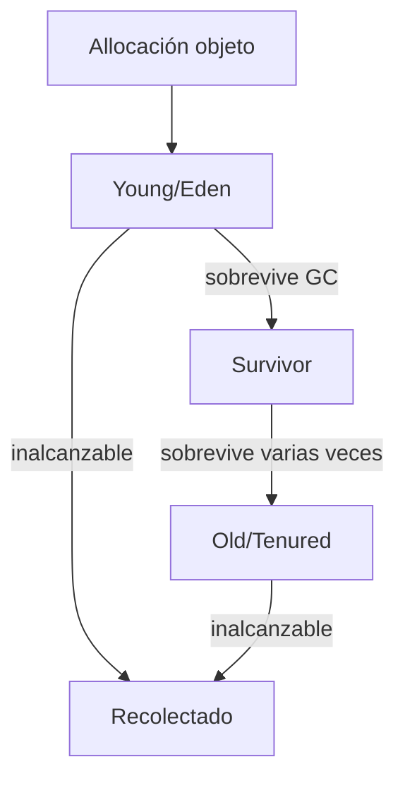
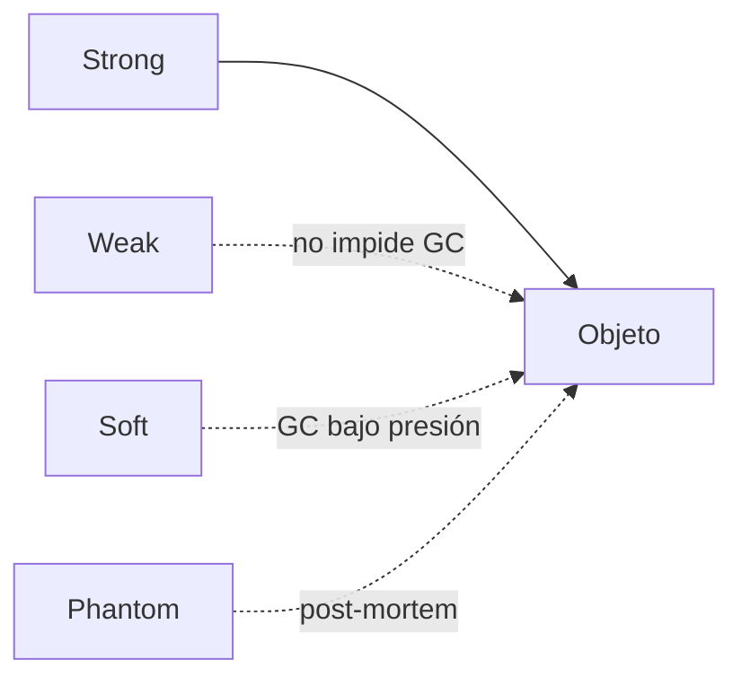
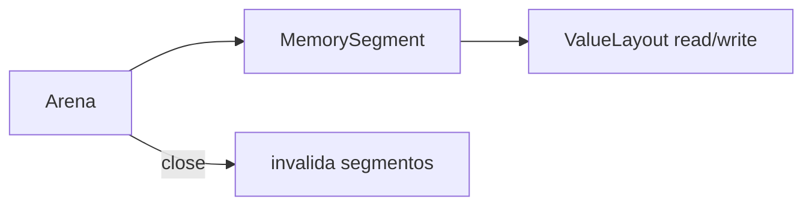

# Módulo 11: JVM avanzada

Escribir Java correcto no basta cuando el sistema sufre GC pauses, leaks, arranque lento o uso nativo de memoria. Este módulo abre la caja negra de la JVM: memoria, GC, JIT, JFR, referencias, heap dumps y FFM. El objetivo es diagnóstico y criterio operativo, no magia.

**Contexto Tienda Aurora.** Este módulo aporta bases para Tienda Aurora: los conceptos aquí se aplican en el monolito modular y luego en los microservicios.

**Entorno de referencia verificado (2026-05-22):** JDK 27.0.1.0.2. Herramientas JDK: `java`, `jcmd`, `jfr`, `jmap`, `jstat` (disponibles según instalación).

## Aprende construyendo

### Tema 1: Generaciones de memoria y recolectores · Avanzado · 45 min

**Caso guía.** un servicio con muchas asignaciones cortas sufre pausas. Debes entender heap, generaciones y logs de GC antes de tunear.

Heap, generaciones y GC

**Definición.** El heap es la memoria donde la JVM asigna objetos. Muchos GCs usan hipótesis generacional: la mayoría de objetos muere joven. El GC reclama objetos inalcanzables.

**Cómo funciona por dentro.** Asignación rápida (TLAB/bump pointer). Objetos jóvenes viven en young generation; sobreviven a minor GCs y pueden promoverse a old. GC roots (stacks, static, JNI, etc.) determinan alcanzabilidad.



**Ejemplo mínimo enfocado (ejecutable).**

```bash
mkdir -p java-m11-gc
cd java-m11-gc
```

Crea el archivo `DemoGc.java`:

```java
public class DemoGc {
  public static void main(String[] args) {
    for (int i = 0; i < 100_000; i++) {
      byte[] b = new byte[1024];
      if (i % 50_000 == 0) System.out.println(i);
    }
    System.out.println("done");
  }
}
```

```bash
javac DemoGc.java
java -Xms32m -Xmx32m -Xlog:gc DemoGc | tail -5
```

**Error común.** “Tunear” GC sin medir. Corrección: observar con `-Xlog:gc*`, métricas, JFR; cambiar una cosa a la vez.

**Verificación (JDK 27, 2026-05-22).** El programa imprime `0`, `50000`, `done`; con `-Xlog:gc` se observan eventos GC (la salida exacta varía por GC/plataforma).

### Tema 2: Java Flight Recorder y JIT compilation · Avanzado · 40 min

**Caso guía.** latencia p95 sube en producción. Necesitas evidencia de CPU, allocations, locks y compilación JIT.

JFR

**Definición.** Java Flight Recorder es un profiler/event recorder de bajo overhead integrado en la JVM, que captura eventos de runtime para análisis.

**Ejemplo mínimo enfocado (ejecutable).**

```bash
mkdir -p java-m11-jfr
cd java-m11-jfr
```

Crea el archivo `DemoJfr.java`:

```java
public class DemoJfr {
  public static void main(String[] args) {
    long s = 0;
    for (int i = 0; i < 1_000_000; i++) s += i;
    System.out.println(s);
  }
}
```

```bash
javac DemoJfr.java
java -XX:StartFlightRecording=filename=app.jfr,dumponexit=true DemoJfr
$(/usr/libexec/java_home -v 27)/bin/jfr summary app.jfr | head
```

**Error común.** Activar profiling pesado en producción sin evaluar overhead. JFR está diseñado para bajo overhead, pero configuración y volumen importan.

**Verificación (JDK 27, 2026-05-22).** `499999500000` y se genera `app.jfr` con resumen de eventos.

JIT

**Definición.** El Just-In-Time compiler compila bytecode caliente a código nativo optimizado en runtime (C1/C2/Graal según JVM).

**Contrato mental.** Warmup importa en benchmarks. Microbenchmarks ingenuos pueden ser invalidados por dead code elimination, constant folding o inlining.

**Ejemplo mínimo.** Usa JMH para benchmarks reales; no uses `System.nanoTime()` en loops ingenuos.

### Tema 3: Referencias especiales y heap dumps · Avanzado · 45 min

**Caso guía.** un caché crece sin límite; sospechas de leak. Necesitas entender referencias y capturar heap dump.

Weak/Soft/Phantom references

**Definición.** `WeakReference` permite referenciar un objeto sin impedir su recolección si solo quedan referencias débiles. `SoftReference` es más resistente (útil para caches sensibles a memoria). `PhantomReference` se usa para post-mortem cleanup con `ReferenceQueue`.



**Ejemplo mínimo enfocado (ejecutable).**

```bash
mkdir -p java-m11-ref
cd java-m11-ref
```

Crea el archivo `DemoWeak.java`:

```java
import java.lang.ref.WeakReference;

public class DemoWeak {
  public static void main(String[] args) {
    WeakReference<Object> ref = new WeakReference<>(new Object());
    System.out.println(ref.get() != null);
    System.gc();
    System.out.println(ref.get() == null || ref.get() != null); // GC no garantizado, pero observable
  }
}
```

```bash
javac DemoWeak.java
java DemoWeak
```

**Error común.** Asumir que `System.gc()` fuerza recolección inmediata. Es una sugerencia. Corrección: no escribir lógica de negocio dependiente de GC exacto.

**Verificación (JDK 27, 2026-05-22).** Primera línea `true`; la segunda depende del GC, por eso el código acepta ambos estados y se documenta la no garantía.

Heap dump

**Definición.** Snapshot del heap para análisis offline (MAT, VisualVM, jcmd). Útil para leaks y objetos retenidos.

**Ejemplo mínimo (ejecutable si `jcmd` disponible).**

```bash
jcmd <pid> GC.heap_dump /tmp/app.hprof
```

**Nota de verificación.** La captura de heap dump requiere proceso en ejecución y permisos; se verifica el comando en entorno local cuando hay PID, no como salida fija.

### Tema 4: Foreign Function & Memory API (Java 22) · Experto · 45 min

**Caso guía.** necesitas memoria off-heap o interoperar con librería nativa sin JNI frágil.

FFM API

**Definición.** FFM permite acceder a memoria fuera del heap y funciones nativas con APIs seguras respecto a lifecycle (`Arena`, `MemorySegment`, `Linker`, `SymbolLookup`).

**Cómo funciona por dentro.** `Arena` controla el lifetime; al cerrar el arena, los segmentos asociados se invalidan. `ValueLayout` define cómo leer/escribir tipos.



**Ejemplo mínimo enfocado (ejecutable).**

```bash
mkdir -p java-m11-ffm
cd java-m11-ffm
```

Crea el archivo `DemoFFM.java`:

```java
import java.lang.foreign.*;

public class DemoFFM {
  public static void main(String[] args) {
    try (Arena arena = Arena.ofConfined()) {
      MemorySegment seg = arena.allocate(ValueLayout.JAVA_INT);
      seg.set(ValueLayout.JAVA_INT, 0, 42);
      System.out.println(seg.get(ValueLayout.JAVA_INT, 0));
    }
  }
}
```

```bash
javac DemoFFM.java
java DemoFFM
```

**Error común.** Usar segmento después de cerrar arena. Síntoma: `IllegalStateException`/acceso inválido. Corrección: respetar lifecycle del arena.

**Verificación (JDK 27, 2026-05-22).** `42`.

## Cierre

La JVM no es una caja negra: GC, JIT, JFR y memoria tienen señales observables. Optimiza con evidencia.

## Checklist

- Puedo leer logs GC básicos y explicar generaciones.
- Sé cuándo usar JFR/heap dump.
- Entiendo Weak/Soft/Phantom y su no determinismo.
- Uso FFM con arenas y lifecycle claro.
