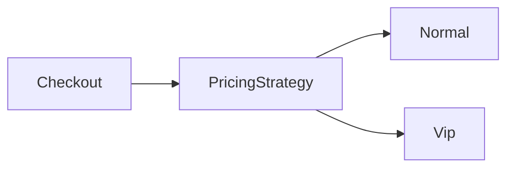
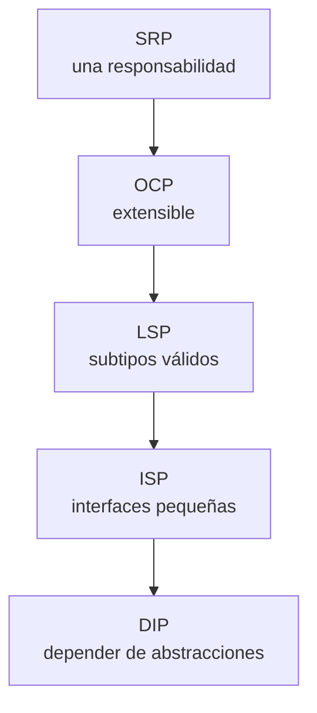
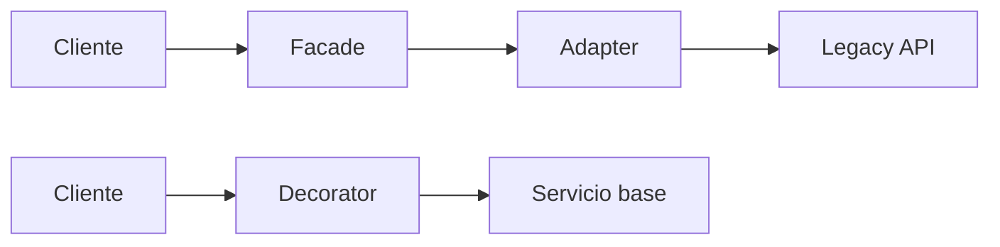

# Módulo 12: Patrones de diseño y SOLID

Los patrones de diseño son soluciones probadas a problemas recurrentes de diseño. No son recetas para copiar ciegamente: aplicados mal, agregan complejidad accidental. SOLID proporciona principios para evaluar si un diseño resiste el cambio. Este módulo cubre patrones creacionales, comportamentales, estructurales y el criterio para no sobre-diseñar.

**Contexto Tienda Aurora.** Este módulo aporta bases para Tienda Aurora: los conceptos aquí se aplican en el monolito modular y luego en los microservicios.

**Entorno de referencia verificado (2026-05-22):** JDK 27.0.1.0.2.

## Aprende construyendo

## Proyecto desde cero: tienda-aurora-java-m12

## Prerrequisitos

```bash
java -version    # JDK 25+
gradle --version # Gradle 9.x
```

## Estructura del proyecto

```text
tienda-aurora-java-m12/
├── build.gradle.kts
├── settings.gradle.kts
└── src/
    └── main/
        └── java/com/aurora/java/
            └── Main.java
```

## build.gradle.kts

```kotlin
plugins {
    java
    application
}

group = "com.aurora"
version = "1.0.0"

java {
    toolchain {
        languageVersion = JavaLanguageVersion.of(25)
    }
}

application {
    mainClass.set("com.aurora.java.Main")
}

repositories {
    mavenCentral()
}
```

## settings.gradle.kts

```kotlin
rootProject.name = "tienda-aurora-java-m12"
```

## Ejecutar

```bash
./gradlew run
# O directamente:
mkdir -p out
javac -d out src/main/java/com/aurora/java/**/*.java
java -cp out com.aurora.java.Main
```

### Tema 1: Builder — configuración paso a paso y validación · Básico · 35 min

**Caso guía.** crear un `Email` con campos obligatorios/opcionales sin telescoping constructors.

Builder

**Definición.** Builder separa la construcción compleja de un objeto de su representación final, permitiendo pasos nombrados y validación antes de construir.

**Cuándo usar / cuándo no.** Úsalo cuando hay muchos parámetros opcionales, invariantes de construcción o legibilidad. No lo uses para objetos simples de 2-3 campos.

**Ejemplo mínimo enfocado (ejecutable).**

```bash
mkdir -p java-m12-builder
cd java-m12-builder
```

Crea el archivo `DemoBuilder.java`:

```java
class Email {
  final String to, subject, body;
  private Email(Builder b) { to=b.to; subject=b.subject; body=b.body; }
  static class Builder {
    String to, subject, body="";
    Builder to(String v){ to=v; return this; }
    Builder subject(String v){ subject=v; return this; }
    Builder body(String v){ body=v; return this; }
    Email build(){
      if (to==null || subject==null) throw new IllegalStateException("to/subject");
      return new Email(this);
    }
  }
}
public class DemoBuilder {
  public static void main(String[] args) {
    Email e = new Email.Builder().to("a@b.com").subject("Hola").body("Msg").build();
    System.out.println(e.to + ":" + e.subject);
  }
}
```

```bash
javac DemoBuilder.java
java DemoBuilder
```

**Error común.** Builder que permite objeto inválido. Corrección: validar en `build()`.

**Verificación (JDK 27, 2026-05-22).** `a@b.com:Hola`.

### Tema 2: Factory Method y Strategy · Intermedio · 40 min

**Caso guía.** crear notificaciones por canal y cambiar algoritmo de precio sin `if/switch` dispersos.

Factory Method

**Definición.** Define una interfaz para crear un objeto, dejando que subclases/implementaciones decidan la instancia concreta.

**Ejemplo mínimo enfocado (ejecutable).**

```bash
mkdir -p java-m12-factory
cd java-m12-factory
```

Crea el archivo `DemoFactory.java`:

```java
interface Notificacion { String enviar(); }
class EmailN implements Notificacion { public String enviar(){ return "email"; } }
class SmsN implements Notificacion { public String enviar(){ return "sms"; } }
class NotificacionFactory {
  static Notificacion crear(String tipo) {
    return switch(tipo) { case "email" -> new EmailN(); case "sms" -> new SmsN(); default -> throw new IllegalArgumentException(tipo); };
  }
}
public class DemoFactory {
  public static void main(String[] args) { System.out.println(NotificacionFactory.crear("sms").enviar()); }
}
```

```bash
javac DemoFactory.java
java DemoFactory
```

**Error común.** Factory gigante con toda la lógica de negocio. Corrección: crear objeto, no decidir reglas complejas del dominio.

**Verificación (JDK 27, 2026-05-22).** `sms`.

Strategy

**Definición.** Encapsula una familia de algoritmos detrás de una interfaz intercambiable.



**Ejemplo mínimo enfocado (ejecutable).**

```bash
mkdir -p java-m12-strategy
cd java-m12-strategy
```

Crea el archivo `DemoStrategy.java`:

```java
interface Pricing { double total(double base); }
class Normal implements Pricing { public double total(double b){ return b; } }
class Vip implements Pricing { public double total(double b){ return b * 0.9; } }
public class DemoStrategy {
  static double cobrar(double base, Pricing p){ return p.total(base); }
  public static void main(String[] args) {
    System.out.println(cobrar(100, new Normal()));
    System.out.println(cobrar(100, new Vip()));
  }
}
```

```bash
javac DemoStrategy.java
java DemoStrategy
```

**Error común.** Crear estrategia por cada `if` trivial. Corrección: usarlo cuando hay variación real y se espera extensión.

**Verificación (JDK 27, 2026-05-22).** `100.0`, `90.0`.

### Tema 3: Abstract Factory y familias de productos compatibles · Intermedio · 35 min

**Caso guía.** crear una familia UI (botón + input) para tema claro u oscuro sin mezclar productos incompatibles.

Abstract Factory

**Definición.** Provee una interfaz para crear familias de objetos relacionados sin especificar clases concretas.

**Ejemplo mínimo enfocado (ejecutable).**

```bash
mkdir -p java-m12-absf
cd java-m12-absf
```

Crea el archivo `DemoAbsFactory.java`:

```java
interface Button { String render(); }
interface ThemeFactory { Button button(); }
class DarkButton implements Button { public String render(){ return "dark-button"; } }
class LightButton implements Button { public String render(){ return "light-button"; } }
class DarkFactory implements ThemeFactory { public Button button(){ return new DarkButton(); } }
class LightFactory implements ThemeFactory { public Button button(){ return new LightButton(); } }
public class DemoAbsFactory {
  static void paint(ThemeFactory f){ System.out.println(f.button().render()); }
  public static void main(String[] args){ paint(new DarkFactory()); paint(new LightFactory()); }
}
```

```bash
javac DemoAbsFactory.java
java DemoAbsFactory
```

**Error común.** Explosión de clases para variaciones simples. Corrección: aplicar solo cuando hay familias coherentes.

**Verificación (JDK 27, 2026-05-22).** `dark-button`, `light-button`.

### Tema 4: SOLID y cuándo NO aplicar un patrón · Intermedio · 40 min

**Caso guía.** un servicio de facturación crece y empieza a mezclar cálculo, persistencia y envío.

SOLID

**Definición.** SRP: una razón para cambiar. OCP: extender sin modificar núcleo. LSP: subtipos respetan contrato. ISP: interfaces pequeñas. DIP: depender de abstracciones.



**Ejemplo mínimo enfocado (ejecutable, DIP/SRP).**

```bash
mkdir -p java-m12-solid
cd java-m12-solid
```

Crea el archivo `DemoSolid.java`:

```java
interface Repo { void save(String id); }
class MemRepo implements Repo { public void save(String id){ System.out.println("save:" + id); } }
class Service {
  private final Repo repo;
  Service(Repo repo){ this.repo = repo; }
  void crear(String id){ repo.save(id); }
}
public class DemoSolid { public static void main(String[] args){ new Service(new MemRepo()).crear("A1"); } }
```

```bash
javac DemoSolid.java
java DemoSolid
```

**Cuándo NO aplicar un patrón.** Cuando el problema es simple y el patrón agrega indirección sin beneficio real. Regla: primero claridad, luego patrón si el cambio lo justifica.

**Error común.** “Pattern-driven development”: usar patrones para verse sofisticado. Corrección: nombrar el problema antes del patrón.

**Verificación (JDK 27, 2026-05-22).** `save:A1`.

### Tema 5: Prototype: copiar un objeto sin compartir sus datos · Intermedio · 35 min

**Caso guía.** duplicar una plantilla de pedido sin que mutaciones afecten la original.

Prototype / copia defensiva

**Definición.** Prototype crea nuevos objetos copiando una instancia prototipo. La clave es el tipo de copia: superficial o profunda según datos mutables anidados.

**Ejemplo mínimo enfocado (ejecutable).**

```bash
mkdir -p java-m12-proto
cd java-m12-proto
```

Crea el archivo `DemoProto.java`:

```java
import java.util.*;
class Plantilla {
  String nombre;
  List<String> items;
  Plantilla(String n, List<String> i){ nombre=n; items=new ArrayList<>(i); }
  Plantilla copia(){ return new Plantilla(nombre, items); } // copia defensiva de lista
}
public class DemoProto {
  public static void main(String[] args) {
    Plantilla p1 = new Plantilla("base", List.of("A"));
    Plantilla p2 = p1.copia();
    p2.items.add("B");
    System.out.println(p1.items);
    System.out.println(p2.items);
  }
}
```

```bash
javac DemoProto.java
java DemoProto
```

**Error común.** Copia superficial de listas mutables. Síntoma: mutar copia afecta original. Corrección: copiar estructuras mutables anidadas.

**Verificación (JDK 27, 2026-05-22).** `[A]`, `[A, B]`.

### Tema 6: Patrones estructurales para conectar piezas existentes · Intermedio · 40 min

**Caso guía.** adaptar una API legacy, decorar un servicio con logging y simplificar una fachada.

Adapter, Decorator, Facade

**Definición.** Adapter traduce una interfaz a otra esperada. Decorator agrega comportamiento sin modificar la clase base. Facade ofrece una interfaz simple sobre un subsistema complejo.



**Ejemplo mínimo enfocado (ejecutable, Adapter).**

```bash
mkdir -p java-m12-adapter
cd java-m12-adapter
```

Crea el archivo `DemoAdapter.java`:

```java
class Legacy { String oldPay(){ return "OK-legacy"; } }
interface Payment { String pay(); }
class LegacyAdapter implements Payment {
  private final Legacy legacy;
  LegacyAdapter(Legacy l){ legacy=l; }
  public String pay(){ return legacy.oldPay(); }
}
public class DemoAdapter { public static void main(String[] args){ System.out.println(new LegacyAdapter(new Legacy()).pay()); } }
```

```bash
javac DemoAdapter.java
java DemoAdapter
```

**Error común.** Poner lógica de negocio en adapters/decorators sin claridad. Corrección: cada patrón con responsabilidad específica.

**Verificación (JDK 27, 2026-05-22).** `OK-legacy`.

## Cierre

Los patrones son vocabulario de diseño, no fin. Usa SOLID para evaluar cambios y patrones para resolver problemas reales, no para anticipar todos los futuros.

## Checklist

- Sé cuándo Builder/Factory/Strategy/Adapter aportan claridad.
- Entiendo SOLID y sus trade-offs.
- Evito sobre-ingeniería y patrones innecesarios.
